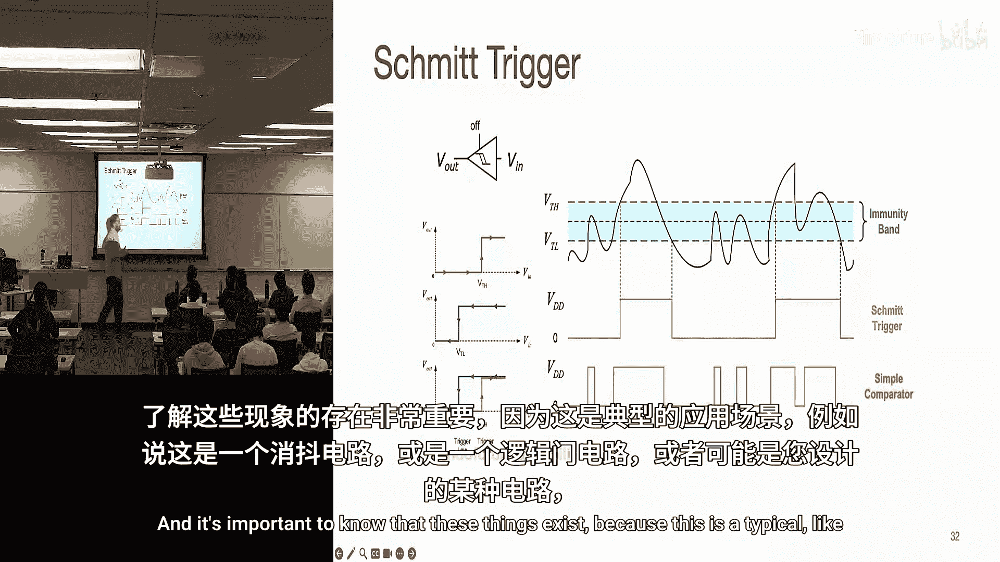
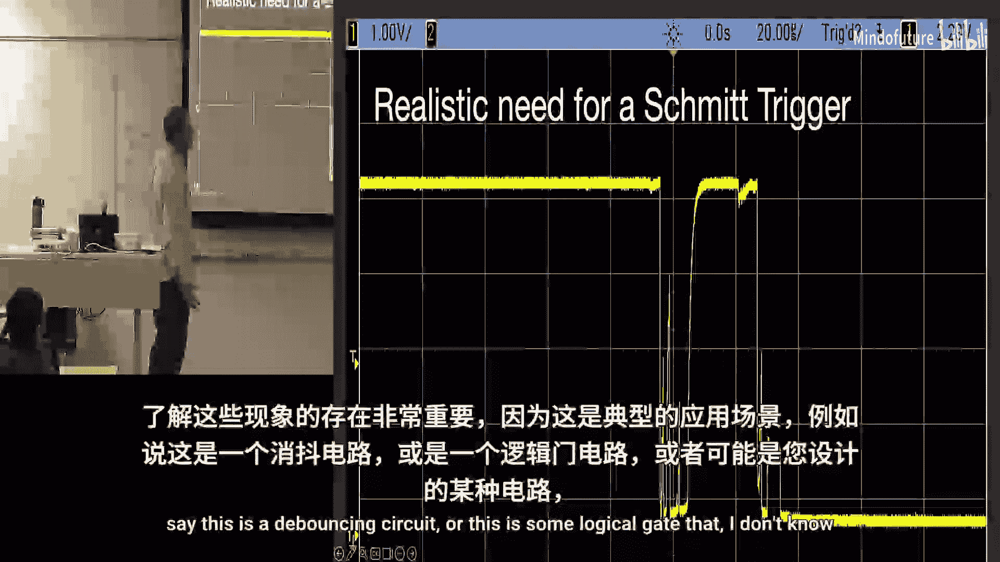
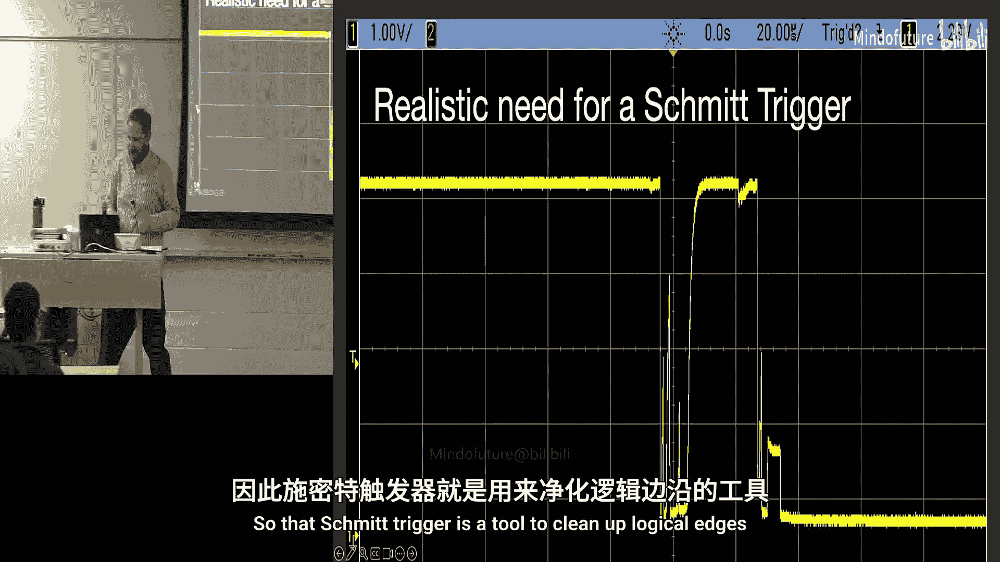
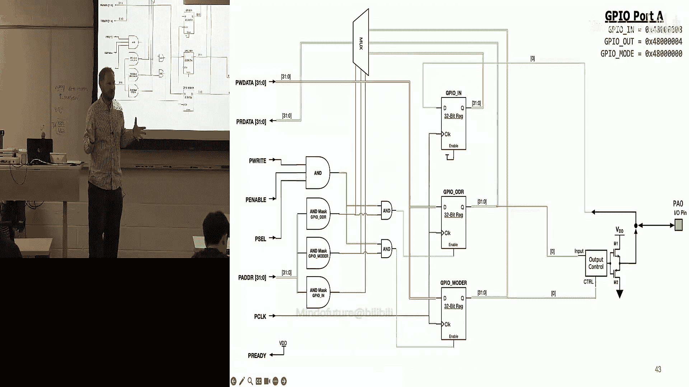

# 嵌入式系统设计导论：课程5：GPIO与内存映射IO

在本节课中，我们将学习如何通过总线结构将数据从处理器核心传输到外设，特别是通用输入输出（GPIO）引脚。我们将深入探讨内存映射I/O的概念，并学习如何设计数字逻辑电路（完成器）来响应处理器的读写请求，从而控制外部设备。

---

## 总线结构回顾

上一节我们介绍了总线结构，它负责在系统中的不同点（如处理器核心和外设）之间传输数据。我们通过一个汇编代码示例，分析了设备地址如何决定总线信号的行为。

现在，我们将从“完成器”（即外设）的角度来思考。你的任务是设计数字逻辑，使得你的外设能够完成处理器发起的任务。

## 设计一个简单的输出完成器

假设我们想控制一个寄存器的最低位来点亮一个LED。这个寄存器是一个32位的D触发器组。

**核心逻辑**：只有当外设被选中（`P_SELECT`为高）、使能（`P_ENABLE`为高）且是写操作（`P_WRITE`为高）时，我们才允许时钟信号将数据总线（`P_WRITE_DATA`）上的数据锁存到寄存器中。

以下是实现此功能的最小化电路逻辑描述：
*   **条件**：`P_SELECT & P_ENABLE & P_WRITE`
*   **动作**：当时钟边沿到来时，将 `P_WRITE_DATA[0]` 的值锁存到目标D触发器中，其输出 `Q[0]` 直接驱动LED。

这样，当处理器执行一条向特定地址存储数据（`str`指令）的汇编代码时，如果数据的最低位是1或0，LED就会相应地点亮或熄灭。

**关于读操作**：我们目前只展示了写操作的例子。读操作逻辑类似，但数据流方向相反，从外设寄存器通过 `P_READ_DATA` 总线传回处理器。

---

## 处理多个寄存器

在实际的外设（如GPIO模块）中，通常有多个寄存器。例如，一个GPIO端口可能有数据输出寄存器、数据输入寄存器和控制方向寄存器。

**如何选择特定寄存器**：我们使用地址总线（`P_ADDR`）的低位部分。通过地址解码逻辑（例如与门和反相器组合），可以为每个寄存器生成独立的片选信号。

例如，假设寄存器A的地址是 `0x1000`，寄存器B的地址是 `0x1004`。我们可以检查地址总线的特定位（如`addr[2]`）来区分它们：
*   当 `addr[2] == 0` 时，选择寄存器A。
*   当 `addr[2] == 1` 时，选择寄存器B。

**电路实现**：`P_SELECT` 信号选中整个外设，而内部的地址解码逻辑进一步确定要访问的是哪个具体寄存器。只有当地址匹配、且 `P_ENABLE` 和 `P_WRITE` 有效时，对应寄存器的时钟使能信号才会生效，将 `P_WRITE_DATA` 上的数据写入。

---

## 设计一个简单的输入完成器

现在，我们考虑一个输入设备，比如一个按钮。目标是将其状态（按下或松开）读入处理器。

**核心逻辑**：按钮的状态连接到一个D触发器的D端。当时钟信号有效时，按钮的当前电平（1或0）被锁存到触发器的Q端。Q端的值被连接到 `P_READ_DATA` 总线的相应位上，供处理器读取。

**关键点**：输入寄存器通常是只读的。处理器通过加载（`ldr`）指令从该寄存器地址读取数据，从而获取按钮状态。

---

## 亚稳态与同步问题

当两个电路系统使用不同时钟，或者信号变化时刻接近时钟采样边沿时，可能会发生**亚稳态**问题。此时，D触发器输出可能在一段时间内处于不确定状态（非0非1），导致系统错误。

**解决方案**：使用两级D触发器进行同步。第一级触发器采样异步输入信号，其输出可能进入亚稳态。第二级触发器对第一级的输出进行再次采样，由于亚稳态在第一级中大概率已经衰减或解决，因此第二级输出稳定的概率极高。对于高可靠性系统（如医疗设备），甚至可能使用三级触发器。

**对“就绪”信号的影响**：如果输入信号需要经过同步链（例如两级触发器），那么数据有效就会延迟一个时钟周期。此时，外设不能立即将 `P_READY` 信号置高，而需要先置低一个周期，等待数据稳定后再置高，通知处理器数据已就绪。这引入了“等待状态”。

---

## 总线传输与等待状态

在标准的总线传输中，一个操作通常包含两个阶段：
1.  **建立阶段**：地址和控制信号有效，但 `P_READY` 为低，表示数据未就绪。
2.  **访问阶段**：`P_READY` 变高，表示数据在数据总线上有效，可以被安全地读取或写入。

**等待状态**：如果外设需要时间来完成操作（例如进行模数转换），它可以在建立阶段之后保持 `P_READY` 为低，插入多个等待周期。直到操作完成，数据准备好后，才将 `P_READY` 拉高，进入访问阶段。处理器会持续采样 `P_READY` 信号并等待。

---

## GPIO内部结构详解

让我们更具体地看看GPIO引脚内部的硬件结构。下图展示了单个GPIO引脚的典型内部电路：

```
          VDD
           |
           +---[保护二极管]---+
           |                 |
GPIO引脚 ---+---[上拉电阻]---+---[施密特触发器]---> 到输入数据寄存器
           |                 |
           +---[下拉电阻]---+
           |                 |
           +---[输出驱动器]---+
           |
          GND
```

**关键组件与功能**：
1.  **输出数据寄存器**：存储你希望引脚输出的值（1或0）。可读可写。
2.  **输入数据寄存器**：存储从引脚采样到的当前值。只读。
3.  **模式寄存器**（2位）：配置引脚模式。
    *   `00`：输入
    *   `01`：输出
    *   `10`：复用功能（如I2C、SPI）
    *   `11`：模拟（用于ADC）
4.  **输出类型寄存器**：
    *   **推挽输出**：可以主动驱动引脚为高电平（连接VDD）或低电平（连接GND）。这是最常用的模式。
    *   **开漏输出**：只能主动驱动引脚为低电平。高电平时引脚悬空，通常需要外部上拉电阻。用于I2C等总线协议。
5.  **上拉/下拉电阻**：可通过寄存器使能。当引脚配置为输入且外部无驱动时，提供一个默认的确定电平（上拉至VDD或下拉至GND）。
6.  **施密特触发器**：位于输入路径上，对输入信号进行整形。它具有滞回特性，能有效抑制噪声，确保只有足够大幅度的电平变化才会被识别为逻辑转换。
7.  **保护二极管**：防止引脚电压超过VDD或低于GND过多，从而保护内部精密电路。
8.  **输出速度寄存器**：控制引脚电平切换的速度（压摆率）。高速切换适合高频信号但可能引起噪声和振铃；低速切换有助于降低噪声和功耗。

**地址映射**：所有这些控制寄存器、数据寄存器都被分配了特定的内存地址。对处理器核心而言，读写这些寄存器就像读写普通内存位置一样，通过 `str` 和 `ldr` 指令即可操作。这就是**内存映射I/O**的核心思想。

---

## 系统集成：从核心到引脚



让我们将整个知识串联起来，看数据如何从处理器核心流到GPIO引脚：





1.  **处理器执行指令**：例如，`str r0, [r1]`，其中 `r1` 中存放着GPIO输出数据寄存器的内存映射地址。
2.  **总线事务**：处理器核心内的“请求器”发起一个写总线事务。地址和控制信号被放到系统总线上。
3.  **外设选择**：GPIO外设识别到自己的地址（`P_SELECT` 有效）。
4.  **寄存器选择与写入**：GPIO内部的地址解码逻辑根据地址总线的低位，选中输出数据寄存器。在 `P_ENABLE` 和 `P_WRITE` 都有效的条件下，数据总线上的值在时钟边沿被锁存到该寄存器中。
5.  **驱动引脚**：输出数据寄存器中某一位的值（例如 `ODR[0]`），结合模式寄存器（配置为输出）、输出类型寄存器（如推挽）的设置，控制着输出驱动器的MOS管，从而在物理引脚上产生高或低电压。
6.  **外部电路响应**：引脚上的电压变化驱动外部电路，例如点亮LED。

读操作流程类似，但方向相反：引脚状态经施密特触发器整形后，被时钟采样到输入数据寄存器，然后通过 `P_READ_DATA` 总线，在处理器执行 `ldr` 指令时传回核心。

---

## 总结

本节课中，我们一起学习了嵌入式系统设计的核心基础之一：GPIO与内存映射I/O。

我们首先回顾了总线结构，然后从外设（完成器）的角度，学习了如何设计数字逻辑来响应处理器的读写请求，包括处理单个/多个寄存器、输入/输出设备。我们探讨了亚稳态问题及其同步解决方案，以及总线传输中的等待状态概念。

接着，我们深入剖析了GPIO引脚的内部结构，了解了各种寄存器（数据、模式、上拉/下拉、输出类型、速度）的作用，以及施密特触发器、保护二极管等关键电路的功能。



最后，我们通过系统集成的视角，完整追踪了数据从处理器核心指令执行，到总线传输，再到GPIO外设内部处理，最终驱动物理引脚电平变化的整个路径。理解这一完整链条，是进行嵌入式系统硬件编程和调试的基石。