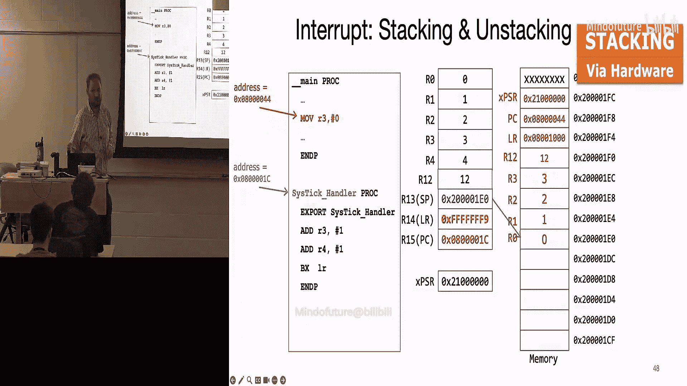
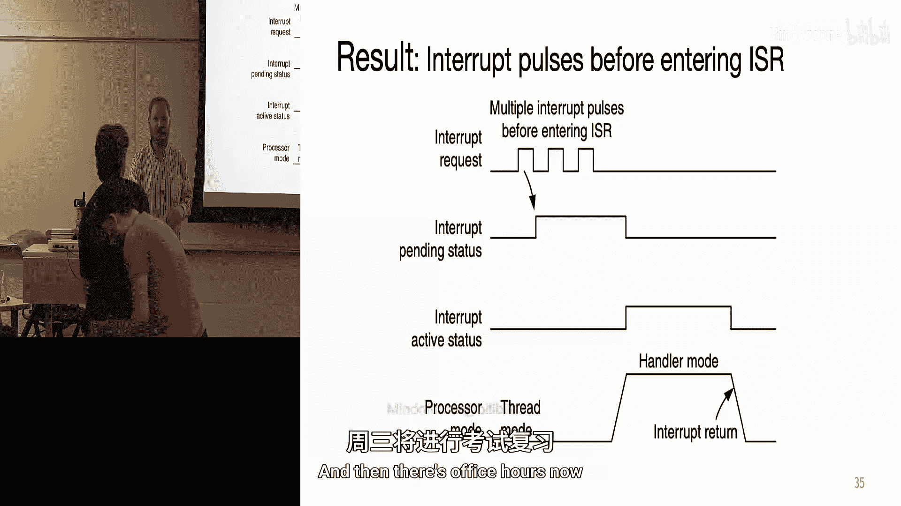

# 【密歇根大学】嵌入式系统设计导论-EECS-373-｜-Introduction-To-Embedded-System-Design-2025-p06-P07_课程6_中断--BV1VTSNBoEem_p6-

K be talking about interruptims？Any it getspardise？So homework free is due tonight。

hour directly after class， BBV 3629。We'll have an exam on Friday。So logistics。

 the practice exams are on the website， we'll have it in class review on Wednesday and then Wednesday before class will probably go over them。

 the data sheet will be released， so you haven't looked at the exams。

Practice exams there's we do weird things here because we're teaching a different subject so we're actually going to give you a data sheet I make it up next to the more spl data sheet that you will need to be able to understand to interpret the design problem we do this rather than giving you all the information on the exam so it used to be we just give you like seven or eight pages you had to read and that would be all the background information that you would need to finish off the design problem but it turns out what we're really testing is how fast can you read and synthesize information。

It's not inherently a great skill for an engineer to have as good if you're a test pilot and you have to figure out why your plane's pilot you know falling apart or something the sky but typically as engineers you have time to think so we didn't want to test that so we're going to give you the data sheet beforehand so you guys should read through it and now you're responsible for understanding the data sheet as well so you'll have two days to ask questions you can ask questions you know it's me specifically or just put them on piazza typically it's like payingy the number in here is wrong or I don't know this diagram doesn't make sense something like that and we'll update it and we'll let everybody know that we've updated it you by Friday morning we'll just freeze the。

Da sheet and this deal with the problems that are in it so that people will have to like constantly keep an eye on piazza。

And then during the exam itself， you can bring a calculator， you don't need a calculator。

Like a four function or a scientific calculator。And then you will give you a copy of the data sheet。

 there's also usually a reference sheet one or two that their posts online to have like all the instructions like what does an ad do。

 what does an or do that those will be given to you so you just come with pencils。

 papers and a four function calculator what questions you have about the exam。Yeah， so just like one。

Yeah don't bring a graph calculator because you don't need a calculator， I promise you。

You can have one if you want one， but you know， like most taxpayer have probably have an harmfulps processor in them。

you run arbitrary code on them or something horrible't do that。佢个先生。Nope， just bring a pencil。

 that's all you need。We'll provide you with the data sheet， the reference sheets。

 and any scrap paper you need。What other questions you have。7。行份证。Nosh，All right。一个意思。

So's see you the VDB so biister on the floor that what I' trying to show you。

 I forgot what I' was going to tell you here， but this week we say we need to start lab4 we don't have to have to finish it next week so that you don't have to overly stress out about cramming and getting all these things done。

 I suggest you to start。Start it unless your schedule is really busy。

 I'll give you some breathinger room but you can do either one you want you can start it this week or start it next week it's up to you you can look at the grade scope for actual deadlines for your lab stuff proceed。

With that will do other， not like other things。this exam。

 we're going to start doing team formation stuff and there'll be a team formation event that's mandatory。

 but we'll have some assignments in here， they're small assignments to get you start thinking about projects and you'll have a team registration event or a deadline where you have to register your team and then project proposals。

ま。Yeah， then down here there's a final exam， a midterm。

 and then eventually essentially by time you go on Thanksgiving break。

 you should have started your project， the project idea have started it and everything's in order。

 order a bunch of parts for you and then when you get back from Thanksgiving break is basically project time all the time。

win度了。Hing down class will have no new。me， although you guys will be given me。

G presentations any questions about。Out of the class is going to be。All right。

about components of the day so servos servos are pretty cool they become like a fundamental device basically gives a DC motor with some gears and it's got a potential ya there in there and then a little microcontroller and what it allows you to do is to control the angle of a motor。

And you there's a couple different types ones that goes from zero to 90 or 90 to plus 90 negative 90 and some that will rotate all the way around depends how which type you get。

 but the cool thing is that we're going to。Control these things with time with timing not so you could think Ill put a digital signal in there that would be a different type of thing it's not how servos work you could say maybe I'll put an analog voltage in there。

 but digital systems are really hard doing analog right but the only thing that digital does well is time so now by controlling when these pulses are wider the width of the pulse and more the thing will turn there's a minimum usually minimum pulse and a maximum pulse and there's a duration so now you get to control these servos with time。

that lets you build things like this， so here have an IMU in here and then little model airplane is just mimicking the rotation that the hands do。

So today we'll do a quick review of memory Ma Ao， then we're going to start talking about interrupts and polling and if we get time I don't know if we will。

 but we'll get to the N vector interrupt controller， which is the module on your device。

That actually controls the interrupts。Yeah。So start here， so we'll review we have。And processor core。

The requestquester is kind of built into the processor。

 but we did make a differentiation between them a little bit and there's some sort of state machine here that's going to control the bus logic。

And so if you want us do a store right， we had this example， in a store。

 we want this completer or this GPI peripheral out here to be able to get these messages and so in between you have to have a bus and so we talked a lot about these busing signals and the idea is what there's many of these maybe as 64 or more of these completers and this reduces by having a bus structure reduced number of wires between the core and the peripherals or the completers。

you could share bus lines， but you still look get to have data transferring back and forth。

And then inside these circles where there's actual little hardware that doesn and does a task。

 and they we' werere just showing here that these registers here are actual physical deep flip flos inside this thing。

The question for you is。You as programmers。Even unless you go off to you programmers generally don't see much about the bus。

 in fact it's kind of hard to see unless you go off to。AnxP or Cyppress or somewhere。

We're actually designing some of these， which is kind of a common job。

 a lot of people end up doing that， even invented systems。

 you think less silicon design really is just writing RTL to define how these things work。

You do not see the bus structure， so how can you as programmers。

 get a better understanding of what's inside the peripheral？How is that manifest to you as program。

 why you take 30 seconds talk to each other， come up with the answer of how do you figure out what's physically inside of this thing。

 what's the thing that you're given？はパじ。是嗯，把。ですよね。かり。

Is it like the memory I heard the answer from a bunch of people the correct answer is the data sheet so the data sheet is the manifestation that is the contract between the hardware people in the software focusing our system sheets these sorts of features so if you go walk through this。

 you get to see like okay here's the GPO register this is from your SCM 32 they only show you the offset registers because in your data sheet it's the device specific one that hold the actual so this is the family data sheet or the reference manual I they call it and then the address offset says whatever the data sheet that the device specific data sheet says is。

The address we're going to do this plus this offset。

 but anyways here we see that there's they define this structure here so it's a register from 31 to zero and it has the structure so now we know there's a 32 bit G T flip flop。

Somewhere in that peripheral and what else is it tell us well it says that these are read and write so if it's free and write。

 that means I can send data from the through the bus into it and I can get data out so that means P write data and P read data are those bus connections are made。

And we go over here to the GPO， well here it's saying， well， if not。

 it don't actually have the upper 16 here， it only have 16 GPO and that kind of makes sense because these are two bits for each and okay。

 there's only really 16 GPOs that you can control with your mode select。

So here these are readrite and they's 16 of them， so now these are giving you the clues of what's inside your yeah。

 what do the reset values mean mean if you write that value， it'll reset？On power on reset。

 when your device resets itself， like so you plug it in for the first time。

 this is the value that it' will be reset to。Now this is a problem， if you look here。

 port A does not reset to all FffF。😡，So sometimes you're booting up your device and you're like。

 why is my LED turn on？whyhy is it flash for a second or why does this motor start turning for a second well。

 it might have some weird reset value where you just weren't。You know。

It's not that you shouldn't pay attention， but it's like you weren't aware that it was going to be in some particular mode and that is less of a case。

 but early on it was a bigger issue with microcontrollers。诶Yeah。

So then if you go back to this problem that we did the other day you could go and modify this for your specific STM 32。

 and now you know that motor was going to be 32 per register。

 but the GPO in and GPAO out registers are only 16 bits and again there're supposed to be 16 of these particular pieces of the hardware。

To represent each one of the possible GPOI GPO pins that are there。

Does that make sense how your bus is， how your core， your bus。

 your computers and your data sheets all kind of linked together？Not one question。Ire always like。

 yes， this is perfect if you were to rerite to the。You unde to find O typeer。

Would the behavior be like undefined or would they just do nothing here。

 I'm going to guess that they don't exist。There's just not hardware。So if you write to it。

Here that means that if this was 16 bits， it would just be bracket zero， colon。

 15 and these wires literally aren't connected to anything。Y， so we're saying that the registers。

 they just cannot be 32， but they have to be 6。I am saying if you're following this data sheet。

 like for those specific one。 I mean， I guess they could have pulled period to this。

There this thing is not a contract， this thing is just telling you what the hardware will do。

 so it's not a statement about there can only be this many bits and saying that if you try to read out of here well it doesn't have read right capability so they're not guaranteeing that you can read and write out of it just only saying that in the lower 160 bits you can read and write out of。

So it's not like。We have found ships that have undocumented features。

RightThey exists right and so you're just， you know one of my students made a little program but we'll just go do and just go to every member address and see if you can write something in and write if you can pull it out sometimes they exist there was a weird communication chip that allowed us to get to a special mode it was a test mode。

They're not advertising it to us because this is again， this is not a contract。

 just what they're exposing to you， but they exist。This is rare though， it's not like there's again。

 there's not going to be。You know， four gigabytes worth of memory here。

 they just don't they for size reason， they just don't want to put it in。All right。

 other questions about this， how all these three things come together？Or four things。s pretty。O。Yeah。

So just a quick question， so for the GgaO peripherals of the actual pin values when you're writing out。

Is it correct to infer that the def flip fls for the upper 16 beds probably just don't exist。

 I then we have them go to the world ones， Yeah okay， practice doesn't exist？

It would be wasteful to have them exist。And they're usually trying to minimize space as much as possible。

Any other questions？Okay。All right， so now we're going to move on to interrupts。So interrupts。

So interrupts are a way essentially to deal with asynchronous events so everything else in your program so far has been procedural and you want something external to occur。

 somebody presses a button well how do you know how is your device aware that that should happen so we've developed these asynchronous ways to deal with it there's generally two methods of doing this so first would be you could do polling which is the naive way of doing it where you repeatedly use an app or process or peripheral something to look for an action and the alternative is an interrupt where you have some external mechanism to interrupt the process of the core。

So polling essentially is like trying to have a text conversation but your notifications are turned off the only way you know if they're texted you back is if you kind of look at your phone right so every time you want to see if somebody's done something you look at it that can be inefficient as you could imagine in the base case in a very simple program it probably doesn't matter that much so here we're just waiting to see if a button is pressed and if it is you go set the value of an LED that's pretty simple so the software is continuously looping and it only takes you three cycles to figure out on average if the buttons pressed so that's not too bad。

However， your program's not doing anything useful we would say that utilization is zero if there were some other tasks you were supposed to do。

 so you're just wasting a lot of CPUU cycles， IU power to get this task done so you can imagine if we did some other thing in here we do some amount of work and it costs 100 cycles well that's not so bad know you got 100 cycles of work。

Then you were spending three cycles checking for polling， so your CPU utilization is like 97%。

 let's say， okay， that's pretty good。But that's not how programs typically work。

If you go do lots of things， maybe you put things in here that have a lot of cycles like hundreds or tens of thousands of cycles。

 well now you're going to see that your systems are becoming less responsive to external events。

 so polling is just not a practical method of actually dealing with things sure for the simple naive case。

 check a button pressed yes， but in the reality systems are getting so complex these days that this is not possible to do so we can do better。

So the alternative is an interrupt， you know， this is a program or event that breaks the flow of execution。

So there's a couple different types so we have let's see we have interrupt service yeah so so we have interrupt service routines as' what we call them and basically they're a glorify procedural call is just a bit of code that does a task and what's interesting is how that code gets called and what the main processor does while that code's being called so basically the whole goal is that you're running through your main program this。

Event occurs， you go and do an interrupt subrine， your service routine。

 and the program should not be changed in any， it shouldnt be modified。

 it should just be a missing gap of time while this other thing happened。

 and then you go back to your code， so there's a whole lot of engineering that goes involved to ensure that this is a transparent event。

So the types of interrupts that you have， there's basically two types。

 there's what we call system faults。I nine as we call them internal interrupts and so those are like table misses or bus faults or divide by zero zero or something like that。

 these are generally developed by arm as part of the base functionality of your device。

Then we have things called external interrupts， or these are usually how we're interacting with the external world。

 so power failure， a button push， I squared C， system timers， and ADCs being ready。

And we call these interrupts， sometimes we call them external interrupts。

 but really what we mean is that they're external to the core， not external to the chip。

The device that's doing the interrupting is on device。

 it just may be monitoring the GPO and that's connected to the external world。

So quick review or quick overview， so an interrupt is something like hardware sometimes firmmer but generally hardware generates an interrupt signal。

 the core has to determine which interrupt has fired and what code should be executed。

 what's the correct response for that， then halts main and runs an interrupt service routine and then returns the processor sir to the original state。

Yeah， does it usually define the Internet service routine？

You spend a lot of time running interrupt service streams。

 I've written entire processing or code for microcontroller almost happens all in interrupt service routine。

 it's kind of a weird way to write code， usually you want your interrupt service routine to be as short as possible。

 but for every reason that's how I decided architect at one time。So let's go fast。

 we'll figure out all the details later， so the question for you is how do we get。

 so say you have a GPO or an ADC that's completed or something external here。

I tries to interrupt code flow here， what is the architectural choice that we should do to tell the core what to do。

 how to change its function， so why don't you take 30 seconds of their neighbor and try to figure out what you'll change about this diagram to make this function happen。

嗯。It's probably just like brighter right wire from。Yeah。I might need to like。Canner up controller。I。

And then。前。I don't believe you've met。こします。I outAll right， what do you think。

 how are we going to get the core aware of external events？是你认。Yeah。Could you connect like a wire？

I'm not sure which one for the team ready signal to straight to the controller。

That's an interesting idea and you' definitely built on the stuff that you already know so you could have so what you said is so like here you're going to take P ready and connect it here basically right that's not so bad Any other slight modifications anybody would want to suggest？

New State， generally kind of。Or like facts sort on old state， doing， whatever。Okay。

 why not just use the bus completely， why not just send messages back？Yeah， send a message back。

 you need to be like reading。You need to be reading yes。

 so there's no way for a peripheral to initiate a communication right it always has to be the core or we could say the APB8 advanced high performance bus this bridge here creating the request and so that's essentially just polling so it has to be yep。

You got to be so loud though you have a register that has one line from each of the peripherals and when you want to send it interrupt you right you set a bit in that register yeah then the processor can say okay has the state of this register changed if so handle the interrupt you got it so the only reason I kind of the guy who answered over here is this not we're not going to use a P ready signal right because that's already has a task and we're not going to overload that task but certainly we could modify these peripherals to have a Dfl flop or something that will send a signal over and then we're just going to route these signals to the NVC so the interrupt vector controller or the nest de interrupt controller and there's not just one wire there's like up to 256 wires that go head back yeah it also the same thing for APB or's not。

For the APB like any of the AP for all of them yeah anything that needs to interrupt and it could be you know remember there's some system interrupts that are about the bus so anything that needs to interrupt is a wire that comes back and now there's a lot of wires that are put in here so here's a diagram for when the R manuals so here we have all our peripherals we just rearchect and now I have Iq so interrupt interrupt register requests I don't forget what stands for but requests oht know interrupt requests there you go so those are all coming in here and there's this end line it's not too many the more you have the more complicated your that vector interrupt controller is but you do have a bunch of them so up to 256 I believe for this processing。

Okay。And so how does this work？So you got some main program。

 we're going to have this thing called the vector table which tells us where the interrupt where the code is for the interrupt service routine then we have the actual service routine so here we're going through code。

 some interrupt occurs then some magic method goes and says okay we're here we're at this location and memory holds so we have a method for choosing this location we'll talk about that in a minute but this holds the address so this is just memory。

 this is an address for memory， this holds basically a pointer to interrupt service routine then we're going to go and execute that thing whatever it's to do usually is something like。

Maybe your ADC goes off and then you go and take that data and stick it， take it out of that。

 stick in the memory and then put a flag in your main loop。

 so next time you go through your main you're like， aha。

 I have to service that data could be something you do。

And then the goal is to come back after exit the interrupt service routine in a way such that you can go back through Maine without ever changing the functions in Maine。

 you don't want Maine to start doing weird things because you've corrupted。

 say the lowest R0 through R3 if you change those things around now you're in trouble because Maine is going to do some other task。

We're going to have some errors。So let's go first through the vector table。

 so the vector table is usually the lowest location in code。So we can blow that up。

 so here we're going to have the vector table is going to go right at the bottom starting at。

The initial main stack pointer， I guess has technically not considered part of the vector table。

 although it's always included in the vector table， the next bit up is the actual vector table。

Our next address up is the vector table you will see for your devices that flash is actually in a different location。

 so flash is up here when you burn code to flash， what happens on Bu up is they take that code and they transfer it from flash in the SRAM so it's faster to get so that's why in lab you may see that your actual place where you're executing your vector table may be different is depending on how you've programmed your device but essentially it's just a direct translation from one to the other。

But anyways， let's just start at the lowest register value or memory value holds a main stack pointer and then your vector table。

So here's an example of what that looks like。So here we have your stack pointer。

 then you have 16 interrupts or they don't have 16 but they have up to 16 interrupts here and these are the system interrupts and then these are everything above and here we're just showing this is the a this is the memory location and this is the pointer to that particular interrupt。

So what I say？40 holds a PC this is the initialization point of the program counter so basically you boot up。

 you figure out where the stack is going to be then you go and say okay here is the first piece of code that you should do that first piece of code should be initialization code that boots the thing up some of that code is essentially given to you by arm。

 some of it is you're going to write maybe there's some initialization tables。

 those sorts of things that stuff is all built into your IDE and so this very first thing is a interrupt itself which is your void reset handler so on power and reset that chip has to do some task so the very first thing it does is not your code that you've executed but basically your interrupt routine。

Orrisa handler， what questions do we have so far？No。

So when the interrupts happening where it goes to Web。Does predetermined or determined exception。

And they're going to where block a code hand in that extension。That like a。

The ranch from that point like Ma's doing something， something happened that sort of。Yeah。

 we'll talk about the mechanism for that in a little bit。So the ISR it's in the flash。

 so this sort of stuff， it just always happens a gone startup， doesn't I understand that correctly？

So the interrupt reset handler definitely happens in that startup， that is what startup is。

And then you then after you're done with that you'll go to Maine okay and then in Maine something will happen。

 so say I don't know you get an external interrupt on channel zero or something。

 then that interrupts Maine and you go and do that task and they'll return you back to Maine afterwards does that answer your question。

Well what's the difference between the first half and second Oh a very good question， fantastic。

So it is broken into two sections， so the first half here is。They system exceptions。

 so these are things that arm has defined that these interrupts must exist。

 these interrupts must exist just for the functioning of the chip and so some of them are like a bus fault memory fault some sort of hard fault nonmable interrupts and reset and then there's even a timer that we'll talk about later this required for arm to have on their device so all this is defined by arm everything up here is defined by the manufacturer so SGM and XP those folks who are making the peripheralfields who are making the things that are outside of the core they get to have their own interrupts and then they've defined these as negative numbers because arm says well ours are so important the chip won't function without ours we're going to give them negative numbers so here's the priority these are the lowest priority。

Meaning the most important， and then those go up of lower significance in interrupt priority。

 and we'll talk about the idea of priority of some interrupt being able to interrupt other interrupts later。

Did I answer your question No， I was asking is the processor like。

I can make us be all instruction to do this so I guess see is like the processor does not hardware takes control。

And so we'll talk about that mechanism in a little bit。

 but the processor is generally unaware that an interrupt has occurred。It this harder the like。

What's a be all instruction in the？We'll talk about that so I'll give you the hint。

 it just takes control but there's no BL instruction branch to interrupt service routine that actually occurs the hardware just forces that change and we'll talk about that mechanism in a little bit。

Okay， so to keep track of things， we got a program status register。

 we talked a little bit about this before， we talked about the first five bits here were your NVIC bits。

 or sorry， your ALU bits， so those were negative overflow carry， that sort of stuff。嗯。

Those those are the application process status register。

 but all together these 32 bits hold other information。

 so we have IT blocks doesn't really come into this class but if you want to make case statements basically those are a way because that happens so often that they have special register is just for that let's see they have greater than your equal2 flags so here for the cortex M4 which you have or M7 they have extra AU flags but the thing we want to talk about here is the exception number so here is a eight bit number that tells what exception is going on or what interrupt is going on right now they're trying to keep track of where you're supposed to be the core is keeping track of what's happening if you're in an exception or not。

And then。To make it complicated， this exception number has an offset of 16 because they're keeping track of that 16 bits from arm。

 so if we go back over here。Oops。Arm here has said， okay， everything from here up is starts at zero。

 but then you have this offset so you have to do a little math to always keep track of wet memory。

 what's the memory location of things， so it's just the memory location is off by 16 you can walk through the math to deal with that。

 but that always trips students up on the labs。All right。So let's walk through an example here。

 so imagine I am a GPO pin， I've set this up to take an interrupt， I get an interrupt signal。

 right so rising edge， let's say。That causes a signal to go high， literally a wire。

 one of many wires to be raised， okay， let's is say is IRQ9。

 that goes to the nested vector interrupt controller。It needs to go through and say oh。

 well what memory location holds the address to the service routine well how do we figure that out。

 we're going to do a little bit of math， take off the 16， we're going to add up9 plus four here。

 whatever this is， and then we're going to look at that memory location in the vector or Inter vector table。

Then it's going to go and retrieve the address from memory。

 then change the state of the processor to go and execute that instruction。

So the NVC sets the program counter to the value in here。

 whatever PC equals the particular value there， and then the core starts executing that。

So the question for you is。Oh， wait。So we just learned that interrupts are just a fancy function call that's initiated by hardware。

 so we put some example， we know that ISR must be ABI compliant。Okay。

So what other state information are we going to need other than saying， okay， R0 through R3。

 what is the other information that an interrupt must preserve in order for the core to get back to its original place and program why don't take a minute or so。

 talk amongst yourelves？You might also want to save the。す。ペジ。お願いします。あますます。しけなていい。然。

It looks like there's a bunch of students trying to get access to the lab material。我せ。

Can you give them？Can you give them all access All right。

 what do we think what else needs to be preserved here Sta point area yeah？

Like linknk register where we were before so we can jump up。うはい。they use the transfers for。Seator 11。

So there could be other registers， will'll just say that this ISR is going to be ABI complianceli。

 so we're going to say is responsible for the upper registers just like a normal ABI compliant function。

 but there are other things we have to keep track of so we said the stack point or the link register。

 what else？Yeah， it's basically like a function whatever。

But colgue doesn't have to keep track of like the program counter， for instance。

Right there's a bunch of other stuff that has to be kept track of so let's walk through that for a second so here this is time。

 so here we're in mainine or basically a user program。

Some interrupt signal occurs and then there's this function called stacking so this is an automatic function that hardware does you as a programmer do not have to literally do this thing and what it does it's going to say is going to push values up to the stack so it's going to take the program status register remember all those values that we talked about with the greater than or equal to all the ALU outputs all that whole thing goes up here because you don't want when you come back for code that to be missing the program counted a link register R 12 because the innerproced rule blah。

 blah， blah register basically used when you have an OS on this thing and then the bottom for registers so that all gets pushed up to the stack。

Then your interrupt handler executes。Does whatever it's supposed to do。

 it ends and then there's this unstacking procedure again done by hardware where all those values are going to be placed back on。

In the core。And then from the cho's point of view， everything's exactly the same。

 it just has this missing moment of time， some cycles went by。

 so sometimes when you're trying to time things very precisely interrupts and you're trying to do it in Maine for some reason and you're trying to do it without a timer then that would be hard you might could have this missing period of time yeah this is like related to stacking but to the last thing we just when we say AI complianceant。

 is that the stack like accounting to the stack point of fall within AI compliance or is that its own thing。

So I have a question that asks you like where it says like like for example。

 you asked the last question right and we know it must be AI compliant and then we ask like what else do we need to keep track of do we explicitly say StaAC winner or is that a part of being AI compliant？

Oh， I see。We're going to talk more about I may have this spoken but we're going to talk more about the S pointer it's got some subtleties with that information you would need to know where the stack pointer is the S pointer here has been updated so is value is true it's just that is pointing down here so when you unstack。

When you do this process， the S pointer goes back up。

 so I guess inherently that value is being saved， it's not something that the hardware is explicitly putting on the stack。

So those are called， yeah， so this is all a hardware process again and to make the distinction between hardware and software in the sense that you don't have to program anything。

 there's a state machine that's doing this task。There's special registers， they come up。

 they don't actually come up that often in class， but sometimes you're going through lab you'll see them so you have the mains stack pointer and the process stack pointer。

 essentially these are for the mains stackack pointers typically use when you run an OS so what OS are you running on this thing。

 there's special OS is called like say tinyni OS and I forgot the other one that everybody uses。

I don't know， there's a bunch of OSs that can run and really they're just they're not memory management sort of things。

 they're really task schedulers， they're kind of glorified task schedulers。

 they're really useful and now these things are getting so complicated that like NRF 52 which is this Bluetooth chip as Collin used。

 you almost always have to use the real-time operating system just because the manufacturers have given you through the your API given so many functionality that it is hard to use it and not it's hard to write a program without it。

In any case， it's just good to know that there are shadow registers。

 but for the purpose of this class， we're just going to assume there always the mainst act register。

There's some more information if you want。It's not again， that important for this class。

What you will see here is that if you go and look at your code。

 you'll see here the main S pointer and this thing are going to be combined when you're in interrupt interruptrupt and your link register is all going to be this weird value。

This isn't the link register back to your PC， you would think that if you're going to branch off to something and do something you need to keep track of your program counter and youd usually put it in the link register。

 that would be a great place for it because then you're gonna to branch back to that and I'll take you back home。

 but this is a special place in this look is very high upend code and this basically tells the hardware。

 when I' go try to execute this， when I'm done with my interrupt。

 it basically says if this is the link register now do the unstacking procedure as a hint to hardware to do this task。

Okay and then the link register is up on the stack anyway。

 so the original link register will be brought down placed and replaced this after the unstacking event。

嗯嗯。嗯。Yeah， basically said that。You will see there's a couple different modes， it might not be FFF。

 it might be E， it might be something else， but these are essentially what we're going to be doing for。

Our lab， most of what you're going to see is FFF9。All right。

 any questions before we go through an example？有。When you say that the hardware is responsible for doing the stacking and unstacked。

 is there actual circuitry that like stores， registers onto wherever the stack is。

 or does it just branch to that place and memory that has like hard coded instructions that do all of the stores？

I think there's let me try and answer that question。Few pieces of that question。

 so literally there's hardware that's going to initiate the process of storing stuff on the stack iss going to use the equivalent。

Of a pop okay， or a push， sorry， so we're going to push a bunch of stuff up here and then it's going to pop it back。

What was the rest of your question？So I guess during unstacking。

 you said that the link register has that special value that。

An address to some like hard coded instructions and like rock somewhere that basically does you could say that yeah yeah it's it's it's the point that says basically now go do pop。

 whether that is hard coded instructions or itself a service routine we don't really know。

 but it's basically that is just the path back to doing the task of unstacking。All right。

 let's go through an example here。We have some main code， we have a system tick timer or handler。

 so this is an interrupt service routine， we have our registers， we have a program SAS register。

 and then we have our stack here。Okay so we're just running along in code you know normal things are happening then oh we got a cyst tick interrupt and it says to go do so then the NVIC figures out that this wire that goes high represents tells the PC to change to this value okay so now we're going to go forward program counter oh we're going to do stacking here so here we're going to go take all the values here and basically transport them over。

 we've saved the program status register， the PC， the link register and the stack pointer has deprecated down to this address okay。

We can see the link register has changed to this Fff9。

 which is the denotes the ISR path back to Maine。And the PC is going to do some tasks here。

 we didn't actually show that part of memory， but the program counter is going to go and execute these codes。

And if you need to T X using R3 is using R4， you shouldn't use R3R4。I remember this all right。

 let is go forward， then it links back it links back to branch register， link register。

 so the XLRs and it goes back to here， well this is that special command。

N command goes back and now because we did that special instruction。

 it goes and pushes or pops everything back。And then the stack pointer has gone back to its original value because it's unstack stuff。

 so you wouldn't want to leave stuff onto stack and your interrupt service routine is going to unstack an inaccurate way。

 doesn't the interrupt doesn't keep track of everything that you've put up on the stack。

 so let's say come back。So if you went and add to things here。

 say you push things because you should have done that with r3 r4。

 you push things up here and then you forgot to pop them back then you're。

SAC pointers off and then when it does when it goes back to this link register then to have it's going to be off by two for everything so that would be an error state case since using R4't you want to that yes you would'm going to that's I forgot what my own slide said happens to Pro sometimestime so there's an error condition i'll show you in a second but yes you've caught it。

So for unstacking， you're branching to some already love hard code。Yep。

 look before stacking you're not you are as well， but the stacking is it's not that you're branching to it right it's hardware has taken over so when I say branching I think of the core has executing an instruction that causes branching。

 that's not what's happening， hardware is taking over in causing branching to occur。Yeah。あ、乗りぶ。

re pre defined hardware。Or like' trust in our。Sorry like that's a special instruction Yeah I mean it's a special location and so it's a location that could be in program space and it just happens to be in a part of your memory that's required by arm。

So it's call your system， I for it， system memory or something。

 and so it has a specific function that function is to do un stack。PSR。Y。

This is their program status register， this keeps track of what your ALU flags are and what interrupts you're in。

Because if you came back from your thing and you were expecting there to be like a carry flag and then your interrupt erases that flag。

 then your program won't execute properly， so we got to save that information。Yeah。

 so we put it up here， so that's the first thing that's pushed up to the stack。

I that registerYou guys， I'm this close， I can't hear you and that's because that register is a higher value than like the PC why do they chose that order？

I don't know。Yeah， maybe that maybe in some sort of architects。

Brain that this has a higher value than that， yeah。

I'm just kind of confused because when we normally branch。

 we would put the PC in the link registeror and this time it's just not the PC。

The place will return once we're done with the。吧。that' called。

So why would they decide to put that in the link and how is it used？So how is this。

 why are we using this value and how is it used because we're not in so you're right and normally in code execution this would be your return path。

 this would be the point in code after your branch and they would tell you what the next。

Thing would be right but this is a whole different function so we're doing interrupts and so we've going to repurpose the function of the link register in a sense to do this other task and so now we need to tell the program we don't want you to go back to whatever this was whatever this PC was because if you just went back to that PC all the stuffs on the stack and we haven't unstacked it and put it back into the registers so we need a way to tell the hardware that don't just go back to this point。

 take all the values that were the state of my processor， put them back here。

So that my code can keep executing transparently and this is the way we do it。

 we just tell it to go back to this location in memory。

 that location memory probably has some hard coded code that says do this task。Okay。And， yeah。

Just want。so when you unstff， we're basically returning to a previous PC which is currently being stored on the staff by the internal handler and then the way we detect that is by checking the LR if it' equal to that volume。

 then we execute untack。And then we automatically returned by just popping the pieces。

More or less correct， I would say the only modification is that it's not that we're moving。

First you do the unstacking， the unstacking by definition is going to put this PC。

 which is on the stack， where it's going to put it in the PC。

So we're going to directly modify that through the stack of process of basically popping。Okay。问题啊。

Good forward。Reg。You do come here， you do branch， link register。

 now it tries to execute this piece of code， right it goes to this place of memory。

 that place of memory says on stack。It does that whole thing， and then PC gets updated here。

By doing that task。All right， let's see what happened we did some stuff。

 we unstacked the problem was that we were manipulating r4 oh no， we did bad things。

 we should have manipulated r four rR wish changed。

So back to your point you caught that before I did， fantastic。Yeah。

If the start corner is at that 200 point， how come when it's putting in？

initials like push cockros going at one below and not at two Oh， you're saying why wasn't this？Well。

 we don't know what that value is， it doesn't matter， it's just pointing to that value。

 it's unknown value， and then you say we stack。Well work。Maybe I missed your question。系先来。

That's where you start pushing the information not one down。We start pushing。

It like this type quarter was initially。200， yeah。it was at the one I've seen。Yeah， well。

 this is where most the last valid was。And then when you push something。

 you increment and then store。And then so now I' showing you this is where the last validada was here。

And so if you had to， like you should have gone and pushed R4 so you could go push something else and then when increment put R4 here。

 you just have to make sure you pop it when you're done。First。Okay。아。Sorry a little short today。

 well， we'll move on to the next one。Let's see we can recap the things you should have gotten away from this is that polling is bad yeah polling can work in the most basic simple programs it's even maybe even a good way to do it in a simple program。

 but really you want to do interrupts and it interrupts。Our。

The major way that you keep track of tasks and things to do a lot of your program is going to be based on yeah sure there's something in mainine but timers are going off ADCs are finishing the external worlds out there some data is coming in so a lot of the work of a microcontroller these days is done through this interrupt service routine mechanism so the peripherals are all connected to the core through wire so up to 56 now you wouldn't want to have 256 I think this particular STM that you're using has 196 fire member interrupts but you have all those wires coming back each R queue is related to a number and then the NVX job is to look up and figure out what's the memory value of the service routine and that's held in the vector table。

Vor tables is here' the pointer to memory。嗯。And then hardware takes care of unstacking。

 that's not your responsibility。I'll have a couple more slides for the next lecture。

 but is there any final questions of what we've talked about so far yeah in terms of like when you write your own interrupt like does hardware like how does hardware know what to do like if I write my own interrupt how does where to jump to and like do I have to tell it to do that that is the vector table Okay so it's a good question。

So a lot of this， the problem is that your IDE takes care of all these things and is super awesome and you lose all control right。

 but essentially you're going to say， hey， your compiler is going to come through and say I have a interrupt service routine for this watchdog timer and is going to be placed when you do the link the linker and the floor planner is going to say。

 well， that code lives somewhere and it's going to resolve those label such that this memory address here represents where that code is。

Does that answer your question Yeah so you would have to specify that it has to be like address 40 like for that like to be an interrupt like how does it know that it's an interrupt is it because it's like a low address and memory like yeah so these addresses are been predefined so your vector table is a conceptual chunk of memory that has a special function and your NVC knows that this set of memory has a special function So the NVC will come up and say well here's my interrupt IQ went off and now I go when I have an IQ goes off then I'm going to go to this particular memory location and whatever the address here is I'm going to go and execute it。

 So the NVIC is very tied to the structure of this vector table。

And you can't like break the vector table up and move it somewhere else because your NV doesn't know about what you've done。

T the program's status register again？The program status Reg sort is just a kind of a snapshot of what the status of your core is at the moment in the sense that it's going storing your ALU flags。

It's also storing your exception number。Interrupt your in in the moment and some other flags。

 so you need these things for it to keep track of the state of the register。Or state of the coreps。

 sorry。What other questions we have yeah the。Since the interrupt handleandr is done by the hardware。

 you'd have to decide as the architect of the hardware。

Registers you would want to be saved so like if you did say want R3 and like in the interrupt handle how r3 has one added to it。

If you did actually want it to effect between R0 and R3。

 you would have to make that decision before you make the hardware。Yeah。

It's probably not the best diagram to get at what you're asking。

Let'See if I have a better diagram somewhere。Not really。

So it was a design choice to only preserve R0 through R3， it could have done all of it。

 that would also be just a viable option， but maybe I'll ask you what would be the downside of adding all the registers that are in the core to be stacked and unstacked？

And which causes what what's the downside of that more cycles， so increase latency。

So now latency I think is between six and eight cycles to get into interrupt and that gets back to how fast can you respond to things so a lot of there's some programs I've certainly done this for one of my projects where I have edges coming in like that mean data or something and I have to sample one store it and then sample the next one and whether it's higher or low so you can imagine decoding a bitstream so edge goes off on my clock and then I sample the other pin and say okay that's higher or low store it and now my latency of how long it takes to get in out to interrupt defines how fast a waveform I can decode so the tradeoff here was I don't want to do everything as it'll take too long so this is maybe the optimal what I need to get away with。

That's a good question， yes。you go to the example， I'm just like。

 could you reex how you're like where you're getting the address for the link register and the PC to update？

All right。So we're here all right and your question is why is this or how do we get back？Register 14。

 that and why is Reg 15 that。Sorry， last part。Register 14 and 15， where are they coming from？Great。

 so let's see at this point the program counter has branch to like this location here right so part of the inter caused us to change our state so we stacked。

And then。You don't know this because I didn't show that part of memory。

 but this value happens to represent this piece of code here。

 so this is this and R31 is at this memory location， this is inside your handler， okay。

Now we still need to know what the link register is when we're over here。

 that's been pressed up to the stack as well as the old PC， so that's all taken care of for us。

It's just that when we do BxLR branch to our link register， now this gets put into the PC。

Just like it was before， it just happens that when the core runs this instruction。

 the instruction says unstack everything。And when you unstack everything。

Unstacking causes your link register to go back to the old value。

 causes the PC to go back to the old value， in fact， all these things go back to the old values。Yeah。

 I don't know what registers are to be stored during the statute。You don't know which registers。U。

It's true， I did not give you a great diagram， we'll say that for the next lecture。

 but basically it's going to be R0 through R3 so because we're kind of be ABI compliant so we're going to save those the programs the link register and the PC and the program status register those are the ones that are going to be saved up to here and R 12 because it's the interprocedural link register。

 we never use it but that's one that gets stored。Since there's different codes， like I'll add them。

Yeah。I' by that address like 801 c this is the state in which your program is in。

That's where that's defined。So if you're in handler mode like there's this slide over here that shows you it doesn't really come up I'm just giving you this information so that you know you know where this stuff is i'm not just totally making it up but if you're in handler mode versus thread mode there's slightly different and then if you have a floating point extension or not slightly different either way it's an FF with a。

Value there。Rere。Yeah。All right， one more question we'll go。对是你上况。Go to the exam， sure。Yes。

 you're supposed to yeah， he found that out for me we did bad things here。

We did bad things we' were supposed to push our if we wanted to use our for。

 we should have push it to the stack and then replaced it。That's not job that should be No well no。

 that's this is the job of the IRQ handler， would you write？Yeah， so it will be your job。

 you shouldn't do bad things and in Cber the other registers aren't being saved。

 you have to be aBI compliant so we have come to like over which register going to save no。

What'sre going to be saved is R0 through R3。Sorry， yes。

 you have control to hold on what the hardware does is going to do R0 through R312 Lr。

PC and the program status register， then you have to go through and be responsible for our four through our 11。

All right。Theyre all great questions。Let me see here。嗯。That was reviewed from last time。Yeah。まさ。全分。

都对不离看。

嗯嗯嗯好事大。为什是んです。All right， so we're jumping ahead to next lecture a little bit， yes。Nope。To。

 I promise I won't go that fast in 17 minutes。嗯。Okay。

 so I jumped forward a few of the review slides to link the two lectures together but。

Here we're going to outline and this is a lot what you see in lab that there are a bunch of helper registers and we're going to go through a bunch of these and these helper registers help control and keep track of what interrupts going on and the big idea isn't that one interrupt occurs is that multiple interrupts conren sometimes like hundreds of thousands of interrupts are going off in a second and how do you deal with concurrent overlapping interrupts especially interrupts that are really important and the ones that aren't very important。

And so these are a bunch of registers that help you keep track of that。

So the ones that we care about here are you have enable and disabled register so you can go and set and interrupt to be on or off just because your GPO register could be on when you press a button doesn't mean it's actually enabled so you have registers specifically for that task。

And then we'll talk about in a second， but there are registers because it's so important that you don't mess this up。

 there's registers just for setting and just for clearing， there's two different addresses。

 even though they go probably the same piece of hardware underneath。

 there's two different addresses for that。Theres ones for setting which if your thing is pending or not。

 so you can figure out what interrupts you can set yourself and say do this interrupt now。

 make it pending， or you can scan and see which interrupts are pending。

He tells you which interrupt is actually active at that moment。And let's see。

 it'll tell it this is a status register or sorry， interrupt priority register。

 priority is this idea that some interrupts are more important than other ones。

 and so if you have a whole bunch of register interrupts going off at the same time or a bunch pending。

 then you have to your system has to be able to say well。

 which one should go next and so there's a whole set of registers just for retaining the importance of a particular interrupt。

So let's just talk about yeah， talk about some examples here， so this is the set registers。

 so setable and basically it's one hot en codingding kind of where you're going through and you're saying here the interrupts and then you look up in the table and now you can go and turn these off so you're going to put bits into each one of them and because there's more than 31 registers or 31 interrupts。

 you're going to have n of these registers so there's setable register one， two。

 three as you look through your documentation。Now。It could be up to 256 minus the 16 here from arm。

 but the reality is， oh， I was off by 100， the reality here is the STM 32 that you're using a lab only has 96 interrupts plus the 16 from arm just because it's complicated to have lots and lots of interrupts and the burden becomes too high at some point。

 so you're going to see there's probably only three set registers there。

And to go back to this example， there's a particular register that you can write to that's set and you have a particular one that's right to that's clear。

 so if you go and put a one into ISR，So its set and clear， so here's an example。

 so say you do a logical shift of one and then insert it in。

 you're going to see that changes one there that goes along and changes it into this register these are two different addresses they're probably the same memory keeping device underneath。

But they're not symmetrical， I can't put a zero into here and have an effect。

 I can put a zero into here and have that effect and they're doing it so that you can't make mistakes they've just seen enough programmers do bad things。

 they're like well we're going to have two separate addresses， one for clear and one for enable。Yeah。

 you want put zeros into your clear and I the ones into， okay， yeah， that's it。

I already gave you the answer of why they do this。Because it's that sensitive。嗯。And then again。

 you can go look through the data sheet， you should now be getting fairly comfortable with reading through these data sheets。

 the reference manual has all the background information and then your actual data sheet for your microcontroller says you know the device specific information like where what's the actual offset registers are the base register for your offset and that sort of stuff。

Same you got pending and clear interrupts。And then you have your active status registers。

Let's get to the most exciting part， so let's talk about the basic flow of what's going to happen so you have some interrupt request occurs。

Then that goes high， so this this is the wire that comes from your device or from your peripherals to your core。

 that goes high。Your enVC will go through and say， okay。

 this is what I'm supposed to be doing right it says it's going to go look up。

 this is the memory location， all that sort of stuff。While it's doing that。

 it's going to set pending that status register to pending。Now， if again。

 if it's just one interrupt going off is probably not that important， but when you have multiple。

 it will make a difference， so first you go to pending and then you're in thread mode。

 let's say and then you're going to go into handler mode， so this is you're stacking and unstacking。

Oh man。Okay， so then you have your pending clear registered， so here what happened。

You were in pending， you went to pending and something cleared。

 you had a software that cleared your pending state。

 so that happens well you never enter your thread mode。

 it's just not going to happen because you cleared it beforehand。And let's see。

So here you're in your interrupt request state that goes high， pending's gone high。

 you've gone into your active mode， so here you've stacked now in your active threading mode here your handler actually or some other thing deasserts this signal so there's different ways to do it sometimes your hardware will de-sert the IRQ sometimes your software was would have to that that would be through the process of probably writing to your peripheral say okay clear this request bit and then you get to the end of your active mode you leave and there's nothing else pending so you return back to your interrupt state very sorry to your normal thread mode so processor mode is this thread mode just like running normal yeah。

And then handler is just when we're doing an interrupt executions， stay okay。

And if the interrupts you't work to directly state out during。The key hack status went down。

Would have been triggergg well this is the problem this is the real problem because I had worksheets for you guys to explore and have fun with this and then。

I forgot to print them out I didn't think we go this fast so now you guys are getting out of worksheets but we'll walk through the exact example Can you go back like a few slides Yeah this one why is the thread so it was cleared by software but why is the thread mode like never go up it like start going up once the pending status there something else we're just saying that if。

If pending is deassered before。Your thing gets to it， then it's never done。All right。

 we're just saying that something occurred is there like a step in between pending and processor then where like it starts the thread mode？

第二。Yeah。I mean there's a lot well we'll go through more complicated examples and we're disappointeding the thing to take away from this is that you could be imp pending and there's it's not a guarantee that you go straight from pending to active thread mode something can happen in between that's all we're saying here。

So your pending status is just like， okay， wait， we're doing stuff before we enter our hand。

Or pending could be you， I guess the more base cases you're doing some other interrupts。

 but you could be in pending even if your interrupt isn't enabled， I believe。

So there's pending is just a register that says this interrupt has gone off。

 but it has not been serviced yet。Yeah。Yes， we're going to get through all the joys of that complicatedness in a second。

What do you mean arguments something more that's all it can do that's all the hardware is provided to do so in that case in your irQ so your service routine then that's your job you could go back to the peripheral and say okay give me that extra information I might need more state information。

So the prioritization of interrupts saying that like at the same time when you pick or I'm one interrupt within in the midst of it so get out of that we have we have cases for all of that we'll go through that in a little bit all right soll get you guys can get out of a worksheet we'll do it right now'll get this is beyond your honor code okay that you're actually going to do the worksheet in your head even though I don't have a worksheet for you all right so what do you think is going to happen here what happens if IQ is not clear the interrupt request that wire that comes back to the end of VC stays high is gone independent then it went into active mode you've done the task is going to exit active it going to get out of it so we're clear what happens after this point so think to yourselves draw on paper。

And we'll come back in a minute or so。何か？So can you keep back to the spot it won't be on the complete。

Yeah。あです。goesactive to love。しどい。休ですか。おさす。Yeah。あ。什。もり。So iron it is a nice。我这个。まし。

It was because I feel like。Yeah。我。は。St everyone。What's up has to do a little bit more work。

I sawing halfway。That what I look really interested in and it was like before all did。系啊系。We a bike。

All right， what do we think what's going to happen after we exit our？IRQ， we go out of active mode。

 what's going to happen？You'll enter again。What's going to happen to handler mode？

So we've exited right， so we BXLR， what's going to happen here？I going to go low。

 it's going to go low because we're doing what task？We're going to unstack。

 we're going to force ourselves to unstack， I mean it's not inherently obvious。

 but it is you know not like the diagrams are that detailed， but we're going to unstack for a second。

 but we're still active， it's going to go and clear this pending got cleared here。

 why did it get cleared because it's no longer a pending when you're in active mode it you blocks this。

 you can't be pending if you're in active mode。Let's see what happens here。

You've unstacked now you have to immediately， then this becomes。

It became unactive well that allows it to become pending again because that never got cleared and now we have to ret and go after that thing again these are cases we want to get around later on。

 we'll have some ways around it， but this is showing you the issue if you never go and clear a request and it depends on how that peripheral set up。

 if it's a pulse or if it's a level set， then you may have a case where you're continuously servicing this interrupt。

So does pending status and active status like block like going back to the interrupt device？Yeah。

 so pending status gets deasserted when you're active。

Okay and then you can't there's nothing here pending I didn't get enough any other pending here to interrupt this right and when I exit then it allows pending to be assertable it can occur again so it goes in checks and then it says oh I'm active does that make sense Yes when another interrupt comes in does it interrupt sets to like make that pending it can and we're going to get to those details if that interrupt is of if higher priority or a lower priority number yeah。

What's the wait time different before like interrupt why is this different here， I don't know。

Because well， you forgot that I warp time on this axis I don't know。

 is I got these from a great manual， but I don't think it， well， I could I guess。

I don't think it's an inherent reason why one has to be faster than the other。

 I could guess a little bit， sorry。When request is high instead of Yes and it does depend on how those interrupt service are made。

Like like the Smith trade， I kind of control like minor blinkers。No， this is all digital logic。

 so we'll assume that we don't have any of those horrible analog problems。All right。

 so let's ask this question I got it it will be the last one and again you guys got out doing a worksheet so we got an interrupt request that happens three times so and we could just like maybe these are very long timescales where I have an edge coming in and the edge goes off like into a GPO pin and that GPPO says there's an interrupt and then it gets theas it spend some more time later and it happens again happens again and for whatever reason we don't know we haven't finished off our we haven't even started our thing yet so tell us what happens in interrupt active status and processor thread when you have three interrupts that have occurred while it's still pending so take a minute or two to guess。

Or think about it。かてね。But name facing my。 Yeah， I something else。なほど。Yeah， just active bits on the。

こじ。like。S。ち。It like。あ。Chase。All right， what do you think what's going to happen。

 what's going to happen here？thinkYeah， well， eventually this thing is going to go， let's see。

 lets his advance board。Yeah， it's going to go high when pending goes low， that's exactly right。

And then we're going to enter our handler， right， but I didn't do three of them。

Okay there's no state holding device it doesn't know it it was important in the sense that it happened multiple times and doesn't keep track of that it just knows that it's high pending was held why pending took this long to or why it took so long to get to pending。

 I don't know assume it's some state of the thing maybe there was some other interrupts going on but then when it comes through it's just going to do that interrupt one time All right we'll end there。

And Wednesday will be an exam review。And then there's office hours now。

