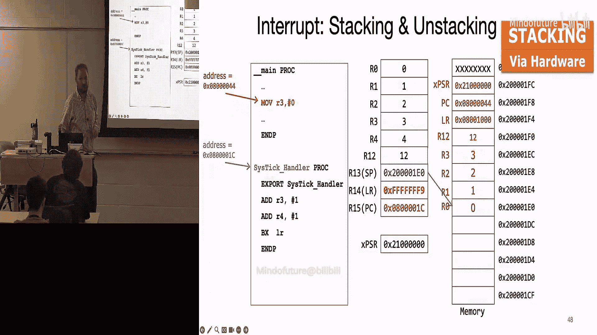
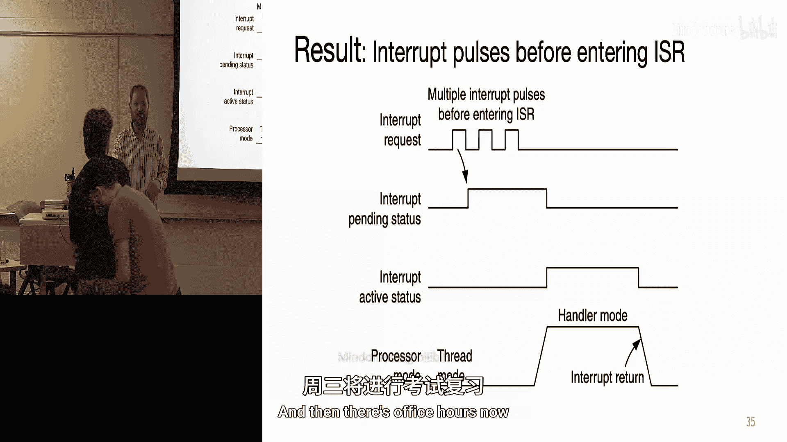

# 嵌入式系统设计导论：课程6：中断

## 概述
在本节课中，我们将要学习嵌入式系统中的中断机制。我们将从复习内存映射和总线结构开始，然后深入探讨中断与轮询的区别、中断向量表、中断服务例程的执行流程，以及嵌套向量中断控制器（NVIC）的工作原理。核心概念将通过**公式**和**代码**进行描述，以帮助初学者理解。

---

## 复习：内存映射与总线结构

上一节我们介绍了处理器核心、总线以及外设之间的关系。本节中，我们来看看这些概念如何通过数据手册（Data Sheet）呈现给程序员。

作为程序员，我们通常不直接与总线结构交互。那么，我们如何了解外设内部的硬件结构呢？答案是：**数据手册**。

数据手册是硬件工程师和软件工程师之间的“契约”。它描述了外设的寄存器布局、功能以及访问方式。例如，对于一个GPIO外设，数据手册会告诉我们：

*   存在一个32位的GPIO输出数据寄存器（ODR）。
*   该寄存器是可读写的，这意味着处理器可以通过总线向其写入数据或从中读取数据。
*   每个位对应一个物理引脚的控制。
*   寄存器在复位时具有特定的初始值。

通过数据手册，我们可以推断出硬件中存在一个32位的D触发器来存储ODR的值，并且该寄存器连接到了处理器的写数据（PWDATA）和读数据（PRDATA）总线。

**核心概念示例（寄存器描述）**：
```c
// 假设的GPIO ODR寄存器结构（根据数据手册）
typedef struct {
    uint32_t ODR; // 输出数据寄存器，位[31:0]对应引脚[31:0]
} GPIO_TypeDef;

// 访问示例：设置引脚5为高电平
GPIOA->ODR |= (1 << 5);
```

---

## 中断简介

### 轮询 vs. 中断
处理外部异步事件（如按键按下）通常有两种方法：轮询和中断。

**轮询**是一种简单但低效的方法。程序需要不断检查某个状态（例如，反复读取GPIO输入寄存器的值），以判断事件是否发生。这就像关闭了手机的消息通知，必须不断点亮屏幕才能知道是否有新消息。

**中断**则是一种由硬件触发的机制。当外部事件发生时，硬件会主动“打断”处理器当前正在执行的程序流，迫使处理器去执行一段特定的代码（中断服务例程）来处理该事件。处理完毕后，处理器再无缝地回到原来的程序继续执行。这就像开启了消息通知，新消息到来时会自动提醒你。

**轮询的缺点**：
*   **CPU利用率低**：在等待事件时，CPU空转，无法执行其他有用任务。
*   **响应延迟**：如果主程序循环中有耗时操作，系统对事件的响应会变慢。

**中断的优点**：
*   **高效**：CPU只在事件发生时才进行处理，其余时间可以执行其他任务。
*   **实时性好**：事件一旦发生，能立即得到响应。

### 中断类型
中断主要分为两类：
1.  **系统异常（内部中断）**：由ARM内核定义，是芯片正常运行所必需的。例如：复位（Reset）、硬件错误（Hard Fault）、不可屏蔽中断（NMI）。这些中断具有最高的优先级（用负数表示，如-1, -2...）。
2.  **外部中断**：由芯片制造商（如ST）定义，通常用于与外部世界交互。例如：GPIO边沿触发、定时器溢出、ADC转换完成、通信接口（I²C, SPI）事件。这些是我们在编程中最常处理的中断。

---

## 中断处理机制

### 中断向量表
中断向量表是一段位于内存特定区域（通常是起始地址）的表格。它存储了各个中断服务例程（ISR）的入口地址（函数指针）。

当某个中断发生时，嵌套向量中断控制器（NVIC）会根据中断号（IRQ Number）计算出在向量表中的索引，然后从中取出对应的ISR地址，并让处理器跳转到该地址执行。

**向量表示例**：
| 内存地址 | 内容 | 说明 |
| :--- | :--- | :--- |
| 0x0000_0000 | MSP初始值 | 主堆栈指针初始值 |
| 0x0000_0004 | Reset_Handler | 复位中断向量 |
| 0x0000_0008 | NMI_Handler | 不可屏蔽中断向量 |
| ... | ... | ... (其他系统异常) |
| 0x0000_0040 | IRQ0_Handler | 外部中断0向量 |
| 0x0000_0044 | IRQ1_Handler | 外部中断1向量 |
| ... | ... | ... |

**核心概念公式（计算ISR地址）**：
假设中断请求线IRQn被触发，NVIC查找ISR地址的过程可以简化为：
`ISR_Address = Vector_Table_Base + 4 * (n + 16)`
其中，`+16`是因为前16个向量槽位留给了ARM内核的系统异常。

### 中断服务例程与现场保护
中断服务例程本质上是一个特殊的函数。为了确保中断返回后，主程序能完全不受影响地继续运行，硬件和软件必须协同工作，保存和恢复处理器的“现场”。

**硬件自动完成（ stacking / 压栈）**：
当中断发生时，硬件会自动将以下寄存器值压入当前堆栈：
*   **xPSR**: 程序状态寄存器（包含ALU标志位、当前中断号等）。
*   **PC**: 程序计数器（返回地址）。
*   **LR**: 链接寄存器（被特殊值如`0xFFFFFFF9`替换，用于标识返回模式）。
*   **R12, R3, R2, R1, R0**: 根据ARM架构过程调用标准（AAPCS），这些是调用者保存的寄存器。

**软件责任（在ISR中）**：
如果中断服务例程中需要使用到R4-R11这些被调用者保存的寄存器，程序员必须手动在ISR开头将它们压栈（PUSH），并在ISR结尾弹出（POP）。

**中断返回（ unstacking / 出栈）**：
当ISR执行到`BX LR`指令（LR此时为`0xFFFFFFF9`等特殊值）时，硬件会识别出这是从中断返回，并自动将之前压栈的寄存器值弹出，恢复到处理器中。随后，PC被恢复，程序回到主程序被中断的代码点继续执行。

**核心概念代码（ISR框架）**：
```assembly
; 假设的汇编ISR示例
IRQ_Handler   PROC
    PUSH    {R4-R11}        ; 保存可能被破坏的寄存器（软件责任）
    ...                     ; 实际的中断处理代码
    POP     {R4-R11}        ; 恢复寄存器
    BX      LR              ; 特殊返回指令，触发硬件出栈
    ENDP
```
```c
// C语言中的ISR声明示例（使用编译器特定语法，如ARM GCC）
void __attribute__((interrupt)) TIM2_IRQHandler(void) {
    // 1. 检查中断标志（例如，TIM2->SR寄存器）
    // 2. 清除中断标志（非常重要！）
    // 3. 执行处理任务（应尽量简短）
}
```

---




## 嵌套向量中断控制器与中断管理

### NVIC与中断控制寄存器
NVIC是管理所有中断的硬件模块。每个外部中断都有一根独立的请求线（IRQ）连接到NVIC。NVIC提供了一系列寄存器来管理中断：

*   **中断使能寄存器（ISER）**：用于启用某个中断。
*   **中断除能寄存器（ICER）**：用于禁用某个中断。
*   **中断悬起寄存器（ISPR）**：读取可以查看哪些中断正在等待处理；写入可以手动设置某个中断为悬起状态。
*   **中断清除悬起寄存器（ICPR）**：用于清除某个中断的悬起状态。
*   **中断活动状态寄存器（IABR）**：查看当前正在执行的中断。
*   **中断优先级寄存器（IPR）**：为每个中断分配一个优先级。**数字越小，优先级越高**。高优先级的中断可以抢占（嵌套）正在执行的低优先级中断。

**注意**：使能/除能、置位悬起/清除悬起通常成对出现，并映射到不同的内存地址，这是为了防止软件误操作。

### 中断处理流程与状态
一个中断从发生到处理完毕，会经历几个状态：
1.  **中断请求（IRQ）**：外设硬件拉高中断请求线。
2.  **悬起（Pending）**：NVIC检测到请求，将对应中断标记为悬起状态。
3.  **激活（Active）**：如果该中断已使能且优先级最高，NVIC启动中断响应流程（压栈、跳转），中断状态变为激活。
4.  **执行（Handler Mode）**：处理器执行对应的ISR。
5.  **返回**：ISR执行完毕并返回，硬件出栈，中断状态清除，处理器回到线程模式（Thread Mode）。

**关键点**：
*   必须在ISR中**清除外设的中断标志**，否则中断可能会被持续触发。
*   中断悬起状态在中断变为激活时会被硬件自动清除。
*   如果中断请求信号是电平触发且一直保持高电平，而ISR中又未清除外设的请求源，那么在中断返回后，该中断会立即再次被置为悬起并触发，导致处理器不断进入该ISR。

---

## 总结



本节课中我们一起学习了嵌入式系统中断的核心知识。我们首先回顾了通过数据手册理解硬件的方法。然后，我们对比了低效的**轮询**和高效的**中断**两种事件处理方式。我们深入探讨了**中断向量表**的作用，它像一张地图，存储着所有中断处理函数的入口地址。我们详细分析了中断发生时的**现场保护**过程，包括硬件自动压栈和软件需遵循的规则。最后，我们介绍了管理中断的核心硬件——**嵌套向量中断控制器（NVIC）**，以及如何使用其相关寄存器来使能、控制优先级和管理中断状态。理解中断机制对于开发响应迅速、高效的嵌入式系统至关重要。