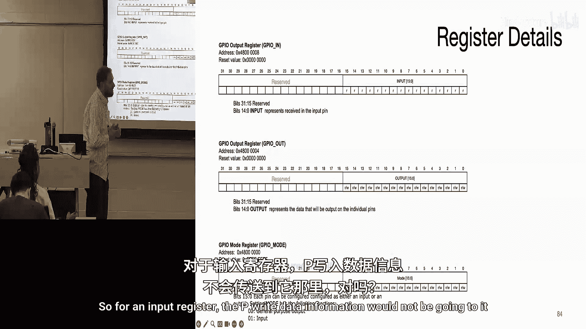
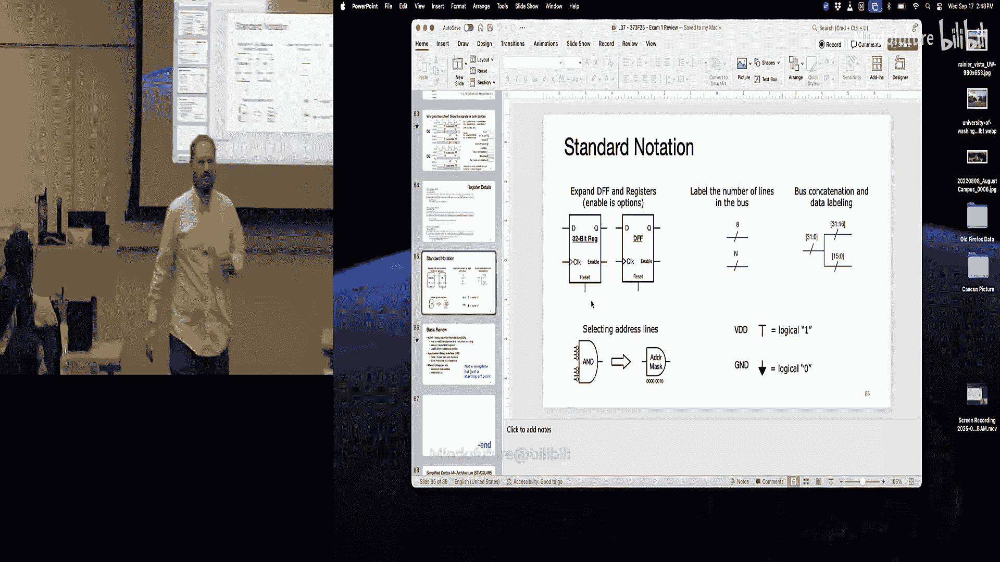

# 【密歇根大学】嵌入式系统设计导论-EECS-373-｜-Introduction-To-Embedded-System-Design-2025-p07-P08_课程7_期中考试1复习--BV1VTSNBoEem_p7-

Um， was posted around， I don't know， maybe even earlier one o'clock today or so。

 we'll go overum in class。And then of course， the exam is on Friday，s going to be in Meister。

St there from 430 to 630。Any logistics question before we get started？It1 year turn two。这都。

questions over the content and then I want to really get your feet your questions to me as we go through so feel free to interrupt me so let's see closed books closed notes you'll be given the data sheet and the reference sheets you bring a four function calculator scientific calculator please don't bring a graphing calculator you don't need a calculator I know sometimes as helpful that you don't have to like。

Once you bring the new math， like get stressed out。

 you just want something enough to do it for you that fine， but you don't need it。

Pones got saved in pocket and we'll have a timer available。Let's see。

Generally the game is to maximize the number of points that you can get so don't spend too much time on the exam like any one problem on the exam if you're getting stuck just move on。

 you're just trying to maximize points， there may be points。

 especially design problem whether something's ambiguous or at least you think it's ambiguous。

If it really is you come and ask us， you can do that， or you're going to say here's my assumption。

 my assumption is that this pin or this thing is logical high。

 we didn't tell you it was to enable something that was logical high or logical I just say this is what I assume。

And we'll grade that and'll take that into consideration while you're grading while we're grading now if it is assumption that directly contradicting contradicts a statement in the exam question prompt。

 then it's not very valid， but otherwise。To make sure you're communicating with us。啊。

hard for you to get partial credit without showing work so at least break down and explain what you're trying to do。

 especially design problem I think I should be doing this， this is my goal。

 a few sentences about maybe how you're trying to wire up a diagram or what your code is supposed to be doing will go a long ways to getting you that extra credit。

And we're pretty generous， we're not going to be litigious and like little thing to take off points。

 its not that type of class。So the DHC' has been released。

 I'm sure there's some minor error in there， maybe we have a GP report。

With weird address or something if you see it let us know if you have questions let us know I encourage you to please post in piazza so everybody can benefit from the answer or I will have to go back in Ka and post and then we'll try to we'll update the data sheet live up until like the morning of the exam so there's no。

Are we surprised by any changes on that？あ。Yeah， okay， so what study homework labs。

 old midterms on the website questions are just going to be just like homework and midterms there's not。

Whilely new types of questions or content are material。嗯。Any questions so far。

 before go over the data sheet？Great。All right。Day sheets out there。There is。

 we gave you this wild new display that has a one wire interface。

 the actual way in which this protocol， this thing。

 the protocol this thing communicates with is not important。 You're going use the word proprietary。

 You don't have to actually know how it works that will be taking care for you。

 but you're responsible for knowing everything else on the data sheet here。

Where the character placements are， all those sorts of things。There's a keypad。

 I don't think we've gone over in lab or in class how exactly grown home decors work for a keypad so there's a little false ad link probably want to。

Look that up， but basically just a bunch of switches， that's all it is。

 and there's a certain pattern that you can use to decode those switches。We should know that。

There's the MA 32 has some GPO pins， has some proprietary pins to talk to that and then a bunch of registers。

 these registers do tasks。The SDM3 sheet， you have an address it's a bit register。

As these pins have certain functions， these pins are reserved。あてす。And so what perverse the Carl then？

诶 if you enable。Thing still be displayed。Or even you only have to on one location on a certain point。

Okay。By。you're only displaying that。One location at a time。You can update a location。Okay。

 and the way you update is by enabling the sampling。Yeah。

 so you got a peripheral here so so the idea is that there's an external piece of device and then there's an internal peripheral which is explicitly designed to talk to that display kind of like SD card with you talk the peripheral inside SCM32 then it's an SD card interface and then it does some protocol to talk SD card same here。

 so here you can put data into this this thing takes data。I is my boss。嗯。You can find a location。

And then when you enable it， it will put that character in that location。

There's a GPO peripheral the standard peripheral has a direction of modes。

 you can have you value in ports， GPA output ports， and there's a temperature sensor。

 temperature sensor is there's a 16 bit value and you put one or a zero in there to enable or disable the temperature sensor。

有。I'm going to beg。And all of you could figure out what my tricky design question is going to be。

My guess is that there's going to be a push button thing， there's going to be a display。

 you have to use a temperature sensor for something so you could just go through and write down like tonight what you think the design problem is going to be and then you could solve it and you're probably going to get most of the answers correct and most of everything we're going to ask is going to be there。

Any questions？Yeah， we're going to have like enough time to not do that。Yeah。On the exam。

 do we have a lot of time for that question？I mean you it's a two hour exam。

 you can look at the other exams， they assume that you've read this and understand this and this need to go back for information that's the assumption so you have extra time i'm saying as a study guide you could go through and。

JustTry to write a design problem using those elements and see what happens。

Does that answer your question？I don't know how much like relative this is。

 but the reset value is all zeros， but that's 32 bits and there's only 16 bits of like。就在。

It doesnn't bother me too much， but I can change the data sheet so if you just put that Gazza then I'll update that on there that's a good point that isn't inaccur。

 I don't think it really affects problem。So is the tippetry？

Sensor saying if I cleans and input's make something that temperature or like it's reading temperature and showing it via read the description so I'll give it away so in almost any silicon device you can make a temperature sensor for free。

All you need is two diodes， well what's the best way to do it they usually do two dis similar size diodes with the same current going through them。

 the difference in voltage is proportional to absolute zero， some trick of physics I remembered。

I learned one way back。And so that means any microcontroller probably has a built in temperature sensor。

 any it's easy to do and so that's the same thing， this is a sensor that's built into the Ma 32。

All right， so any， I mean， you guys haven't had time to look at it。

 so I doubt you'll have detailed questions， but any general questions about the data sheet？

At least I noticed in some of the their data sheets like towards Bo mentioned and like timing diagrams and those timing diagrams dont have like。

It' weight information I'm assuming we're not dealing with life。All our states are like， you know。

 no weight， like basically P ready， is always ready it comes to them。I don't know， you'll have to。

 it's going to be a fun time out there you may have that sounds like something that would be inbounds。

As a question and you could look through read through the data sheet just like you could read through the STM 32 data sheet and kind of figure out what hardware structure would have to exist to instant sheet this particular registerconfiguration and these requirements。

 the verbal requirements and you could figure out what hardware would have to be there。嗯。Okay。

homework all right， so three main topics， so the arm instruction she is set the application binary interface and ma may mapo so I'll give a little primer over them。

 but this is really an opportunity for you guys to ask questions okay。

So the major elements of the instruction set。Architecture， so we have registers right。

 these are in the core， these are what your program can directly manipulate。

And you have memory right and then so these are addresses。

 a arm has defined that these regions will be used， so you know text 4000。

 whatever to 6000 will be the peripheral space and so。They're all 32 bit wide。

 there's a program status register， the program status Reg also holds your NVIC flags and later on in the interrupt section which is not on the test。

 we've talked about how this register also has other functionality。And then you have code right。

 so your code， some code only manipulates things in the register。

 most of the instructions only manipulate things in registers， there are special instructions。

 loads and stores that go and manipulate things in memory。

And then you have loop and branching instructions。And then we also have these special instructions that allow you to update the ALU flags。

 so it's the way to add some conditionals to things。So coming here。

 we have 13 general purpose registers， some of them have extra special functions that aren't actually that relevant to this class。

 we have the stack pointer， the link register and the PC。

 and then we had this designation or this distinction between lower registers and higher registers anybody you remember why there's slower and higher registers。

 why do we make this distinction， if we're doing a 32 instruction there are 16 instruction。

So like which registers you talking but could I manipulate a lower register with a 32 bit instruction Sure。

 it's just a designs choice so they said we're going to optimize the 16 bit instructions so that we have smaller code space and those will generally be optimized for the lower registers and then 32 bit instructions can do everything can do both yeah。

Is any of these registers the Asra register or the was that daily register is that where is that is not shown right here it would be down here oh it's somewhere up here there we go。

And we don't talk really about the when we're not talking about the prior mask， their base priority。

 those are for interrupts and these faults and control masks we're not really talking about now。

They exist and then you got there are the master stack pointer and the program stack pointer you don't really have to worry about the difference between those here。

Yeah， so those are mo dependent we'll just assume you're always in main is our 12 call saved because I remember when we did the stacking and unstacking it was the one of the ones that have to push so is that just general or is that only when you do the stacking and uns stackacking that？

So if you're a function， you have to assume that you cannot manipulate this only really for the purposes of this classes is only done like in lab like when you're doing this interprocedural call register。

 we don't actually use it for any examples， but sometimes your code will pass things back and forth so this is for an OS and this is optional on some architectures。

 so you can just assume that you have to save that state if you're in a function。嗯。Yeah。Okay。

Remember that arm has laid out memory up to four gigabytes worth of addresses。

 but the trick is that oh and it's all unified memory， so even though code and SRAM。

And peripherals are all addressable from the course point of view as if they're just memory locations。

 they're actually separate things right， so you'll have flash memory which is nonviatile that will usually store your code where SRAM is for data and those sorts of things and those are actually physically different structures on your device。

嗯。And so this is really defined， so there's interoperability between。

All all of arms offering so that you know things can be portable so their architecture can be portable from one company to another company。

 they don't have to make things specific， yeah what are private fuel buses for？

Private so these are for。This is these are for the actual arm core to work specifically。

 so some of the private peripheral buses are going to be like the ibus and the Dbus or specific buses just to get data in and out of memory now that's when you're trying to do instruction fetches and that sort of thing which is different than say。

Loads in stores。So we are really。As programmers， you don't， really。

So we also remember talked about that this is for your specific instantiation of your STM or your arm cortex M4 processor。

 here's a memory layout and there's lots of reserved spaces。

 reserve meaning that there's nothing there， and you could of course concatenate it all down or collapse it all down so it took up the minimum number of addresses but then it then arm would have to update their ISA for every different SUA for different product that a manufacturer would make and it would be too challenging to keep an ISA。

Consistent that way。So reserve means not on ships。I'll give you an example。

 I have more confusion about this this year so maybe I gave the wrong to tour on this or something but the analog I came up with is imagine that you're a city planner and you're planning out a new subdivision and you go and say all these places have addresses but then the manufacturer the developer says well I'm only going to put houses on some of them so even though they all have addresses they can only store people in certain locations so here is the you know this is reserve in this case and that's simply the same as this the manufacturer has gone through and said I will have addresses for everything but I'm only going to put places to store memory at specific locations so it's just that implementation choice。

 addresses allocated houses not implemented addresses allocated memory not implemented。

Is there any questions here， yeah？Sorry， this is a question from the。

make the register slides is that for one of the exam questions previous exam question。

 there is a question that ask which are the following registers not preserved across function calls by the caller and that question has both R 4 and R 12 but R4 is the only answer so is R 12 not that you mentioned that R 12 is。

R 12 you have to so if you're a function， you have to retain that information。

You should push that information to SAC if you need to give to R 12。

Which register is not preserved by color。Can you just post that Piazza or we can talk about other？

Which exam was that on Oh， I didn't make that exam？Okay。So any questions about？

Memory layout and why they have these reserved spots。O。

And then we also have to further complicate things， memory is not laid out just easily in 32 bit。

 so each memory location that has an address is actually 8 bits。

 even though we think of everything as a 32 bit processor， right。

 loads and stores are done in 32 bits， that's because we're just going to reconcatenate this as saying hey。

 this thing，All right， this address， if you do a 32 bit store， will store。

In sequential address numbers so each one of those bits will go in this different addresses and that just to be confusing because here we see that we're incrementing by four and here we're incrementing by one it's just good just to think back and forth about why that is well why are they doing that so they have more flexibility and how you represent store data that's why we have store byte and store half but just thinking about this is an architectural choice that here they're just incrementing by four so when you're doing your exams is keep track of how large when you're looking at some memory thats empty look at the steps and see if is it supposed to be byte addressable or word addressable。

O。And then again， since the memory blocks are distributed throughout the thing。

 so even though the core thinks this is unified memory and arm thinks this unified memory。

 STM has broken this up and now you have memory distributed throughout the thing， have SRAM。

 you have you flash， you have external memory， external devices。

 and then peripherals are in the peripherals， there's actually memory storing elements in there。

 usually flipfls。All right， so anything about memory y？

So on the fault go you have to be so loud on the fall 24 exam， there's a question about like what？

Whi module implements like a specific function， and I want to know what exactly counts as a module in terms of this diagram。

U。I would say like anything in the box can see a module。I don't know。

 I'd have to look at the counter example of what's not a module。Yeah。

 each one of these translates to something on there。And if you have a specific question。

 post on Piaz。Okay。Yeah， module is not a， there's no definitive term for like what is a module。

 module is this something that's self- containedtain。

 we try to make sure that we're talking modules go in peripherals and peripherals are a thing。

 but I don't know， it's an overused term in embedded systems。All right。

 so we talked a little bit about memory architecture， talk about instructions。So generally you're。

Not responsible for knowing， but should review branching。

 standard data processing and loads in stores。So just to review。

 theres a bunch of kind of standard operations that are in the reference sheet。

 and so your goal should be to know understand how to read the reference sheet。

And then there's this option here that you can manipulate many of them so that the result of a subtract or carry an ad or ad sets the ALU flags and that's by appending the instruction here with S at the end。

 and that does the job of updating these ALU flags right here。Again， there's the ALU branching。

 so there's the other major functions here are branching so you branched to a label。

 you branched with a link register to a label， different branching to specific registers。

And then you can do concatenate them with the results of your ALU and how you define that is say you could do branch unequal。

 and that's when the Z flag， for instance， is equal so you could have an add an S at the end that sets an ALU flag and then you can use one of these things to have a conditional branch。

And then there's this an example of how those things can be all concatenated。

 so what is a branch of unsigned hire， don't know why you would need that， I mean I'm sure。

From architectural point， it's useful， but you shouldn't remember that you should just be able to look at your data sheet and say。

 oh， do I need to know this， is this a tool that would be helpful in helping this exam？If。

Sorry before you do the。Conditional branch， don't you need to compare values before that Well。

 you can set those other values with this S flag。Right， so this， so you could say adding add right。

 and then you could say if the result of the a， those ALU flags is something I don't know what it would be。

 then you can decide to branch on that afterwards， so rather than doing an explicit compare instruction。

 you can set the flags with these instructions。U。I don't think I have a explicit example of that。

I mean， you can also use a compare instruction as well。So you should。

Again I don't want you to memorize instructions， that's why we have computers。

 you should be able to work your way through theendix too of the data sheet and be like oh。

 if I need to learn like how to use a store， okay， this is how I would reference that or a store halfway。

 this is where I would go， they also have all the branching conditions。

 so at least be able to work through the data sheet or the reference appendix so you can use it on the exam。

Any questions？Okay。The other major set of instructions that we care about are loads in stores and that's primarily because this is how we are going to interact with those memory map IO and there's four variants of loads so there's and these are all about indexing right so the way you would use this in memory map IO is you get some base address this is the base address say of your GPO peripheral and then they always in the dayH sheet there's talking about the address offset well this is where you put the address offset is so now you can have one set of code that initializes say GPO peripheral a and then you can use reuse the same set of code for initializing GPO peripheral B you just have to change the base address and then all the offsets addresses are generally the same that's how they designed the chip so that you can reuse your code easily so you can put a negative as an immediate。

And we just quickly walk through these things， so here we have we're going to put let' see where we're going to we're going to load the value of or the yeah。

 we're going to load the value that's contained at the address stored in r0 and put it into r1。

 we're going to go out。It's a 32 bit operation and we're going to put that in R1 indexing offset indexing it says on the fly。

 as we do the thing we're going to add for or add whatever that value is in one instruction cycle。

 it's not going to take two， we're going to do that add and we're going to be do offset indexing。

Now we're going to get higher value and then the other ones the bang I just remember that because like immediate。

 I want that indexing to happen now so before you go out and fetch the data。

 this thing is indexed and it's stored back in R0 so it's permanently changed。

And then you also have a post indexing version where you go and grab the information and then store the value。

So the way to sell between those is just by looking at the way it's called like in the brackets。

 is it the way you tell it's post index per index or will it be like specified？

Well the instruction coding is there'm is that the only way to tell the indexing and post indexing yep that's the only way your core knows so yeah it's just if there's a bang and then this is post like after the indexing I guess how I kind of remember it。

Yeah， the stack grow like down or up goes down so two lower memory addresses correct so when you push something it goes to a lower correct。

就不楚。Let's see， okay， I have a memory indexing problem if we have time at the end， we'll do it。

All right， so now we'll switch gears to application binary interface。Some basic rules here。

Preserve the contents of R4 through our 11， the stack pointer。

 let's be careful O see now I was ambiguous about your question somebody back there was asking this question。

 I will update this slide why should we be careful about it。

 I think your function should preserve it only I would say only the compiler should be manipulating that thing as part of interrupt。

So you should save that value but clearly I don't agree with whoever made winter 25 and we'll be consistent right you guys can come back in your comments and be like you didn't tell us what to do you made it very ambiguous and a little way oh no I did that and I we'll figure out how to grade you appropriately we're not trying to hear just to take points off for no reason。

But the real trick is that a function needs can expect to have r0 through r3。

 so this is scratch space for the function and that is where the variables are going to be passed to the function from r0 up to r3 and then that's where variables are going to be returned starting at R0 and going on well r0 to r1 for 64 bits and you can get up to 128 bits if you needed to typically the mental model is you only get one variable back but certainly you can put two variable backs that would be fine。

If you need more space then you need to go and put that more register space。

 you need to preserve those registers are for and upwards and you need to put that on the stack。

I have a question just by the content in general so on the last side was arm A and memory mapped IO so there's questions on like the homework and stuff that are like pull down resistors and capacitor and so all are those stuff can be on the anything you did in lab so I'm happy to go through no not strictly this it's a good starting place but these are the major things I figured you should know。

I'm happy to answer any pull up resistor questions you have。ち。Okay。

So you want to go through an example here， so I think we did this one before。

 so this we'll go through stacks and pointers， but this is an example of a function calling a function which calls a function。

 this will exercise the problem where normally when you push to link register。

 the link register store the next instruction so you don't have to worry about the link register it is taken care of for you。

 but when the function calls another function when you branch link register now you're going to update the link register which is a problem so you need to do something you need to save this link register or you won't know your path home。

And in this particular case， we're going to do that twice。To do this we'll need pushes。

 so we have push which will push things onto the stack again。

 starting at high value in stack and then descending and it's important to remember that the order in which you do your pushes。

 if it's in one instruction does not matter， it's always going to go from highest register value down to lowest register value。

Again， that's because。It's not three independent pushes。

 it is one instruction that will happen in one cycle， CPU cycle。

And is one hot encoding the registers that will be pushed in the instruction itself。

 and so the hardware doesn't know which one you intended， it just sees the instruction and says。

 okay， I'll just go from highest to lowest。Likewise， P is the opposite right。

 P is going to take things off the stack and put them in the corresponding locations here。

 the increment， the or the link register as no sorry the stack pointer as it goes and it doesn't have any idea of order either。

 it just happens it will do it in the opposite order of push so you can use them symmetrically。

Any questions about push and pop？Yeah。还是你。I answered that question before it even came out。

 I feel really good as a professor I'm on my game today right。So go through this example。

 I mean it's the same example I showed before but maybe it'll spawn different questions or maybe it'll make more sense at this time so here we have some assembly code we're going to start up here。

 we have two functions the functions go to labels。The S pointer is pointing at the last bit of valid data。

Now we just don't know what that value is， it could have been something and just not important for this question。

 so there's some data there and the program counter is pointed here okay。

So if we're going to execute that first command， we're going to move r into sorry。

 we're going to move the number two immediate into r0。Then we're going to branch。

So that branch is we have this little indicator here that shows us that this is the location memory location remember your linker when you assemble your function is going to resolve all these labels so it knows where to go but for now we're just going to use this notation and then we're going to branch and we're going to update the link register okay so we're going to go move forward the link register it what's going to be done is the next instruction so the address of the next instruction that will go after return from this this branch will go here so that's in the link register and then we're going to increment the PC to here so the PC is now here and this first instruction says we're going to push the link register up there now。

That's just because this happens to be the first instruction。

 it has nothing to do with the last branch， we're going to push this up to link register because this function is going to call other functions and it needs to retained link register so it knows how to get back up here。

Js misla。Which ones misla the green arrow blue right？the link register， the link register well。

 this is pointing out the stack。T with that Oh that what I thought you were pushing on。Now， well。

 they were pushing the previous link register， I think。That we're doing。

So that this value is up there Oh I see what you're saying， so you want this to point to there， okay。

 yeah I can see that。I't note that。Okay。All right， how are we doing okay， so now where are we at。

 we've just pushed this thing。Yes， you're right， that should be different。

And now we are going to do the next instruction， which is a branch link register to this instruction。

 so now we're going to take this next instruction which is here and that's going to go。

 that value is going to go into the link register。Thankfully。

 we've stored the previous one so we have a way home。

And we're going to go up to square square says multiply two things together。

 and then we're going to exit right， we're going to branch to the link register。

 which is going to take that copy it in。Which pushed this back down to there。

 so that was returning here。 Now we're going to do that one more time。

We're going to go up to is that correct？Yes。Now we're going to do sum of squares again。

We've updated to 16， we're going to branch out， branch again。

 it's a second time through how we're going to pop that value back。All right。

And then where were we we were here， and then we're going to branch back now we're going to use because we pop that back into here。

 now we have the correct way home， we're going to put that into PC which is going to end us over there。

All right。Other than the colors being wrong and the arrow being wrong。Any questions？Yeah。

 can you go back to the two BLSQ calls and where I？ちゅちちゅ。All right， so where are we here。

 we are come back。We're here， we want to retain this value because we need it back later。

 so that's being pushed the stack in the wrong color with the wrong arrow。

Then we're going to branch here， we're going to branch to this point。

 we're going to branch an update link register， which is should be this address here。

 right because this when I return from this function。

Then I need to execute this next thing right so this value should go into the link register。Okay。

 so that's the next instruction went here now I'm， is that just a mistake or is that intentional？

Let's see here， the PCs should be at， yeah， that the PCs wrong too。my gosh。

 it turns out I am not a very good。Armcops。So。Okay。And then then I'm going to branch link register。

 so I need to go and take this value and put it up there because that's the next value。

 and then I'm going to branch to SQ up there。So that PC is correct。

Then I'm going to do the multiplication， then I'm going to branch to the link register。So here。

 this has gone here and that's going to take us back to the second。呃。Branch to squared call。

 so we're here。And we're going to come back up when we're finish with that oh we're going to branch。

 we're going to take this value here right so we have to store a new branch。

 we need to branch link register， we're going to take this next value and put it here。

 which is the pop。We're going to do the square， so now we get 16， we're going to branch out of that。

 we're going to take the link register， put it in the PC。That puts this back up pop。

 we're going to take pop down。We're going to pop the link register then we're going to branch link register and then we're out I think that makes sense I think I was just confused because you had the two back to back SQ calls but that's just because you want to run the function twice it's not Yeah it would be easier if there's a little bit of breaks right and then you could actually see the so you could add an extra functionality there so the reason why Quad pushes link register and SQ doesn't is because Quad advances with the link register。

Well， Quad knows that。Qud because Quad is calling， so you're right。

 because Quad is calling a function it knows that its own link register will get changed so that's why SQ doesn't push it because Scrt doesn't call anything if SQ was to call something right it would have to push。

Do you wanted to， could you do like pop PC and then if you went to board having to go pop LR BLR？

Yeah， you can do that。个人做一个事情。O。ound two errors， fantastic。All right。

 let's see any other questions about stacks in general？Let see。

It's probably important to remember that。The information on the stack is not thrown away。

There's no garbage clearing， it's just going to retain there。

 it's just your sack point just pointing to a location。

 some people think that somehow it gets zeroed， the information is still up there。Okay。

Memory map Iio。So remember， in the very first day of the class， I showed you this horrible thing。

And you're like， I don't understand any of this， this is horrible， felt very lost。

 I hopefully now is getting a little bit better by the end of the class you'll know every little piece of this。

But the whole goal of what we're trying to talk about with memory Ma Ao is we have our core。

W whichch is what you learn in 370。And we need it to talk to things outside of the core。

 So we need to talk to memory locations like SraM and flash。

 and then we have all these peripherals and a peripheral in this context is a。

A functional block that has a specific set of addresses associated with it and has a completer in it。

 and we'll talk about what that is in a second， but the completer would make up one set of peripherals and then each peripheral would have its own completer。

And so they are locations which you can send data and get data from and we need to talk about the mechanism in which we have our core talks to all those things and that really is the bus structure and in this class we're not going to talk about the advance advanced high performance bus just because it's just a layer of obfucation or layer of。

Detail is too much， so we're just going to assume everything is on the advanced peripheral bus and that you know the memory interface。

 this is the requester for the advanced high performance bus。

 we're just going to assume that this bridge is right here will make life easier。

So let's go look at the GPO ends， so GPO pins have registers that have functions。

Gone through this a bunch of times， so there's a registrar that will take sample the value on the external pin so this is outside the chip。

And we'll hold that state， every clock cycle will update this D toq and hold the state of the output pin。

You can configure it to instead of just being input that you could output so you can configure that by controlling the control register it's also called the mode register and STM either high or low to control whether the data from I guess this should be the advanced peripheral bus goes from D to Q every clock cycle and is put out on that pin。

 so now we have storage elements that we can write to that will store information about how to control the UO pin yeah。

On a data sheet， you can set it to alternative function。Alternative function。

 as we talked about with the more advanced diagram。

 you can do things like put other functions other than just these to the output pin。

 so an alternative function could be I squared C， sorry a communication bus protocol could be that you want to connect this line to an analog input pin。

 so for the purpose of exam tomorrow we haven't talked about any other alternative functions that you could that would be applicable。

Contro register the GIO so it completelys whether it's any our output。

 correct Does that generally like output or not does it generally go。

Is it case by case or does family go here？那你什么？Well， every output pin。

s this GPO pin is going to have a register in which you can output data on。

 so it's going to have his own register and we're going to concatenate those into a bank。

Does that answer your question？Is that related to the making put separate？Oh， okay。Well。

 I'll go advance， why not？So every GPL pin has multiple registers and the control pin。

 in your case on SM32 there's two bits for motor， which is， I think it's enabled。

 disabled like input output off an alternative or something。

 and so you have a number of bits that control the state of whether it's an input or output。So yeah。

 there's always， there's each pen usually has a motor， maybe two motor bits。Yeah。

 and theres an enable register。 I that what gets sent to P enable usually？No。

 P enable is defined as part of the bus structure that is more just yeah。

 so P enables only to talk to these registers the register itself say this was enabled it might have some other functionality like enabling the peripherals and turning them on and why you' want that is that you could just power down your peripherals to save power in the data sheet like the enable register to turn on and turn off that register clock No well no that's if you're talking about the temperature sensor that's turn on and turn off the temperature sensor the entire whatever functionality it describes。

So with this saying AHP， this thing depends only interacting with the AHB， not the APP or both。

Just assume it's all APB for this class， it'll be just fine。Yeah， what the was this number？

This number。It means one。It just means that this is a register you put data in and maybe for this on this one is and maybe an input and this one's an output I don't know。

 it it's just for an example。But this is just a state holding device。

 this is just representing we have four GPO pins in this example。

 and then there's four registers for each one of the control registers here。

Just like there's an input right you can actually see all the input registers here。

 and this would be the data that happens to be coming into the device。

These is the input from these registers like I saw in like the last lecture or two lecture ago。

 it was like 32 bits coming into the data and and then I output。

 the key was also 32 bits and then you just indexed。Index for output control。

 like which bits you want to look at。So what are those 32 bits represent because don't you only need like two bits for the control output or oh but those 32 bits are for the entire port so it would be it would be annoying if every time I wanted to update so say there are eight bits here or eight eight pins I'd have to go to one specific address and then you can only update the output of one pin and you have to go to another address and you can write。

All eight at a time and change it。So is the output control for every pin that is that they hard coded to a certain address for that particular pin like I have a certain index because you're looking plus PB0 when you just be looking at like the first bit maybe So let's say theres a register has a memory address and then this register this control say the first pin and this is the sec actually probably be more like if this is pin zero this would be the control register for pen zero and then pin1 and then pin2 pin3。

OO。Yeah。我平大家。Can the pins directly go into PR data？No， not really， but。あ。So like in a real STM 32。

 no， absolutely not。Right， PRD。Why would you not want that well first you want to debunk or you want to collect it and store it in a device and be able to read it on command。

 you don't want to always driving in that thing and then most likely is you have multiple registers with multiple addresses and so you don't want that always hogging that output line。

Yeah， so I just want to confirm in each of those blue squares that that's where they're going to be one bit the kind of like。

 yeah， colored squares and because I like store， there are one bit flip flop。But together。

Represent when you connect okay， so here I got four registers， right？

those are each stor one bit or those are like these are in this example is one bit I say I got a Q and a D there's no nothing else it says so I got one bit that' going to come in here and store the input value for PB0 and I got another register for PB1 and so on and so forth now I could lay them out distinctly。

But you know， it much more economical if I just group them all together。

 I'm going to group them all together into a registergitry。Yeah。Yeah，'s right。Okay。

Oh way back there yeah motor kind of like the control okay is there a reason why you have control is it like you can control audit at the motor motors more advanced this is a toy diagram。

Does't mean anything motor is the actual implementation that STM has chosen and they actually have two bits for every GPO pin and so that's input output。

 enable and alternate function。Okay。So thank you girls， getting it we。

We have each one of these registers is a concatenation of all the pins on the port。

RightAnd then you can put them all together。And we can go in so now this is a memory location from the course point of view。

 it's just a memory location and now we have a completer right， so this is a completer。

 this is the thing that's handling the bus transaction。 This is the thing that you write in your。

y diagrams right and then here's the output port， here's the input port here's the I don't actually have a control register but imagine that these are all distributed through here and your goal is to say okay when I put my and a mask on here so that when I'm trying to write to this thing the data actually goes to that and then then it will manipulate the output port so it does a task okay so the core's point of view is this is just memory。

And then the way you talk to it is you have this requester when I say state machine。

 I mean there's some combinational logic could be a state machine as well that's built into the processor core。

 I shouldn't even have an arrow here， surely this should just be connected and so just from like 270 point of view some combination some you know instruction gets goes and then based on that some signal lines cause combinational logic to what what does it do it raises the lines here it will raise this combinational logic will raise the address based on the load or store command it'll change data based on that clocks always go in and it has some control lines so here's how you take。

A store command。Right and it gets turned into bus traffic and that gets transported across the ship。

Gets captured by this completer， gets filled out into data is loaded into some register。

 which represents some action， some data， ones are zeros and being pushed data out onto your GPO pin it's like the path that data goes through has to happen all of these things and why do we have a whole complicated bus structure because there's probably 64 or there's 96 on your device。

 different completers， different peripherals in which you can write data into so you don't want to have to have lines to each one。

 you have addresses for each location and P select lines for each peripheral so that you can effectively manage where data is going。

How a feel about that。Good， what's question？Qu about the diagram。

 I see that there's IRQ and then much number with CFf。

What would that be in terms of what we just talked about from previously these are other registers。

madeade some registers up all right， these are registers inside a computer。

 these each have addresses。And so a completer has a piece left will go and say。

 I want to talk to this particular thing。And then address is saying I want to talk to individual register in here and I don't know。

 maybe I have a really advanced one， there's different configuration things。

 or this is the IRQ means interrupt request line so all these things can be updated。Yeah。

So does each peripheral have a completer correct， and then then like a corresponding requests are on the there's one requester。

So have you index it like each computerrs with the address， correct？There's also P select。

 do I have it up here， yeah， we'll get， let's go， let's keep going fantastic all the right questions。

All right， so right， we have， well， let's just do the next one。 Does it advanced through。

So we have a requester and we have two completes and can have n completes the P right data is the data that's coming off of。

 so remember the core is part of this， the core is right here。

So you get a store thing and you're storing some data。

 well that's the data that's coming across here and it's going to every single device。

You have P write lines and P enable lines to all devices。

And we have the address bits go to all devices the trick here is we have P select lines。

This is only going to enable or turn on select one completer the target completer for the particular address and where the data is supposed to go。

 and that says Comp， please pay attention to the address lines now in the real system you don't need 32 bit address lines because you don't have 32 bits worth of registers in each one。

 but for the purposes of this class it just makes it easier if we just assume it's 32 bits of address lines。

Does that answer somebody's question？All right， so this piece selects is allowing you to select different ones address is going to those individual registers if we go back here。

 so inside this Compr is。All these registers， right。

 and these are the things that have addresses that we're going to talk to。And then let's see。

 where were we？Everything gets a clock。And then the other trick is that the P write data。

 so this is the data bus that goes from the completers， back to requesters。

 they each have their own bus。That's because you don't want to have something that's very slow blocking everyone else。

 you don't want to have node contention so here every single completer has its own bus back and then it's up to the bridge to go through it and when it's ready。

 it can go look at these one so if they're going have be different priorities of like this bus has higher priority than the other priorities so I'm going to look at that data first we don't really care about that right now。

 but it's just good to know that there are individual 32 bit busess for each completer but from requests through two completed there's just one universal 32 bit bus。

So like when you explained this two lectures ago and you did the example with like we wired up like a computer I think and we had like a mug and you get to choose between like the three registers like the mod input and it goes back in the PR data。

 does it always send back like the input or output？So。

So always send back like does the computer always send back the input or the output or the input of what oh you mean it always sends back something from those registers yeah like if I say I was doing an output right i'm writing to it wouldn then just send back the exact same thing that I I。

U。I mean it depends on what the combinational logic told it to do right so if we get let me see if we have that example I don't have it on my slides although that would be good so you can architect it however it's supposed to be done the ISA and the manual will say what's the expected configuration we just know that when P ready goes high it should have the right data。

 the correct data on there， but if when P ready is low it could have any other data it wants。

So for P right data， it's one bus for all of them， right， but for P re data。

 each one has its own contract to the APVY。Just a couple reasons， none of they're inherently obvious。

 but so there's no bus contention so now we don't have to have a mux between each individual bus second these things can take different amounts of time so you don't want one holding up a bus forever。

While you're waiting for it to complete so now it's just saying the bridge can come through and say or the requester says you do the task。

 you do a task， you do a task。 And then when it's ready， it can go and it looks at the。

And P ready lines which each one has I believe each one has a P ready line then it can just go index through the P ready lines and say oh you're ready。

 you're ready now sorry I'll finish that task so and we're assuming that P right data can't hold anything off right like nothing's going to be held up by the right data which is why they're all sharing yeah。

 this is way faster than these typically。Yeah， so P select can be thought of as the indication of the completer that the information coming in on the bus is important right like that there's like something to be done you。

Is talking to that thing right and then could you want to me what the enable like what the distinction between that and enable so the enable says the data has been on the bus is active so how the APP bus protocol works is there's a setup stage and then there's an action stage I forget out what the action stage is called but they're set up so everything happens gets set up means all the data here has been instantiated and then enable goes and says now it's your time Comp to work do this task So select will go but it's not necessarily the case that like the right data is only when enable is high are you telling the completer everything is correct。

And does the high performance bus also follow the same like if you write data going back or completely。

 I guess？Yeah， or more or less。It's actually a pipeline bus。Multi stage pipeline bus。

 but we're not going to talk about it。You can't really。Right you can't like I guess， well。

 I guess we can invent a scenario not knowing the real constraints。

 but you could pull P select high on two lines at once。

 and then two completers would try to look at address and the data and do a task with it。

Probably doesn't have any meaning is probably outlawed as part of the protocol。わなさい。

You're seeing like the purpose for having multiple。Oh，我。Sure。

Get one job to one peripheral and then go back to it Yeah so say I say hey， completer one。

 you happen to be an ADC， ADC usually take a long time to converge maybe like 32 cycles so you could say ADC start。

 go do a task。Now while we're waiting for that， go over here and go get some memory read out of this other thing。

 and then it can go look through and say， ah this is these things are ready。

 I will start servicing this data that's ready。The processor is like optimized specifically for that yeah。

 you're assmbbller and you know code will do that。嗯。

Are you ready coming from the computerr to the requester saying that my data is ready right， Pete。

 yes， okay， like I am ready。You seem skeptical so the first peripheral takes 32 cycles some move or storm。

Sure， data in it。I the just be doing something else in those 32 cycles like whether it be the code that does that or like the actual process so there are for the purposes of bare metal programming。

 it's unlikely that you'll write a program that takes advantage of it。

 but we can put an OS on this thing。And now you could be in you have sub programss working。

 you have multiple tasks working on so there's layers of complexity can be built on top of this that you can explore 473。

Okay， no good questions， yes。just like looking at faster versus computer。

 but like on a problem like the homework one where we' we have like all our your needs。Yeah。

On like request or versus computer is that falling like is that that is inside here。

you are looking at these bus structures here and trying to complete a task and then we try to trick you by taking these outputs。

 we put them on the side。But you are trying to complete some task in here and you might be questioning what task am I trying to complete？

You are typically trying to wire up。Something like this。All right， let's do this。

You have a P write P address like all these inputs here。

 and you are writing some combinational logic like an anN mask which manipulates some registers that we've given you that are connected to something usually we're trying to hook those up right so you had what did you have like a my funk and I forget what you guys had？

Yeah， trigger right and you're trying to wire all this stuff up so that it will talk to this thing so that the core can talk into this peripheral and get value out of it。

And remember， it's not just the course you guys are going to be writing C code or assembly。

To actually talk to peripherals that make them do things like talk to the outside world。Okay。U。

So that kind of brings us back to this example here here I mean still it's an assembly instead of C but you can imagine that context as well。

 so here we're going to store something， we're given some values and we're giving some addresses and in this case it was right so what's the course conception is that you have register spaces。

 you have memory and that you're going to do some task right you're going to go out there we're going to take the value in our our1 and we're going to put it or no sorry the r value in r0 we're going to put it in the address that's defined by R1。

Offpset by four， and then we're going to go put some value there so coffee went there right so this thing。

 this action that we've done into this conceptual space causes bus transactions。

And we're going to look at the bus transactions here。

And so those bus transactions are going to make these wires go high and low。

So here we're going to have address is going to go is going to be based on the address from the store command right so this is。

And 1000 and plus four were offset by four， so that's why we're going to see on the address bus。

 we're going to see that value。P right is going to go high because this is a store。

 we're going to select this particular peripheral， so D1。

 because that address is within the range defined find that this peripheral will respond to this one won't do it。

Then then we have the setup phase and then they have the transaction phase。

 so here all the signals have been defined and set up so that we don't have any propagation issues and then we're going to say okay now we're going to tell the peripheral that it's time to act and then that thing goes high。

怎么回事？Pe right， I mean， I did the build out， obviously this data should be instantiateated before that happens。

 but it is instantiated here， so coffee went。Because that was the data that was to be stored by that command。

And then P Read is available immediately， it wasn't obvious because you didn't get a diagram。

 but we're just saying if this was just a register， it would be done immediately。

 you don't need to wait。And then。Yes， your piece select that goes high is because you're accessing D1 like memory range right so this peripheral。

Or completer。Responds to address will respond to any address within that range。

 and so P Select will go high for any when anytime you do an address， this P select will go high。

And then just not a curious that？Just automatic functions of the core yes to do that yep。

 this combinational logic 270 sort of， it just does it yeah。

Like for purposes of us drawing a diagram， like can we always assume that P and A will go high the cycle after like P select is。

Like's what that's what the manual says it should do so that's like that's information given in the manual correct so that is yeah that's proper behavior。

なんです。哦。I think I might have miss this but our boss it's just like a collection of wires correct more value than like one and correct so I mean we did have a lecture but we're telling you so many things。

 it didn't get in your brain because we overload you with information I accept that so yeah the bus is like 32 bits of address。

 32 bits of data， one line here， one line here， one line there in a clock。

Why is P able go high oh here？Here， oh， pen A goes to all devices。Yeah。

 it's only P select that's going to select a particular device。So this device knows。

 ignore all this information because I was not selected。Yeah。

He and they will always hide the cycle after data， correct？U。

It can't be in the same cycle I think the spec says it could you could wait。

 the core could wait or the requester could do this afterwards。

 but it can't do it any closer now for the purpose of this class。

 we're going to say that happens one cycle later。Yep。I know trying the examples。

 there are places where they have weight states， how do we know that God away or not？

How do you know if you have a wait state， so in this thing your device？Your completer。

Here we'll have some combinational logic that takes too long。

 or it'll have some task that takes too long。And then you'll have to have some signal that will be used to raise and lower P ready。

Okay so inside this thing is going to define it for you， otherwise。

 if you don't know you can just assume it happens in one cycle unless explain to otherwise。

When we're talking about the wait states。Like， for example， starts one cycle after data。

And then you have a weight state does that the way that you can more like how do you apply the weight states when you're drawing diagrams good question so weight state is really affected by P ready P ready so it's the completer or the peripherals prerogative to have a weight state the core does never states like you have to have a weight state so the peripheral will have a weight state because of its internal function and it will take P ready and hold it low。

Until it is ready and then it will raise high and that signal of it going high will indicate to the。

Rdge。Or to this guy， it will say a this thing has gone high。

 now the requester can go through and say it is time to read the data off of that bus。

The bus is valid you get into one of the scenarios where like like。

A piece or P ready is ready for zero， but not like three other peripherals would the requester then send another。

while the other ones are still waiting or will it wait for all of them to complete。

 this is another badge， I don't know。That's how that's a layer above this class。

 so I think it's possible but we don't have to worry about it for this class。

 so that's when you get to our to real time operating systems will give you some of that functionality。

The synchronization also be another case。Meaning weight beyond just combination logic within the synchronization comes up when you have two different clock domains。

Mean that parts of your chip are working on two different speeds or maybe clocks aren't nicely divisible。

 typically that is more of a problem when you're talking with things off chip。

 but the reality is if we go，Here we look at the real thing。

 this is you like on your devices is like， I forgot what your bus speeds are like 120 megahertz and your high performance bus is at the same 12 megahertz and your low performance bus might be like 60 megahertz or something。

or even 10 meahhertz and so there are times when because there's difference in timing there will cause to these effective weights。

 but they're all synchronous because they share a common clock。

 it's just a division of that clock time we're experiencing weight status about the internal combinational market。

 correct？That's exactly correct。啊。What other questions we have？

What if I with the weights can on diagram agreement only effects be ready， correct。All right。

Let's see。What do I want to tell you here I should read through these details。

 they tell you secrets about how things work like you can look at this。

 this is not the same for your data sheet， this is from years fast right。

 but this thing says that the GPI mode or motor is what 16 bits。And it's read， right。Read W Abel。

Which means that is guaranteed。That。This bus is connected to P write data and P read data。

But if we was only say read， well， then you have no ability to write to it。

So that input is not connected， does that make sense？

So this is like telling you and you know it's 16 bits because this is all reserved。

 so like you can look through the data sheet to envision what is in hardware on your peripheral。Yeah。

 oh and yet here I bet here's telling you what the masks are supposed to be right there telling you yeah。

 so for this wasnt like general purpose and the input you can say this could be either read right or only。

see input， I can't write to an input register。Right just by kind of logical definition。

 input register gets data from the external world， so wouldn't make sense if I could write to it。

 so I can read from it， but write register， I can read and write from it。

 I can see what values stored in my output'll register and I could write data to it。

Does that answer your question is like the function options for that mode for like open and but basically saying you can read or write or read only those kind of your options basically yeah for this one。

So for an input register， the。The P right data like information would not be going to it right like because you can't get write to it from the yeah let's go pull up that but something would have to be going to it right Oh no I didn't want that stop computers are hard。

I you pop the slides somehow。🤧嗯。😊，Sorry。

来把。So that's what happened here。没啥。So here we're saying that P write register or P output register。

 I can write data into it， yeah， right？Because it came from PW data， I can read data out of it。

Just like the data she told me they said this is read and right。

 therefore it is connected to those buses。Because I have to instantiate that functionality。

GPO in does not connect it to P right data。Right right。It's not， whereas is I getous data。

 it gets it from the GPO in itself because it's connected to the outside world。

 it's every clock cycle it's logging， is this pin high， is this pin low， stores it in here。

 and then you have the option to read it out。Pral where。Only right now。Right。

You still need to connect PR data like Gro or something where you to keep thinking。

You could leave it on you don't want to connect it to ground necessarily because then you would be shorting it right。

 and if this thing was。Hi， so you can leave it floating。我在忙上班。Why。Instead of two。

Because I have design， invented a special mux that uses one hot and coat instead of it's just how I draw it。

 there's no inherent reason I can make a mux that uses three input lines that selects between three different ones。

I say the ground not just set it all is zero。You're talking about PW data， oh PR data。

 no that's fine， because it's an output， yeah， it set it all to zero。

 you can drive it all at the ground。算毕。I thought you were talk about the other one。

Wait PRR data why do we have that mux isn't the whole point let all of them go into the processor or the processor which all the peripherals each peripheral has a bus this is an entire peripheral these are not peripherals these are registers in a peripheral。

Oh so it chooses which one is the L and so there's this line is one of the lines that goes back。Yeah。

よエ one。And yet it's outputting 32 bits。Wow you know I'm poor professor I couldn't go and draw 32 of these little GPO pins here I just get too clogged but so and it was confusing。

 I tried to help by saying that this is a zero bit goes into here I've indicated which one it is yes that is confusing so we could rechange this problem out so that there's 32 of these stacked up and then that would create a bus that goes over。

So I know between curs， you remember about like timing delay。

 as far as like sending information back。the purfu like much like I do you have to worry about the delay。

I mean thex actually selects which they're push out for a well， okay。

 so let let's just say that this mux was guaranteed to always take one cycle delay。Just who knows。

 I made a bad mux。Well， then you need to be able to control P ready so that P ready is low during that cycle when the data is not valid。

So you'd have to have some other state holding device a little timer something else there。

 I don't like grading those。But that's what you would have to do so is the entire like GGO A correct？

Yeah， if we go back to that cartoon diagram where they're kind of stacked on each other。

 that's what I was trying to explain there。Yeah， one if it sounds like we can use like standard gates。

 can we use like that end mask thing instead drawing down and then we go over here。

This is actually denoted on your exam as well， no， you can't do that。いでか。So yeah。

 you can you get options， you can have D flip flops， you can turn your D flip flops into registers。

 you can just tell us how many registers there are。

 you can have you could do bubble logic if you want。

 but might be easier for me and the graders and you if you just tell us what you're masking。And then。

 you know， if you're going to concatenate wires together。

 tell us how the concatenation works and tell us how big your buses are rather than having to draw double lines。

And then this little cheat sheet should be on the bottom of your reference。Thing that you get。

 so you don't have to remember anything。All right。We got two more questions， maybe， yeah。

I know we just went about interrupts or interrupts going to be on the exam？One question down。

One more question。哦括比较强。全。I can't be that clear， I'm not that good a teacher， come on。

you think we should find the cheat sheet， What's thats one thing should find the cheat sheet。

 you don't get a T sheet so in zero。

