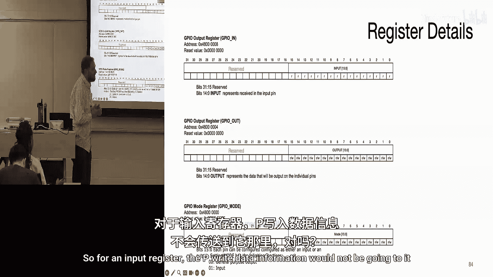
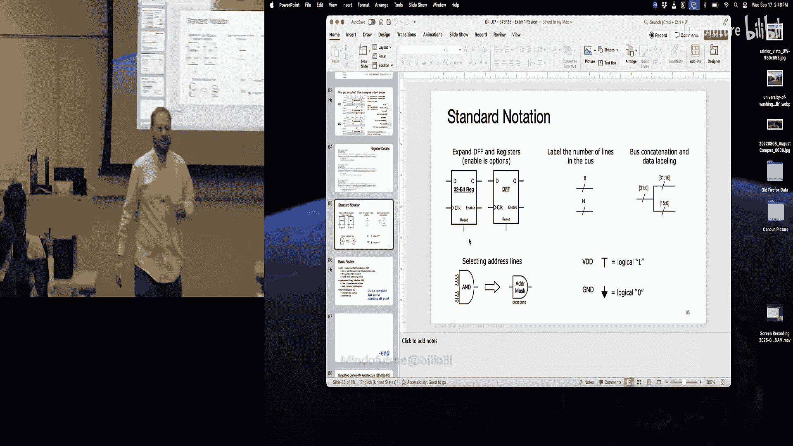

# 嵌入式系统设计导论：期中考试复习

在本节课中，我们将复习期中考试的核心内容，涵盖ARM指令集、应用程序二进制接口（ABI）以及内存映射I/O。我们将通过解析关键概念和示例，帮助你为考试做好准备。

## ARM指令集架构

ARM指令集架构是嵌入式系统设计的核心。它定义了处理器如何执行指令、管理寄存器以及与内存交互。

### 寄存器与内存

ARM处理器包含13个通用寄存器（R0-R12），以及一些特殊用途的寄存器，如栈指针（SP）、链接寄存器（LR）和程序计数器（PC）。这些寄存器用于存储临时数据和地址。

内存被组织为统一的地址空间，但物理上分为不同的区域，如闪存（存储代码）、SRAM（存储数据）和外围设备地址空间。ARM的内存布局是标准化的，以确保不同厂商的芯片之间的兼容性。

### 指令类型

ARM指令主要分为以下几类：
*   **数据处理指令**：用于算术和逻辑运算，例如 `ADD`、`SUB`、`MOV`。
*   **加载/存储指令**：用于在寄存器和内存之间传输数据，例如 `LDR`、`STR`。
*   **分支指令**：用于控制程序流程，例如 `B`、`BL`。
*   **条件执行**：许多指令可以通过添加 `S` 后缀来设置处理器的状态标志（如零标志Z、进位标志C），后续的分支指令可以根据这些标志进行条件跳转。

以下是一个使用 `ADDS` 指令设置标志并条件分支的示例：
```assembly
ADDS R0, R1, R2  ; R0 = R1 + R2，并设置状态标志
BEQ  label       ; 如果上一条指令的结果为零（Z标志为1），则跳转到label
```

## 应用程序二进制接口

应用程序二进制接口定义了函数调用时寄存器的使用约定，确保不同模块编译的代码能够正确交互。

### 调用约定

ABI的核心规则如下：
*   寄存器 **R0-R3** 用于传递函数参数和返回值。它们是“调用者保存”的，函数可以自由使用它们。
*   寄存器 **R4-R11** 是“被调用者保存”的。如果一个函数要使用这些寄存器，它必须在修改前将其值压入栈中，并在返回前恢复。
*   **栈指针** 必须始终保持对齐。
*   **链接寄存器** 存储着函数的返回地址。当一个函数内部需要调用其他函数时，它必须先将LR的值保存到栈中，否则返回地址会丢失。

### 栈操作示例

以下是一个函数调用链的栈操作示例。函数 `quad` 调用了两次 `square` 函数。

```assembly
quad:
    PUSH {LR}        ; 保存返回地址，因为即将调用其他函数
    BL   square      ; 第一次调用square
    BL   square      ; 第二次调用square
    POP  {PC}        ; 将保存的返回地址弹出到PC，实现返回

square:
    MUL  R0, R0, R0  ; 计算 R0 = R0 * R0
    BX   LR          ; 返回到调用者
```
在这个例子中，`quad` 函数在调用 `square` 前将LR压栈，调用结束后再弹出到PC。`square` 函数不调用其他函数，因此无需操作栈。

## 内存映射I/O

内存映射I/O允许处理器像访问普通内存一样访问和控制外围设备。这是嵌入式系统中与硬件交互的基础。

### 总线结构

处理器核心通过总线与内存和外围设备通信。主要组件包括：
*   **请求器**：位于处理器核心内，发起读写事务。
*   **总线**：一组共享的导线，传输地址、数据和控制信号。
*   **完成器**：位于每个外围设备内，响应总线事务。它包含设备的具体寄存器。

关键信号包括：
*   **PADDR**：32位地址总线。
*   **PWDATA**：32位写数据总线（请求器 -> 完成器）。
*   **PRDATA**：32位读数据总线（完成器 -> 请求器）。
*   **PWRITE**：高电平表示写操作，低电平表示读操作。
*   **PSELx**：选择信号，激活特定的完成器。
*   **PENABLE**：使能信号，指示地址和数据总线上的信息已稳定，可以执行操作。
*   **PREADY**：由完成器发出，指示数据已准备就绪。如果操作需要多个周期，完成器可以保持PREADY为低电平以插入等待状态。

### GPIO外设示例

一个典型的GPIO（通用输入输出）端口完成器可能包含以下寄存器，每个都映射到特定的内存地址：
*   **数据方向寄存器**：控制每个引脚是输入还是输出。
*   **输出数据寄存器**：写入数据以驱动输出引脚。
*   **输入数据寄存器**：读取输入引脚的状态。

当处理器执行一条存储指令（如 `STR R0, [R1]`）时，请求器会生成相应的总线事务：在地址总线上放置R1的值，在写数据总线上放置R0的值，并置位PWRITE、PSEL和PENABLE信号。目标GPIO完成器捕获这些信号，并将数据写入其输出数据寄存器，从而改变对应引脚的电平。

## 总结




本节课我们一起复习了期中考试的三个核心主题：
1.  **ARM指令集架构**：理解了寄存器、内存布局以及数据处理、加载/存储和分支指令。
2.  **应用程序二进制接口**：掌握了函数调用时寄存器的保存与恢复规则，以及栈的正确使用方法。
3.  **内存映射I/O**：了解了处理器如何通过总线与外围设备通信，包括关键信号的作用和GPIO等外设的基本工作原理。



请务必熟悉提供的参考手册和数据手册，在考试中善于利用它们来查找指令细节和硬件寄存器信息。祝你考试顺利！