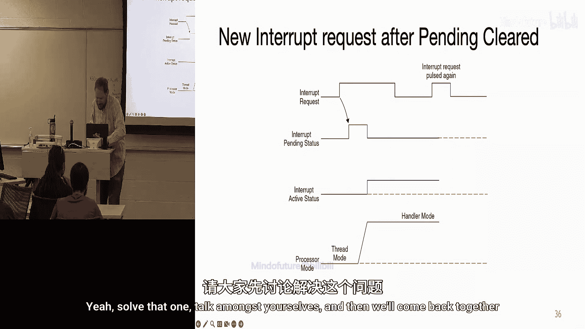
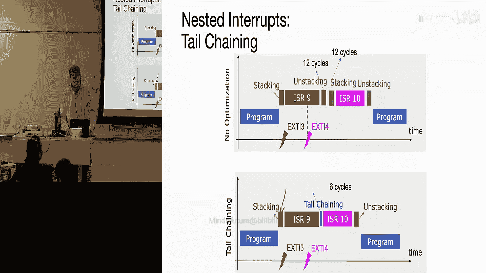

# 【密歇根大学】嵌入式系统设计导论-EECS-373-｜-Introduction-To-Embedded-System-Design-2025-p08-P09_课程8_NVIC--BV1VTSNBoEem_p8-

All right， we can get started now， maybe。All right。

 so homework4 will be released tonight it's due a week from today。Well have office hours today。

 that's the normal office hour time willll be directly out class。

So we're aiming to release the exam one scores on Wednesday。

They take a lot longer to grade sometimes in another gear， so we're working through it。

So where are we in the class？Let's see so now we're working on interrupts and interrupt preemps so we got a little bit ahead of our schedule and this week you're doing or finishing off the interrupts lab next week we're going to start projects right so or start team formation and project ideation so we'll have a team formation event next week on Friday。

And before that you'll have some ideation slides and we'll go over that beforehand。

 this is an opportunity for you to start thinking through what projects you want。

 what you're excited about and then during the event they'll be like pizza and that sort of stuff but we will have people share their ideas so you guys can start forming team and figuring out like ideas any logistics questions before we get started。

Yeah。Okay。So last time we're talking about interrupts control registers。

 we'll do a little bit of review of this， interrupt flow control and then today we're going to talk about interrupt priorities and how to deal with concurrent and overlapping priorities so a little review from last lecture so interrupts are a method to asynchronously change program execution on the microcontroller。

There's two types of interrupts， essentially they're system exceptions。

 we call these internal interrupts， these come from arm itself in a sense that these are the things that you need for the core to actually function。

 things like bus interrupts or memory misallocations or memory mis hitts or something。

 those are all going to be system and then there's events or external interrupts and these are the things that you are intentionally programming typically they're outside the core the peripherals will be causing some code change to occur。

And then we also talked about vector tables in Sing and stacking which we'll talk about briefly so just a reminder。

 we have our core part of the core is this thing called the NVIC and nested vector interrupt controller。

 this is a bunch of logic andSa machine that controls interrupts。

 it takes signals from the peripherals。Right， so these are literally wires coming from each of the peripherals that indicate that an interrupt is happening and this thing knows which wire belongs to which peripheral and then there's some control register so you're going to go you don't write microcode or anything for this NVIC or normal code instead you configure it with a bunch of registers right and then you're going to do that from the core and so this will allow the core to be doing some execution。

 you'll set up some interrupts like hey when the GPO pin goes high， do a task。

 this will this GPPO peripheral will cause this NVIC or this line to go high the IRQ causing an NVC to take control away from the processor for a moment。

 give it another task to do and then seamless put it back to its original state。

So how does that happen， come back？So you have some main program， right。

 some external interrupt occurs， we have to figure out。

First the NRC has to figure out which IRQ it is and that's pretty easy because they they're all mapped into it but then it's got to go and relate the IRQ that caused this has to execute code at some location and so there has to be a table or a structure or something that represents that holds the address of what code should be executed so the NVIC had what's called the interrupt vector table this is stored in memory in the lowest location memory first place memory is the top of the stack and then there's the resets and so the NVC will go into memory it says well I know an IRQ corresponds to these particular locations in memory and then it'll take this address and then start executing that subroutine。

There should be some more builds here， guess not。OhI was building through this， okay。

 so some interrupt comms and then there's combinational logic essentially it says the interrupt of nth index here corresponds to some interrupt over there and then it's going to take this represents memory space。

 this is address of memory space and in here held in memory is the address of the IRQ handler。

 basically it's just a fancy branch statement。Then you're going to go execute that code。

And when you're done， you're going to return control back to Maine and the goal is to make this as seamless as possible。

 so Maine doesn't ever know that anything happened here。

 there's just going to be a missing chunk of time and how that's done is that there's the stacking and unstacking that occurs where the NVIC will take all the information that was required over here。

 so the lowest four registers plus PC and the LR， the stack pointer and put them on the stack。

 do this task and then return all those variables back to the controller so that you're in Maine。

Any questions？No questions。Okay。So we blasted through some of these slides before。

But I wanted to just to highlight the ones that are particularly important and we'll go through some examples。

 so we have the interrupt enable so these are a bunch of registers where you were going to go through not necessarily configure that interrupts configuring some of the ins and outs of the register are going to be done in the peripheral but in the endVIC you're going to go and write in and say I want this thing enabled or I want to clear it so interrupts are inherently enabled or disabled you have or they're always disabled you have to enable them and you might do that in your configuration but you also may do a dynamically inside your program where you're saying I want them to be turned on now versus a different time so whether it's initialization or in your。

Programs kind of up to you then there's pending registers now these aren't necessarily things that you set although it is possible。

 but these are more the registers that hold the state of the what's happening in the NVIC and they're holding the bits of when IRQ comes in from the peripherals it will show in a register these are the ones that are pending this so it the state holding device really core to the function of the NVIC。

And then there's another register that shows which interrupts are actually active and then lastly we haven't gotten to it yet but we will today there's another set of registers that tells for every one of these individual interrupts what's this priority we'll talk about that in a minute。

 but the goal of this idea is that some interrupts are more important than the other ones and so you know you're fine an airplane or something a model airplane or something and you have an interrupt for stability control versus I don't know directional heading or something and some of those are more important than other ones and you want the highest priority ones to always be executed first。

And then we went through some of the details of these particular interrupts。

 one of the key takesaway is that you can have many interrupts， you can have what it was at 256。

 I think， to 240， but it's up to that's what arm provides you， hey， you could have this many。

But your individual device manufacturer is going to have a subset because it's complicated or Mika InVc that has all these interrupts。

 and some of them are necessary so you get 96 with your particular micro controllert plus the 16 from arm。

Okay。So any questions about the basic registers， yeah？

The booting what with the other ones like be doing？We could look through it。

 I don't remember them all off top of my head， let's see。I I have them written down in a weird way。

So let's see we have the reset handler， the non masksable interrupt handler have no idea what that is。

 hard fault， a memory management handler， bus faults， I'm not what the usage fault is。

 but these are the types of interrupts that can occur。Does that make sense？

Yeah like if you're like accessing a memory that's not cloud and there's like some for that Yeah basically what happened is say your memory manager which is a modules we don't really talk about that much but say that thing has gone to a wrong error or is' starting to execute is asked to go to a code space that doesn't exist it will throw in a and then it's this jobs you know the NVIC has well there will be a program that's written to handle that particular case what happens when this default occurs typically for you guys you're going to worry about the reset handler that would be a thing that you want to boot up in a certain state maybe I've certainly written programs where in the reset handler you want to make sure the state of certain pins is known so you don't want it to boot up and have the default state of LEDs。

 you want it to be a known state。Those sorts of things。Any other questions？い。

The problem to a certain statement there。So the manual will tell you what the default state of registers are。

 you might not like them。They might not help you execute your program。

 it could be you don't want to boot on your thing and then have your motor starting to turn。

That would be annoying。And so you would go through and as soon as your thing boots up。

 the first thing it does is resets the direction of those pins， for instance。

 now that's less of a worry on this particular microcontroller I used。

MSP 430s back in the day which is a smaller microcontroller to do really low power things and some of those were random。

 you didn't know what bit states some of those registers were going to boot into and so you better go and reset them to something known as soon as you wake up。

Any other questions？All right， we went through， I'll hand out these worksheets again just so you go through we missed one of the。

One of the interrupts or one of the slides。G you guys a chance to do it so if we look on the slide。

 we see that the top is interrupt request， so that's the irQ signal that comes from。The peripherals。

So that's not a register state， that is just a signal and there's going to be 96 of those we're only showing one in these exam total let's see you need two more maybe。

Yes。hold on don't get lost yet I promise I have interesting information for you hold on just be quiet for a second would you Okay don't I don't care so pending status is literally this is a register。

This is a state holding register that's going to be caused when your NvicC reads。They request。

Inter IQ。We'll have some other people send them back if you guys could just send your sheet back。

Back in the rows， the people in the back great。Krick， can you just send these back？是。For。然后你。是。

Do guys need more time to talk to each other？ま。全。快出去。All right so here we go。

 so we'll go through this example to so you guys can all remember so we have some interrupt request interrupt request comes from the peripheral it goes high then your NVIC is going to set heading status this is a register and it's going to go high so between here and here the envicCted a task okay。

Then after some period of time and this case is fairly quick。

 you're going your NVIC is going to take your processor offline well first your NVI is going to say okay we're going to go into active state so it's going to go from inactive to active。

 this particular interrupt and so that's held in the active status register and then the processor is going to go into handler mode which is basically say it's going to do the IRQ it's going to end it when it ends this is going to be deasserted。

 it's going to go back down， that's the normal state of how these things work。

 so then if we have any questions on this。All right in the last week i'll just go through these you guys can draw them out if you want and we'll say that we have one on the back and you haven't done yet so in this particular case we have our our interrupt request came high okay。

And then our pending status went high as well， when it's pending， that caused it to go inactive。

 and then their handler goes and the question happens， what happens when you exit？Your active state。

 well， if pendings still high。It's going to happen is you're still going to exit。

 you're going to unstack and then it's going to come back again。

 it's going to go from pending to still high， therefore we're going to go back into pending。

 then we're going to go into active then we're going to go back and interrupt so in a sense we kind of wasted some time we'll talk about this wasted time here where we had to stack and unstack and there's ways to mitigate that issue。

All right， any， any questions here？Yeah， so when it reenters， it only stays active。

Oh I guess its sorry Ill to that backwards， so it flips off for a second and then just stays active and that just keeps looping since yeah in this particular case because for whatever reason we don't know。

 but this interrupt request has stayed high。Okay， and it should have come back down but for every reason it says hi and so you can't go back into pending or you went into pending here。

 you can't go back into pending when you're active。

 so it's not because it not like it didn't immediately go back here because it was active。

 so when it became unactive then it was allowed to become pending again。

 it became pending then it went back to active。Yeah。Why is it a less durationeration the second time？

These are magical， like intel， grass， apple grass， where the axes don't matter。

 it's just giving you a feeling。There could be a variety of reasons why say you don't go immediately from heading into your active state。

 so maybe there's some variable here。Any other questions？Okay， so the next example was。

What happens if you get multiple pending interrupt requests right so that line from the peripherals toggles three times。

 but here you've got the first one， you went into pending。

 but for a reason who knows why the reason is you haven't been able to get into active yet。

 what happens in that case？And so here。This remember this line is just one is a register where each interrupt has one def flip flop or one state holding device in it。

 so it's one hot encoding so where each individual location denotes which register it is and so there's not enough information to hold hey I got three pending interrupts this only says I have a pending interrupt then it went into active then you went back you don't do it three times because there's no even way to hold that state information。

What questions we have with this？这样。Different signals go lot。

s a particular reason this this means Apple is trying to tell you that they have doubleX performance this year versus this performance I have no idea like I just took these straight from the Ar cortex or the definitive guide from the Ar cortex manual it's pretty good pretty good book this is one of the two books I recommend the first book was like a junior level or sophomore level book a little bit more tutorial it kind of assumes you didn't take 370 this book the other book I recommend it assumes you've taken this course and worked in an industry for a year and then you're like I understand everything in it it's just a reference manual。

All right， so the next question is， and this is the real question should be on the back of your thing。

 what happens when I have an interrupt request， I've gotten independent and I'm active and let me see if I can get the prompt correct。

Request goes high， but then it goes high- well， request goes high again in the middle of my active state。

Is that correct， do I believe that？Yeah， to solve that one， talk amongst yourself。

And then we'll come back together。It's not correct request。

我们06。I。Im going read。That's why I think。も。なんかわいで。'。らいる。

And this back a of I think it's closings I I no quality。

有些需要。W things is going to happen。我がなでこ。So I'm thinking like this goes to the union。

And that to be different from the other examples， right？こ。always time get。さい？なといく。

entire teamAnd then when was done or when you're out of this， it will treating。

They'll probably somewhere back there。All right， let's see I see lots of good answers back there。

 there's probably one small point i'll point out that I didn't quite teach you correctly。

 which will make things hard。here we go。All right， so the question here is we came into interrupt and we're let's see we're active mode。

 we're still active， but how did this thing get said again， right。

 how did just get interrupt pending again， well the thing I forgot to tell you so you couldn't possibly get this answer correctly。

 but that this is you can turn on pending if your positive edge triggered。I didn't tell you that。

 so you couldn't possibly know， but that's over here， let's see， where's this example？This example。

 you didn't have a positive edge trigger， so it waited， come back here。

So then you had to get out of active for pending to go high again， that's just a level set。

 but if it's a positive edge trigger。And。You can actually deasert and again。

 the same thing happens on the end here， right， you go， yes oh is this the right one， yes。

 it's the right one here。This ended and then you had to go right back and you were out of active for a moment and back in。

 it's just that pending somehow got set， how did pending get set because of the positive edge trigger。

 this rarely comes up， yes。Example。Or slide to five for those's multiple。Yes。

There's no state holding information there is already high。We never got out of pending。

 so pending was set here， pending could have been set here， could have been set here。

But Pennny never went low。Yeah， before pending went。

 so in the example we're showing now pending goes down early and you go into active and then pending reset。

 but pending never was taken out of pending， pending was always asserted。

 so it was just keep on being asserted over and over again。Okay。

I got you on a trick question that you couldn't answer。Does anybody have any questions？

I on the back over there， very quiet back。No questions yet fine the brave question， yes。

 are the arrows supposed to indicate like positive or like negative x triggered for these arrows？No。

 they're just telling you what actions happen。All right。So let's go on。

 talk about interrupt priorities， and this is how。You know that one interrupt is more important than another interrupt。

 so the NVC you have a question？So I'm assuming in the last example。So winner。

Its the positive trigger and then it went down because the status went down and that got right？

You feel like the previous act just kind of was taking its。

 would it just just also stay in that pending state or？Yeah， what if it say that pending saying。

 because is pending until you come out of active， that's the thing that gets you out of pending is being inactive。

All right， so the NVIC allows you to set the priorities almost every interrupt。

 it doesn't allow you to set the priorities of arms lower 16 interrupts that's not possible they have to only use five on this particular chip。

 but those are reserved， you can't change those， but you can see that change of priorities over everything else here interrupts can be preempted by lower importance interrupt and we're going to use the term importance because we' going to use golf scores for interrupts we'll talk where low numbers mean it has higher importance but basically if you have a higher interrupt you want it to preempt or interrupt another interrupt。

Here we're going to use golf score， so a lower number means higher importance。

So there's bunch of fixed three fixed priority levels， and then you have up to 256， but in our world。

 it's well you have 256 program gramable priorities。And there's particular registers for that。

 you know， they have addresses and then you're going to go through and say， okay。

 this is how I have eight bits I want to use to represent。

The priority number for a particular interrupt。All right， so it inverse relationship。

 lower priority values mean higher urgency， so a if a is5， then a is a lower priority then B。

 so B has higher importance try to make sure。Talk about that way and then these are the most important interrupts so reset has to be more important than a hard fault because reset is like the thing is coming on right nothing can interrupt that and you might think like isn't that happen immediately well it's not light bulb there's actually a lot of boot up sequence that has to occur for the processor to actually land in Maine and be executing your code so this is the most important one。

And so we use a register structure to keep track of this。

 so here we're going to have we say there's these eight bits。

Of potentially up to  eight bits to denote the priority of a particular interrupt and so we can chop up these bits in two different ways with two different numbers so there's the preemption priority and the subpriority so preemption means of two interrupts with different interrupt priorities one is going to preempt the other one so the lower the priority number or the more important is going to preempt but then you may have multiple interrupts of the same preemption priority and then you use the subpriority numbers to say well that's this is the ordering of how those interrupt should occur so there's like you know。

The big priorities and then once you're already interrupt。

 how would you sort essentially the interrupts that are still pending of the same value。

 we'll walk through a bunch of those examples。There is a small。呃。Qurk for this particular device。

 and that is that it does not even implement the lowest four bits。

Of the preemption of priority register， just because it doesn't having that many choices actually isn't that useful。

 so you can write to these but they'll do nothing and they only give you the top four bits and you get to manipulate the top four bits to have more or less preemption or subpriority。

嗯。So you can reallocate this is what this table is showing。

 you can reallocate the number of bits and there's a register for that where you can say， well。

 I want maybe three bits of preemption priority and only one bit of subpriority。

 or I want one bit of preempttion priority and then everything else is a subpriority so it gives you some flexibility in controlling which interrupt interrupt other interrupts。

Yeah。They split out into preemption priority and subpriority。

 couldn't they just treat that as one number and have it achieved the same purpose？Yeah。

 but you you run out of space pretty quick， that means is that I think that over that's more interrupts。

Then you or that's not enough to represent all the interrupts that could possibly exist right not enough bits。

 and so they're basically saying the best strategy is we're going to have some we'll have two bits or say whatever number of bits。

Of things that have different priority and then we're going to sort the rest of the bits， pendings。

 and this is really about which pending things should go next。Yeah。

What does preemption versus mean again？Preemption priority is I have two interrupts。

 three interrupts， let's say and they all go off at the same time or while I'm in to interrupt。

 these other two interrupts go off， should this one that just went off interrupt currently active interrupt。

 it could， that would you'd want that if you had like a hard reset right or a bus fault or something important。

Then it says， all right， I'm interrupt， I'm not going to interrupt this interrupt。

 let's say it's just too important， the other ones that I see some things that are pending。

 but they're not particularly important enough， but when I leave this interrupt。

 which one of those pen interrupt should I do first？And that's what subpriority is。Yeah。

 they're not using the four bytes， the four least negativetes when I。Fororit priority。

Vers why would you choose this？So arm says you have to use four sorry arm says you have to have eight bits okay but STM said look that's too many。

 my NVIC will be too crazy， it'd be too hard to implement。

 it's not worthwhile because I only have 96 interrupts so I'm only going to do four right why I can ask you why you take 30 seconds figure to ask each other or discuss why has STM said I'm only going to do the top the highest bits？

Here and not just use the lowest bits， why would STM make that decision？Talk amongst yourelves。我。买会。

YeahYeah。I was only the same person， but I am not。辣会。是。

what do we think why not just use the lowest four bits。

 why have actually use the highest four bits in this leave these unused。

 why would you make this architectural choice？Okay。Perhaps somebody has a guess。

Wells if you are trying to manage a set of code across multiple processors。Oh。So。

Having your as long as your preemption and subpriority are about the same。

Across different processors， well， this doesn't even matter。Here or say。

 you transfer your code to another processor that has the lowest bes。

These interrupts will still work。哎。These are just more fine grain control over those bits。

I think that's the reason why they're doing it。Okay。Because interrupt priorities are so important。

They actually have a key that you have to write into a register if you're going to change the allocation of your。

Preemption priorities。So what you do is you have to take， I mean， it's not like a private key。

 it's not like a security thing， but there's just some value and then you have to write it into that register because and that allows that unlocks it so then you can change your priority groups。

And that's just because they want to make sure that no code error occurs is that's going to drastically change the execution of your device。

 you have to intentionally do this so in lab youll have to look for this particular code to change those preemption priorities and those group priorities。

All right。So let's go through an example here to say we have the external IO lines here。

 you can go offset， they have the space offset for the interrupts from arm。

And say we want to go give it some value okay and so that really is。

 there's this data structure here， a memory structure that lays out different interrupts and then there's four bits here that you're going to go place into there and it's got to be the upper four bits for this particular application so you're going to set it in there and that will set the interruption priority。

You can actually do this in assembly if you got real excited。

 they actually have a specific instruction for， oh wait for these are for masks， sorry。

You can go and change your execution masks so you can go and change which priorities should be。

Execcut it so you could say anything that's less important has to be more important than this value than you should be able to execute it and so you have some instructions。

 you actually have assembly instructions and of course you can do it and see as well where you can change the value of the priority mask。

And you can set to you can set them all on， you can set them off or you can set it to a particular value。

 there's also a fault mask and the base priority mask。All right， so let's talk about。

I think interrupts make more sense when you bring it all together and you look at overlapping interrupts。

Let's talk about this case， we have your program stack。

 we have this is execution time is is difference between we'll say software。

 they call us hardware sometimes so this is basically in your interrupt handler。

 we have registers here that represent their priority table so these are five different interrupts of different values。

Then we have holding the state of if it's pending or not are is a pending register。

 all these interrupts are active so you have another register for that so this is your enable register and then you have or sorry this is which ones are enabled and then these are the ones that are active so right now。

We have nothing's active， they're all enabled， nothing's pending。

 here are our priorities and oh and here's our base priority。

 basically saying that any value smaller than this can be interrupted。

 but you could decrease this value， say you could put it to nine。

 and even if this thing is enabled and it's inending。

 it won't get processed because your base priority is smaller than that particular value。Yeah。

thing that priority table is that' saying that the interrupt that's in spot three。

 since I has the lowest priority of three， that would go first。Yes， y。Or say it another way。

 if it's active， nothing else is going to interrupt it。Yeah， this is some。

This is all preemption priority right now。We'll talk about that particular case a little bit。Yeah。

 since here like23。Versus saying like for all possible。Yeah。

 this is just saying this is the base priority， you have to have a priority larger than this。

Or smaller than， sorry， something that's more important but smaller than this and you can change this number if you want to。

 I don't know， you're important part of the code， you don't want to be interrupted。

 you can disable the interrupts just by or disable lowpar interrupts just by changing this number rather than going to each individual interrupt and changing multiple instructions。

Yeah， is there like a function called that all interrupts or would you just do that by either lowering base priority all the way down There is a function for that。

 but one of the easier ones is just to do base priority it gives you more control。Yes。

This set of priority numbers was a set of problem。I'm sorry。

So that is in the preemption priority bits that were' over。Here， this is essentially the table。

 you have a table and you can go put your bits into here and what are those bits？

Those bits are these bits here and right now we're talking about the preemption priority we're not talking about subpriority so you're setting these values so this is you can set the allocation。

 but you can actually set what value these are。Okay， all right， so let's say。An IQ 4 goes off。

Okay so that's going to cause us to start stacking and here's our program S。

 so we'll PC the program status register link register R0 through R3 and R12。

 you put those on the stack。That has caused us to be impending right now because we're in the process of stacking。

 we're not active yet， it's going to take six cycles or so for us to get into pending or sorry for us to completely stack and get into our active state。

Then we're going to go into our IRQ so here's the idea here is that hardware is causing this to happen。

 this is a program that you've written， this is another program you've written in your interrupt service routine it's just that stacking or the hardware got you there wasn't a function call that got you there and so now we're in that interrupt we're not pending anymore so this register has been deasserted but we now we're in the active state。

And we've set our base priority to six， which means that 10 or eight， if they happen right now。

 they cannot interrupt this， they will keep going， be to stay in pending， but if two。

 three or two or three happen， then they would interrupt in this particular interrupt。

And then you're going to branch to link register， remember this is that special link register。

 that's the value that's like FFFF6 or something， and that's going to tell the hardware you're going to link to a location that tells the hardware okay。

 it's your job to unstack。You're going to be out of active。

 you're going to unstack and you're going to go back to your normal program execution that's the normal way a single interrupt will occur。

What questions you have。Yes， does you have to be really loud does enable do and A this says that I want this particular one of these interrupts to be enabled and on so I could make this if I had made interrupt four if I had made this bit zero。

 yeah， this bit zero， then if the interrupt comes， it doesn't do anything。Okay。She says no。

 she says not I don't like any of that okay so you could go through and tell your peripheral， hey。

 I want you an interrupt pin when I see a rising edge on this pin I want you to go high and send an IRQ to the core okay to the NVIC。

But the NVIC does not have to listen to you， listen to that interrupt or that interrupt request。

 instead it could say put a zero here， and then it will ignore interrupt requests from line four。

Does that feel good so would that be something that happens at the very beginning。

 like when the request there's a request or would that just be？What' the current law。

Enabling is done by I didn't quite hear everything so my apologies but interrupt enabling and interrupt happens by you as the programmer you're going to set these things to be enabled or disabled so not all interrupts are on by the fault and so you can go turn them on and you can turn them on when you kind of reset the entire device part of your boot up routine initialization routine or you can set them dynamically your code say okay now turn on for this particular function then turn off later on。

 does that answer your question。Okay， great。All right， so let's look at when things get weird。

So things get weird when we have nested interrupts and that's the name of the NVIC is a nested vector interrupted controller because the idea is that multiple interrupts will be happening on top of each other and so the goal is that higher interrupts occur。

 lower importances interrupts will not interrupt to interrupt a importance higher important ones will。

 and so we'll walk through this example here。So here we're kind of back to where we were before。

 so we're in a program and interrupt four occurred。

 we started stacking and then we started doing this task here。

 actually this shouldn't be here quite yet， but we started doing this task and while we're doing that task and interrupt occurred okay so interrupt three and so now interrupt three has a priority of three which is lower than the base priority。

 therefore we're going to have an interrupt interrupt and interrupt。And so when that happens。

 we go depending。And oh sorry this was the this was maybe IRQ was just using the stack。

 this is what we're demonstrating here so if we go back back back So here I don't know what the IQ was doing。

 but it had some data on the stack whatever is function was I don't know and then it gets interrupted so now we're going to do stacking again so now we've gone into pending this thing was enabled this one is still active right4 is still active but three is taking over and now we're going to stack the state of the register that was responding here。

 this entire thing is being stacked up here， the state and now we're going to start executing IRQ3 So IRQ3 was pending now is active now we have two things active IQ3 is active。

We execute that， we get to the end， we branch back to that special location。

 it unstacks the data that was held here and puts that back in the court that the data necessary necessary to execute this。

 puts that back in the core， and now it goes back to this particular that one， that one's pending。

 or sorry that one goes to active。We finished executing this。

 and then we unst and go all the way back to our main program。What do we think？

In some interrupt and then there were like two nested interrupts that happened。

 there were basically like three active bits。How would it know which of the other active bits to go back？

Well， let's look at this exiting strategy here， right？

It doesn't actually keep track of what was what was pending beforehand that information like there's not an extra register for that it's held here on the。

It's held here on the stack， this is the state holding device。

 so it says when it exits here it says BXLR right and then it unstacks all this data。

 puts it back in the core， that just happens to be you're in this IRQ， you're in this interrupt。

Does that make sense？See， ask your question again。嗯。肯定死么。

Maybe maybe a way to rephrase it is like what is the piece of data that's indicating which active？

Its corresponding to your current intro， nothing。The way that information is held is through the act of stacking and unstacking。

Okay so it's kind of the sequential action of I stack this。

 therefore that's my last one and then I stack this again so the stuff that's in the stack is what's needed for this so when I unstack I'm going to do this right and so there's this an oning chain of on your stack is all the interrupts that you're in and it's just sequentially going back through them。

what's that each level here， so this is the importance， the lower the number。

 the more important it is， so in this particular case we started out in four which had a priority of six。

 this is the interruption or preemption priority not subpriority。I'm at six。And therefore。

 if one or zero came in， it could not interrupt because these values are larger。

But three came in and three was able to interrupt。Remember mean one is like the four or three means。

 is that connected to a pin or something please？Yeah。

 these are essentially these signals that come from to the NVIC and so number four corresponds to this particular interrupt priority。

 so if you look in the vector table， those lines correspond to those particular interrupts and they each interrupt has registers associated with it。

 which is pending enable and active， and so the NVIC's keeping track of how they're all coordinated together。

Yeah， what does the case priority change？So the base priority changes。

It was at 256 before this happened now at six because now we're saying。

 I don't want to be interrupted by anything less important than me。And so these are less important。

And therefore it does some logic when this IRQ comes in， we're going to do some logic to say， well。

 you're asking for this part interrupt three， it happens to have a level of three which is less than six so now I'm able to interrupt so this is keeping track of the state here。

Yeahep。Har adjust in the base or like hardware hardware I mean you can change the base priority if in software you know I'm coming to a really critical section of software this actually often happens when you're pulling in your decoding serial data and you don't have any peripheral serial we call it bit banging where you're taking in you're checking if as high or low you don't want anything to interrupt that task because you'll miss some data edges so that is a time when you might change your priority level annual so that nothing can interrupt you so is this like some sort of。

実は where。That allows some sort of interruptive like enabling if sort reading the。

Priority value into the base Yeah， it's just some combinational logic it says whatever is in this register is it greater than this other thing in this other register if it is then do a thing。

I like they here。When something can go interrupt the interrupt our saying life was actually a。

When is it adjusting the value of the case when you start so we're going to watch right now。

 I'm going to advance forward， we're going to stack here。

And then the price priority changed when I entered that one。

 so there's some combinational logic that says when I'm in an active。IRQ。

 then I'm going to change the base priority to that。For other questions， yeah。

Do yout understand what happens when you next。So change the base party back to what。correctrrect。

You even have to look for active bits all you do， so I'm going to go from IRQ3 and I'm going to go back。

To IRQ1 what is the function， what's the mechanism that does that。

 let's just say whatever this is just the data that the IRQ is using so ignore that for now。

 assume that the IRQ was responsible enough to pop off its own data。

Okay then the action of unstacking， just the mere action of unsting forces this data to now go back onto the core。

 so mechanically like like a hardware function will take the program status register which encodes this information。

 the link register R0 through R3 and R 12 puts that back in on the register and then changes PC PC is going to push back to this location right here where it got left off so that's the mechanism for un does PC yep unstacking does everything required to put us back into IRQ4。

And that way， there's no state holding device other than the staff that knows or has any record of how many interrupts deep you are。

 you could be a 20 interrupts deep or something。And the only place that information is held is on the stack。

Yeah。This the。Does it interrupt of the same priority of another interrupt interrupt that interrupt？

No， it has to be a higher interrupt。And we'll go through tail chaining， which we'll answer。

 I think the next question you have。So tail chaining is what happens with something of the same or lower interrupts to interrupt。

 okay？I the opposite question you asked， so here we go。

We're in our Q4 and then a new interrupt is going to come， what interrupt is it going to be？

It's going to be IQ1， which has a interrupt lower priority。

 so we're not going to preempt instead and we're not going to unstack。Now the reason is so。

If I went unstacked， I'd go all the way back to Maine and I'd waste a bunch of time in the action of unstacking because there's a bunch of memory rights。

 we have to take reads and write， we have to take stuff out of memory and put it in the PC。

 so instead of unstacking， we're just going to wait for a second。

 we're going to do some other we're going to get everything set up we're going to switch to a new IRQ here。

 but all the original state that holds program is is going to stay on the stack。

And then we're going to go when we're done that we're going to unstack and go back to program so here we're saving ourselves actually I have to look it up I think this might be 12 cycles and this is shorter it is like six or three cycles or something forget exactly。

 but basically you save the action of taking going all the way back to the program you just wait and then go directly into your IRQ so that's if the priority is lower。

What's all happening， is it just setting PC？Yeah， setting PC has probably got to update the base priority sort of things。

But it doesn't have to change， you don't have to hold the state of the microcontroller。

 right you don't have to update that， you can just leave that on the stack。我这。

Like the same preemptive priority compared to like a。Let's just say like a lower soap。

So what will come back？So I think we have an example of that next， no， we have late arrivals next。

So the question is。This was a lower priority so it waited here。When does subpriority come in。

 imagine if I had a number of interrupts that came in all at level 10。So now maybe one， two， three。

 four interrupts are all pending， we see them pending and they're all level 10。

 how do you determine which one of those 10 goes first。

 well the subpriority bits we're not really showing here。

 we'd have to have another registered channel here would allocate would indicate which one should go first。

系。One you're thing is you check your preemptive register first。

 then you check your subpriority if you have it like a tie yes。

 and that tie will only exist for pending things。All right。

 and then we have another one called late arrivals。

 so what happens when an interrupt while you're stacking if another interrupt of lower priority number or higher importance happens？

So here we have a case where we're in a program we got interrupt four and then while we're stacking。

 we got interrupt three， so what you wouldn't want to do is like double stack。

 like stack this then start four and then immediately have to stack it that wouldn't be effective so you don't want to do this it doesn't really make sense to do that because you're not even really nothing happened in four yet for needing the stack so all you do here is you just change their priority。

At the last minute or you're sorry， you just changed which interrupt is going to be there so you go and take。

At the very end you're going to go look at pending ink well let's see what you' going do you're going to figure out that this one has a higher priority and more important here sorry more important is lower priority number and then you're going to execute that one instead of four so that saves you some cycles go to three and then because four was lower priority number or sorry higher priority number and you're going to do tail traininging here where you're not going to unstack all the way you're going to go to immediately delete that one then unsack and go forward so basically you have up went to the last cycle for interrupt to come in and you choose the more important cycle or interrupt yeah。

Stacking is completely hardware， so it just won't be losing。我也。

I guess nothing could happen in between it， correct？Yeah。

 there there's no stacking inside of the stacking or something that just is not allowed。

 is it like atomic yeah？What questions you have about interrupts？Have one more example to go through。

Yeah， how do you know which has to be。Like which one is like what the bits correspond to so we like way back here。

哎，对对对对对。Their're registers for that is the short answer。

So there's mean you guys can't see that there you go so there's an active register it's in this particular one。

 what is it one bit for each interrupt and then there's N32 bit registers up to the 96 that you have and so you know here's interrupt zero there's a bit its read only right you can't write to it and it will hold the state of whether that one's active or not so there's a register for that。

Will that get pushed this stack？Is that part of this snap， no。

 it doesn't need to get pushed because just doesn't actually hold real state information。

P thatly you would need like if you're stacking unsacking。That's held on the stack。Right， but。

The kind of like the knowing which active to go back to if you're going in like deeply nested in like which I was asked before。

 but remember where is that held？What's the structure that holds that information？Well。

 I kind of thought it would be that register no， maybe not， nope， it is literally is the stack。

So after I leave IRQ3 and I unstack IRQ3， which IRQ am I going to next？By definition， right。

 because the action of unstacking will instantiate the information required to do IQ4 on the processor。

Right this information is going on the processor， you're jumping back into it there's no other。

Method to make that decision because you be XLR， it that's the only thing that can happen so that's like hardware deciding。

Like hardware knowing that。Well， the hardware is dumb， as dumb as hardware can be。

 it says I get a BxLR to FffFF6， I take whatsoeverever on stack， I put it in the core。

It just happens to be that that information in the stack represented the action of doing IRQ4。

And now you're back into IRQ4 and you're going to do it。

 so that action of the method is unstacking puts you back to where you were。

 you keep unsacking unsacking， unsacking with a BXLR to FFF4。Until you're back into Maine。

How's that feel？Okay。不是我。What what about this case so you have so you're you're on level four okay and then you you interrupt that guy to go to level three and then while you're in level three。

 y a new interrupt comes in that's lower than four and three so its maybe it's five okay？

What it unsed for so its it's to do that the priority here is five。

 which means yeah yes do an that comes in while you're in three so it won't do anything right because it's not in the use because it won't interrupt and interrupt doesn't have enough priority so then you would just execute you go to three。

You'd go unstat， let's see what we'll do it'll unstat no。

 you get to end of three and it'll figure out what it should do it should figure out if。

It'll look through pending， I guess， and say， is there anything higher than four， anything。

 any interrupt that's more important than four in this case there won't be right because it's five。

no， it would wait， no， it's five， right， then it would do five， then it would go back to six。Yeah。

 you saying。So let's say this say it was four。And while you're in three。

 IRQ2 comes in which has a five priority right， then instead of going back to four it's going to do late arrivals or tail chaining。

 it'll do tail chaining right where'll say okay， I'm going going to jump to two here because it has a it's more important than four。

 it's going to do this task example I'm meant to say it's a lower priority than both oh so we'll change this one to literally two or something。

 then it'll just interrupt the interrupt。don no， I'm going to priority hire， okay。

 I'm going to priority like it's a lower。We use the word importance it's it's it's less important as them than vote like can Yeah fine it's less important that no then it's going to go。

 then it'll go back to four， then it'll do eight at the very end。

Because the base priority will prevent it from happening。Also。So let's go unsted three。

 finish four and then do that lower。 I was wondering why wouldn't it like tail chained to what？内。

Why won't well， that's because it's based prayer。I want a tail chain to。To this， right after three？

And your statement is， how does it know four exists because it's on the stack。

 that's what I was thinking like but we know what's active。好的。And so you could go through。

 I guess I guess have to read the manual again， but it should know in that particular case that it should go to four。

 I know it will go to four rather than going it will always do old。

Do the interrupts in order of priority？So I have to think through the mechanism。

 like what's the actual logical mechanism here， but it's going to look at active to see what it should be doing next。

Oh right， so it knows to tell shame when it's impending and not inactive， Yeah Okay gosh。Ex sense。

Yep I is only high during snap it never goes back high even when it it's very by pending goes high when you're not inactive so you could be so say I got IQ 10 here or this one I have to all this sort of stuff it's going to be pending until I get to it so it's not just stacking it's it's when it hasn't been。

Serviced basically's interrupt doesn't go back pending well。

 to be interrupted by an interrupter you must have been active and so when you're active you transition out of pending into active。

So yeah， that cur can exist。100% sir if I understood what you were just saying so let's say you had IRQ2 which has a priority of five so were you saying that after you were done with IRQ4 it would correct saying that but IRQ at four has a priority of six so wouldn't okay sorry I probably that's prior where I got confused confused him it should it will do the interrupts in the order of the priority that's the goal so if I misspoke sorry。

Yeah。So if it was 10， for instance， it will do four and three and then do 10 at the very end。

In this instance， though， it would finish three and then do two and then finish four。Yes。Okay。

Have I confused everyone enough？Fantastic， let's move on to the next problem。

CanConfuse you in a different way。Yeah， it just just to remind you these are review slides spend where we got。

 but just to remind you literally there are wires that go back to the NVIC controller。

 those are the interrupt signals， there's multiple of them。Okay。

So here's a slightly different example。So you can see in a different way。

 so we have the interrupt numbers so these are yeah so the prior so interrupt numbers so these are in kind of interrupt table。

 these are their locations， you have which ones are enabled， you have which ones are active。

 you have which ones are pending and which ones in their priority so here we only have one thing enabled and then we have program。

 we have our stack。And there's sack over there， and here's memory， okay？And so let's see。

 so we have that IRQ for external interrupt  three goes off。

Which then we would go into this thing here to figure out what into our。

vectoror table to figure out where should IRQ3 handler be。

 what's the address of this particular thing？Okay。Oh sorry， that's where the code is。

 the address is somewhere in here at the lower bits。Then what happens that we do stacking。

 why the arrow points that way， I don't know。That looks like a slide。

Mistake or and so then now we've set this to pending。

 it's still enabled now and that's what the priority is so nothing's going to interrupt it。

We're going to load the stack up， that's what the pending process does。We're going to be an IRQ9。

We're going to bexLR to FffFF6。And then we're going to unstack。

And then we're going to go back to where we were in the program。

Usually this helps if we do it the next day， but anybody have any questions with that？

YeahWhat is the IR money。2。You guys say that again where ISR Yeah。

 that's the as just the interrupt number in this example。All right。

So here we'll talk about a different version of preemption。So here we have stacking。

 so now we have both， so again these are registers that are in the NVIC that you're going to write to to set up。

 at least I mean you're not going to write to these， you're going to write to enable。

 you're not going to write to act you're not going to write to pending。

 but you can write to enable that's in the NVIC and you say you've enable these two interrupts and interrupt three comes in。

And that happens to be ISR9， this is just the location。

 this is just like the external interrupt number three。

and then DMA channel comes in so what is a DMA channel DMA is direct memory access we'll talk about at the end of the course basically allows there's another controller on your device doesn't have all the functionality of your core but it allows you to program it by writing to its registers it will do memory transfers for you so for instance you can go into your ADC and every time the ADC profile goes off which allows you to measure things on external world like analog voltages and you can go put it into memory or say you had a serial bus instead of wasting the course time to do this you just tell the DMA to move that data around for you so it's an extra functional module for you anyways so let's to say that goes off and now let's see what was the priority so in this example this is five this is three so three is more important so you're going to interrupt your interrupt。

You're going to do stacking， so here is the original program and then here is the state of our。

ISSR9 put on there。Let's see what happened now they're both active。系。You're going to execute RSR 12。

 sorry。And you're done， you're going to unstack that， you're going to go back to nine。

It's become unactive， nothing is pending。And then you're going to unstack that program there。

Any questions？So the other。Channel is not like when you even。

Maybe you cost was send signals or you could send signals， it just wouldn't interrupt。

So you could get say youve got whatever this is IRQ 11 here here， because it's not enabled。

 it doesn't matter， so those IRQ can come into the NVIC all they want that they'll is be ignored。

And so like when would that happen， that'll happen if you say you've configured a whole bunch of interrupts on your device and you've told the peripheral。

 hey， when this event occurs， I want you to raise this IRQ pin because that comes from the peripheral。

 it's not the NVIC that will set up the IRQ pin going higher or signal going higher or low。

 but the NVIC has a choice of listening to it or not。Oh， I did put cycle counts on here。

 so tail chaining， this is six cycles， I think it's 12 cycles to get into here。Yeahep。

It's 12 cycles for stacking unstacking， so this is why you don't want to do tail chaining or this is why you don't want to stack and unstack because then you got to way to 24 cycles。

 but tail chaining only costs you six to go from one interrupt to the next interrupt so it saves you time。

All right， we blasted through interrupts。10 minutes fast。What other questions you have？Yeah。

 I don't think there's enough interrupts for this to happen。

 but could like stack overflow have you have like a crap ton of interrupts happening with like bad priority numbers like just one after another in probably probably that plus you know。

 like you're using the stack for your own things， yeah， you could probably stack overflow。Okayうん。

Any other questions？All right， well on Wednesday， we'll talk about timers then。

。So the。