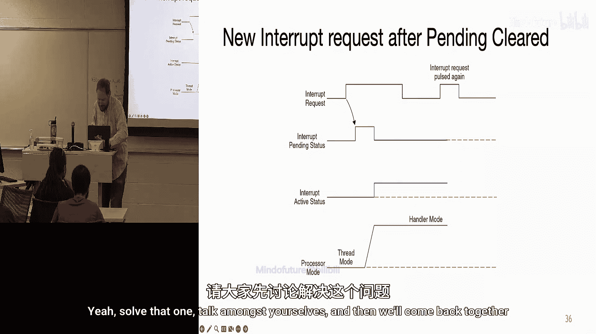
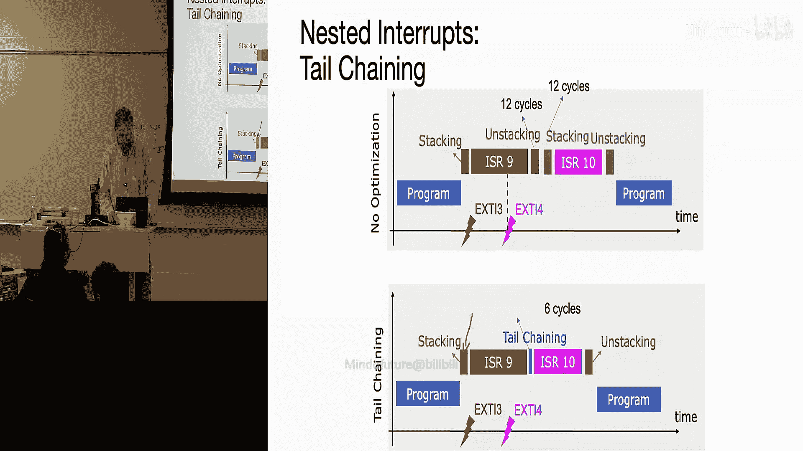

# 嵌入式系统设计导论：课程8：NVIC与中断优先级

在本节课中，我们将学习嵌套向量中断控制器（NVIC）的工作原理，特别是中断优先级、抢占和尾链等核心概念。我们将通过简单的例子来解释这些机制，确保初学者能够理解。

## 概述

上一节我们介绍了中断的基本流程和控制寄存器。本节中，我们将深入探讨中断优先级，以及NVIC如何处理并发和重叠的中断请求。

## 中断优先级基础

NVIC允许为几乎每个中断设置优先级。优先级数值越低，表示中断越重要（类似于高尔夫分数）。这允许更重要的中断抢占正在执行的不太重要的中断。




优先级通过寄存器设置。对于我们的微控制器，使用8位来表示优先级，但只实现了高4位。这8位可以进一步划分为**抢占优先级**和**子优先级**。

*   **抢占优先级**：决定一个中断是否可以抢占另一个正在执行的中断。数值越低，抢占能力越强。
*   **子优先级**：当多个中断具有相同的抢占优先级且都处于挂起状态时，用于决定它们的执行顺序。

以下是设置优先级寄存器的概念性代码表示：
```c
// 假设 PRIO_REG_X 是中断X的优先级寄存器地址
// 设置抢占优先级为2（二进制0010），子优先级为1（二进制0001）
// 由于只使用高4位，需要左移4位
*PRIO_REG_X = (2 << 4) | 1;
```

## 中断处理流程回顾

当一个外部中断请求（IRQ）发生时：
1.  NVIC检测到IRQ信号，将对应的**挂起状态寄存器**置位。
2.  如果该中断已启用且优先级足够高，NVIC开始**硬件堆栈**，保存当前程序上下文（如PC、PSR、寄存器R0-R3, R12, LR）。
3.  状态变为**活动状态**，处理器跳转到**中断向量表**中指定的地址开始执行中断服务程序（ISR）。
4.  ISR执行完毕，执行一条特殊的返回指令（如`BX LR`，其中LR是一个特殊值如`0xFFFFFFF6`）。
5.  硬件**恢复堆栈**，将保存的上下文载回处理器，程序返回到被中断的地方继续执行。

## 嵌套中断与抢占

如果一个更高优先级（数值更低）的中断在当前ISR执行期间发生，NVIC会允许它**抢占**当前中断。

**处理过程如下**：
1.  硬件会再次进行堆栈操作，保存当前ISR的上下文。
2.  处理器转而执行更高优先级的ISR。
3.  更高优先级的ISR执行完毕后，恢复堆栈，返回到被抢占的低优先级ISR。
4.  低优先级ISR继续执行，完毕后最终返回到主程序。

**关键在于**：处理器通过堆栈来维护中断嵌套的层级信息。每个被抢占的ISR其上下文都被保存在堆栈中，返回时通过出栈操作自然地回到正确的执行点。

## 尾链优化

当当前ISR执行完毕，而另一个已挂起的中断的优先级**低于或等于**当前中断的抢占优先级时，会发生尾链。

**在这种情况下**：
*   NVIC**不会**先完全恢复堆栈返回到主程序，再重新堆栈去处理新中断。
*   而是直接跳转到新中断的ISR，跳过不必要的堆栈/恢复操作。
*   这节省了执行时间（例如，从12个周期减少到6个周期）。

## 迟到中断优化

如果在处理器为中断A进行堆栈操作的过程中，一个更高优先级的中断B发生了，这称为“迟到中断”。

**优化处理如下**：
1.  NVIC会识别到中断B比A更重要。
2.  它会**中止**对中断A的堆栈过程（或直接复用）。
3.  转而开始为中断B进行堆栈，并直接执行中断B的ISR。
4.  这避免了先服务低优先级中断A的不必要开销。

## 总结



本节课中我们一起学习了NVIC的中断优先级管理机制。我们了解了如何通过抢占优先级和子优先级来管理中断的重要性。关键点包括：**低优先级数值代表高重要性**、**高重要性中断可以抢占低重要性中断**、以及NVIC通过**尾链**和**迟到中断处理**等优化技术来高效处理多个中断请求。理解这些概念对于设计响应迅速、可靠的嵌入式系统至关重要。