# 【密歇根大学】嵌入式系统设计导论-EECS-373-｜-Introduction-To-Embedded-System-Design-2025-p09-P10_课程9_定时器_PWM生成_虚拟定时器--BV1VTSNBoEem_p9-

All right， let's get started。So we'll have some announcements， exam one grades have been released。

 we'll go over that some of the grades in a second。

Homework is due Monday I have office hours that day as well next week we're going to start our kicking off the project and so you need to go through and do ideation slides we'll go over those in a minute and team formation so those are dates to keep track of this as an required event。

So thinking about the exam， these are the grade distributions of last semester and the two exams that you guys looked at okay。

 I know that these are pretty low grades， I promise you we curve the class。

Just because you got to grade this an average here doesn't mean you're in any trouble at all。

 okay we can look through this who you may have probably already seen in your emails。

 but who thinks that this year's test was harder or easier than the practice exams。

How about easier than a pra exams。A couple people harder than the practice exams。Okay。Well。

 the statistics don't necessarily bear that out but you a two point or five point difference isn't significant。

 I would say as a measurement method， but I would say it's about as challenging as the previous exams。

 I will say that the last question last problem took more writing than we had really appreciated how long it would take for you and we tried to grade accordingly in the future I will probably made that last problem。

 a little last section a little simpler。But you can see that you know some people did particularly well so I say we got to the upper end。

 most people are here kind of what the class average is and there are some people on the lower ends。

 I would say let's talk and make sure that your understanding in a good position to be successful in the class。

 I think everybody should be able to pass this class。

 even if you don't do well on exam because when I'm really looking for as an instructor is for you to demonstrate to me that you know the knowledge of the course and that doesn't have to be just through an exam。

 it could be through other methods， the project is a great way to demonstrate that you know the knowledge of the course。

 people learn in different ways。So any questions about grade distribution or grading of the exam？

Geneally， yeah， solutions are posted。Yep the solutions you don't think you have access to the solutions you access okay。

 I thought but the folder I put it in should have already get granted access so I will double check that if we have a little break。

Okay， any other questions？Yeah。All of them were single answer， yes。Howful will the curveb be？

I don't think anybody through when you get all the way through the class will be surprised by your grade。

Okay， nobody is going to be like， oh， I understand embedded systems way more than my grade demonstrates。

So I rarely have people surprised。Don't worry， the other way to say is don't worry， I got you， okay。

What else， any other questions？了かの。So regrade requests I don't think I have it on here will give you a week。

 I think they're due not Friday but next Friday， so try to give you a deadlines。

 do your regrade requests so that we have a single time where we're going to go through them all rather than doing them out through the semester。

 that's usually pretty horrible。Okay， so the project details will be released tonight。

 the first thing you need to do is do some ideation slides， you need to make threeX slides。

That convey some aspect of the a project that you want to do this is really to force you to think about what is it that you actually want to do so you need to have less than100 words you need to have one image it can be hand drawn it can be GPT generated I don't care whatever you want you have to put it the slides have to have your name on it to receive credit and then there'll be a drop a folder for you to drop them into okay。

And then if there's any。Projects that you're particularly excited about that you would like to present to the class in some way。

 so in the team formation event we'll describe the project in more detail。

 we'll talk to you a little bit about the process， the project and the support that we give you in the parts that are available and then students can come up and present their ideas to try to get other students know recruit other students into their exciting ideas。

 and so the star is a way to indicate that you were excited about this slide and would like to present it。

So the team formation event is Friday from 430 to 630， will have pizza and attendances required。

What questions you have？Inさ。Three ideas， one slide each。あ来。Yep。Yeah。😀哈哈。😊，I mean。

 it's just a class participation point don't have to kill yourself over right like you should go。

 I'm going to mark if you're there or not and I'm going to give you pizza so if you're just if're like I'm hungry you can go over to bister and then we'll feed you。

レす。All right， what other questions you have yes in the back very loud please the project change Yeah because a lot of things well。

Team formation， the goal is to find people that want to do like projects and then what's going to happen is you're going to pitch a project to me and Matt and James and we're going to say like hey that's insane。

 that's cool but we can't probably do all of that or hey you might want to explore this technical path sometimes that process of going back and forth with your instructors。

 the project does change dramatically but we try to make sure that it's something that is actually achievable and we'll exercise the core elements of the class。

So we're talking what do you got 85 in this class， great question three to four。It would be ideal。

Just to clarify you said we're going to come up with ideas and present them Yeah， okay。

 who's like everyone's presenting one？No， people who put a star on that thing and are excited so everyone makes the slide people want to present star because the act of making slides will make you force your brain to think things and then you'll be like I want to do this idea instead of that idea but if you come in there and don't think about it at all then have then you're like don't know what you want to do and you're just kind of lost。

So it's forcing you to brainstorm Do you have like some guidelines on how complex it should be or how it I'll release the spec tonight it should the base goal is to exercise the core elements of the core course so like memory mapdos are going to be pretty easy because you can't talk to a GPO pin without it but you're going to have like timers and interrupts and I squared C frills so you need to exercise a bunch of these things and then make the real trick of this class is that you have to do the system integrations anybody know the YouTuber stuff made here。

It's great he goes through this thing he calls it integration He it's beautiful oh my gosh you write code。

 you hope it works and it's just an over lovingv disaster and then you spend two weeks debugging it perfect that's what embedded systems is that's the learning experience I want you to have you have to make something that really actually works in the real world and we're gonna measure you on that。

So is it like at the end of the event， we have to like them。

which team we're on correct you have to you should have a team form form by an event and then like three days later what is it a the following Wednesdays there is actually a form you have to fill out and say this is the team I'm on but hopefully most people will figure that out in the event。

Other questions you have？Okay。Yeah， so read through the project disposal proposal。

 there is a you know a project you will make a project proposal and there's a sample one up there。

 so read through this， this is after you've made your team， you read through this。

 you go and make your proposal and you're going to sign up for a review slot these are these are last year's dates but you'll sign up for a slot to like individually as a group meet with me or James or both of us I forget how it's going to work and we'll give you direct feedback like one on one feedback about how your projects like give you advice。

 give you feasibility， tell you if it's complicated enough or if it's too easy those sorts of things and it help you land on a project plan that makes sense。

All right。I need a little out of order？But I'm going to switch back to grading for a second I'm going give you the hints about how to get as many points back on your re grade request okay you want to get more points okay here's what you do you could go and say hey there's a factual error on my exam and the grading in my exam say for example。

 sorry my hand ranges really messy I know it's hard to read but I wrote this and please take a second look and then the graders me and James and everybody well go and look and say aha all right I caught my error it's a factual error you wrote this other thing。

Super easy， that's like a no brainer you're going to get the points back。

The ones that are harder are， I'm meant to say。Like I wrote this， but I meant to say that。

Like I meant to win the lottto every week right so that's going to be really hard for us to regrade so you probably can't do that can only really grade what you've written。

There's things like a value judgment， right， where it's not cut and dry facts。

 it's like did you explain this well enough？And so those can be hard。

 a bad example is can you have more points？I also would like to win the lottery and have points right like it's just I won okay a much better strategy that will convince me is say the core question is asking for C。

 but an I demonstrated A and B in my answer， and those are key components of C now you have a logical reason and you're giving me evidence of why I should give you more points。

 but if you just say I want more points， probably not going to happen。

And another tough one is the question X and I answered why can I get credit， oh， probably not。

 you answered a different question。And so to combat this。

 sometimes we have questions that are confusing or have errors in them。

 so we go through and systematically， you know we go through and have multiple instructors read the exam。

 even though one of the problems that didn't work very well and have we look at the statistics of the question to make sure there's no inherent error。

 so unless there is a systematic error in the question like that is demonstrated by a large population is unlikely that will change that sort of request if you answered why that's probably the wrong answer。

Is this helpful in understanding the psychology of the graders and how you can get question。

 give many points back？Kind of okay。I think that should be the third I'm exactly sure it was Friday。

All right， so we're going to go on to timers， is there any logistics questions？Anything else？Yeah。

the re gray request Oh， you got to go real loud Will the re request decrease our gray？

What did you going to know。Rarely I mean I have had people that like just try and like you know get every single little point and sometimes I get a little angry and then usually what I do is I just push their thing away and I don't answer for two weeks and that lets me cool down so I'm not so angry with that person and then they're fine but rarely do I get in the case so I remember when I was like taking physics they'd be like if you submit a re request I'm going to regrade your entire exam。

We're not going to play that game unless there's a problem。Okay。All right。All right。

 so we're going to move on to timer so last we talked about interrupts and now this is another class of modules that you'll find on microcontrollers as a fundamental model basically is measuring the passage of time so most of' say is going to be talking about the timer modules you have later on we're going to talk about CsTch which is a specific timer built into your core that's required by arm and that's what they would use for an operating system so your device says support an operating system in the context of an advanced scheduler。

And then finally， we'll talk about virtual timers， we probably won't get these to these today。

 we'll get through this， but that's what's coming up。If you're looking for readings。

So let's see so this is from the developers guide there's entire developer's guide on a reference for your STM 32 so you can look through those if you're looking at the book that we recommend but don't require chapter 15 is pretty good and STM has like YouTube tutorials that like they professionally made they're a little bit more tutorial rather than educational or rather than I don't know classroom teaching but they're pretty good so there's some other resources if I don't make sense to you。

 map doesn't make sense to you James doesn't make sense to you other resources。Sorry。

So a little background， so timing， right there's a bunch of different functions that you want your embedded system to do。

 so thinking through how did your iPhone work。You know you have world time， you explain time zones。

 you have things that alarm， so things happen at a certain time。

 you have stopwatches that measure the passage of time and timers that can count down to zero。

 so these are different functions for manipulating time or counting time。

We also use timers to control things so we talked a little bit about how timers could control a servo by doing something called PWM you can also have DC motortors we'll talk about an RGB so now the idea here is microcontrollers are really good at measuring and controlling time they're bad about just about any other real worldorld interface like analog they're really bad at or even delivering power they're not that great at but they're really good at controlling time and these are all electrical ways to control the external world through timing mechanisms so we'll talk about how to achieve that。

So let's see， we have so timers kind of review here， Pulic， oh， what do I want to say？

So you could have an interrupt go off to causes you to do a task periodically so maybe every second you want to go through or maybe you know 500 milliseconds you want to go through and check a bunch of sensors to see if some event has occurred or you just want to log some data you could just be in a while one and just every time you go through check that sensor but that might be a little chaotic especially depending on code execution and maybe you want a really good time base you want to measure the sensor value every or so often so one thing you would do is youd set up a timer that sets off an ISR so in that interrupt you'll do with the task of measuring those sensors so now you have very precise measurement of time you can provide you like accurate delay loops。

 generate pulses and waveforms， measure the duration of time and then know that this is actually a fairly challenging one we'll talk about you got to measure the passage of user time right like how do you display and keep track of monthsday years minutes hours。

Like that sort of conversion is not inherently well。

 I your controllertrollerers are good at counting microseconds and nanoseconds。

 they're not good at measuring long periods of times that humans care about。

Okay so there's a question for you， how do electronics detect the passage of time so let's think about how do humans do it。

 how do we do it as humans if we say we didn't have a clock we have to go look at the natural world around us。

 that is our method for understanding the passage of time so humans can look at the rise and fall of the sun you could have a mass spring mechanism right so like old school clocks that you could use measure the passage of time。

 so the question for you is how do electronic devices measure like at the physics level。

 how do they know how long time has passed？When you take 60 seconds brainstorm with your neighbor。

 come up with an answer， how do they do this？Yeah。

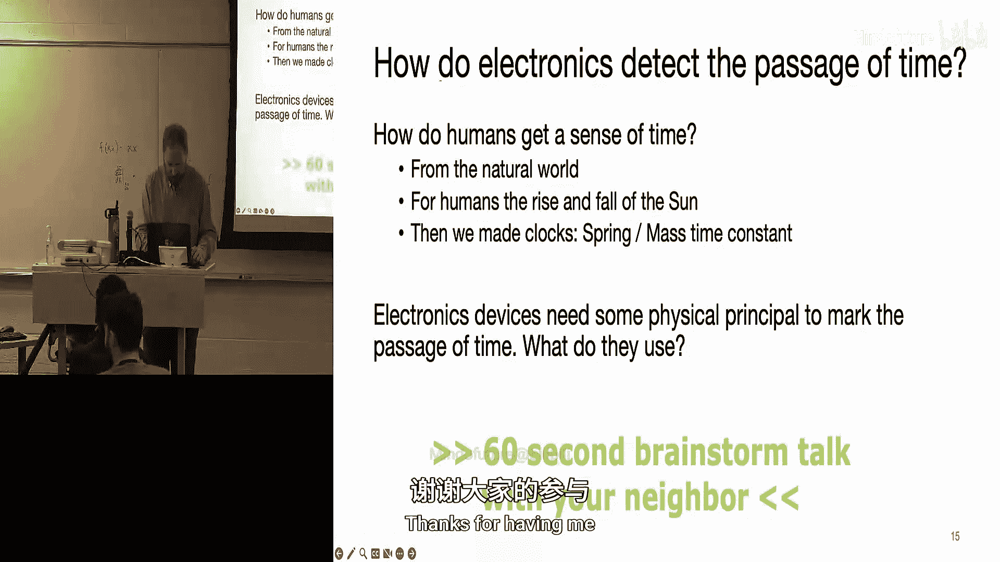

。じで。I。か。あですよね。It's like let's say it is done。Me too。

 I got to the last question I realized I'm like I spent too much time。SI lost points on that。

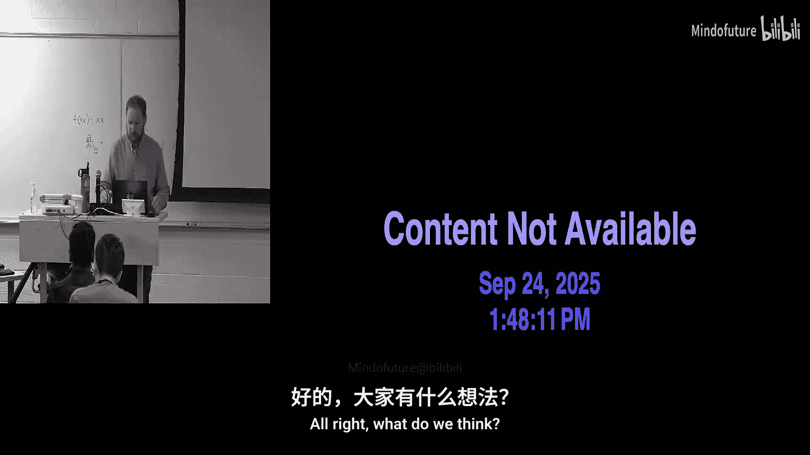

All right， what do we think， how does electronic device measure the passage of time？Okay， it is。

Fantastic， anybody else want to go up with an answer that was perfect？Yeah。Like a 555 timer。

 for example it uses a specific resistory capacitor combination time constant that's true so RC time constants have I guess you have to have some constant that certain has a known voltage which is fine so you take a known voltage you can use the decay of that known voltage through an RC time constant to create a time base two methods forgot about that one' great any other methods。

ど以前。hearing。Oh， you could， nobody does that。But capacitors are just the inverses of inductors and they're vice versa so we can construct a circuit that would have an L time constant or an LR sorry an LR time constant it's just complicated to make thats a good idea Yeah I mean like on a broader scale like for like global time they like pink satellites how does a satellite know what time it is？

家。Like like no never actually there are atomic clocks。

 atomic clocks I just don't know they were excited one time basically。会就好讲。Okay。

How can that be a hole in my knowledge I know how well I don't know how to build one I know how they fairly work I think it's like you get some helium or something and you get it to a known temperature and you watch the you put a wave front through it and it oscillates a certain time I don't know I have to go look that up that's fantastic I didn't know something okay answer was like oscillating quatz right you have to like calibrate that ever yeah okay let's go on you got it you're get into it。

All right， let's start off with an anatomy of a timer， so C。

 we start down here and we're going to go through the oscillating quas and the different types of thing in a second。

 but CRT we have some physical， external things that you're supposed to be eyeoppens and you have an external crystal or an external oscillator。

 something that's keeping track of time for you。And then you have to turn that into basically square waves。

 you have to have a clock drive or something that's going to turn more or less this analog thing into structured clock and then you can prescale that。

 manipulate it， we'll talk about all these things in a second。

 there's a counter that keeps track of the passage of time basically counts how many little clock ticks have gone by。

We can do things like what we're learning about today is these capture and compare modules that allow you to manipulate the start and stop of the timer。

And all this is essentially written in assembly， I mean you could write you will write this in C。

 but this is I'm trying to denote that this is low level， you know。

Or where it says in very log but low level hardware interfacing and then you go up the stack a little bit and you have your system level and then you I guess you get into assembly and then at the abstract level right where you're actually making the thing that shows the user was like a clock interface and you're getting to。

See。Okay。So let's start with the lowest level crystals so a crystal is a fundamental。

Electronic component just like a capacitor， resistor and inductor。

 it is a piece of quartz that when you strike it with electricity。

 it will only let certain frequencies of electricity through it so you can imagine that this is a very narrow band filter and if you set it with a low frequency through here that it would not pass through and if it's too high it won't pass through so we consider this like a band pass filter its super super narrow。

It's one way to look at it and then you have this inversion circuit here so this is like what's inside your microcontroller again this is not important that you know exactly how the circuit works just know that there is a circuit so this is the line between your microcontroller and your circuitry and on your boards that you have in and lab and anything that I've ever made you put a crystal on here that's tuned to a certain frequency you have to put some loading capacitors on here the manufacturer of the crystal will tell you what these need to be and you have to kind of check the data sheet to make sure it's all about the same range and then this causes this is an inverter that causes a negative phase so you get 180 degrees out of phase and it will start oscillating back and forth back and forth so and the energy that starts going through here some of it will get through and oscillate back and forth and basically the full output of the circuit will be precisely tuned to the center frequency of that circuit and there's some painful startup stuff that you don't have to worry about you just have to know that your embedded system is going to need an oscillator or a crystal oscillator and that you。

Put capacitors on there。So there's a wide range of crystal osllators。

 they are pieces of quartz and they come in different sizes so these are like old school metal cans here and here these are good they have they're fairly large but they have good EM suppression because they're in metal these are kind of more modern ones where they're small like I don't know this will probably be one me millimeter by half a millimeter maybe this is two by half。

That size， and then here's another one in a different type of package。

 and these again oscillate back and forth。And the trick is that you can go buy these in a wide range of frequencies。

 so when you they're not tunable per se， but you will go to a place like Diikey or a Moser and you can choose one that has a certain frequency。

 so a classic one is 32。768 kilohertz。It just happens that as you multiply that out。

 that translates to seconds， hours and or seconds， minutes and hours very well。

 so you can get seconds out of by multiplying that up with a counter， so that's a very popular one。

 but crystals are generally good for low frequency things。嗯。一嗯。What。so much。

Best is a funny term in the engineering world because best means like is it cheap。

 well of course is pretty cheap， is it functional， like you have to balancing all these sorts of things。

 so it's maybe not the most pure tone in terms of frequency， but it's cheap。

 you can buy one of these things for less than a cent and when you buy in bulk。

See if you go up to the food chain a little bit you get to saw resonators so this stands for surface acoustic resonators this is a piece of silicon basically that has a structure on top where you launch an acoustic wave across and it has a certain propagation delay again the details are not that important sometimes they're called ceramic resonators but these typically go and the 10 megahertz up to 100 megahertz so these are good for clock sources。

For like your main clock on your device。woul be from one of these while the quartz resonators are good for like low frequency stuff and interestingly there's kind of like this gap between 1 megahertz and 10 megahertz where there's not a lot of good resonator options。

But yeah， anyways， these are frequent relatively stable， good frequency。I consistency。

 but you pay more for any of these devices if you want the parse per million of the frequency shift to be smaller and smaller and smaller。

 and then there's also temperature coefficients that would be a problem。

Yeah and so you have I guess I forgot this photos this before on your boards there's a specific input port for 32。

768 kilohertz they want this your board is looking for it precisely this crystal because the rest of the system depends on it these here are for there's a range of megahertz so you can be to  four to 48 and that's the range it expecting so you put a crystal on here that will multiply out to something that will be useful for your particular application so you do get some control for that frequency。

Let's see。Oh digitally controlled oscillators so digitally controlled oscillators are a usually they're a ring oscillator so a ring of inverters that there's an odd number of them and they'll circle back on each other and they'll have a clock frequency so with them the challenge is these are all or the good thing is they're all on device so I have I don't think it' highlighted here where there's a crystal oscillator or a ring oscillator they're all on device but they're not as precise because you don't have the external world。

 a nice crystal or resonator to know exactly what frequency it is so less accurate but you can reduce or or increase the number inverters in the change and you can change the frequency so now all of a sudden you're very agile so I had a little project where I needed to quickly change the frequency to look at different incoming waveform so some are fast where some are low and I want it slow and I wanted to adapt and use less power so I would change my DCCO settings to lower it down and reduce power。

They'll be able to meet my timing task。Let's see I guess it does have it so the SDM 32 years in lab。

 the AHB and the APB clocks are up to 120 megahertz and so。You allows you。

 you're only allowed to give up a 20 or 48 megahertz clock crystal。

 so how do you get to 120 megahertz and they would have a guess？How you go up in frequency？Yeah。

Like clock multiplication circuits before， they basically have a clock multiplication circuit。

 they call it a phase lock loop。These things are sometimes are called PLLs and basically they allow you to upsample。

 so imagine you have a faster oscillator going around and you have a lower frequency oscillator。

 but every every time one of these clicks goes by you count how many of these faster clicks went by so you say I'm going to want to go three times as fast and if I'm going a little bit slow you increase your oscillator going a little bit faster you decrease your oscillator。

 so there's a way in which you can upscale a known signal source to make it air known clock source to make it faster。

 there is some higher noise in this sort of thing and higher power。But it's definitely possible。

And you can also adjust the frequency a little bit off of that， which is nice。

 so those are the PLL modules over there。Your chipI also has a fairly advanced clock distribution。

Moality or clock distribution tree where you can go and control which one of these input sources。

 so whether it's the 32 kilohertz or the 48 megahertz or the PLLs or the ring oscillator。

 you can distribute where does that signal go does it go to your sub mainin bus。

 does it go to your timer you get to control all this clock distribution。Now。

I don't think you're going to have to do it for your projects you just get to know that you can do it when you're ready to registers enable clock is this like where you would be writing stuff？

It kind of depends if you're writing like in your peripheral because sometimes there's registers to control that or sometimes you're controlling here。

 so to control which clock is actually sent to a peripheral， so they have different places。啊。Yeah。

 so I think at this point using QB ID and just clicking this is where you just click buttons in you're praying you're hoping that it all works out and if you're doing vanilla normal things that the QI engineers expected you to do。

 it'll probably work out if you get to the point where you're doing particularly advanced things you're trying to get like super precise timing between I don't know two different peripherals。

 sometimes it breaks and you've got to either have to go back to GCC which would be challenging but it's possible or you have to kind of like really read through the documentation to get QB ID to give you the clock distribution you want so not a statement that you have to do it。

 just statement that it's possible to control the timing of your device。Any questions？

This is you have multiple clocks going going on at once。Mmhmm。😊，Yeah， you might want to have。

 I mean in our particular case you might want your core probably going as fast as it possibly can。

 right if you want high performance， but you don't necessarily have to have your peripherals going that fast in fact you may want to have a timer going to have very specific frequency so it keeps track of time for you in a nice way。

so now you becoming a problem where you have on one piece of silicon。

 you have multiple clock domains and then there's circuitry there to make sure that you're not doing things asynchronously。

 you as a program you don't have to worry about that， but you could have that situation on chip。O。

So next step up for that we talked a little bit about the clock driver， again。

 this is not an inherently important circuit that you have to know how it works。

 you just have to know that a clock driver will interface with a Chrislosla to make a clean。

 nice square wave here。After that， we'll talk about the prescalear。

 which allows you to control the frequency of this thing and then the counter。All right。

So just think about this as there is a square wave coming in of some frequency coming into a prescalear and then the prescalear is going to divide down by some ratio and send it to a counter so we'll talk about the counter in a minute and how that works the counter here is going to keep track of how many edges have gone past it then we have an ISR or an IRQ probably a better term but basically this is if set properly this module set properly when an event occurs here this will set off and interrupt which you've learned about now which will cause the main core to change modes and you can respond to this event there's a thing here called an auto reload register which basically says when this thing get counts down to zero。

 what should the value that's loaded back in here be these are typically 16 bit timers and you could just go start at 16 FFF ofF and all the way down and then restart or。

You could put a known value in there so that you're counting down。

 And so the real trick of these things is to think about。What's the period here？

I'm going to scale that down and figure out what's the period here and then I'm going to count that many periods with this thing we're going to show some equations here but you if you're thinking about timer math as an equation。

 I mean it's fine but you should be able to intuitively think your way through the equations in fact James will be like yelling at you in a lab like stop with these equations just think about the fact that you are counting microseconds or some period and you're counting how many of those periods so two to the 16th will be how many times end period will be a certain period of time until this thing overflows。

Okay， now I will give you some equations I said I wouldn't give you an equation and I give you equation that's because STM is trying to trick you okay you would think that the output of this would just be like your prescalear value divided by your input clock frequency and that would give you your output clock frequency。

 but this is actually a register， this is a pre-scalear register and they don't want you to be allowed to put zero in there。

If you put zero here， you say this PCS was zero， then you're divided by zero and bad things happen。

 so they always by default full add of one and0， so if you put a zero in here that could be the value there's still a one so they're trying to protect you from yourself so that your system still operates even if you make an error。

That's fine， but this equation just assumes like logically you're saying I have this input frequency I want I divide it by half so it comes out the period is twice as long。

 you say that's fine， I don't even need equation to figure that out， but。

STM here has put a one here to force that there's a case where you can't accidentally shut the whole system off。

Does that make sense？Yeah。Minus one， y。But there's no reason that one should exist。

Other than STM's protecting you。嗯。And we'll walk yeah。

Is the preskill like a register or is it a frequency？Always both's let's look through an example。

 so glad you are here because I forgot that I had a demo。

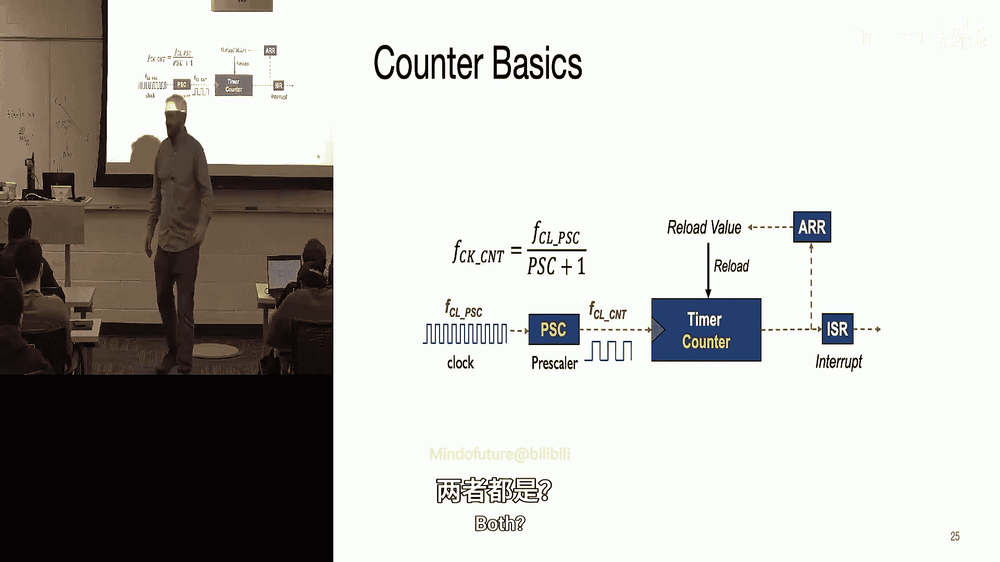

And then you told me I will do it all right， so this is an example of a prescalear。

 very basic prescalear， four tap prescalear and basically each one of these is just dividing my two。

 so here we have clock clock is coming in here fast。

 this is the output of one and here I'm divided by half okay。

Here I'm divided by 4816 okay so here this is a very this is called the clock divider not technically a prescalear looking at prescalear in the second。

 but all the prescale are doing it can't count up， it can't make it faster it can only make it slower but you imagine that you would have a controller register that would go into here and that controller register would say okay I want you to take this signal and divide it by two or by four or by whatever the number is so now you have register part of the prescalear that reduces the clock frequency。

Is that good？Yeah， so， but like when you're trying to look at like that equation， Yeah。

 it's just like a signal coming out of there。 like does the。

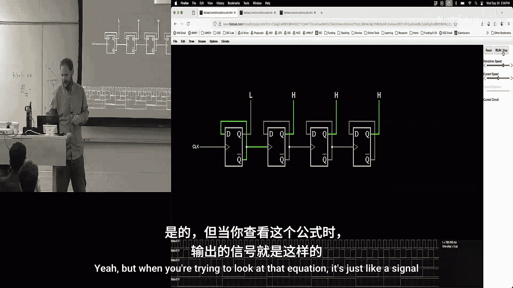

好。Like prescalear zero B， is that just like？I guess said maybe that's just just nothing then it's just。

 okay， I see what youre saying。All right， no， we're good， okay， it's great。

 so prescalear zero would just be this divided by one rather than putting zero in here and then then you have an infinite。

は。Let me see do I have？So I just showed you， oh， come back。

So this is a clock divider which is literally just dividing things by half by four by eight and so on There is another module that's called a prescalear which is doing something more interesting which is actually giving you a true division。

 it's not just divide by two， you could divide by five， you could divide by odd number。

 it's a more complicated module that we don't need to go into。

 we just know that there is a division between difference between clock dividers and prescaleers you have prescalers that will actually do the division even if it's not a multiple of two or a power of two。

看下。So anyways， these modules allow you to divide the clock frequency down。

 increasing the period of a signal， and it gives you the control so that you can hit certain timing requirements that you would need for a PLBM motor or something like that。

Questions。And then remember， you can oh， you can go through， you have questions。

 you can let's say take this， put it in your browser， and you can play with that， okay？

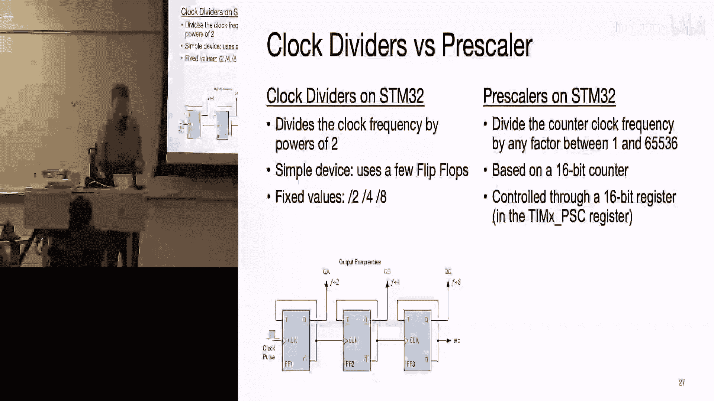

All right， so let's look at the anatomy of a counter。So a counter stop here。

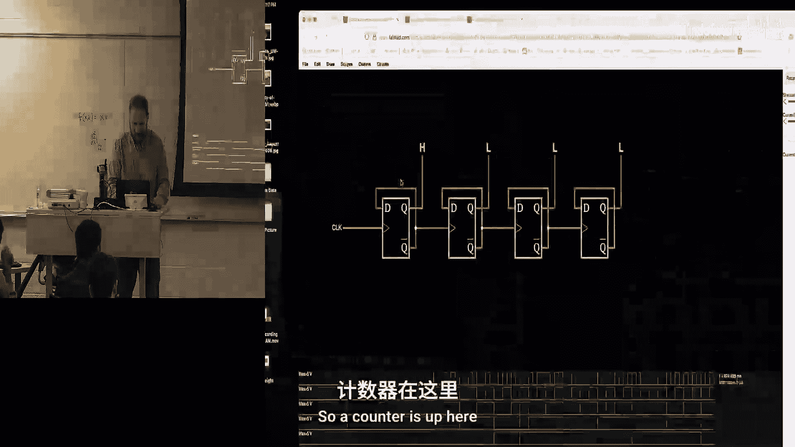

嗯。So counter so has a clock that comes in remember this could be the basic clock that comes right from time or your clock module or a prescaled version and all it does is control has some control logic and the anatomy of the timer our counter is not that important I assume you've learned that in 270 what's important is that in binary is going to be counting up so this is just this is not part of the time where this is just a display this takes a binary input and shows me what the value here is so it's just a display module and basically this thing is a four bit counter and it keeps counting up every clock cycle is going to increment by one。

Yeah。I。Sorry yeah yeah can we can go turn it the other way and now we can count down so your counters that you'll have on your STms can count up count down you can pause it as well I didn' I didn't give that in this part of the circuit so you can enable it disable account of count kind of countdown in fact you can also。

There's more control registers built around this thing so you could load a value into here so you could pause you know pause this thing and say。

 okay， I want to reset it so all of it will go back to zero， I can fake that by doing this。

How clever I am， okay right， so now I got zero。But you could also load in a one into here。

 a load two， a load or actually a load1，0，1， one， whatever value you want in here。

 preset it to something and have it count down。Or count up whatever you like， how does that feel？

Okay。

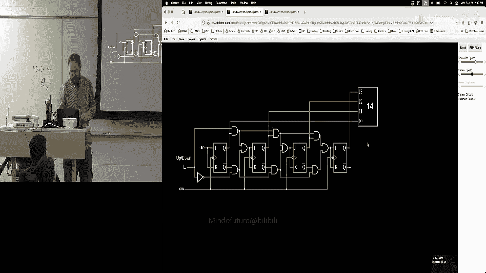

Let's see。Yeah。So these can be multiple bits， you know your particular instantciiation of a timer is typically 16 bits but sometimes you'll find 32。

 64 it just depends on what your particular micro controller offers。

 oftentimes you'll get a count up countdown， you can hold a value， you can load a value。

 you can read the value out of the timer， which is super important right。And remember。

 these are just memory map I modules， you're going to have some structure like this。

 you have the advanced peripheral bus writing into registers。

 those registers will control this and control the state of this just like we did with GP pay Opens。

All right。So we're going to talk about two add ons to the counter。

 two types of control registers or logic elements that allow you to use the counter in different ways。

So the two primary modes are they used to allow you to measure how long something takes。

 so you' you know this would be a capture， how long does it take for something to happen。

 like you see an event， you start here and then when that event ends。

 you capture that time that it occurred。And then if you want something to happen every so often like on a periodic schedule。

 so every time it's two o'clock I'm going to I want something to happen so then you have your target。

 which is like two o'clock and you're looking at the time going by and you're comparing these two when these two things equal then an event will happen so this is triggered by an external event and then you look at the time and this one is you're looking at the time and then you do some task。

So an example of a capture， kind of think about that fan example that we had from homework。

 so if you have a fan you know what speed is spinning。

 one way to do this is to have a GPO interrupt every time to complete its rotation so the fact that's GPO and interrupts as you spin in the past is the capture event。

And then you're just going to capture the time interval。You could do this just by。

Having you interrupt， what am I saying the right idea， but you might want to。Okay。

 so if you do everything with an interrupt， that might be fine。

 but in a very complicated system with multiple interrupts， that could be a problem。What you can do。

 so you could interrupt the thing and then so what I guess we're saying is their interrupt could happen then you could go and read。

Through the core， through the APB bus and read the value of the timer to figure out what time it is。

 but there's at least 12 cycles there probably and it could be if there's lots of interrupts it could take even longer so the solution here is that on this event you will take the value hardware we' take the value out of the timer and put it into a register for you to look at later so it's going to take that store it for you and then whenever the core gets to it it can come back through the APB read that value and say okay this is the time when this event occurred so we'll walk through that in a second。

All right， so here we're back to the original time where we talked about。

 so you have your clock coming in， youve got prescaleers so you can control whether you want a little bit slower or a lot slower。

 you have some counter， the see counting up or down and say you want it to be AAA every single time and then count down this will happen and maybe you set it up so that when it hits zero。

 you have an interrupt service routine you want。The addition of the capture register or is a capture Comp register。

 so CCR in capture mode allows you to do do something where you set the timer up。

 say it's been counting for a while you set it up in mainine and you say okay start at zero and start counting up and then when you see a GPO pin。

 capture that value and put it into this register so here what will happen。

Herear what happens that GPPO pin goes high， it causes this thing because you configured it through the registers as defined in the data sheet to be in capture mode and when this event occurs it's going to take the value so this would be say 16 bit value here is going to store it in here。

 this thing can keep counting it doesn't really matter。

 but you've got this value stored it here and then your in service routine interrupt service routine will come back and read out this value later on。

いや、。Unsigned into like overflowrows multiple times doesn't that make it like inaccurate to measure as the left time which it absolutely does so that would be an error condition now what you'd want to do is that might mean that your counter is going too fast for the thing that you're measuring。

So maybe you have something that's going off here like at a kilohertz right。

 but this thing is running at hundreds of megahertz。

 then you might get that overflow event before this event goes off so what you do is you go to your presscalear and say slow down。

 I know something about the signal coming in， slow this thing down so I don't miss this event by overflowing。

And is that done like manually or is the S byU， the programmer manually？

So you have to make the decisions right about how to set up prescale or something you have to set up the auto reload register。

 which controls what initial value this has has to be set up。

 you have other registers to control this counting up， counting down。

 and then you have registers to control whether you're in capture。

 compare mode and what you should do in those cases。A there questions you got？Zero questions。

Fantastic。What am I trying to show here？Yeah， okay。So imagine you have an external signal here。

 you can configure your GPO pin to say have a falling signal and then a rising signal and you want to figure out the time between the two。

 that would be an example of how to use a capture timer so you set it up here， you let the timer go。

 and then you capture the moment this occurs。Okay。嗯。Let's look here first。

 so this is a more detailed diagram of what you would find than the SDM 32 or your particular SDM32 so there's a filtering module this will allow you to filter out high frequency noise in it basically a subal counter of the inputs coming in I'll show that a second there's an edge detector so now you're going to count how many edges come in。

And then you have a prescaler， so you have all these different ways to manipulate and filter out signals just basically in hardware。

You have the prescalear and then you have a 16 bit counter。

 this is your you're counting up and counting down your capture control register。

 you have a DMA mode that we'll talk about later in the course and then you have your interrupt flag because you can enable interrupt。

 you can set the type of interrupt and then over capture flag。

 I think this is if this thing runs over to your point about overflows。

 you can set that up to throw an overflow signal to your core it says hey。

 this is another type of interrupt， it's not just that this thing captured。

 it's that you actually overflow。So if I go back a little bit。That's see。

So input filtering so you imagine you have some external signal in the world that is variable or bouncy right from a button push what you can do is you can set this thing up to say okay I'm going to say this is your sampling clock and then internal timer clock oh so this is your timer clock but then you're going to say this is a downconverted version of this this is a pre-scaleed version you can say well I want to go sample each one of these times and then I'm basically going to wait until it's stable transition so here it's all varying around so I want to see enough stable transition before I then say a an event has occurred and then I pass it on to the rest of the modules so even in your hardware you can do a little signal processing just by filtering out some of those signals。

That's what the hardware， that's what this block basically gives。Okay。

So the next example would be the compare timer， so very well speed for driving a DC motor so you want to make a signal that goes up and down for a purpose so I don't know if any of you have dealt with DC motors but one way you could control them is with a analog voltage you put more voltage in they spin faster lower amounts of voltage they spin slower the problem is digital systems really bad at controlling voltage and so the way they handle that is they control time instead so instead of doing analog way you basically turn a pulse on either max or off and you do it quickly enough。

So that on average， the average between the amount of time you're on and the amount of time you're off is equal to some analog value。

 so if I'm 50% on 50% off then I'd be going half speed if I go to 25% off and maybe 75% on that I'm not 75% and so this is a nice way just to use time which is easy to control on a microcontroller to mimic an analog power value。

Yeah， so like you use the time as the when it's high， you switch to on when it's low， it's off。

 so that way like you can change to time to change。

was the last part and you could like change how the time to change if it's on or off like okay well。

 I'll show an example of that， so we call that pulse width modulation and it's a powerful tool for controlling external things。

I most of you are probably like anybody is's going to have a vehicle that drives around as part of your final project is definitely going to use one of these。

All right。So you need for these sort of things you need a signal that has a certain duty cycle so that's percentage of time it's on and then you need a certain frequency。

 how often is that signal repeat， we'll go through that in a moment。Aley， let me go through it now。

 we'll just go for it now。So， let's see。So here is an example， what can you guys see， Nope。

 you can't see anything cool。

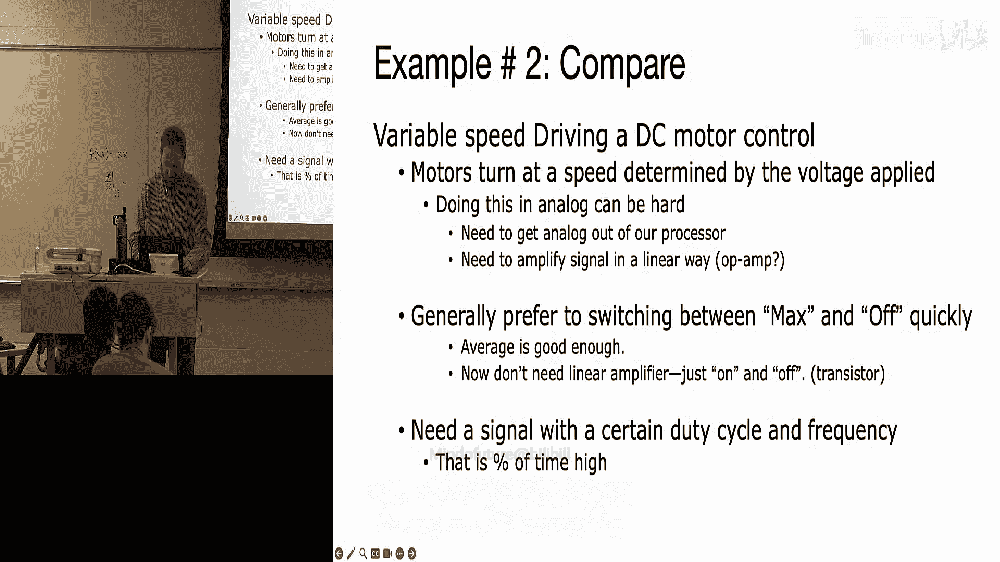

That's a good example， though。All right。So here we have a pulse train and I just have this clock module and that clock module lets me control the duty cycle so if I go and change it here you can see。

The percentage of time that I'm on got much wider and the duty cycle is higher。

 I don't know what the value is， does it say， it does not say。And then I can go all the way low here。

That。And so now I'm mostly off and you could go all the way off， it doesn't really matter。

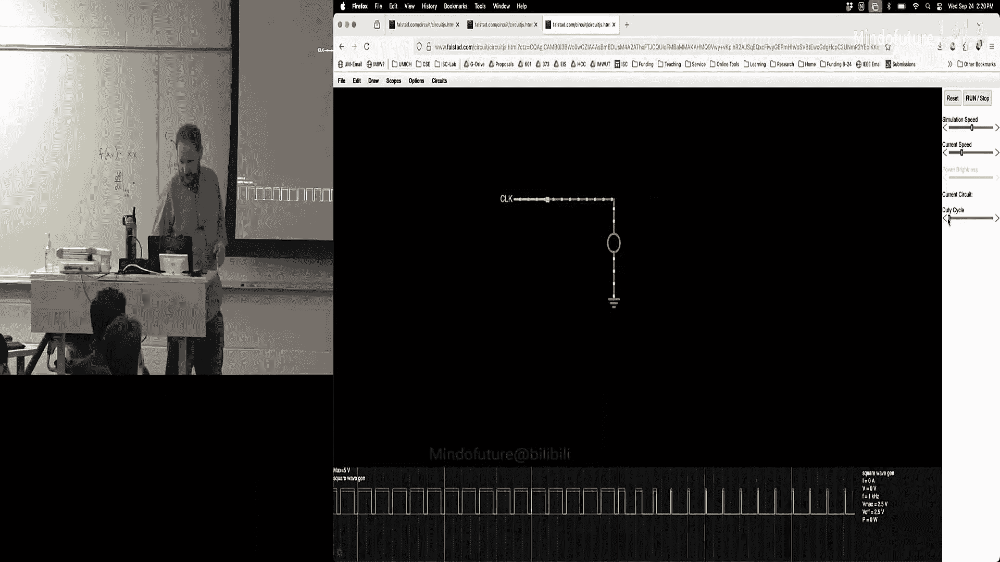

This demo。OkayAnd so the idea here is on average， I mean we hear the simulation slowed way down and we can actually see this LED blinking out and off。

 I don't know if it will work。On the screen。Maybe if you squint really good。

 you could see some percentage of it like it gets blurred out so here it's kind of dimmer。

 it's on it doesn't really work it works out well on my screen。

But the fruit fresh rate over here is not that great so here on my screen this looks almost on all the time and then as I slow it down you get to see it looks much dimmer and so this is literally how you have those little breathing LEDs on your electronics this is all they're doing there's nothing fancy this have a GP pin us that's dizzying fast。

You have a little GPO pin and they're just varying in the duty cycle to get you that animation effect。

What do we think questions？Have you all seen this before？Okay。

And then I guess the takeaway here is this is exactly the same signaling you'll use to drive a DC motor。

 you just won't connect it directly to an IO pen， you'd have to have something in between usually call it an H bridge I'm sure there'll be some group that will present to you guys about H bridges and basically it just allows you to drive lots of current but still represent these pulses so these pulses will drive an H bridge and then you'll be able to jump like an amp on for this period of time an amp off for that period of time or sorry amp on for this period of time and no current for that period of time。

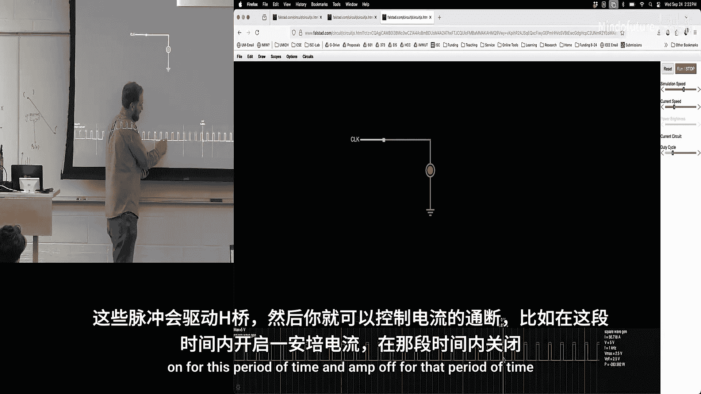

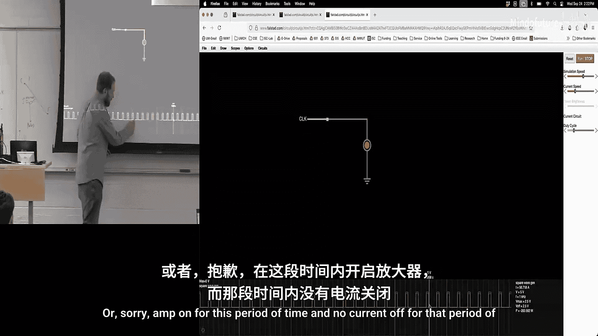

Okay。I don know，All so how does this different from before？So again we have some clock coming in。

 we're going to control the frequency or how long the period is for the signal here。

 this thing is going to count up， let's say， and what we want to do is have it every time a certain value is hit。

 I want to change that signal， I want it to go high or low。So here what we have， oops。

We have a compare， we're going to reconfigure this register to be in compare mode。

 so there's other registers here that control this peripheral。

And you're going to say like start this time we're at zero and then count up to a certain value。

 say 100， and then every cycle is going to compare， you have a comparator here that's saying。

 is this equal to this and if it is， then you send out an interrupt。

And there's different types of ways you can control this。

 you can have this directly control a GPO pen， you don't even have to go to the core。

 there's this PWM module kind of built in as one of the options here but basically you could say okay if you're below 1000 right then we're going to keep it high or sorry we're going to keep it low and then when it this thing hits 10 we're going to go high and then when this thing wraps back down zero you go back down low so on and so forth。

 so that's way you can set the boundaries of your PWM。

And there's lots of different modes for how the counter compare counter can work。

You can force it high， you can force it low， you can force it to be frozen。

 and then you can have different conditions。嗯。The counter itself can be。

Counting up it can be counting down you can be counting up and then counting down so this is all that's happening here is when it hits the threshold。

 the auto reload value it just is told to go back down and so maybe you want to go and have some capture con value here and this is just a different way to maybe get twice as much time out of this counting setup up these are a little bit simpler as this says the auto reload at time say so when you hit zero then you're going reload the value it's going to go in the auto reload register is some value here so some binary value and then you're going to count down this one is a count up timer you're going to start at zero and you're going count up until your auto reload register value and then you're going to overflow keep going up over and over over again so this are different ways of controlling how the frequency of the period let's say or the frequency of the pulse width modulation or the period of the la pulse with modulation is with this and we'll talk about the。

For control register， control the duty cycle in moment。

Let's see there's lots of different output channels for this。

Here you can have different input clocks， you have different triggering control modes。

 and you have your prescalear， your counter， and then for one counter。

You could have multiple capture compare registers， which is nice because now you have one thing that's counting and instead of having a counter as a piece of hardware for every possible GPO pin you want to go high。

 you can have multiple registers that do the task so here you can say I want you count up from0 up to two to the 16th and then at some value。

 say 1000 I want you to do a task and then maybe 2000， 30004000。

 so with one counter you can reuse it four times and then these will go through and go up to an output channel or output controller and these eventually would go to a GPO pin so with one time where you can control multiple PWM signals。

Questions do you have？So we already gave the example here of what PaulQu modulation is。

 at least the intuitive example， how you can control this is here you have。

Some reference signal and all this reference signal is saying okay when this value。

 so this is supposed to be counts on this line and this is time and so here 1，2，3，4。

5 we count up to some reference signal and when that reference signal goes high or hits the same value then we can have the pulse with modulation go high and then when it reflows we go back so here's a way to control to set up a pulse with modulation and so the time that goes up is the period and then this is this value here represents the time is so all you have to do is change your reference signal up and down and that will make this go wider or lower。

All right， so let's walk any questions so far？Yeah。

The counter is able to up the voltage in the next linear year。

So counters able to up the voltage these are steps。Sorry， we're zoomed way out。

And so these are is this is counts， not voltage， so this is the counter hazardaz value1， two， three。

 four， five and that's a fair criticism， this is a better example here。

So it's the same sort of diagram， we have a counter that's going to count up。

 it kind of has meaningless if you only have six steps for whatever， that's what it is。

 so here auto relet load register says， okay， you set your counter to count up when it hits six then it's going to overflow。

And then start at zero again and ago。So the auto reload register all right and these are this is time or this is clock。

 so here's the periods， so you can go through and say my auto reload register is essentially controlling the period of this waveform that's coming out。

Prob be better to say that。So I see how to reload register， great。

And then the repeat control timer just just doesn't really come up that much in these examples。

 but it's just something that's going to come up in lab。

 so this is tells you should you keep repeating over and over again or should you stop after one cycle and so that's nice if you just want to send out one pulse where you don't want to have multiple pulses coming out so you have a method of controlling that。

Let's see， so here yeah， so here your period is basically one plus AAR times a clock period because these registers need the extra one in them and so now you can go figure out what the period is based on your number of clock cycles。

So countdown mode similar， you can start at your AAR。And then countdown to zero。

 you have the underflow event which brings you back into AR， so basically you get that。

Ctric or that timer module and the AAR is being put back into it on these underflow events。

 and here's another way to come up with your peer in either counting up or' counting down。Yeah。

 you change AR you want to do。Yeah， everyone， so in that case you're not guaranteed that this period will be right so you can just like change it here and then bad things could happen。

 but then you might as from your application point of view say does that actually matter？

And I think on some of the timer match module you can wait until this next event occurs。

 so you can tell the auto reload register don't reset the time until you get in this case a underflow event and then so that way you don't have this kind of runt pulse that makes weird things happen。

U。And this is just an example of a center mode where you count up that gets up to your AR and then counts back down so the overflow event here causes it to change direction it counts back down and this is going up and down and up and down you may say why is there so many modes it's just because it just gives you the flexibility the cost for STM to put all these modes in the microcontroller is pretty minimal。

 it's a little bit of extra logic but it gives you a lot of flexibility because typically the joke is you can never run out of timers。

 I think forget how many timers there are in your chip I think there's like 24 or something and it is literally possible that that's not enough for some applications because usually there's a very time dependent things you want to keep track of。

So they're giving you flexibility。So let's talk about how to generate the pulse width modulation so we talk about how to get the period set up。

 how do we get the pulse width set up。So here you're going to go and have upcount modes。

 your autoreload register overflows and then counts back up again。

 and now you're going to have your CCR your capture control register say it's three it's constantly comparing is the count on the timer three no is it three no is it three no is it three yes if it is now takes some action and you would have a register that sets some action up yes is there any worry about sub latency the comp between the CCR and the current counter you mean the latency of the comparator itself No because we can make those things relatively fast and so the designers of the hardware are telling you hey that propagation delay through that comparator is smaller than the fastest clock cycle that you can put through this？

We're just going to assume that STM did a good job， as they do bad things， it'll be interesting。Yeah。

It's a good question。All right， so what we got we got。So anyways， we're going to compare， compare。

 compare it's over it's over or it's equal to that value now let's do a task。

 what's that task going to be？In this particular case。

 you have to configure the time or output modes， whether it should be positive edge or negative edge。

 but here we've got an edge come in and that has caused our output signal to go low。

 then when we underflow or overflow here， then we're going to transition it's going to go back up so now we have a oscillating waveform like a square wave。

And by controlling the CCR， if I pull it down to one。

 then this thing is going to get much wider if I put it all the way up to five。

 then it's going to be very narrow。And you can work yourself through the math to figure out how that works。

 again， the auto reload register。Because STM is trying to help you by always guaranteeing there has to at least be a one in here。

 they never want you to accidentally be able to zero in there。Okay。

 so now you can go through and calculate your duty cycle and your period。Y。

 where is the prescalear come to play here， is that when you just like don't want to use a clock and you want to use like a different signal？

Prescalear it is a version of your clock so it's not like you don't want to use a clock it's just maybe that clock isn't the correct one that helps you with your application sove had a previous question of what happens if you're overflowing in that case what's probably happening is that your clock is going way too fast to measure those slow human things right and so what you'd want to do is you use your prescalear to slow down that clock so that you have enough ticks in your counter to measure the thing you're trying to get to so a lot of what's going to happen is we're going to give you a problem that says hey there is an event that happens at this frequency and now you have to be able to set the period at a certain amount so the guarantee you're going to hit that event and then we might also say we want to have a certain resolution like here's how fast your time's got to be well then you might change your prescalear to have a certain step with。

行。Mr。 Ws we carefully。自？对。three states， there are three states the time around。Well， CCR。

 for the making decision in CCR， they always say it's going to be greater than or is it less than or greater than or equals。

 so there's no just equal state。They answer your question？ま。

If you could have like multiple values like the CCR like like so you went to like have different outputs。

 oh yeah， between like if it's less than this greater than this， but also less than this one piece。

Yeah， I have an example of that coming up and that's the multiple output modes。

 so yeah we'll talk through that example。U。Here just showing that。

 demonstrating that the logic could be inverted。is the difference here is this is mode1 up in the corner up there。

 mode2 allows you to go in the opposite direction。And I guess the takeaway here is now the duty cycles is basically counted differently right before the duty cycle was three over seven and that was four was seven and that's just because we changed our logic about what was logical high and logical a little。

Here' is just an example of we've gone and moved the CCR to five。

 therefore the duty cycle has gotten smaller。Periods say the same in this example here the periodss gone twice as long right because we had to count up and count down and now we're saying that the CCR is three so now the CCR has this upstate and then when you're coming back down so your internal logic says when you're advancing then the positive edge will come or your advancing you go from two to three on this edge then we're going to make this a high signal and then when you're decrementing we're going to have low signal so it's just a slightly little bit of different logic and we're not going to make you memorize that modes on an exam or homework well homework I don't care you have reference sheets but we're not going to make sure you。

Remember which mode， it may be enough to say， hey， this thing has these three modes。

 there's a couple different， there's a description about what each mode does。

 and then you have to go and pick which one you are going to use to accomplish a certain goal that I feel that would be in bounds。

 for exam。And again， this is just showing here I can go change this duty cycle， right。

 proportional to where my CCR is。NowBack to your question。

 if we look at the larger block diagram for capture compare modules or in the compare。

 you have a timer or you have your clock you have your prescalear you have a counter and now it can have multiple registers for capture compareare one capture compare 2。

3 and4 and then those can be configured to have an output channel sent to a GPR open and that allows you to do things like this where with one timer set to some AAR。

 you can have two different CCRs with different values and now you can generate different signals so here's the example of the CCR3 CCR 6 and now you're able to generate two pulse width modulations using one timer the trick is。

When you're thinking about all those things you need to control。

 you're going to want to make sure that the period for both is reasonable right。

 you can't dynamically change the period for both events from here to here。

 but you can certainly change the duty cycle for each。What questions you have？嗯。给。方便。Sure。

 rail line mode。Okay。Talked a bit about this oh yes so we asked about synchronous updates for your auto reload register versus asynchronous so synchronous updates wait for the underflow event or the update events this overflow or underflow to occur where asynchron events don't so the only difference is that asynchronous events is going to guarantee that say you had a certain period or a certain duty cycle that and you changing to a larger one that there's a clear delineation between that you're going to go from one duty cycle to another one if you do it asynchronously you could have this one run really small duty cycle or kind of a long duty cycle so just knowing that these two modes exist can help make things work better this would come up say if you had a servo and normally have one pulse width modulation and this way is lower and this ways higher and you just happen to upload asynchronously and just for one cycle it twitches this way and then it twitches back where you really went to go up but。

As it just happened to be in the wrong part of the duty cycle。

 the asynchronous method makes you a very short pulse for a second。

 and that would just be a small control error and not that big a deal for many applications。

 but it gives you the option to control that。All right。

 so now you guys are getting to the point where you should be familiar with the data sheet。

 so the devil's in the data sheet and it's coming to the point where it's your expectation for our expectation you're going to read through the data sheet when you don't know what registers do。

 what the exact value is and what value to put in there that is essentially where we're moving to in the class。

What else is there， yeah there's lots of different ones so you can you have main enable。

 different controller register seriess for enabling， capture。

 compare on different channels and deciding what mode to run in。

And here's like the full diagram of I showed you the toy diagrams before。

 this is more of a typical block diagram for the advanced control timer blocks that these are in the peripherals。

 this is not the system clock， but you can start seeing some of the same things。

 we have this edge and filter detection， you have prescaleers。

 so this is pre-caling the signal coming from the edge filters， you have capture compare timers。

You have output paths here， you also have clocks coming in from your main timer so you can go and control all the clock speed and you can control the prescalear that goes to your counter。

 so there's prescaleers for your input signals kind of more rarely used。

 you definitely can use the prescalear for your input clock edge you have your counter here and then you have multiple capture compare registers in this particular case you have six for one counter。

 you have an auto reload register， you repeat register and then you interrupts and not these other output controllers so you should more or less be able to read through this block diagram。

 at least to know like oh， there's actually six here and here are you can look through here and say oh I didn't realize there was a prescalear or I could get signals from different locations。

All right。Sure， any questions？That's still a problem。See your job。

It's to set up a pulse swift modulation with the specs provided。Yeah。So you guys got 16 big。

Clock source， 16 bit timer。And your goal。Is to make I see a 10 millisecond period。

We' a 10th re cycle。よ。What happened to you， they didn't like it， they said no。

 said he have sit by himself。あどしま。If you guys had to sit by yourself， you didn't even get a seat。

You guys got more？Right right。Thank you。I send those down， is the case。Sure， yes。

Everybody get one depends on。I should。All right， so just to be clear。

 you're trying to create this waveform。10 millisecond period。With a one millisecond duty cycle。

You're given a clock at a certain frequency，  16 megahertz does not divide nicely。

You might want to prescale that down by some value so you can do your division nicely to get these sorts of signals out of that。

Yeah。あ会な。这。The monitor I said yes， go for it， as long as we have space。

 I just want to confirm that we face chairs'。An seems overwhelming。

want it to be like this is the CCR Valley one over 6 high how many in those periods of the 16 is not divide is。

just seen a plug given。吃完。Its high over much artery。Where we I yeah three。那个。What's the big goal？

And what values do you need to achieve the PWM with a duty cycle 10 period of10？

It cycle one times equal one minus。But to get the frequency， you just have to convert it to。

 you have freedom right everything else find。The period went by， two periods went by。

 three periods went by。would be attended release second。pres theres a way to do that think you。さ。90。

slide0。RR isD is 160。H off a millisecond just number。

I readBut then how do you set the prescale to find the time？Yeah嗯。For this，10 motorcycleiseds， right？

Shouldha I convert that a second， so it looks's like the basic image？I you need to minus1。

 I'm still making sure this is true AR over I'm talking。312 feels like anything actually。

we that gave you a new clock greater than It fine of it high010z or001 1 。😊。

So we don't have a lot of time， have zero time but these will be up post these slides basically there's pets there's multiple ways there's multiple prescaleers that allow you to get to this value right so you' got 16 megahertz and so really it's not frequency you should be thinking about as periods right so you invert that and you get the periods and then your counter counts how many of those periods have gone by。

And you're trying to count up to 10 milliseconds that's where your AAR is supposed to be or ARR is supposed to be this is supposed to be equal to counting up to 10 milliseconds worth and so one over 16 is not a nice happy number。

 but if you divided it by 16 then at least you get a number that's a little bit nicer here and then you're going to set your CCR to be some number of those units these periods you're going count up so here's one set of solutions because you can have multiple。

There's multiple PC prescaleers that could work， but I said okay let's make it easy let's divide this by 16 now remember arm is trying to trick you don't let them trick you you want to divide by 16 but it's one plus whatever the value you put in your prescalear so now that gives you1 megahertz and then you're going to go through。

And do the math to set up your pulse widthmic like how many ticks have to go by to get to one millisecond or 100 milliseconds and then this particular case it was divided by two scaled up and scale down and then you're going to go through and figure out what your CCR is so I know we don't have enough time now just work through the math you'll find the solution to get through it and we'll go through another problem。

来。😊，All right， thank you。Tur in your worksheets， I mean this is going to be in the slides。

 but if you want to， you can take a picture of your worksheet as well。呢个什么来。

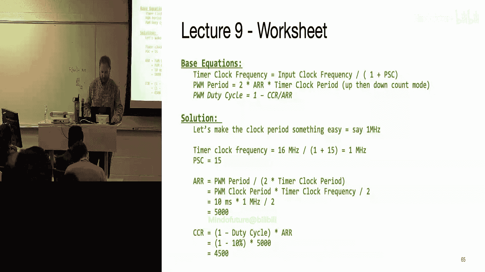