# 嵌入式系统设计导论：课程9：定时器与PWM生成

## 概述
在本节课中，我们将要学习嵌入式系统中的核心模块——定时器。我们将了解定时器如何测量时间，以及如何利用它们生成精确的脉冲宽度调制（PWM）信号来控制外部设备，如电机和LED。课程将从定时器的基本工作原理开始，逐步深入到具体的配置和应用。

## 课程公告与考试回顾
上一节我们介绍了中断的概念，本节中我们来看看课程的一些近期安排。

考试一的成绩已经发布。成绩分布与往年类似，课程最终会进行曲线调整，因此目前的平均分不代表最终成绩。关于考试的任何疑问，可以在一周内提出重新评分的请求。

项目即将启动。以下是需要完成的前期步骤：
*   **创意提案幻灯片**：每位同学需要提交三张幻灯片，每张描述一个项目想法。每张幻灯片需包含少于100个文字、一张图片（手绘或生成均可），并注明姓名。
*   **团队组建活动**：这是一个必需参加的活动。届时将详细介绍项目，同学们可以展示自己的创意幻灯片来招募队友。活动将提供披萨。

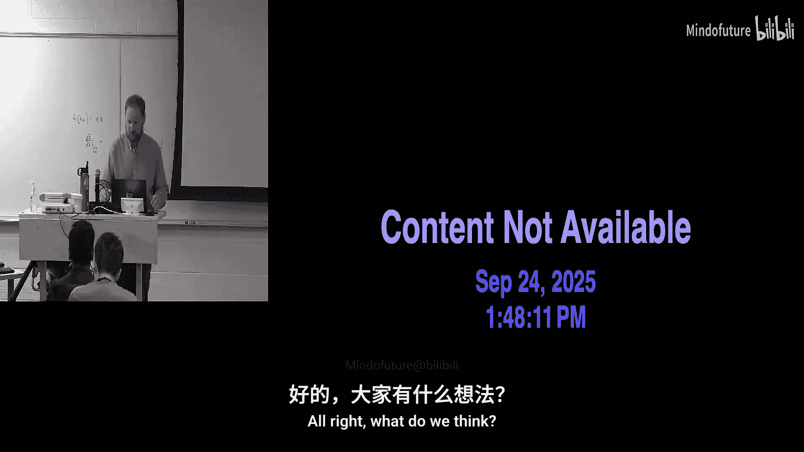

项目细节说明书将在今晚发布。项目的基础目标是实践课程核心内容，如内存映射、GPIO、定时器、中断和I²C等，并完成真实的系统集成。

关于重新评分的提示：最有效的重新评分请求是指出评分中的事实性错误。较难获得通过的是诸如“我本意是想表达……”或“我认为我应该得更多分”这类缺乏证据的请求。

## 定时器简介
现在，让我们进入今天的核心主题——定时器。微控制器非常擅长测量和控制时间，这是与外部世界交互的关键方式。

定时器的主要功能包括：
*   周期性触发任务（通过中断）。
*   提供精确的延时。
*   生成脉冲和波形。
*   测量事件持续时间。
*   维护日历时间（需要软件转换）。

一个关键问题是：电子设备如何在物理层面检测时间的流逝？答案是依赖于**晶体振荡器**。晶体在受到电激励时，会产生非常稳定的特定频率的振荡，这为系统提供了准确的时间基准。

## 定时器的解剖结构
上一节我们提到了时间基准的来源，本节中我们来看看定时器模块的内部结构。

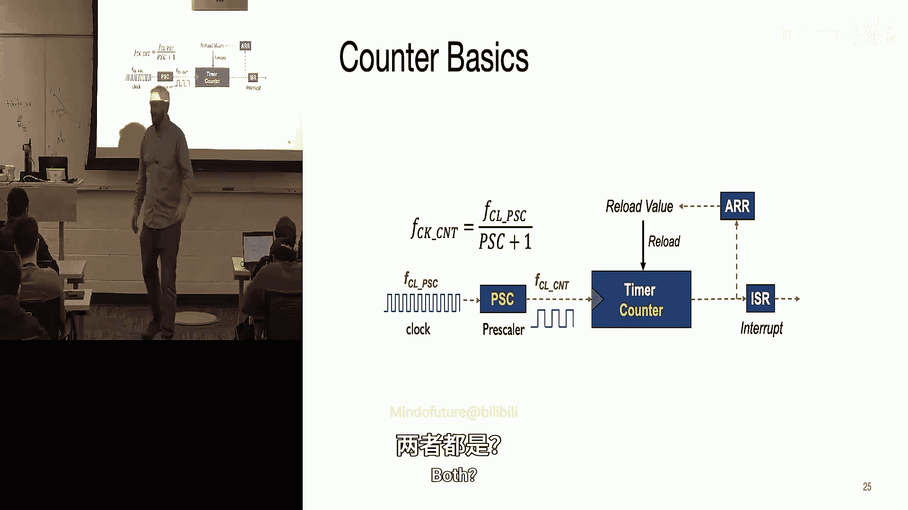

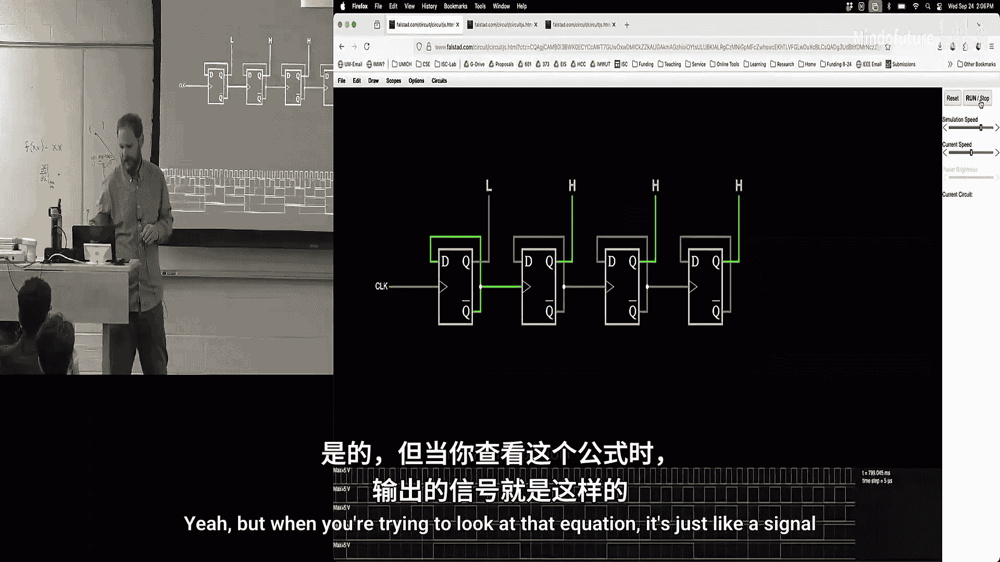

一个典型的定时器包含以下部分：
1.  **时钟源**：来自外部晶体振荡器或内部振荡器。
2.  **预分频器**：用于降低输入时钟频率，公式为：`输出频率 = 输入频率 / (预分频器寄存器值 + 1)`。+1是STM32的设计，用于防止除以零的情况。
3.  **计数器**：核心部件，对经过预分频的时钟边沿进行计数。可以是16位或32位，可以向上、向下或向上/向下计数。
4.  **自动重载寄存器**：定义计数器的周期。当计数器溢出（向上计数）或下溢（向下计数）时，会自动加载此值重新开始。
5.  **捕获/比较寄存器**：这是定时器的“智能”所在，我们接下来详细看。

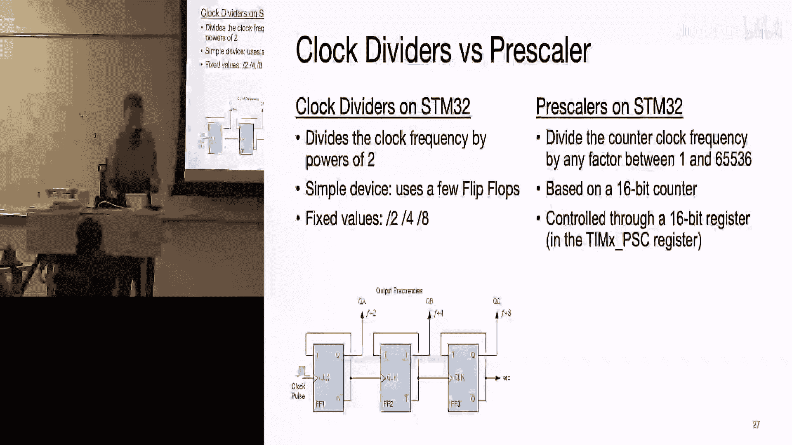

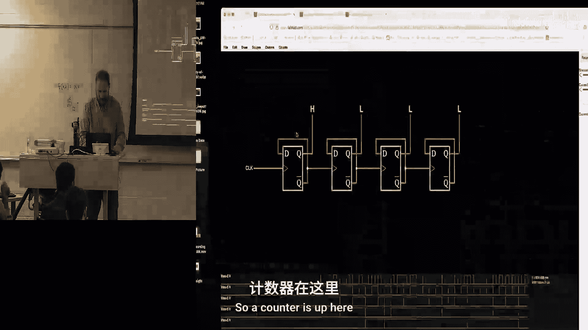

## 捕获与比较模式
定时器通过捕获和比较模式来实现其强大的功能。

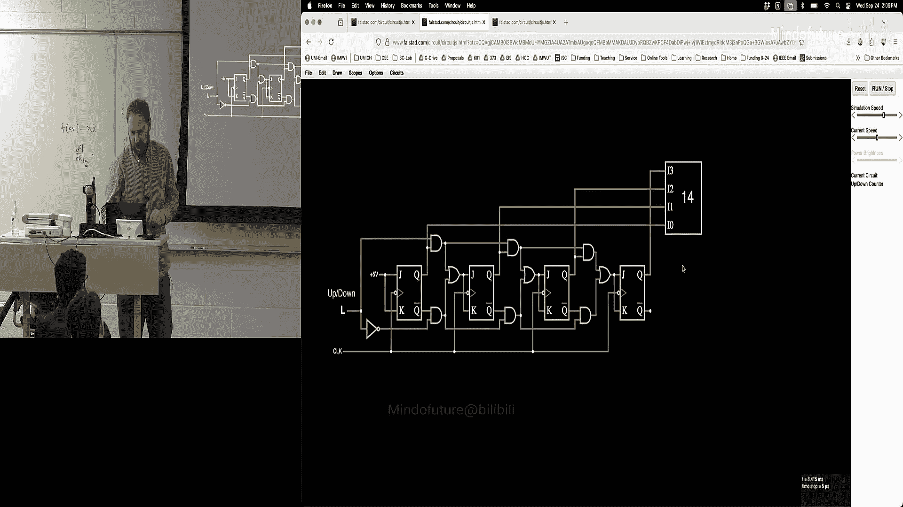

### 捕获模式
捕获模式用于**测量**时间。当配置为捕获模式的外部引脚发生特定事件（如上升沿）时，硬件会立即将当前计数器的值“捕获”并存入一个专用的捕获寄存器中。之后，CPU可以在中断服务程序里读取该寄存器值，从而精确知道事件发生的时刻。这避免了用软件读取计数器可能带来的延迟误差。

### 比较模式
比较模式用于**控制**时间。用户设置一个比较值。计数器运行时，硬件会持续将其当前值与比较值进行对比。当两者相等时，会触发一个事件。这个事件可以是：
*   产生一个中断。
*   翻转一个GPIO引脚的电平（用于生成PWM）。
*   其他硬件动作。

通过设置不同的比较值，可以控制输出信号的特性。

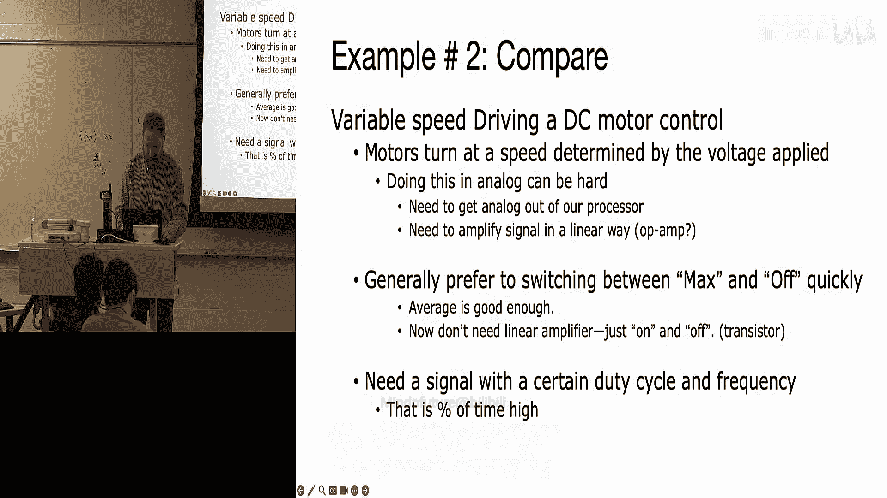

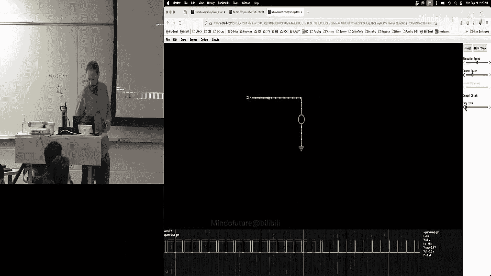

## 脉冲宽度调制生成
现在，我们利用比较模式来实现一个极其重要的应用——**脉冲宽度调制**。

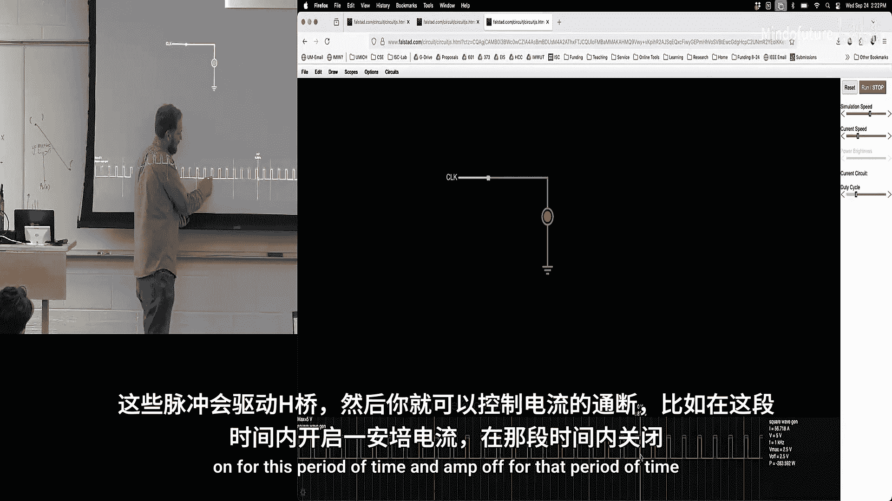

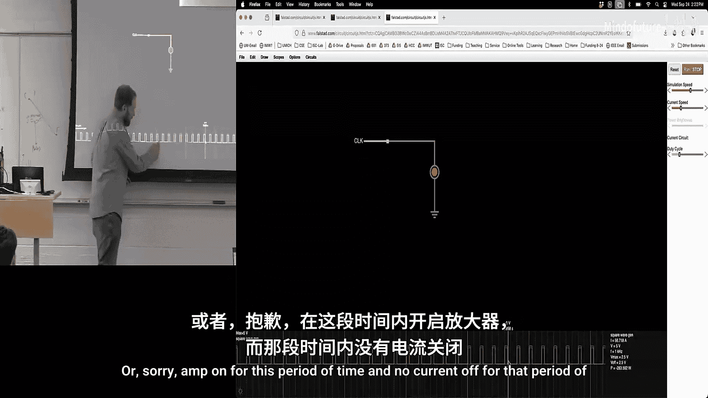

PWM是一种通过数字信号模拟模拟量的技术。它通过快速开关一个数字引脚，并调整一个周期内“开”（高电平）的时间比例（即**占空比**）来控制平均功率。

以下是生成PWM的关键步骤：
1.  **设置周期**：通过自动重载寄存器设定计数器的溢出值，从而确定PWM信号的周期。`周期 = (自动重载寄存器值 + 1) * 时钟周期`。
2.  **设置占空比**：通过捕获/比较寄存器设定比较值。在向上计数模式下，当计数器值小于比较值时，输出高电平；大于或等于时，输出低电平。因此，`占空比 = 比较值 / (自动重载寄存器值 + 1)`。
3.  **配置输出模式**：将定时器通道配置为PWM模式，并映射到特定的GPIO引脚。

一个定时器可以有多个捕获/比较通道，从而用单个计数器同时生成多个独立的PWM信号。

## 配置实例与计算
让我们通过一个具体问题来巩固理解。假设我们需要用STM32的16位定时器生成一个PWM信号，要求如下：
*   时钟源频率：16 MHz
*   PWM周期：10 ms
*   PWM占空比：10% (即高电平时间1 ms)

我们需要确定预分频器和自动重载寄存器的值。

**计算过程**：
1.  目标周期 `T = 10 ms = 0.01 s`。
2.  时钟源周期 `T_clk = 1 / 16 MHz = 0.0625 µs`。
3.  需要的总计数次数 `N_total = T / T_clk = 0.01 / (0.0625e-6) = 160,000`。
4.  由于16位计数器最大值为65535，小于160000，因此必须使用预分频器来降低计数频率。
5.  选择预分频器值 `PSC`。如果我们希望分频后计数器刚好计满10000次达到10ms（因为10ms/1ms=10，方便计算），则分频后的时钟周期应为 `T‘ = 10 ms / 10000 = 1 µs`。
6.  分频后的频率应为 `f' = 1 / T' = 1 MHz`。
7.  根据公式 `f' = f_clk / (PSC + 1)`，可得 `PSC = f_clk / f' - 1 = 16 - 1 = 15`。
8.  设置自动重载寄存器 `ARR = 10000 - 1 = 9999`（因为计数器从0开始计数）。
9.  对于10%占空比，高电平时间应为1 ms，对应的计数次数为 `1 ms / 1 µs = 1000`。
10. 设置捕获/比较寄存器 `CCR = 1000 - 1 = 999`。

核心公式总结：
*   定时器时钟频率 = `f_CLK / (PSC + 1)`
*   定时器时钟周期 = `1 / 定时器时钟频率`
*   PWM周期 = `(ARR + 1) * 定时器时钟周期`
*   PWM占空比 = `(CCR + 1) / (ARR + 1)`

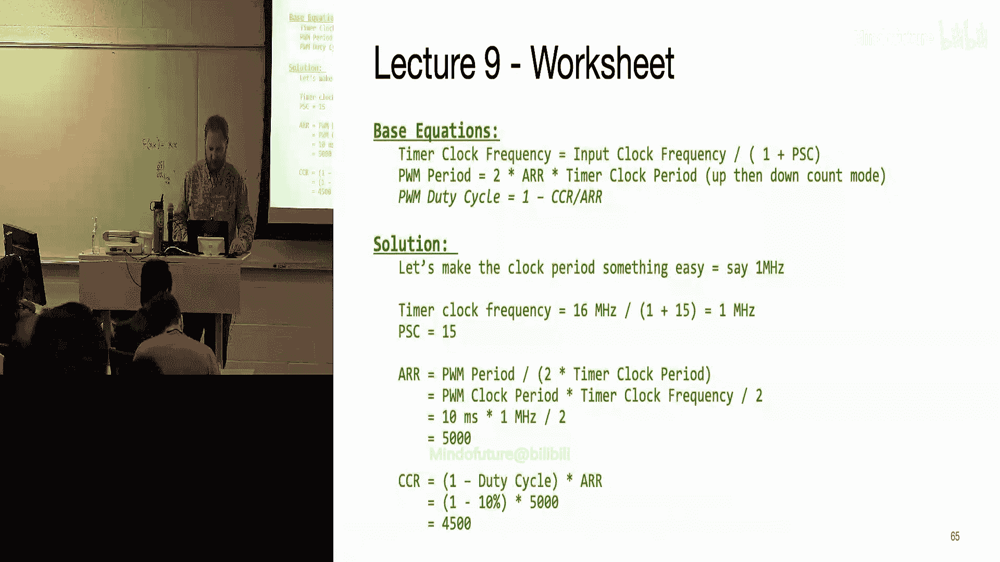

## 总结
本节课中我们一起学习了嵌入式系统定时器的核心知识。我们了解了定时器如何通过晶体振荡器获得时间基准，并剖析了其内部结构，包括预分频器、计数器、自动重载寄存器以及至关重要的捕获/比较寄存器。我们重点探讨了捕获模式（用于精确测量时间间隔）和比较模式（用于控制时序），并详细讲解了如何利用比较模式生成PWM信号，包括周期和占空比的计算与配置方法。掌握定时器是控制外部执行器、传感器和实现各种时间关键功能的基础。