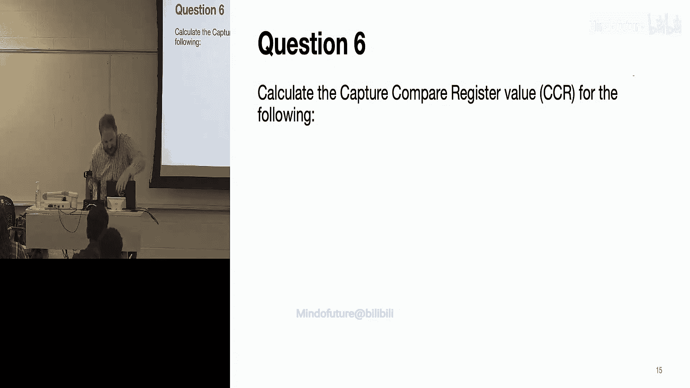
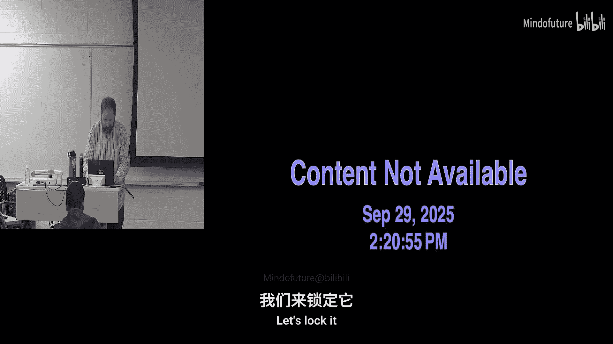

# 【密歇根大学】嵌入式系统设计导论-EECS-373-｜-Introduction-To-Embedded-System-Design-2025-p10-P11_课程10_定时器_PWM生成_虚拟定时器--BV1VTSNBoEem_p10-

Okay， we can get started。か。Okay， we're getting started thank you， all right。

 so today there's homework due， homework five has already been released and we'll have office hours right after class。

We'll have on Friday it's a mandatory event we're going to have team formation so in that event we're going to discuss the project make sure you understand what's needed to be prepared and then you're going to find teamss and to be prepared for that on Thursday by 1159 pm you need to submit your slides to the will Dropbox folder this is not the grade scope。

Any questions， logistics questions？Yeah， so we just put them into the folder we have to market anywhere Well it tells you you had to put your name here other yeah we'll just go through and we'll download the PDFs and then put them in your in graycope for you basically so you don't have to do that task。

嗯。All right， so the other day it bothered me。 it bothered me， I didn't know how atomic clock worked。

 So this is not。This is not a component of the day。

 but it's still like I think understanding how the world around you works is incredibly important。

 this is like this fundamental value of being an engineer。

 I don't know how like history majors go around the world just wonderinging how does your cell phone work like I don't know of course history majors probably argue well if we don't learn history we were doingom to repeat it so they have a good argument but it just bother me that I didn't remember or even know maybe how atomic clock worked。

 but I also wanted to teach you the lesson of being an engineer is learning first principles of everything everything around you so that you can gather that together and use that little piece of here。

 a little piece of here bring it together for your project that's what I find really empowering about engineering。

 but anyways here's how atomic clock works for your embedded projects。

Basically you're going to get a field of cesium， so you get some cesium atoms or raidium。

 you get a cloud of them and raiddium and cesium， I'm sure other atoms do as well have this unique property where you can control the electron state based on the impacted electromnetic energy onto it and what you can cause is a change in reflectance in this material based on that structure now what's really interesting is if you pump this cavity with exactly this frequency。

Then these will pop into other state and you can look use a laser and look at the reflected properties and the transmission of properties to figure out if they're in that transition state so basically this is equivalent of you have a pendulum a kid on a pendulum or a swing and you're pushing them and only one frequency will really be the residentsonant frequency of that pendulum and then they're going to shine a light on that child as a photo detectoror to figure out if say the child change when it's swinging at maximum amplitude something optically changed about the child are smiling That's it you have a photo detector that looks at the child smiling only when they're swinging at maximum amplitude are they smiling that's equivalent here you have cesium atoms。

 you're going to oscillate them with electromagnetic field that exactly is frequency they're going to smile they're going change your optical pro and you can look at this and the trick is this is very。

 very narrow frequency to me how do you g whatever time you if that's the only frequency that you can use。

Well now you have clock dividers and all the other stuff you want off the end but this is a way to get a very stable clock so by changing this frequency even slightly down in the millhertz will cause the optical properties to change so you're constantly kind of servoing trying to keep this thing such the optical properties are reflecting and when that's true then you know you have a stable time source and then you divide after that where are these atomic clocks used is that like what's in our laptops and stuff those are the atomic clocks are relatively large and you don't really need that level of precision so I think this is like in100 years you'll lose a second or something like this more precision than you could possibly need so satellites are one because you actually have relativistic。

Vlocities and notveloc but you're far enough away from the center or from the earth that gravity flow or time flows at a different rate for satellites and you need to account for that flow of time difference in order to have good global positioning so when they first put the satellites up there they were like why are we off by tens to hundreds of meters and they're like oh we didn't actually keep track fine science equations here think about the flow of time due to gravity？

So where elseC use them scientific research， like， I don't know who actually needs this sort of time based other than satellites。

For somebody， yeah， yeah。I mean， I have a picture of one。

 it looks like a monstrosity lab piece of equipment。

 I don't know anybody who would find value in commercializing these into like suitcase size is probably all kind of one off things。

 and I guess。Okay。Just took a side quest， it's fine， I got excited all right。

Let's go on to it so today we're going to do a review of timers we're going to talk about virtual timers and if we have a chance we're going to get to assistT which is a timer that's built into the core of your MSP or your microcontrollers。

So little'll review we talked about capture timers and so capture timers where they capture an external event and place the time into a register。

And so your clock peripheral module is going to be fed with some clock and the presscalear just allows you to divide by some value to have a lower clock speed and usually that's nice because you're trying to measure long things and then in your timer module this is the actual timer itself and it's going to be counting up or down when a certain event happens underflow overflow you can have。

Interrup request go off and then when you overflow or underflow。

 you're going to reset to your auto reload register and you're going to start this again。

And so the capture part comes in here is where you have some external events。And that's going to say。

 okay， this event occurs， I'm going to take the value in here and'm going to place it in there just so you have a local storage of that。

And then you can pop off an interrupt service request that will go through and cause the core to say。

 hey， when the interrupt gets handled， the core can look back in here and say， oh。

 this was the precise time as measured here that that event occurred and now you don't have to you can overcome the latency ofpoing for sure but also the latency and uncertainty in servicing requests。

Or servicing interrupter questions。Any questions there？Okay。

The other one was the compare and so this is not trying to measure external events it's trying to measure the passage of time so you have all the same anatomy you had before the difference is you've placed some value in this register and you're just waiting for this value to equal that value and then event happens and then you just get to interrupt service request you pop into that interrupt and then you're going to do some task because you know this amount of time has passed。

AndSo the most common well， not the most common case。

 but one common case is PWMs heres you get different clock sources just for multichannel timers in general。

 you got a different trigger of rents you have a prescaleer you have an countdown timer。

 then the trick here is you have multiple capture compare registers for one timer so with one timer you can do four up to four tasks and then you can decide if they're rising edge falling edge all that sort of stuff and then send them out on control channel which is basically routed to your GPO so this is with one timer you can do up to four events。

Any questions on that？All right， so last week we probably did not spend enough time going over that design problem。

So we will do a different one that I invented this morning， so it's only slightly prone to errors。

And so we'll work through this one to make sure everybody has a good understanding of how to generate PWMs。

Because that's what you'll be doing live this week。证据。后。你两。比如说全位。有这个事是。没。把这判成结了。ます。

Sigore from the Boards of Obles。听好。这上。觉得觉得可。嗯。没啊。好像这个什。Great。没有。我。Yeah。

Sometimes I could only find six。You thank you very。还全的。放诉。消。All right， so you have PWM。

 sorry you have a servo that is going to change direction from negative 90 to 90 degrees and then you have some position timing so it says you have to generate a pulse with the pulse width of say 2 milliseconds。

2 milliseconds to 1 millisecond and then0 degrees is going to be 1。

5 secondsd so if here the pulses you have to generate and it tells you what your period has to be in order for this thing to work。

And so the first question is draw a basic diagram of the wayform you want to get out of this。

 so the previous thing told you what you needed to do， draw that diagram， annotate it。

 this is kind of the process of going through。You know， getting these questions。就是。This。对了。不那好。好个。

Yeah width of this has to be 1。 and to go to positions。But our FPJ was still growing false。

You could like to do what it was supposed to be is high for a while and then low for a long time。

 so pulse is like。Yes， for position zero degrees， you're going to put a this size。

 this size that size。are by COVID timing。Choose your device makes0lin wanted to go 45 degrees。

I don't go 45 degrees， say you have an airplane like a model airplane。

 you want to control the angle of the flap then the thing is un flyable to slide。现。Geor。

你 just make couldn。然后。So， you're telling the to press so hard down the rest of the equation trying what's the keep ahead。

I went to 100's so is a perfect're growing you can it but that's not perfect something it can be feel there's about that looks great。

this would be like I think it is20iseds another that's a good point have to be on 0 you could do like be fine should period would course went that。

you got to set up a timer to hit that the what is yours that looks good my screen though I would have expected you guys to come up with right？

Your GP pen is going to send out you。The servo is looking for a pulse， this a certain length。

the information of what angle should be at it can be it's not just 090 negative ideas any angle in between right and so the width of this pulse tells the ser what angle it should be at and it needs to have a certain period and if it doesn't right then the serervo doesn't understand how to interpret it so it has to have a certain period。

Certain pulse， so I would expect some diagram like this， you could have put in here the Ashville。

 some people did like three diagrams for each one of those three positions that we called out。

What questions we have？So ultimately， if you looked on oscilloscope， this would be the-。

 this would be what was coming out of your GPO pin to control a servo。

They just be repeating over and over and over again？If you guys are looking at me like I'm insane。

 that's fine， that probably means you have questions and I could teach you things if you asked me。

Yes， so how is the。I was like the like in servo supposed to be like super accurate to know like。

Like one point compare like 1。01 millisecond to yeah that's what the servo does it's a piece of it's in itself it's a piece of electronics that's using instead of you trying to write through a tear robustbu。

to the servo to say be at this angle have one signal and your coding information is time。

And so the servo has little RC mechanism in there in the counter itself to keep track of time。Yeah。是。

B都要啊。that is the given。他这几边我我的可。Because that's well， that's so where Servo goes out。

 but you wouldn't know， and I wasn't really asking you that。Why' she like 0。

5 it doesn't really matter。Right because I just wanted you to draw the waveform， yes。

 there're going to be different it could to be a different value。

 you can be anywhere between one millisecond to two minutes like and pulses。

 but this need you to think about what waveform you're trying to create and the reason you have one it because that's like the minimum maximum correct distance correct。

Wither questions questions in the back。Confuse people in the back。

I see people lift up when I said past， I might be confused people in the back if you have any questions back there？

Yes， a brave person， where do we write our name on the worksheet？

You found me the error in my worksheet or put it on top that's great。These are participating。

 that's great， one more question。Yeah。within this periodYeah because your servo demands that you talk to it in a certain way so oh by zero within that one to two milliseconds and then I guess is kind of a weird way to think about in a sense that this is just going to be a repeating thing so it's like where do you start counting is really the statement。

But I would just say start， either have the pulse start at the beginning or the end is probably the easiest to think about。

Also， if you were anything less than1 milliseconds， we just assume like you've seen I。

Time like wouldn' move it all at the servo if it's out of spec。

 we don't know what the servo is gonna do。 is what the servo demands Yes if pulses within that same period。

 let's say one millised each would count as two milliseconds or how that I don't know you're gonna have to you go get a servo out and you treat the servo poorly it out of spec and you see what it does this is just what the servos it requires from a state as you allowed I'm not charge yours can put any pulse width and stick it into electronics It's not like there's anything as wrong will happen is it will flutter it'll twitch it may go to the wrong location right but it's not it's just saying this is what it's required for the servo what it expect So like if for example。

 if I want to like go to like090 and negative 90 like three different increments be best to just do one for each period then。

AndAlso it takes time， these are coming out over 20 milliseconds。

 but there's actual mechanical time for this thing to move around。

 so it's unlikely that it's going to go from 90 to thing to 90 within milliseconds if you put another pulse over here so you got to go slow enough for the thing to respond。

嗯对 so this。When I server' is already moving， does it interrupt？

If there was to a change to go the other direction will drive to yeah but you should should go slow compared to 2020 milliseconds you shouldn't be updating it more than once in 20 milliseconds。

 it'll be out of spec。All right， so we'll go to the next question。

 this one was courted I'll admit poorly so I'll modify this a little bit you have to keep track of time right you have to keep track of time in fact it demands up here that you are able to have 180 steps。

Okay， it says you have to have 180 steps to control from negative 90 to 90。

 so now you can go back to this and you know right here。

 it is negative 90 and this is 90 or vice vers I don' know which one it is。

All you have to have 180 steps in between。So what is the largest？Period of time， you have to。

track of an order。To meet those timing diagrams， you could go smaller short and you would still be able to hit that。

 but you can't do 170 steps， that would be too large。

So what is the period of time that you need to keep track of with your timer？T过。

Can you have a little square wave on the here， that is your clock， right？

And your clock to have a number of X from here to here has to have at least 180 okay we agree with that。

 yes， what is the period that that clock would have to be？It's the largest。

Possible period of time that you have to keep track of。

 you can keep track of smaller periods of time， yes。19 milliseconds，19 milliseconds。No。

19 milliseconds would be like。A 90th here all right， 19 milliseconds is here。

But I need to keep track of I need to have 180 steps right in between here。

 time steps in between here。All guys work on it together for a little bit。

don't know how to do millisecond I'mitory don' if I do like 1。

 millisecond need how many steps30 times。So you're saying that you need to think in the numbers because you' got to go and hit those part of the thing。

 you have to hit those numbers smallest cloth period that you'。I have a one week extension。

 but they have to to work on like projecting on to 90 degree open。其是你有用要。In turn these or utmost。

five。So just forgot because that between these two time period you have to get that in my resume。

 which I worked on so much because I was applying so I literally have like one。that's what I got。

Yes is to be wrong they're going tell we're going to vote essentially and figure out if I can do math as well All right so you have to hit pulses between this size and this size so that's one milliseconds worth of pulses so I just put it into microseconds and I have to have at least 180 steps in between there right because I need to be able to control the servo location 180 degrees so the prompt and so the smallest amount of time I need to keep track of is this 5。

555 microseconds does that makes sense。Where does this come from。

 Because we're going to feed a clock into our timer that has to at least be。

Of this size to be smaller， sure。But it has to be at least this size。Yeah。

 could it also be like half a millisecond over 180 since some of the pulses are one and a half？

I mean， if you put a number here that's smaller than this， then yes。

from what the brief said have to have at least 180 steps。You're going to have 360 steps， okay。

thatconds because I did the end of the problem and so I knew that microseconds were going to be useful。

All right， so next question three is going now we know kind of the specs of what we need we have。

 we have pulses that have to be a certain time， we have to keep track of a certain period has to go by now we're going to start configuring our microcontroller。

So。Here's a little table you get to go through and this I guess this is free choice depending on how you want to set up your timer。

 but you got to figure out what's a PWMO you want and if you wants us to be up counting and downing and this is the logic this is really where you're trying to hit to under what conditions should be logical high and what conditions you need are logical low such that you need this right you're trying to be logical high here。

 logical low there。So to meet this time diagram you made。

 figure out how you want to set up your microcontroller。就是全都模。We ahead do talk to each other。

 it's okay。You have to put arrows to remind yourself。P than your CCI was only for my sister's。😊。

let's do counting other way because click go down counting one and then for the PWM let's do one because one is a smaller number。

😊，Consider is the amount of city and accurate。明。I would say。

 let's go young and calculate a number didn't ask you actually。

 I guess if you auto reload warning you to hear you could make these all make sense。

 Also very reasonable。😊，As you make like90 or one mill I don't know what it circle to have to do with that mode one is my extreme you need to go to negative 90。

This is not。 I want to discrete to a certain level on your counter but it comes down to it。

The devilActually， I。I mean wants to do this dragon extra chips because they seem to be powerful and deagative0 and Max are just not。

we need them all the time I so because we have some modules through our my regret。Okay so。

going to your Windows turn'。does it for you automatically you literally figures pressing the up arrow on your keyboard kind of where you get free choice there's other solutions here that could work I'm just up here's the thing that counts up。

It going to be in mode1 and so it's going to be high in the beginning when the CCR is below this value and then it's going to drop down low so that's mode1 up counting so when the count is less than CCR we're logical high and when the count is greater than or equal to CCR we're logical low that's going to give us assuming we're an up counting mode going to give us this diagram so here you imagine that we're up counting。

And there's going to be some threshold that occurs causes that time。Yeah。

 maybe you'll understand this wrong， but。We can need three different CCRs。you did calculate three。

 but you could do any number of CCRs in fact， it's not just that the server only goes from negative9D to zero to it couldn't go in any angle in between I'm just asking for those three CCRs。

Okay。CoReally， you got loud can be down count and you can。

I' just told you this is what I'm going to choose。There are multiple answers。ok。

Now we're going to go on to the next one， which is choose a prescaler。

Now three scale is going to take the four megahertz clock and divide it down what should it divide it down to Well you already figured out what the minimum。

Time period you need to count is。It was like 5。5，5 milliseconds or something， microseconds。

Glide your clock down to that value now you don't have to， you could have it be faster if you wanted。

 there are multiple possible answers okay。Take a little bit， calculate out what you think you're。

PS see or prescalear restaurant week also remember the arm is trying to trick you。

We you and the presscaleers is always plus one because if you look at the math of it they if you put zero in here。

 they don't want you your clock to stop so there's always a least divided by one four mehertz clock it said so oh buried in details in a non obvious way。

So we need2 it。I。What is FL PSC 20 period ？我是是该。あ don能这。

So that means may have to understand the clock coming down， so if you look here， look at that。

That's the version and you're going to slow it down to using this equation and you know what the period of that clock is you already calculated so I mean just 20 minutes is the result that we want though right how are you getting。

Okay， but that's a period， so you have figured in the details it says you can give the four mech。

formal you can look in here， but all it is is one over one divided by。😊。

And you know4 mehertz frequency makes is because the clock is in frequency it'ss like anything。We？

gambling makes to be。It's from a different units military put in the con second because we want to be the largest。

5。555 what is that micros。Time。然了。2 I came up with。

So I said that here format got messed up but the period of four mehertz clock is 0。

25 microseconds recall that we wanted to measure at least this value this is the value we wanted to why because that's the smallest step required we don't count a difference between one microsecond50 microseconds by by 180 so this is the period that we would need and so we can go through the math and figure out that it's approximately 20。

The division ratio between this and that is approximately 22， however。

 we can only put introgers in here and the PSS has to have a divide by one so that's because of arm is trying to trick you all。

So it's going to be like frequency divided by one plus your division ratio with equal is your output frequency and the one is there so that you can't accident put zero into that register and cause your clocks to stop working so I got out a PCS of 20。

Anybody get a different PCS？Feel real good about。Thatt means the division ratio 22 yeah。

 Did you explain what you meant by the 5 by1？就是对。The divide by one thing well you said because we can't have 22 put I just missing so fine。

 so frequency of the clock。Provided by one plus PCS equals frequency out， so this is your prescale。

 I guess this would be PCCP。So we're just saying that if you have an input clock of four megahertz。

 you're going to divide it by some ratio to get your prescaled frequency。

Now normally you just divide it by some number， you don't have to do the mental gymnastics of plus one。

 but arm does not want you to accidentally put zero in here and everything stops working so you've try to divide by zero it demands that it's plus one so just remember arm is trying to cost you points on the exam it's not me it's arm。

哎。😊，Why are you doing period and not frequency frequency up there or like like you do because I think in period？

好。Yes， this is a rain share。when I plug everything into the equation in terms of like herds。

 yeah I get PSC equal was 21。 before it， shouldn't we round up？runninguning down like， well。

 if you do it， and I think if you do it in period， you find you want to divide crown down。

I don't know， do the math you figure it out if it hits your period requirement。

 you're trying to get to 555。55 microseconds。Okay， I we'll get to the last part， well。

 that last part， almost last part。questionion is， what should your auto reload register be in order to get the correct PWM period？

So remember， you have this frequency coming， you have the clock coming in， it has a certain period。

 and now you have to count all the way up to 20 milliseconds。

What value will allow you to hit 20 milliseconds causing and should cause the thing to overflow and restart？

嗯。加发。And actually what our at 218。over2。They're going calculate're going to calculate what the A are。

students were and count 12，3，45。Or like what you're counting to， and then at six you come down。

 AR would be six and the ARR would be nine。1000 spec within reasonable error times。

 which is20000 divided by times because two times half is divided by。Yeah， the A is。

does that impact our system？Whiever one who got hit in theking on， you're playing poke on。我感那个。0。

1 if how are we doing？急命？觉得。You can't put floats and you're most like using I think should be around 200。

 automatically that makes sense for this what we're trying to do。As we have our counter。

Co is counting I chose we're counting off so these are little steps right this is time time going back here period so we're counting off and we're trying to figure out when should this thing start again。

what's the value here， what's your auto reload register value that will cause。

 what's the count value that will cause us to reset such that this thing equals 20 milliseconds？

How do we do that？So here we what is that guy doing don how in the world okay。

 20 milliseconds and I'm going to have to count 20 milliseconds divided by this is the smallest step that we were taking right is approximately that number and then what do they say say they round it down？

Well we can look oh because they' around it down here。

 plus have to add one AAR should put down there AR is also a type of register that demands that you put a one in there because I don't want your auto reload being off by can't be zero because then you would immediately be sending to interrupt。

So AAR has to be off by one， oh， do have it here。What questions you have now well I think we'll calculate。

 do we calculate the error in a second？Calculate the error。No it was very small， so here we're a 0。

01 error。T say it's an eible so I guess if you're an engineer so we just have a conversation over here in math classes they always give you perfect numbers。

 this is which is exactly be if you're a scientist you're doing something that's got to be priced。

 we're engineers we're making tradeoffs， everything's dirty It' horrible over here right and so now you have these non precise numbers and all we're saying is figure out if you're ever worried especially if you're a job。

 is the error important， go calculate， is it actually negligible how far off we're at。

So on an exam would I probably care if it's round up or round down。

 probably not pretty close unless I made it the example， the instruction is very precise。

 but if you're off by you know， factor of two or 10 or，You know putting words in there。

That the answer what is T here， not TpW T take period？periodiod。这点的。What is this period？

This is AR plus text， oh， this is the time that you need， so this would be 20 milliseconds。Yeah。

 is the purpose of the AR to trigger when the that entire register will reset or is it the value that actually gets put in there the value that gets put in the register okay。

 so if we go back。Here a your questions。So let's see what we're doing。

prepare so this thing is counting off in my world here， I don't know if you can see it way back here。

 but I'm counting up。WhenWhen should it reset， when should we go back to zero？系。😊，Well。

 you click value in your auto loop reject when this thing hits that value。

 we're going under overflow and go back to zero and so I want to pick an AR that's going to give me a period proportion that closeak what I want my period to be so I just took AR times the smallest unit of time to 5。

55conds we're going to count that up then we're going to get us 20 milliseconds。也就是。谢。这不些。O。

So now I wanted you to go through and calculate what your capture compare register should be for the following and oh I didn't actually write what they should be on your papers is going to be CR1 CR out。

 sorry， zero degrees， negative 90 and 90 degrees。Comp that value language。

这样他有么标就如说这个。1 minus like4。哪啲。Its a tune server。Please let we know is stress。a 20 millisecond。

How do I？I is a calculated captain。

哇。直前没。さすま。2。Two millisecons is there to which is basically percent。

ly is so I' Z Brian' every single time the song X。One the Jersey cycle， rosen Madkeeper。

Is it not this one， I don't know， but it was like 40 different formulas which came in？

What are you bro？trying's still six hours in the back， he side in the back。

After that they off fireworks hear eyebrow。なた三年。like not no no。

 like you know how just whole value that are。My understanding was。So you do got。it right。

That's a fair can probably was sore from it from shouting so we went together like this group of high school girls behind us。

There were a couple， I literally like like sweets like like so over。

the thing the same thing where we have 1。5 mill thing possible how many men 5。

5 guess that's our snap thing？All right， it's melon。

And if you're running out of timeIt's smell yourself right now？I forgot how I put it on the sheet。

 but I said the minimum count was 182 and the maximum count was 164 so saw a lot of answers that were approximately that Any get these actual answers？

Some people got the answer that's fantastic I didn't I don't not everybody disagrees with me that's a good day but so yeah。

 so these are the CCR is the value you put here， let's say you put a CCR value and you're saying I'm going to count count count count and I'm going to hit some threshold and that thresholds going to cause something to happen what's going to happen。

You're going to cause， let's see you're going to do this， you're going to go out。

 I did the other way， this come down like that， and then I'm going to increase my CCR to the other value。

 CCR。And then。I'll have a square wave of the comm。this was a dramatic， this should be over here。

 this is a little bit of a dramatic one。I'm moving changing the CCR I'm changing the width of my pulse and so in your microcontroller code you just be updating that value。

 set up your whole timer and then you're just going to be writing into that register saying okay I want my pulse width to be this I want my pulse width to be that and now you'll get these 180 steps in between negative 90 and 90。

Yeah， we always run round up。H是。So I don't typically have a hard step if you're rounding up or rounding down because you can calculate your error like how much are you going to be off like 0。

1。01% it doesn't really matter if we use like mode two shouldn't we like round down。

To mode202 countdown， yeah， you should probably round down。

Okay formula oh is CCR have to have a minus one in it probably maybe I made an error that so that we can go take a check does CCR require a one in it？

Well， I would I multiplified by the AR depends what we're trying to accomplish。All right。

 how many people feel， oh here's a little check， like the goal is you were supposed to have1 at least 180 steps between there and so if I have the CCR here and the CCR here。

 do I have enough steps in between so that I can smoothly move myserv arm and yes we did？

How many people feel like？That they got this， this is good， they're ready for lab this week。

How many people are like， I came to the wrong class today， and this is horrible。

I've got some honest people here fantastic I promise you I hopefully it'll make more sense when you get to lab。

 you'll be doing all the same math， you'll be walking it through and you can actually watch your little serverR move around and you can look at as you change your CCR you'll watch your pulse with move around。

So you'll be doing this in lab All right， any last questions before we move on to virtual timers？

Okay。So please put your name on the top of them because I forgot the name spot and you guys will turn them in at the end of the day。

Yeah。这个进品。All right， we'll try to blast through virtual timers All right let's come back together so virtual timers are on the application or abstraction layer。

And so one might ask a question can you ever have enough timers so what do you want to keep track of so one for caption external events。

 one for timekeeping and what you find on your microtrollers're using I think there's I think it's 21 different timer modules on there and in east those timer modules also have separate CCR registers so now you have a lot of time but you can ultimately is hard if complicated system to have enough timers and so what is a way you can get around this by having more timers and the answer which you guess you could have guessed by this slide title is you're going to make virtual timers to keep track of that so how would you make a virtual timer this is using one timekeing device just think through talk with your neighbor how would you turn that to a virtual timer that allows one timer can count any amount of time possible so think through what that would look like and then we'll go through examples of how they're built。

然后呢。で。You can is master time。then you scale it differently fine。All right， what do you think。

 how can we use one timer to keep track of multiple events and events？

on like what I mean scrs like different PSCs or whatever to like depending on what you're like would say I want to keep track of。

 I want a 10 minute time or a 20 minute time or a five second time or a three minute time or how do I have one clockkeing device keep track of all those different times？

And they all start up once and they all we have to keep track of when they go off could you do something where you just have like one quick bass clock and then you like。

Say you take the pulse on every modo two or moduleo three or module four so that you're。

Intexing any different parts of the counter， I guess。

I think I got that kind of I think you kind of bounce off of it like your ARR would have to be like。

嗯。Like not the biggest possible time。And you would just divide it up。Amongs the are different。

Like sections if you had like a 20 minute and max and then you go oh I see what I see what you guys are saying so then so you're saying you're going to have one big long timer。

Right， and then and then what causes you to go off at like 10 seconds versus 20 seconds。

 like how would you keep track of those sorts of like the events that have to go off？No。Okay。

 interrupt。We could have multiple CCRs for each。That is is definitely would work what happens if you want to have more。

 this is where the virtual bar comes in， one is if you want to have more clock events and you have CCR registers。

 so right now you get four per timer， maybe you want to have 100 things you're keeping track of。

You have one like local timer with a really fast clock and then in software if you want to measure e lapse time between something。

 for example， we you like measure the start time and then wait until the end time minus the start Oh there we go。

I don't think you're getting it so we'll give you the quick I think I'm going to say the same thing you are and then we're going to go through a deeper example so imagine we're going to keep a virtual queue of all these times so I have all these times that have to go through and then the first thing I'm going do is I'm going to set a timer that goes off in 10 seconds。

And then I because that's my next thing so I'm going to set compare it to 10。

 and then when that interrupt goes off， I'm going to go and decrement all my other clocks that happen here。

 so I can do all this in software and then I reset my timer for three seconds and go to that one so I just have a list and I'm just going to keep counting to the next event and then you have a virtual queue of events。

We keep going， set the three， compared to seven， and this way it doesn't actually matter how big this is I only ever had to have one capture compared because I'm measuring the delta to the next event。

Does that conceptually feel good yeah oh we're going to get to that we're going to get to the detailed examples。

 but yes， so we'll go through conceptual conception about how virtual timers do work and this is starting to get you ready for 473 or 570。

5 73 where we talk about realtime operating systems where you have virtual timers and realtime operating systems these are a component of that so let's say conceptually we have a program that sets up your timer we have an actual timer it works just like you are looked at it has a account has a event that occurs when the count when this count equals that you have an interrupt and then in your ISR you're going to do something。

And so here we have multiple programs in this case。

 four programs that are each have timers that are trying to execute so we have a timer and it's going to be。

 let's see it's going to go off at three， it's going to go at five seconds， it doesn't matter。

 and this is just denoting we'll talk about in a moment。

 but it's a deelta timer repeating timer so we're just going to go off every two seconds after every seven。

 and this is just happened once at four。Then we're going to have conception。

 we're going to have this virtual timer code， which is going to go in the program is going to tell this little program here of all the events it wants to do and is's going to make an event queue and then it's going to update the hardware timer to tell it to keep track of the next delta in time that needs to keep track of and then in the AISR is going to go in service all these different program timers that need to happen。

 so we'll walk through this in just a second。And show you how it all comes together。Right。

 so you're going to do those particular interrupts in there。

 you're going to do whatever this handler wanted you to do in that virtual timer interrupt。All right。

 so let's start so at the very beginning you have to build an event queue so here program one comes up and says。

I want to have an event in my event queue， this goes off at it's going to last for three seconds。

 it's going to only going to happen one time。And we're going to add another and we're going to set the counter to three right because we already know just off the bat。

 we at least have to count to three and then this event will go off。

And then we're going to add another thing to the event queue hey， we're going to put five in there。

 that's fine， five is less than three， so this one will go off first so we're going to keep our three here。

 we're not going to put five over there because three is going to happen first。

And we're going to go and add this deelta timer just this means it's going to happen every two units now the problem is that this event requires the interrupt to happen after two units of time while at the counter set for three so here we're going to go resort the stack and we're going to have that one's going to go next then the three then the five and we've reset the counter up there。

Then we're going to add seven in， seven is going to be repeating or from program three。

 and then we're going to add in program four is going to put a timer that's going to go off one time at time four and then we're going to have to restore and now we're ready to execute this virtual time where we have a list of time hered events。

And we're going to count down to two and then we're going to when that goes off we're going to service this event does anybody have a question about the setup here yeah so its always to have the time for Lisa greatests yeah because what you don't want to do is well I guess the other state statement the one at the head of the queue should be the thing that has a small amount of time because you don't want to have in the previous example。

 the error condition was。Here， that's not perfect beer condition。去去去去去。

So hereve the front of the queue sets that time sets the hardware timer here。

 so in this case if we just ran this， we've missed the two and so the method to overcome that is we just re our timer queue。

Yeah， any other questions about the setup before we walk through it， yeah？我是较大。

The delta just means that this is a repeating timer， so once it goes off。

 it's going to go back into the queue。we'll walk through that example in a second。All right。

 so here we're going to start， we're going to start decrementing time so everything's set up。

 we got our event queue we have a timer and now we're going to start decrementing time。

 so here we go down to one would obviously you're not going to do one unit of time there'll be whatever。

 thousands of clock cycles that go through here but for the sake of this example let' say it's one second。

And then when it hits zero， you're going to trigger it interrupt so now you're going to pop into your code。

 so your timer has called an ISR in that ISR you have to go and figure out。

 look at your event queue and figure out what's the source。

 what has to be done you're going to remove the head if you need to and update the times。

 in this particular case， removed it， we're going to go and update all the times because。

What happened is at this point two seconds has gone by， this has to have this was a three second。

 so  three minus two is one， this is going to happen in one second's worth of time。

 so we're going to have to update everything in the queue。Okay。

Now they're all set and this happens to be a delta so do we have to insert a new event， yes。

 this new event has to be added back in and now we've sorted it。

 I guess it could have gone here here it doesn't really matter。

 but it has to come after one and so now we have got a reed stack and we know how long should we set our timer for in this case it's one unit。

We're going to go and set new time， and then we're going to go and redo the whole thing of setting the hardware timer and waiting for the interrupt to occur。

Yeah。I there kind of like a downside with virtual timers really because you need to do the like popping and reing there's going to be some like delay where you're not Yeah that's a great observation so these are good for long periods of events。

 especially things that humans care about like seconds because you're down here in microsecond accuracy territory right but where if you're in milliseconds or seconds tens of milliseconds。

 then the small amount of latency caused by doing these extra operations probably isn't that big a deal。

 but I wouldn't say that virtual timers are good for doing precise events。All right。

 so let's go forth here we're going to start our timer again because our queue is set and we're going to decrement。

 we're going to go trigger off the interrupt service routine here we're going to figure out the source。

 it was this thing。We're going to take this off， we don't have to add it back in。

 this is just the one shot we're going to go through and decrement everything， oops， we went through。

 this was two now we've decremented， I get that math right？Oh yeah。

 it was two here and then one go I've decmented everything by one and then we just keep on going through the queue every time we've resorted we're going to say aha I'm going to accept the timer to this and we're going to count down both these will go off next and you'll have one left on here it'll count down they'll go off next and then you'll have whatever would be on here three or two or something and then you'd count down for that thing kind so both the orange and the light blue are going to go off the same time to go back。

Did they go off the same time because you would have to go through。

 you have to go figure out where all of Yeah check which one Yeah exactly if this you're keeping track of what the timer was set to and you go through and say okay。

 this one and that one， this is what it was set through you have to have some logic to keep track of that and is there some priority status for this as well or does is it just like the priority status is that you have to resort sorting priority like oh program like the blue one does happens first before the orange I suppose a really advanced timer would figure this out？

In the base case of a virtual time where you don't need it。Yeah。

The two events with the same time happened at the same time。Well。

 these times have expired so maybe this is like nine o'clock in the morning and this is nine o'clock in the morning and so then in your ISR you would go do one then you go do the other one。

 so it's probably not great for really precise things where you need precise timing but if you're trying to just figure out when am I supposed to set the alarm off on somebody's iPhone then this is accurate enough the cycles lost by servicing this interrupt before serving this interrupt is not vital。

I have never been late to work because I was microseconds off on my timers。た？All right。

 so there's some caveats right so what happens oh this is poorly written。

 but what happens when new events come in like asynchronously right so imagine you have your timer set up here program one to set this up。

Program two and you're counting you're going through your counter and then program two wants to go and add a new event well now the thing that's causing the interrupt to go off and reset the service routine is not the expiration of this hardware timer it's going to be software based so this is where you could call the interrupt just through software by basically pushing one into the pending register I believe for guys yeah I think that's just pending。

And then you can go through an Ash service this event， so what's going to happen。

 your thing's going to expire。The clock hasn't run out so you have to keep the time on the clock you're going to subtract the difference off。

 update the queue now you're going to add in timer this is going to be added in。

 you have to keep track of all the time so that one's going to have to be subtracted off that one's going to be subtracted off you put that event in。

Well we essentially reresorted and then you go forth and start counting down so the big idea here is if a program asynchronously wants to add an event you're going to have to trigger the ISR and keep track of what time is on the counter right because this is the thing that caused it it was this thing that's caused it so there's a little edge condition there。

What questions？All right， so some of the problems only works with Comp timers。

 I suppose that's a problem。You already brought that up。

 ISRs are probably not going to be the best tool for really precise timing。

 there's other tools on your device basically use a hardware timer in its native form for keeping track of time events。

 you don't necessarily have to virtualize it that's not what it's great for it's good for long term events。

嗯。And some responses will be slow because of your ISRs， that's partly because it takes。

 was it six cycles to get in and six cycles to get out， I think or maybe it's12 to get in。

 but you also have ISR priorities right， so you may have be in other ISRs that are blocking this particular interrupt from occurring so you don't want to really rely on precise timing。

一。So I guess it comes back to like does this matter， it really depends on your application。

 do you really care， probably not if you're just trying to do a schedule event like you're trying to say every you know 50 milliseconds turn on and check some sensor。

 you might not care precisely when that censored off。

 you just want to make sure that you have a reading， but it depends on your application。All right。

 I think we'll end there what questions you have。he's like， where is the software that's？

This is all you would write this， yeah you would have to write this essentially this is a building block to a real time operating system that you'd have in the VenQ so more likely somebody's going to give you some software that's in a virtual timer。

It like somethingYeah。这个啊。Pas the first thing in the queue and then y。

 there commence a clock and all other elements correct with the time that's in the first y okay。

 y mouse way that's you can keep track of we go back to here。

You do that just so that you can keep track。Well， if this one went off at one。

 then you have to one second has passed， so you have to keep track of this for all the other events to keep them in time。

All right。I'll stop there， homeworks posted and there's office hours after class today， thanks。

