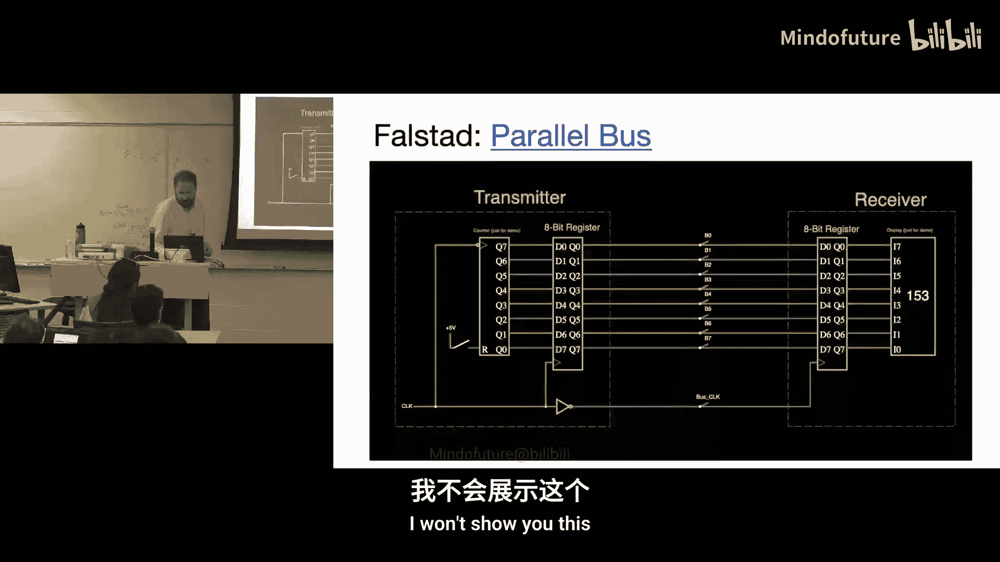
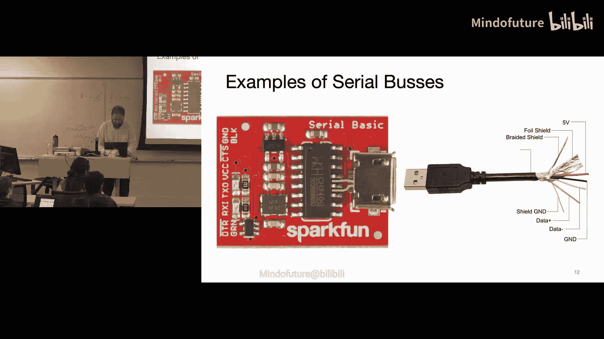
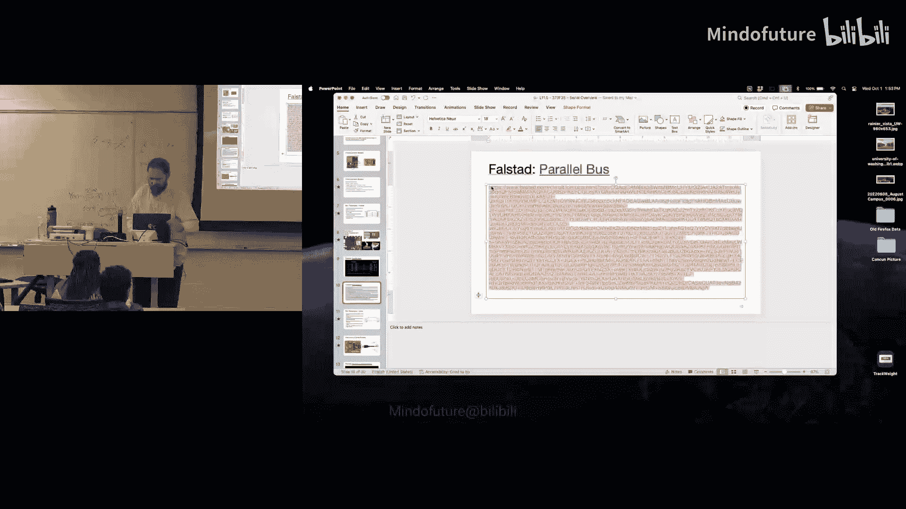
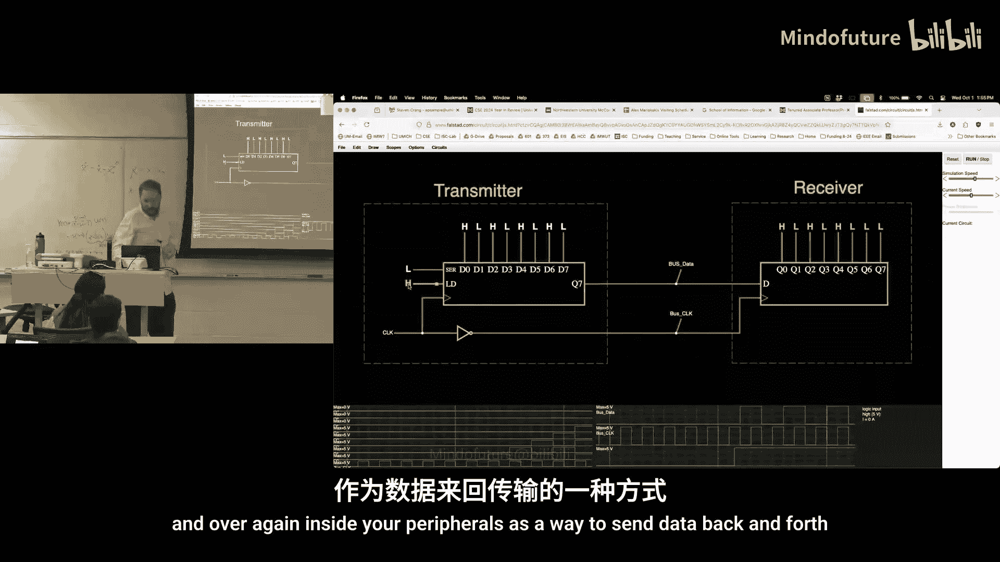
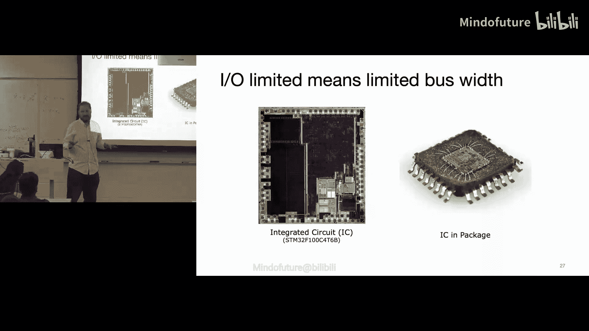
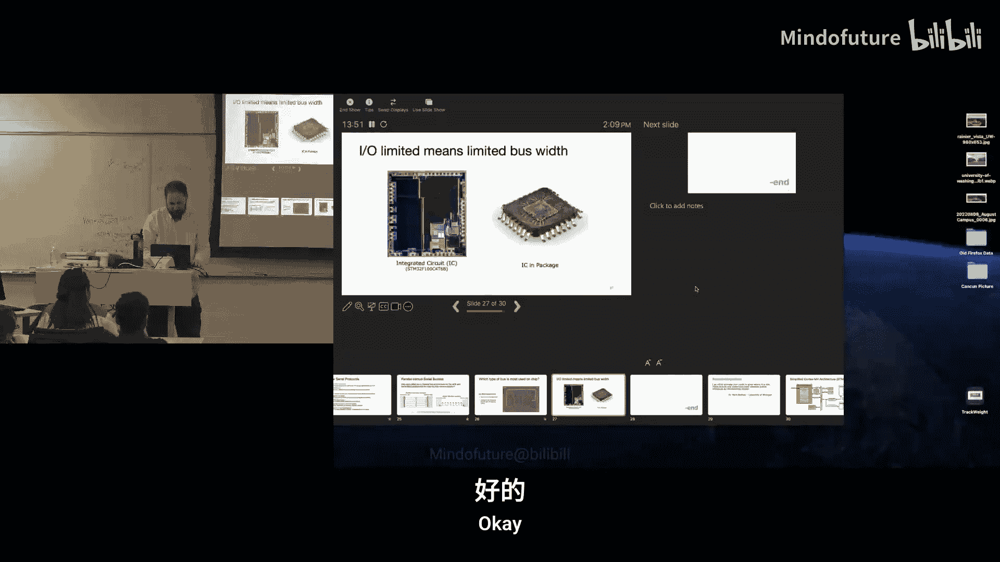
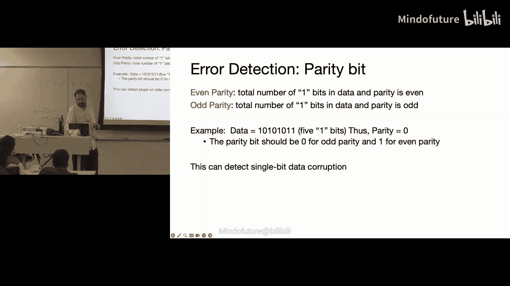
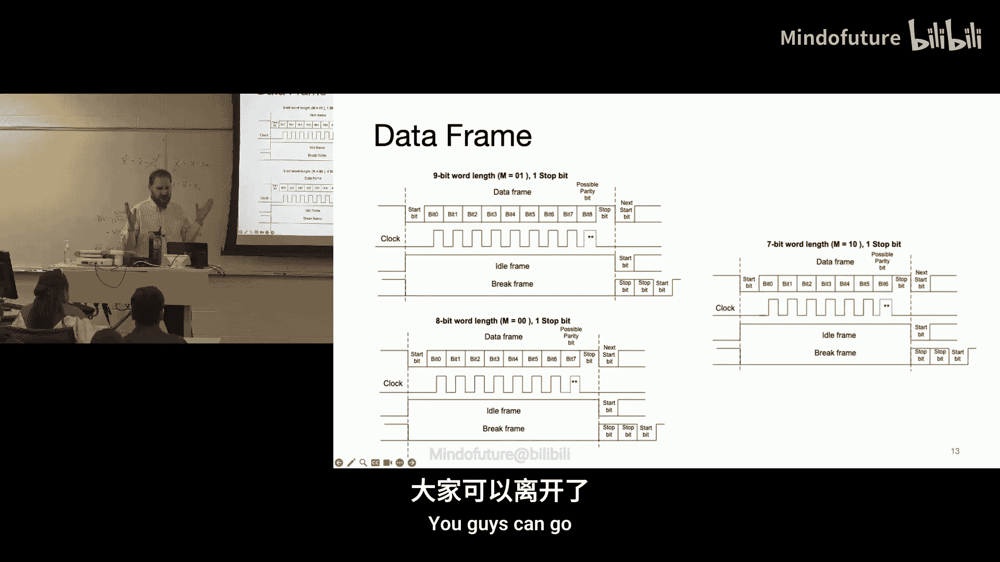

# 【密歇根大学】嵌入式系统设计导论-EECS-373-｜-Introduction-To-Embedded-System-Design-2025-p11-P12_课程11_UART串行总线--BV1VTSNBoEem_p11-

人生是一情。Okay， we're going to get started now all right， so welcome back to class。

Normal announcements your project ideation slides are due tomorrow night you're supposed to put them in a shared folder please label the file name for your slides as your unique name that will help us make sure you get the credit for those slides that you put in there if you just name them copy of template。

嗯。You're going to make the greater sad。All right， so those are there on Friday we'll have the team formation event and we'll give you pizza to encourage you to come and then we have office hours Monday and homework fives been released it's also due Monday。

Any logistics questions？Yeah， just to' do I can't hear man is that due at 1159th Thursday？

What's that？can night， 1159， yeah。Yeah。Please don't lead anybody else's thing it's all one big shared folder。

 all right， any other questions？You go。So I wanted to finish up on one part of timers'rs and that's just to talk about the cyststicic timer。

 which is a special timer。So first we can just talk about programming paradigms。

 so generally every program that you'll write in this class and you can't reason。

Think about why you would do something else is going to be the super loop concept where there's some part of mainine you're going to do some initialization and then you're going to have a set of tasks and you're going to sequentially go through those tasks that's typically how you'd write a program in the bare metal world and it works pretty well because you guys are generally doing relatively simple things your projects can get rather complicated so it might be challenging some sometimes if you have lots of different tasks to get done but it should probably be able to done in this paradigm now the challenge here is say you have a task that's like I don't know。

Measure， you have some Yar， spinning lidDAR， and you have to measure a bunch of values and do some computation on it。

And then maybe you have some button presses here that you have to react to maybe that button presses let's just call it screen update and then some you know some engine here that has to do some tasks and what you really want you want to have nice smooth animation because you want that user experience to work and maybe you're trying to track somebody and you're trying to calculate where to hit them with a ball I don't know or some target so the problem here is if these tasks start growing or taking longer periods of time because the computation is harder or maybe you're waiting from some serial interface to go then your screen might take longer it may take longer to get to the screen update now you have no guarantee that your screen will be smooth right so as your system starts getting more and more inputs it starts getting laggy so this is the problem with this sort of scenario。

And then some way we deal with that is we have some interrupts。

 so interrupts can help mitigate this to some degree。

 help you be responsive to the button pushes and make sure that happens。

 but sometimes some you don't really have an interrupt at least in this paradigm have we have constructed it for updating a screen so you can still have this error condition connect occur。

So the counterar argumentment is what we call a realtime operating system which essentially is a fancy scheduler now there's lots of ways to implement this。

 we're not really going to go into it but I want to set it up so you guys know what a realtime operating system kind of is thatll set you up for 473 and I'm going to talk to you about why we have the cystic timer is built into the art course so I'm trying to get you guys ready to think about that so the real-time operating system paradigm is you have tasks and you assign tasks certain priority and then you have some timekeeping mechanism a scheduler that says I need to make sure that these tasks are done within this priority or in this period of time so then you could have something like a screen where you give a screen a higher priority and make sure that it's deterministly done every say you know 30 seconds or something this is the same thing as like multith where you have each task。

Or is that yeah you can think about that tasks and thread in terms of rtas or the same thing pretty much there's a minor maybe difference。

 but they're the same idea here you're in the world where you have one core right you're're not going to actually do things in parallel there are microcontroller class processor there's like the ESP32 which has a dual core that's a good time to use an rtas Arduinos are probably not good because they have they're pretty limited they're like 8 bits or 16 bits are not very powerful and then the STM32 is an okay I mean you're running that like 120 megahertz anyways so that's a reasonable processor where you could have so many things going on that you might want to have an rs and built in Q IDE is there's a free ross you just like Larry is called career artoss you can push a button and Sansh one。

You'd have to really have a good reason to enjoy that much pain in your projects。

So where was it going with us just to let you know you could have a scheduler that would go through and schedule these different tasks for different times and then you would need a mechanism to do that right so that's what we're talking about here。

So that's where system timer assist tick comes in and basically is the interrupt or's the timer that's built into the core that allows for interrupts unknown known time schedule so you could say。

 okay do this task here， do this task here， this task here and what you have to do is make sure your task your subtask is atomic and is guaranteed or should end in this period of time there's a difference between hard timing constraints and soft timing and constraints。

 hard timing and constraints would say if you don't get it done。

 your system fails the plane falls out of the sky， soft timing and constraints would be like okay you fail to meet that but the user really didn't notice because you're just touching the in screen entertainment system is not mission critical but anyways the goal is to try and get your task to end within that period of time and then you're just going to switch through tasks you might have tasks that have different priorities and you want to make sure that those go through you have a queue just like you have with your interrupts and you're making sure that those get done first。

Okay。So how cyst time are integrated， it's part of the core， it's not one of the peripherals。

 so in that sense there's lower latency when you're trying to talk back and forth to it and it has very fixed function this doesn't have PWM control because the core doesn't need that it just has timekeeping control and there's a dedicated handler for that provided by arm and I mean you can rewrite this handler but it's mapped into the inVIC。

So yeah， so here the core， solve part of the core and you in the vector controller can get inputs from the cystic timer。

I'm not going to go through every little piece of detail。

 but this is just so you know that it exists it's not a 16 bit timer it's a 24 bit timer and basically is a reload value and it's just going to be counting down that's all it ever does and then it decides if something you know when the event occurs when it transitions from one the counting here transitions from one to zero then an interrupt can go off causing an event to happen。

嗯。Basically just shown here， is always countdown， you set the effectively the auto reload timer or the reload timer。

 they call it that it's called the reload timer and it clocks down。

 you have a tick that goes off and you do a task。There's four control registers for this thing。

there's four bits， there's the control register for it， but there's four bits。

 three of them are control bits and one of them the statusdest bits so this tells you what clock source you want to go from。

 so you tick an A， interrupt an able， and then this just tells you if its actually hit zero in case I don't know maybe the interrupt didn't want didn't go off。

 you want to check manually。You can use that flag。Y。

You can choose different sources so you get this come off the advanced high performance bus because that's the only bus that really touches the core even though we talk about the advanced peripheral bus we just simplified it for you guys。

 so the advanced peripheral bus is the only clock that's available and you get to do a divide by eight and this basically muckpses in right to choose that or you can and then you have an and and that it's pretty simple control logic。

Yeah。And then there's four system registers， we talked about one all right， out。

 we talked about most of them， let's see。So there's the control register， this is the reload value。

 you have the current time， there's Ob Z tick and you have one more which is the calibration register again。

 this helps you to remember what it is， let me go through here no no no no I want the calibration register。

So the calibration register makes an assumption here that you have a certain clock and is calibrated to say。

 this is exactly one millisecond。Offset so if you have a 15 megahertz clock going in there it will give you the correct value to result in one millisecond and so now you can just go to this register。

 pull it out and then put that into your reload register and know that you're going to get a millisecond now you can set up the scheduler that's going to go off every millisecond do some tasks again this is not like oh my gosh deep exam question oh my god fundamental to like you know timers this is more like think what the architects are giving you because they're setting you up to do this task and this task is to set up a real-time operating system。

All right， that's all I want to talk to about this， is there any questions？this is a。

We running particular tasks for。Within a certain time， it stings out of the one lifestyles。

Well this is to ensure that yeah okay you can say it that way。

 so the goal of this module is to ensure that you have some way to set priorities for tasks and to ensure that you transition from one task to another task without necessarily worrying about did the task complete so you set up a timing schedule and you say okay that task is done。

 you do a context switch to another task， this is where you will see frames and frame pointers in your code if you' went through all the disassembly stuff。

So yeah， it's just about controlling program execution。すまん。Well。

You would halt that priority if it takes too long， then you're going to halt execution。去去去。

So I mean it depends how you set it up， but if your program takes longer than this to execute。

 then it'll haul execution of that program do a context switch to another program。

 which is essentially just think about like an interrupt here're an unsted thing put a new one on then you're going to go and do this other program and go through your queue when you're done with this one you might say well what's the next most important one it could have been the original one you want to don't know but it could be something else so this ensures that every program gets a slice of the CPU at some point。

So with assuming that it doesn't run over time does it just start the next program and restart the interrupt timer Yeah I mean you get control of how you want to do it so you could just say I don't really care right I'm hitting all my stuff I have a light workload I'll just go idle for a while another thing to do oftentimes depending on your programs you might when you're done you might go into a low power mode to save power and then you're just going to wait till you wake up and then you're gonna to do some other task and so I've written things for a little sensors where you do something like six cyststic but the interval might be 30 seconds and you wake up you do a little bit of task and you go back to sleep and then you're waiting for maybe for an interrupt。

From a sensor or something to wake you up to do a task。All right， any other questions？

就是确定好的 character there。现在明年把明同。It's not treating the task as interrupts necessarily， but I mean。

 it's using， you're not writing them in the handler。

 but you're saying interrupts control which task is going to go next and when you're done doing the computation for a given task。

ok。So that was just a little bit of review now we're going to go on to the regularly scheduled program we're going to be talking about serial communication buses and protocols and we're going to do start with a little overview of bus architectures so these are all like the parameters that you should think about when we're going through these other modules and I've broken them up as four different modules we'll probably get through these two today and then we'll do these two next week。

So we'll start off here。For those who are excited， there's readings。

 you can look at the embedded system or the textbook that we have， look at chapter 22。

 I encourage you all to start being able to read through the data sheet， the reference manual itself。

 I know the thing is over  a thousand0 pages。AndI know what your tendency is you're like this thing is horrible what I'm going to do is I'm going to do command F to find the one register I need and I don't want to know anything about the structure because I want to get the data now and if I have the data now I can go on to the next question I get that that's great however if you understood the how the arm has set up this manual you could just read this and you wouldn't even need to come to class it's not that hard to read through this text and understand what it is that the things' trying to do in some sense I'll give you the overview so you have the context but all the details of like how these things actually work is written in there and just as soon as you understand the structure of the thing you'll be able to bounce through them pretty quickly and find all the little information so。

My suggestion to you all is learn how to read manual as well if you intend to be doing embedded systems。

That is the。A learning outcome of this class is that you can learn how to read manuals on your own。

 it's not just searching。All right， so now on to serial communication。

 so there are lots of types of serial communication buses you've probably seen them in your electronics。

 here's a bunch of parallel buses and then you have other buses we call them serial buses that talk one device to another device。

So when you're thinking about these buses， there's a bunch of things you should parameters you should consider and we'll go through each one of them。

 and that's whether they're wired and serial or parallel。How many， what's the bits per second。

 I mean this should be bys per second bits per second， how fast are they。

 there's usually a trade off there， there's some timing methodology right so like how do you synchronize between these two things？

There's the number of destinations and sources so you can think about this as topology。

 is there just one controller and lots of peripherals or is it that there are multiple controllers on the bus and what's that configuration we're going to talk about arbitration schemes。

 so this is about how many and what the structure on the bus is and this is about how do you determine which one you should be talking to。

And in the APB bus， it was literally a flag， it was a select line that went a high or low and there's different methods for different protocols。

 then there's actually the protocol layer which is the format of the data and is there any redundancy in that data。

So we'll go through those so parallel buses should be somewhat familiar because that was what memory map was run on to have multiple wires maybe doing a word at a time good for highband with requirements say you're talking from a CPU talking to a disk and oh and that I should have said this is all in the context of two chips talking to each other chip on chip communication still uses this terminology and would use a parallel bus but that's will give you a different set of constraints and requirements so all these lectures are about thinking about how two chips will talk to each other。

More expensive in terms of pins and wiring and current requirements。

 there's just more things going on， so it's not necessarily a lightweight solution to implement。

 but you got good bandwidth， good speed， and there's a bunch of protocols you've probably heard PCI。

 PCI express， compact flash， these sorts of protocols， probably heard about。

And then here's， again， just literal examples， this is a bus structure going from what this would be probably a South bridge or something like an Intel CPU or X86 CPU that's going to have to have a large bandwidth to talk to memory and large bandwidth to talk to the video driver a video controller。

 so then you need lots of parallelism。This is probably a graphics card I don't know what this is maybe I have no idea what this is eastern that maybe。

 but here's a PCI slot connector and you have lots of parallel lines coming in and this is just an old version like an old D。

 I don't know， 51 or something connector that has lots of parallel wires。

That's the sort of structure we're talking about。'm notI won't show you this。

 you've seen parallel buses， I'll show you the serial version in a second。

All right， so any questions about parallel？In general。Nobody in the back have questions。

Zero questions， fantastic。Ready for the exam all right。

 so the counter one to that is a serial interface and here instead of having。

A bunch of parallel lines where each line holds a bit of data。

 we're going to transmit multiple bits of data over time。

 so this is showing that there's a time sequence and so in this particular case say D1 or D0 comes out first and then D1 D2 so on and so forth and so now we're trading time for physical number of pins or physical wires。

 so it takes longer to get out but we have the advantage of only requiring one line well at least for the data in this particular biology so single wire to transmit and information makes things easy to implement you're going to have to have some synchronization between the transmitter and a receiver I guess you still probably need that in some version for the parallel bus but so in this case you'll need an extra wire for the clock we don't usually concern too much in the parallel case because there's so many wires anyways an extra wire for a clock is not that big a deal。

Inexpenive for communications and good for typically long distance communication right so you're trying to go through ethernet as an example of a serial interface。

 even though there's multiple wires yes， all those wires at any one point are carrying one bit at a time。

 so they're using positive and negative versions of the signal so that they can have better signal and noise ratio where you don't really have long distance parallel buses。

 can anybody guess why you have short parallel bus distances and long。Serial distances。Yeah。

 maybe interference， yeah。So there's yeah so interference is a great one any other reasons you might think about multiple Yeah。

 so you know you imagine you have you're trying to have an ethernet cable go over this building and there's 32 wires long that's just going to be like literally expensive and painful to use okay so we're going to cost optimize that down to as minimum number of wires as possible noise and interference is a big one if you have multiple wires now they're going to interfere with each other because you're going to have different data on them and you have this thing called crosstalk which is painful and you have to do lot signal integrity engineering by actually coding each wire with metal or something or shielding so they don't talk to each other which is expensives usually serial is just one bit。

Ger yeah， I mean you you might have one transmit and one receive right so you have a Tx and an Rx we'll talk about that case。

 you're probably going to have some sort of clock arbitration so you'll have multiple single signals。

 but it's not like 32 data line， you might only have one data line with other helper signals。

 does that make sense。Yeah。Yeah we're going to use a chef register fantastic I'll show that in a second so examples are RS232 ethernet USB is the most predominant version of the serial is clearly universal serial bus firewi used to exist's even there's IRD what does I don't know but this is a protocol this is your optical protocol for your remote controls that's considered a serial bus we'll talk about that later but it's just one signal thingsbleeping blinking off on and on you can't really get parallel then you'd have to have different wavelengths the receivers and then' other or transmittterters and the receiver' have to have multiple wavelength detectors and it would be painful so this is just like and they treat it like your micro control will this treat us like a serial interface it just happens to be converted to terertz instead of megahertz。

And then here's examples like USB， and so here we have data plus and data minus that is just differential signals。

 so they have the same line they give a positive version。

 a negative version here so that for each bit so that the transition is very clear to the receiver because there's lots of noise there's shielding the shielding typically grounded at least it should be。

 so the shielding here and then there's a metal mesh around that as a ground as well。

 and then you can go look up your protocol here so it's positive negative data and then power and ground。

Let's see。嗯。

No， I don't want that。

All right， so fundamental to any do you guys remember what shift registers are。

 do you learn about them in 270？No。Seriously 270 no shift registers oh okay fantastic。

 you just arms were all broken when I asked totally fine got it all right。

 so a reminder of what shift registers are。Let's see so here we'll unlabel a clock what is this going to work so this is just going to take the parallel data and then sequentially push the data out over the bus to the receiver and this is the fundamental unit of translating between the massively parallel world which is your microcontroller and shifting that and translating to the serial world this is like a microcontroller this would be some peripheral over here and now you can see these bits translating through and so this is this architecture you're going to see over and over again inside your peripherals as a way to send data back and forth。

All right。All right， so things to consider， so there's issues。

 what do I mean by encoding I have no idea data transfer rates。

 certainly data transfer rates here are faster than this one。

 I guess data encoding of how it's encoded whether versus serial versus parallel。

You have a lot of pin costs with the parallel versionsion。

 and then you should have some in any of these protocols。

 you have some error correction or error detection mechanism。

 maybe a little less important with the parallel because you're going over short distances and controlled environments。

 but serial almost all the protocols have some sort of error correction。

Data transfer speeds so serial is typically slower。

 obviously you're translating time for speeds you're going to be slower but these you know speeds are not bad USB3 now or I guess these are USB2 speeds our megabytes per second gigabytes per second so they're relatively fast your internet is relatively fast it's just that you can get much much faster speeds basically DDR3 DDR4 transmitting data from processor to memory and back and forth now you're in multi gigabits per second so that's the fundamental tradeoff between the two。

So。Yeah， we talked about most of these issues。So timing。

If you both parallel or series could be asynchronous or synchronous and by as or synchronous we mean that there's a data line and then there's an explicit clock and the clock is telling the receiver when to clock in the data。

 when to latch in this data， so that makes it very explicit。

 there are protocols where asynchronous where the receiver has to on its own figure out when to clock data in。

RightThis has the advantage if we don't need a clock wire， which is nice。

 but now it's up to the receiver to figure out exactly when and you may not know right。

 it may not even know when the signal is coming in。

 so there's got to be some arbitration or some method to recover the signal and the clock so we often call it clock recovery where you're getting some information you have to infer or phase lock your clock to that particular receiver。

Would you like asynchronous like it like how does it is it like all software that controls like how do you know usually it's hardware peripheral。

 we don't want to put programmers in charge of you know making sure you have critical things happening so they go and they'll make and we'll talk about some of those methods when you get this some of the later bus protocols。

 but there's usually hardware methods to help you figure that out。

Some protocols like wireless protocols will often have a preamble。

 so they'll have before the actual data packets come in。

 they'll have a set of transitions of a known type。

 so say maybe eight transitions from high to low or something and that allows the receiver to lock on to the timing and then it knows how to cover the rest of the signal。

 so that's pretty common in wireless systems that have something like that。So timing methods。

 synchronous， we talked about most of these。U。Let's see。Yeah。Okay， so device， device communication。

So you can either have single single source single destination。

 so point to point this is typically the cheapest because you don't need any arbitration or cry states and no order to select between different things so this is。

This is just a preferred one you are is often like this analogy single to source so maybe you have a microcontroller that will talk to multiple things but those things can't talk to each other so this would be an example of the APB bus controller could talk to multiple the peripherals but the peripherals couldn't talk to each other and then you have some that get a little while and crazyaz where you have multiple sources。

 multiple destinations， sometimes you have multiple controllers on the bus and then there's got to be some negotiation between the controllers about who's actually going to have the bus at that any one time。

And here's just an visual example。I don't know why these come out so bad on the screen。

 but this would be like you are where you got point to point communication。

 many structures are like this where you have a common bus that goes between them。

 but you could also think about a star configuration where you're the microcontroller and now you're talking to multiple different devices。

 oftentimes you have dedicated pins like two U pins or two sets of UR。

 two sets of vicequad C you could think about a star configuration like that。

When you get to things like mesh networks， these are often used in wireless systems where you have devices with different capability trying to backha data and then rings and trees and buses and some hybrid stuff are also seen in。

Data networks， so like ethernet protocols。Yes。Arbitration techniques。

 so this is how do you know once you have everything linked up。

 how do you know who should be talking？If you have multiple devices， so say you have here。

 how do you know that this device or that this controller here is talking to which device。

 so how do we do that with the APB bus？If you remember， yeah。

The select line for peripheral and talk to so you said you're going to use the select line to selected the actual peripheral so that was the way to arbitrate and then the address bits talk to individual registers inside that peripheral。

嗯。And then we'll talk there's a bunch of different ways because it does get complicated。

 so there's some bus protocols where there are no select lines whatsoever。

 and now you have to find some other method to decide who's talking and when they should talk。U。Okay。

So this is supposed to be just a quick overview of the concept that you should be looking for as we go through the next lectures so here are examples of peripherals or protocols we'll talk about so you are an RS232 it's a very standard low cost point to point solution I squared C sometimes we call I2C don't even know what it stands for anymore because I've just been working on this so long but this is a proprietary spec by Phils and you actually to use this to make a device that goes out in the market you have to register the address of the device and pay Phils a bunch of money so that you can have your device registered but then Phils make sure that your address of your little peripheral so you make a little sensor doesn't cloud with anybody else's address so it's kind of interesting they've kind of made their own little market here where they get paid because they instantiated this one SIs here a peripheral interface doesn't actually have a standard associated with it it's much more free in that。

are open as a standard， even and when I say there's no standard associated， there's no like IAE。

 like here's this governing body that controls SI， it's more of an agreement between all the manufacturers of here's the common interface modalities and sometimes you find weird devices that don't implement one of them and they don't have to because it's not beholden into a particular standards body。

And these are other ones we're not going to talk about。

 I think if you know these you can figure out that the fundamentals of these pretty quickly。

 this one is almost exactly you are， but USB has actually gotten to the point where more like RF in a cable than it is just a serial protocol and it has layers of complexity or more like ethernet than more like SPI or I2C so we' can to leave these for other classes and there's enough tutorials online if you end up using them for a project you'll be able to find your way through。

Oh and Bluetooth， yes， okay， so a question for you。

 why does Ar use parallel buses for inside the chip like the APB and why do we use serial buses for off device communication for chip to chip communication。

 so whyt take 30 seconds or so talk one to each other。us to talk to Vga though，W。

 you can do it like how processor uses a parallel bus to talk to the video parts more。あな前。对。

everything。thats that's。I。Oh yeah， it and it also moving just don't right。Oh shorter。All right。

 what do we think， why do we use typically use or why does arm use a parallel bus on chip and use serial communication for off chip？

Because goes for trip to chip， is like less distance to。What。W wait。

 so the armed parallel buses are on ship， so that's like as close as you could be。U。

I don't know if necessarily distance is the most important thing in this case。

 when I think about distance， that's a fair thing， I'm thinking about like trying to go from chip to chip this far versus a USB cable that far or longer。

There's only so many pins on the ship why are there so many pins， why is that a limitation。

 tell me explain more？Why don't we just put more pins on the chip then you don't know。

 that's's a fair question。I'll show you in just a second。

 so this is just a reminder this is the bus architecture for like an 80 or 8008。It's old。

 this is only eight bits， but it's very easy to get all the around here in fact。

 how chipI works is typically you know you have like your transistor layers and you have multiple metal layers on top and then you might have six or seven metal layers so you can actually have digital logic and then push buses over the top of them without much problem so the counterar here。

Is we are limited in the number of pins that you can get so each one of these little black dots is a pin and you just literally you're limited by the size of your chip。

 you don't want to make big chips because big chips are expensive。

 the cost structure is you want the smallest chip make big die about this big and you cut it up into little pieces。

 the large and then your certain amount of profit you make on a die。

And so the smaller a chip is the more profit your company is going to make and which is inversely proportional to how many pins you can get on it so you live in this pin constrained world and if you come back to this thing this is literally how these little dots you can take a gold wire you bond it to this thing and then wire it to these pins outside there's only so many you can get on this thing before it just becomes on noneconomic there are chip technologies called flip chip chip technologies where you can put more pumps on top of them。

 but they are much more expensive and painful to make only really worth it for the top end processors where you really need more I。

我哋做要。啊。But should connect make multiple lives like limit the number of port。Yeah。

 so you're saying you have multiple wires in here and I have one wire coming off and I could use a muck。

 right？To multix into this。We'll ask what they do。Right so you have things like you have your youR peripheral and your wish a communication peripheral timer won't work。

 but you are ADCs， your camera peripheral all these sorts of peripherals to live here and they reuse the pin for multiple functionality so you could use it for GPO you could use it for an analog function you could use it for PWM you could use it for all these things and that is what your control register your motor register on your device was doing right you were selecting which functionality goes to this pin so basically you're doing a multiplexer。

 you still only get one signal out at a time so you'd have to do time domain multiplexing between those things and the reality is this pin is only like this pin is only connected to this ever and so I'm not going to be able to connect other wires to this so it's almost always going to be one functionality per pin for your device。

All right， so does anybody have questions about？Cereal versus parallel in general。

 or why you would want to have most communication protocols are based a tip to chip is based on cere。

ok。

응。Nope， I don't want that。All right。Talk about universal asynchronous transmit receive again those are the readings in the book if you get excited。

So the universal asynchronous receiver transmitter is general class of types of controllers that kind of switch between parallel and serial forms。

 sorry they take the massively parallel world of the microcontroller or the processor and shift the data out one by one and there's a bunch of standards around this we're going to talk about you are and then these are the physical interfaces for a UR protocol which define both the mechanical interface。

 the connector and the signaling interface， how high or low。

 like the voltage levels of the signal and the data read。

So little history lesson UA came out in 1971 even before I was born if you can imagine that there was a time that far along and back when we thought beige computers looked hot and but pretty much most of these ports have disappeared however。

 oh and they called them UA was the protocol and the standard was RS232 and that's what these serial ports looked like and I think a subD9 subd men that this shape this kind of connector style and then there was nine pins in them yeah there you go and so this was common way to get data in and out and now it's commonly used and in the 2000s they started to remove them computers that's great but it's still a very commonly used protocol today there's billions of devices stilline a today based on that protocol why？

Why are we still using a deprecated protocol？Why don't you take 30 seconds talk amongsts yourself why the industry would make this decision。

 why not just kill it finally？I。So right。ly aating my。This don。All right。

 what do we think What could be a reason that the industry has not killed off this？

Devicice or this protocol considering it was。It's been deprecated from almost all consumer grade computing devices。

Their ability to want to kill things if they're still running on it。Yep， it's pretty good。

 so I would certainly say that there was legacy issues here， so say starting around here。

 laptops specifically started getting smaller and so having this big bulky connector here just wasn't making sense and essentially that's why we went from USBA to USBC because they just needed make things smaller but that's why they would have kept it around just a little bit longer backwards compatibility for these legacy devices。

 but now we're 25 years past this， why do we still have devices with USB。Similar maybe more。

There's last small。So there could be some unique。Aspects to it from a signal integrity point of view maybe you think it feel like a really reliable way to go from parallel to ce？

No better way。嗯。Yes， I think those are kind of related one more。Sort of the cheapest， the ease of。

Production。Yeah I'm going to take all three of those answers put them together cheapness it's just so first of all it's so fundamental you're going to see in a second that this the way in which you'd have two things communicate is just there's like not an alternative that's also easy and cheap and reliable it all fundamentally foils down to something that would look like you are and so the PC market stopped using it but the microcontroller market said oh wait we have this protocol exists there's a bunch of people that know how to use it but well this going reformat a little bit for microcontrollers now that's how a lot of chip to chip communication works。

嗯。So maybe put these a little bit out of order？But this is what it used to look like doesn't really matter anymore I'll give you a little story oh and there's certain voltage levels Rs232 if you were finding legacy equipment then you'd be in 15 volts or6 volts or 7 volts know this is negative 7 volts to 2 volts what a weird signaling this is a low this is a high why I don't know I just live here okay so there's different now when I was an undergrad like you I was working in a research lab and they said okay take there's some old legacy piece of equipment and figure out how to get your microcontroller to talk to it and I didn't know anything about anything and I kept on struggling for a long time trying to figure out why my microcontroller is putting out positive highs and lows and then what was coming out of the Rs232 converter was inverted I couldn't figure out what was wrong with my protocol how would that happen well what they're doing is they take signal levels so like 3。

3 volts maybe 5 volts and they kick it up to plus or minus 12 volts and they just。

They send it literally through an inverter that just boosts the signal up so that it's loud enough so that by the time it gets over to the receiver。

 the signals have not degraded too much the noise， so it just took me embarrassing in a long time to realize that all that was inside that little piece of converter was an inverter that had 1 minus 12 and plus 12 rails。

All right， so let's get into some of the details for this particular protocol there is a dedicated transmit and dedicated receive so this is catch will'll catch everybody so you have device one you're going to transmit out on your microcontroller to say some peripheral device maybe a radio and you're going to transmit here and it's going to go to its receiver and that' transmitter is going to go to its receiver now I once。

A year or so I see this from somebody and I made the same mistake too where you say okay well this is my my controllertroll and that's a peripheral device so I'm going to take transmit's going go connect to transmit and receive is going be connected to receive because this is my transmitter I'm going go over here these things are supposed to be interlocked but that's not the perspective about how this protocol was made the perspective was that theres no master or no controller these devices were of the same were equal it was originally made so computers could talk to each other and so now from this point of view。

 this is it's the controller right transmit received so my suggestion is if you're confused at all on your board leave yourself extra little pins so that you can manually rewire that if you screw up or there's little tricks you can do with zero and resistors so you can put there's this way or that way to connect different things and save yourself the embarrassment that I had of getting it wrong。

So here you'll see you got transmit received and ground， but what's missing？There's no clock。

So why take 30 seconds to talk amongst yourself try and come up how are they going to how is this spice going to know。

 there's no preamble， I already told you that one， there's no preamble per se。

 how does this device know when to clock the date in， how does it do clock recovery？嗯。

justHow do you know when it's transmitting data Yeah I get some highs and lows first well is was it two highs or is it one high。

 was it two bits you were sent or one bit？Well no， I would just think no。And that tells my。老贝。You。

Where。し。All right， what do we think， what' some way to figure out when the clock and data on the receiving device agree on a transmission rate beforehand you can figure it to the same rate and then synchronize to a clock edge whenever Well I like the first part you said let's agree on the same first of all data format we got to do that and then let's agree on the same data rate so I know the bit with you're supposed to be but then you said the last part you got wrong he said synchronize on the clock but how are we're going to do that synchronization bit after we've agreed about how long a bit is。

What are some methods we could come up with？大个时啊。transactionaction starts。

By sending like the first bit or something to note that you would start a clock on the rising or falling edge of that。

It sounds pretty good， you have to have some feature of the protocol to start timing off of。

Right so it could be like a transition from low to high or low or high to low where you're say， okay。

 when I see that， then I'm going to do this other thing and sorry my own timer to know when to clock in so we're going to see how they do it in just a second。

 butre essentially that's exactly correct。So on your nuclear board， this is your U peripheral。

 this happens to be LP standsford Low Power UR peripheral。And here there's a。

 I don't know what this structure is， oh this is supposed to be your bit rate。

 an oversampling generator we' talk about how this our boD rate generator and oversampling method works to get the clock to know when the clock data in。

 then you have shift registers， then you have PIOs and then this can send off or interrupts and all sorts of things when data comes in。

And that's essentially。Just a bunch of shift registers with a clock here to keep track of when to time things in。

 but the next question is， so this is where you agree on time back and forth so you literally have to program into your microcontroller this is my bo rate or this is my symbol rate of how fast data should be coming in then you still need a way to figure out when exactly in time to  latch in that data and so how they do that。

IsSo this is a time of diagram this is the sender the receiver in this case is not receiving anything or sending anything so this is a bidirectional communication or fully duplexed where a transmitter and receiver can be transmit exactly the same time because you have two separate wires it doesn't matter you can just transmit back and forth but here what you have is you have a start bit and this start bit is denoted by the line is always held high and then a transition from high to low indicates this transition that data is going to be coming and then right here you're saying well I'm going to keep low for a period of time and then I'm going to trans either high or low these are what these signals mean so bit zero can be high or low and now we just know from this time to this time you have to have a little timer internal to keep track of then I should be sampling and approximately the center of each one of these things and so this is eight bits and then here's a parity bit the parity bit helps you check to see if the data you got。

wa crept and then there's a stop bit where you transition up and you have to be held high for so long so that they know that you're at the end of the transition。

Questions。All right。Let me see if I have exactly a slide I'm hoping for yes it coming there's different data frames so in the UR protocol you can be the typical one is in eight bits。

 you can have nine bits or seven bit words。Item the reason it's usually apis is because that's what ASCI is so use ASCI you're trying to transmit ASI characters over and then you get them on the other side and like you have somebody that's human readable。

 you can use other types of bits， you get a bit stop bit。

 parity bit you can have up to two stop bits if you want to and you have to agree beforehand how many stop bits you're going to use and how if you're going to use a parodity bit or not。

So。I think there was a drop in voltage for a certain time。

Previous the how time that we're starting some form of frame， which it's going to put in data。

Yeahep kind of this is good check and up okay now that's for to use it Yeah so if you like a device that uses like serial communication and then I guess you're using a microcontroller the device have like within its data sheet like a bo rate and then yeah you would set your microcontroller to that that's most problems that's the first layer problems when we work with you are your computer you're using hyperterm or some terminal that lab gave you you have you are and you set it to something and then you thought for sure on your microcontroller you said it to something and those two bo rates don't mix aren't the correct and now you get gibberish。

 you still might get ask you characters out might look like something because you know it went through here and even though it's at the wrong time it still sampled something。

And then you just get like some weird AS characters you've ever seen in your life。

 and then you're trying to debug that for an hour。First layer of UR problems。U。

Podity bits so parody bit is a way just to check to see if the data that you've sent is accurate so if there is noise on the line and you had a bit flip this would tell you that there's a bit flip it would or tells you that one bit got flipped but it doesn't tell you where and it's just it's a very crude way so basically it's you count the number of ones and the total number ones if it's an even I think you got even parody and its odd you got odd parody you think odd is zero and even is one。

And so the nice thing is that your hardware is going to detect that for you。

 so your hardware has built in stuff and you can get a little interrupt that says， oh。

 a parodity is off。嗯。Yeah。do you want a specific pary legacy？

like hotter even or just're just you're going to count through here and see how many ones you have。

And then if you have an even number of those， its a certain parodity。Yeah。

 if the parodity doesn't equal the number of ones you have， then there was an error。Al。

 this is basically。Being in this specific route。He the checking。Or knowingno what value should。

Yeahep。U。Oh w in there， okay？

呃。We talk about the data rate or how fast that communication is with the term bo rate。

 bo rate is not the same as symbol rate， symbol rate is how many transitions per second。

 bo rate is how much information per second， so let's say each frame has one star bit and eight data bits and one stop bit and no parity bits。

 think about that case， you might say that okay， how much data is being transferred through。

And you might say， oh， this is my bond rate divided by eight because I have eight bits。

 well that's not actually true。Because you have these other bits here right you have these other bits so your actual sorry Bo rate is the symbol rate。

 not your data rate I missvo for， so this is the actual number of bytes per second you get through。

 you have some protocol overhead here that's sort of the definition here is the differentiation。

So start soft bits or overhead。The other thing to think about is this is still not what you're actually going to be able to get through the line。

 this is just for one data frame how fast the data frame comes through but you have to fill that serial line with data so it might be that your microcontroller spits out a frame and then needs say several milliseconds or maybe more like microseconds before the next frame can come out and why would that be because you're going to go from your core。

 you're going to have some word you're going to load it or store it into a memory address and that's going to go out of your microcontroller well then you have to store another thing in so you have a series of packets you have packet packet packet whether there's some space in between the packets so you can't fully fully utilize that channel and get exactly this rate that's just like the instantaneous rate for a data frame。

All right， so going back to synchronization， so how do you actually do this。

 we said we're going to use a top start starting edge toote when we're supposed to clock in。

 oh there's one piece of information I forgot to say。

What could you imagine could be a challenge with this right well I'll just tell you if this clock is not perfectly synchronized or this clock eventually they're going to get out of sync。

 this one is like say5% faster well eventually over here right they're going to become out of sync so this is this clock error will happen in your body rate。

 partly because。The source clock you have may not be perfectly divisible into your bo rate。

 it might be an approximation and or the transmitter might not have a perfect。

Delineation to be zero you know fully accurate in the bo rate。

 so this is only really good for eight to 10 bits worth of data and then you on the next every single frame you're going to calculate when you start looking based on this transition so because of clock skewed between these two domain。

 you can't rely on this timing all the time。But when do you go and figure this out So I used to have nice little animation here that would slide back on forth it was pretty I look at this as like the problem is you're pushing a kid on the swing right this is saying you're trying to measure when to look here and the challenge is I don't know when the kid's coming right so my daughter I always pushed her on the swing with my blindfold on with my eyes closed right and so to do that you have to know I might be pushing air so you need some way to synchronize with the swinging person just like the transmitter sending data on some edges。

 you need to synchronize with it some way so you need some strategy of knowing when to push the kid or some strategy of knowing exactly when in time to latchching the data again you know the period of the swing you know the period of the data because you greet on the bo rate but you don't know when that edge is coming so you're going to use this start bit to figure that out and what they do is they essentially have a clock that over samplesles so you have a clock say it's going。

16 times the speed and you say， okay， no， my bo rate that say is going 16 times。

Yeah I know what my bo right rate is so I'm going to set this clock to 16 times I'm looking for this transition from high to low then I'm going to count in eight cycles。

 this is where I'm supposed to be this is the middle of the bit then I'm going to go 16 bits because it's 16 times over sampling and then i'm going to start clocking in here and then there so this would be Z zero and one。

 two， three forward so basically the penalty here is that you have to have a clock that's much faster。

And your actual data rate， and that's easy now now we have clocks to go 100 megahertz。

 but back when they started in the 1970s， this would actually somewhat of a challenge and a sacrifice they had to make to make this clock go much faster than the actual data rate。

Does this make sense？However we're going to go and decide when to actually clock in data so U are 6xclock is 60 times your bond rate。

 correct？Now you could use different and different strategies， you could have an eight times clock。

It could be maybe 32 if you really want to be precise， who knows what it。

 right but it's probably going to be some power of two， make life easier and you have to be able to。

 you know when that clock comes in you're basically going to go one and a half bo rates and start knowing when to click into the middle of the bit。

Yeah， sorry， what's the value of like going into the middle of the bit instead of like like what if you just did like 16 o'clock cycle so I just went here。

 well now my date is transitioning？Right so if I clock in here is that a one or a zero and so what you want and almost all the clocking strategies is you want it to be stable for a period of time so what we're not showing you and I'll show you in a second there's a little bit of skew here so we want it to settle for a while and we're going to say maybe like a quarter of the time it needs to be settled for a quarter of the bit with or the period here whatever this is or sorry from here to here it needs to be stable for a while so that I know it's clockable。

Yeah just to make sure we'm since we have no clock when you get the start bit comes in let's say your bo rate is a 16 example you do half of that and then you do the bo rate again have to oversample and then to answer his question just so to avoid that sal rate so this signal is coming from the external world and this signal is on your device right and you don't know exactly they're not perfectly align the internal device external world so if your clock was just the bo rate well you could your square wave could be anywhere in here and you might not hit exactly right or maybe the worst cases you're always hit right here you're trying to clock in this data that would be wrong so by oversampling you know there's a starting point and then you know where where to start sampling data and this is all done in hardware you don't have to do any of this you just have to know it exists you are peripheral does this task for you。

And so your job would be know you should be able to after going through lab and working on serial interfaces for a while is be able to understand youR protocol so here we have say this is a transmit then I mean's transmitting seller device it starts up high。

 we see a low sequence right there's a start bit it's been held low for a period of time you would have to already know what your or your boD rate is and you could calculate okay using timescale here when when half a bit was over and then half a bit here and then a full 16 over sampling here and then you go and calculate right here each one of those things to recover the bits now we didn't talk about this before there's no set protocol whether you are is most significant bit first or least significant bit first you just have to agree with the transmitter receiver have to agree on that beforehand just like they have to agree on the bo rate。

number the number of stop fits and if there's a parody bit or not。What questions do you have？Yeah。

's like since you have to add a secondary clock inside the like the processor and stuff， yeah。

 is the reason you don't send the clock signal go through because of light？

the clock signalYou don't want to use the pins。That's it。

 we're just trying where all this pain and overhead is just basically because you're limited on an IO pens。

Why did they originally do this？Like in the 70s， it was probably a clock skeew issue。

 it was probably too painful to send all that data around。

 but an issue with like if you lose a clock。Voltage signal versus like one piece of data for that all Yeah sorry you're saying to say the voltage on your clock went too low Yeah like it was ad Yeah that would always screw everything up so maybe maybe you could think about this being more redundant because now you're not relying on a clock signal but then the other side is clock signal tells you exactly when to clock in so no I don't know what design problems they were facing back then。

You're technically still relying on a clock signal that's just like internal it's coming in from the outside right but the problem is you have to synchronize there right and now this is always a perennial problem were trying to synchronize between clock domains if you're off by a little bad things happen so this is you need a reynchronizer which is essentially the structure we just showed you by oversampling。

啊。All right so thinking kind of connecting this back with the rest of your STM right so here you have data coming in。

 it's going to go into a shift register， you have another data data register so this is going to take it from serial。

 put it into parallel when this registers full is going to throw an ISR and that ISR goes off then you can do some tasks in fact you can get an ISR when it's transmitted is transmit so you go and put a piece of data in here。

 you say go it goes off and then throw an ISR to tell you to do the next one right so now you have essentially a method for the ISR to do flow control and send multiple characters at a time and so again the programming paradigm is you do a bunch of setup。

 you go through and you set up these registers to be on and connect it to the GPO pins and sending data particular bo rates and all those things and then your weight you're either pushing data into and call in an ISR so you're saying okay I want you to push this data out for me or you're waiting for data。

to come in， pop in the ISR， read this buffer， put it into storage， and then get out of your ISR。

 and then in Maine you can do some function on top of the data that you put in memory。And you know。

 going back to this， this is kind of a typical。Interrupt scenem where you have hardware。

 you know you're trying to set a string of data， you can go and set up your interrupt such that when it send the first byte then it hits the interrupt again。

 you send a second byte， third byte and that way you can get a string of data sending out relatively quickly and you mean there's no reason why you could do it in a wild one loop where you go through you send out a piece of data go all the way back through your loops and another piece of data another piece of data。

 interrupts is just a formalized way to ensure that you get it out as fast as you can。Oh。

So the kind of modern way with modern usage of youR is typically one microcontroller talking to one other chip。

 it used to have UR protocol allowed。Multle devicesices to talk to multiple devices we don't do that anymore but say you want a microcontroller to talk to a computer Well your SDM32 happens to have a USB controller on it。

 let's assume it doesn't not all microcontrolllerers do but almost all microcontrollers have a U interface because it's so simple so what you do is you buy an extra chip I don't know I don't actually forget what this company is this FTD and they make U to serial interface chips and everybody uses them they've just become ubiquit I'm sure there's other companies that do it too but now what happens is you're going to talk to U to this thing and then it has a whole USB interface into it and it takes the U single and sends it to your computer it takes care of all the negotiation because USB isn't just a serial communication like we've talked about has layers on top of where there's acknowledgements and shakes and talk back and forth and all these agreements and it's just too much overhead oftentimes for what you want to do with a little microcontroller so there's this for this chip from。

Your microter's point of view it's just a serial interface。

 it tops your computer and your computer will have like a hyper terminalal or some Python program which is just pulling data in and out。

 and so these chips often make it very nice to use。嗯。

And then the next version of these is they have what you'll use probably your projects is they haveig or XB chips。

 which is basically youar to to wireless to 2。4 gigahertz or to Bluetooth and again you don't want to know how Bluetooth works is horrible but you're just going to go and send in Uar chips and it's gonna be like a modem that sends over to the other side and so all the wireless part it's taken away from you you don't have to know how it works。

 it's just data pops into your python script or your terminal on your computer and send data back and forth and for your projects that's really nice because sometimes you want to debug like why is my little robot always doing crazy things or like it's autonomous it's trying to move around and you don't want to have cables and running after it with your laptop we can have it send diagnostic messages over Bluetooth saying oh I got a left command I got a right command this timer went off now you least can figure out what the weird state of your devices so that's a really useful tool for debugging but just getting data on and off a device。

Any questions？Okay。Yeah， I basically talked about Bluetooth。Talk about these chips。Let's see。

 on your particular microcontroller， there's actually three Us， three and then wait。

 three U- I forgot what the S stands for。rsal synchronous， I think this universal synchronous。

 no it can't be synchronous。And then my notes don't know what it is I' have to remember but there's up to five UAs there's one low power Uart the low power UR has a nice capability of it can actually wake up the mic controllertroller when there's traffic so you can be in alter low power mode and it doesn't really consume that much power these all have PFs。

 eight bits so you get to have one register full of data before and you have to service that from your interrupts before the next byte comes in。

嗯。And then each one of these Uert modules has a dedicated to interrupt on it。

 so there's lots of different functionality if you wanted to have three radios on your device for some reason。

 you could do it。All right， so pros and cons only uses two wires that's great， no clock for signals。

 it really reduces the wiring burden， you always have to have ground。

 that's one that people often forget。嗯。You know put you you don't need the GPPL pins。

 these are for other reasons， these are for like flow control for the Bluetooth specifically but you are' here remember you have the crossing structure and they'll hook them up and they'll say no data is going through well if you have you know a USB powered thing and a battery powered thing over here and you haven't connected them to ground or therere two ground pins together well no current flows between them right so you have current always flows in the loop by definition and so right now you have no return path so no current wants to go into this thing you might get some random data a little bit of signal but it won't be robust so when you're doing your labs make sure you actually connect not only Tx to Rx and Rx to TX but also the ground wires so at least there are three wires that are going to be required。

So cons， the size of the data frame is limited to about you know really' eight bits but you could get nine bits out of it。

 it doesn't really support multiple peripherals or multiplecontrollers。

 there was a way to do that we're not going to implement that anymore it's not implemented on your devices so it's one device to another device your hardware over samples。

 maybe it's a con but realistically it taken away for you。

 you don't care right but that is maybe a con a conceptual con and then devices have to agree a priori。

you can't justs going to be it's gonna to be hard a hot swap thing that's not what this protocol good is good for where you connect two things together to start working。

 maybe some other person has connected some peripheral in as part of some consumer electronic devices that's not going to work you have to reset everything you have to agree on everything beforehand and then your internal clocks have to be accurate and stable theres calculations you can do to see what your clock rate is and what your desired bot rate is and what the error is and if the air is too high you will actually get errors in the last couple bits of your or statistically you get more errors and the last bits of your transmission so just the heads up just because your microclair says you can try to do that bot doesn't mean it's perfectly that number it might be a little bit off。

right， that's all I want to talk to about UAt will' save Iquad C and SPI for tomorrow。

Is there any last questions？第二。我就觉得。my minutes how we have。The question is。

 can I explain why there's  nine bits or 10 bits or 8 bits in the data frame？Why is a question？

I can tell you that it is this way。This is just historically how the protocol has been set up。

 so I would say the most common is they have eight bits， one star bit， eight bits。

 a stop bit and a parody bit， that's pretty common。

 but most microcontrollers will support nine bits or seven bits as well。Any other questions？

All right， you guys can go I'll see you all on Friday。

