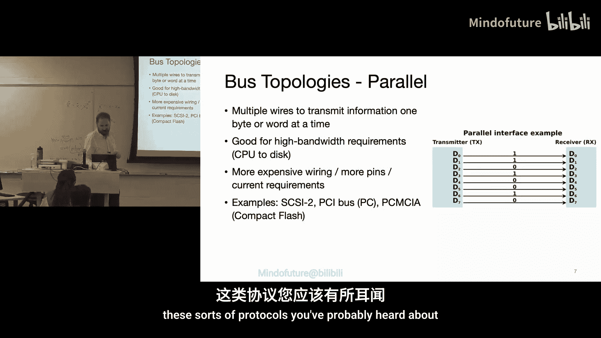
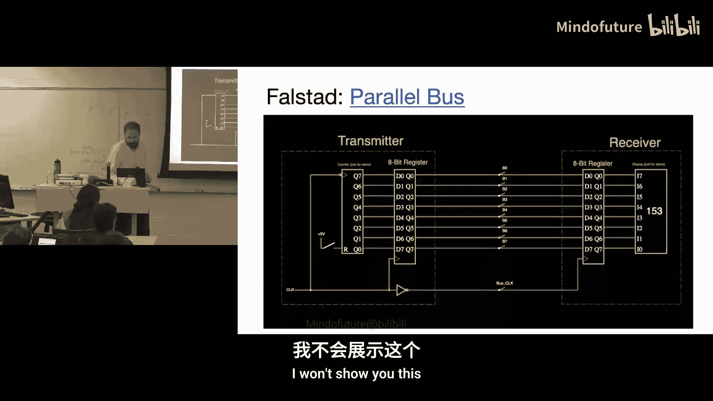
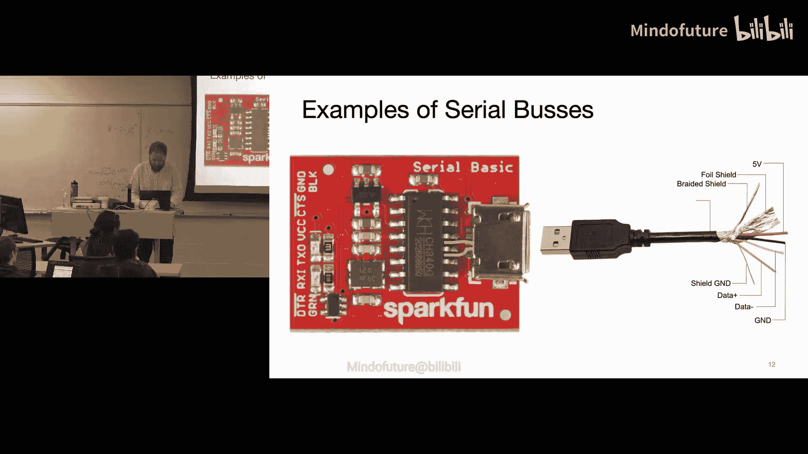
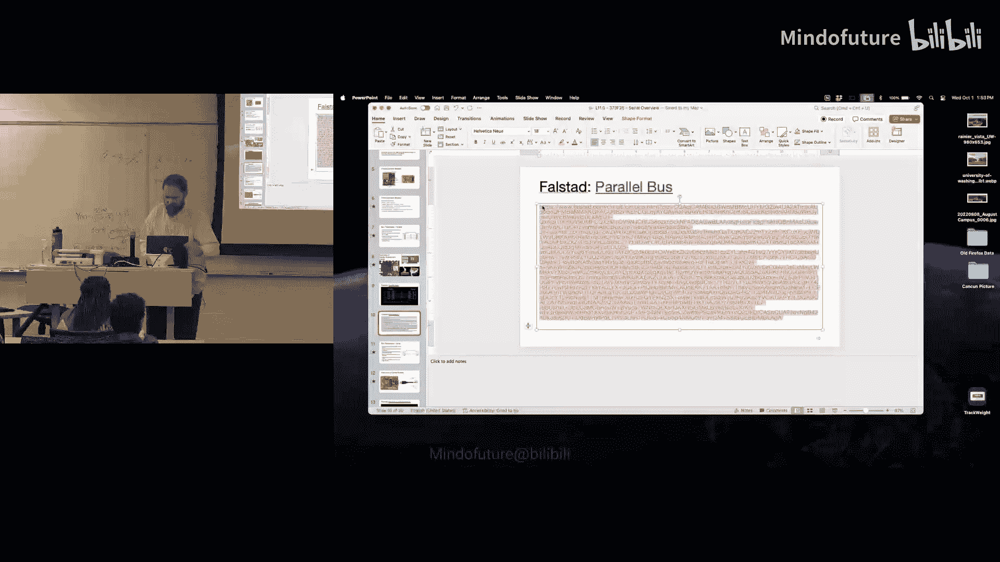
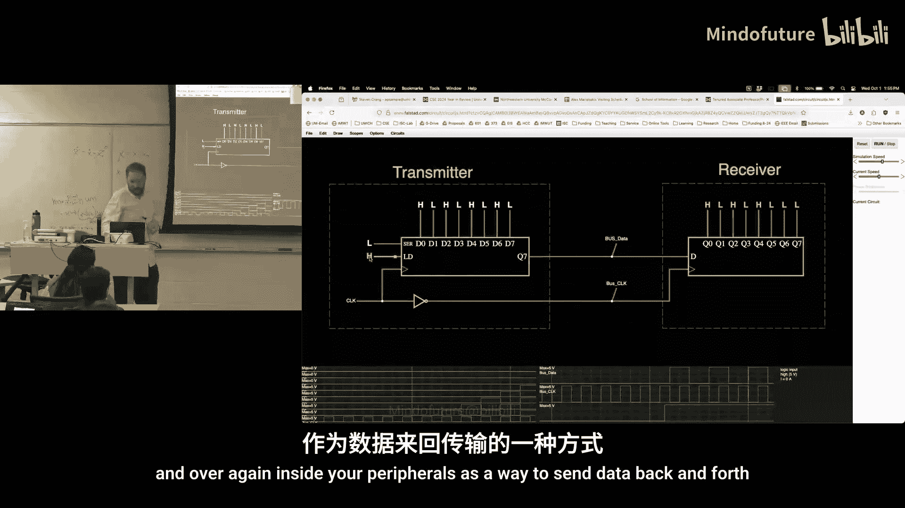
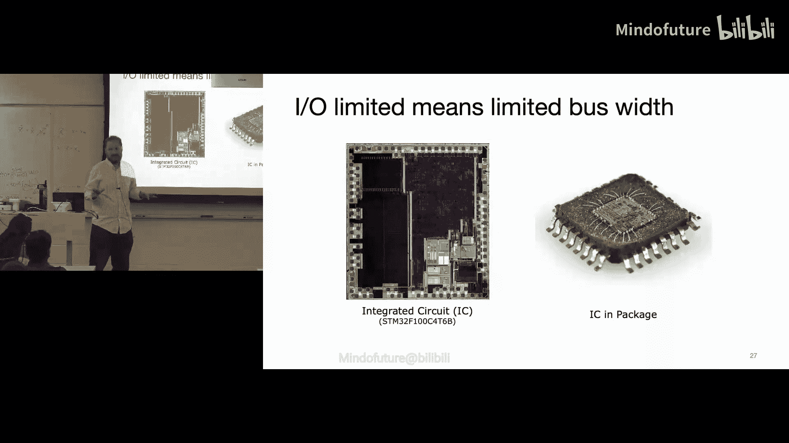
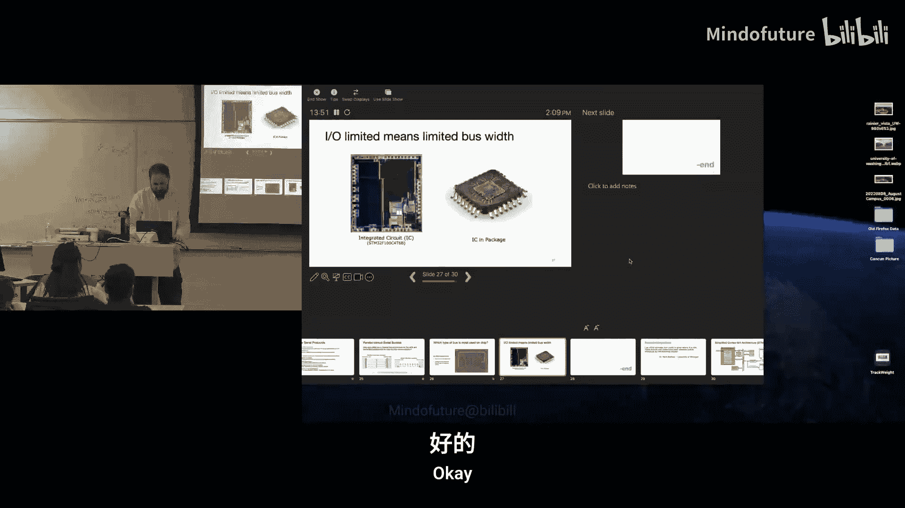
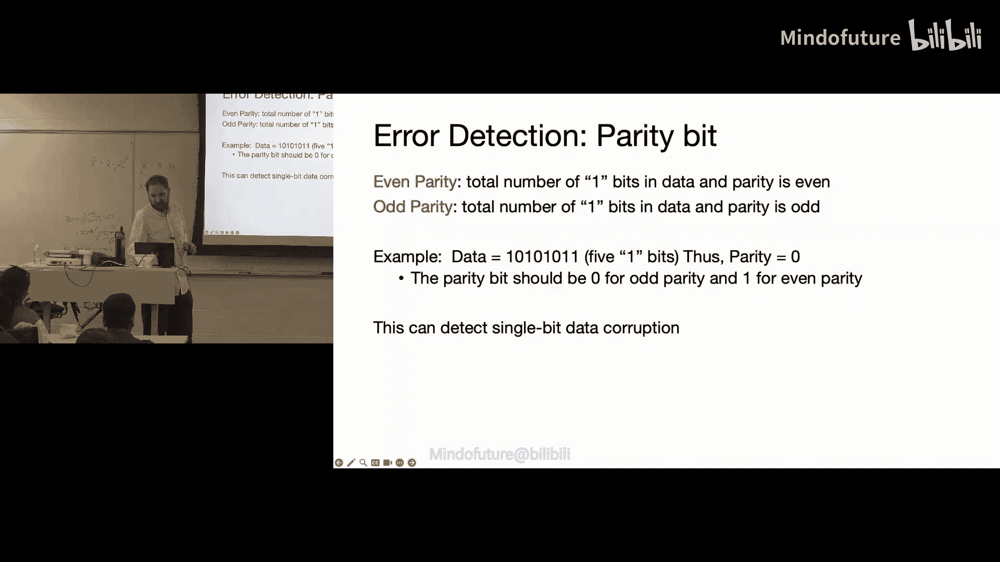
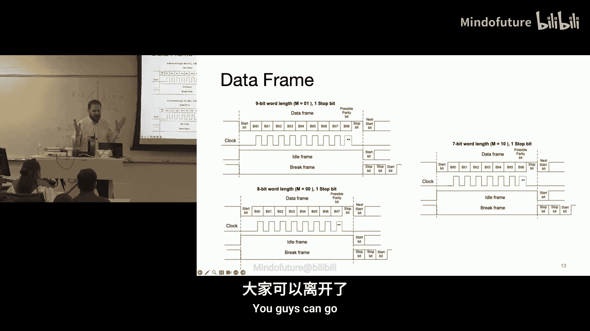

# 嵌入式系统设计导论：课程11：UART串行总线

## 概述
在本节课中，我们将学习嵌入式系统中一种基础的串行通信协议——UART。我们将从系统定时器开始，然后深入探讨串行通信的基本概念，并重点讲解UART的工作原理、数据帧格式以及实际应用中的注意事项。

---

## 系统定时器与编程范式

上一节我们介绍了通用定时器，本节中我们来看看一个特殊的定时器——系统定时器。

首先讨论编程范式。在本课程中，你编写的程序通常采用“超级循环”概念。程序从`main`函数开始，进行一些初始化，然后循环执行一系列任务。这对于处理相对简单的任务很有效。

然而，当系统任务增多或单个任务执行时间变长时，这种范式会遇到问题。例如，一个任务可能因为等待串行接口数据或进行复杂计算而耗时过长，导致其他需要及时响应的任务（如屏幕更新）被延迟，造成系统卡顿。

中断可以在一定程度上缓解这个问题，确保对按钮按下等事件做出快速响应。但并非所有任务都有对应的中断源。

另一种解决方案是使用**实时操作系统**。RTOS本质上是一个复杂的调度器，它允许你为任务分配优先级，并确保高优先级任务在规定时间内确定性地执行。你可以将任务视为线程。RTOS需要一个时间基准来调度任务，这就是系统定时器的作用。

系统定时器是ARM Cortex-M核心的一部分，而非外设，因此访问延迟更低。它是一个24位递减计数器，主要功能是计时。当计数值从1变为0时，可以触发中断。

系统定时器有几个关键寄存器：
*   **控制寄存器**：用于使能中断、选择时钟源等。
*   **重载值寄存器**：设置计数器的初始值。
*   **当前值寄存器**：读取当前的计数值。
*   **校准值寄存器**：这个寄存器很有用，它提供了一个能产生**1毫秒**定时中断的预计算值。例如，如果你的输入时钟是15MHz，你可以直接从该寄存器读取数值并填入重载寄存器，从而轻松设置一个1ms的定时器中断。这为构建以固定时间片调度任务的RTOS提供了便利。

RTOS调度器确保每个任务都能获得一定的CPU时间片。如果一个任务执行超时，调度器会进行上下文切换到另一个任务。这保证了在多任务环境下系统的响应性。

---

## 串行通信总线概述

现在，我们进入本节课的核心主题——串行通信总线与协议。首先，我们概述一下总线架构中需要考虑的关键参数。

以下是评估通信协议时需要考虑的几个方面：
1.  **串行 vs 并行**：数据是单线逐位传输（串行），还是多线同时传输（并行）。
2.  **数据速率**：通常以比特每秒衡量，涉及速度与成本的权衡。
3.  **时序方法**：通信是同步（有专用时钟线）还是异步（无专用时钟线，需时钟恢复）。
4.  **拓扑结构**：总线上有多少个源设备和目标设备？是点对点、单主多从，还是多主多从？
5.  **仲裁机制**：当多个设备都想通信时，如何决定谁先使用总线？（例如，APB总线使用片选线）。
6.  **协议与数据格式**：数据帧的具体格式，以及是否包含检错或纠错机制。

### 并行总线
并行总线使用多条导线同时传输一个数据字的所有位。它适用于高带宽需求，例如CPU与内存或显卡之间的通信。其优点是速度快，但缺点是引脚多、布线复杂、成本高，且不适合长距离传输（易受干扰和串扰影响）。

### 串行总线
串行总线在单根导线上按时间顺序逐位传输数据。它用时间换取物理引脚和连线的简化。虽然完成一次传输需要更长时间，但只需更少的连线，成本更低，更适合长距离通信（如以太网、USB）。

**移位寄存器**是实现并串转换的核心硬件。它能够将微控制器内部并行的数据，按位移动到串行总线上发送出去，反之亦然。

**串行与并行的权衡**：
*   **引脚成本**：并行高，串行低。
*   **数据速率**：并行通常更快（如DDR内存），但现代高速串行接口（如USB 3.0, PCIe）也非常快。
*   **错误检测**：串行协议通常内置检错机制（因距离长，易受噪声影响）。
*   **时序**：两者都可分为同步和异步。

**芯片间通信为何多用串行？**
主要原因在于**引脚数量限制**。芯片尺寸和封装成本限制了其能拥有的引脚数量。为了在有限的引脚上实现更多功能，通常会对引脚进行复用（通过GPIO复用功能选择），但一个引脚在某一时刻只能用于一种功能。因此，使用引脚效率更高的串行通信成为芯片间通信的主流选择。

常见的串行协议包括UART、I²C、SPI、USB、以太网等。本节课我们重点学习UART。

---

## UART详解

通用异步收发传输器是一种将微控制器的并行数据转换为串行格式进行传输的控制器类别。其物理接口标准之一是RS-232。

尽管在消费级计算机上已不常见，但UART在嵌入式领域仍被广泛使用，因为它**简单、廉价且可靠**，是芯片间通信的基础方法。

### 基本连接
UART通常包含两条数据线：
*   **TX**：发送线
*   **RX**：接收线
以及一条必不可少的**GND**：地线。

**重要提示**：连接时，需要将设备A的TX连接到设备B的RX，设备A的RX连接到设备B的TX。常见的错误是将TX与TX直接相连。务必同时连接地线以构成完整的电流回路。

### 核心挑战：时钟同步
UART是**异步**协议，没有专用的时钟线。那么接收方如何知道何时对数据线进行采样以读取正确的位呢？

解决方案是通信双方必须**预先约定**两个关键参数：
1.  **数据帧格式**（数据位、停止位、校验位等）。
2.  **波特率**（每秒传输的符号数）。

接收方利用**起始位**来同步。当数据线从空闲状态（通常为高电平）产生一个下降沿时，表示一个数据帧的开始。接收方检测到这个下降沿后，启动内部计时。

为了精确地在每位数据的中间位置采样，UART外设内部会使用一个频率远高于波特率的时钟（例如16倍）进行**过采样**。检测到起始位后，它会等待一定时间（例如，在16倍过采样下，等待8个周期）到达第一个数据位的中间点，然后每隔16个周期采样一次，依次读取后续的数据位。

### 数据帧格式
一个典型的UART数据帧包含以下部分：
1.  **起始位**：一个逻辑低电平位。
2.  **数据位**：通常是8位（代表一个字节），也可以是7或9位。传输顺序（MSB/LSB）需预先约定。
3.  **校验位**：可选的奇偶校验位，用于简单的错误检测。
4.  **停止位**：1个或2个逻辑高电平位，标志帧的结束。

### 在STM32上的应用
在STM32微控制器上，UART外设硬件会自动处理上述的起始位检测、过采样、数据移位和校验检查。你的主要工作是：
1.  配置GPIO引脚为UART功能。
2.  设置波特率、数据位、停止位、校验位等参数。
3.  通过读写数据寄存器来发送和接收数据。
4.  通常使用中断：当发送寄存器空或接收寄存器满时，触发中断服务程序，以便高效地处理数据流。

### 现代应用场景
现代嵌入式系统中，UART常用于：
*   **微控制器与PC通信**：通过一个“USB转UART”桥接芯片（如FTDI芯片），将UART信号转换为USB协议，方便在PC端使用终端软件接收数据。
*   **微控制器与无线模块通信**：许多蓝牙或Wi-Fi模块（如HC-05, ESP8266）都提供UART接口。微控制器通过UART发送数据，由无线模块处理复杂的无线协议。这是一种非常方便的调试和通信手段。

### UART的优缺点
**优点**：
*   仅需两根数据线（加地线），节省引脚和连线。
*   无需时钟线。
*   硬件简单，广泛支持。

**缺点**：
*   数据帧长度有限（通常最多9位数据）。
*   不支持多设备（多主或多从）架构。
*   通信双方必须预先精确约定参数，不支持热插拔。
*   时钟误差会累积，限制了单帧数据的最大长度。

---

## 总结
本节课我们一起学习了嵌入式系统中的串行通信基础。我们从系统定时器及其在RTOS中的作用开始，然后比较了串行与并行通信的优劣。我们深入探讨了UART协议，理解了其异步通信的本质、如何通过起始位和过采样实现时钟同步、以及数据帧的具体格式。最后，我们了解了UART在STM32上的应用方式和现代嵌入式系统中的典型使用场景。掌握UART是进行嵌入式设备调试和芯片间通信的重要一步。