# 【密歇根大学】嵌入式系统设计导论-EECS-373-｜-Introduction-To-Embedded-System-Design-2025-p13-P14_课程13_模拟信号概述--BV1VTSNBoEem_p13-

。All right we're going to get started I don't know where all the rest of you were gone there's no event today I don't know but we're going start we're going to finish off a little bit of serial interfaces today and then we're going to go on to analog signals which is kind of like the last big chunk of the class and kind of the same stuff as last time oh that was yesterday or two days ago but team registration is due today this is important so one registration form per team if you did multiple I don't care I'll figure it out but that's going to let me make those folders for you you'll get know like a team registration folder or team folder as we saw on the project overview and then after that i'll release some time tonight i'll release the。

Schedule of the meeting sign up sheets so you're supposed to go to it。

 fill your name in and that's when you're going to come and talk to us。

 we won't have class an official class on Wednesday next week so you don't have to come to class。

 you may happen to have a time where you're meeting with us during class time that will be one of the times。

Any questions？There's no class on Monday。No class on Wednesdays， sounds like the best class already。

Yes， you know， okay。Any questions， no？their classes they are definitely I'm trying to get probably 22 teams to have a 30 minute meeting each with me Matt and jam so definitely not going to be able to get that in the hour and a half class we have scheduled so thiss going to be free for all you guys are going to look for fine times fight over the times it's going to be great we're going to try to make them widely available typically we have enough for everybody yes is like the Wednesday。

 Thursday and Friday。And if we have to， it's going to be Saturday， please don't make a Saturday。

We'll do that one over zoom， yeah。Do we have to submit our actual proposal on my grade scope or canvas or something you put it in your project folders checking that on Wednesday only or like before before is this is really the project proposals is really for you to think force you to think through the thing so we're going to go through your project proposal and your slides in the meeting。

So it should be there the night before yeah did you say when up for will go out tonight yeah。

 I'll want to post something。すのや。ok。

So let's finish up。Creal stuff lets see we'll go back here and we have a worksheet problem but I'll give you the quick review I kind of did this review last time。

 but you forgot everything from last time totally fine。

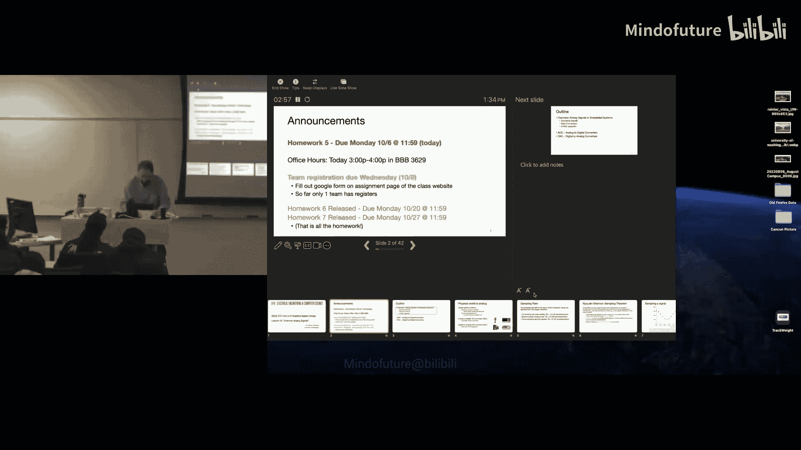

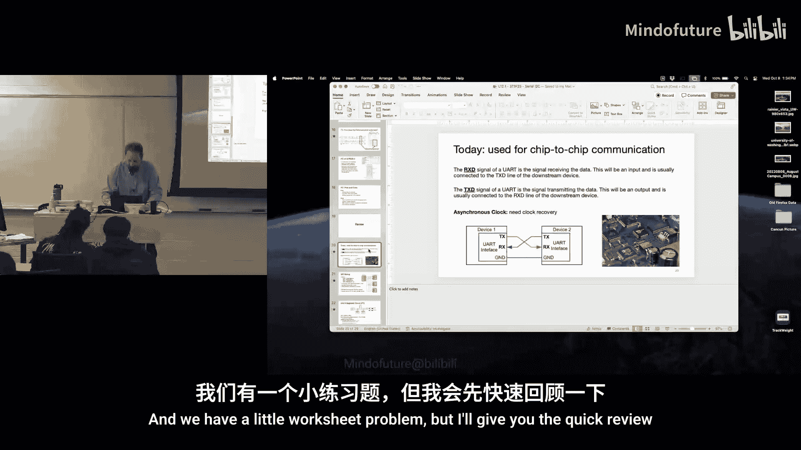

So。For you arts， how you guys doing， everybody， all right？Fantastic。You are。

 so remember it's one device to one device it has no arbitration protocol it could if you could stick another device here。

 it would have no way of selecting between the two devices。

 so from an arbitration point of view from a topology point of view it's one device to another device。

 that's a unique characteristic。There is no clock， is asynchronous so the clock has to be recovered。

 another unique scenario for this particular chip communication。

 other than that you have to a priorie with all them。

 you have to figure out what your data rate is more or less beforehand。

 but this one specifically because there's no clock。

 you have to tell each device what the data rate is beforehand yes。This also seems like starts in。

いうよ。You can look through these things， there's a special start sequence。Then we talked about SI。

 so seero peripheral interface， this is the de facto standard。

 this is the one that everybody uses but there's no official standard for it so that has a variety of different implementations and speeds that you have to check through。

This one is denoted that there is a from the controller's point of view， there's a serial data out。

 there's a serial data in， there's a clock line， so it's a synchronous protocol and everybody shares the data buses。

 you can transmit receive at the same time， that's totallyll find the way you do arbitration is there's a chip select so there has to be extra pins to check to select which device you're talking to。

The controller pulls the thing low to initiate and the controller generates the clock。

 it should have made this clear before that clock is only sent when data is being sent。

 clock is not continuously going， would be a waste of power。

And basically it's built on a bunch of shift registers。Backacket sizes are typically eight。

 sometimes four， I suppose are 16， but typically it's eight。

And then the other one we looked at was I2C or I squared C。

And this was trying to solve a different class of problems， we were trying to say。

 what's the minimum possible number of wires we could have？

To allow one controller or multiple controllers to talk to n peripherals and so here there is no control lines explicit。

 all that arbitration thats hiding who talks is done through an address if each one of these has to have its own unique address。

 there's a serial data line， it's not serial out or serial in it is the same line used by those either peripherals or the controllers to talk so you have to look here to see。

 I mean if you're looking here you might be seeing the traffic from the controller of peripheral and you don't know if you're just looking atscilloscope trace。

It's 7，16 or 10 bits， open collector output， so the reason they did that。

 this is just a mosFt inside， it pulls this line down for a zero。

 it lets the line go back up for a logical one that this is done so that this device can't put a one out and this puts a zero out accident and you short out the chip。

 this allows a level of robustness because multiple people could be using by accident， the SDA line。

Only the controller sends out the clock。Yeah。there pull that's what we call it we're going to call it a pull up because it's connected to the VDD so if there's nothing connected to this thing all the gates are open is going to pull that line from ground all the way up and then you could have a pull down resistor which is going to pull the line down。

The weird one about this protocol is that。Well， addresses for each one yes。

 but devices speed of the bus is depend by hardware choices that's weird normally you just send the clock faster and normally you want SI to go faster。

 you just have your STM send out a faster clock signal here is you could do that within a range with this。

 but ultimately you're going to get to a point where you're going faster than those pull up resistors can pull back up you should think back to the for the false examples we showed with the capacitors and how you had this law long charge up cycle and so that's an example where now you have to go and change your resistor value in order to get faster speed。

All right， so hey， what happening here？All right。So， okay。Now here's your example。

 here's your thing I want you to consider。How would you make a one wire interface So you only get one wire for everything。

Okay， and ground， you get it return wire。But you talked about S was。

F wires plus a select or three wires plus a select line。 and then we talked about。I squared C。

Which is two wires， I want you to design a one wire interface。

And the goal is to think through all the things that we just talked about。

 all those other serial peripherals protocols and figure out how to make one that only uses one。Wire。

 got two there。这玩意。Okay， send him back to this guy。Gentlemen。有关系。まて。One wire of the hair。Im。Two more。

他的。我然后那。系。Can你 me。Should we be there？a multi。Let's say at least multiple peripherals。

 but you can once you figure that part out， then you got multimaster if you want。

I'm my buy is X of the virus。So for topology for this new one you're inventing。

 it should at least be one controller to multiple， but once you figure that out。

 then it can be end to end。And then sure any different thing I don't know why I feel it's important。

Just one wire， how will we do it All right so how are you going to do？Data。On why。

s the phone best right。device only。other two out the other three with one wire one makes can start describingcr I don't know how it works。

 I just。much copy当看。Yeah， it's one bit。 the other signal is just the opposite of the first signal。

 so transmit waves not kind of USB two wires， but the other wire one。

 anything its going transmit video waves radio waves look at that and choose choose the characteristics that you would want to make up this myth physics you。

can of something like hand because I think it's the thing。

I'm trying to understand that exists in the protocol。

 so I can't design one and that' make me similar。one don single over。

The only reason differential high like months， which is' definitely like stupid。

 but it would probably thinking you could just have one voltage major thing about the circuit the proposal get the。

we probably should before class there's no class on Monday so we can that's why have no class class。

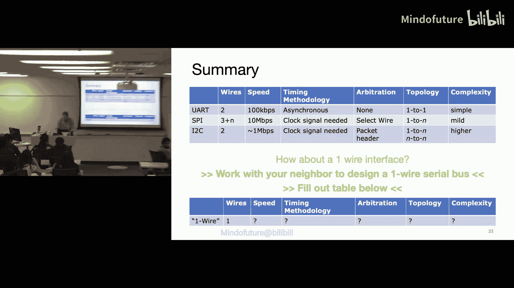

Yeah， know I guess maybe meeting up my bill。I agree， I don't know for a power just it。

 we're going talk to you it's a power block the installationsulation and you connect them。

To be like the startk condition like 100。尽量的我。Could you even draw out what you think the internal circuitry and logic should be to highest level point of view were the。

嗯说按个TM改。

系噶， ok。my partnerOh， your partner job have no you some pause me and other side。

I'm the ways that you would do it is just have like some type of synchronizer some of them have no arbitration methods synchronizer device has an identification。

If you're doing a single wire， can't you still do an identification like a packet header does all。

're going to have a right。Ho，o， low， low and then pattern bonus the voltage I。' think it's like 3。

3 or something like that。We don't have able maybe maybe。Maybe。All right， how will we do this。

 How in the world could you have a protocol that only has one wire， Any have a。

I guess the grounds yes you have two wires fine， you have a wire for a ground。

 sh all the other ones lied to you and said that they were like two wires or three wires plus。

 but they always had a secret ground， I'm also lying to you。Okay。So just one wire plus Ch。

 how are we going to do it how will we do Well we already know how many wires。

 what's the timing methodology， how will we know when to clock in the bits Soll be asynchronous remember youR has no clock。

The receiver has to over samplele to figure out where the bits are。

 and has to sample faster and then guess to be right in the middle of those bits okay how about arbitration。

 how will we talk to multiple devices？Yeah。You人。You only have one wife。Yes， I know， it's amazing。

 how will we talk to multiple devices？so how in the world does I squared C talk to multiple devices assume we could get rid of that clock somehow？

How does Iquad C arbitraryrbitrate to multiple devices？

The address of the device you want to talk to Yeah so now we're going to use addresses。

 packet headers to talk to them okay and topology， how if we made up this mythical one。

 this mythical thing，How many can we talk， is it one to one， is it one to n or n to N？

Could be also I'm selling， it could be end to end， no reason why not。End to end， fantastic。

And we'll talk about complexity in a second。 So here's how this is a literal。Tology that exists。

 you can buy chips that do this， I actually made up the example and then figured out it existed I was interesting so here's the controller。

 you have a controller， you have this is just what the input of I squared C is or the input output stage of the I squared C so you have a transistor that pulls the line low。

have a pull up resistor that let it go high， so that's how we're sending data。

 then you can send packet headers for arbitration。And you're going to do it asynchronous switch。

 which means the receiver of this device is going to have to oversample the signal to recover the clock timing。

And。Yeah， so you can see that here， there's an interface controller。

 and then the device has a 64 bit ID。Does that make sense how it's possible。

 I'll show you a false out in a second， does anybody have any questions so far？ter。Well。

 how fast compared to the other ones， that's a good point， compared to the other ones。

What is the general speed you expect this to be？Well， is it as fast as you are？Faster。

 slower than you are。Faster or slower than ice scores or SI。

I'm going say much slower than SI faster or slower are the same as I squared C。

It's the same physical layer I squared C， so it's better be on the order of i squared C Yeah can you cover how it supplies power again that's the secret。

All right， so imagine I showed you guys， I think in day one。

 this RFID thing basically is going to you put a one out on this wire for a while。

Then you have a diode。That diode is going to go and drop that into a power reserve thing， capacitor。

 and then when you have stata zeros going through， it has to have enough power on here to survive until it comes back up to one。

So the signal itself is throwinging out the data that you need。Or sorry。

 throwing out the power that you need。

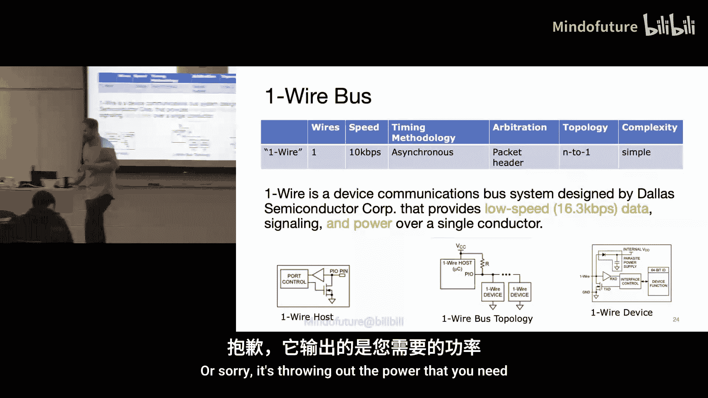

I can show an example。So here。用户。This is the thing running。

 this is just the same circuit from I square C。I only thing of here is I add in a voltage harvester。

And。Here's the load in this voltage harvest， there should be one。What's going on here？

What's this value？What。Oh， because I'm pushing now a low on this one， okay。

 a low here and a high here。So this thing gets pulled back up to high。Moation speed。

So this line should be a high， why are you not a high？No， here' low。

There we go all right so now we're going to charge this thing up in fact this capacitor is turn green。

 this means's a high voltage， so now the capacitor is at high voltage and I'm going to go send over one really quick。

Or 0， so we're going to transition to zero to one， and we can see that the voltage didn't really drop that much here is actually I think it's the red line。

 so the voltage was able to stay high during that little blip because the capacitor stored enough charge on it。

And then we can send data back the other way。So here。We have target， went and sent data back。

 so now we have the same physical layer as I squared C except now we also have to。

Take control of timing， you have to do the asynchronous clock recovery。No way's excited。

 that's exciting。see。そ。Both them where you can read or write anything back and forth。Well。

 just the same as with I squared C right the default state is these buses are left high。

 that's actually how this thing charges up and then you would have a stark condition where it's pulled low and then you send out your bits yeah。

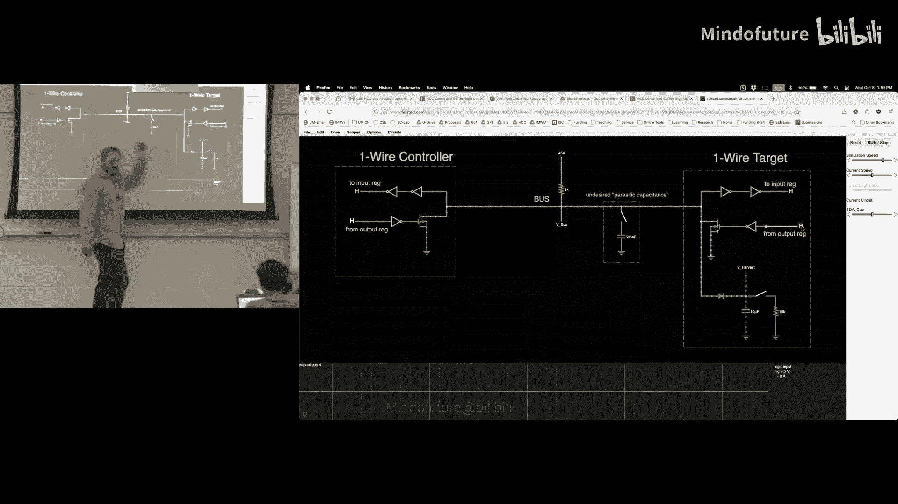

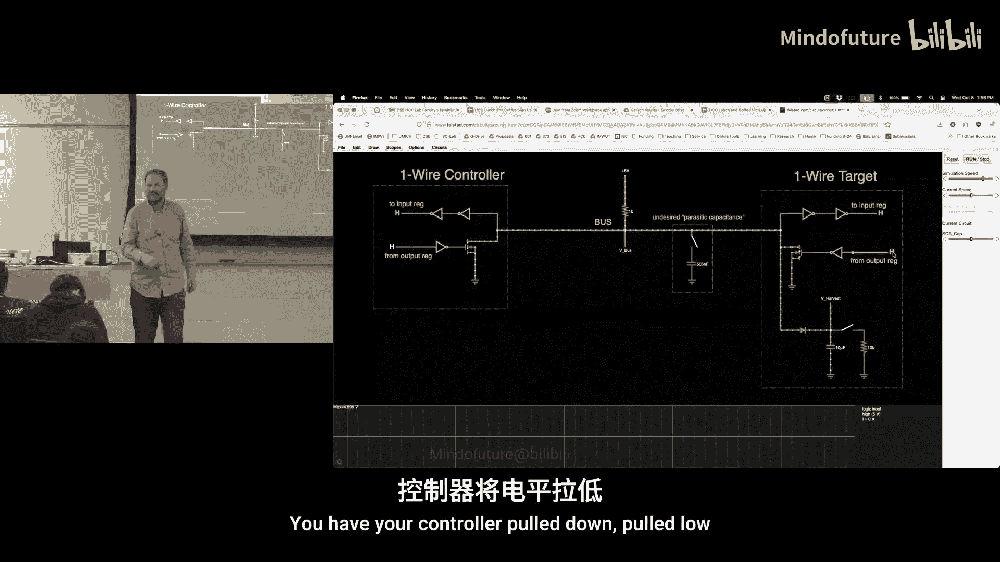

We have your controller pulled down， little low。W go pass or not like discharge because it's large。

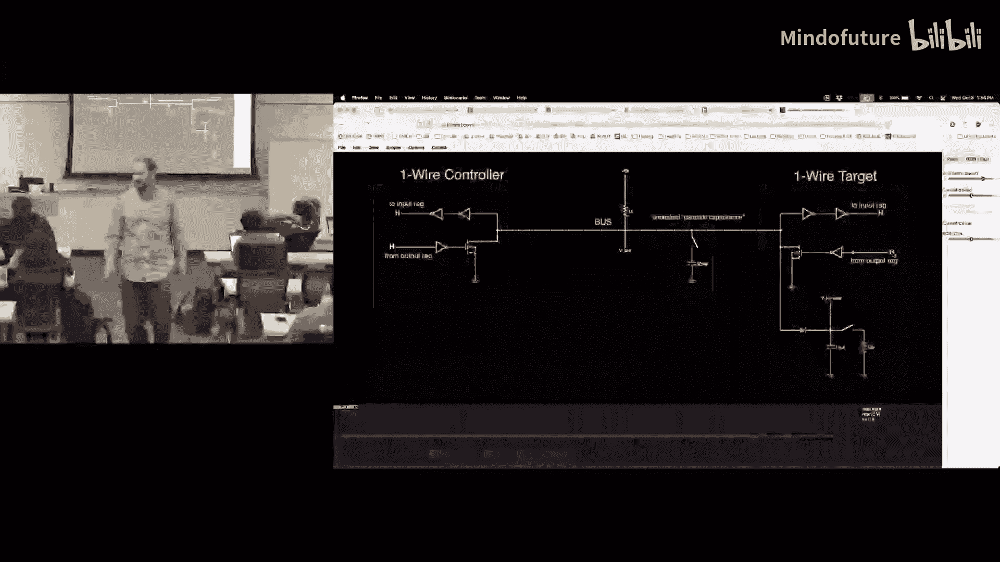

Its just。

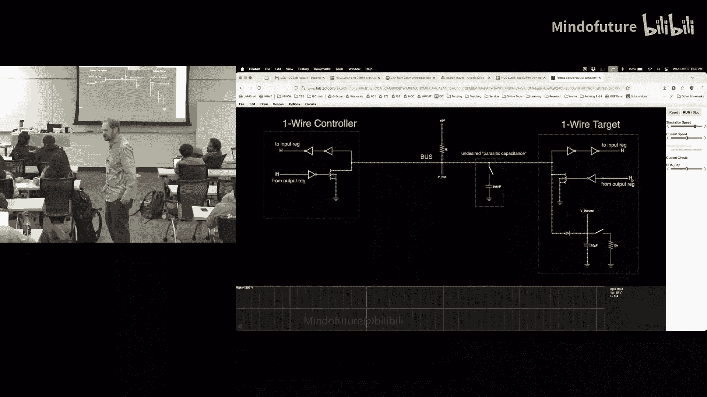

I not you can't we're not instantly pulling like'll put this load on here。

 so let's just say the load is。I put a 10 k on here。

 which just say that's the power consumed by the peripheral， which is reasonable。And so let's see。

 is that what this signal is？AndWhere is it？I don't know where。

You to can plot it bee harvest bee harvest is。There， okay。

 so that's that blue signal and then then I send data out。The red line went down a little bit， right。

 but didn't brown all the way out， and so you just make the timing of your bit smaller。

 small enough so that you don't brown out during that period of time。Yeah。

 we want to send a lot of zeros。Then you should design your protocol such that you cannot and design your protocol。

 say you have eight zeros that you'd want to send out。

 then you'd want to make sure that you spec your capacits are large enough such that eight zeros can make it through。

Yeah。Do you mean have the same amount of ones as zeros or as charging？charging no。

 they're I guess they're about the same rate， but there's going to be a lot of time between packets。

Right yeah so that's the charge time so like RFID tags don't have any batteries in them and they have the little capacitors and so what happens is when you take your phone you know your m card。

 you charge it up essentially and then it sends out ones and zeros RF energy or no RF energy and it's able to survive long enough to do the entire protocol and send back the data。

So this I'm telling you by proof of existence， this is possible。

I guess the amount of charged is enough to support the amount of ones that the target wants to send。

Whereas the capacitor'ors voltage itself just the powering like every single old like logicging thing。

it's the capacitor like storing and why do you need the storage why do I need a capacitor？

So this 10k represents all the digital logic on that peripheral。

So say you have a little hester sensor， it's on your I square， what is this nine squared。

 this is one wire， right then this capacitor needs to hold all the charge required to power that thing while there's a one or while there's a zero being sent。

And so now you have to design your protocol such that you know you have upper bounds on how many ones could possibly go out。

So that you can't discharge yourself by accident。And getting a 10 microfa cap is just is literally 0。

001 cent right it's a little device that you a piece of speck of Greg， you know。

 a rice that you basically put on your PCV's very small。

 very cheap yeah it charge to send a one from the target。Oh， no。

 it doesn't cost charge because that comes from here。We don't actually drive a one on this one。

 we only drive zeros。Yeah。There would like be a way where you could set your like high voltage be different in your low voltage to be like higher than zero so like 3。

3 and 5 or something like that so that you're always getting charged or you could it just makes things complicated and it might not be worth the trade off so say it's interesting I'll repeat the statement。

 what happens instead of having the two logic levels be say five volts and  zero volts you made the lower logic level like 0。

3 volts or something well that is below that particular voltage happens to be unique in the sense that's a diode threshold but then you'd have to be able to use 0。

3 volts。And that's kind of hard you would want to have to have a buck converter boost converter to kick it up。

 but maybe you did something slightly different which was different between 5 volts and like 5。

5 volts and then you guaranteed you have enough voltage for logic you could do that I just think that what the tradeoff was is like oh this isn't that hard to do actually like there's billions of devices on the planet that kind of work this way all the RFID tags like it's not going be hard so you just put a nice big capacitor 10 microfarets and you'll be fine。

Yeah。I know it was like when it comes with the asynchronous like like use the over sampling your prep plot like where was that be in this so that is here。

Pass this stage， you're going to have to have a little ring oscillator it's going to be kicking around。

 you already know you look through the data sheet to figure out what the bo rate of this thing is。

This thing sending data out at the right rate， and then this thing is oversling to make the decision of where in the circuit it should where in the Bistream it should sample。

Does it makes， so I realize it could have been a clever professor and tricked you all。

And Ben giving you an impossible problem， but now that we've explained it。

 does it make more sense or you're like， ah， this is still impossible。I got， yeah。

WhatSchronization like more？Just like you art， do you want me to go back over UA？All right。

 let's do youR for a second。My goal is literally that teach you things， I will teach you things。

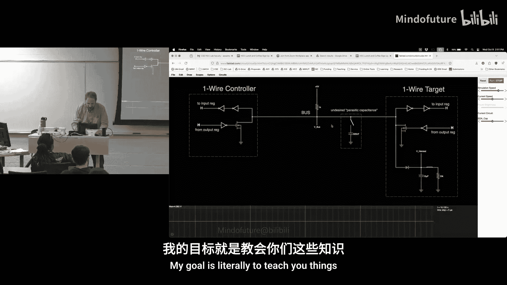

嗯。嗯行。Right。All right。So remember the challenge with you are is that you're just getting edges。

 you don't know when the edges are coming you need some way to know when to sample in between this data and this thing is supposed to slide back and forth。

 but I'd still haven've fixed it so the problem is you're pushing a kid on this swing and when do you push if you don't know you might be out of phase so they call it phase misign if you push while the kids all the way out there you make no progress you have to push just when so how do you figure out when you should push you need some way to look at the signal to figure that out well they give you a mechanisms for that they say when you go from high to low when you make a transition this is not data yet this is just a start bit so when you see the transition from high to low then what you do is you count whatever you're set up to say you're doing 16 times overs what you're going to do is you're going to go in first to8 so that you're line in the middle of the bit and then you're going to do 16 so now you're aligned in the middle of bit zero so this oversamp clock so even if you're off by。

Clock period。All right， that's okay because you're over 16。

 so if I plus a clock period or minus a clock period。

 you're fine because you're still within this window。Does that make sense how we're doing it？

is the bo rate referring to how we're open how much rover no， Bo rate is the symbol rate？

OfHow symbols are going back and forth， that's the agreement on the size of these bits。

What if one person's clock is slightly off I doesn't shift Yeah so what happens if you know you're supposed to be something and the other person can't quite get to it and that's very common that you're you know hurts off or tens of hurts off on that signal。

 the question is how long until an error occurs？Well， these packets are only seven。

 eight or nine bits long， plus start bit， a pary bit and a stop bit， maybe two stop bits。

 depending on your protocol。So that accumulated error has to be with so the error between the two signals has to be within this time span。

 that's the requirement， but eight bits isn't that long。

 and they actually have tables which you can go look at that will show you here's what your expected error rate is going to be from this amount of mismatch。

start bit at this start of every single packet yes， every single packet。

 you are reacquisitioning the clock rate and redefining when you're supposed to be sampling。TheYeah。

In't know how many clock cycles there are at all like within。One cycle of the block。

Because you told it。Because you were going to say here's the bo rate。

 and then the manufacturer said STM says， well， we're just going to oversample by 16 times or maybe eight or maybe 32 times whatever the hardware people who made your peripheral does。

 that's what they're going to oversample out。他这位置。軽い病。Okay， so let's go back to here。诶。

You're saying that this clock could still be off， right？

It could be slightly off because you have a clock divider with a prescaleer and that's all being sent you're taking from you remember that clock diagram we showed those super confusing back when you started the timers。

 you're going to send that clock through your STM32 in QBID and send it right to your UAt module and so then you're going to try and get it to be the right clock speed but it's not going to be perfect。

And so there could be errors， you're going to accumulate errors over time。

 the trick is it's unlikely you're going to accumulate so much error。

That you miss a single packet that you miss these last little bits。That would be too much error。

And because you read for every single packet that comes in。

 you figure out you look at the start bit and then retime the entire sequence， it doesn't matter。

So like number of the number of clock cycles per bo period is dynamically calculated when you set the bottom。

Yeah。😊，嗯。あ。Now that's fine。Yeah， next me。So like maybe this is when we nationally。What's this？

I yes yeah now you as programmers don't have to do anything， you just rely on those very。

 you know clever hardware engineers to actually do this for you。

 your peripheral has all this built in， you don't have to oversample anything。

 you just have to know it exists and why it exists how it works。Yeah。

its own internal clock the peripheral is driven by a clock that you select so remember it's one of the three clock sources is going to be their external low frequency oscillator external high frequency oscillator or ring oscillator internally then you're going to take that clock signal so in your case on your STM is 120 megahertz and you're going to use dividers and prescaleers to prescale it down to be 16 times the boD rate that's coming in。

Now， thankfully， QBI， so magical， wizzywigs all that away from you， it just works。

But the main idea is once you know how。from the start signal and then kind of start。

 then you do your 16 yeah。So all this clock generations figured out for you because that is how the peripheral setup up internally you tell it basically what's the bo rate。

 you put that effectively into a register and then it will figure out， I mean。

 it will just over sampleample by 16 or 32 whatever the overs samplele rate is for that particular bo rate you put in there。

 you don't have to do anything。And this clock is internal to the U are no， no。

 but we're not sending the clocks we know you are sending the clock comes from your main clock tree。

 right？不是ち。ち。对对对等对。This gigantic。Mess of fun。Oh look there's two your UR right here it's on here I even knew it I knew it so here you would go and select your clock tree and you go through a bunch of muxes and look at this prescalear this is your advanced peripheral prescalear and now you have an advanced peripheral I don't know it's a high performance bus advanced peripheral prescalear and then you're gonna send some version of that to your UR and I bet your UR itself actually has a prescalear in it how are you sending it so there is a wire that's connecting the clock to the UR。

嗯。Somehow we could trace this rats nest yes， but there's a wire that's， okay。

 and its just not sent with the package just set separate。the whole thingは you are。Asynchronous。

 you have to figure out your own clock。Yes， so we're talking about onship。

 we have a peripheral that's the U timer， the UR peripheral。

 you're going to use your APB to send data to it。Part of this clocking tree structure also sends a clock signal to control that peripheral。

So you could use PC， let's just say it's PC。You could use a different clock as well。

 but then it's going to have its own scalar inside of that to take that clock signal and turn it into the correct timing necessary to generate packets with the correct size which collect Bo。

I bet think you think about it， come and talk to me， all right。We're going back like three lectures。

 it's exciting， like all the logical errors I clearly have made and failed to teach you。Fantastic。

What other questions you have？Do have like listened。Additional fact， as far as connected to like a。

It's like a flip fl， I that it's activeiv in at this increased rate reading in the value that's there termmorphical1 or zero。

You like you're knowing to sample。rianAre you talking about the peripheral are you talking about the STM 32？

呃。Third， I guess's determined。TheV facing clock。That when you're trying to decode thing that's going to be in the peripheral。

 it has its own timer， its own clocks。Right， so theys see the like dinner up。あそ。对。

Art was like because basically once that time hits it's reading the value， correct。

 artists wondering like how was it like reading？The values like that value somewhere sort like flipop or yeah。

 just just the de flip flop， that's all of this。It just becomes a statehold device。

 they can choose to do it any way they want all right。I've thoroughly confused all of you。

 maybe I've explained some things。Any other questions about serial interfaces？

It's a great time to ask because I'll teach you things。嗯。All right， you ready for analog， yes。

 want analog， yes。I' not as enthusiastic as I am， I don't know why， and it looks pretty good。

All right。So。へ。All right， so we're going to talk about recipe3 lecture modules。

 so first we're going to do an overview of analog signals in general。

 then we'll talk about specifically ADBC analog digital converter architectures。

 things that you will have to make decisions on which architecture choose and your embedded systems and then we'll talk about digital to analog converters where you will be able to make analog values that will be generated by your STM 32 and there's different toppologies for this。

 but first lecture is really trying to give an overview about these theories。

Okay so you know I guess philosophically a microcontroller the only purpose of a microcontroller I think is to interface with the external world right you have computers。

 you could have desktop computers aren't connected。

 but like that's the type of computing that's not particularly interested especially for the embedded world so that's why we spend so much time on U artt because that's a digital way to communicate with external serial peripherals to talk to the external world and analog is another way to sample the physical world and stimulate the physical world I guess so the two ways to look at this is we have analog digital converters so example is a microphone although microphones themselves are highly specialized peripherals are highly specialized you can think about just some analog signal that you're going to capture a DAC would be a digital analog converter where you take some digital bitstream so some sequential values and then you're going to send them out and turn them into analog values like a speaker so each year we have microphones are a little bit more rare usually。

like sound or clap detection， and then it's relatively easy to make a DAC or to use the DAC and have it play fairly high quality sound on the STM32。

And these are just equivalent， these are commercial equivalents to the equipment you have in labs。

 so you have function generators， which is equivalent to a DAC andscilloscopes were just fancy Ds or fancy ADCs。

So probably the first thing to think about is sampling right。

 this is the rate at which things are going to be sampled so for audio high quality it would be like 44 kilohertz mid quality of 22 kilohertz and then phones are actually pretty poor right they're usually about at least cell phones and landlines I suppose8 kilohertz does anybody know why they only sample at8 kilohertz。

是。That it was enough to convey the。Important parts of human speech while reducing bandwidth that a lot of people get there's a trade off most of human speech is under eight kilohertz。

U。And very little of it is， I mean while people can make larger higher sounds。

 there's not really much information value， so under 8 kilohertz to about I think there are only like 20 or 200 hertz or so somewhere in that range。

Is what most audio or voice over the phone is， and that's why it also doesn't sound that great quality sometimes。

If you took， I think it's 216 in digital signal processing， is that correct？Yes， maybe。

 so you should have heard about the NCquaIS sampling theorem。

Basically says if you want to be able to sample a signal and understand it you have to go。

 you have to sample it twice as fast as a signal itself and able to recover the signal and understand its frequency components if you don't you're going to get aliasing we'll talk about that aliasing is when the digital signal appears to be different essentially from the analog value and it's also important to remember that Nqui sampling Shannon theorem assumes that there's no noise and there's no clock jitter which is actually an important assumption that comes into this。

So we can think about just sampling a signal here sampling a signal is just like here's a sample。

 then I measured here then I measured here then I measured here。

 you might say I set up a timer that will cause and interrupt to occur and which will'll do an ADC sample so that's one way to ensure that there's a reasonable consistent timeframe for making these measurements if you just did it in a while one。

 you may not know depending on your other things exactly when you sampled and then it may change what you think the frequency of the signal is。

Take a second， what do you talk amongst yourelves， what do you think the sampling rate is and what's the frequency of the signal？

There is0。Wes zero zero sidess。I1%。Does anybody have the sampling rate， what is it？2，000 hertz， y。

 assist。This is there's a period here， so it's one over the period， so the sample。

 the time between two things inverted over one， that will give you the sampling rate， so 2000 hertz。

What's the？From what you can tell here， what do you think the period or the frequency of the signal is？

200200 yep， so how are we going to do that we going to say assume this is the peak I guess you couldn't really tell。

 but say this is the peak and this is the peak， what's the time between that that's going to be your period and then when over that it's going to be your frequency。

Okay。Pretty easy so far。What about this， this is when circuitrc can be a little ambiguous。

 what's the frequency of the signal？0。We zero。T is Nikqui say？Oh， it's not sampling。

So technically Shannon Nquis， this allows DC as a frequency。

 but just trying to show you the ambiguity that can happen when you're not aware of the sampling so it's technically possible that I could have this sine wave inside here in fact I could have double the sine waiver。

Quaddruple or eight times a sine wave， and still if I was under sampling too slowly。

 I wouldn't know what signal I actually have。So you have to be able to choose the right signal。

 or I say， know what the right signal is。Same thing here。

So here's that same signal that we saw before that was 200 hertz that made the assumption that there wasn't a secret higher signal。

 so here is another signal that could have generated this。

 and we were just sampling too slow to understand that to see that。How about this signal？

What we think this is， how would you even go about figuring out what the signal is？

You got to split it into multiple s wavess Yeah， this is probably going to be multiple signals on top of each other。

From this thing， it would be kind of painful to figure out there's not that much data。

 but just happens to be made of 100 hertz， 400 hertz and 1。

600 hertz and sampled that a rate of 4000 hertz。嗯。So just comes back to a piece I like to tell people which is the osciosscope sampling theorem。

 it's not my theorem， I just made it up。Basically。Acilloscopes。

 you're going to set the sampling rate with them and you should be scheduling at least five times faster sampling rate than the actual signal you want otherwise it's going to be really hard to figure out what this thing you're looking at is。

In fact， here。You you look at a oscilloscope and it says， okay， I got 200 mega pertz。

 that's what it says here， and it says you can't read it and I can't read it here。

 and hopefully I can read it over here。Sas five giga samples per second here we go。

 So so what does this 200 megahertz mean when you're talking about oscilloscopes？

Anybody want to guess？I clear。Is it like the max type of signal that'll allow you to see like the most you can zoom in。

Okay， let's go back to this。This is five giga samples per second， that's what the sand for。

 five giga samples per second。So how are we meshing these two numbers together。

 like how does one thing have both of these values？Maybe。Possibly also would be a function of like。

Sos like frequencies above 20 microhers won't even get through to whatever's actually measuring and which one is that？

So you're right， there is a bandwidth limitation， so that's what this top one here is okay so this oscilloscope is rated to take signals up to 200 megahertz beyond that。

 the analog front end， all the circuitry is not able to capture signals going faster than that。

Even though it can sample up five giga samples per second。

It's just saying that here's this oversampling capability。

 but its analog bandwidth sampling capability is lower than that。

 in fact they purposely make a filter so that you can't get higher order signals and you don't want to actually get five giga samples or 10 giga sample or 10 gigahertz signals in here then you'll be under sampling your signal and you'll have the same problems we saw in the last slides。

And so what you find here is there's also this four channel， hows this four channel number。

 which is the number of simultaneous signals that you could be measuring。

 how does this four channel relate to 5 giga samples and 200 megahertz？W。Okay yeah。

 you got to be allowed though each input is sample at five gig samples per second and each input individually has a 200 mehertz bandwidth it's a good guess is happens to being incorrect。

 no worries。What we're saying is this machine can sample any signal sorry its entire sampling capability is five giga samples per second if you turn on all four then you're going to dividing all four channels by five giga samples per second so imagine there's essentially a mus in here you have one really fast ADC and you're going to go past each one of them so from that you can see that。

Your oversampling rate is only about 4。 4。25 times the signal， which is close to five。

 but it makes sure that a 200 megahertz sample on all those channels is oversample or has more or sampled by 4。

5 times making sure that you can actually visually see the signal and you're not going to be tricked by actually seeing a higher signal on there that you can't understand。

is this helpful when you're looking at instrumentation， this makes sense？

All you wish you never saw analog。Yes。it's affectedSo you're going to divide your sampling rate by the number of channels that you have on typically。

Des on the piece of hardware， sometimes it's just is just the highest frequency can do。

 sometimes they're always going to divide all four channels by this and you can't get any faster than say 1。

25， but sometimes a nicer slowcope will be good to you in a sense and allow you to sample at least one channel this fast。

The big channel。带佢啊。It's just a mus， right so every fourth signal can go to that channel。All right。

 so an analog digital converter's job is to take some analog signal and then give you a discrete time representation of that signal。

U and so you're going to go through it's going to be quantized in magnitude。

 right because you're going to have different binary values that it can be and it'll be discretized in time。

And so you should think through when I think about these things。

 I think about this little ladder here， well I'll talk about that a second but here's like analog value and here is a basic just for a three bit ADC or three bit D。

 the discretization that would occur right so you have you have ambiguity here's the voltage signal and here's the binary value and you're saying well it's somewhere in between here you have some ambiguity and the way to think about this is that you have a number of bits so say in this world is three bits and your ADC or your DAC has a voltage range of say and here is  zero to two volts and then you have two to the n steps in between and so now you're going to discretize all those possible analog signals into ADC values into binary values so here right any value say was this like one to 1。

25 any value in here will be turned into four。If you can go through an example。

 there's different ways to lay this out， so we'll go through different ones。

 but you can imagine that there's this stair step and。I never try to。

 I encourage you not to need the formula knowing the there's no。

 we don't give you cheat sheets in the class because you should be able to derive the formulas effectively in your head。

 all we're saying is I'm going to go from some this is RefL。

 Ref what is that messed up on this particular slide？It's peculiar， do I have the right slides？No。

That's sad， I made you beautiful new slides。Well， it would be exciting， let's go through them。U。

So basically we're saying from this range from this voltage to this voltage so this is rep high。

 this should be lowercase， Ref low， this should be lowercase Ref low and we're going to say the voltage that you're at times at this range will be divided by this many steps and we'll say minus1 and that's because you can't really actually hit here five vols is basically unattainable like that 111 in this particular setup is unattainable because there's only one precise voltage value that will exist so now you can start figuring out what the digital value is and we're going to use a floor function to whatever it is we're essentially going to go to the lowest the next lowest whole integer to represent the binary value so in this particular case。

Yeah，The two ms beginning what is the end representing？Oh， it should be a number of bits。

So here we'll go through example here we have three bits in this a very horrible analog digital converter or a DAC but two3 bits minus1 times 2。

8 right is and then' where do we get this reference low and reference high from this is for this particular ADC has to be valid from some range right so 000 equals some voltage 111 equals some voltage here it happens to be 0 and5 so we're just going to plug those in so now we go 2。

0 or 5 and that comes out to the 3。92 and we're going to just go down to the lowest whole integer right and that equals3 so we can see that there's another the problem here is that this is an unattainable value essentially no signal is ever going to trigger 111 I mean sure if you add absolute five but you're kind of biasing that you have a lot of zero here but you can get very very low 111s。

And so how yeah， so for V reference high， you're just going to take the highest value。

 but for V reference below you're just taking growth to that point No what value the V reference low。

 what does zero is00 equal what voltage0 doesn't have to we'll see examples later on where it could be any other voltage but in this particular example the lowest bit equals zero so that would be your low reference。

 your voltage of your low reference， we have five  voltagets here what happens equal 111。

So that would be your high Ref value and again this can change your ADCs on your STMs is 3。

3 volts and there's actually internal references you can I think it's a 2。8 band gap you get。

 which is more stable than your power supply， and so then your high reference would be 2。8。

And so to deal with this fact that this is like nearly impossible to get。

 most manufacturers will do a half bit， half lowest significant bit offset will offset the whole thing over a little bit and here we can see that the formula has been modified here by adding a half bit。

 this allows to have it's not a full bit here， this is a half bit but。

You're likely to get some signal here that's actually 111 and you're likely to get0。

00 and then you can just go in through and walk through and modify your。Equation。

 and you see that the half bit has actually made this four now。

 that's essentially because this ladder has been moved over by a half a bit to make this stair step ladder。

The reason we do that is because we never actually gave to five votes。

 So it the one was I actually use a voting Yeah yeah， that's it。

 and the reality is that this little piece of。Of offset is obfuscated from you most times because it's not so obvious in your ADC that you're going to get that it's a three volts。

 if it's three volt or three bit ADC， that step is going to be really large。

 but usually like it's a 12 bit， a 10 bit， a 16 bit。

 so manufacturers won't even tell you what the offset is because it doesn't matter。

So that's this is just an example of how to go from an analog voltage to a binary value when we talk about DAX。

 you can certainly go the other way， you could just invert these formulas to take some binary value knowing what the low reference 000 voltage equals and what the high reference 111 voltage equals。

 then you can go figure out what the analog value you are going to get out is。

And there's the idea of resolution， so you're going to have this ADC， it has some resolution。

 and we mean the smallest。resolutionsolution that the smallest analog value that can be discerned beware oftentimes engineers will just quote the number of bits。

 they'll say what's the resolution of your ADC to' say 12 bits。

But that's assuming because you didn't specify what's the resolution of your ADC going from zero to five volts。

Right then they would take the 12 bits divided up so that you go and get the actual analog voltage but resolution really means what's the analog voltage value the smallest you can get there's a couple ways to talk about this so the way I typically think about it is your reference voltage here it should be。

I'm purposely making it vague because these things can be vague when you see it in the real world so here's the references0 to5 volts。

 this is the high reference because they haven't ever typically the reference lower reference voltage for ADCs is always zero is always ground doesn't have to be if you wanted you had a ground that was something else then you would be V high minus v ref low so it's that voltage range divided by the number of steps you get in here and that's probably the ideal case the more precise way to say this is to get the one minus1 in there but as you see the delta is small so if you go for a 128c with 3。

3 volts which is relevant to the STM32 case the difference between these two accounting styles is 0。

001 millivvolts I'm gonna guarantee that's in the noise already of your system so that's why when you go look at the data sheet sometimes they are like they're not going to show you the n minus1 or two to the n minus1 they're just going say this is the。

This is the set size of our device。 Yeah， engineers are not always precise。Yeah。

 and the error between this is 0。0030。03， sorry。So it's more accurate to use the other expression。

 but you might have to come back and say， is it actually relevant？

And that is because there's quantization error， so in this depth size I can have an analog voltage so here's an example of a negative rail。

 it's not zero。V ref low is negative4 V ref high is positive four。

You could have any analog value inside of here and you don't know so there's an inherent error in this and we call it quantization error and that's going to be one half the lowest significant bit。

 the smallest value you can measure your plus or minus half a volt。Okay，Or half a LSB。

 so that's why they're not really carrying so much if you're doing the。

To the n minus1 in this equation or on the previous slide。

 because it's within your quantization error anyways。All right。

 so why don' you take a second and figure out for this particular ADC？

You be able to figure out what your quantization error is for a 12 by ADC with reference from zero to three volts and you work with your neighbor so you can come up with an answer。

Basically size。What do you think？Was it was resolution when you' were talking about like camera resolution？

So like。This was all you how you have discard。是的。So the resolution is the smallest count value you can measure on the same cycle I mean。

 you told me it's possible， and I think I figured out。sign issue。how 。

Like what mean we we haven't really written order00 a solution value how are you going to have time to work in this and I was thinking Yeah。

 you just I was saying you drive this with relationship to this kind of issue that would be half quant did you get for that 0。

0035。Because my resolution is 0。0007 back I got but I didn't multiply by two。

plus I trick the the absolute value be come together here's my answer and I made small distinction。

And how I represented it， because here。Its essentially your lowest significant bit。

 but it's really minus half of that is probably the more accurate way because as you take the full value up it's a little bit below your target value or a little bit higher than your target value and you're always going back and forth so one way to represent that is to simply say。

Your plus or minus。This amount of voltage， that's the amount of quantization error and you could just say your LSB。

 and then you'd have to say that you had to think that this is your absolute error versus your relative error。

す。Okay。Whether any questions， is that error usually just negligible？

So if you have a lot of bits in your system it's pretty small and so I think it's probably important as guys startrc getting to your project like your system noise。

 your power line noise， what influences noise do you guys think on your power lines？

The number of wires I wonder wires doesn't really matter。Static voltage， static voltage。

Yeah not really right you get you know you get rub your feet in the winter you're more likely to blow your device up than cause extra noise。

 I mean it does cause noise， let's not say it's wrong。

 but it's more like what would cause consistent noise that would corrupt things consistently。

What do you guys think， it's the source of noise， yeah？这。Oh， I can't hear you induction loops， Yeah。

 induction loops。So and what is what？What do we okay I'll just tell you I don't know how to phrase the question but so in power supplies right you oftentimes have loops of wires that are causing magnetic fields and those can be coupled into other things power supplies themselves especially switching regulators they switch out of certain frequency which means there's high frequency content on your bus wires。

 another big one is your data lines， I square C SBI you arent those are all making a transition from one to zero one to zero and now that one to zero is pulling current from somewhere and that's being pulled from your power lines and now you look at your power line and you will actually see a version of your data on top your power lines now you' got yourt convert or boost converts causing errors you got your data communications causing error what else causing using errors。

You could have ambient energy， you know your RF signals are causing error。

 especially if you have a wireless transmitter on the device。

 and so what you find is that oftentimes the magnitude of the noise on your power line is larger than a least significant bit of your ADC。

And so when my this rule of thumb for an ADC is the last bit is garbage， it means nothing。

 maybe the last two bits if your system's not doing so well。

And if you need high good resolution for those lowest bits。

 then you have to take extra steps in protecting your analog circuits。

 protecting the signals that are feeding your analog。

 and that's why you will see on your STM 32 is that you actually have separate voltage rails that are protected from their power supply to make sure your analog systems are clean。

All right， so signal conditioning。So imagine you have some voltage signal you have to choose the right range to use so here we have an example of r plus to our negatives is reference high reference low and if you do this the problem is the range is too small and now your ADC is only going to capture this it's going to think there's square waves coming through what happened to my analog signal you might say well you haven't chosen the correct range for your ADCs so oftentimes on a microcontroller you'll have an input reference pin where you can choose an analog value from an external source to be the positive sometimes it can be be ref negative or again on your Sm32 there's different internal sources you can select for these two things so you got to make sure you're within the right range。

The counterex is your range might be too small and your voltage variations might be very small and so now know I don't know exactly what it would be for this system but say you only have two or three bits。

 maybe four bits of resolution and you just not have enough resolution to see this analog signal。

 so this is the range is too big。And what you're aiming for is something where the signal。

 maybe you don't want to go all the way up to the top。

 just in case it overshoots but on average it's the full range。

 this would be the ideal way to recover as much of the information here as possible。

Sometimes it's not possible to adjust VF positive and rer negative。

 so that's why we go back to 215 you add an amplifier。

 just a simple off amp can boost up your signal so this within this range。So a lot of the research。

A lot of the work my lab does is trying to find a new analog signal signal out there somewhere and digitize it because it will help us understand human disease progression or human behavior in some ways and oftentimes you just need to do a little signal processing。

 analog signal processing digital signal processing to get at this signal。

 so a simple opMamp is usually where we start。Any questions？Okay。What was I trying to teach here？

Just a reminder that VRF negative V ref positive apart those equations， those can change。

 so here you have a 0。3 volts and here we're just saying that v ref negative 0 is equivalent to 0 111 is equivalent to4。

 so when you put your analog voltage in， you're going to get anywhere in here because there is some error you're going to get some binary value。

 but if you go and change your reference voltages， so one say negative or one in five。

And you put in that same 0。3 volts here or sorry 3。25 I think is what it was。

 you're going to get out a different binary value and that's just because these ranges down here changed so it's always important to think about how does this scale match to this scale and then you know that there's this many steps in between so that's why I never think about the equations or never remember the equations I just think about how am I going to set up these ratios of each other。

Once I understand what this ladder is， then it's just picking out the value and the voltage。

 and I can go either way， you can go from decimal down to an analog voltage or vice versa。Yes。

In your。Microcontrollers， yes， but something you should think about is that we talked earlier about under sampling a problem。

 under samplingling a signal， so here you don't necessarily know if it's the blue signal or the red signal that you're sampling it's an inherent problem and so what you typically do is you go put a filter on the front of it。

Such that you'll remove any the red signal guaranteeing it's not there so that you're able to unders sampleample your signal。

This happens， sometimes it's inherent to the structure of your ADC， which we'll talk about。

 sometimes you explicitly have to put it on your board。

 but it does mean that you have to think about what is the signal you're trying to capture such that you're not accidentally getting the red and signal。

嗯。IfYou really need us， yes， you do。And then here's just the math if you need to go through it。

 this is basically just 215， maybe 216 that's showing you how to calculate out the R's and Cs such that you get a cutoff frequency that will reduce the signal that you do not want to get。

So that's a brief overview to make sure we're all up to speed on analog signals， any questions。Very。

Your resolutionPlus or minus， yeah。Yeah， can you go back and explain what this filter does it just like removes the other frequency basically Yeah。

 it removes so say you put your cutoff frequency such that it's underneath this value。

 then it will remove the red one， it will never get into your ADBC。

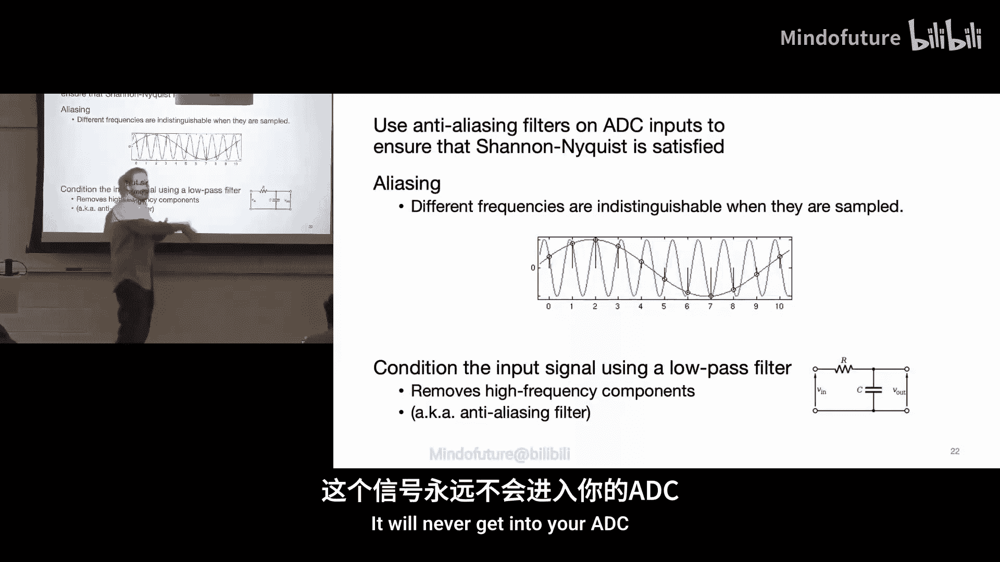

I'll show you an example from a research project， I'm actually going to skip the example that we or we'll do the worksheet later。

嗯。But here is a research project I did back at Disney。It is weird， it's weird。

 what we wanted to do is make wearable devices or any device that would allow a computing system to know what you're holding on to。

So how would you figure out what objects you're touching so you're touching your phone because the assumption is that we could provide you with better services right you would be able to infer a computer service can infer what you're doing the day and you say when was the last time where did I leave my phone well you'd have to know when was the last time you touched it so how can you do that well we came up with this thing called EMSense？

Basically the observation is that all electromechanical devices are emitting EMI electromagnetic interference。

 and so this is actually a terrifying event that I went through and many engineers go through where you have your favorite consumer electronic device you're trying to get certified by the FCC and so you have to take it to be tested and you put it underneath normal workload conditions and they have antenna and is in acoic chamber which does not allow RF reflections and that they're trying to measure。

 does it emit signals that break the FCC's guidelines and why does the FCC see these guidelines because you don't want to have all these devices interfering with each other。

 you don't want to have I don't know， some w-fi router that takes down a satellite station which actually has happened there's an ASus router somewhere and it was blinding a military。

 no no， is a Earth science observation tower and they couldn't figure out why is because there's something in this。

d and it was sending out too much 2。1 gigHtz noise doesn't matter but anyways。

 in this particular case this is a terrifying event because you're a little green line went over the blue in the red line。

 meaning that that's about six months more of work where you figure that out and now your boss is super bestsed at you but this is happening as long as you're underneath this signal level they don't care all what your modulation type is that means all these devices are sending out unique signals or some signals down there So we made this little device little wristband and all it was was an op amp and a cortex M4 and a Bluetooth module and an ADC that was sampling pretty fast 2。

3 megaamples per second and so you put it on and what we notice is that when you tuck your phone your screen here you've got to see some electrical profile this thing was putting out noise and now it has some profile and what we didn't appreciate at first is how unique those profiles are So here is all。

Different profiles for all these different devices。

 so a drill versus an iPad versus all these different things。

 you grab onto them and it's sending you a unique signal that's going to couple through your body into our device。

And so。My students made fancy animations。basicallysically you take your RFFT do a little baseband shift。

 you've taken a background sample， the previous sample before to figure out what the background EMI is you basically do some thresholdholding and send it to a machine learning classifier to detect what object it is and so this will go pretty this is going to be cut pretty quickly but a laptop here。

And it's connected to this smartwatch， which is going to send， tell you what is's touching。So here。

 refrigerator， this is the spark from the stove。Toothbrush。Scale。

All these devices are giving off unique EMI signatures， this is a touch screen underneath here。

Trills， sure。Motorcycles。One of the professors had a motorcycle， so we did that one。

That door handle was an electric door handle， yes， how it nose like the back doors oh because we labeled it back door。

How big does your database have to be to be able characterizing all these you do need to do collectus the data beforehand and do training on it it doesn't have to be that big。

Now why did it do ladder， ladder is not electrical mechanical device。Anybody want to guess yet。

 is a big antenna。So we were so the students were very excited look。

 we can detect ladders and I said that's not possible you know。

 so they've tried to figure out why is the where is the signal coming from and what we didn't realize is this was the country radio station in Pittsburgh。

ItTook us a while to figure out because that radio station is not at somewhere below 2。

3 megahertz it's up in there and the much higher frequency。

 but we were under sampling it is a higher frequency。

 we didn't put the filter on their ADC and now we're under sampling that signal such that now we know that at least you touch a ladder because we can enable a ladder but we had this fault signal coming in that we didn't realize and then just to wrap it up this is what you do is' a confusion matrix this this shows that for device Q or vice P how often is it denoted P and some of them are good and some of them are bad。

And there we go， all right， I'll let you guys go， thanks。

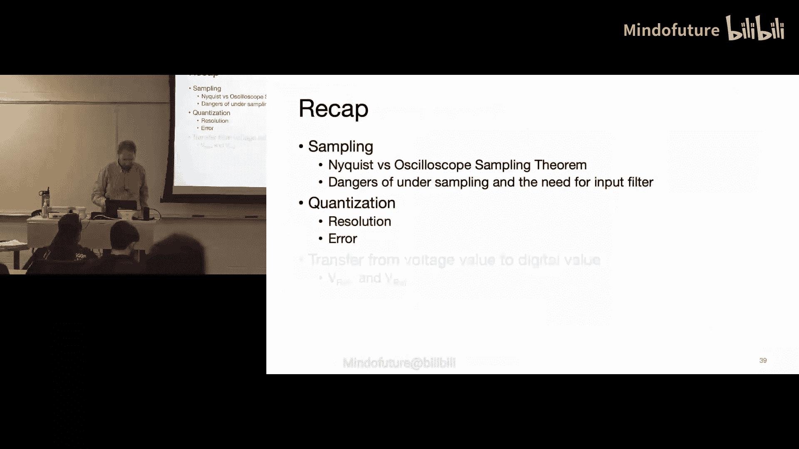

Okay。