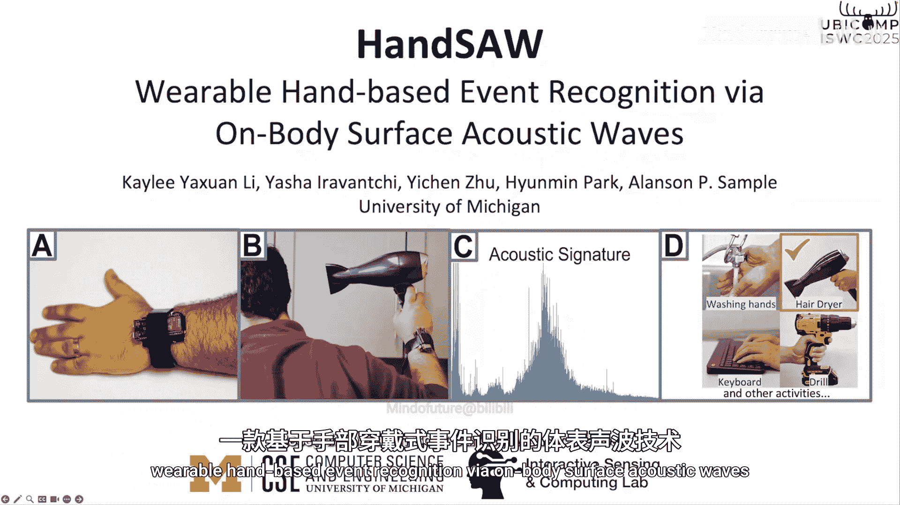
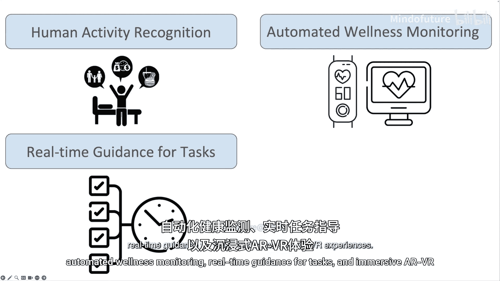
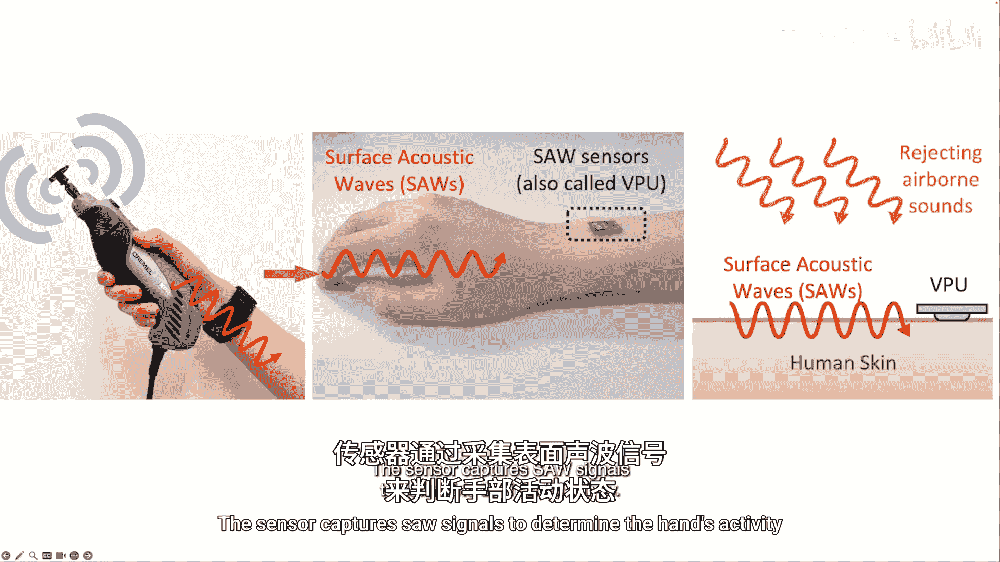
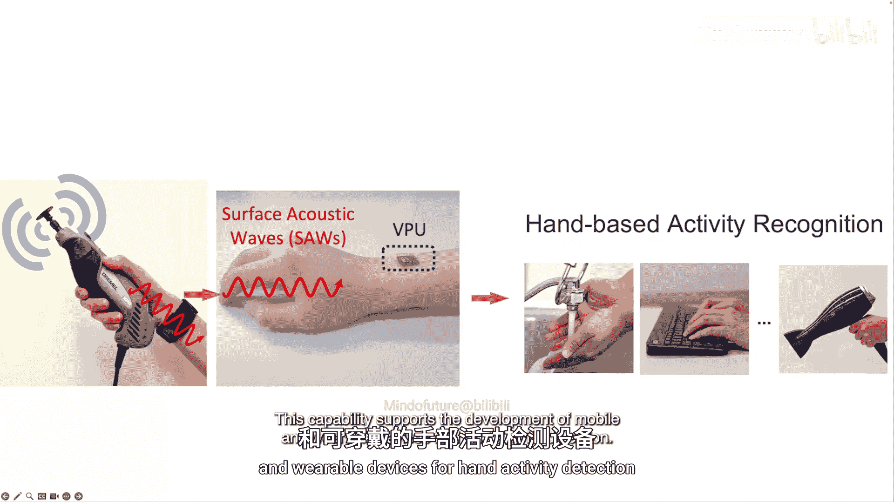
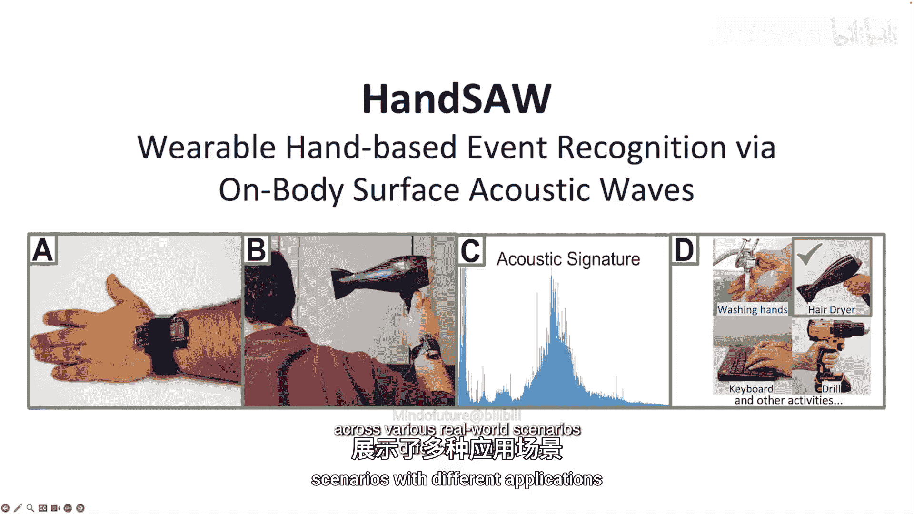
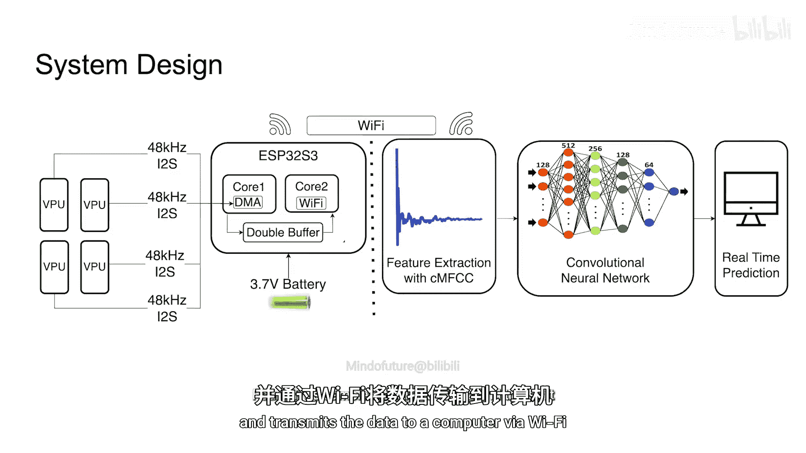
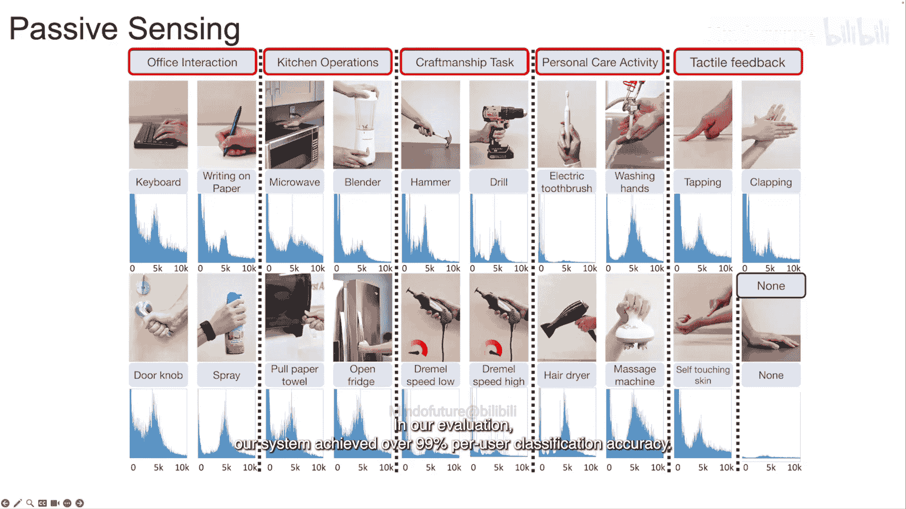
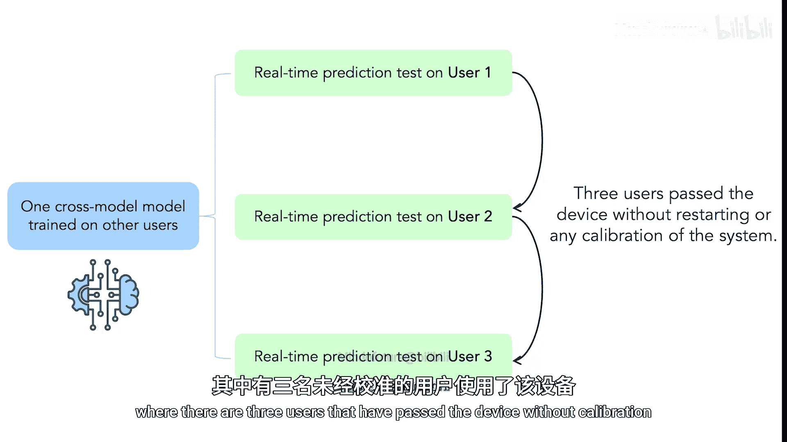
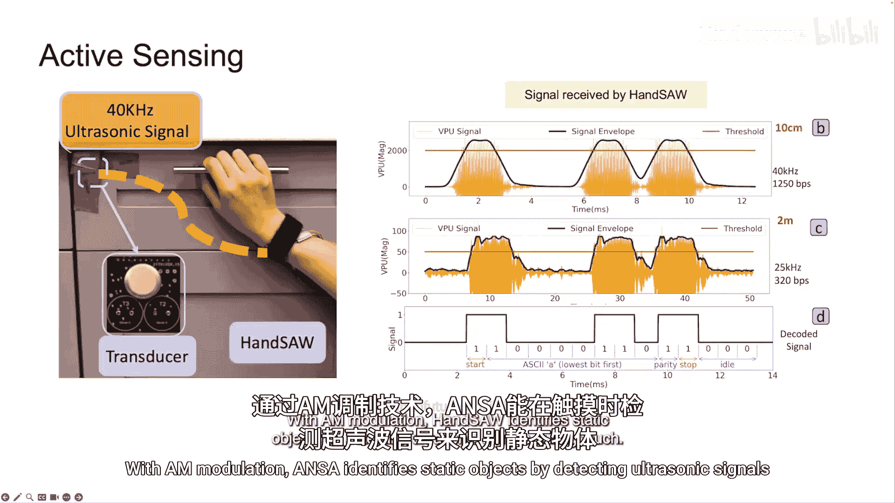
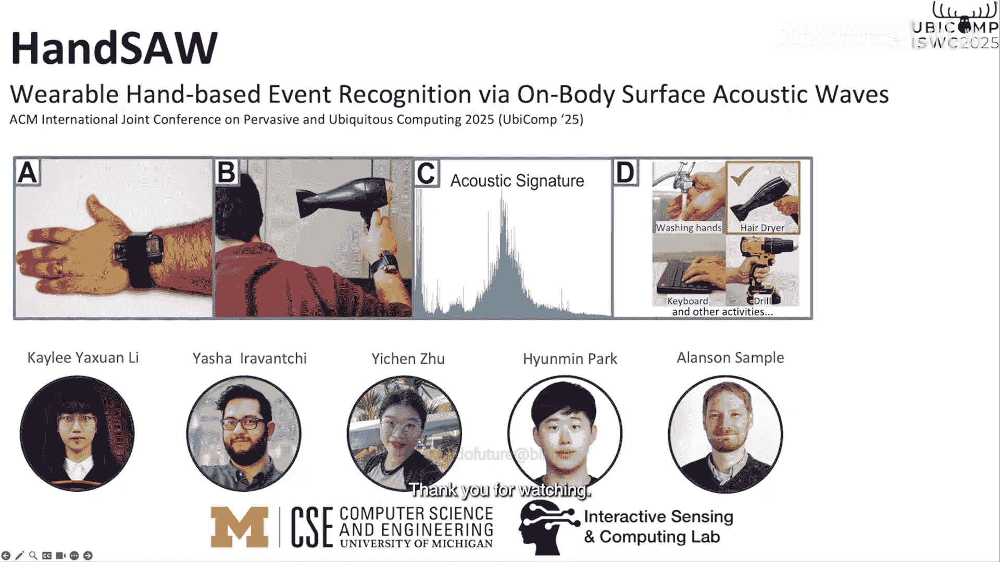

# 【密歇根大学】嵌入式系统设计导论-EECS-373-｜-Introduction-To-Embedded-System-Design-2025-p14-P15_HandSAW_基于手部穿戴设备的声表面波事件识别--BV1VTSNBoEem_p14-

In this video， we present hands off wearable hand based event recognition via on body surface scoustic waves。

 Under hand interactions with the physical world offers insight into a person's activities at a given moment。

 It provides detailed contextual information about their actions in the surrounding environment。

 identifying subtle signal patterns in these actions offers computers insight into human object interactions。

 and recognizing these interactions with objects supports applications and activity recognition。

 automated wellness monitoring realtime guidance for tasks and immersive A RVr experiences。

 Many mechanical devices emit acoustic waves during operation。 Similarlyly。

 acoustic waves are produced through physical interactions with most objects。

 One particular type of acoustic wave So acoustic waves prop along the surface to air boundary and travel from the hand to the body when interacting with objects。

 This property allows the saw based sensing approaches to effectively reject airborne environmental noise。

 the sensoror captures saw signals to determine the hands activity。

 This capability supports the development of mobile and wear。😊。

devicesvices for hand activity detection Handoc consists of a wearable system employing novel surface acoustic wave sensors called Vps to capture saws。

 The system provides superior bandwidth and signals to noise ratio while rejecting through air sounds。

 we demonstrate the practical usability of this wireless risk foreign system across various real world scenarios with different applications。

 the VpU features a sealed mass spring diaphragm position on top of a sound port of as microphone。

 allowing it to capture service acoustic waves generated by objects and trans mid through the user skin during touch interaction。

 the ESP323 microcontroller processes the capture data for Vp sample signals at 48 kiloherz and transmit the data to a computer via wfi to evaluate handsaw we conducted a user study with 16 participants analyzing 20 activity classes across five scenarios Office interaction kitchen operations craftsmanship tasks personal care activity and tactile feedback in our evaluation our system achieved over 99% per user classificationification accuracy。

showshows the raw signals， FFT features and real time predictions on the monitor。

Handsaw provides real time safety procedure monitoring and guidance for safe workshop tool usage。😊。

Reeneral usage warning， not wear loose holding， jewelry or long hair when using a suit。

Use the practical way is and support the to。 Additionally， Hansaw achieved 91。

6% accuracy cross users。 The second demo illustrates real time predictions using the cross user model。

 where there are three users that have passed the device without restarting the system。 Thus。

 Hansaw demonstrates for performance for new unseen users without calibration。

Using the sametan approach， objects can be instrumented with lowcot ultrasonic transduers to generate inauudible signals for active data transfer。

 thus enabling user object interaction and activity detection with AM modulation。

 Hansaw identifies static objects by detecting ultrasonic signals during touch。 For example。

 Hansaw can send shopping list reminders when a user touches the fridge。

 This approach can work in tandem with passive signal。

 enabling sawbased communication with various objects。 Ultimately。

 Hansaw provides an easy to implement robust and cost effective wearable device for user object interaction and activity detection via on body sawbased sensing for more information。

 please refer to our paper。 Thank you for watching。😊。

