# 【密歇根大学】嵌入式系统设计导论-EECS-373-｜-Introduction-To-Embedded-System-Design-2025-p15-P16_课程15_数模转换器--BV1VTSNBoEem_p15-

All right， we're going to get started so we're with some announcements here， as most of you know。

 proposals， submissions are due today。Make sure you do like put your name on it and like your group number and the name of your project so that when I print them out。

 I know what they are。That's helpful， but resubmit them today， we'll grade the final version。

 not the first version。Homework sevens assigned due next week。

 that will be your last homework assignment。The exam is scheduled for next week。

And then we're going to start student presentations after that。

 so last night I went through and assigned each of your project teams a topic。

So you should go check through here and see this is linked on the。

Assignment page there's a description of the assignment which is basically you are going to research some aspect of embedded systems that's been assigned to you and do like a 12 minute a 10 minute presentation to the class teaching rest your classmates about some idea Now I tried my best to give you something that's actually related to your project if I failed at that like。

I't know you're not using LDar on your project， you should let me know I'll switch it around for you。

 I also try to group these ones that most people need in the beginning so like driving a brushless DC motor or a DC motor like how to do that。

That's like ever lots of groups are going to need that we put it up up front PS2 controller XB。

 a graphical display， so these are going to be on the first day that Monday after we get back from。

After the exam。Oops， come back。So here we are， we're here next week is a review。

 we'll do talk about DMA and PCB's design and you'll have your exam then we'll start student presentations student groups need to come in practice with me Matt or James beforehand so we're going to make a signup schedule we'll put it post it tonight。

 we'll get priority special priority to especially this group I'll make some times over the weekend。

And next week， so that make sure that you guys get a chance to present。

 everybody else needs to present or do a practice presentation before their presentation。

Any questions？我问得个翻。所应的清楚。No questions。Good the component for the presentation is it just like the one main component do you have to do all your components No just one but you're gonna to be a little bit deeper dive right so it's gonna be like so people doing like motors and motor drivers it's like not just like you want to get some background of like how does a motor work right and then it's like well do you how would embedded systems person like drive that thing so how do you go from like your signals 3。

3 volt signals to driving this motor and then what are the control things you have to think about so like it'll force you so I try to choose ones that are actually relevant to your project it'll force you to learn how to interface with this thing you've chosen and it'll teach other people how to use it？

没认识他对。嗯。Ill score one our information of the student presentation。

The student presentation practicing you guys areing you're going to first practice with memat or James and then you're going to present in a class Well you've been assigned a slot so these days during the class you have student presentations。

You've been assigned a slot。That is denoted here。Presentation day， slot number， here you go。

 and then beforehand we'll have a sign up sheet for you to come and practice with us。So money afford。

Is our practice。Yep， I just didn't get a chance， have not agreed with Matt and James about all the days。

For your practice， do you have a question nope so this is online， you can go look it up。

 you know have to squint， it'll be just fine。All right。

 any other logistics questions about what's coming up？Okay。Zero questions， fantastic。Okay。

So I didn't quite finish off the ADC slides。AndI just want to talk about the ADC that you have on your STM 32。

And by now you should be able to more or less navigate your way through this block diagram。

 so here's your SAR ADC has will' talk about these things。

 but injection channels and output channels and oversampling modules so you should be able to。

Read through the documentation because you guys should be getting pretty good at reading the data sheet by now and kind of work your way through this diagram。

But high level， you get a 12 bit ADc that runs at3 or 5。3 megaamples per second。

 so that's pretty fast。And because it's a SAR ADC， you can reduce the resolution and get up to 8。

8 megaamps per second。I don'll know exactly when I would need to do that， I mean。

 obviously if it was sampling something really fast but。You know， there is the option。

They have this idea of channels， so it has 16 external channels。

 which means these are analog pathways that go and lead to your D or sorry that lead to your digital GPO pins。

 and so now you can sample up to 16 pins on this microcontroller can be converted or configured as analog inputs。

And then those will be fed into your SAR ADC， there's also internal channels。

 so there's an internal voltage reference， why would you want an internal voltage reference。

 why would you oh think about why you'd want to measure some internal voltage？

Just whatever this steps。Like said yeah。You could do that， any other ideas， it's not a bad idea。

So the internal voltage reference is a very stable voltage reference it's called a band gap voltage reference and basically it gives you a known value and that will be a known value independent of your input of your power supply voltage so if your power supply voltage is kind of noisy or maybe it's varying。

 there is a range at which your microcontroller can be powered at this thing will say a this is my actual internal voltage it's I think for you guys it's 2。

7vols and therefore you can measure your internal voltage reference and be like oh wait。

 something must be weird here because I'm measuring this。

And I'm supposed to be getting this DAC value， but I'm getting some other DAC value right so now you have a way to calibrate your ADC。

Sometimes I don't know if you can do it for this particular micro controllertroll。

 but sometimes you can run the reference， see the bias well oh no， you can do it。

 the bias voltage can be run off of your internal reference voltage。

 so that means that you're going to be more independent of noise although you're not going to get your full range。

Other internal references or other internal things that you can measure is that there's a temperature sensor so every piece of silicon can be made into a acc crudeed temperature sensor。

 basically you take two diodes of the same size and run two different currents through them of known values and then the voltage difference between them is going to be proportional to absolute zero so you can get within two or three degree accuracy pretty reasonably well with just any piece of silicon so you can always just think to yourself in the future oh if I need to know temperature my microcontroller should probably already do it as long as it has the D you can look at your battery voltage divided by3 and then you can actually look at your DAC voltages so we'll talk about DAs next but internally though route the output of your D into your ADC so you can double check is my D doing what I expect it to be doing。

And then there's also an opportunity here to have 16 bit hardware overs。

 so now you could you have this accumulator so you take a sample and then it will do the averaging for you basically so it will keep on sampling data and then when it's you get your 16 bit oversle it will throw an interrupt and then you can pass that on your output channels。

And that has three watchdog channels which is kind of interesting。

 so we have watchdog timers and I don't remember if we talked about them。

 but a watchdog timer is a timer that must be it's a register， you set up the timers。

 you have to reach to the register before the timer goes off or the system forces you to power on reset so anybody know why that would be useful having some timer that goes off if you don't schedule it。

 you reset yourself。If like you have a sensor and like it's not working。

 maybe you reset it and like it'll fix itself and Yeah。

 but let's go back to the case of just a timer before we go to the analog one。software or firmware。

Yeah。So you have a piece some code in your thing that hangs the device， you have some unknown state。

 we don't want your device to be hung forever right and then you have to have some technician go out and do it so you have。

The watchdog timer， your main loop should basically go through every so often。

 whatever the interval is and rewrite to that register setting it back to zero waiting for it to count up and then if your software does hang for whatever reason the hardware timer the watchdog timer will go and then power on reset you so this is a way to kind of save your device and not have to deal with field reinstalls and angry customers they have a similar idea。

 that's just the idea of this watchdog and then the analog watchdog would say hey I I'm measuring this value I have an analog value that goes between a certain range maybe let go between two values and if it ever goes above or below that then throw an interrupt so you can attend your ADC off to do with some task and maybe it's a distant sensor where a value goes high and when something's too close and then it just continuously runs this ADC your core can do whatever it wants can go to sleep that's typically what low power microcontrollers are trying to do all the time save power and then if it goes。

enough it'll go and through an interrupt that will cause you to be able to respond to that event。

We talked a little bit about sample and hold circuits， so on your or STM 32。

There's a registered to select what your number of cycles for your sample and hold。

So the minimum here is four cycles and that is dependent on what is the clock going into here so you can have a 16 megahertz clock and you can divide it by some prescalealar and then off of that intermediate clock。

 you can go through and choose how many cycles you want for your preferences to charge up your sample and hold circuit。

So in this diagram that's here you have the sample time and then you have your conversion time so we're saying that this is software selectable and why does anybody remember。

 I know nobody， everybody's looking at their things I'm not very excited， that's fine， I get it。

Does anybody remember why in the world you'd want to change your sample in whole time？

W don you talk with your neighbor， figure out if you guys can remember or as look back on my slides to figure out why you'd want to change your sample in whole time。

そさめてく。certain amount was like so you may want to。It's like， it that you're older more you。もIて。

What do we think， why would we want to just change our sampling whole time save more power because you're voting on instead of sampling faster？

Yeah， not really， I don't think that I would just go as fast as I could then why would you ever want to go slower than the fastest possible？

あよ？What's that？Does it yield power？What does that mean。

 when do you mean deal with power Well you're sampling a lot you're doing a lot of operations？True。

 if I could just slow down my sample right that I don't need a sample。devicevicicee for that， yes。

For accuracy reasons so you have to be louder accuracy in what way like the longer you sample。

 the more correct you are or like the more resolution you can have。No， I know there's an EE here。

BecauseI see you。WWhy I know you're looking， maybe you'll find it。

 why if I had a signal would I want to sample la for a longer period of time？Yeah。行。

The signal may take a minute to get to a stable value Okay， Yeah。

 and what what might cause this to occur？And you want a higher resolution？

I'm getting towards source resistance this guy knows about source resistance， I know he does Okay。

 so you can model your sensor。This is a resistor， and we're going to call this sensor。

And this has an output， this source resistance is going to limit the amount of current that can be driven into what。

 well， it's going to be a capacitor and this capacitor is what is being used。

 remember there's a little switch here。You're going to store some amount of current on this capacitor。

Some amount of charge sorry on this capacitor and so if the resistance here is very small well then it's going to charge up very quickly great that's what we want however we don't live in this nice ideal world sometimes you have sensors that have high output resistance and that will mean that you are charging slower and slower and slower the higher this value is longer it takes to converge some value before this capacitor will be charged up to BDD here or be out of that sensor。

So the source resistance is a serious problem。And by changing your sampling time。

 you can allow that capacitor to charge up to a different value。How's that work。

 that is that good EE reason it makes sense to me fantastic I don't know if I'm the expert。

 I think you're the expert so no I you've taken EE classes more recently than me。

So all I'm saying is why would you so for the9E majors， the CE majors and the computer scientists。

 why， why would you this if your signal cannot drive a value very quickly。

 if you put your thing on the oscilloscope and it takes a long time to charge up。

Compar to the sample time， then you need to go and increase your sampling size。

Do we think that makes sense？Okay size。The effect of how quickly you actually charge it。Correct。

 right， so you have some drive strength of this sensor that sensor might have a poor drive strength now in the reality。

 this capacitor is really small。I don't know， how big is this capacitor？嗯。哪有 know。500 pico ferrets。

 let's say， which is pretty small。And these things are probably going to be like， say， 50 ohms。

Wch is pretty small itself， but you're trying to do it really。

 really fast so you can calculate your RC charge up time for that and you remember you're trying to go up megaamples per second so you want that little capacitor to charge up inside that thing fast and those are just approximate numbers that I guess I don't actually know any real numbers。

Well。You can't see anything as I put it way over there， I'll draw it over here。

So if the resistance is small， source resistance is a great sensor， it'll charge right up。

 but if the source resistance was large， it's going to take a long time。

And so if I set my sampling right here for a small resistor great。

 I've got the analog value of voltage time， this is really close to my alpha voltage great， however。

 I'm here。I've done the same sampling times。And that is not the end voltage here。

So this is the voltage on that capacitor in your sample circuit。

I sampled so fast that didn't even give that capacitor time to charge up。完这双时再是。

It will be constant for a device， but it's not constant， well as all does have true。

 it's typically constant for a device， but it's not constant for every possible sensor or every possible source。

Some of them are pretty low resistance。Or high resistance， sorry。Yeah。

I I don't know if the ADBC of that makes somebody like buffering and make a resistance smaller。

あ回点でしま。Yep， you could put an opamp in there and make it faster。It be case for you。Not really open。

Uter the sampling time or until one alter the sampling time， which is like when a。Yeah。

 you could put the statement was， well if this doesn't have enough drive strength。

 how could I solve that， well one ways you could put a hot a in there？

And we can do a voltage follower。And so this should have low input or should take a small amount of current。

 so it should have high input resistance and they should have low output resistance。

 so this will take this voltage and put it over here and it should do it be able to drive that capacitor much faster。

 now it just costs you something。it costs you this component on the board。

 maybe you don't want to make that trade off right so now you could just change something in software and allow for that thing to charge up。

Okay。And then for your particular device right， you can say here。

 I have a 60 megahertz clock and 4 clock cycles and you could go through and figure out for a 12 bit ADC。

 how long does it take to sample something or at least to converge by the time you say go to converge here。

 you can just count through the cycles what do they say 12 bit so 12 bit  ADC is going to take on average or it's going to take six cycles to converge because you're doing a binary search and now you're going to get to 6125 my nanoseconds。

Yeah。Go。Okay。あさ見た。I'll go through some options to make you aware the output of your ADC you can choose to control how the data is aligned it's kind of an interesting thing you can say if it's signed。

 not signed and you can say how does it pack up that 16 bits you know if you're just doing eight then you could go and say toggle back and forth and double use that memory location I don't know why you really needs it do this but every once in a while somebody gets confused about why it's even an operating option and that's usually to do just data packing and make sure it's as small as possible。

On your。ADC， there's two different modes， there's this kind of regular channel mode where you'll say you'll have this mux right so there's a deepba port and there's a mux there's only one ADC even though you can on your particular device there's up to 16 different analog pins that can be configured as an ADC it just means that they're going to be time multipleed so this mux is an analog MuX is going to take this value and put into the ADC and then a regular mode you this regular channel is going to do a conversion and put it out here if you want to go faster you have what's called injection channels where it'll do four sequential reads and they actually have their own location up here。

 so now you can store up to four ADC values before having to come out with DMA or an interrupt to do a task of taking that data and putting it somewhere。

いま。反转埋。Why would you want and do the eject like for significant values that's a great question so it even gets weirder than that right so here this allows you to go faster and now I don't because I don't have to go through and do a memory read each time。

Right so memory's still pretty slow getting because you have to go。

 I think this is on the advanced peripheral bus I don't actually remember。

 but means you have to go through the high performance bus into the advanced peripheral bus into this peripheral and send the data all the way back to memory it takes a long time so we can do this we have this option here and here。

It's interesting well， you way to have a slide on it。嗯ん。

So the injection the difference between injection channels and regular channels injection channels are actually a higher priority actually come up with higher priority interrupts and so you could have multiple sampling thing which is a weird idea why would I want an analog I have one ADc why would I want an ADC to interrupt the task of measuring another ADC value idea why would you do that some make sense so how you set it up is you're going to set up these things might be your highest priority maybe you're sampling that you know a mega sample per second on some value that you need a very precise timeframe format it but then have some other value like a temperature sensor we know from last lecture a temperature sensors aren't going to vary that much maybe once a second would be fast enough so this is a lower priority than this these will take priority and it's not priority over the same digital eyeO is that they're going to change the muck so one mus might be to a temperature sensor and then these other things will be to say the sample the signal you want to sample and you could have all four injection ports。

Go to one particular pin， so now you're saying that this analog signal that's faster。

 you want high precision on has the highest priority。

 so if even if the interrupt comes it says do this task or sorry， say you're doing this task。

 this thing can override that one and recontrol where the mux is pointing to to get that value。

That's kind of talked about here， not really though。It's just different mode。

 typically you could hit me in software， you could say start。

 just do a channel and then stop and you can do in continuous mode。

 and then the injection channels that just allows you to basically pipeline this action do as fast as possible get those four reads。

Out。U。Thinking back to this figure here， we have some voltage value that has to be corresponded to some digital value and it's important think it's not a 3 bit ADC。

 it's a 12 bit or 8 bit ADC， but where is this voltage correspond to well you can inject an external pin。

 you could have externally you could have a reference voltage that drives that it could be the VDD pin or it could be an internal reference like we talked about before。

 so it' important to think about as you're configuring it， it's not necessarily going to be 0 to 3。3。

 it could be some other value and it's important to think about what is that top value of your ADC analog conversion value。

Let's see we talked about watchdogs already。Basically， it's just that there's a threshold。

You can check to see if the analog signal wanders in and out of that。

I don't really talk about low power。In this class， but you're MSP 430 or no， sorry。different project。

 your SDM32 has a low power mode， several low power modes and typically for battery powered things you want your microcontroller in sleep as much as possible。

 so a lot of an engineer's time is trying to figure out how to do other tasks while this thing is asleep and if you're just trying to measure some see if a value leaves certain area this would be a way to do it。

So the intended structure or not the intended structure。

 but a way to use your ADC with timers and make sure there's a firm time bases here we have our main loop and we have a timer and an ADC so in Maine you can go set up your timer peripheral to go off at some period of time whatever it is every second and in that interrupt service routine then you can go and say okay now take an ADC read and then when that ADC's interrupt goes off meaning that the conversion is done you could go and read those things out so here you have two ADC or two interrupts that are part of this routine so every time this goes off it takes ADC read your ADC IR goes off and then you take that data and store it somewhere you can't leave it here because there's just not enough room there's only five register is basically the store stuff so a lot of the task of an ADC is taking data and storing it in memory center。

The alternative mode that maybe some of you will do for your projects is you have a timer。

 a timer setting up a time base and you're going off。

 say every second or maybe every couple 100 microseconds goes off。

 you take an ADC read and now in your timer ISR， you're telling DMA。

 you have a DMA controller we' talk about that later today or maybe next week。That， hey。

 when this ISR goes off。Instead of me as a controller as the main processor trying to do this。

 what I want is the DMA controller to take that data and store it off into memory and this way your core only has to wake up for this period of time to do this thing and all that's automated and comes back and says I'm done and that done flag could be taken care of in the main loop or could just be another ISR that says okay。

 take that data again。Yeah。Like race conditions， concerns with like checking that Dma up yeah。

It can be bad， you can write bad software。It really depends on what's I might want to think about what's the condition here。

 like there's no race condition in the sense that this done flag will only happen after the ADC has told the DMA hey。

 I have data for you and then DMA is going to push it to the memory address you've told it to do it's really maybe your question is like what do you do after this are you going to have a condition where it doesn't hit that timer again or maybe race conditions the timer has gone off before this is done？

That's reasonable as long as it's within your ADC time。

 but if this timer goes off faster than your ADC can converge， then yeah you have the race condition。

 you can't get out of that。That makes sense。What about just like the main program just reading back bit D done？

It depends on what the goal is， if this is a repeating timer， you don't even care then。

Right so all what you'd have to do in this timer has to increment where DMA should read should write data from so in your DMA you say hey。

 this is where I want you to get data and this is where I want you to put data so you just have to make sure that the pointer of where data should go keeps getting incremented you don't want to overwrite that data。

啊。All right， so that we can REcap for ADCs。It's important to kind of realize the general type of ADCs and be able to reason about the tradeoffs。

 I don't care if you can draw out the architecture of them or but you should be able to recognize the basic architecture and say。

 okay， why is a flash ADC faster than a slope integrator or faster than a successive approximation one。

 and you might have to be able to say， okay， this is an appropriate time to use this type of ADC。

You will not all your microcontrollers will have ADCs。

 there'll be times when you will be looking through datahes。

 trying to choose one that meets a certain task， and there are a lot out there and here's the starting point of things to think about。

嗯。And then your STM 32 you is a SAR ADC and provides you with a bunch of trade offs。

 and then I just went through that part， but that's basically。

Thinking through how can you use it and how can you use your timers and your DMA to get the most value or get through ADC reads as fast as possible if that's what you need for your application。

All right。Any final questions about ADCs？は。Go on to DAX。So for DAX。

 we're going to talk about three major styles， actually， we're going to talk about four styles of。

DAX， and then we'll talk about the STM， and then we'll talk about error types in ADCs and DAX that you should be aware of in general。

So there's reading if you're interested。All right， so a DAC is essentially just a signal generator or a speaker right。

 is is the thing that creates an analog value。You know。

 the things you want to think about are just the opposites of ADCs， so you still think about， I mean。

 it's the opposite of ADC and you saw think about speed and resolution and power disation and those sorts of facts。

So the basic idea here， you're still going to use this binary ladder idea。

 you' got some binary value here and then through some process you get an analog voltage out now there is something slightly mis misleading about this。

 it's not that you get a time varying analog voltage is for each digital value you would get one point here and then you change this digital value to get another point。

 another point， another point， another point。So you imagine you could be reading through a memory buffer which basically describes a waveform so you could have triangle waves or square waves or whatever waves you want。

And this DAC will be creating the analog values。And you can notice here。

 you know' here's equations for the transfer function between a DAC value and an analog value。

 they're very similar， if not exactly the same as your ADC， it's just that the。

The inputs and outputs have been switched where instead of an analog voltage。

 and you're trying to figure out the DAC， here is you have a DAC voltage and you're trying to figure out what the analog voltage is。

We talked about sample and hold circuits for DAC or for ADCs。

 and now there's the same sort of issue in a sense with DAX and this is this idea of a loading effect and probably if you're an embedded systems engineer this should before you graduate the idea of resistor and a load in this voltage divider thing should start feeling pretty intuitive。

 you find this happens， these sort of circuits and tradeoffs happens all the time and here we have a DAC that has some V desired。

 when it has some inherent source resistance and that's limiting how much current can be pushed through and depending on your loading condition you can actually corrupt or change the VL voltage far enough away from the desired voltage to break your application。

And so as we talked about before， one way to get around that is you go put a voltage follow in their basically opium。

 which does not draw much current， so this will not let current going here as equivalent high resistance。

 but it can drive lots of current out so it can faithfully reproduce this value。

We can see an example of that。

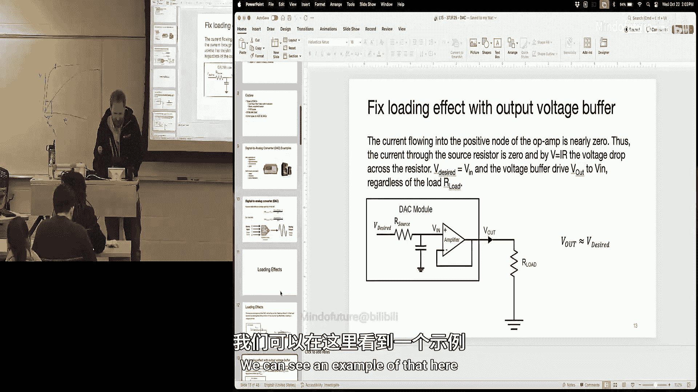

Here。Just to drive this home， so I'll speed up the current。对。So here we can see that。Here we have。

 this is the output of a DAC， let's say。We're not talking about how this voltage is made at the moment。

 we're just saying here's the output of the deck and you can actually see the current flowing out here。

 we have the same circuit but you see there's no current flowing here because and this is ideal situation but it has high input resistance which means doesn't matter what current is going on here it won't drag this down won't modify that and I'm going to go and change Rl here and you can see as I change this resistance that voltage is going to change already it's not perfect right here it's 6。

5 output we're going 6。5 here because we have this buffer in between here is 6。

5 but now you have5 volts out there and so if we go and change load resistance。

Right now I have a very large load， small resistor， but it's consuming lots of current。

 we actually saw current speed up and you can see it's dragging down this voltage。

 so now my system's outputting 2。4 volts， I told it to do this。

 but the loading conditions have caused an error。And now I'm not getting the correct value on my output now this one has this buffer in here and is still able to produce the correct value。

 even though the load is fairly large。R out the load instead of R S the。Well。

 why would I make change R load because as engineers。

 you generally don't get much control over RS RS is typically intrinsic as you'll see。

 Rs is intrinsic to the design， there's seats over there if you want or up here。U。

So this is going to be intrinsic to design， but my loading conditions right if you go put an LED on something。

 well， I'm going to load it down， I could put a resistor on something right that load is。

Usually something that is changing so changing that load is what results in your voltage not being like the correct Yeah so here's a voltage divider right and so I've reduced this value and now I can see my voltage divider has you know divided that down if I make my load like the ideal case would be here I make my load really large 10 k oh that's great now the difference between here and here isn't even that large maybe that's good enough for my application but oh I wanted to drive a bigger load as anybody know what what the input impedance of a speaker is。

Gue people aren't making home stereos anymore。Anybody want to guess？Yeah， like eight oms。

 eight ohms exactly， I think isn't cars like。Its like eight ohms I think is for cars and home stairs like four oms or something they're really small resistances。

 so now you think you've made this really whbing know amplifier and you're just going to blast your neighbors out of the water but here this is at 600 ohms and now you're dropping all this voltage right so now you have to do special techniques to be able to drive lots of current into that thing otherwise look at the volume right here of my output of my speaker is small compared to what I wanted。

We can also kind of see the effect of high source。So first let'll show the effect of low source resistance。

 you always want low source resistance because now the top of your voltage divide is small。

 it doesn't really matter what this is， it's going to be pretty close if my source resistance is small。

 life is pretty good I can't even make my load resistance right here I'm 800 ohms and there's almost no difference because my source resistance is small that would be great。

 unfortunately I can't really change my source resistance and as you see as you go up 800 ohms I'm at 150% here now again it didn't matter over here。

Any other questions？Yeah， go again magic。Now， for 373 students op amps to just be magic。

 they shouldt know what he wants to know how an op amp works is horrible。

 whatevers inside of that who' you've taken 311， you know what's inside of there， is it horrible？

Yeah can be he's lying is horrible don't know what's inside of here is's fine what you do is you go get find an analog engineer when you need it opM or just follow some basic tutorials if you just do normal tutorials and just do normal configurations it'll be fine especially if they're not fast if you get in high frequency then it becomes horrible but anyways if you ask a real question the real question here is that this is not accept current into it。

It has high input resistance that's how the ideal op amp is， so this breaks the loading condition。

 this is equivalent of like a megaomem and therefore it cannot load down this node and because of this configuration it's faithfully reproducing the input voltage。

Wait。Magic， okay。What other questions？guys， you guys did voltage followers in 215， right。

 like someing amplifiers。Okay。Great。The for applications are different。Well。

 they're only good for fast applications if you take311 and then the higher got take a grad class before you learn that they're good for the higher applications they' trying to get you to take more classes。

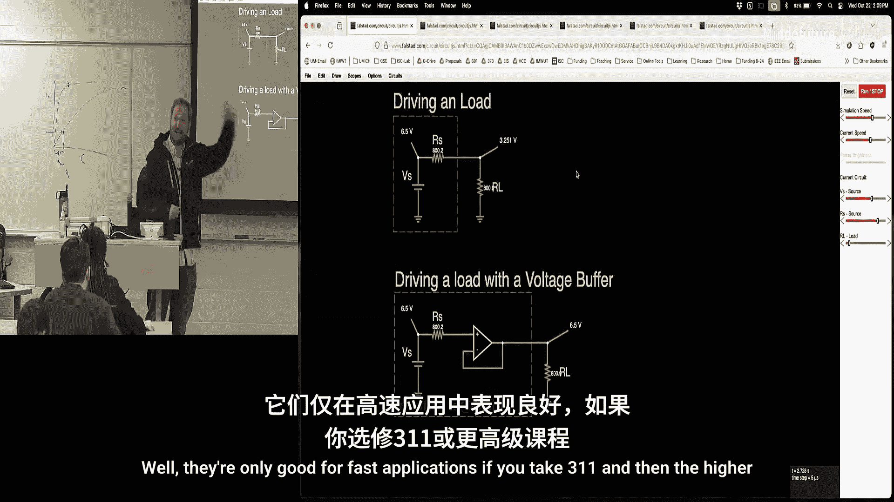

All right， so now we talked about this idea that we're going to have this。Buffffer。

And we'll talk about the most simplest。Dak you could possibly make， and that is just a digital eyeO。

Putting out a PWM this can make you a nice analog signal is's going to sound horrible that's fine it's going to sound like you put into a little pizo disk。

 it's going to sound like a buzzing soundep beep beep like an eight bit Nintendo game but that's fine but it's cheap right all I had to do is put a resistor here and a comparator here or a capacitor here and I'll show you that I can turn these square waves into a sine wave。

And the trick really is it's just going to be a low pass filter。

 here's low pass filter and you're taking this when you see here here I'm mostly high right I'm very small a logical zero here for a very short period of time and my corresponding analog voltage is nearly VDD and over here low most of the time and for a very short period of time I have a little spike at VDD so mostly the time on that ground you can see my corresponding analog value is pretty low and this is just the fact that we're going to a low- pass filter that signal。

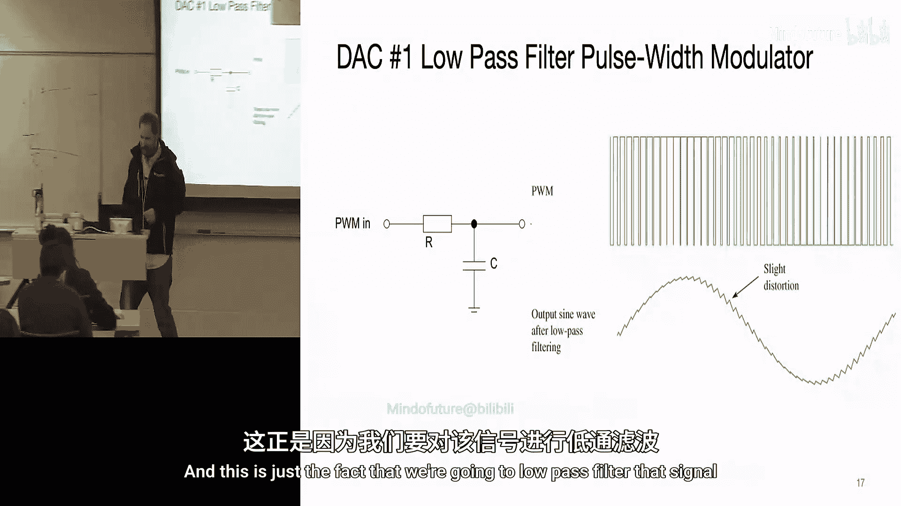

Yeah。And so。You can go see a false add about that。And heres here's where you'd want to have a little output buffer because this thing can't load much down that's the problem。

 so assume this is a microcontroll area and has internally buffered everything and everything's as nice as it can possibly be。

You just won't be able to drive much load， so I put this little voltage follower here。

 but now we're going to control the duty cycle and by controlling the duty cycle。

 I'm going to make the green line move up and down。

And you can see that's just the output of this and this node here is。嗯。

The output of my digital IO pen and so by changing the duty cycle。

I'm charging up this filter basically and now I have a analog voltage on the output that's higher。

Let me think about that。Make a simple D。This is like you， you got like 12 hours before the demo。

 you're like I just want to have some D points， I want to make a little buzzer buzz。

Reistor capacitor， you fool around with that for a little while。

 you can make something buzz and then to make an analog signal right。

 you would just go in here and just vary this over time。

How you can speed up the simulation a little bit to make it fast and now。See。Yeah。

Now you can digitally make a sine wave or some tone that you can hear through a speaker。

What do you think okay， she's like， I I think that makes sense， fantastic。I mean。

 there are problems here， look it's not a great signal because you're charging。

 your filter has to be designed for the frequency that you're at and you get these ripples on top。

 so it's not going to sound great， but it's going to sound like something。Any questions？T。

You guys are like， I made this already， I know this。You're storing the value that you're putting in。

 like the digital value you're putting in。I wouldn't say it's storing。

 this whole thing is acting like a low pass filter。

 so it's going to low pass filter this digital signal and I'm going to change the duty cycle of this digital signal。

And so the average of the duty cycle is what's going to come out here。

And you can actually see this little RC charge up charge down in between cycles here is like charging up and that charges down just for a little time。

And so there's a bandwidth limitation here that this will only work well for certain frequency ranges if you go too fast。

 it's not going to work well。

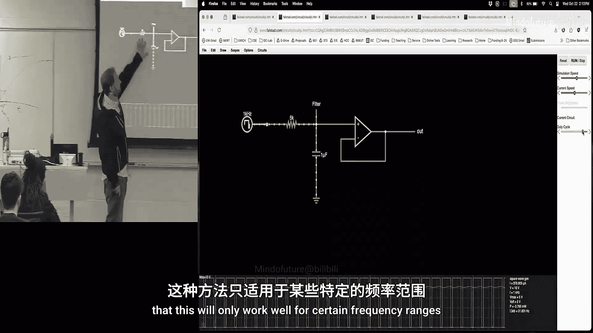

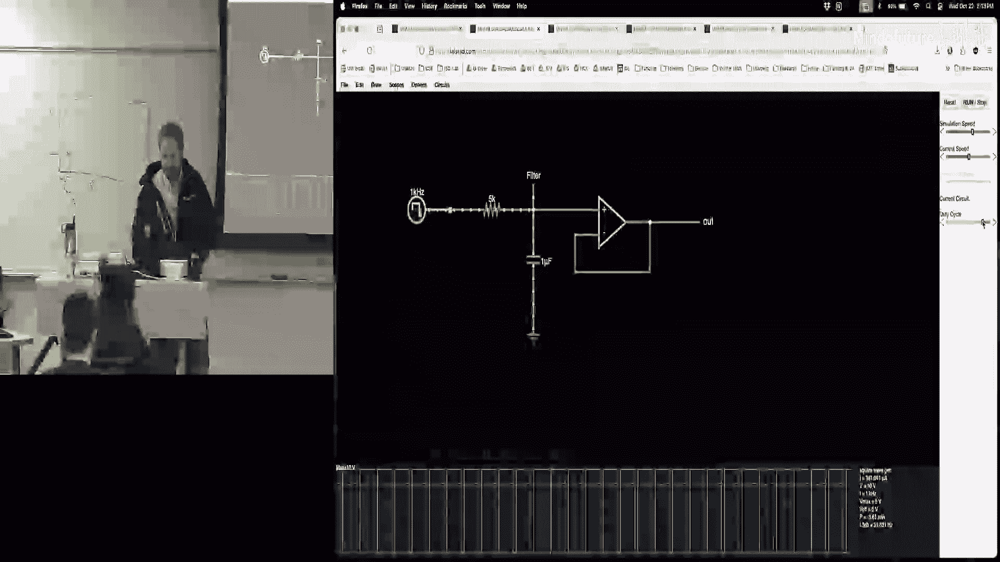

Yeah，就是这来说。Yeah right。Yeah， but there's limitations。

 you can't get around it too much right so you're always going to have some amount of distortion on this thing and there's other ways you can probably get around that。

To make a cleaner signal， this is just like cheap。Rush signals。But yes， we could do real math。

Like the engineers would calculate the correct size here for duty cycle to minimize like we can find those tutorials online。

 but we're computer engineers， we don't care about math anymore， we're just making stuff。

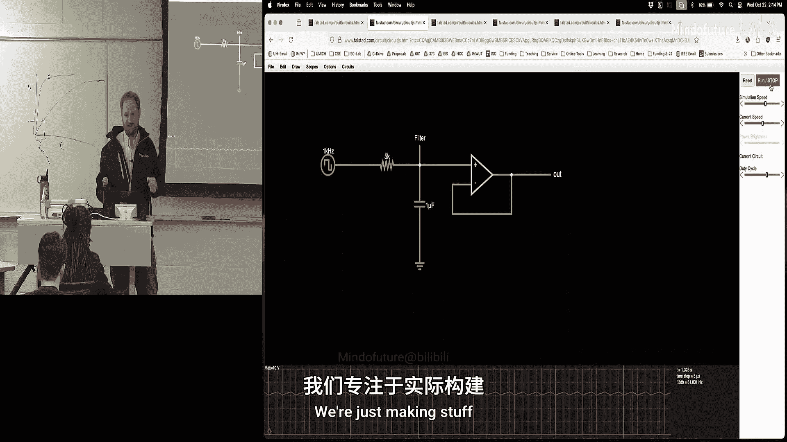

这是啊。All right， so any questions about？Any more questions？All right。

 that's the simplest version Now we're going to talk about resistor voltage divider so this is basically going to be the inverse of a flash ADC so how the flash ADC work remember made have this resistor ladder and then it was comparing input voltage to all these nodes on the resistor ladder here we're going to do something slightly different here we have a reference voltage all right so that could be 3。

3 volts or your internal band gap， whatever it is and then this ladder is going to make up a staircase of different analog values and then you just go and collect connect one of them with a switch or transmission gate connect one of them to an output stage and then you're going to send that out so then you'd have to have some decoder here which is going to go through and select which one of them but this is essentially just the exact opposite of a flash ADC。

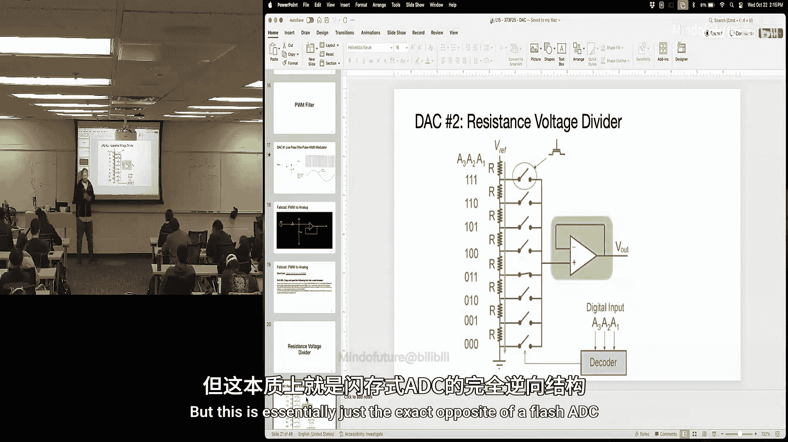

There's really nothing too special about it here we can see， remember color here indicates voltage。

 so here we have ground which is gray， we have green which is seven volts up here。

 and then we can see the gray ads here in fact you can look and little down there you can see one volt。

wo volts， so on and so forth and then by putting a digital code in here I'm going to select which one gets out here and here this is a binary decoding structure right but basically it a series of switches that's going to go through and connect that output value so you can collect any value you want now is going to give you some analog voltage on the output now here the problem we're going to start seeing is there's no output buffer on this one yet。

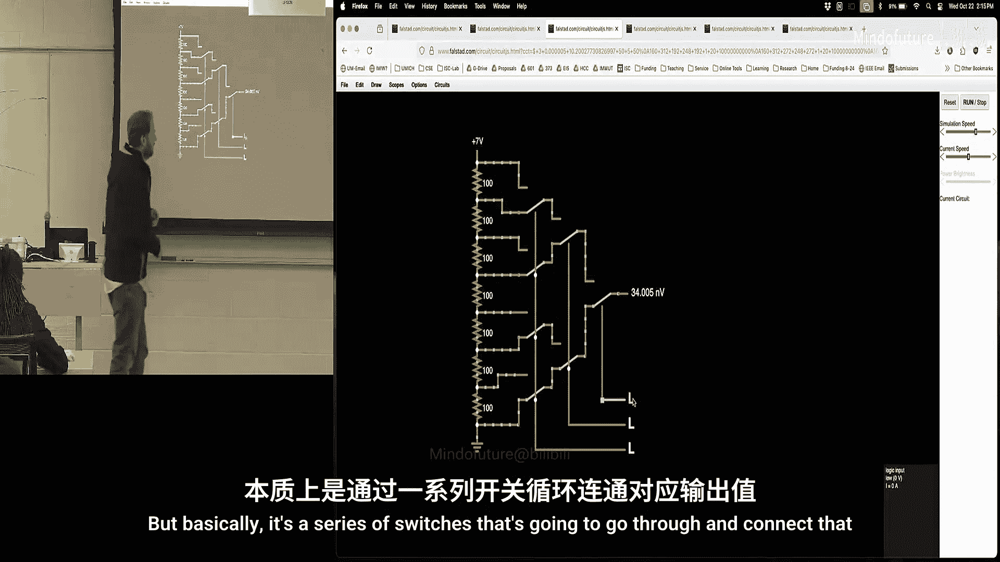

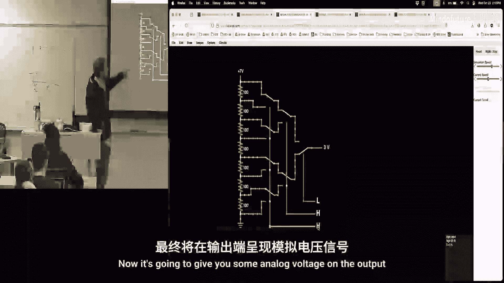

All right， so whatever load I put on here。Is going to be a function of all these resistors and so some loads。

 like if if I connected that one。that one's not a great choice， let's do this one。

So this one would be 100 ohms。Divided over my load resistance， well 100 ohms is pretty small。

 so maybe that's not big a deal， but if I go。Now I have 700 ohms。For this value。

 about 700 ohms and so now my output resistance is actually changing depending on what digital code I put in here。

 so another reason why you'd want to have an output buffer so that this structure doesn't change your output voltage。

That makes sense。No， no making sense。He's like， no。

So if you're a computer scientist and you thought you wandered in the wrong class。Totally fine。

What do I want you to learn， what I want you to know first of all。

 just there's this structure that generates the voltage and that you're selecting them and that there's this thing called output loading and you just want to put an op amp here。

 whatever that magic op amp is put out here to make sure it doesn't mess things up。

That's all you got to know if you're a computer scientist。

What do you think some of the drawbacks of this other than the loading condition， which is solvable。

 what are some of the drawbacks of this type of DAC？

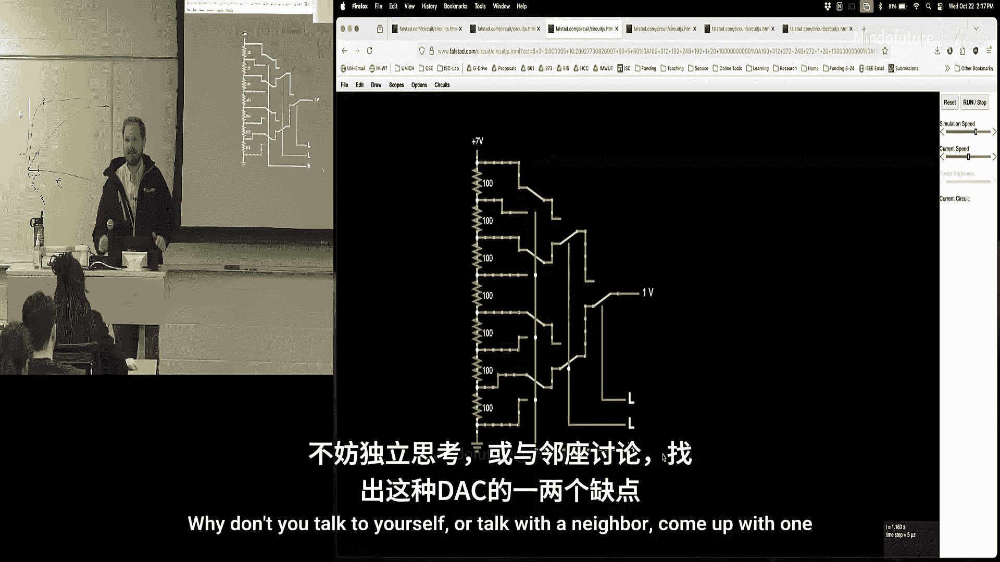

When you talk talk with a neighbor， come up with one or two drawbacks of this type of D。

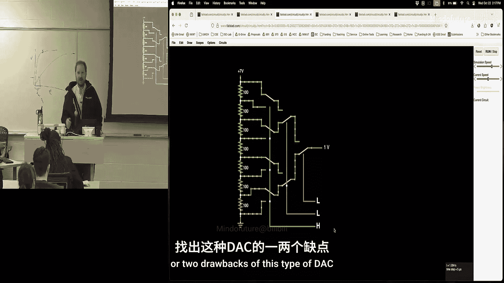

では。ItSo simple it's a drawback and it's another drawback。二万。You got a sword。

more values you have that。没所。ManessAll of the resistance is from these。because of your multi。

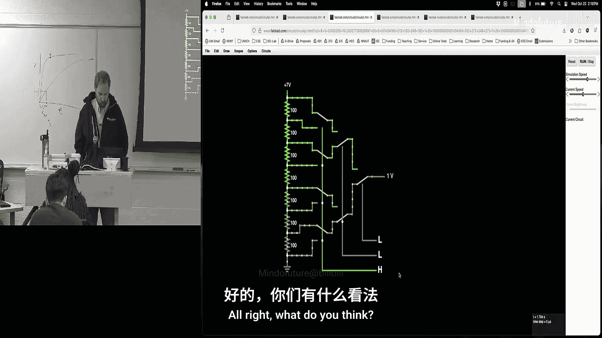

Did you got him， right？All right， what do you think what are some drawbacks of this type of？Dak。意で。

是具具体吧。Actually you see all these resistors that are supposed to be the same resistance。

We see have to make sure that sort of。Between like getting all those larger resistors in。

Yeah so while manufacturing this all these resistances have to be the same or as close as possible which is not trivial it's the task I mean it's better well we'll show this better than trying to have precise values but it's still hard to do what else saw a hand back there yeah was going say there's components Yeah a lot of components a lot of resistors right so the resistors make up area on a chip and area cost money so this one would and you need a resistor for every single output value you have so you're trying to get a 12 bit D that's a lot of resistors right so now we're getting prohibitively expensive to make a DAC and this style that has a lot of bits but what's at an advantage of this one。

是嗯。Any of them it's fast right within one cycle guaranteed as long as you can as fast as you can shut this gate。

 you can get the answer out， so one cycle you can get kicked versions。Any other trade offs？不。

I see I don't know why we got speed， area， linearity。I'm sure I'm missing something。

Complexity takes a lot of switches， but only one op amp， which is kind of nice。

 but a lot of switches， okay？ALo of resistors， all right， so there's we'll go forward。

So what happens if you took one of those switches and switched more than one switch at once is it seems like there could be some advantage there so we can look through what that would be。

So you may remember back to 215 we had this thing is terrible I know it's terrible there's suming amplifier magic box here and remember what this does。

 a suming amplifier says I'm going to sum the current essentially going into this node so sum this thing plus this thing plus this thing I'm going to give you a proportional value over there very nice so here's if you have those resistors there here's your equation basically I'm going to add voltages together so this is like you know an add block in analog。

And we can just look at try and get an intuitive understanding of that。

 we don't have to get through all the details but。Essentially， oh， you can't see that， okay？

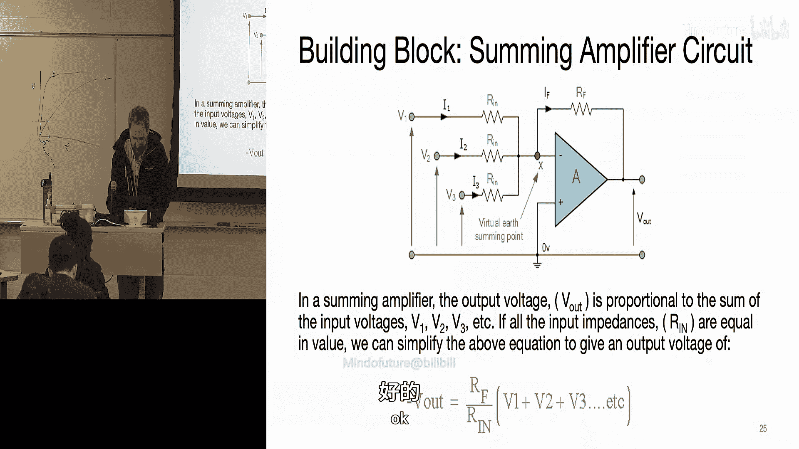

嗯。So these are just two time variant functions， one's a square wave， one's a sine wave。

 you know typically you're just thinking about a DAC putting out one value at a time。

 but this is just showing you how a so many amplifier would work and it could just be two DC values but all is happening here just to convince you how a som amplifier works we have a sine wave plus a square wave and this is just the superposition of both signals on top of each other it's sum the two signals together magically I promise。

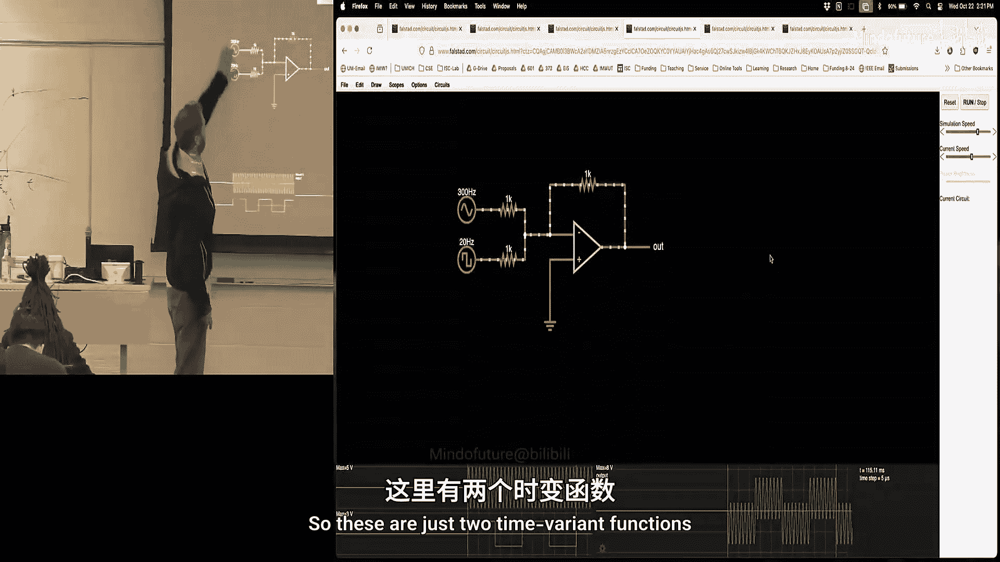

Okay， how do we feel summing amplifier just takes two values。

 digital or analog values and adds them together again。

 this doesn't have to be sine waves it could just be two DC values you could do it point by point okay so that's how summing amplifier works。

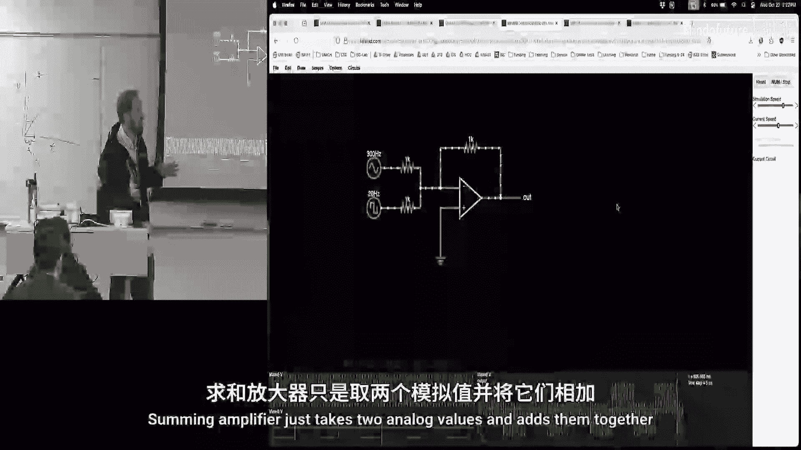

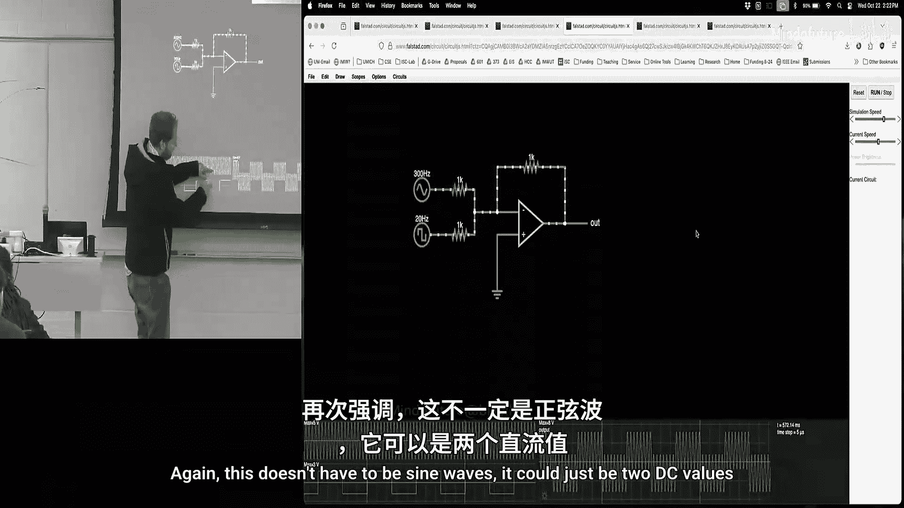

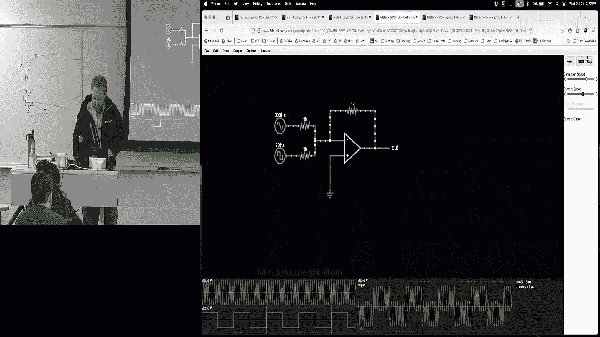

So we're going to take that basic building block and we're going to make。

They call it the R by 2r ladder or R2r ladder， oh， that looks horrible and my screen。

 but basically we're going to have a structure here with multiple resistor paths。

And current pass and we're going to create the structure such that current is divided equally so we have half the current reference current a quarter and  eighthth 16th going down and then we're going to combine these different amounts of current together to be able to get an analog value out so I can take half a reference current value and a 16th of a reference current value to add them together to make up a particular analog voltage and so now you could also just look at this reference function here and you're saying here are the switches and I'm just going to say is this one or zero if it's one I include this term。

If it zero， I don't include this term， and now you can see how you can combine all these values。

Into an analog output voltage。So this is nice， let's go through an example。

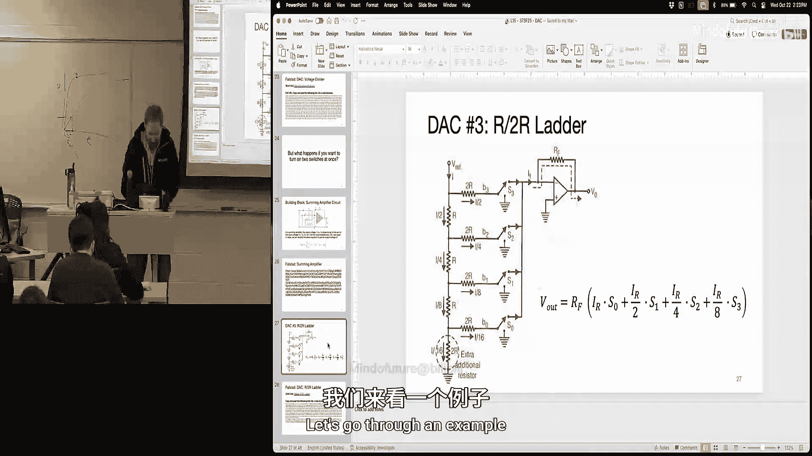

就。So this is just a different reconfiguration of that and you can kind of see this voltage or current division here in the circuit set。

 I'll set up the system。This is approximately going twice as fast as that。

 maybe this is going half that， half that， you could actually we could calculate it out。

 we could look at the actual currents and figure out if that's true， what have we got here？

Yeah it's about right， what is this1 60 is about 180 or sorry， this is 80 microamps。40。

So on so forth and so now we're going to take those currents and we're going to sum them at this node to give us a proportional voltage out。

 so now we've been able to reduce the number of resistors that we need we didn't need a whole resistor ladder。

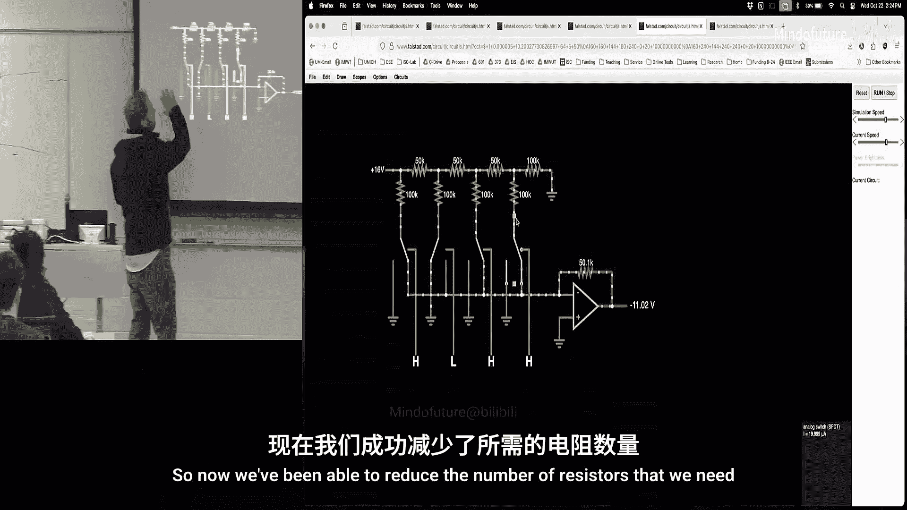

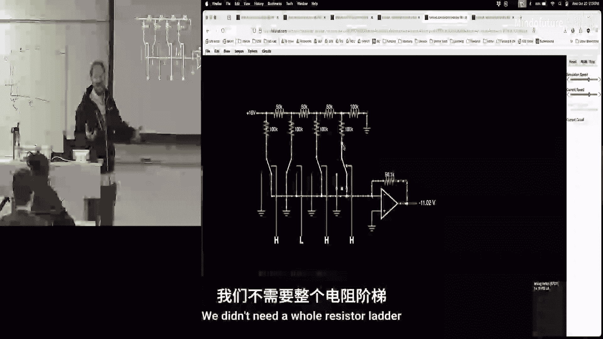

Because reuse we can use multiple resistor pairs at a time to sum them together。

 get us an analog voltage， so now we're using less resistors。What question do you have yeah？

is your voltage ne。H students smart students asking questions because that's it when I were trying to teach something I could show you the whole thing we could buffer it and I can make a really complicated circuit sign that gives you positive voltage it's horrible。

 we don't want to do that this makes circuit too hard this is kind of like the classic way to show this trying to get the intuition not trying to learn how analog circuits work nobody wants to know that only he wants to know that。

You just want to get the intuition that hey， I can have these currents。

 each one of them is half of the previous current， so I have all these different current values to select from。

 and then I'll add them together by that equation and it's going to give me a proportional output voltage and that allows me to have less resistors。

Or what would be a disadvantage talk with your neighbor。

 come up with some disadvantages for this method？Yeah really and complicated。 That's' 50。1。also。

 it's like。What's the question if kind negative to the ground and positive but circuit complicated tap do you don't need to go full scale which inverts have a negative rail like voltage。

don't look at that negative sign so this is the idea right so I can go change this value here。

By switching these things at different switches， I can change the output value。ますか。

I should have said that before， watch this， so what's a disadvantage of this？

A we see any disadvantages？It's like， I you know。Would this be easy to manufacture or to manufacture。

 it's complicated， it's complicated， yeah。Har manufacture。

Hard I manufacturer here we need to have some resistor values here that are proportional and sure it's not all the same resistor value。

 I need to have two resistor values and make sure that all of them are precise。It's not that bad。

 it's just two different types of two values。But it's still harder than the other one to manufacture。

楽します。Any other advantages or disadvantages？Yeah， is it possible that the current consumption is higher than the other option？

一万这些。That's a good question， I think typically you're going to have these analog circuits they're going to be in like the nanoampmps。

Peco amps like it is definitely higher than the other one is it on a system level pretty appreciable。

 probably not i'm going to say probably this or the compare opt a here I mean is probably higher value than these so。

Approximately same。Yeah， it's like 10 cents more expensive because you have to pass it through an in you want a positive voltage yeah it could be a little bit more expensive that one will say we had the other one should have had an at least an output stage on it so but yes。

 the real thing would be gets more and more complicated to get this thing to be a positive voltage。

Okay， so whatever are the disadvantages， I say is going to be harder the manufacturer is still nice。

 one advantages is ready immediately， that's nice， right within one cycle。Okay。

This one is more efficient in terms of how many resistors we need so we can get to larger bit values easier than we could with the。

With the inverse of the flash， I forget what we call that one resistor ladder version。

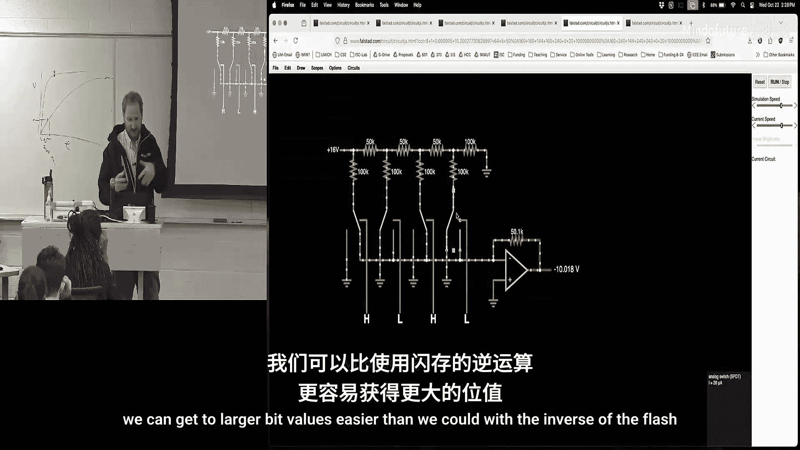

Okay。And we'll go to the last one here。And this one might be。

Might feel almost exactly the same instead of having those two resistors。

 we're going to use one resistor here to create that current and each resistor is going to have a different value and it's going to be R divided by two by4 by E。

 so instead of having two resistors we have one resistor。

Which is nice okay and here you can have that transfer function basically walk through this and kind of figure out okay here I use D instead of asset switches。

 but here's you put a binary value in here and the big idea here is by using ratios of resistors we're able to reduce the need as we're reducing need for as many resistors so that's valuable。

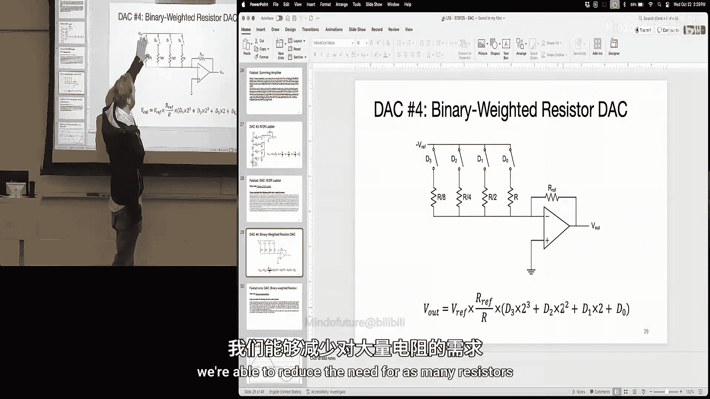

You can look how that one works。And this one simpler？Right here we just have our voltage ratios。

 we have some digital voltages coming in， this is either going to be one or zero and then。

By selecting some digital value， I'm able to change the output voltage so simpler。

But I'll just give it away the disadvantage here is that。

Now I have to manufacture all these different resistances。

And making that on chip is hard maybe it's easiest to make one resistor value on chip and make them matched across all the resistors that's the easiest but then you need a lot and here you need the lowest amount of resistors which is nice but you need to have multiple different types so now we have this scaling problem of like how easy is it to manufacture versus how many how big my D can be so this would be I could scale to a large bit size but I'm going to have linearity problems。

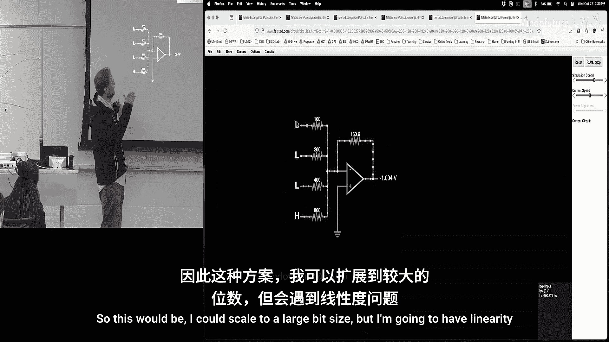

And then the other one， which is， hey， oh。The more extreme version here is， well， I am very linear。

 but it's hard to get that large bit sizes and then。In terms of that trade off。

 this is somewhere in between where okay， I only have two resistor values to get in a ratio。

 so this is a little bit easier to manufacture and I can get to somewhere in between in terms of absolute bit values。

So what questions do you guys have？Yeah。speed number is like a considerable thing that you have to。

Of how fast， like how this would be slower than。Can you just say that again， S in this case。

 since you're having to flip a lot of switches to get the value one， it'll take more cycles。

 is that like a considerable amount of time that that takes？

I think you can all do all those switches in parallel， they don't have to be sequential。

I don't think it's， I think they're all one cycle。All right。

 so I don't know are this the printing got messed up， I don't know why got put on the next column。

 but it doesn't matter work with your partner try and think through the trade offs between。

These different resistors urge sorry that these different stacks。Yes。this。Oh。Pテ。没有事。

Lots of students here saying。嗯。It line of。For。I don't like。Okay。Okay correct。Last time。

 he said music。Com not extra。す啦。Thank you。You guys need one more？Yeah right。Yeah。Pro。You got one。ま。

用户有定的。had people doing it。三对这个。Well， I'm actually're not making any it's starting to though。

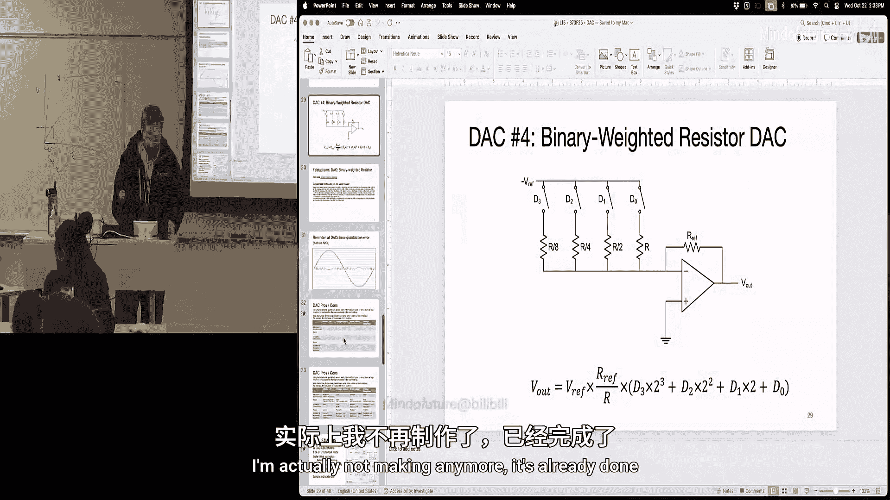

PWN you have binary and you have like four resistors and if I I like I can just do。

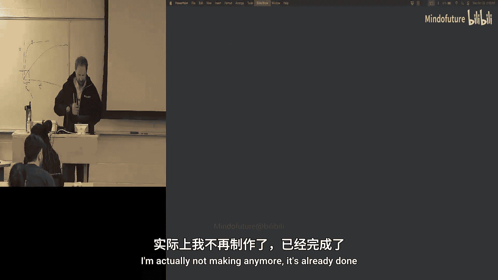

Nobody would know like everything's automated I just it's all not one cycle is resolution just very fast what did I say。

But same， same， same same。I kind of agree with me can us。But。

 that was the hardest concept it depend on the baby on the talking。这是一次第二个。' oclock switch。

We just submit one does， it's magic or same have like this is the only reason this one might be higher。

😊，Okay， well what generator is very bad？Pow。you linear is many'。I homework'。what。

I't realize binary the resolution divide to of resist to get high resolution I can't predict so for the same area I can get resolutions with this version。

 it takes less。that makes sense。resist think worse for the same area。 Okay。

 what do you mean by anythingqui high power that or design itself。Yeah。

There's one problem that you can actually get20 and not having it is really simple。

 But you said it's the hard an action idea。L is the phenomenon。

but maybe the new I guess it's all the same。いこいて。All right。

 let's go through some here how about we'll start with resolution and resolution。

 I mean like bit resolution， like for the same area。

 which architecture is likely to give you the more possible bits of resolution。

 you know which architecture gives you bigger range， essentially， what do we think？

Well we we'll range is where our biggest depth field or bitfield， let's look at binary weight。

 when you think about these three。Which one gives you the highest number of bits for the same area。

Yeah， binary weight and if you look through you just need you need less resistors to get the same thing so that's a benefit there and then it is the R2R ladder。

 you need twice as many resistors， but you still get better value than this where you need one resistor for every possible。

Every possible division。Now， this one is almost not comparable to these， a slow pass filter one。

 so what's the resolution I know I said medium。I don't know。

 it's also like this is noisy from a time point of view。

 so there's probably weather ways to really maximize the performance here。

 but I'm going to say a cool star there because I don't think it's really comparable to some of those things。

What about speed？死逼。They're all the same， anybody have a slightly different opinion。Also。Okay。

You're saying this ones slow what about these they're all the same I agree with that one。

's let's see what past me said。Okay。I say that these are all fast because it just takess one clock cycle to close those gates。

Right so you're just switching between different analog voltage values and so let's just say it gets done in one clock cycle。

 this one I'm going to say is extremely slow because it takes many clock cycles to create a PWM remember PWM you have to have a timer with you got a clock that goes in then you got a prescalear then you have a timer that's going off and every once in a while a timer goes off to make a PWM go high or low so if you think about all the complexity all the time it takes to make a PWM signal and the fact that you need multiple clock cycles for your low pass filter to settle down now you say this is extremely slow compared to these。

Anybody believe that？Yeah。Some people believe it。Some people think they're in the wrong class， okay。

 so don't worry， last analog class。Linearity， what do we think。

 let's not worry about this one for a second， how we think about linearity and by linearity I mean the likelihood that you put a digital value in here and the transfer function to the analog value is linear as you go through your digital space。

 what's the likelihood that you'll have errors。of what do you think for these three design。

 which one's the most error prone？Yeah， the binary weighted because you have to have all these different resistor values and that means that if you look at the binary to win it was like half R or like there's R and there's half R and a quarter R and eighth R and a 16th R going onwards and now if there's a little variation like maybe it's 16。

5 for that last one and they're not all perfect ratios of each other。

 that means that your transfer function is going to have a weird steps in it so this one's the hardest and most complex to make in terms of to manufacture and get good linearity。

 what about these two what do we think here。Which ones has the best linearity about these two。

I would say yeah， the voltage divide version does because this one is the same exact resistor if you're good at it doesn't even matter if you make a 100 ohm resistor and you're off by 10 ohms。

 it doesn't matter as long as you're off by 10 ohms on every single resistor。

 that doesn't matter and it's easy when you're making silicon to have one device manufacture exactly the same each time。

 it's easier than trying to make multiple devices or multiple resistors all exactly a particular value。

All right， so what did I say？What did I say？Yeah， that makes sense R okay。

 there's the ratio and this ratio event， okay， I agreed with myself。

I should have said that this one is linear is lower than this one， I don't know why I said medium。

 but I would say that this one's lower than this one。And then linearity， this one's horrible。

Just because it's already varying so much。How about power？Which is the best Yeah。

 you're missing complexity in between。Oh。哦。Well， fine， oh boy， you're right， I am。All right。

 well for power that this is low why don I say this is low power。

 oh because this is all digital and this does need analog stuff。

 but I said these are probably in the grand scheme of things power about the same amount of power。

 I mean there are slight differences that this has more this has more past the ground than this does but those are pretty small。

 each have an opt on the output， I'd say this is just all digital， probably the lowest power。

All right， yeah。whyhy is low power。There's no analog components in here whatsoever。

I guess you still need an output drive off a， no you don't even need you to see your GPO pen。

 either driving high or low。Don't need a comparator， you don't need an op amp。Yeah。takes a lot time。

Why is time important？I mean， yeah， I guess you could say it takes more time to get there。

 but given time the same amount of integration time for everything。

 let's assume that so you know microsecon for here and microsecon for there。

I'd say they're about the same I'd say this is lower power than that。All right。

 we'll get the complexity last。I don't know where complexity went， number resistors。

This is nice because this is extremely low， you just need one external one， you don't even care。

But here you have， it's good to think about the resist number of resistors you have。

 the number of switches you have and how this decreases。

And this is really the thing that's causing you cost is a number of resistors。

 maybe complexity as well for the number of switches。what did I write for complexity。

 just complexity， I just said complexity randomly。That's good。

Which one's the most complex then we'll take a vote。What do we think？And what do you think。

 is this the most complex？W to raise your hand？Anybody put this one？Yeah。How about this one？

This is more complex than this， this one had horrible multiple resistors I didn't understand anything in there even this one has less resistors Yeah。

 I would say the complexity these are both approximately equal voltage divider I felt was easy to understand。

Proably hard to manufacture， and then the complexity， guess for this one's probably the lowest。

All right， three minutes。There's a DAC on your device， I'll blast this。We have two dacs。

Eight and 12 bit output modes。You can buffer the it's actually there's a calibration register that tells you what the offsets are so you can make sure you get an accurate output voltage there's actually a sample and hold mode which doesn't make sense what does that mean because you're not sampling something what it will do is you can output an analog value there's a sample and hold circuit on the output you can put the entire device to sleep and it will hold an analog value and then you can wake up update your analog value go back to sleep if you needed that if you cared if you're doing something really low power they're given you all the tricks now I got two minutes left don't go because I got to teach you something I promise。

This has the same quantization error， same inherent problems that the ADCs had。

That you're going to do this thing where you're going to do this offset。

 they do the offset over things so that you can get advantage of the highest bid in your quantization error。

 how far off you are from desired your analog value is from your desired value is going to be1 LSB。

And I guess these are for all now we're getting into the。Both ADCs and DAX。

So if you're looking at error functions， what are the causes of error。

 what are the types of errors that can show up， there's offset error。

This could just be that some of those like the foot or tail resistor of a D or an ADC is off and now there's an offset on it。

 that one's pretty easy， this one you can just calibrate out。There's a called full scale error。

 which is the slope is off your function to can calibrate this out as well。

 maybe that transfer function isn't linear because of some manufacturing error。

 you'll find that there's some offset error。The one that gets really hard is differential nonlinearity。

Basically the step size between steps isn't the same and that would come in when that DAC if you looked at those binary the binary weighted one where the resistor values were slightly different。

 you can actually get different step sizes and that doesn't sound like that big a deal。

 but there really are DAs that you could actually have such an error。Where it's got a negative。

Arror where actually this output value is greater than this output or smaller than this output value。

 even though the binary bit is higher， and so if you're ever doing controls and you're trying to control something with a DAC or an ADC。

 understanding the error types in your thing will affect your control loop because now you could get stuck in this local minimum。

And then the last one is integration error where this is kind of like offset error。

 but you can say that there's a bias in part of your ADC ladder。

 which is pushing you up and now you have some integration error。

 which will make your ADC control loops bad。And so the last。

Cycle it's just good to know that these types of errors can exist and how will it occur well if you're doing an FFT of something which will happen。

 your ADC is sampling stuff but you're going to get all these harmonics off of it even though you say these harmonics don't exist I take my analog pro bow right and I measure the signal I don't see the harmonics but in my data I do see the harmonics that can come out just because of your ADC or your DAC is causing the problem because your hardware is imperfect All right。

With that。I'll let you go。Just remember， you just have to know the basic trade offs between the DAC types all right。

 thank you。

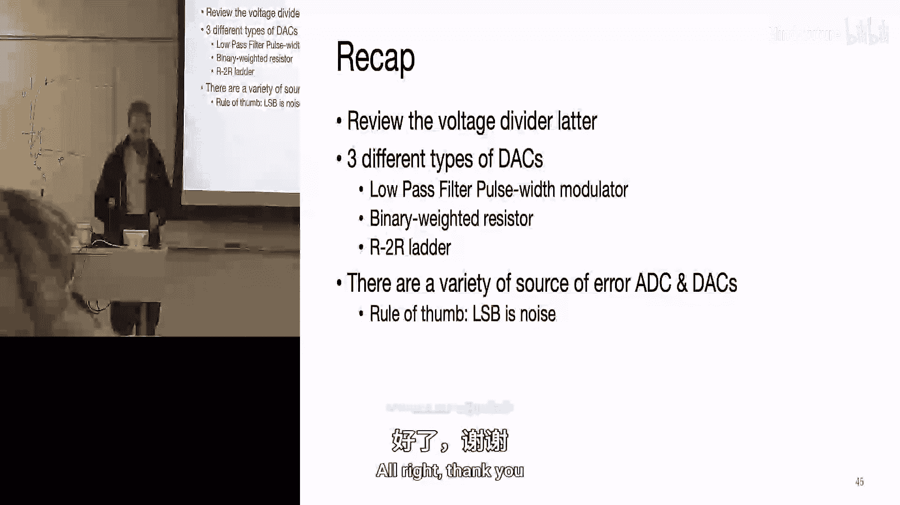

Yes。Oh， please turn in your。

