# 【密歇根大学】嵌入式系统设计导论-EECS-373-｜-Introduction-To-Embedded-System-Design-2025-p16-P17_课程14_模数转换器--BV1VTSNBoEem_p16-

All right， welcome back from break and from your project meetings， we're going to get started now。

All right， so homework is due tonight we'll have office hours， project resubmissions。

 so many people are asked to revise their project proposals。

 please keep the original copy in your drive folders and put the next version in there so we can look at the difference and see that you've improved。

We will grade the second version。Any questions there？Oh wait， these are not correct， well。

 they didn't get updated。You can't get downloaded from Dropbox but these aren't ready yet。

 so don't worry about them。Homework assignment sevens been released and due。

 we have exam next Friday and then student presentations。

 Ill assign the topics this week they'll be ready for next class。

 so they're not actually on the website right now。All right， any logistics questions？

You guys are like spread out some weird way， okay。All right， so last time we met。

 we were talking about analog signals in general and how we were going to convert from this analog world to this digital world and really what it was about was this。

 I call it like a binary ladder， we have voltage on one side。

Binary values and the other one and you're trying to make that transfer function to go from some analog value to some digital value and this isn't something that you necessarily have to remember the equations for you should be able to reason it out for yourself although you know equations are helpful when you're starting out so here we're just saying what is the equation that allow us to go from here to there and so we gave you a couple examples。

Here's kind of like an idealized ADC function here where we're saying， okay。

 we're going to discretize this up into steps， steps that are two to the n minus1。

 and then we have some voltage range here still didn't update those values。

You think get updated from Dropbox and you go over the problem with this model。

 although it's probably the simplest is that it's nearly impossible to get the value out of the highest bit。

So the way we get around that is almost all manufacturers will go and slide is over by half a bit so an LSF half a least significant offset。

 it does mean that this is a little bit smaller， it's not full bit with here。

 it's not full bit with here， but at least you get the full value out of the full range。

 and then this just means that you're going to offset this ladder by half， a half by half a unit。

And then you can get the equation here， and both theses show that you'll be rounding down。嗯。

Any questions here， yeah？Okay。You guys could just move the desks， I don't mind。

 they're not going to bother me at all。Okay。Yeah。And then we talked a little bit about resolution here。

 we mean the resolution of a bit how for at least significant but how big in the voltage range is that that's usually a key function for your ADC to understand how accurate it is or how good it is at measuring small offset errors。

 small offset， so that's suggest you take your V reference here。

 the equation is assuming that your negative rail is at zero and your positive rail is in this case five volts。

 then you divide it by to the end。And if you want to be more precise。

 oftentimes you'll see this equation in your data sheets and the more precise。

 more technically accurate one is that one， but given that the bit widths are usually pretty large。

 say8 bits to 16 bits， it doesn't really matter even 24 bits。

 that last one step is usually not that important， so you won't see it necessarily in your data sheets。

All right， any questions here？Does anybody remember any of this you were here last two weeks ago？

Not a chance， that's fine， I have a worksheet。We can all experience this together。

And I'll give you the primer for the worksheet is oftentimes we think about a physical phenomena that happens in the world。

 there is some black box magical function and what we want is engineering it out。

 whether it's temperature or air pressure，Whatever it is you want some function out and so in the embedded systems world。

 we have physical phenomena， you have a sensor， a sensor is a transducer that takes a function。

 you know some physical phenomena and converts it into some other physical phenomena in our case it's going to be voltage or current。

 we have an ADC。That gives this ABC counts some units， but not necessarily anything in SI units。

 and then you need to some software to turn that into engineering units right so basically I'm going to tell you what this I'm going to give you this。

 I'm going to give you this， you guys have to tell me the equation that you right here to give me the engineering units out on the out。

So on the screen， we have a very basic。U。A very basic temperature sensor， so there's three value。

 three twins， ground VDD。And an analog voltage level， proportional to temperature。

And then that's the real you know， that's a real graph from a data sheet that shows you what the transfer function is。

 so it's saying you will get a voltage proportional。So this is if you we're looking for slides。

 this was in last week's slides。You're going to get an analog voltage proportional to temperature。

And so your job is to figure out given an ADC， a 10 bit ADC。With a voltage range of 0 to 3。3 volts。

 what is you know， how will this function so first one is to figure out the reference。

 the minimum set size as a 10 to ADc。Then you'll go through and figure out a transfer function and then calculate out。

The temperature for the voltage degree for50 volts。All right。

And this is like super similar to what you would do， you'll do it for your projects。

 if you have a temperature sensor or what you would do in industry。You're just hanging out， okay。

 he said I'm out of this class。Some two more。Yeah。One worksheet that was。Should。Yeah。I like。9%。

Can you say。018年其实。Ase that the maximum ballot half is voltage。Prossor is one。

Is how I don't want to be as awkward about the workshes out。How are you going to get started？So。

 it' speak anything。' not value it just， can't go past that。03。

 the readingThe minimum reading is 0 they gave0。I my。I have of outs。你什么痛。

So we're applying the resolution for part one is asking you what's the smallest step size in the analog voltage range you could possibly measure so you're going to take your voltage range from here to here or in your case its 0 to 3。

3 volts and you're going to set it up in small little steps right what are the step sizes？Two c 10。

 right steps。And you'm going to say what's the smallest step size and voltage I could possibly measure basically we're asking the least significant bit what's the voltage size for the least significant bit of your ADC this tells you how small you can get it if it was really coar it may not be a useful ADC we're trying to figure out how small it can possibly be and here we can as visualize for this thing one step size is pretty big yours is going to be a much much smaller。

II'm saying the two the9。 There is a two to 1。 yes the two to 101。it one。

Because then you drop to a mineral give this value recently。right。I'll take my$2。

000 and I just rewatched them ball get back to a really。

divided by three points myself basic physics guys took physics。

taken resolution reading time bit from here and convert it back to I think the easier way is to convert first back to voltage back to voltage multiply by the they just to yes。

 is。I。If this stuff only't exactly right again， with's cYou multiply by210 minus1。

You add that function I do have one， so don't worry， what do we get for question one？Yeah。

ach talking okay， they get something similar。Three， two， one millivvolts。Here's what I got。

We have our rough voltage and then we're going to break it up into steps。So 3。3 to zero。

 otherwise you'd have to zero minus your high， so let's say 3。3 divided by this equals 3。

22 millivvolts。If you did more exact one， I don't care。

 you could do minus one and get it'll sell you more exact answer。

 but you're already seeing like this is a pretty small stepsize milliv volts。

 I guarantee your system' is going to have more noise in it。

 you'd have to work really hard to reduce that amount of noise。

 but this is the smallest step in voltage that you could possibly measure。No， we believe that， okay。

I believeThank you， one person。ますか。不是。means get the from the ADC voltage firstsp voltage generic。

Thank you the first by the post。Yes wish。Yeah， you said you do that， but you。

2 finishing with us' haven。That that's my。My first guess was this is actually's on's I got the。

what you can hear basically right， and we need to invert it。

All then here's the equator for the ADC values， okay？And you go and manipulate this around。

 you combine the two， so now I have some ADC values times two to the end。

 I guess that should be actually be a number because that should be 10 this will give oh。

 I'm going to do it next next build， there we go。So now here's our transfer function。

 I get a temperature is proportional to some ADC value。

 given the architecture of that ADC and the transfer function of that。

 meaning I get some ADC counts here and outcome a temperature。是。あれ点。取消。等到你两个。Now you can go through。

 you can through， go through this value， I'm going to put two to the 10 here。

 I'm going to distribute that through right here。I don't know， can you do the math。And的。老他。All right。

 what is the value， anybody do the value at 50c？嗯明。Maybe see value， yeah。好。那啊。361。361。

 anyone get 361？All right。I got some people you， I got bought 2010 hands， at least it raised。

Anybody got something different than 361 or that what he said？All right。

 we're going to assume that my slides are right this year。Ha we lot people agreed。

But what sampling frequencies should you use， it's not not yet been given the tools to calculate or determine what exactly the right frequency is。

 but just knowing this temperature， what would be a good and reasonable choice？Yes。One hurttz。

 hurts can be fine， right， temperature doesn't change that quickly。

So like somebody said 40 megahertz。That would have to be like the experiment is you have a piece of steel with a bunch of temperature sensors on it and you shoot it with like a petawatt laser and you want to look at the heat gradient of that heat front pass through your sensors。

 maybe you need 40 megahertz of sampling rate， but heat transfer is pretty slow so one hertz sounds reasonable to me。

あ、ちご願すたね。So。1 hertz1 hertz or faster should be fine you can probably do one minute if it's like a。

building heating cooling system yeah to do the plus one half for three because it's the graph like oh here because is it offset that's a fair question because I did the plus1 half and got 361 but without that I got 36' 60 yeah just off I guess we did specify what the architecture and if this manufacturer did the offset。

 I would accept either answer if your freezing was correct but you're already seeing that the delta is pretty small right。

Can you go back to part two， I'm just lookingre how you related ADC back to the equation。

I got two equation I got the this is the rate for temperature to voltage transducer right and then I have voltage theta ADC transducer transfer function right and so now I just do simultaneous functions so I substitute VT in here and then I went and for T temperature I got that in terms of ADC counts then your VT heres just v minus BL right which is just V temperature that's V temperature V ref is 3。

3。These will be posted in tonight I the re non redacted slide so you walk through it any other questions the insane is like why why would anybody do this？

Be your jobs one day， promise， be happy when you do this one this fits an easy problem no this guy says no。

 theres now this will not be my job。I。her。我是そし。高位。So last lecture was like analog signal review。

 we really didn't talk about the details of ADCs or DAACX， and we just did our conversion exercise。

So now we'll jump forward to ADCs themselves， so there's the ADC， this is the reference manual。

For your particular device and then the embedded systems book has a relatively good section on ADCs。

 although they don't really capture different architectures for ADCs which are important to realize so we're going to talk about sample and hold circuits three types of ADC architectures and then we'll talk about the ADC that you have on the STM 32 in lab So again the idea here is you're making essentially a really simplified version of a slloscope really the only differences are the sampling speed。

A 10 bit ADC is not that that that much right sampling speed。

 but also this thing is really low noise and accepts voltage ranges from a really high range。

 so I think this is up to three well it will survive 300 volts。

It's probably 30 volts plus or minus but otherwise you know the technology in here is not significantly different than your microcontroller。

 in fact you can go online and find these little pocket size analog digital converters like little credit card size and there's basically just a microcontroller inside。

All right so at the beginning here we have a sample in hold circuit sample in hold circuit's job is to let it says sample and hold the analog value and that's because we'll find is that some of the architectures that actually digitize the analog voltage take a while they take time and especially if you're measuring something fast you need a circuit that will hold that so here this year your analog in this your analog out and then you have some clock here that will close this gate and essentially this is just supposed to show a buffer and this is an analog buffer and you don't really have to know how this works I'll show it to you in fall out in a second but basically you're going to store the voltage on this thing and then is hold it here for a while until your ADC is done。

Yeah， and I said all that more or less。In the real world。

 sample and hold circuits are more complicated just because you have to bias everything。

 but in the reality， they're not doing anything more fancy than is holding charge on a capacitor。

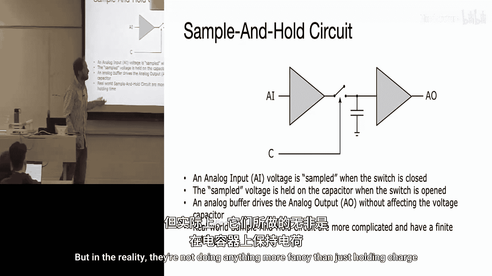

So here's an example。

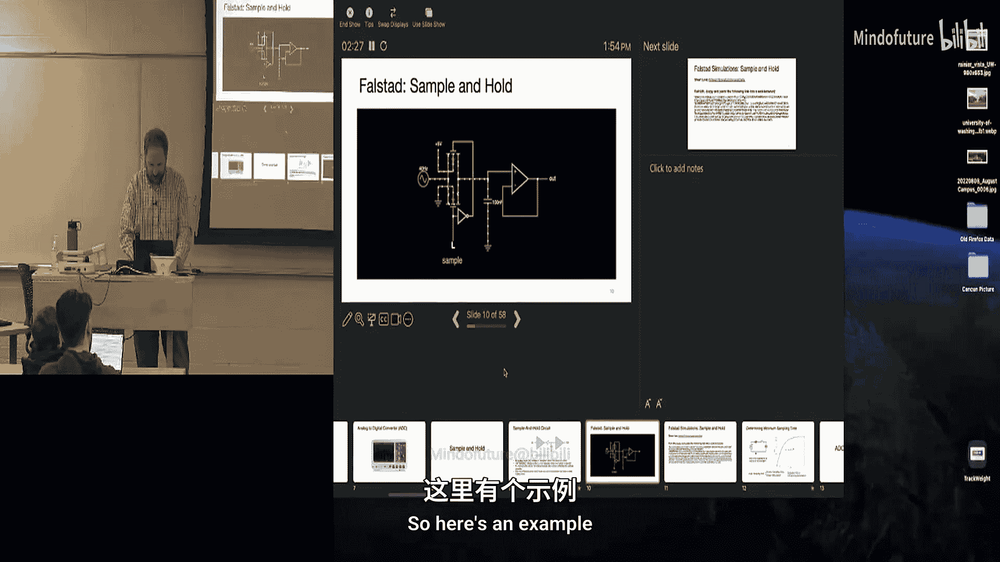

Right。No， I do not have it Fred。

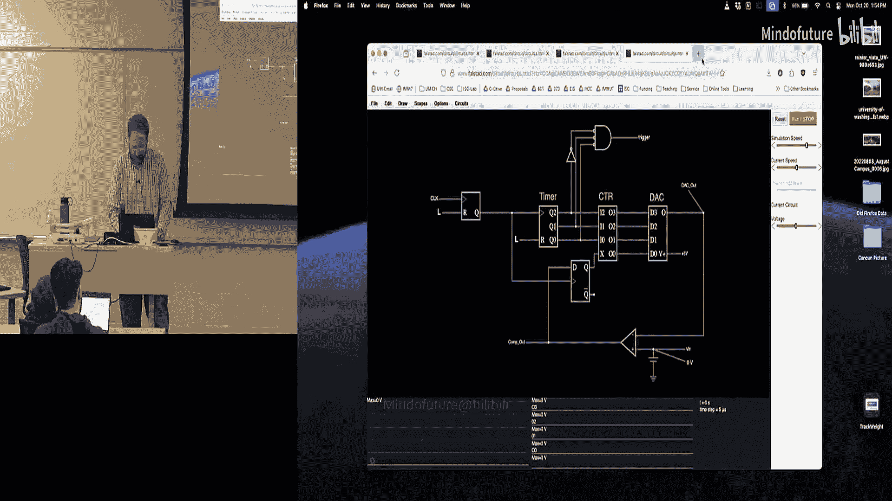

Okay。

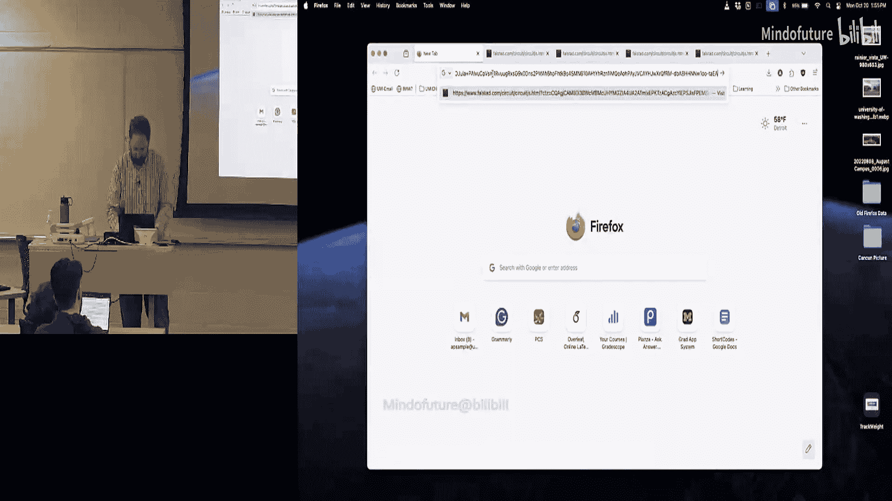

All right so this is just supposed to be a transmission gate that is just that switch here's the sample circuit and this is supposed to hold the value here for us or no this is this is to invert the other side sorry and then this is just the output buffer it's in the voltage follower mode which means whatever the voltage here is its going to duplicate out there and you could pull hard on this you could pull a lot of current out of this and the opium provides it not the capacitor and we're going to assume this capacitor is very nice it doesn't leak any current doesn't have any parasitic resistance so we're going to load this thing up and none of these have parasitic leakage we're going to load this thing up and we're gonna to be able to watch this sample on the other side and so to set it up we have some sinaloidal signal coming in and then you have this is supposed to be this output node。

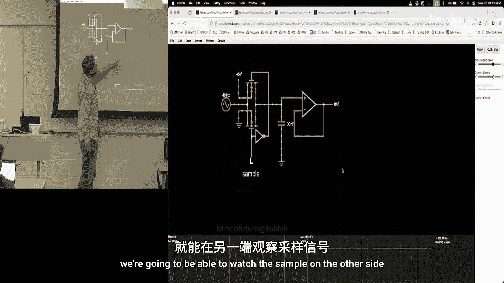

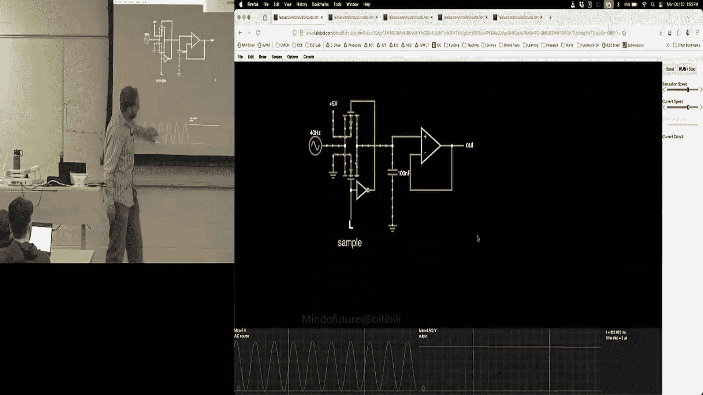

And as I go and capture this thing， I'm going to open up the gate。

 now you can see the analog volt oops come back。The analog voltage here is just passing through the gate here。

 so this is what they're called。There's a special name for them。

 but basically the NOSs and POOSs together allows analog signals to go through。

And then when I take my finger off， the sample button。

 this value is held and in this nice case it's held indefinitely you got a face like this is insane。

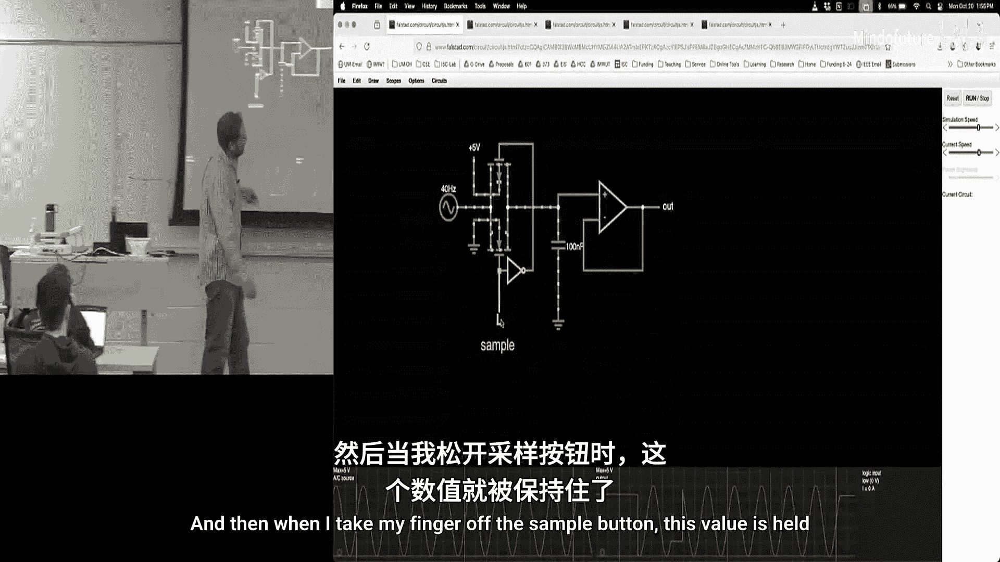

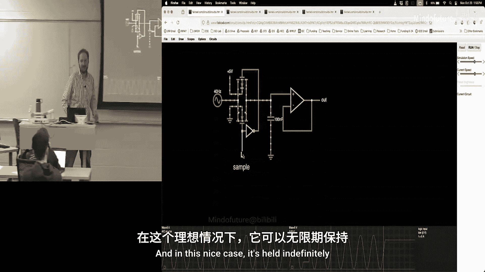

嗯。I is the Y axis number。In that graph， how do I get this number？

What do you mean the y axis and number yes？

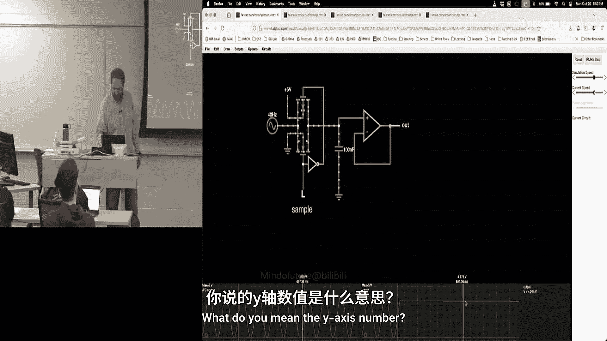

That's just the whole。Correct。So this here is this output voltage， this is the input voltage here。

 and only when I open up the latch。Or open up the transmission gate， that's what it is。

 I remember the term the transmission gate now is allowing current to pass through and you can actually see this analog voltage is paying pass through and you can see it on the other plot over here。

 these are two different plots， they're not the same plot。Yeah。Yeah。

 what does the triangle with a plus or minus do？The triangle， this is the op amp。You take 215？

Fantastic。That is going to be super confusing though。All you need to know this is a magical circuit。

 this is a magical circuit takes whatever voltage is here， whatever analog value here。

 and because it's in this feedback loop is going to hold it right there， so's all I got to know。

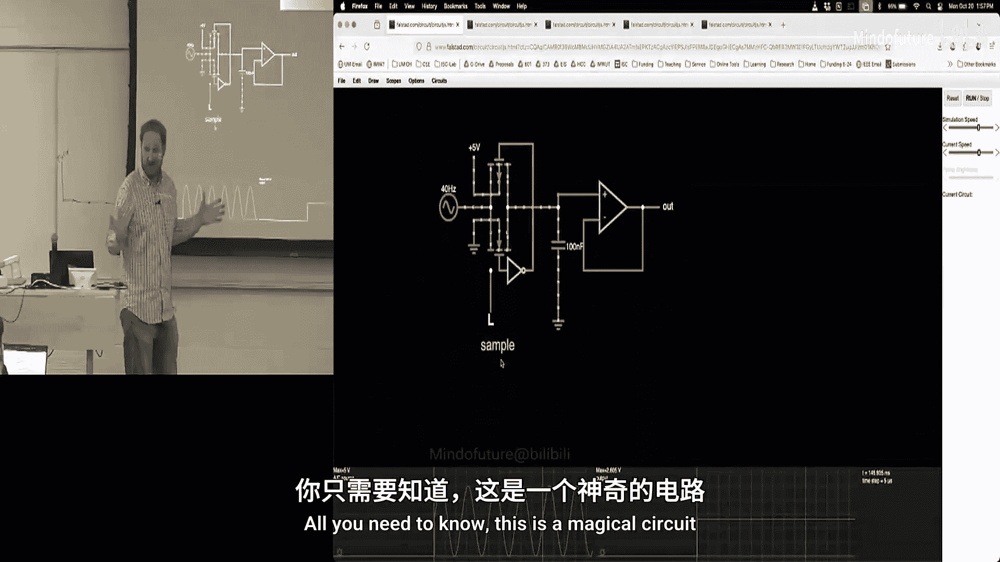

うんうん。I think I broke my thing。Yeah。Is the value held in the capacitor？あす。How does that work？

So it's just a capacitor holds voltage， correct？M board like a hired wouldn just keep getting charged。

Yes， but this is a transmission gate that only allows voltage through， so if we go back over here。

This is。This is a switch。And it only lets this thing charge up that when it's closed and it's open。

 there's nothing to discharge this， so it's going to let that signal out。Yeah。

So here I've got to open and you can kind of see I'll increase the current simulation speed and so now you canoo oh。

 that's very fast look at that。So now you can actually visualize the current coming through。

And when it's closed。There's nothing coming through and now there's something coming through。

 so in real life you'd have to sample it quickly as a capor just to resolve it over time。Yeah。

 there's some loss function， and so you're to the analog circuit signs are going to design their circuit such that the amount of time it takes for your digital system to take an ADP read is much less than the discharge rate of this。

But this way I could have a signal that's going very， very fast， much。

 much faster than I could ever sample with my ADC， and I can still capture it。

 I can still measure it because I have a voltageed version of it right here。Yeah。Soice only。かて。

OrIn the Fages Act or there for。嗯。Vage。Mine up perfectly or is sort。

And this in this ideal world where I have false tad and perfect circuits， whatever。

 when I take my finger off of this， whatever that voltage is will be mirrored over here。

In the real world。m it takes some amount of time to charge this up right so you may undercharge this thing。

 there'll be some loss factors， but those things are also things you can calculate out after you've done some calibration。

嗯。ふ。All right， any last questions for sample and hold？

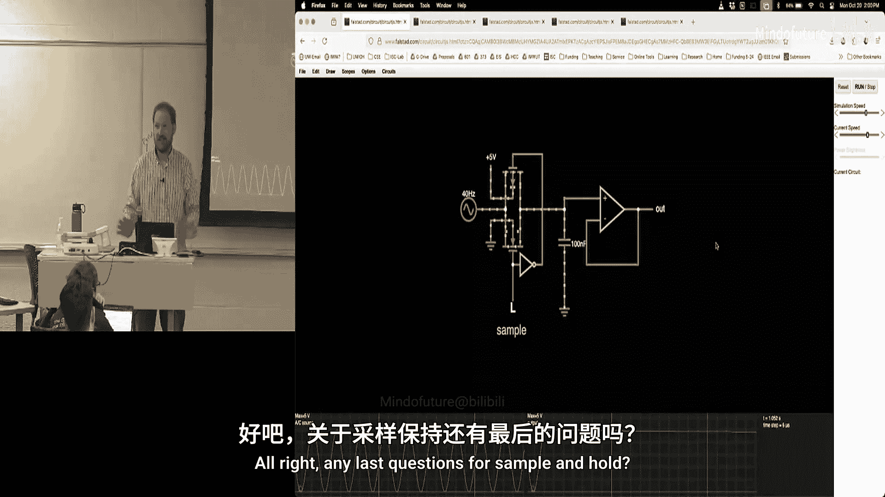

Remember， the goal is to give us the ability to capture a signal that's moving very fast。

 much faster than we will possibly be able to do conversion on。

 and there is two types of ADCs where that's necessary。

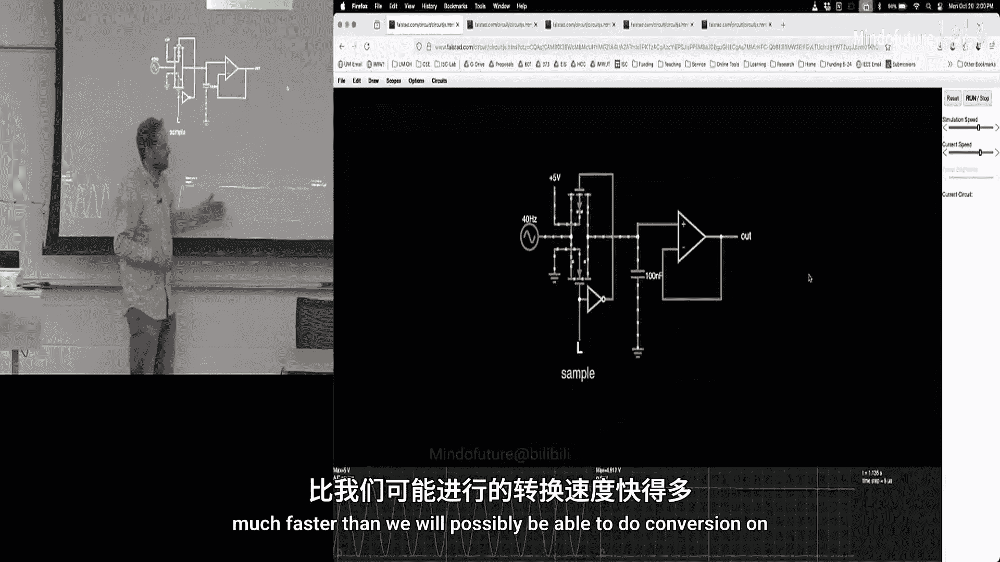

All right。U。And so one of the challenge here is this rise time is dependent on your RC charge rate so if remember from 215 if have resistor in capacitor when the switch closes it charges up and where does this resistor come from this comes from like your analog sensor like that temperature sensor doesn't have an infinite amount of current it could provide it has some equivalent internal resistance so that's going to give us some charge time now maybe you're lucky on your circuit and it's just a good driver and it can actually drive it very quickly but in the reality that there's some charge up time and so if you go much faster you'll have some ADC sampling error where say you're trying to do it here。

 you're always going to be at 63% of the max voltage now that's okay back to the question over here if I always know that I'm going to have to be at 63% of my maximum voltage I can just do an offset that's fine。

 but that is the tradeoff when sampling too quickly。

You'll find that in the STM that your sampling time is actually software dependent。

 you can set different amounts of sampling time， and that means you should probably know if your signal source has a lot of source resistance because then that might take longer for your signal to stabilize。

Is there a question？All right， so we'll talk about some more building blocks of an ac again these are not。

These are supposed to be high level， I just certainly don't want you to know how comparators work or opts work。

 but just once you know about their general functionality。

 then you'll be able to make reason about the circuit diagrams you'll see later on。

 so a comparator is a simple analog device and all it says is that if the input is greater than the output then the signal goes high。

 otherwise it goes low， it's just comparing to values。

 it's no different than doing if then or if greater than。

That sort of thing and then the other one is a voltage divider， so back to a basic 215 element here。

 basically saying here， given a voltage here you should be able to reason about what the output voltage here is and in this case if R2 and R1 are the same value which is often the case in these analog digital converters and DAC。

 then V1 is just or V out is just half of V1。And then so for a comparator， just like I said。

 usually we're going to set it up resistors and comparators together so that we have a resistor divider here。

 so we have VCC with a resistor here and resistor here that means V ref is one half VCC and we have some input voltage we're trying to ask question about it is this input voltage higher or lower than VRF and so in this part all this period of time V so this is time I guess and this is voltage and so anywhere here where V ref is lower than VCC over2 then the output is zero and then when it's over。

Here when it's over VCC over2， the outputs high and then back down again。

 so here we have a way to make a binary decision about some analog voltages given some reness point。

Given that this is a building block， if you have questions， great time to ask。

So what's your per divided reasons？Do as half of the pieces。那个。What's the purpose of dividing here。

 why not is create some other voltage reference and I could put it in here， you could。

 and then I might ask how？How will you do that and so I think the statement the kind of argument is you could just put a voltage sign here right like a power supply symbol and just do that totally could what we're going to see is this resistor structure is going to be used again and again and again throughout these other things to create reference voltages。

In fact， the number of resistors you can have on that device is actually an important consideration in cost because resistors are fairly large。

One thing to remember as you're going through these diagrams that we're about to show is wheres the plus side。

 where's the minus side， because we're going to flip these things around。

 we're going to make it difficult， we're going to try and trick you just because of how it's convenient to write the diagrams。

 sometimes these will be inverted。So lets look for that as you go through the diagrams。

 any other questions？い？新。はいはい。医。We're assuming the perfectly ideal op amps。

 we live in the ideal world， we're in falsead world。ない。As far as the terminals like the positive。

国か校と。你分钟。就是。That's only in the feedback if you're doing node voltage analysis。

 we don't have to do that。Okay。So we'll talk about our first architecture using these basic parts so we have a bunch of comparators here and we have a bunch of resistors now these resistors are making a voltage ladder they're all the same size resistors and so now you're just going to do the voltage divider over and over and over again to come out with step sizes of V refF so ReReF could just be 3。

3 so VCC it could be another value just like we did our equations last time we had ReReF was 3。

3 for that 10 bit8C here it could be some value and the lower part of the ladder here is ground it could be something else it doesn't have to be that。

And then your input voltage is going to be the thing you're measuring， yes。

Do you need two to the10 of those， yes？And now you're starting to see the problem while we might find out that that's not the best architecture。

But this is a what we call the flashlash ADC which has some nice advantages that we'll talk about and then when you're trying to get to high bits。

 we'll talk about how to get there too。All right， so the resistors form a ladder which generate evenly spaced voltages for each one of these references right so this comparator is trying to say is the input voltage V in greater than or less than17 in this particular case of VRF。

 and this is or two/7s，37，4/7s all the way up， so each one of these individual comparators is making a binary decision is the input value greater than its reference or its negative terminal。

Then you use the comparators to check all the voltages。And then you need a priority encoder。

 otherwise what all is going to happen is one of these pins is going to be high and all the ones below are going to be high and then all the ones above reference voltage are going to be low。

 and that will give you an indicator of what it is and you need some way to turn that into a binary value and there's a bunch of encoder types and I'll show you one in just a second。

 but it'll turn step this ladder structure into a binary output。Anybody have questions so far， yeah？

Because they're like one hot encoding， yeah， you could say that。

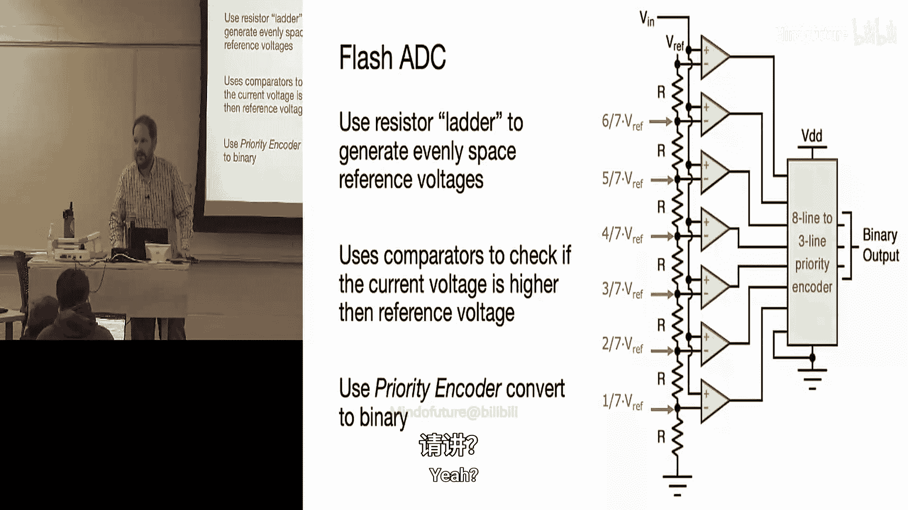

U。

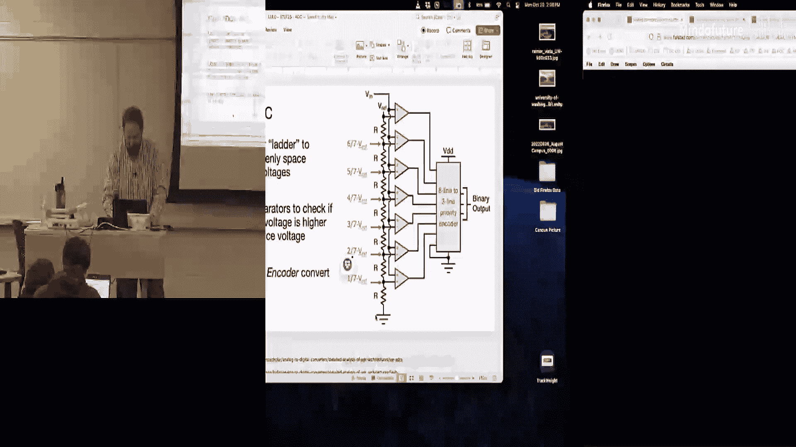

Let me go over here。R this so in this simulation， just the same thing you just saw。

 only the priority encoder here is a bunch of Xor gates。

we have AC signal or a varying voltage coming in here， just for demonstration purposes。

 it could be a static voltage here， but here is a 50 Hertz triangle wave， right coming up？

And then we can see that we're getting this binary value， in fact， because this is ramping up。

 we're actually seeing our binary counters essentially acting like a binary counter and we can see the binary values coming out of this and as we ramp up you can start seeing that here this voltage is equal to this is greater than equal to this voltage and this thing goes on than that one than that one than that one than that one and so now you can actually figure out what that voltage is just by looking at these colors here otherwise of course you could just look here and read out the binary value there。

So for instance， here we can just look at this value， it shows us at this analog value。

 what was the digital readout of those of these bits right here？What questions do we have？

This is the encoder， there's lots of ways to make an encoder。就太少。

So what do you think some advantages of this architecture are？Its fast， it's fast。

 I mean has it right in the name？

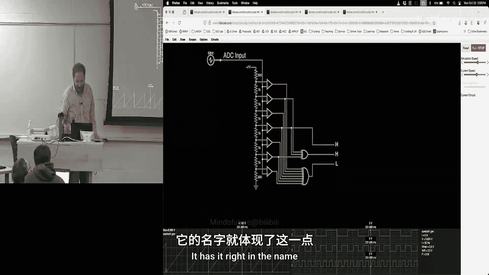

Fantastic。Yeah， you probably save power since you only need one voltage in source so that you can just divide it through。

Maybe， but we don't we don't have to reason about it really hard， but each one of these。

 you know you have one voltage ladder which has to be biased， okay， that takes some current。

 but each one of these competitors have to make a decision and they're constantly talking right every time there's a voltage change then you got high or low。

 so actually kind of power consumption could be medium， let's say I wouldn't say it's absolutely low。

Where are some other problems？Yeah。Yeah both admire the last ball bench trying the least amount of current to it。

 because it's most noisy。Yeah okay that's interesting， it certainly does。

 you're reducing your current here， and so you could say， well。

 small amounts of noise from the system could influence this point more than other points。I never。

 you're not wrong， I don't know if that would make a big system impact。

 I hadn't really thought about that if that would really be something the analog engineers couldn't get around。

What about these resistors， what's the challenge anybody think about the challenge of having lots of these resistors on the？

Yeah。Could be large， what you'll find out if you ever to integrate circuit design is that a resistor is actually way larger than a comparator。

 way larger than digital logic because the resistors usually was at poly， what's poly。

I don't even remember anymore as boy， spent 20 years since I made a chip。

Basically you have to have a little piece of metal that's round around your chip and that thing has is physically large to get effective resistance and compared to digital logic or even your analog comparators here it's much larger so now you have a size cost if you have a lot about these what about the relationship between these resistors what's implicit in this？

Yeah， they're all exact same size now in an integrated circuit that's a pretty reasonable assumption that's more reasonable than say。

If you take resistors out of a bag from digitkey or discrete resistors。

 but depending how you lay these out， they may actually have different resistance values。

 there's processing steps where you polish things， you have to do these processing steps and some of them will be a little bit smaller a little bit malformed compared to the other ones so now getting linearity where all these things equally line up and are exactly the same values actually nontrivially hard when you're trying to measure things like 0。

3 millivvolts right that's when it starts getting hard。

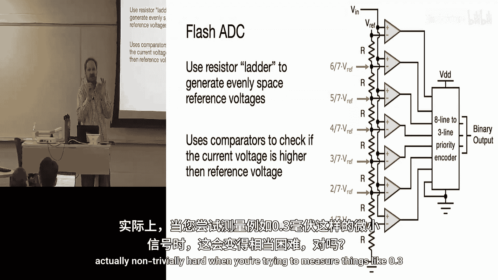

Let's see what else I have on here。

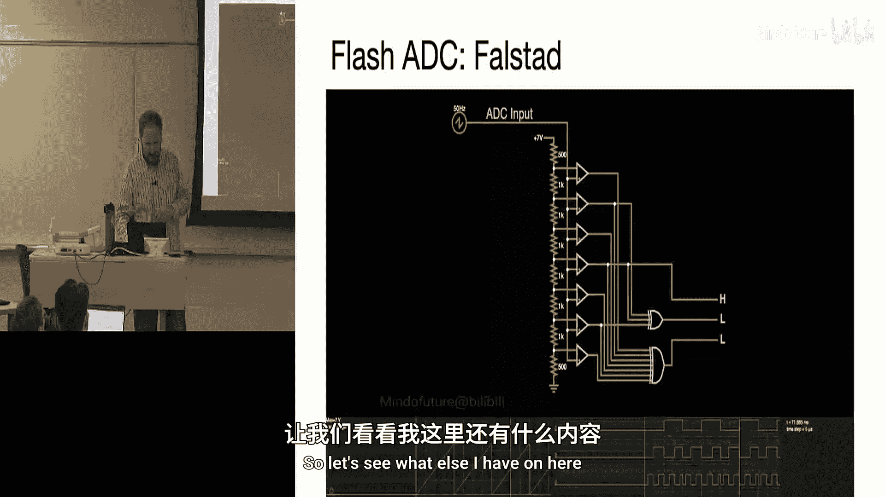

啊。So speed， this is very fast， in fact you can sample a signal faster than one cycle on your AD of your clock so that's the big advantage of this the resolution here is limited to the number of resistors you can have on device so limited resolution complexity。

 it's not that hard to make but you do need a lot of comparators and you have two to the n resistors。

 power consumption， speed versuss power tradeoff I guess you could say that the faster you go。

 the more those calculation， those comparisons you're making so the power could actually be quite high with speed。

 but also you have a lot of things that are switching which could be high in power。

Any questions about flashlash ADCs？

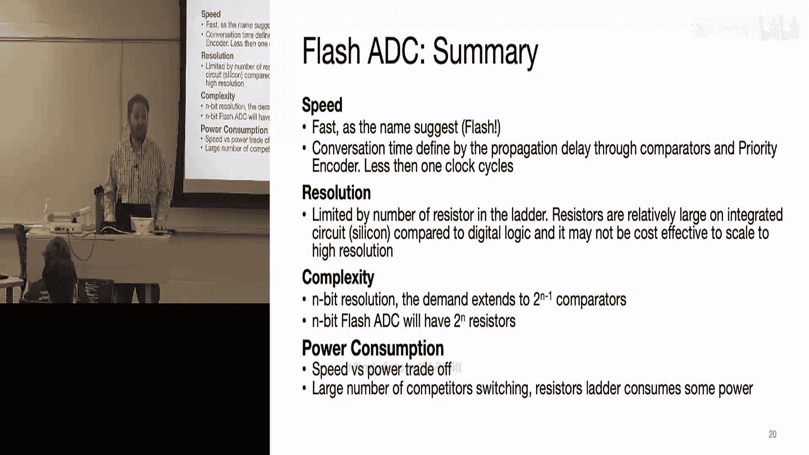

So the expectation is that you should be able to reason through how this works。

And what the trade offs， as we'll go through the rest of these。

 what the trade offs for this design would be for another design。

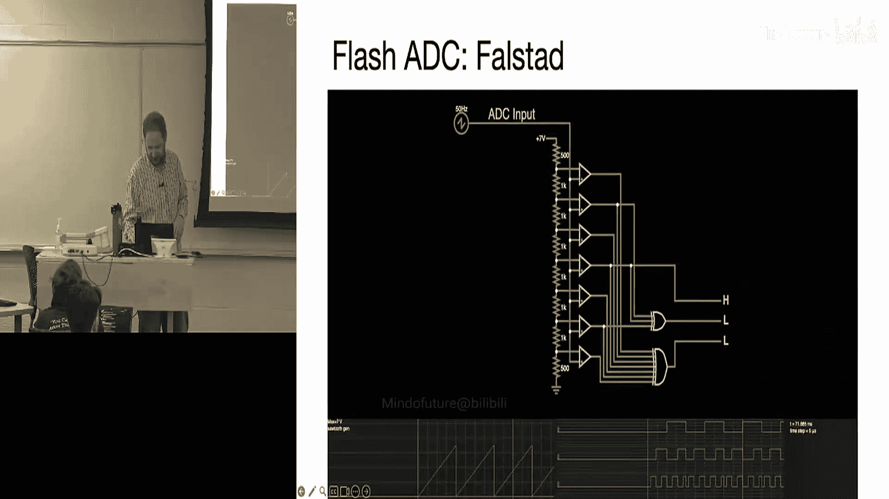

All right， another common one you'll find are slope integrators。And so slope integrators trade time。

 they use time to measure an analog voltage， which is a nice trick because if you remember。

Microcontrollers are only good at measuring one thing and that is time。

 they're not good at measuring analog voltages， but they have really good clocks and so the idea here is you've had some nice RA function。

That would say ramp up at a known rate， and then when this thing and this thing hit each other。

 then you just measure out the time。So here you can have a comparator that looks at these two values。

 my VN versus my ramp and when those two things equaled out。

 then I would just measure off the number of ticks that it took to go by so here you can have a timer that keeps track of time you start a nice analog ramp function until these two things equal how you measure that you have your inputs of your comparator to tell you now you have a binary decision that this thing is larger than that thing okay now I'll read out the time so that makes。

Calculations really easy？To ask me your question， I' love just like a canary in a coal mine。

 clearly I'm not making any sense， I look at this face。

 I figure out I've screwed up my lecture what can I help with I'm just about the ramp function like if you give the ramp function signal of VN does it still like start at zero so I'll show you how to make this ramp function in a second so just assume that we had a ramp function that at some time I wanted to I could just start it and it would just start climbing at a known slope。

M just。And if that was true， then it would be， I think you could calculate。

 you could construct the rest of this pretty easily to come up with this digital you answer yeah。

For this one versus the flash one， how do you check multiple levels here at once？

Multiple- you're not doing it at once the flash was making a at one time was making a binary decision。

 it was converting analog to binary right， it just happened that it took intermediate。

 it took a bunch of steps here we're just trying to say at the end of the conversion。

 this is how much time it took。Let's fear like VN changes or something like oh man。

 now you're screwed， okay， but but we have that sample hold circuit。

So now we can use a sample hold circuit to hold VN constant。

F you see you think about the land frozen much here。那个。你在第一个是。Yeah。Look at the time。

So here's how to make it now I'm not going to ever ask you how to make a RA function because I had to I learned it when I was undergrad and I couldnt understand it and then I went to graduate school and how to make one of these things and then I finally understand it so I'm just going to tell you how we make them and then you just trust me and you just be like okay fine。

 ramp functions exist。So you could if you're trying to make and really what we're trying to do is like what is a function that would have a time constant that would have some behavior that would change predictably so you could think oh we're going to use an RC charge up now that's not exactly the ramp function we want but it could work it just means that over here we'd have less resolution as you go farther in time it's really hard to tell the difference between this point and that point so your signal is going to get more noisy and you're going to have less resolution over here you have lots of resolution so that would be one way to do it and here this is a voltage source into an RC charge circuit。

Now the counter example to that would be a current source and don't， I mean。

 if you took 215 or maybe I don't know， the analog circuits IC class is actually pretty trivial to make a current source。

 but you don't have to know that just know that if a current source existed and you drive it into a capacitor。

 fantastic， the result is from some basic math that is a linear increase as a function of time。

 it is hard to make good current sources that are noise invariant， temperature andvariant。

 all these other things， but we can say that if you had this magical current source。

 itll cause you a nice ramp function as you push it into a capacitor。

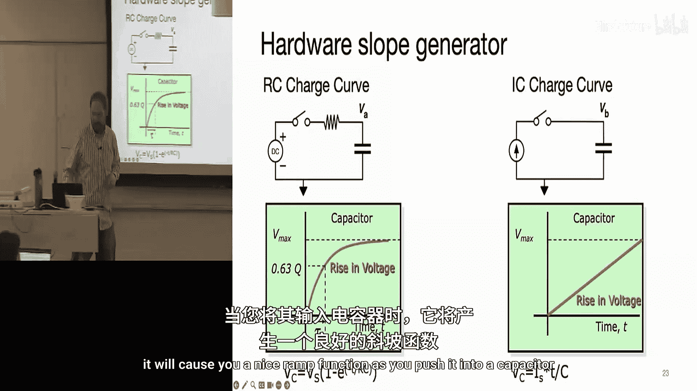

All right， so we'll kind of see how this circuit all works together。

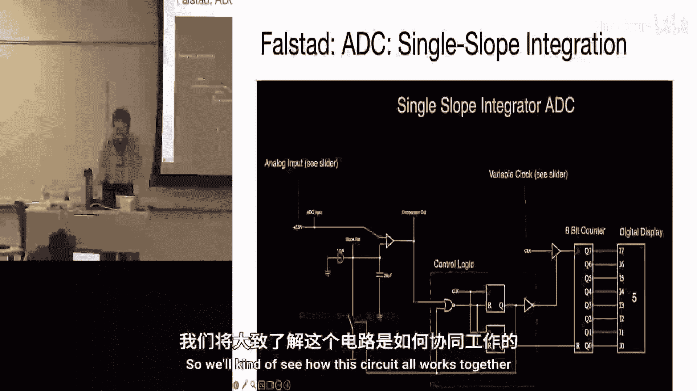

So complicated circuit here， here's a little nice little ramp function。

 it's going to charge up this capacitor okay and I'm going to have some input voltage。

 it's not going to be time varying and I'm just going to set it once now you could put a capture compare or sample in the hold circuit here。

That would have a fast moving signal and then you could sample it and then put it through here but right now we're just going to say this is the and put the ADC in it at DCC or its frequency is fixed and then there's some control logic here don't worry about how the control logic works when you can work your way through it but basically it's just enough so that automates the task of startingard this ramp function and doing a comparison。

And then we have a binary counter here， which counts up as a function of time to keep track of how long it's been since we started a ramp function and then a display thing that will show off how much time there is。

And I realized that you can even， that's a live slide。

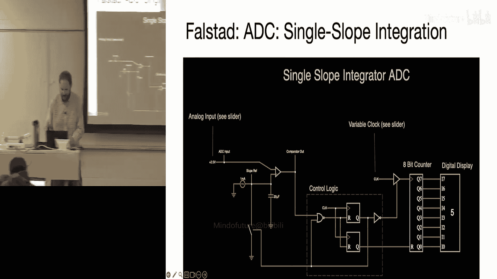

There's the actual false sat simulation。Okay， and then we have a clock source here。

 the clock source is going to drive our timer and this passage of these clock ticks is what's going to encode our binary value。

 basically。So let's run this。So here。We set off the conversion。Stop。

And what happened here is we started a conversion， we had a ramp function was coming up until it hit some value until it hit this reference value here。

 so that reference value is right here， no no， sorry。

 this is our ADC value and this is our ramp function when those two hit。

 your comparator went off and then we're able to read off a binary value？Let's try that again。

And I just it reset itself， that's why it went back to one。

 but here it had a display value of nine right nine clock cycles went by to see this so we could see this is our DC value or I mean our analog value that represents this number。

 we could go here and increase the voltage。Do that here and then Erice。Start。

And now it's going to take a longer period of time to get there。And now we got a value of 12。

And so now as I change this value， I get an analog input， I get a different ADC value here。

What do we think will happen if I change the frequency？What's the advantage of this。

 this sort of thing， what happens when we change the frequency that drives this clock？ま。What's that？

I will not converge any faster， this ramp function will take the same amount of time to go。

 and that may not be obvious but this ramp function is really this current source。

 magical current source into this capacitor。你边楚哦。That's kind of the power of this thing。

 so let's try that out， let's see I'm going to increase the frequency here。

And I'm going to say run again。You sat， Ron。Ramp time is still going to be about the same。

But my display value got the 51 for that same amount of time because now 51 clock cycles went through here。

 so now I have a circuit where I can change its resolution based on the clock I send out it。

It's kind of cool， right？😊。

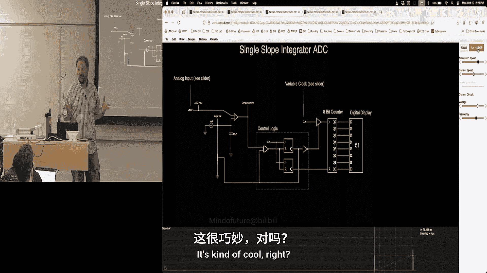

If you have a slower system that can't afford a fast clock。

 you still get an ADC with some good resolution， but here I could really increase。

 I could go to gigahertz and have as many little steps inside of this as I possibly want。

 giving my ADC really high resolution。Is that not amazing， I'm amazed。More saying more。

What do you think， does that make sense？Yeah。more steps or more pieces yeah so that means if I have more steps inside of here right if I only had two steps。

 one， two then I can only tell you is's only you know one bit ADc and I can only tell you that at some value inside of here is higher or lower but if I had two to the you know 10 then I have lots of little steps in here and I can tell you smaller and smaller resolutions yeah that's not measured like the more resolution you have the less' measured。

ASo now we have the challenge of how fast can the whole system go right so I think what you're getting to is this ramp speed here is going to dictate。

How often I can sample things and in fact it's the worst case ramp speed because you'd want to be consistent you don't know what your data is going to be and so if I went and put a voltage all the way high。

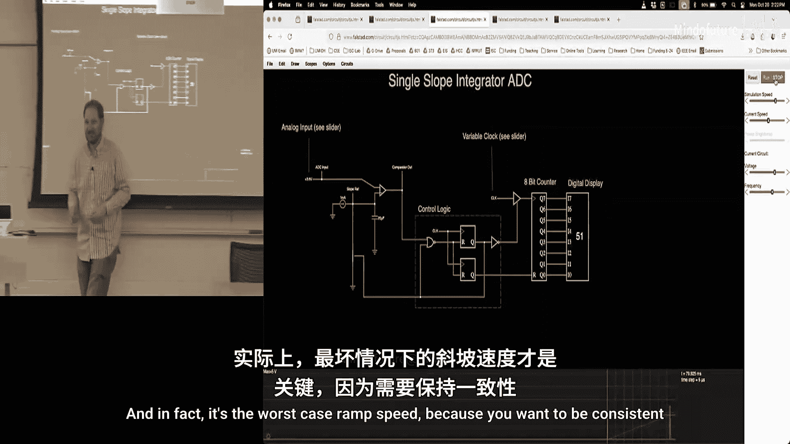

I think this will come around to the next cycle。Yeah here we started another cycle。

 my voltage is high and now it takes much longer to get to that value right so here it was you know it was only what VDD I don't know what this maybe VDD or three or fourth or something and now it took much longer to make that ramp over there so I always would have to plan for the worst case scenario is how fast I can make an ADC sample。

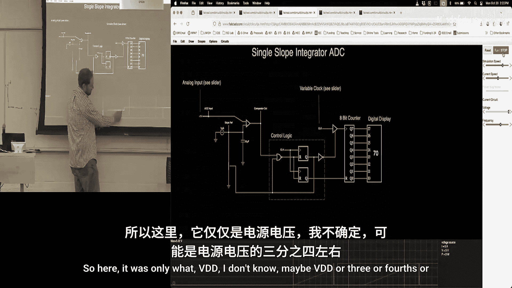

Yeah what's that little jump Oh this is just the internal logic switching between when the comparator goes up。

 so the comparator goes up here and then this logic that nobody wants to look at because it's horrible makes the decision to what does it do。

 it resets this circuit here basically。But the idea here is now I'm using this ramp function and I'm going to use time as a proxy for the analog value。

And that's a pretty nice trade off yeah the。No one necessarily changed the range。So the range。

 I guess you could say is， well， what's the range of the input analog input voltage and for the simplified circuit。

 we'd say it's zero to whatever voltage or ramp function can get up to。

Let's say counter  before it reaches voltage level so say that again。

 if I chose my circuit poorly I could have my counter could be too small toward my ramp function and could overflow my counter before the ramp function converge on the analog value。

 that would be possible so we'd want to make sure that our function our clock and our timer had enough steps to be able to hit the maximum of our ramp function。

Wait， one more time， why did so the top green line us the ADC input yep。

 why did it change because I changed it？Okay。I can I can go over here and I can change the voltage。

 you can change the voltage too I just has to be running so here I can。Jinging。

And see here's the problem， this is what happens if my analog signal is changing while my ramp function is coming up。

 it wasn't able to capture any of that because I didn't have a sampler and hold circuit I it constant it should be constant yeah。

All right。If you guys can play with that， I would like to point out。

That that's a nice simplified version， when you go to industry or look at the data sheet。

 slope integrators， they're almost always dual slope integrators where they have the sample circuit is kind of built into the circuit where they have this charge up time where they're sampling a signal and then they have this discharge time。

This is really nice because what happens is that any imperfections in your charge up that capacitor can be offset by the discharge of that thing。

 so there's just a more sophisticated way and I added a false stad if anybody gets real excited。

 actually I found this one online， some other crazy person made this nice false a。

 let's see if I can make it work。嗯。What did you have to do， you have to push start。

So here you can see it ramps up and then ramps back down and then holds that digital value for you so I'll let you guys play with that the big takeaway from this circuit is this is just what you would find in like multimeterters like this circuit is very nice for high precision but slow acquisition rate and so handheld multi meters use it all the time because you're not trying to sample circuits really faster benchcha multimeterters that's where I've seen it mostly and some like one off like you always find these weird things that like Home Depot that measure some analog value or something some transduuccer it's usually always a slow8C that only exists because we can trust the discharge whether we can trust the charge。

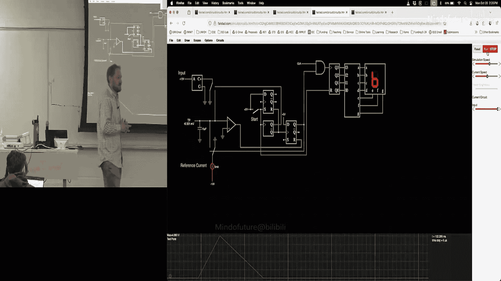

Yeah like we're measuring on the down because that's accurate Yeah so this one。

 if there was small variations in your input signal and you didn't have that sample and hold circuit。

 then this will allow you this accumulates charge as it charges up this thing it's not purely a voltage measurement the charge measurement how much charge is going in and any imperfections than this are captured on the input and disregarded on the output so it makes you a little bit more noise and you use it kind of acts like a filter for your input signal in case there's variation so it has some architectural reasons that aren't that important again the big thing is know how a slope integrator works in general。

 the tradeoff is that you can use it's a slow wayed acquisition signals but is very accurate and you're using time to measure signals and that in the real world they use a dual slope integrator twice as good as what I've taught you。

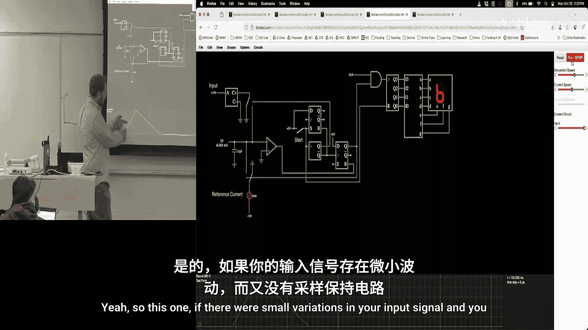

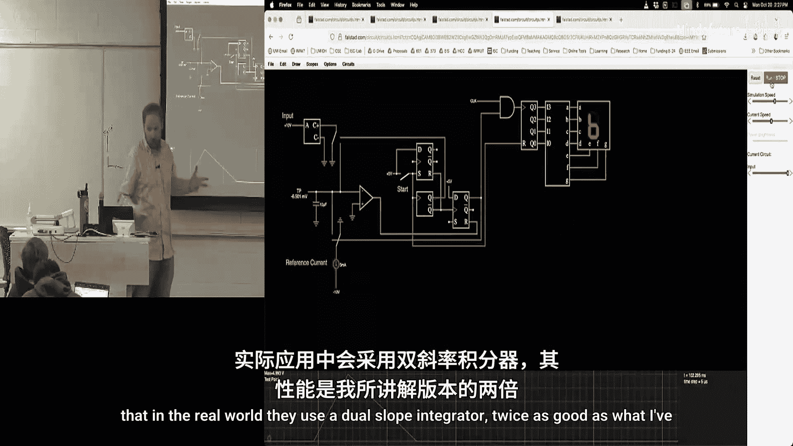

So some of the frozen cons here speeds， so it's slow uses time to measure a ramp up voltage。

 so it takes many， many clock cycles to come to a decision where the flash took less than one。

 this takes n class or whatever long it takes to go up to maximum voltage is that many clock cycles。

On the benefit side is the resolution can be really high。

 this is probably best in class or best of all the ADCs that you'll see in terms of resolution。

 it's just only good for slow signals。Complexity， it's not that bad， but it does。

 I mean you got to be an analog engineer to make one of these things work。

 so maybe that's too complex， but from a layout point of view size point of view there's not any big resistors in here。

 capacitors are still take up space but maybe not as much as resistors and overall well。

Caacitors are large， but there's only one capacitor compared to all the resistors we had in the flash。

And power consumption is pretty good， this is pretty low in power consumption and is really used in battery power devices a lot。

So any。Questions about slope integrators， the trade offs。Okay。

Oh yeah greater about the speed you have to wait for it the charge up and usually what you're doing is you're waiting a fixed amount of time to sample your thing your measurement so that's a fixed amount of time and then for a sample in whole circuits there's usually a fixed amount of time so there's always this kind of fixed time up front but it's about the same period of time to sample a thing because you have to take multiple clock cycles it's much faster or much slower than flash ADCs。

other like mentioned the single slope and double slope。

We once you pass a whole time with a single service。

So this period of time is the same for a single slope integrator。

 but the dual slope has this charge up time in the very beginning。

And so this does increase your overall time， but I'm going to say compared to any other ADCs。

 a flash takes less than a clock cycle takes。Hundreds， if not thousands of clock cycles。

All right so one clock cycle for every LSB in your ADC。

 so if you want 10 bit it's two to the N clock cycle so I would just say in general。

 this takes so much longer than any other the ADC structures that you want。

 it almost doesn't matter what this is， it's just a long time。But yes。

 it's slightly longer than a slope， a single slope intetor。All right。

So a SAR ADC this is the type of ADC that you have on your STM32。

 so a successive approximation register or SAR ADC is in this particular diagram we're going to start off the sample and hold circuit so we have some analog value is going to be held here again we have a comparator just like the slope integrator we're going to compare this voltage which is our input voltage just some other voltage and then we're going to make a decision we'res going to say is it higher and lower so you could have the resistor ladder in here。

And that says the same thing and makes the comparison between the two of them。

 but we're going to make instead of having n comparators we're just going to have one comparator and we're going to have a thing called a D which we haven't introduced yet。

 which is the digital analog converter we'll talk about that next but for right now you just put in a binary value and some analog voltage comes out so what we're going to do is we're going to put an analog voltage in here and test it is it greater than or lower than the analog voltage that we're trying to measure and then if it's lower then choose another value。

 choose another value choose another value， choose another value so what would be a good search algorithm to use here。

Binary search， and that's exactly what we're going to do。

You're going to basically make a binary search algorithm in hardware， it's going to go through。

 you're going to start off with half， and then you're just going to go and successively march through。

hopes。And try and find that value until your comparator goes high。

 you know that you're at that value。嗯。Okay。What questions do we have here？Those likearrows。

You know line just mean like it's sending yeah， it's just the direction of arrow I this morning。

 I looked at these slides and said， why is this the grounded？Why are we grounding this？

And then I remember okay stop， you're not analog person now you're a digital person。

 this is just a block diagram showing where data is flowing and so this is showing you will read out your output value right here out of whatever goes into your D is your output digital value Yeah you'd always want to start with the higher value when they go down right that way you're count you'd want to start in the middle and then make a binary search whether it's a higher。

 lower， higher lower higher lower control logic in there that so like remember how when we did the flash like if you did the the lower voltage threshold all the other ones that go high to is there like control logic to prevent that from happening in there？

Yeah， we'll go through an example and this is really going to give you just an analog value that's proportional to a digital value here。

 so it really is going to be you start at maybe half your binary search tree and this is going to put out a value that's basically BDD over two and you're just going to try and search out which value is closest to this value。

At SHA and what timing you to doing with SHA？S so the SHA is the sample and hold circuit what does sample hold？

电话。Acquisition， let's say。Acquisition basically this is that we we saw in the very beginning where those op amps were and it was horrible。

 no we knew what op Amp was that's fine I promise you're not alone all the ones that took 215 they don't remember where the op AmpP is either。

 that's why they're here， not an EE。But basically you're going to take that analog value。

 you're just going to hold it， so it's being held here and it's going to be held here for many clock cycles。

And then the timing here， the timer here is just to keep track of to push this digital logic along。

 so it's going to go make a decision that's what the timer is really doing the binary。

The take all the entire time that it takes for the SHA to hold it yes。

 you' going to you're going to want to have your sample and hold circuit be hold it and responsibly hold it be able so it's not discharging that capacitor value it's got to be designed for the longest possible binary search that you're going to have。

And that finance or is that clock driven？Okay， so the clock is like slower for SHA。The well。

 let's go through an example as I have in a second。

 so just assume that this is to be much going to be held much longer than it will take to converge on an analog value。

And your binary search will take。So if we look through here first。

 you're going to have some sample time。So what's going to happen assuming I don't know why it starts at zero is a fine place to start。

 but you're going to have that transmission gate， it's going to have that value on the output of your sample hold circuit it's going to be zero。

 you're opening transmission gate and you're going to have some charge up to some value and that's going to be your sampling time in fact on your STM you can define how long should your sampling time be and that assumes that your resistance of your source signal could vary so you can tune it basically but basically there's some sample time and then you're going to have some conversion time so here the analog values lockeded in and then we start doing our binary search trying to find a value that's close to that。

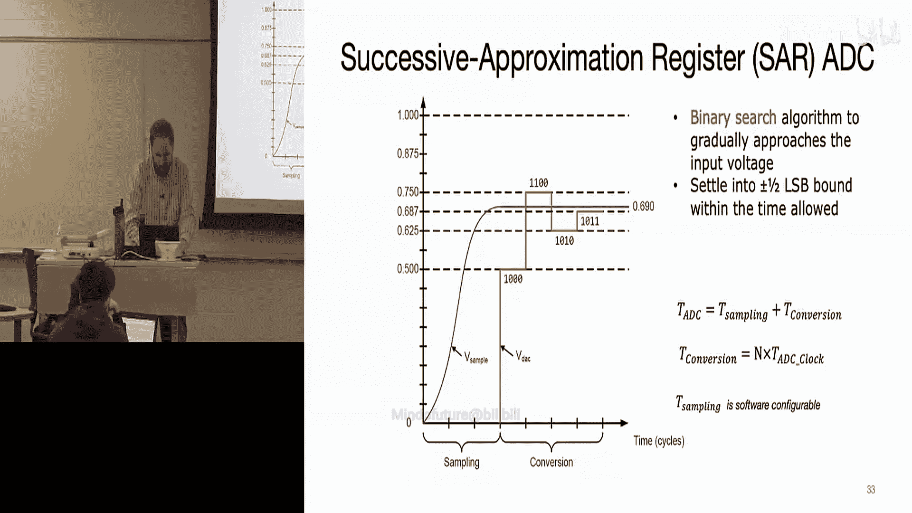

So I'll show example of that。Let's see。So what do we have here？So we have a comparator out。

 we have our analog voltage in I should labeled this better。

 but this is your ADC value that you're trying to measure and this is just a little label that tells you what the value is and I'll be changing it there and now you're trying to always compare between these two and this will show us what the value output is and then here's a timer and some control logic that I wrote and here's a D that's going to convert this binary value into an ADC or into an analog value that's going to be compared here。

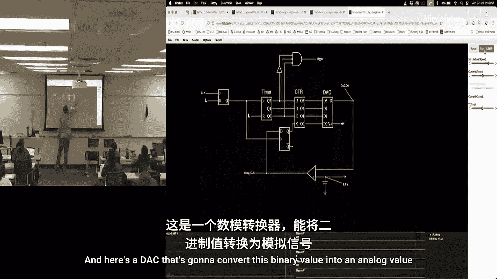

And so we can actually watch the binary search occur。

It's always exciting to see if I've written it correctly。

So here we started out a little bit higher than we went you know VDD over four basically down a little bit。

 and then we kept on searching up until we found a value that's close and now we can read that value off。

Easier to make than digital。Well， you'll find out on Wednesday。But。

What you'll find out is that it's a reasonable tradeoff to have to make a DAC right so like from an area size point of view versus speed DAs are somewhat easier to make than a flash ADD ADC or a slope integrator ADC。

 so using a DAC is actually well in totality a good decision。

And let's see I can increase the voltage here。Oh， let's reset。And then it'll take longer。

 Craig because it's always going to wait， yeah， it did work gay。

And so it's going to go and serve out to that voltage。

 And you can play with it and figure out how it goes up and down。

 It should stop after it's been triggered。 Sometimes this false ad gets a little， a little tough。诶。

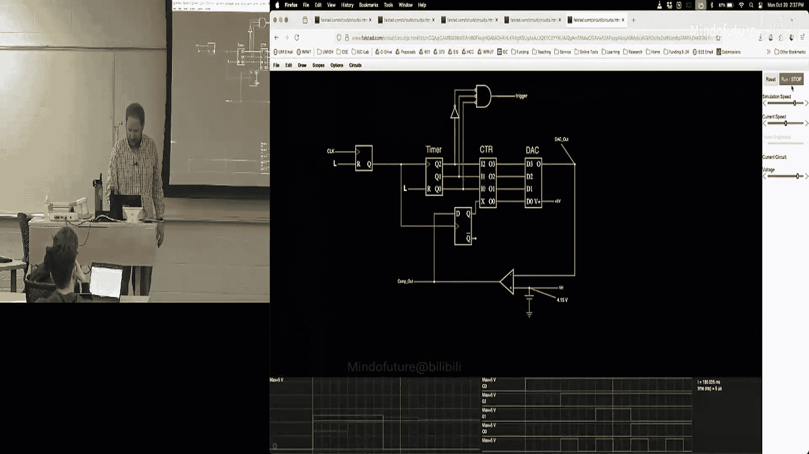

Okay。Well， so I want to tell you。So one of the nice things。

About SA ADCs is that you can actually change the speed of the ADC by changing the clock going into it talk about that here。

So if I take。If I say I had a a 10 bit DAC， but I wanted to and that would make a certain number of steps。

 least itll take at least 10 steps to get to my analog voltage。

 and so that's a period of time that you would have to every single time use your ADC。

 you're going to have to a sample time and then a conversion time。But you can make a tradeoff。

 you could use less bits， reduce your resolution to be able to sample faster。

 so all of a sudden I have an ADC that will make this time resolution trade off I have a very fast signal and I don't care if I and if it's okay not to have the highest resolution。

 I can remove some bits at the end which will make my entire conversion time faster in fact your ADCs on your STM 32 give you this tradeoff I think it's somewhere between like six megaamples per second versus maybe five mega samples per second I forgot we'll see on in later slides that you can change the resolution your ADC to make it be able to sample faster signals。

So that's one of the advantages of these type of fats。The resolution is pretty good。

 you can get higher resolution than you can get with a flash ADC。

 it takes longer sure it doesn't take as long as a slope integrator。

 you don't get that same resolution， so here's a happy medium between flash ADCs and slope integrators complexity well you need a DAC and a bunch of control logic。

 but you don't need。It's relatively not that large， and this is reasonable。

 you see it from power consumption point of view， you see it in lots of digital devices you see it on your little microcontrollers。

 these things that can be very， very low power。All right。What questions you have about SADCs？这个买。

The fine search， fine search is adjusting the。your signal output to that matches our desired signal that input signal。

Okay。And the binary part thinking about that is just that comparator。

 that's making those binary choices。是。VeryGood。Yeah。一せ。There you're not， this is higher or low。

And based on that， and then you activate your next step in the minor search。

 which updates the document key。Yeah， I mean you can kind of see that here。

 I put out a binary value and then this or this analog value。

 this proportionalless binary value was compared to the input voltage and it was lower so then the controller said okay well I'm going to go up try here。

And said， well， now this is higher and try here and then kept on converging until it got to the end of its sps。

P is able to indicate。because I assume if you went higher。It' very like。About on。About from below it。

 or just slightly。A comparator that says if we go all the way back。这东西。Comparator says。

All a comparator is doing is just saying is。The input on the positive signal higher than the input on the negative signal。

 that's all it does， just making a comparison。Not detect that。The difference between being honestly。

那你错。是这个。It残人。这个意思。s another difference between like being aligned and you mean like equal then like how's it do equal and greater than doesn't matter all right we got two analog things maybe they have infinite precision。

 who knows those analog comparator engineers are going to tell you what the weird behavior is but that little bit won't really make a difference if you're greater than you're equal to because that's smaller than the way smaller than the resolution of your ADVC so if it's equal。

 let's just say it's high。All right。You guys get so lucky。

 you get two worksheets in one day best double points。I couple points。t。

 hand those back so what I want you guys to think about oh well while I'm passing these out。

 the goal of me teaching you ADCs is not so that you are ADC engineers。

 you are not qualified to make ADCs now。What I want you to do is to be able to understand the trade offs between ADCs and the inherent tradeoffs。

 like which one should you choose if you're buying them from did you keep？

That's the goal of what you should do。And so we're just have a little。Trade off sheetet。

 this little worksheet for you to think through， is this， you just have to rate them high。

 medium low in comparison to the other ones， it's not a big。Test。

 but really just to have you think through。ですね。These trade offs。Yeah。

 what is accuracy like all right， that's the same thing。Two， you got it。Because this is。

Thank you because it's rate high medium low。sConsider that。や在な。Oh。

But flash is it gives it away in the name flash gives it away in the name。Yeah。

 this matter we could talk about the。Accuracy could come in like with a voltage divider with a flash。

 right if those resistors aren't perfectly aligned， not the same then you'd have lower accuracy。

So accuracy could be have accuracy because I think we could talk about resolution and accuracy is two different things like you could have really good resolution at measuring things inrecisely inaccurly my voltage ser so it's basically how mess。

There would be because， youll magic that way you made the。You could with these homework。

think for resolution for the ACs has the best resolution。Its in the greater。

You can turn the clock really high right because you're measuring time。

 you're going to take a lot of time to do this task so you're going to get the highest resolution。

I has the lowest because now you have to have lots of resistors in there and you're going to be limited by size and I didn't do medium。

 I said good to high， you can get pretty good resolution out of SA Ns。Yeah。那ち。

I shouldn't ask questions first， but you guys probably could have figured out speed flash less than a clock cycle is immediately available。

But。It has a low resolution because you can't have lots of resistors， low integrators。

 the slowest because you're taking multiple clock cycles， but it's got a lower resolution。

sorry it's got high resolution and then sorry do you see it's pretty fast it depends。

 I would say this is medium again， I didn't use the same nomenclature did very fast okay。

 this is effectively a medium here it's fast but it's not going to be like megahertz fast So why is slope slower than sorry。

Why is slope。Slower than SAR because SAR is going to take some number of clock cycles。

It's going to take two to the Nclock cycles。This is going to take linear box cycles every single bit has to be counted。

The other way around。Every single bit has to be counted with a clock like， you agree？要そだ嘅哦。Yeah。

 but this， I'm going to do a binary search。So it's going to be end bits there to so given the same end number of end bits。

 this is always going to be faster than slope integrator I guess like like for Slopinging or can you like have like a really fast clock like when you need to help why can't I use a fast clock for the sorryC then？

I guess I thought the logic would be like really complex so you couldn't have that。

There are there ultimately it will be some trade offs。

 we're not trying to get through those trade offs we're saying just given given a clock cycle。

 this is always going to be slower than a fixed clock speed。

 assuming our logic can meet that clock speed。Is there a question somewhere？

No the students that want to go okay accuracy we didn't really talk too much about accuracy but accuracy comes down to is different than resolution resolutions。

 what's the smallest step sizes， how many things can you disccratizes in but you could measure garbage really really well right so that's where accuracy comes in here okay slope is the highest in SArs's medium slope is I guess in this size is the lowest because those resistors all have to be perfectly matched toll find out that in SAR ACs they're also have some match resistors in a more interesting way in which don have to be matched but it's not as critical this one can be the highest accuracy because all those things do not depend on process dependent circuits。

Pro toy B。cost I said this is the highest but it takes larger。

 this is the smallest cost because it's very small this is a good trade off between the two final questions again this is not for you to get perfectly correct this is for just to force you to think about the trade off。

I think it's kind of that。

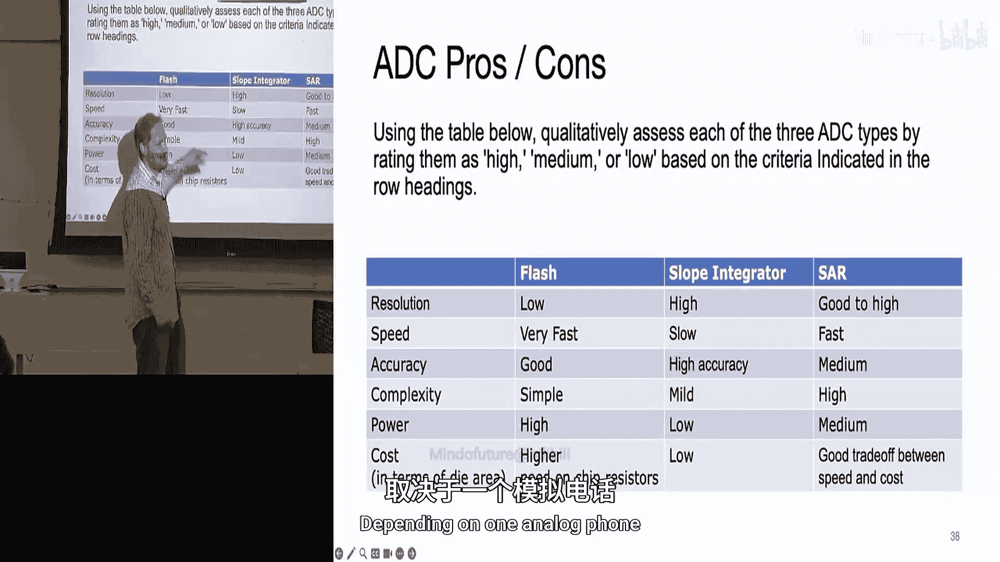