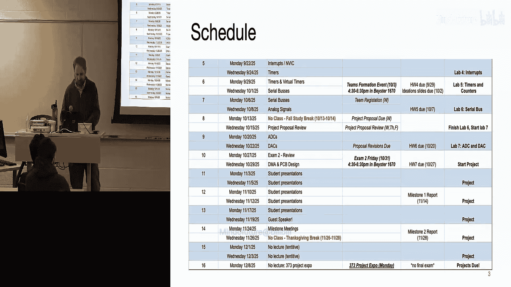
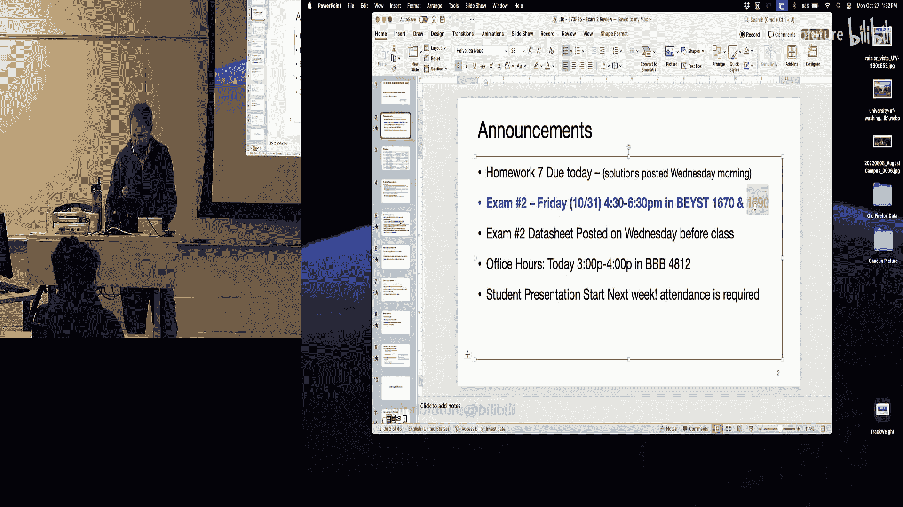
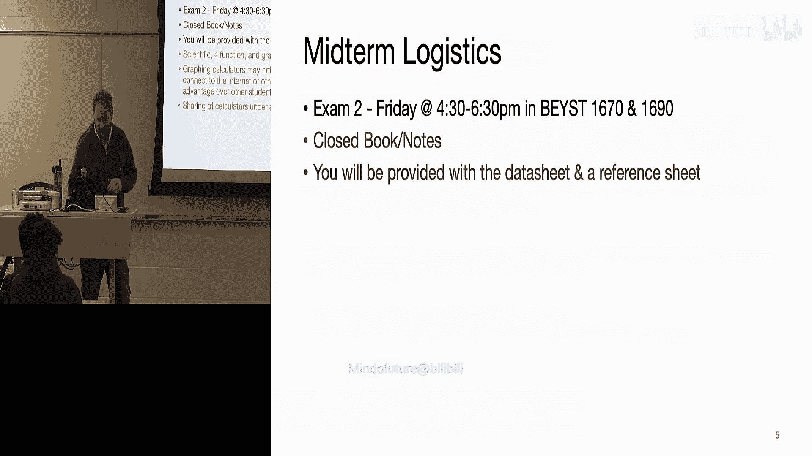
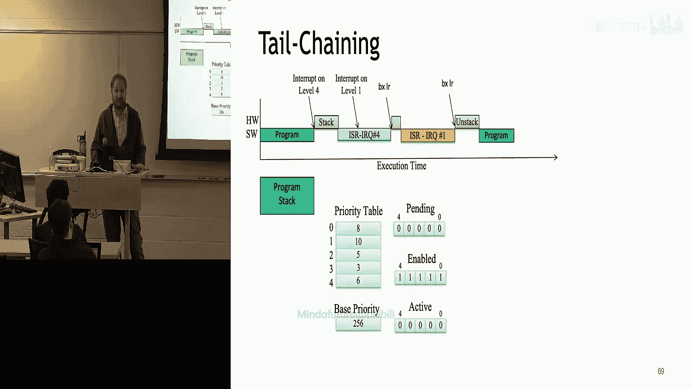
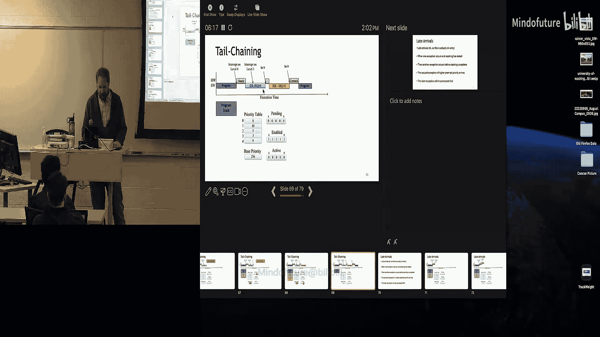
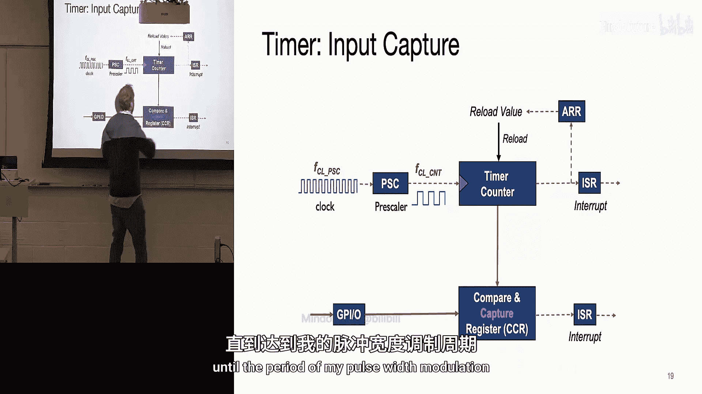
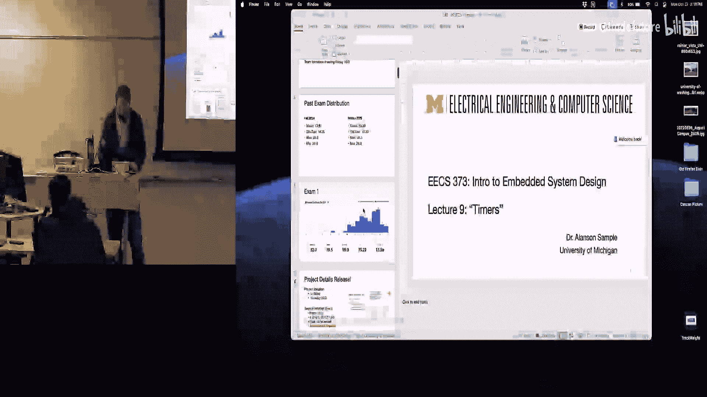
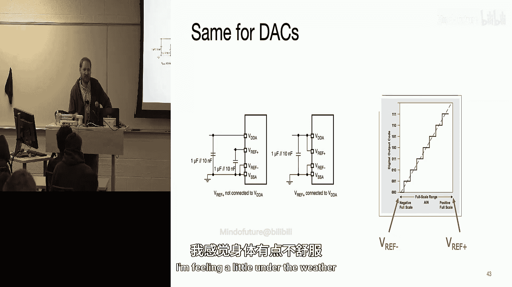

# 【密歇根大学】嵌入式系统设计导论-EECS-373-｜-Introduction-To-Embedded-System-Design-2025-p17-P18_课程16_考试2复习--BV1VTSNBoEem_p17-

当時ね。Tonight， I need to be up to study my exams。こも？都迷来，我看翻你我。一去晚一下这是。

All right let say we're going to do a review for exam two on Friday。Take very next。Announcements。

 homework seven is due iss the last homework assignment， that's fantastic。

Again on Friday and we'll release the data sheet on Wednesday as hours are today and then see presentations start next week。

 your attendance is required， you have to actually create each other's。

And then we'll have I'll reach out to the four that are going on Monday。

 we'll arrange special office hours and then I don't know if it's up yet。

 but the rest of you will have through a spreadsheet online。Practice。

Sessionions with me or James or Matt。Then。L we are just about here， we're here。

And then after this is student presentations and basically all you're doing in lab is your projects what you do youll be。

看。When we out in the meetings， we'll have a guest speaker on Wednesday I still think that's true。

I think you just confirmed。All right， any logistics questions？要。Before it was just 167。啊。

Like on the slides it。It should be just done as 1670。Where you that the previous slide？

50年。

That's great。😊，Any other questions？All right， so we'll do review。

This is your chance to ask me questions， I can blast through these slides real fast we can get out of here。

But then you will learn anything。logistics， oh presentation that midterm logistics。

 I think it's wrong， oh no， it's so right。

TheRo is wrong。

我上。So close notes closed。Fox。You could bring whatever calculator you want because you used to be just scientific and for function because you could have a calculator that got to run probably run arm Corps force anyways。

And you could probably have an emulator on there， but then we figured nobody actually has these calculators anymore。

 everybody has graphing calculators and what am I going to do and we get lots of people asking if they can bring their special calculator and I don't care just don't run emulators on it or have extra notes and all the other stuff。

I right， storm it。Of course， and then no phones and devices and we'll make sure there's a timer eight on the screen this time and not just the one in the back room。

Any other logistics questions？嗯。哎。See saying these last time。

 don't spent so much time in anyone one problem， you're welcome to start a design problem first if you would like。

嗯。Seeay all your assumptions， it's much easier， you can get so much extra credit if you just say。

This is what I'm trying to do， especially for the last couple of questions of the design problem where you're like rushing anyways。

 you can say this is the what it's supposed to do。 is write it in text。 Great。

 you're not gonna get all the points。 but you'll get some points。

 At least we have something that great。 Just leaving a blank gives you zero opportunity to give any points。

U。And that's back to partial credits rare if you don't show your work。

So if you at least write something I can grade them。the issues made available。

And we'll post any you can ask questions on Piazza so I don't know this year。

 either our data sheets are really good or you guys aren't asking questions。

 usually we have a lot more questions， but if you have questions about the about the data sheet or there's errors in it。

 no， please let us know。We won't announce any of the changes on Piazza。All right， to what study。

 homeworkmarks， labs， old midterms have been on the site for about a month。嗯。

You're going to be like homework， going to be like the midterms。

 we're not going to do anything too surprising。I would say everything from the course is fair game。

I'm probably you know you need to know these things and able to do these things。

 although I probably won't ask you super detailed questions about the arm instruction set that workflow tool chain。

 but never map bio for certain how do you talk to a timer or any of these other things without knowing what this is so I wouldn't stress about these but the core concepts here are required to know these things so primarily we're going to look at interrupts timers。

 serial communication and analog and geoconive digital。troverters。2。So it interrupts。

So how do we get？And may remember， how do we get information like we have an ADC that's about to end。

 how did this thing tell the core that it has ended its ADC conversion？今点话点手。How does that happen？

Readyvinine。Can you describe it？It goes across the bus across the bus。

 anybody have a different interpretation？Yes。The interrupt pin on the ADC gets tied to a GPIO。

 which internally is configured to go to the NVIC and when the NVIC detects that GPIO line is high。

 it sets。ThePending bit in the register and。causes the ISR to run guys got it a little bit so the ADC。

Gets data through the GPO pins but the ADC itself will have registers and the ability to throw and interrupt the GPO pins do it of course as well。

 but the key idea is it's an extra wire it doesn't go through the bus it an extra signal literally a wire that goes to the NVIC and all of we could draw them for every single device everything single pro could have them and the buses have interrupts and the DMA has interrupt and I'm sure if you have faults on your SRAm or something there's interrupts but there's lots of these wires 96 wires for your particular devices you're using lab that will come back here and each one of them can hold this interrupt state so it doesn't go through the bus structure because that would。

These peripherals can never talk directly to the core only the core through this through the bus high performance bus matrix and through the bridge can get to initiate conversation with these things say okay now as your return to talk there's no way for a GPB to say hey。

 please talk to me that has to be done with this external wire and that is the same if you think about。

SBI or I squared C or you aren not you are SBI or I squared C。

 these other communication protocols where。They need a dedicated line to talk to for the peripheral to talk to the court。

Any questions about that？嗯。Yeah， so they that wires。

Only on the ADB are peripherals it doesn't apply to the APV ones fit's for everything。

 everything that hasn't interrupt， so I was saying like DMA has interrupts。

That will be an extra wire that comes back through here。

I bet the SRAM probably has a system fault interrupt or something where it says， oh。

 there's some error occurs and that comes back so we could draw up to 96 for interrupts for all these different wires for different conditions。

All right。So here's a kind of more simplified example here we have some what are my animation tell me Okay so here we have some interrupt that's going to occur we've set up a GPO pin we've gone through the registers and said on pin4 a pin3 if there's a rising edge I want you to throw an interrupt okay so that will occur it will the GPO pin will throw a wire aligned that will go high to the NVIC and this will be the IRQ this is the interrupt request service line and this is tells the NVC hey this thing has occurred right now it's the NVIC job to process it and decide which interruption be on first second third if there's multiple。

But this is just a request， remember there is going to be 96 requests coming in。

 so we're just showing one here。So the NVIC will figure what that is， its job is to say， okay。

 IQ is interrupt number nine， however， I need to go look into memory to figure out。

Where this as where is the vector interrupt table stored？

St at the bottom story at do you know the exact address for it starts？Nope。Mes。Nope， not minus。F。

 yes。Four， we'll get to that later， we'll get to it next slide。

 but we'll see that zero is the stack pointer， four is the beginning of the factor table。Okay。Anyway。

 so now the interruptop past the NBIC has to figure out， okay。

 which is the actual handler so it goes in the。TheT figures out what address that is and then。

It sends that to the core。execute the interruptive。We can see that。You're here a little bit。

So here this is shows the top of the stack and this is the first reset handler。

 this is the most important one， this is when you power on nothing can interrupt this one and then all these other ones。

 these first 16 or first slots here are all the ones that arm in Stanhes as part of their architecture that must be there so cystistic timer these debug timers and hardfall timers and bus faults。

 those have to be there and then these 16 and up are all the device manufacturers so arm and AMD and STM sorry STM atxD。

 those sorts of manufacturers will have interrupts that they are customizing based on their hardware so there's not required to have a watchdog timer as part of Ar architecture but STM has added one and says okay this is the location so Hex40 is holds the address for where the interrupt handler is for watchdog time。

And so these interrupts come in， the NVIC figures out what address should be done。

 so for IRQ 3 over there is stored in HeX 64， that's the address in the table。

 and then that points to some IRQ handler some every located。Yeah。So。

We have our interrupt so here you in user lens， this is time we're going to show different heart on top is going to be the hardware actions。

 so an interrupt occurs we're going to do stacking what is stacking this is the。

How the NVIC gets the processor from normal process mode into interrupt mode and so what it does it has to retain the entire state of the arm of the core that when it returns it can go back into position so very learn about how you need to have ABI compliance so you need to keep these bottom four but you also need our for the link register program counter and then the program status register so that you know where the URL flags or the ALU flags are and those other flags so when you go back to your program exactly in the right position。

So here you'll go execute your HR handler， you'll be done and then it'll unstack taking all that back。

putut it back on the core and this process of stacking unsted makes the entire interrupt transparent to the core。

 the core doesn't really know that it happened all the state was retained。

 it's just that there's a missing gap of time。那个す。It must be one question， there must be somebody。

 some brave person here has a question。The LR is set to be like near the top of the memory。

Hardware了解。So there's a hardware function that basically goes and you don't。

 have a programmer don't do anything， but hardware will cause all these things to be pushed onto the stack。

But un。Where it's just unsacking this hardware as well， it's when you in that particular case。

I'm here。Im not showing it here， but the return oh yeah， here it is， so the link register。

When you stack or when you're in your interrupt handle or this is your link register and so at the when you exit your interrupt you go here。

 what is this， this is a signal to your hardware If you try to execute this code。

 your hardware says oh I know what I'm supposed to do I'm so as to unstack。Oh， wait， so。

Oh I thought that like there was code at FFFF9 that did un stacking that's not what happens we could say it's hardware code you could say it's you could say it's code that you don't write it's stacking hardware code Yeah you can say that。

How do they actually do it， I don't know， but I'm going to guess that arm probably has RTL so what RTL stand for as anybody of remember？

Register， yeah， transfer language， right？So if I rent RTL， which I guess is a version of code。

 this' burned into hardware that does this task every single time，'s probably not。

Hoode that can be modified that's doing a task。Sure。あい。What do we do， we're here any other questions？

Well， well for all。嗯。好的 yes。So it doesn't do so the question was so hardware will do all this， yes。

 hardware does all this puts it on the stack， it doesn't do like R7 through R 11 because there is some A compliance so it wants to make sure。

It says you probably don't need those if you're in a interrupt so when you write your interrupt handler。

 you can't go and use R 11 through our whatever4 unless you store those to the stack through your task and bring them back down before you leave so your handler still has to be ABI compliant。

And again， this is done in hardware。Yeah。And so it's probably valuable to kind of think through how your code。

Your core and your stack are all interacting together so in this particular case stacking occurred which took all these values。

 put them on the stack， allow the handler to come in。

 change the or the PC to something else able to run all this stuff and to handler and then on the way back it goes and executes this thing which causes all of that to be re stacked on top there and normal code keeps executing the only caveats you have to the core will complete whatever instructions it's doing if it's a multicycle instruction it will not split halfway in the middle of an instruction it's not a valid。

Name for this architecture。All right， so steps for interrupt。Go through these。

So you have some peripheral some other source crs interrupt， determines which one it should be。

 hardware stacks， theres there's some aisle time while the you get the bus and you fetch things so the target there's a fixed cycle I think or maybe 12 cycles I forget how many it takes to get into it interrupt。

 updates the stack pointer ups the。These program status registers is the lower part of the PSR with the exception numbers since the PC to the vector handler and then update sale are so those are the steps to get oh and then I missed it here late CS 12 cycles to get in。

I can't remember all my processors。It's also good to think through these diagrams so what happens when you have multiple and concurrent overlapping interrupts。

 what happens when your interrupts get interrupted。

 and so in this particular case we're showing program stack and then some interrupt occurs。

 what happens if you get an interrupt here， thinking through which one has a higher priority。

 which one has a lower priority difference between Gremption priority and subpriority？

And then we have the different conditions here of Grampionin， tail chaining and late arrivals。

just states that if it interrupt happens when there's an interrupt and it's a more important one or has a lower priority number。

 then it will interrupt the interrupt。Alternatively， if it's not a higher priority。

 then it's likely to do tail chaining， such that instead of unstacking it will go and spend just six cycles and then go to the next interrupt without having to do the process of unstacking then late arrival says basically if you start to interrupt。

 but before you start executing it， another interrupt comes so interrupt comes here。

 you don't go into this one， you can check in this last cycle here of the stacking process and then just switch the program。

The PC counter because that's the same thing， the PC will go in。

 you switch that PC and you'll actually do the late arriving ISR if it is higher priority。

A more important than the pending one that caused the original interruptim。Super clear。

Why don't you guys talk to each other for about a minute and ask each other if they have any questions。

 what would you most want to know about interrupts？

What are you most confused about interruptops maybe that will generate some questions why don't you guys talk with each other。

 you can even use this slide or these concepts as a prompt go ahead。sense to figure out。It''s's like。

I talk about priorities as I assume it's like。How many。Answering likeAll right。

 what questions you have or what question did your neighbor have？interrupting interrupts。

 it looks at preemption priority then subpriority then interrupting。

It looks at preemption priority because sub priorityority。

The preemp priority allows you to preempt and interrupt but subprior this says of things that are pending。

 what is the order so a subpriority number would not cause would not be the deciding factor if an interrupt should be interrupted okay so but if two interrupts have the same preemption priority but different subprior then it wouldn't be interrupted。

Right so two interrupts come in， so the same interrupt priority， they're both go on pending， right？

And then which one goes first， well then you look at the subpriority number to determine which one goes first it's already one going then you would wait Yeah so you have two interrupts come here both with lower or or sorry。

 less important interrupts with higher interrupt numbers but less important this one they're going to wait till the end and then the subpriority number is going to decide of the things that are pending which one will go next。

They have two enough the same branch priority， but different subparories and they arrive at the same time。

Which one's picked does the subprioring matter and that scenario it's not like you're going off and interrupt you're just those are just the first two interrupts so okay so you're here two interrupts come in and one has a more important sub priority sub priorityority but they have the same preemp。

嗯。And they're both going to be， I think it's whichever one has a lower sub priority because then they are still in this case。

 the same case here you have two things that are pending right and then how do you sort the pending interrupts will you sort the pending interrupts by subpriority。

Ation priority then sub priorityor。Because okay， so like in the case where you're like you're in and up already。

 it makes sense to have a lot of things pending because like you're this interrupt but nothing's preemping it because I think nothing cant pret it so a lot of things can like build up in that interval but if you're just in the program interrupt on the first interrupt ever possible so like thats that was the confusion I had but I'm here so the interrupt happened and then what happened just。

A cycle later or less right then you're still in that sacking。

 you might be in a late arrival case because you're going to look in which one do they have the same priority。

 okay， fine。Then it's going to look for a subpriority and figure out because you haven't entered an interrupt yet。

 you still have time to choose your interrupt。That makes sense。Okay， that。Well during stacking。

 it also like if not internet happens during the stack。

 it would have some special hardware to change the。Essentially。

 the decision of which interrupt go in does not need to happen while you're stacking。

 you don't need to know here which interrupt could occur。

Because you're going to have 12 cycles to here， you just need to know right here which you go from the NVIC says this chooses the one。

 whichever criteria， and and that last cycle says this is the PC， go to this PC。

So it could drive on cycles one through 11， but then cycle 12， you would need to know。Yeah。

 explain what's happening in tail chaining and late arrival。The tail fitting。

T here I can go find actual slides to teach things。All right， what do we have here。

 we have tail chaining so we are in an interrupt， we've stacked。

 we are in interrupt IR4 which has set the base priority here。

 only one thing is pending oh becausemless you why one thing is pending。け那ど。It should be active。

Let's see what happens next， so now we get another interrupt。

 I think I just had my size sequence out out of the order。The is IRQ1 to go independent pending。

And so you don't want to do preemption or as sorry， you don't preempt because it has a。See。

 one has a higher priority number， but is less important than six。

 so the base priority says you can't interrupt to me。

And what you don't and then when you exit the IRQ this running， you instead of going in unstacking。

 which would be inefficient， you use tail chaining， which is less time。

 and only takes six cycles here。And then it just goes to the next interrupt。One that was pending。

 so basically to get back。To your main program， everything un pending would have to be empty。

 it has to have all zeros here。And nothing would have to be active and then you can go back and basically at any one point if there's anything pending。

 the NVIC is deciding， well， what's pending， first of all。

 and then if there are multiple things pending what's the order supposed to be。

That answer ask question， that answer question。Yeah， I guess like。

Maybe I'm dismiss like what is it that's actually causing the fewer cycles like so you're not unstacked。

Well the architects have made a choice to help improve performance rather than unstacking and resstocking。

 it's just taking six cycles， don't know what it's doing to get basically the next PC and put it in there so that's something that they've optimized we don't really know the details so。

You have to know that the optimization occurred for your benefit。Yeah。

 so as long as you're and you know， nothing pre emptying。Like another interrupt， you're tail chain。

Yeah， so while you'd have to have something pending to hear something would be pending RQ1 comes in now at this point in time we have something pending。

You have something active and then because the baby priority。base priority is six。

 but this interrupt priority is 10， this won't get done so that demands that it stays pending until this gets done。

And it will go to tail training， basically is the method of clearing the queue without having to waste time uns stackacking。

One of thing I was wondering if you have the same freedomemptive and sobriity， is it there？Priority。

嗯。Is itIf you have the same preemption and then different subpriorities， same subpriorities。

 my guess is going to go by the NVC table。To break the tie right because now you basically have a tie。

 how are you going to solve that problem， well the NVIC table has an ordering of what's important and what's not important。

 so I'm going to guess that does the lowest value on the endV。

Any other oh you want to go through you asked two questions。

 you want to also go through late arrivals， think that be great。

Late arrivals says you're in a program and some interrupt has occurred。

 interrupt four occurs here and it goes into stacking。

 but while you're doing that interrupt three occurs。

 well interrupt three has a lower priority number， meaning that it's more important than six。

 so instead of going here and then like stacking again or something。You wouldn't want。

 you wouldn't want to stack and stack again， it would just be wasteful。It's possible， I mean。

 you could technically do it， it would work。But the double stacking is wasteful so instead what we do is this at the last moment。

You come in here and you go to IRQ3。So basically。We look here， there's multiple things pending。

I get this right。Maybe I got a， oh yeah， there's multiple things pending and not until I shouldn't be there。

 but not until you get here， do you go and sort through and figure out which one you should actually use and then you use the one that has the highest or the best priority and the best subpriority。

Okay。Any other interrupt related questions？later arrivals were un stacking too。For unstacking。

 what does that mean？So while you're unstaacking from RQ forward。It argue of five。

while if you're on stacking， what it like？That's a good question you don't want to interrupt unstacking。

 you don't want to have your stuff stacked over here right and you don't want to be can't like stop stacking halfway and if you get here well then you're back to your main program so then you would have to stack again。

Ilay arrivals on the tail treaty。Late arrivals on tailchan。You're writing the exam questions for me。

Late arrivals on tail chaining， so you're saying here。Yeah， I assume that in the last cycle。

 if the interrupt occurred here， it won't mess up the program。

 so then you can still go through here and then choose。To that next interrupt。

So generally nothing should interrupt up to stacking or unstacking process， that has to be atomic。

Any other interrupt related questions？

All right。

Let's talk about timers。So it's important to remember the base structure of a timer。

 you have some clock coming in， this clock comes from an external crystal。

 maybe on device ring oscillator， and may a crystal attached to a PLL。

 but some known consistent time source comes externally to this peripheral。

You have the choice to use a prescaler or you could use a clock divider。

 but this gives you the flexibility to slow it down why would you ever want to slow down the clock to a timer it seems like it would just be worse like you just make things slow and now you can't think things as fast。

 why are they giving you this choice。Any on your application。

 you might need different like periods or。Different pulse waves to do whatever you want to do and preskilling gives you that flexibility Yeah I think that's exactly right I would say maybe a more precise way to say that is there are applications that you want to measure longer periods of time and you're willing to give up the time resolution。

That's exactly right and now this counter module is simply just。

A counter that's counting up or counting down and every time it gets an edge in it increments is counter。

 so just one， two， three， four and sometimes we would show that as a ladder going up and because it would be too hard to show the stair steps。

 sometimes we just show a straight line that as time goes forward the count starts rising up。嗯。

The output of the timer is just going to be a digital value， some number。

 and you can have an ISR module that will say， well。

 when you hit or when this thing hits a certain condition， say like it's zero or FF。

 whatever the top is， then it will throw off an ISR。

Also when the event occurs you can have an auto reload register。

 this auto reload register will restart the timer at a certain value， an easy one is zero。

 so you're just going to count up to some threshold and then you're going to drop back down。

 another one is if you're counting down， this will be the top and you'll say I want hex AAAA and then it'll count down from that and when it reaches that overflow or underflow value and ISR will go off。

Or can go off if you've configured it that way。And then we add this extra module to get more functionality out of this。

 we add this extra module， we call it a capture compare module because it has different。Cailities。

 so the capture capability says when some event occurs。

 I'm going to capture whatever digital value stored on here。

 I'm just going to hold in the register so that the core can look at it later。

And so typically maybe that would be a GPO pin that will go high。

 maybe you'd have a GPO pin that will cause the timer GPO pin that will go off and you'll count the time you'll say oh it's it's001 and then you'll have another interrupt that goes past another period of time and you can read that out and put it in your core and then the interrupt will come again。

 maybe it's that magnet on the fan from the problem。

 a homework problem and then you can go read through this thing again say what's the delta between this time the new time I got when the second pulse came in versus the previous time and you can calculate the time interval between events so typically the capture timer which is maybe undercelerated thing compared to the PWM generation is a way to capture or measure external event。

 the passage of external time for a passage of time based on external events。

And then that has its own ISR block so that you can know， okay。

 some time or event occurred and then your interrupt handler。

 you can go and grab the value out of this and store it for later use。What questions do we have here？

Yeah， I'm might be jumping ahead， but can you talk about this diagram in like relation to the RCR？

CR just the RCR or the repetition counter registerister， I know it's not on this diagram。

 our repetition counter registerister just says， especially for the compare mode says how many times you want this to keep going？

So when you're making a pulse width modulation， as a classic example， you can say。

 I want this to go for 10 pulses。Rather than say I want it to go continuously or just for one pulse。

Okay， the reason I asked that is I saw a question on the practice， one of the practice aims。

 so that doesn't affect the period at all， right？You don't see how it would why I Yeah。

 it shouldn't affect the period， but it affects how many periods occurred。やちです。Thank you yeah。yeah。

It's not just the same thing I just said the counter example is the compare so the compare says when this thing hits a certain value then do a task right so you can go and set this counter to count from zero up to FFF and when it hits you know。

I don't know 11111， then an interrupt goes off and then some task can occur and so that's the basis for pulse width modulation。

And that's where we get here we have examples of counters going up， counters coming down。

 you can do the seesaw up and down， so this gives you twice as long with while keeping that same resolution。

 and then we go and turn this thing on with the capture compar search we can trim these ramping。

Function so this is time， and this is the count of the counter。

We can say here's our capture compare register and now we're going to do a task with' that task we're going to turn a GPO pin high or low at this point。

 and then when you overflow it goes back down and now you're essentially making this possible modulation to control an LED or motor or something。

So why need oh two questions？So if you were trying to have some interrupt occur like at a known frequency。

Would you use the。There are like underflow overflow or would you use the。CRR you could use either。

 CCR gives you some flexibility， AR will work。The challenge is that it only allows you to have one interrupt。

 while you could have multiple CCRs that would have interrupts at different times。

So either one is fine is kind of what， you know， let's see， I think on your particular microtroll。

 you have like six or seven， maybe timers， maybe a's more I forget。嗯。

But if you were running out of timers， you might use your CCR but had like four channels on that。

 and then you could have multiple ISRs going off。There's another one yeah。

What's the difference between capturing and compare to capture and compare is what triggers it？

That's kind of big conceptual difference so a capture。Is external world。So this。

causes this thing to capture the value the stored in the timer and then it reports that to the core typically through an ISR。

 So it just says since I was told the start， this is how much time has gone past。Okay。Compare。

I guess I didn't go through this the compare is looking at some value so you have some counter here。

 you have some compare value here and what happens is you're just trying to see that this number equal this number if it does and throw off an ISR。

Yeah， my good think about it is。Capture a stopwatch and compare them like how long that's a good analogy。

Do you go back your pulse with modulation mode slide sure？

YeahSo here like' would say references is just like five or whatever。For the CCR。

 if you're about five， then you have your PwM on。So when you reset。

 let's say it's like six or something right is your doesn't confused is your ARR is zero because you reset like zero or at six in this particular case。

 your AAR is this value。Says you're going to count up to your AAR。

And then you're going to reset down to zero。And then let's say like whats the what is the value of zero call。

 let's say I want to reset down to like three instead。Well， okay。

 so the AR either sets what when the counter reset when it counts up to if you're in up mode。

 if you're in count down mode， it tells you what the counter starts at。

So AR is always kind of this peak regardless of how you've set up your structure。

 so this is the AAR here。And this is the AAR here， it's just kind of like from the perspective of here I'm going to count from AAR down to zero then do a task here I'm going to start at zero and count up to the AR either way。

 this AAR is setting the period。Ofcounting it down count that being more advice of a given life。

Moode one to like being high when you're less I would tell you I don't want to remember that I don't want you to remember that that's not important remember like you have to remember how timers work and like how PDFiums work but like labels like this mode one versus Mo two。

 it's probably not something I'm excited to test on。All right， why don't take a minute。

 talk to each other， figure out what questions you have about timers。So it's。

I'm nominate the bathroom cook before you start the next。关。Okay。

If I example what are you most confused about honestly？That's what should be asked。

What is that thing I'm most terrified in？Yeah。Any time or question whatsoever。

WM5% were able to choose Oh yeah， you check in。Yeah，我。

But you don't see why you should use anything other that convey。や你。

If you I think on the advanced time where you can set up different interrupts based on different channels So a lot of them have。

 it's not just one CCR， it's multiple pair I'll just tell everybody than it has multiple CCRs and now you can use these ones to set off different interrupts so it's a way to control which interrupts go off on a time base So that way you're not externally shedding anything you would just。

'll say you want every。You know，13 seconds you want an interrupt goop you can do some task what's that task I don't know maybe you want to sample an ADC and maybe you want to measure something and so you could use a timer to do that Yeah you do that and so you could use different CCR for right what have what are you most terrified to get on this exam that's the question you should probably answering asking now so we get answered for you。

What's that？Yeah， thank you。 But then。It's caused by the timer but it's still grabbing the timer value and putting that in the IQ it's well it's comparing the what you set that CCcrR register for so I want you to go off at this time10 o'clock so it's constantly every minute or every microsecon whatever looking at the clock and says is it 10 o'clock it's at 1 o'clock it's at 10 o'clock finally it's10 o'clock then it throws off an alarm so it's just like a pause like it is on。

It doesn't always have to be a GPO， I'm sure there's other things you use for CA Compare。

 that's just a pretty easy one to think about。culture。AAre PW modes related to the compare output？

Yeah。你说。在呢个。So some of the different mos are dependent on。

How youve constructed your timer schema and the clarity of your logic here so if you're like counting down but this is inverted that's one mode。

 if you're counting up and it's inverted that's a different mode so it's kind of like what are all the logical combinations here so this is counting up counting down and then this is inverted logic or noninverted logic so that gives you all the different mode I'll just tell you on an exam what I'm looking for I'm not going to ask you to remember which mode corresponds so which logic level here。

Yeah。Earer， you mentioned the center count mode and so you can get like a larger width width like。

Proution。Particular example where one。We use that option compared to just usually。

Couning and downtown。I'm sorry， I missed the first part oh center counting you've。Well。

 so here the problem is if I double the period， I have my resolution。

Right because now I have to spend twice as long for each step here。

 I don't have that problem here I go count up to my AR and back down so I can double my period。

While keeping the same resolution。It seems like an edge condition like how often was as an engineer in the world faced with that condition and like oh my gosh。

 this is the solution， but my guess is it's so easy to implement from a hardware point of view they' like well' just give it out to the engineers。

And see if they use it。And we can construct， there's lots of complicated ways to construct pulse with modulation。

 especially if you have multiple things。That I'm going to guess there's maybe other cases where useful。

 but really all I's given you is double the period with the same resolution as the trade off。

No other questions about timers？Can you kind of explain like how like intuitively you get like the math equations based off of like the AR values or like the CCR how do you？

呢首。So I think the core is to always think about this as timers are counting clock periods。

So your period is your AAR， so that's just saying I'm going to count up my AAR value times the period that's going in after my prescalear。

So this is a period and this thing counts periods up until that point or starting at that point。

 so that sets my my period of my or sorry， this thing counts time periods here up until the period of my pulse width modulation。

And then the CCR， let me find a slightly bit better。出し？嗯。

Maybe this is a good graphpper。Right so here I have a clock coming in and I'm counting up to an AAR。

 the AR is six so I'm just counting clock periods， I could change my presscalear to make those periods longer and then I'm counting more periods of time。

But basically the AR is just counting up to here， and then their CCR is just saying， hey。

 when do I make the decision？Between when this thing should go high or low。

 and so that's basically the period divided by your CCR is going to give you your or your CCR divided by your period is going to go and give you your pulse width modulation。

 assuming that it's positive vote。I don't know， that's how I usually think about it。

 that answer your question？Any last yeah， so I thought so the RCR here is zero right。

 I thought that meant how many periods happens， are you saying that within one0 six count you think there's one。

ourCR here is now we're all perfect， we're all said， okay， if you go for one。

 I'm going to get one pulse， Im going two for two pulses three for three pulses， except for zero。

 zero means going continuously forever。So if you don't want to mess with they use up to zero yeah。

 and then keeps them going， that's the default state when you power on it。

 so well don't think you even have to set it。All right。Any other timer related questions？Yeah。

 your CCs， the relationship between the U CCR and the ARR and sort of defining the duties cycle like how much。

Yeah， and remember we do horrible things to you because those arm engineers， architects。

 are trying to trick you， they have things like your program or sorry。

 your prescaler has to be that value plus one。Oh those mean engineers。

 why are they adding that plus one？To a prescalear， what do you mean they don't trust you？

Right because you can't take your clock value and divide it by zero that makes the whole thing stop it's always least got to be divided by one。

 and then it could be one plus some value， so they're always giving you this offset one same with。

I think your CCR is also the same way I have to go look it up。

But just remember those tricks as you go through the homework and practice exams。

 sometimes there's this plus one and you just have to think about in the math why that exists。Yeah。

So is it the ARE auto reload register cannot be zero oh that's true if your auto reload register is zero then you go from zero to zero in one clock cycle and it bad newss right your time is constantly going off。

So I would say AR， not your CCR。Okay。Let's do a quick review of serial communications。

Most of serial communication is talking about one ship talking to another ship。You can think about。

ChOr devices talking to each other also as the。The peripheral is talking to the ABA the advanced peripheral bus bridge that's a different type of device talking to each other it obeys a lot of the same structural issues it's just a parallel bus instead of a serial bus why is it that we don't have a lot of parallel buses when we're talking from chip to chip what's the design constraint that we typically don't have it you want to use at least GPs so pins is the problem and they know you don't think about this as being a realistic problem but remember if your piece of silicons only like a millimeter by a millimeter's only so many pins you can put on there to actually get data out to the external world so especially little microcontrollers are really pin constrained well bigger chips like processors they're also pin constrained but they're also larger and can do more tasks so IO bandwidth getting off device is usually much more restrictive than going from one module to another module。

On your device。So it's just good to keep that constraint in the back of your mind that helps you understand why these designers are making these weird choices that impact us。

So UA is this kind of ancient communication protocol going back to the early 80s。嗯。

And it was for computer to computer， but as computers got more complicated。

 now this protocol still exists and is good for chip to chip。

 and so we have one device that talks to another device。

 the wiring trick here is that RX goes to or TX goes to RX。

And Tx goes to Rx Tx does not go to Tx don't do the problem that I did when I made my first board and go Tx to Tx that was bad news bears then I had to go take my little you know exactly knife and cut those wires and then soldder Bri or put little blue wires on my board to make it work the first time but regards to that Tx goes to Rx Tx goes to Rx here and now you have these two devices talk to each other but they have no clock and that was the real trick of this protocol how do you get around this clock issue well what you do is you have to。

A priory talk to each other or know what approximately the clock speed is。

 so we call that the bo rate and this protocol is approximately a 10% error， that's true。

 although that would still cause a lot of with noise and everything would cause a lot of problems。

 usually want your error to be much smaller than that。

But what happens is have a we don't have it What happens here is that you're going to run a timer that over samples is probably eight maybe 16 times faster。

 you find the starting edge here， you start your timer you count over half a bit here then a full bit here and then you know that you should be counting in this thing so it's really the starting condition or the sender whichever one it doesn't matter is it a fully symmetrical protocol whichever one pulls the line low first starts talking and then the other one knows it needs to sample here here here and we know what the protocol size is it can be lowest bit。

 least significant bit most significant bit but then it has predefined size is five six。

7 or eight bits you have a parodity bit and maybe one or two stop bits。Any questions about you art？

Yeah， the boundary is defining how like fast data is so that each one can。

Set the clock to the correct overs correct okay exactly so you have like other devices like SI and U are。

 they have a clock so you don't have to agree beforehand what the clock rate is going to be with this one you do have to agree beforehand。

What the clock rate be the trick is you just don't know when the clock edges are coming。

 so you need this oversampling to figure out the correct phase of the signal。Yes。

And there's just an example， one of the tricks as you are is both devices can talk simultaneously。

 they both have their both they both have their individual lines。

 so it's not a requirement that one talks before the other one and back and forth although that's typically how it was usually say one device is asking a question or telling of a command。

 the other one， the other one responds， but it's totally legitimate for both to be talking exactly at the same time on different wires。

 both would be trying to do clock recovery and figure out when to sample the data and then their registers would get full and then interrupt a go off and then each microcontroller device would have to go and server that interrupt and figure out what message was just sent。

Talk about SVI， this one's probably the closest to the advanced peripheral buses that we studied in the first part of the semester。

So here we have a minimum of four wires， we have serial data out， serial data in。

 so that goes is shared pins that go to every device。

 so the controller here has serial data out it's from its perspective has a bus that goes everything。

 has a serial data out here that goes a serial data in that goes every bus and there's also a clock that shared of everything to do arbitration to control and understand which peripheral should be talking。

 the chip select line comes in and the chip select line is lowered to select a specific chip so which every one of these it wants to talk to it will pull that thing low。

And then only then the peripheral knows that it's time for it to communicate。

 it will listen and send data back or respond when asked。Yeah，s are slow， generates the clock。

 the clock is not always going， the clock is only going when or the controller sends it out。

 only when it wants to communicate。And then technically it's shifting data into one and out。

 the other one at the same time， although in practice。

 that's not how it would appear on oscilloscope in practice the controller will ask or send a command。

 and then the peripheral will respond if it is。Any questions？Yeah。

For the serial data and the SI controller。That's connected to the three peripherals correct so is it like that's hashing the wired depending on the oh the mugs is depend on the chip selected the mugs where we're talking about chips all the SDs on the peripheral。

Yeah。Only if interfere with each other。A peripheral can only talk when it's been selected。

So the controller is responsible for only selecting one of the peripherals at a time。

 therefore there's only one bit of data going out on that bus。What think about that。

Do I answer a different question to give me a look like I don't think he had either the right thing。

 but I get that that selected like how does that work I guess？This chip select line has gone low。

This thing chose。To talk to this one， this is the only one that should be sending data out on that net。

俾嘅姓。How do you send out the data？Without it like interfering with the other SDs oh like this SD is pulling low and this SDO is pulling low but this one's bench select like this has a CMOSs output。

 this one is going to go into high impedance so that this one can go higher or low it just just tells the chip select tells which one should attach to the bus。

But internally， it takes care of that。多す。是谁接绍？No。All the zero protocols use shift registers like why is this a bullet important on SPI specifically all this yes。

 all the protocols use shift registers。SBI is a originally setup such that one shift register from the controller would be shifting in data from the other one as's how is originally your setup up it's just that typically what happens is this one's going to send out like all zeros because it has no data to report。

好，O。That is the typical usage case， there's nothing in also because SPI is not does not have a spec specification like I square C is。

 it's more an emergent protocol， you could definitely have a controller if the peripherals behave properly could broadcast to all of them and say pull all their chips low and say here's the command。

Now they can't all talk back at the same time。So it's possible。

 I don't know of any chips I can remember that actually do it though。It more。All right。

 then we had this awesome confusing diagram you know how good this diagram once you understand this diagram oh your life is going to be so happy you're it's going to be great Well what this diagram is trying to explain to you is that you can have four different operating modes for SI and it's all about well the clock clarity is the clock normally start high or the clock normally start low and then it has well when is the data sampled is the data sampled on in this case the first edge transition or the second edge transition so now that gives you two by two gives you four different operating modes and then this diagram is just trying to show you given a stable set of bits to clock in they've offset here they've offset the clocks。

Here they're showing the clock clarity high and what are we in this mode over here。

 so we're in one mode， so we're in mode three。On the second transition， we're clocking data in。

And it's showing you where you clock and then you can work your way through this diagram to understand。

All the different modes at which your clock and your phase sorry clock clarity and your clocking edge will be used to clock in data。

Does the diagram basically show that no matter what mode you're in。

 you're going to clock the data at the same time？Yeah。

 the real purpose of the diagram is to show you where on this clocking edge you will be clocking。

 but yes， I guess the other thing it shows is that no matter what clocking mode you are。

 you can clock in the middle of the data。Yeah。What's the benefit of having four different options for？

I don't know。And we inherited this stuff I'm just reporting i'm like a news reporter I'm telling you this is what industry is doing。

 they're making your life worse， I don't know， it has given flexibility to industry to create different protocols in different ways。

 maybe they had chips that，Could perform better， I don't know in one clocking scheme or another one。

 it used to be that you would worry about this way more while your peripheral that you buy may be in mode three。

 but your microcontrol link can only do mode one and then you are screwed。

 but now everything the logic is cheap enough that everybody can adapt more or less。

It may be the case that you'd have a peripheral。Different peripherals will have different modes。

 and so if you go back up to here， this could be mode  three and this could be mode1。

That would be horrible， it's fine， the microcontroller just have to know that and those when you chip select something now I change my mode so that I can talk to that。

 that's more common。U。And this is just showing what a typical transaction is we're only going to put out clock edges when we're actually communicating so here the clock has gone out。

 SD has sent data out and then it's。The microcontroller sends out the next。

 the clock cycles and this thing knows to respond back。

 it knows why because it got this command here and it responds in this particular case with F。

 I don't know why it just does。But it's the microcontroller or the controller that's sending out the clock edges。

 which this thing is clocking data into。Yeah on the homework I got confused by the fact that like you can have different numbers of bits but like。

If it doesn't tell you how many bits you're sending， like from a stability perspective。

 is it okay to have like the last bit be sent when it？

s like it's on its last clock edge or would it need to be a bit sent before that？So like wait。

 you see how seven on the top are。up there and then if you go down to zero。

 could you then have a one after that or would that seem like not allowed？

Well then you'd want well first of all， chip selection should only go up after you're done with the things。

 chip selections indicating that you're still in a transaction。

 so in that case chip Select would have to go out if there's a one here right and then you'd still need another clock edge to clock that thing in。

So if you went， by the time we see that last。Go up say we know that in this case we't only be able to have eight bits bits but you should but it's not that the microcontroller has to figure it out or anything its that you should have read the data sheet and already know what the protocol is supposed to be so there should be never be a case where the microconter is like oh I had to kind of figure it out it should just know the exam would we know how many bits of data sending Yeah I'd have to tell you that but you can make it up you could say I assume it's zero bits although that would be pretty。

That would be hard time to give you points so you could say I assume it's eight bits because that's standard。

earlier that the standard inmouth ising and then we're responding its typically at the same time since they can happen at the same time it can happen at the same time。

 it's just that's not how people use the protocol anymore。

The case three would meet maybe you want to have high bandwidth data transfer。

 there's like these cameras that you stream data back and then you can also set up like Quad spi so you actually have four data lines on spI and you can send data to configure the camera for the next thing while data is coming back so there's cases where it's possible it's just。

Not what we're trying to focus on on this class is question but like let's say you're sending up that S right would you be able to send it to multiple peripherals at the same time or that in the way since you need your chips like so I think it depends on the let's assume the peripherals are game let's assume all the peripherals have the same mode that would be the first important one if there are different modes that wouldn't work and then the controller could pull down multiple lines to send out a thing to each basically for that to happen each peripheral would have to basically have a broadcast mode or condition right where like they expect that to actually happen because what you wouldn't want to happen is then how do you control which one do you talk to next like this thing would have to do it seems messy。

有。F will respond with a variable number of bits or it's fixed it should be fixed and is there like some like there。

Like a counter that knows how many bits is it's like waiting to receive that it knows to set the chips like high when it receives that number of bits essentially yes。

 so inside your device you're going to set up and you're peripheral you say there's a register like a shift register thats collecting these bits and you're going to say this is how I've set up my device this is how many bits I expect。

But each of the peripherals can have different numbers of bits or sure。They typically don't。

 but they could。Yeah， usually send like the most significant bits first or like the least。

There's no spec for this protocol so you have to look in the data sheet and find out。All right。

So go on to i squared C。So this one， so let's see。You think about you are as being the original。

It was good for one device to talking to another device。SPI， we could say， well。

 SI solve that problem by being able to talk to end devices。

But with the penalty that you have to have a chip select line for each one。

 it made arbitration the task of choosing which one to talk to very explicit。

 but it doesn't scale particularly well if you have lots of devices。

So I2C attempts to solve this problem， I2C is attempting to reduce the number of wires to as small number as possible。

 so here we only need two wires， serial data and serial clock。

But the arbitration task now is done by a register or sorry。

 a address that's burned at manufacture time into each individual one。

 I shouldn't even say that it's at the RTL level a hardware level， it's fixed。

 it's not dynamically signed up manufacturing， it's fixed， each device has its own address。

And now a controller to talk to it has to know what addresses are on the thing that's fine。

 you're a designer， you already know what the board layout is。

 then the controller says I want to talk to this device or that specific device。

 and then it can send data in， it says， I want to talk to this device and send data or I want to talk to this device and receive data。

The other wild thing about this one is that you have to have these horrible resistors。

 these horrible resistors have the benefit of allowing one data line。

For controller to talk to a peripheral and a peripheral talking to controller because these are both open and drains。

Here and now there's no condition。Where the peripheral。

 so you had multiple peripherals or even this one peripheral can be driving a one and this other peripheral could be driving a zero causing a short here。

 they can't do that only this thing can pull up current so this one can either do high impedance as in this thing pulls up the high or they can both pull down to low。

 which will cause current to pull this low， but it won't blow anything up， so to share。

There's one data lines that either one can talk on， they have this open drain architecture。The same。

 yeah。What questions do we have？Question about like。

Inverting this from like the up to pull down if think it's not using like transistors。And like。情况。

I guess， what does that good？So you could just go， so these are N moOSs transistors。

 you could put POSs transistors in here。And then you could take your resistor and put that to ground。

So it would work， it's just that now everything has to be at the same voltage。

 this is somewhat nice in the sense that you can have some more voltage and tolerance between devices。

You can have higher voltage devices talking to lower voltage devices if it're designed properly。

 but the other method you wouldn't be able to， but generally speaking those are two symmetrical systems。

One of the tricks here is that clock edges happen in a weird way normally we used to think we' used to think about okay the clock edge happens here and then then the transitions and then it comes back down and the clock say see a clock edges here it clock edge happens in the middle of the bit and then there's a transition here both the rising and fallen edge of the clock happen inside the bit。

 which is just kind of a weird protocol， but because it's as thisC or RC charge up。

 you can't really rely on the speed up here so they just make it happen really fast happen right inside the data so it's slightly different clocking scheme。

 there's a stark condition here where a data has to be pulled down。

 then it checks to make sure that it actually got pulled down。

 then clock comes in here and starts its task。Clock ends by going high and then data ends by going high。

 that's the stop condition。And here's just an example of this RC charge up issue that you have。

 this is kind of a poorly behaving S2C bus， one way to make these things sharper would be how would you make these transitions sharper。

 what would you do？ smaller resistor will be able to pull this up where we'll use more current to pull this thing up high getting over the capacitance on the line。

 making these edges sharper， and then you get these little runss here and occur。

 this didn't go all the way up， which could have been caused the problem and so you'd want to go increase or decrease your resistance size to increase the current。

always want to finish like your right three with a max。They kept usingmic。点靠。嗯可以。So。

 so the question was about a NAC versus an ACCC。So here we have。

 fear it would be a controller talking to a peripheral and saying， hey。

 is there a peripheral at this address？That's what this packet is， who sends the a bitt。Wass that。

Anybody。要。The peripheral sends the act bit， it's basically saying the controller says is there here's a  seven bit address。

 I want to write to it， then it says okay is there is that thing on this bus and if it is。

 it will act， it will pull this thing low and low， so now we have bidirectional communication here。

 which is kind of inside a packet and now the controller says okay this thing is actually on the bus fantastic and it goes and sends the data and it acts again says I got the data。

And then what we have here we're going to say back to that same device， I want to read data out。

 so this was probably a right bit where it said give me a certain amount of data。

 I don't know why we send all zeros I don't read the data sheet I don't know anything。

 but it says back to this device and then the device sends some data back so here's the device sending that data and I'm not sure why as a NA we'd have to go read the data sheet to figure out but then there's a stop condition。

Baby it's that the controller says I'm done communicating with you， that might be the condition。

 there's no reason to be prepared for the next interaction。It got the datacy， whether or not。

You have your viceparancy system in with the macro。To me， no matter what i squared C has as and as。

It's just what is the meaning of the AC or NAC that's the question and you'd have to read your data sheet for it the one that's the most common is you're writing this address and you want to know is there a device here well the device has to act if it NAs then it just it might not be on there maybe。

As stalled may doing another task it may not be able to respond or it just might not be soldered onto your device。

 so a act doesn't mean your things there necessarily a app in this particular case。

 an act means the things here and that could mean that it's off or just not on the device at all。

Yeah嗯。The back and act bit being the same like location would it cause an issue if the like the。

 like if something that would have caused the act to go high happens in the middle of the writing transfer and it wouldn't have been able to finish。

with that cause an issue， if the act happens in a bad spot。

 since the act is like saying the peripheral is having a problem， the peripheral has a problem。

 but the controller no sorry the act means that the peripherals is on the bus and ready to receive so it means it's good。

 an act means bad。For the SCM32 the Mac means that it's done like transmitting Yes。

 that's why I believe so like what if it had a problem in the middle of transmitting and no longer is able to transmit that just be lost？

Yeah， I suppose you've done non standard protocol things by， I don't know， dying。

 and so I don't know what happens then。Probably what's going to happen is nothing's going to be in charge of the bus。

 I'm just going to guess， and then hopefully as the microcontroller fails。

 it just releases these lines and the bus kind of figures it out。Yeah。

Why is there a period where it stops between sending the。Add just in the data here or here yeah。

 why is there time why isn't just send the data right after the address？3。

I don't know specifically what the reason is the protocol demands that there's some period of time that that occurs。

 how long it is， I don't know。All right， why don't you talk with your neighbor and see if you have any serial communication questions？

Oh we don't have any time， don't talk to anyone。Stop talking。All right。

 we'll talk about ADCs very quickly。We just did them too。All right。

 so it's important to remember the basic architectures of your different ADCs。

 I do not expect you to be able to draw them from memory。

I don't know how that would help you as an engineer。

 but you should be able to look at that and kind of reason yourself through what is the pros and cons of them。

 or at least to remember hey， look this is a four bit or this is a three bit yes it a three bit I forgot because that wasn't there three bit flash ADC。

 this is slope integrator has no resistors， this is that SAR ADC has a da in it this is a sample and hold circuit so you should be able to remember the trade offs between them。

 that's an important piece。You need to be able to。Think yourself through this ladder。

 so we normally we showed it just in this quadrant， but certainly if you had negative voltage。

 your reference was negative voltage， you could slide this here。

 you put it here doesn't really matter， but here we're just showing this count output and the number of steps in thinking through how to construct this ladder as an important way to think through both DAACX and ADCs。

And here we see that this is the minimum step size that can occur and that relates to a certain voltage range。

 so I can't measure things smaller than this， so this would be the ADC resolution or the lowest significant bit size for your device。

You have a question？Thinking through of how the ends of these things work。

 so this is your V refF negative， this is your VR positive。

Have that there we go typicallyy VR negative has been shown shown in most things just to be zero volts。

 it makes it easy as's how most micro controllertrolls at work， however you certainly will find。

External ADC modules that you can buy that you could give a negative voltage to。

Which could be a nice advantage if you're making an embedded system that has to go and measure something from positive to negative rails。

 and then it will just give you back data。Obviously that data will be between 3。3 volts and  zero。

 but now your microcontroller doesn't have to have negative rail， but this external ADC would。

 so that would be a way to get around that measurement problem。We talked about four types of DAs。

 this is the very simple one which is this PWM plus a low pass filter。

 it's cheap and easy basically you just need to have an op amp on the output。

 your microcontrollers actually have op amps built into them。

 the big BP ones that you guys use in the lab and so you could route it to an op amp and make sure that you could route it out back into an op amp and make sure that this thing is well buffer to drive a load or it might just be easier to put an op amp on your device。

 you have the voltage divider DAX which is the inverse of flash。

Then there's the two resistor network types， the big tradeoff between these are is how these the ratio of these resistors。

 so this is easier to manufacture。However， it takes more resistors than this one。

 this is harder to manufacture on ships， so the trade off here is limited a number of bits。

Higher number of bits， but harder than manufacturer。Just knowing those general freedom offs。

And then DAX have the same thing where we have reference voltages for high and low voltages。

 so we have a couple minutes left why we talk with your neighbors。

 come up with some good questions about things you are confused about or don't understand it about DAX and ADCs。

Yeah。You are all my special suit here。 What questions do you have？な。你唔解呢。Right。いや。あ。I'm sorry。

YeahThank you。I came here。The second ADC oh， the slope integrated， yes， a cons source。

Oh these guys are done， but all right， any last questions？One question I'll let you all go not him。

 you always ask questions， somebody asked me a question。Right。Yes， how's your day been okay。

 I'm feeling all under the weather all right， see you guys。

