# 【密歇根大学】嵌入式系统设计导论-EECS-373-｜-Introduction-To-Embedded-System-Design-2025-p18-P19_课程17_DMA与PCB--BV1VTSNBoEem_p18-

All right， so let's see today we'll do we'll finish up full analog review。

 at least give you guys a chance to ask me questions。

 we'll talk a little bit about DMA and then I'll go over student presentations and give you some examples。

What。know what student presentation is and maybe some fitfalls that students had。

Any logistics questions to get started？应该。No no，M问。嗯你。This is you should be excited。

 this is the last class where I'm going to have to teach you anything I'm taking a break after this you guys are going to teach me things。

 other guest speakers teach you things but I don't have to teach you don't have to learn from me anymore。

My ADCs， what I do， I blasted through these real fast and I kept it too long， and it was horrible。

I take a couple minutes。Talk with each other about what you're confused about with ADCs and we can generate some conversation about them。

Right。你 have any question。Oh really。Yeah theres like the previous ones。

I previous attitude sheet didn't have any of ice。今弟。Like it was a three point。

It has upper limit next in Oh yes。你也没事。A， what do you think this group came up with some good good ideas after I prompted them。

 I forced them to think and they were using their brains for a while was fantastic。

 but what questions do you have about ADCs and DAs that you're like oh no。

 I better learn for this exam？Yeah。I see like a two to the n versus two to the n minus one。

 y the minus one is supposed to be more accurate， explain why the minus one is more accurate because if you just go through the math。

 that's the actual。Eation， but all your data sheets are just going to say two to the end。

 not all of them， but many of them right and so it's because if you have like 12 bits that little thing doesn't really matter and then there are some intricacies about how youve biased your ladder and that sort of stuff。

很老。I is3 bit and2bit DAC and ADCs would a question like that maybe where you have to use the minus1 because yeah。

 I don't think we're too litigious on the homework but。Yeah。

 it does a small number of bits so it's going to make a bigger difference the exam would we need to use the minus one since we went down that is a small number of bits。

I usually don't get again， I'm not too litigious about this， but if it's like a 12 bit ADc。

 you can calculate what the deelta v is and it's very very small like here're in nanoals。

But when I taught it the other way， then students would come in and say， look。

 this data sheet says it's not like that and I'd be like oh。Yeah。Of like a DACC。

 is it possible to like determine like what's the resolution is this？Sure。

Like a graph of it like this the plot。Well， this is not it。This you should be able to figure， I mean。

 this tells you this is three bits， but like if you want， like we had an actual image of one。Yeah。

You should be able to figure out this one。Now。You know what I'd be thinking to yourself。

 I'm a computer scientist， I got lost。I don't know why I'm here， this is horrible。

But you can just go and see how many switches you have。And then can in this particular architecture。

 you can have more than one switch closed at a time。

 and now you can figure out this is a four bit ADC， four bit D。Woring if you're given like a。

Of like a D of。那个すご。呜。You have to do some deduction and some reasoning through that one。

 you could look through and say， well， here's all the steps I can count。

 and you could say I know it's at least this resolution。よは。Sorry。当然啊。Yeah。

As far as the conversion resolutions with the number bits you're using。Theys like your longest。

Time to see the numbers。Its意。Like you made it to your。

Like the conversion of right away like you' mean like this one bit。I didn't know that like it。

kindSo the question is you have a SA ADC， remember this is a binary search。

 you're using a DAC to search for the voltage that's closest to this and what happens if you just got lucky it happened to be at 50% you guessed 50% the first time you're done。

What do you think？And ADC would do。So' mean this side of the room。Carlson， all right。

Dterrupt early so that it because has value it could do that you could add logic to do that。

 but I think the reality is because the hardware doesn't know returning and interrupt early actually doesn't solve anything。

Like sure， that sample itself can be faster。Later on。

 like say you're trying to stream serial data through。

 you're still going to set up a timer on some assuming the worst case scenario so your sample rates based on your worst case conversion time。

 so for your particular micro controllerts they don't throw off and interrupt faster because of that。

There are things that are like parallel ADCs that try to do all the binary searching at once so that you can figure it out faster or multiple- they basically have multiple DAACs。

 I mean， sorry ADCs together， but typically lets go with the worst case。Does answer your question？

Any other questions about ADCs or DAACs？Yeah， its。Right go into the counter or like when is the counter being used。

 when is the counter being used， the counter is keeping track of the amount of time it takes for one slope。

To reach the reference voltage and the right sorry for the slope to E to reach the analog voltage and then when the enables done to AC value is what's an encounter right。

And so this is nice because now you can change your clock and get higher resolution， like， wow。

 that's kind of cool。Right。Because microcontrollers are really good at time。

 they're bad about everything else， so this is an example where you're using the right measurement form factor。

That here are machines really good at。I that a constant current source not a that makes the voltage go up literally。

 correct？We could if we were really excited to drive that together as a class。No， we wants that。

It's just a cool trick of math。Yeah。I know its like written as he's sitting here using a quote unote time to measure voltage。

 correct。I know you can like adjust things like resolution by just a sample time of SA graphs of like。

We adjusting our solution for your voltage。Absolute， it easy。I's getting to hear full today， Georgia。

Only consider the slope ingr using。是。Well， both of these， this one。

 you could change how fast your clock goes to increase your resolution。

 you could decrease your clock your clock period or increase your clock period so that you could converge faster so you can trade off time for resolution on this version and you can do the same thing here because you don't have to do go if you have 12 bitsar you could do only 10 or only eight。

 knowing that you're going to converge faster so in both of these you can trade off time for resolution。

It's like I think like in like a chart， there' was like comparing like the ADCs and it described like which AC uses time to measure voltage okay？

就 said。It has like a time resolution。Like's that meanss using time Well I would say this uses time to measure voltage because you're actually measuring the time it takes to reach a certain thing。

I guess I definitely' at the slope， I just wasn't sure if the SA is included in that because of the whole。

know， I would say there's a trade off， but I'm not saying you're probably not using time itself to measure voltage。

So for the slope integrator you can change the clock so you can control the speed and resolution Okay doesn' the homework answer says that you can't do that so I just says it can because it's not。

You tell those graders， press your sample set。Really。And they worries soon can。Well， this year。

 those graders are going to be mad at me。slopepe integrator。

 do you typically have control over both the speed of the ramp and the clock frequency individually or does one just one？

don't rarely do you see slope integrators that are configurable？

Like as part of an integrated part of like STM 32 it' usually an external module。

 there's some microcontrollers that have them， but they're really good for like。

We'll handheld consumer product devices andre trying to measure something in analog。So for this one。

 am I correct in understanding that you can' actually change template time just the resolution？

Rap is going to take the same amount of time yeah， that's true。你牌。

I think this is one of the highest accuracies， so if you want to get like five and a half digit or more like eight and a half digit DM multimeter。

It's going to use one of these。Are any other ADC questions？Or that question。

The exam we would need to know that it's a flash ADC versus like when we're doing the problems。Yeah。

 that seems pretty reasonable。Yeah I would probably that that seems fair to me I think if I looked at these three i'd say well here's this voltage ladder and you kind of understand the voltage ladder and that every node you're making a decision and then you don't really have to know how the priority encounter works or even。

You know what's there， but just seeing this part you should be able to figure it out slope AC。

 if you see a capacitor anywhere with a current source going into it and a timer that's。

A slopelope integrator and then this feedback loop with a D。

And a sample holds circuit and some logic， so I think those are all pretty fair。

How do D is used in the comparator is that to generate the different like guesses is exactly what happens。

 so usually start your deck off to like 50% and then you're just comparing are you higher and lower and then you're just jumping back and forth trying to figure out D。

Because it's a analog， this is an analog voltage it takes that voltage button and it。So it sets like。

 is it greater than 50% BDD over two yes or no， and then it does that logic decision here。

Like you've set up all your decision points at once。

So like every possible voltage has been generated so that you're making a decision and you do it very fast。

 this one is smaller in size， more or less。And but it takes a little bit more time because you have to generate each one of these voltages。

So oh， that D generates those voltages of comparative。That's a good question。Yeah。还正粉是。

We still gets more accurate。Every increase site。Receive the like。

Increases time I don't know if there's any triple slope integrators。haven't looked too far into that。

 but yeah， you would increase your latency， but you become a little bit more immune to noise and process variation with the tool slope。

All right， any other last burning questions？I can answer for you before the exam。

And it doesn't have to be ADCs， anything from the。

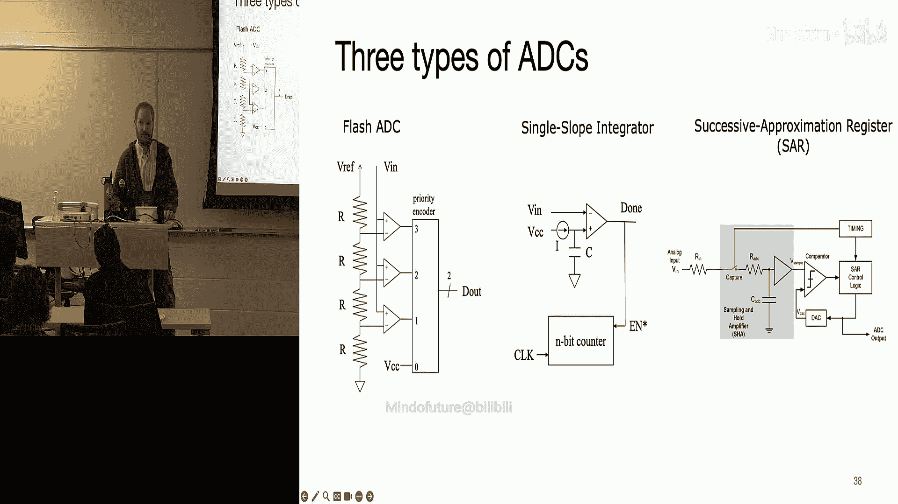

Okay， yeah。then we is using like sort of ocilloscope percent like sample rate there where used do five times。

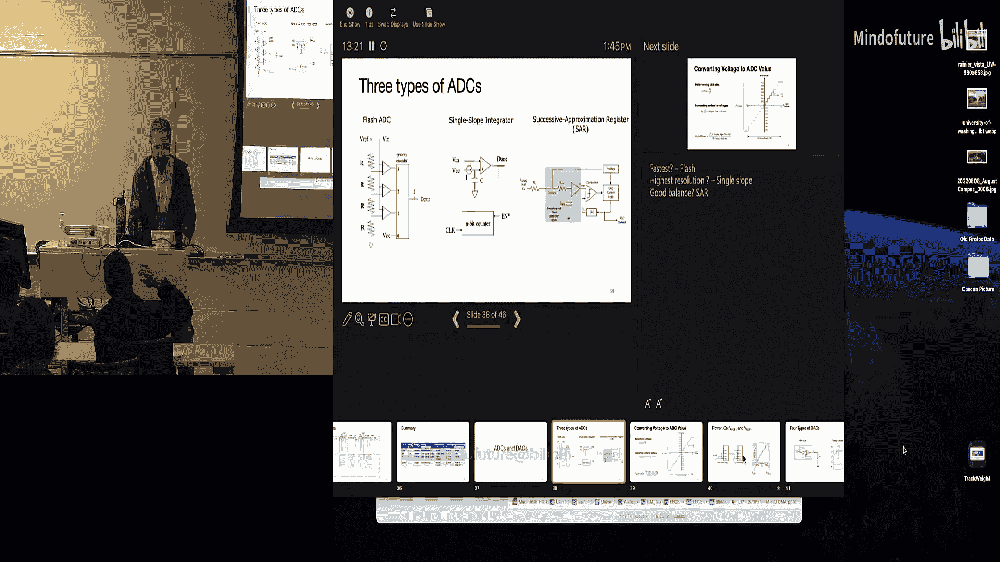

I would say that the most robust way to say is use ShaN's limit your ShaN's theorem for sampling。

 this is how fast you have to go， acilloscope is for you to look at things。

 for you to be able to look at a signal and understand it without using math to do interpret。So。

If you're going to sample something in the real world。

 you should probably go five times faster because this's my rule of thumb for all of you。P。

I don't- well， I'm not going to， let's see。There's a lot of different ways to answer the question or to ask a question。

 so most things that are going to be like calculation base would probably be Shanne's limit because we would probably ask you like what's the fastest this ADC has to go or something right to be able to recover the signal。

 but if the question was， hey， a human's going to read the output of an ADC。Like you。

Or a user or something， then you're probably going to want to go five times faster because it's hard for you to look at a bunch of dots and figure out if is that what's the frequency that goes through that。

 you need to have more information。谢。Okay。So we'll talk about DMA。

 I think there's at least four groups that are going to be using DMA today。

Or I mean in their projects so I wanted to give a quick overview of it and then next year we'll probably have a entire lab focus on using DMA or using DMA in some way。

 so I wanted to make sure you all knew what it was in theory and then you can figure out is that useful for your projects because it does speed things up and it gives you some complexity points。

So the problem that we typically face is say you have some peripheral out here。

 let's say it's an ADC and you're sampling something and your goal really is to maybe take the average min Max that sort of thing that will you'll use this not the actual ADC value itself but some mathematical average of it is part of your thing so what could that be maybe you're trying to。

Do rainland， that rain is not a good one， but I don't know。

 there's some analog brightness you want to look， you want to follow the sun or something you might want to take multiple ADC values。

So that you know exactly which angle and thingss at。

Oh that's a good one so maybe you have a server arm that's sweeping through and you're trying to find some light source and so now you need a buffer full of some value and then you imagine youll find the peak and you got to find the peak of that so how would you go about doing that so the naive way to do it is just to do a bunch of load stores the problem here you have to go from your peripheral all the way to the core and then load it back over here so now you have two transfers which is going take time and of course the opposite would also be true you're taking data out if you're doing DMA or something sorry if you're doing sound generation and you want to go play a sound over through a D there's actually a nice I'm sure Matt and James know where it is at one point but there's a nice website that will take like an MP3 or no wave file and turn it into code C bin or CR that will just play that sound for you so like all that's done for you which is nice and you can play actually pretty good sound like maybe510 seconds anyways。

Could do that by taking out a memory and processing it through the core just that this blocks your core from doing anything and it fills up your bus。

 not in a bad way necessarily， but it certainly holds on your core。

 So DMmaA direct memory access is the idea of。Having some other controller or some other method for directly having peripherals talk to memory or memory。

 talk to memory， it's almost always memory and peripherals talking to each other and leaving the core available to do some other task。

嗯。And so that's nice， you imagine if we were going the other way。

 you'd have your ADC that would just start filling up a buffer as your servo move the light sensor over the sky and then after you've gotten maybe 100 samples or something then you just turn tell the core to turn on。

 it saves a lot of time and effort。So there's two general ways to get this done philosophies there's what's called oh you have a DMA controller which is on your bus and this acts essentially like a second core。

 you don't get to write code for the second core， but you can configure the second core like a peripheral to do a task for you that task would probably be like go to this memory address or maybe on an interrupt。

 go to this memory address， get some value and put it into memory at this memory address and you can set it up to do it circularly or maybe like a ping pong buffer or just from one point to another point。

And then the two modalities are you can do flow through。

 which is data will go from the peripheral and be stored in DMA and' register and then DMA will push it out to memory or DMMA can set it up basically set up the destination address not being the DMA itself but being memory and so now you can pass it through now the benefit of this is that you're pretty。

Tolerrant to slow peripherals so maybe U art would be a good example where the DMA can go push this through what you don't want to necessarily have is have a really slow peripheral in a fast memory and everything's being blocked here that's where DMA comes through but if these things have good timing and tight timing and they're on the same channel which we'll talk about later and you can have the peripheral talking directly to memory and the DMA controller is this telling things where to go basically setting up that bus traffic of saying this is the address and that's the destination。

And so what that kind of looks like is your DMA controllers here on your high performance bus matrix。

 we'll talk about that in a second and then you can be controlling information going through the advanced peripheral bus in the bridge。

 remember these are generally much slower than the advanced peripheral bus and advanced peripheral bus is pipeline and then this matrix is actually the idea that there are several buses。

 there's six buses for your particular device and that means that there's a road with six basically parallel lanes and now you can have different amounts of different six simultaneous destination sources going at once。

And so you can imagine you look here with deepPO ABC's camera and USB。

 these are all pretty high bandwidth things that have lots of data potentially going through them。

 it's not just one sample， it's repeated things over and over again。

 now you can kind of see why the architect chose to put this on the advanced high performanceform bus because now you have a direct line to get the SRAM or to flash and to the DNAA module itself。

So in this DMA bus matrix。You have these ideas of channels。

 you can tell that this was done by engineers and not computer scientists because it starts indexing at one。

But here as it shows you for your particular device what's the mapping。

 you can see that here all of them can get to memory but the ADC1 can't necessarily talk to time or two so there is some synchronization that you'd want to do in planning as you start out your project if you think you're going to use DMA you're going to want to make sure that they are on the same channels to have effective transfer。

 this is for the fly through， you can still get away with a sorry this is the flyby。

 you can still get to work with a fly through in most cases because then you're going to take one channel to the controller or to the DMA controller store that data there that DMA controller is going to send it back out to another location。

啊。And you can let's see what else you can see。Yeah， lots of timers， your SI。

 those are the most of the。Prefers that need DMA。And so just as the quick walkthrough。

 this is the counter example of what you don't want。嗯。All you don't want to go to the core。

 so here you can send data directly through the DMA engine where the DMA engine is controlling the interrupt request so a lot of this is get it interrupt from you aret okay that's going to happen then it tells you aren okay。

 send it to SRAM and then that can all happen autonomously， so there's good tutorials。

 takes a little while to set up but it's not too bad。

There's two basic modes we won't go through all the registers， but there's two basic modes。

 there's the incremental mode where you're telling and there's a couple registers so you can save the direction and the count of how many。

 you know you want to go from memory to your peripheral or whatnot。

 and it tells you how many times you're going to increment so there's an increment register at the keys track of it and then you'll go through in this increment the data。

So this is oops。slides come messed up so this is an example of what would be good for like a ping pong buffer so you can set up two of these you can be filling up one ping pong buffer ping pong will go off set up an interrupt that will tell your core hey start pulling data out of this other one so a lot of these structures are really good for streaming data that's primarily what they're good for。

The alternative one is a circular buffer mode。Os。听咪喂。I don't know why it looks like that。

 but the circular buffer mode basically it's got a memory address and it just keeps going as soon as it gets to the top the memory address keeps coming back down so circular buffers are another good way to deal with streaming data you guys learned about circular buffers and ping pong buffers assume。

Yes， so in that like matrix。I'm confused on the。You were talking about like fly through versus fly by。

 and I was like a little bit lost on how that actually like not not this matrix， the the。Yeah， yeah。

 like is memory supposed to be on here yeah， memories assumed to be on here it' to be assumed to be available on on a channel every channel。

 yes。But it would be， I don't。You can't necessarily talk to SPI， receive and send something to timer。

So it' was just saying like the fly through versus flyby is like a flyby doesn't talk to memory and it talks directly to this other program you could have twos talking directly to each other and then the fly through loads it into memory as like an auxiliary thing that then allows it to go into another channel。

I mean， maybe the slight difference from that is flow through actually stores the data temporarily in the DMA。

Module itself。Before going to memory and the problem here with this one is it takes two memory transfers。

How does that relate to the diagram？I think it's just telling you these are the things that can be connected per channel and what would in the real problem here。

 the real constraint between which one you choose is the speed of your peripheral。

 if it's a very slow peripheral you don't want to hog that channel the whole time if it's an interal thing like where you would want to release channel one。

 let's say then you just use channel one for a moment。

 have your DMA hold it and whenever it's available， you can have a blocking thing at channel one。

 then it'll talk to memory。Yeah。It's a good question。

So you guys learned about circular buffers and ping pong buffers。

 so DMs you know thinking about these data structures and why you would use them in a streaming。

Data mode and providing you with mechanisms for this。

 and so there's a bunch of extra flags you can look through to show you。

 okay here I'm halfway through， like you'll get pointers to show you where you are on the circular buffer and so that your core can wake up and make sure that it's pulling data out from the correct place at the correct time。

嗯。Yeah， I think these。I think these things just got， the labels this got next up。

 but I'll make sure they're updated and put out in the slides。

So that's about all I wanted to point out， there' are just a couple different modes and you're going to have to read through the or the bus matrix channels to make sure that you can transfer data at those times。

When peripherals are ready to Sunday that this is where it's all going to be happening to interrupt requests and DMA is going to be able to take care of that for the core。

So the goal was just to give you。A overview of DMA， so if you needed it for your final projects。

 it was available。Are there any other questions？Yeah。

 you a ping pong buffer ping pong buffer is this the idea so say you had some buffer and you're failing it up right and your goal is。

I want to pull data out of it I want to fill this up and then pull data out and store and use it on my core。

 but the problem is like I don't if I get to the very bottom， then I'm out of memory。

RightSo like now the core would have to be very litigious about like making sure where that pointer is and making sure that I'm not running out of memory。

 so a way to do this instead is you have two buffers。

 they usually call them in code like ping and pong and so you get to interrupt that says when I've hit the end of this buffer。

 then tell the core what to do and then it automatically switches over to the other buffer。

And so now while this one's filling up the core knows， okay。

 I've got to go process all this data because when it come back to the first one。

 it's going to overwrite that data， so it's just the data structure with a little bit of hardware support that helps keep track of what the fresh data is。

People get really religious about ping pg versus circular。I don't know why。

So if as far as your attention is to those profit。I'm a pretty field。

At that moment I not necessarily worry about that particular weight process。ですね。

you necessarily worry about。I would say like if your project is running out。

 it has real time and constraints。Like you're trying to measure some sensor or you are you're trying to put a lot of data over you are where you're trying to put ADCs or D。

 you're trying to play out audio right that's a nice time to use DMA because now your chords doesn't have to keep track of that you could just have a timer that goes off and says transfer this data over。

 can even just be one value right transfer this data timer goes off at one over 44 kilohertz and take a value out of memory and send it to DMA。

And acc doesn't have to do anything。Your core because so one of the problems is you got your DAC is spinning out sound and now your core hogs it or maybe some other interrupt occurs and your core will corrupt your DMA or your D audio output because it's taken too much time and now you hear like a pause or a skip or a hiss in your audio track it's because your core is token up a bunch of。

 wasn't there for the right timing。Yeah， I guess this is more of a practical question。

 but when configuring the DMA controller in SCM 32 QI DE， how do you tell it like？

Whatever the circular buffer take popop offers are， because I imagine you'd have to like。

O those in your main not see and then passing aer something。

that until after you auto to generate or does it like allocate the buffers for you when you compile it it out。

 okay， you just say this is the variable right and then yeah so you can look when you set them up in QIE。

 you get little variable names and it's hidden all the details are taken away from you。

Oh that compile time like you can set them up yourself like hardcore bare metal C， it's not fine。

You'll find， I mean I'm sure you've already found this， a Cuba ID is pretty good。

Most things that you want to do， but remember how many people use cubeB ID a year。

 what do you guys think？稍子。100 k maybe like in the US like how many people are actually like using that cubeB ID20 it's not iTunes right like iTunes they actually make sure it works half the time I don't know right but cubeB ID is like broken especially at the edge conditions like oh my gosh you find like oh I did some weird clocking tree and like now I have to rewrite it from scratch。

So I guess what I'm saying is QBI is pretty good， but just be careful if you're doing really weird things。

 the Wizzy WIig is going to fail you at some point and just be aware that there are limitations that these software because not very many people use it in reality。

 it's hard to support this thing。All right， any other questions about DMmaA？Yeah， is it on the exam？

I would think it， so we did talk about DMA。😡，Earlier in the class。

 and I just about all I've ever told you is it's a way to take data。😡。

From one memory location to another or peripheral to memory without using the controller。

 that's all I've told you， so if I told you like go calculate the timing interval for DMA for something。

 you know， I think that would be outside the scope of the class。

I think I answered this on Piazza too， if you had homework assignments on that or a DMA lab。

 then yeah， I would probably ask you more detailed questions。But now I maybe。

 I've already made the exam， but maybe I should go put an DMA multiple choice question on that。

Are there any other questions？How many people have made PCBs before？点解嗯。And quarter the class？

Sometimes we include a PCB。U。S。Lecture。あ。

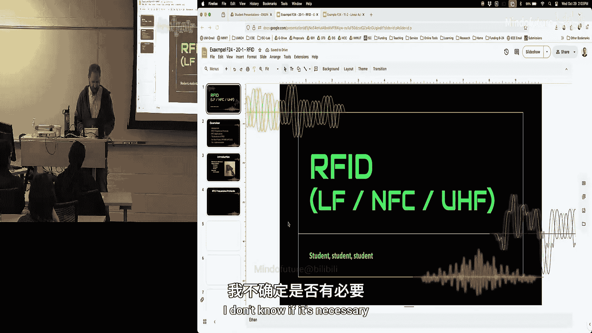

I don't know if it's necessary， maybe all right， so I want to talk a little bit about。About。

What's expected for the presentation so these should be about 10 to 12 minutes long。

 your job is to create a presentation that ends on time please not too short please that will teach the rest of the class how to use these components the goal was to choose components that are actually relevant for your projects for your team and then by forcing you to learn them you'll be more prepared for your own projects and then you would go and teach the rest of the class which are probably going to use similar things so like I don't know about half the class projects are going to use XB so we chose to have on Monday we'll have a team talk about XB so that it kind of gives you guys all a primer on how to use that it also lets us explore a wider number of topics and meta systemss that we wouldn't get to in lecture。

And it helps to hit your AEt certification or our AEt certification of making sure that you present things。

So I was going to go through some any questions on logistics beforehand？Or what's expected？Yes。

YouJust go through like the reference manual like spec sheet。一般注。

I'll go over an example now I took slides from past years for topics that weren't necessarily a part of this class。

 so I'm going to go through them to kind of give you a better example。

 I don't have like a nice lecture on it but my guidelines would be in any presentation。

 understand who your audience is right and so you want to introduce the concept but also like ground it in something that they already know and understand because if they already understand it then they're going be easy to follow you the rest of the way。

 but if you just start talking about， I know this is the ones about RFID if you just talk about ultra high frequency RFID tags in the integrated circuit inside of it。

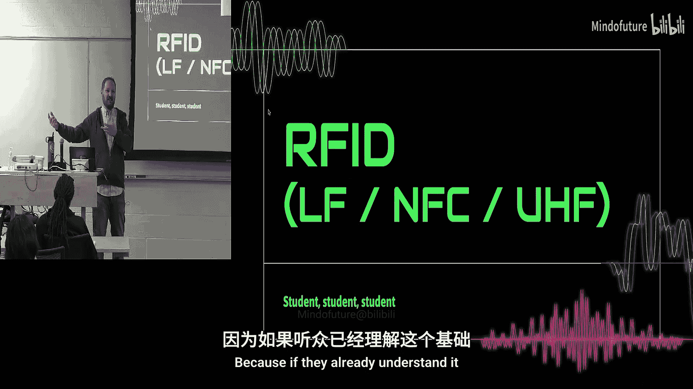

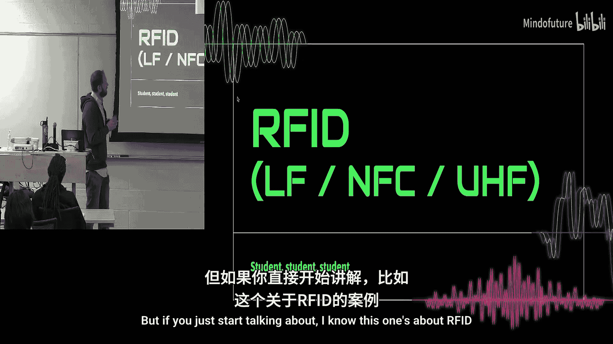

And like super detailed stuff， they may be lost from the very beginning， they'll have no way to。

Catch up with you。And then the last part is like think about what the value of the presentation is for your peer。

 for your group， or for the audience， and that is they might use something here so they need some tangible actionable nuggets of information that will actually allow them to achieve a goal。

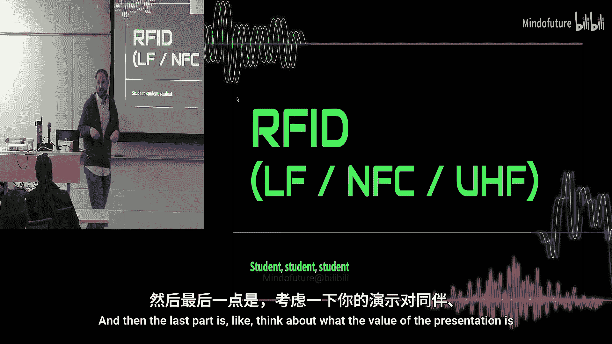

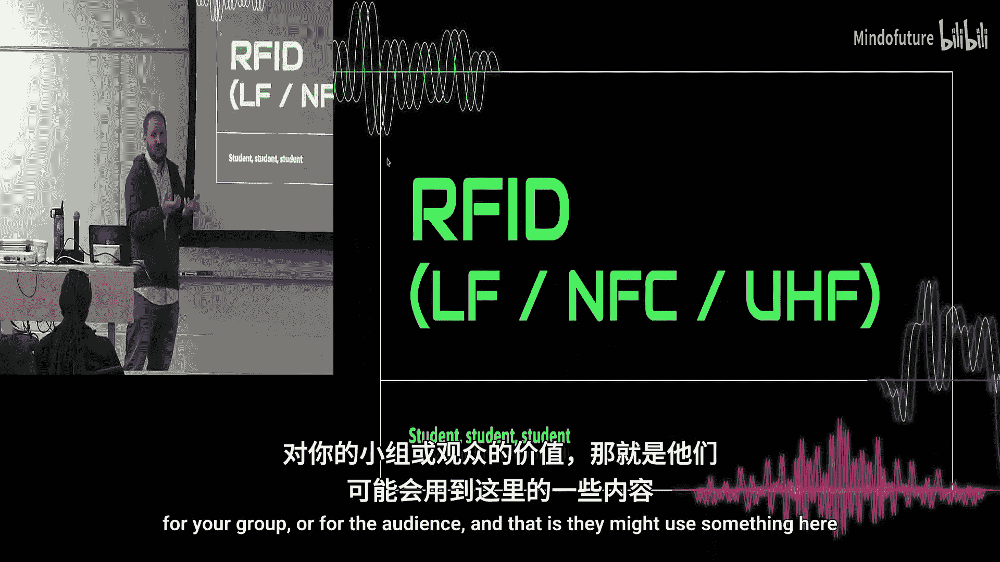

Take a particular component。Good I like how do you like you read the data sheet and providebe a guide and how to use that's approximately correct。

Now it would be good if you also gave some background。

I don't know what' your do you know what your thing is？OhYeah。

Color light sensing IR and UV great so you could just go and say hey。

 I picked up the LM5142 and it has a wavelength of this and that。Be kind of like abrupt。

 people might not understand， but he said， hey， this is how generally。Color sensors work。

 they use photoreistors or photodiodes and have to tune manufacturers tune to band Gap to be able to be sensitive to certain frequencies and now you're kind of giving some idea of like the limitations of what this technology could do I'd start off there。

And here's the underlying physics principles of how we can do this， and then you're like。

 and then there's a particular example here if we could use right and that is this LM 52 level。

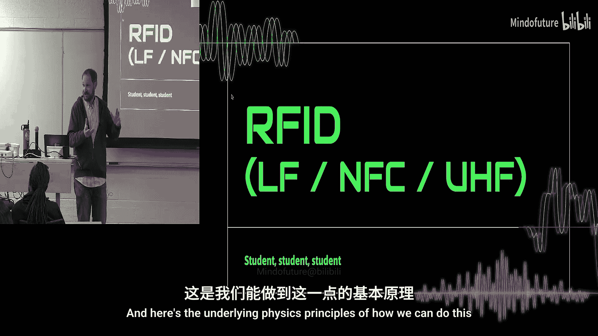

Yeah。What are your thoughts on using the font wingings in our presentation wing what's in what what's a winging in this case？

Let's see you oh fonton， oh， Jesus， no， no， damn it。Well， you can't wing things is unreadable， right？

Like it's not actually like you could just put up gibbr on there， I don't know to help anybody。

 maybe I can give you general feedback on presentations if you use comic Sans。😊。

Your future boss isn't going to think that you know what the hell's going on。

The contents could be good， but it's still comic standss。

It's more of a teaching thing alongside of our presentation can we use the whiteboard if we want if you want to。

 that's exciting。Aye。I don't know why you'd want to。

 because usually that means that you have not thought of what you want to present beforehand。😡，Right。

And now you're on the fly， have to explain some idea。So sometimes when I'm interacting with you guys。

 I'm like， oh， we went off in left field and I better go draw something on the board because I don't have a slide for it。

 but this should be a well canned 10 minutes and it's unlikely the audience will ask you a question that you。

they're not going to ask any questions in the middle of the presentation so maybe at the very end I don't know what were you thinking about doing I don't know it's like if it's like if I'm trying to show a shift register just for example because we're doing LED right I draw the shift boxes I draw you know the things and I shift them over I erase I shift them over just to show things move could you make a beautiful animation。

but that's so much work I mean yeah it doing a great amount great job is work it makes more sense on a whiteboard I feel but I don't know if it's not you know what so part of this game is that your peers are going to grade you will have so you should come to class。

Part of your class participation is come to class and you will fill out a form for each team and then at the end you'll fill out a form to rank the teams to get some bonus points and then part of class participation is did you actually fill out your forms so if it's and you'll get feedback on intelligibility and did it make sense。

So that's a gamble to play I encourage you to spend a little bit more time making slides I know you look at my slides and you're like man that guys like you just asked chat this morning to make them now I know you think that I actually try to make nice slides it's kind of hard。

Any other？

Hesitation questions go through here。All right。Introduction is fine。

 oftentimes I find in presentations that it's a little bit boring to talk about this usually want to get through like the motivation or the beginning idea first。

 but here where we're going talk about， I don't know why you write introduction but RFID frequencies and topics。

 okay so there's a little bit of outline not a big deal。

 I don't know if I'd really want to read through each one of these things in the presentation given you only have10 minutes。

So here。Where they're trying to give you a sense of you've all done this task before of tapping right so here I think they're doing a good job of trying to ground this in something that you know right here is the experience of turning on an RFID tag use it every day and then there's three basic elements so there's an RFID antenna there's RFID that's not how I would do it yeah RFID reader RFID tag and then an RFID antenna and tag are combined together and the trick of RFID in general is that it is battery free。

 there are no batteries inside RFID tag where do you guys think they get the energy from。

the device that's tapmping Yeah， so in the reader itself right this thing is beaming power to it。

 it could be through induction， it could be farfield radiation。

 but it's you know a battery free little device and that's the trick it will last forever and it should be low cost right because you don't actually have to put a battery inside of it。

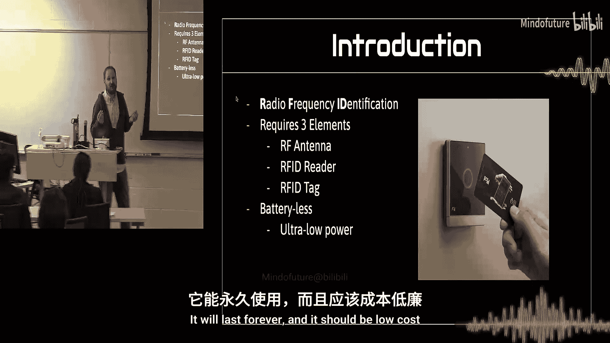

And then they're going to talk， they're going to give you some background here。

 so the idea here is you're trying to tell you that hey there's different types of RFID tags based on the physical layer underneath。

 so there's alter low frequency ones， this is I don't know if you have any pets。

 but this is the pet tracker they're not tracking， but they put little。

capsule injected inside your pet and it has a ID so if the ever gets lost they can be scanned and now you can get your pet back right so it's permanent ID those are really low frequency low range this frequency here 13 mehertz so this is an ISM band this is an ISM band this is an ISM band and this is as well that should be 9。

5 950 megahertz these are the frequencies where it's available for companies to transmit information all the other frequencies the government has allocated for other purposes military scientific like astronomy things or medical devices。

These are about the only places that you could make a consumer electronic devices。

There's another one here at 400 megahertz， I guess here and 6。5 megahertz。

 you' actually find that they're all harmonics of each other。So where are they trying to tell you。

 trying to tell you that the range is also proportional to the distance to the frequency。

 so a higher in frequency， more or less the longer distance you can go。

It actually starts being a limit about here where it starts to go back down again。

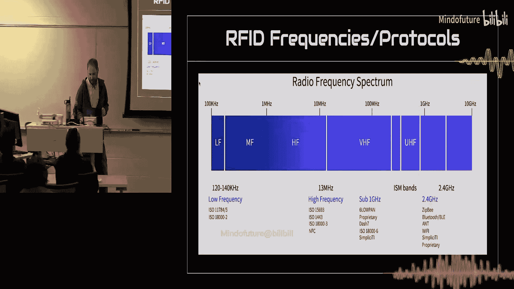

And then they're going to show you here some applications。

 this is the type of coil that would go into your pet payment systems and then there's far field scanner。

 lots for payment secure payment animal identification and then object tracking so the UHF stuff will go for say 10 meters or so that's an ideal case so that's most of this room we could cover with a couple RFID readers and be able to track coursearly where you all are。

 but certainly we could figure out who's in the room and that sort of stuff and I've done some research on that work to try and understand what people are doing in their home。

And I go through when they talk about the anatomy of an RFID tag。

 they're going to specifically talking about this module， this type here this is NFC。

 and there's a coil of wire here and there's an IC here and then the two are bonded， a side note。

 RFID tags cost about， I think the cheapest you could possibly buy in volume is about 25 cents or so。

 maybe 13 cents depending on how big the IC is， and typically the cost is。

One third is the cost of the coil， one third is the cost of the chip。

 and a third is just bonding them together， is the assembly of those things。

Now they're trying to say okay， you have this thing and how do we turn it into how to take this RF energy or AC energy and turn it into some usable voltage of the piece that chip chip could do and they're showing you here's a full wave rectifier and then a full rectifier will。

Just rectify， take the down part of the sinoccial and turn it over。

And what it will do you put a capacitor on the back end and now you get something that's approximately a DC voltage that you can use to power a device。

 it's not a lot of power is coming through here is is going to be in this case maybe a millitt at the very best。

 but more like 100。

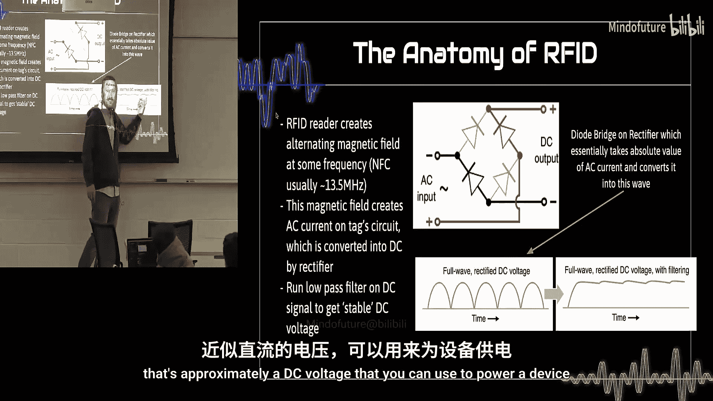

100 microwatts is pretty reasonable for some RFID tags， but it's still usable。

And then farfield RFID tags， these are about this length that happens to be half of the wavelength of the wave prop through space。

And there's a tiny little piece of silicon， and this is the one that can be read up to 10 meters or so。

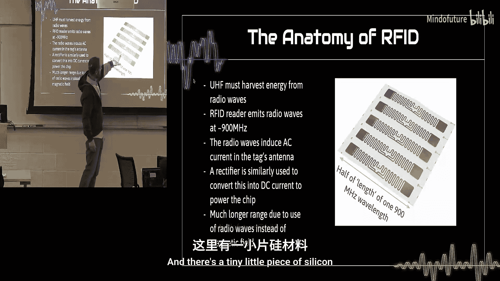

What do they want to talk about here， Annana？OhRead and tags so in this particular case ourA reader is sending out is magnetic field so we're back to the coil case。

 not the farfield case and when you bring a coil wire in here so magnetic field here will induce current and this one current will drive through and it'll go through your recification stage it'll have some control module and then the send data back this is what I think is exciting about RFID at least the far field version oh I'll talk about near field version first near field version first is they short out the antenna so they don't actually emit any signals。

 they short out the antenna such that it will load down the coil more energy will go in here and then on this side they look right here they'll look at how much voltage is going out and they'll say oh the full is dropped down。

Why did the voltage drop down Well this thing is sucking a bunch of bit shunting it to ground therefore I look over here I can tell you that that thing is trying to send me data by looking about how much voltage I'm actually getting out there。

 you can think about that as a voltage divider where you're trying to communicate by shorting out the bottom of the voltage divider to figure out if this load is trying to send data or not the analogy for farfield stuff this is the one we have propagating electromagnetic waves is that I am a RFID reader and you are RFID tags but you don't have any power source so you can't shine any light back at me I take out a flashlight I can send am modulated flights to you but you can't send it back so what you do is you take a signal mirror out just the mirror and you hold it up and I shine my light continuously and you bounce that light back to me and you modulate it by turning the mirror over now now you can send messages to me that's exactly how。

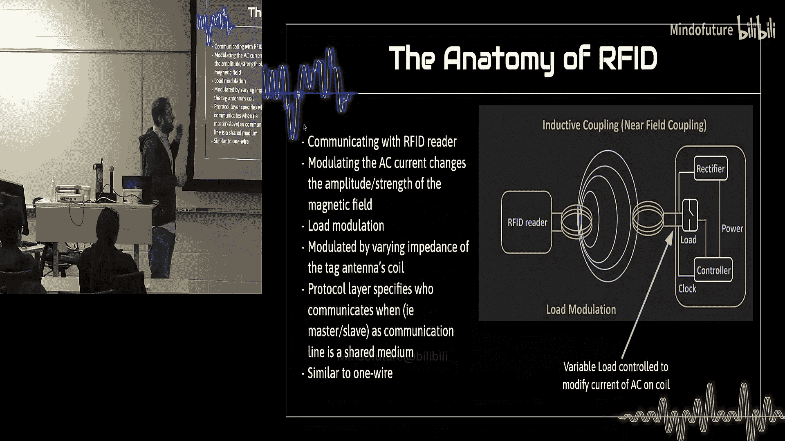

These far field RFID tags work， it's just that instead of sending light。

 they've gone from like 400 or 40 terahertz， they've gone down to 950 megahertz。

Same frequency or same mechanism， they're just bouncing life back and here we're shorting out the antenna to send data back。

 so it's great these things are pretty cool because they can send data but they don't add to transmit any signals。

It only reflects signals。

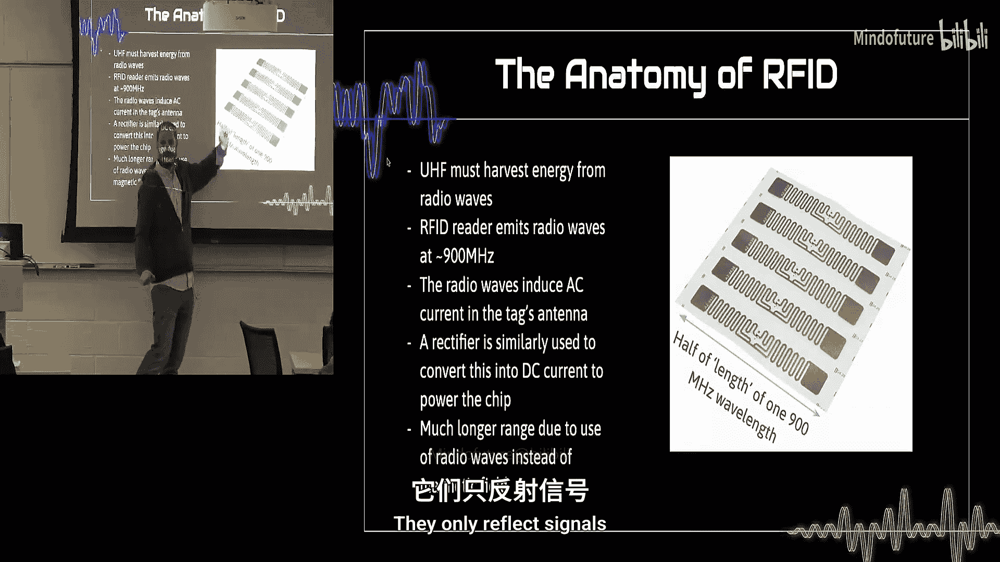

And actually this is what they were going to talk about here， I got ahead of myself。

 I talked about how these things outoo even they must have talked to me or I told them about the mirror analogy。

 to look at this graphic， this is for what even worse than my graphics you guys can do better。

Then now they're going to transition to part of the talk where they're try to make it more concrete for you。

 I don't know if I particularly would have started this way but they're going to talk about particular modules that they have in the lab which is the RCS522 which is an NSC module and all of a sudden there's hard talking about how data is organized in the card I don't know if that's where I would start I probably start here and say this is what the module looks like you can see the 01 header pins it's about this big and this thing has SBI you are or Icord C interface you get to select and basically you can talk to it and it will tell you when the RFD tag is here so now you can have contact this。

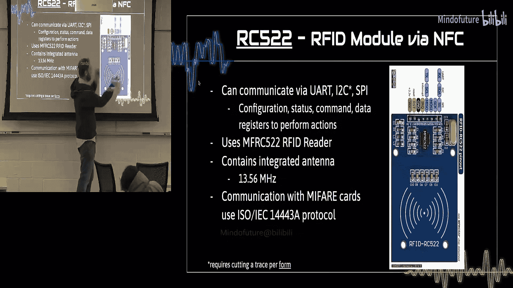

Data transfer， the way they were doing it， theyre playing， believe。

 this is the team that was doing Mario Cart and you would run over something and you would get a speed boost basically。

 and by running over you'd read the tag and then you would know and then and software would increase the available current or duty cycle to that car。

There are just so you know， there are multiple protocols I think they forgot to say it。

 this device only does one protocol is 14443A， but it's interesting I think just because I know this stuff well。

 that there's another protocol called 15556 that uses exactly the same hardwareware everything's exactly the same with the protocol allows the chips to be read from further range。

 you can increase the range of RFID by changing the protocol only。

 it seems like an amazing tradeoff to be had。And then they're going to go through here。

 they're going to talk about kind of theirs setup， they have a battery。

 they have microcontroller right， that initializes this thing， talks to the RFID reader。

 in here you have this antenna analog interface， contactless you aren shore。

 where there's basically a host thing you talk into this。

 there's a buffer where you can send data back and forth and you can read data back in the PC。

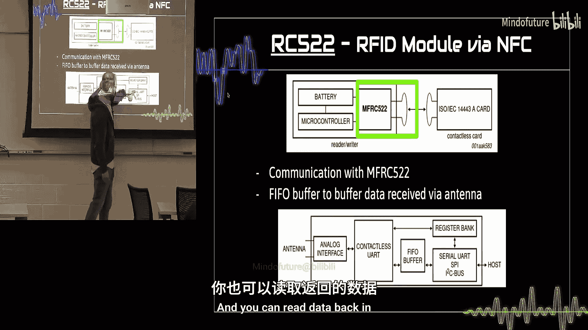

And then a little bit boring demo。You've seen RFID but I like showing demos and I encourage you guys to show demos well as well and here they're just showing these are the sorts of behaviors you can get out of it。

 I hate terminal demos myself I accept that we'll see them in this class but this is pretty boring it's like。

OhMy gosh， did you see the text changed？But you can see intuitively。

 this is the range you're able to get out of this particular device or from lab。

 so you all can expect the same sort of behavior and performance if you want to incorporate it in your。

Projects， so I might。For this one I might have add a little bit more details on SI and how hard it is to set it up。

 maybe they didn't have a chance to actually do that yet。

 but this is kind of an example of what I would expect from you guys， what do you think？Does help？

Right。系。て。I guess the moment， I guess we didn't have your。If you do demo you a center part。

 we instead of how you would do the demo within then like A。

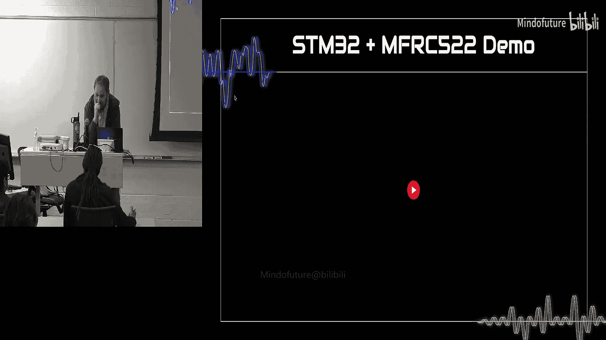

So like say you were presenting on Monday。And you had some like exam you wanted to study for instead and you probably didn't have enough time to set up a demo what could you do it' essentially a question so a lot of those things will have like one of thems an LCD screen I bet you can find online an LCD screen exactly the same LCD screen performing and now people if you're talking about what's the performance of a graphics interface and you just talk about it in the abstract they never see it they'll never understand what you're talking about but showing that demo of somebody else's demo showing a video clip somebody else's demo can help the audience understand。

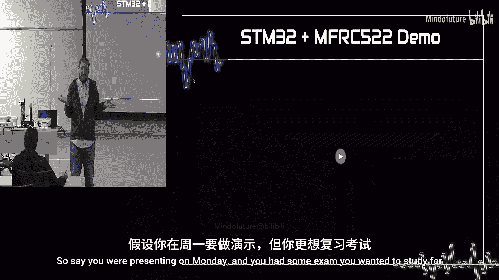

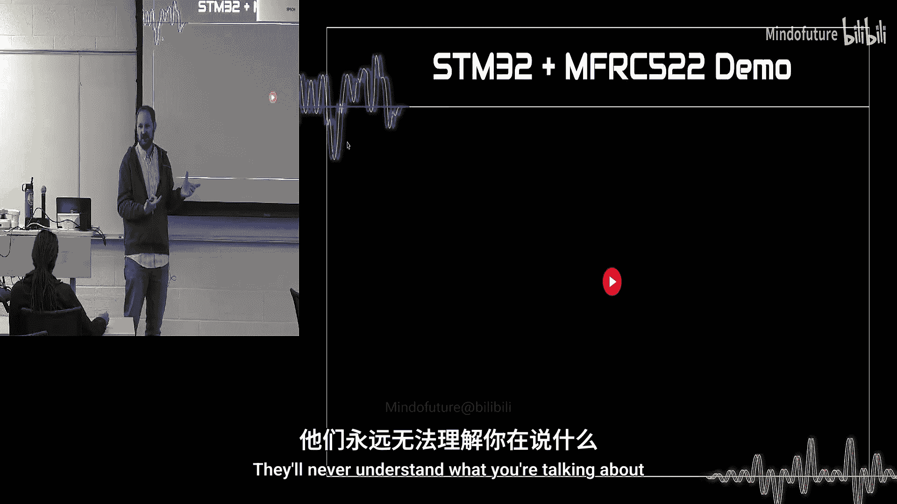

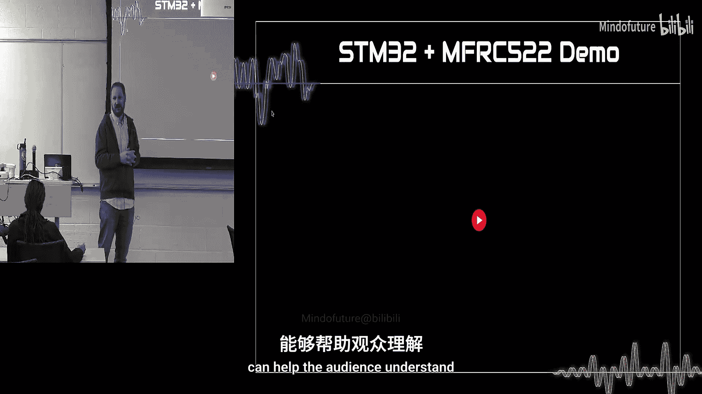

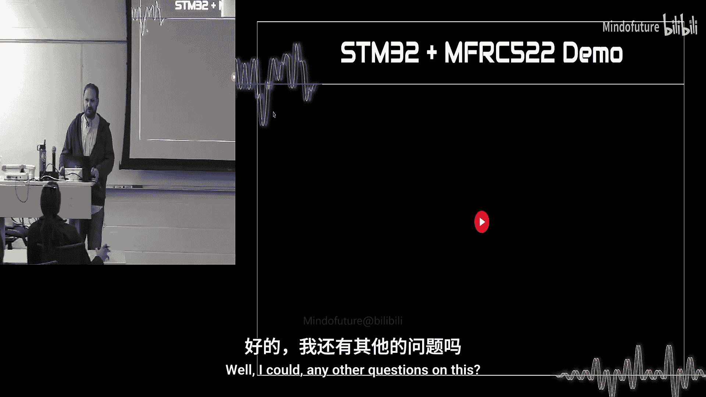

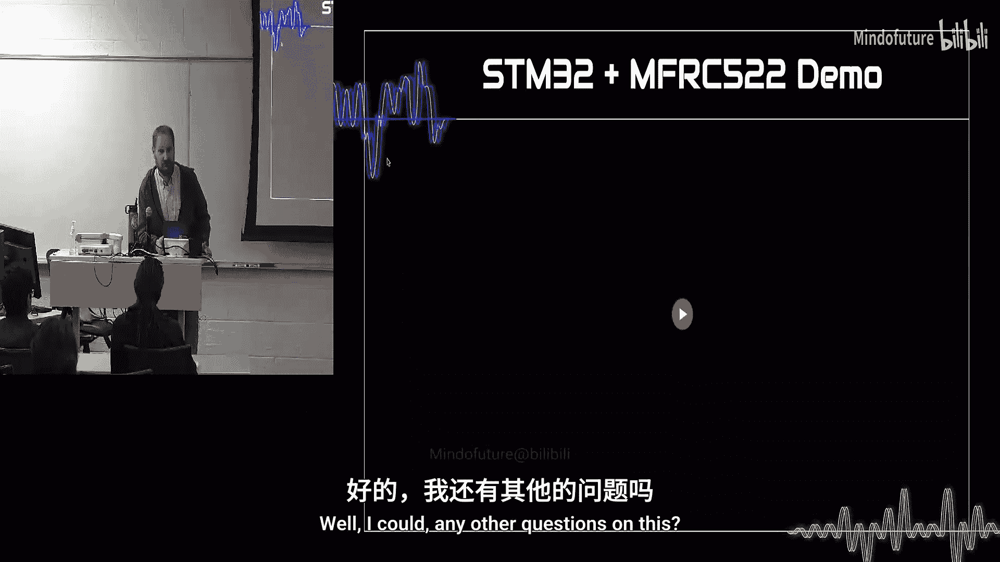

Well， I could。Any other questions on this？Yeah。要自己。

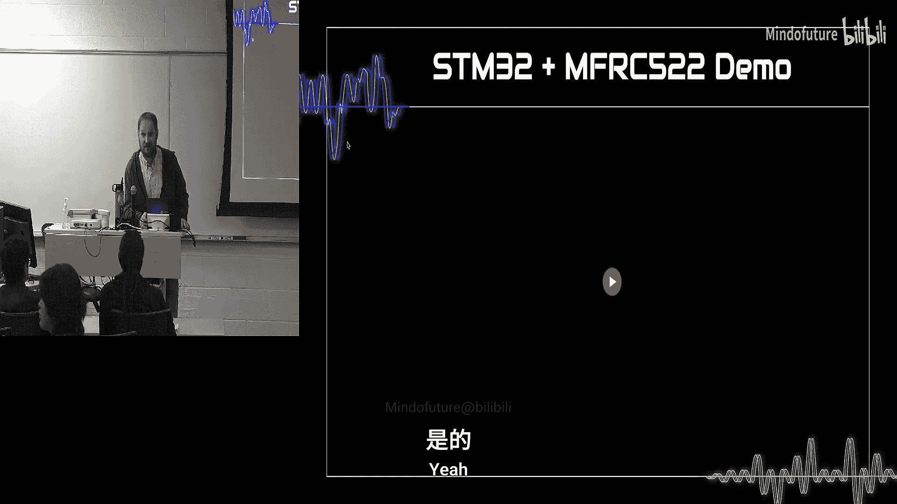

This recording will be。I don't remember what grade they got I'm sure they did find I would not say this is the best possible presentation I've ever seen I'm just trying to give you an example of what I liked and didn't like about it and what I'm kind of looking for that's the goal。

 but these this recording will be made available。think she need like。demos。

 if you were like to make a demo， try to throw the RF ID。In this class， I wouldn't do terminal demos。

I mean， sorry， for my research， my students。I would not。

 I don't accept terminal demos because it's just boring and nobody understands it truthfully what's happening。

 but for this class a terminal demo where like you only have five weeks like totally acceptable。

For your final projects， I hope you can do a little bit of them better。Does that make sense？

Produce one example guess in the case I could say's the final。

I think they're pretty unintuitive because you're like， hey， see。Oh， did you see that。

 that's why I'm so good look， look。That changed。I can't understand anything。

 but at least you could go， I think they let's see if the LED changes when they do things Nope doesn't change。

 at least they could have an LED change right that says red。And then you're like， oh， okay。

 I understand the distance， there's something to learn that's more intuitive than trying to look at a screen。

you guys and like the peers can be grading the song is it just like how good it is like like what's it graded on I think I have to go look at the metrics。

 but it's something like clarity like of presentation does it make sense did you learn anything？Um。

Could you could you explain the concepts to somebody else if asked。

 could you implement it if asked now of course？NoThere's not possible in 10 minutes to make it so you could completely implement RFID。

😡，But you should at least not have to start from scratch so there's some ratings there if you' if you're real excited you compose on piazza and I'll give you I'll show what the metrics are but this's pretty much。

Clarity。depth of content， and can an audience member teach it to somebody else？Yeah。

 everyone's presentation slides be like available afterwards okay， so you're all going to。

 even though I personally do not like Google slides。Because they're horrible。

I expect that you all use Google Slides， that's totally fine if you want to use PowerPoint。

Don't use keynote but we'll have a folder before the lecture that day it's best if you all put your presentations in the folder and then we'll have one computer that's queued up。

 you can just give your talk and then all the slides will be available for the rest of the class and then if you just want that quick reference on how to get motor drivers up and running。

 you can look at that lecture slide。这是 this。All right， well， I could talk about PCBs。You want PCBs。

 you don't want PCBs， or I can let you go。How about raise your hands for let you go？PCBs。Oh my god。

 all right， let's do it。Yeah。But like the final project， if you like run out of ports on the STM 32。

 do you have to use like a PCB then if you run out of what ports？U。

Well PCB won't help you get more ports but you could use two SCM 32s。You could use a GPO expander。

 which imagine you would use a USB or sorry not USB like SI interface to a module that would emulate multiple GPO pins so you could get another 32 GPO pins if you wanted to。

 the bandwidth will be low and it's not be convenient but there are these things that exist。In fact。

 Matt Smith has made you a nice GPO expander， which is described in detail。On the data sheet。

 which has been released， so you will know all about them。Because he ran out of GPO pins as well。

Yeah。😊。

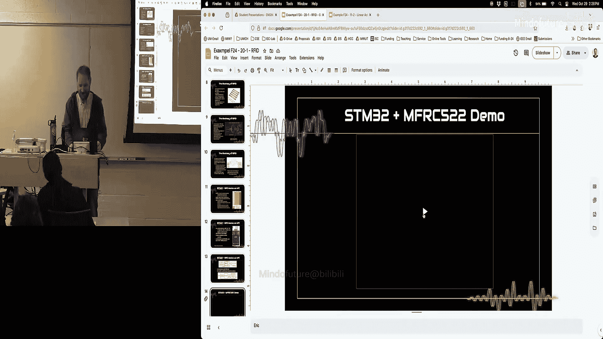

All right， let's see what horrible slides I have about PCB design。

去道。any other questions， I get those slides up。Yeah。Yeah。啥。

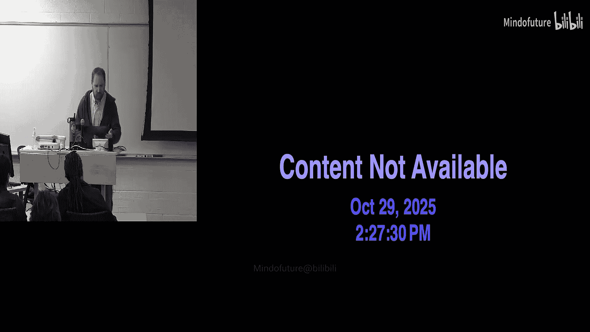

呃ok。Maybe these slides are a little bit less about how to actually design a PCB like the process of choosing where to put your tips and all those sort of things oftentimes is just experiential learning like you have to have gone through it a few times you're like okay I'm charting and get this and you get feedback from people but if you just start off I say tomorrow go make a PCB and you have no background on like even how they're constructed or what the goal is then it super intimidating so the goal of this lecture is kind of give you the background on how PCBs are made and so you have all the terminology and generally what the design considerations are。

 but not necessarily tutorial on how to lay out microcontrollers。啊。

So PCBs can seem like there's something magical， something like like you actually have to know like about electronics and all this sort of stuff but really PCB is just wires。

 it's just wires manufactured by somebody else in a particular geometry that's really advantageous to you so everything that you'll put on a solderless breadboard is essentially the same exact thing it's just been made into a purpose-made solderless breadboard and soldered this will be soldered but it's just all the wiring that goes through the components that's all we're trying to accomplish。

There are tradeoffs here， your wires on your wireless breadboard are thick。

 they can take amps of current， you have to if you think about high current stuff you'll actually have to do some calculations on how much current your thing can deliver。

 but here you can see these little traces in here so this is I don't know some resistors。

 this is through hole resistor and there's a wire that goes through here and it goes to some other through hole resistor and if you wanted to put it amp through here you'd have to do some calculations to make sure that's thick because these thins are these traces are only say 31 mills which is a thousands of an inch I don't even know what it is anymore I've been working in this so long I only't know what mills are I don't even know what they stand for but they're very small。

And so here's an example， this is a throughhold board。

 which is becoming more rare here and where the parts， once you make the PCBs。

 the parts are placed on here， I don't know where it goes from one to one。

Or placed through the board， the more common type is a surface mount。Looks like this。

You don't have the hole that goes through， you have a part that sits right on top。

And this is nice because on the bottom， this hole goes all the way through and I can't put things underneath it。

 so this actually eats up a significant amount of space over time making layout harder。

 although it is a much cheaper way to make PCBs Does anybody know how much a PCB costs to make like this big what do you think？

How about $500？How about two layers， two layer PCB， who thinks it's more or less than $500。

 or how about more？Okay， you want less？Okay，' less than $50。$5。A little bit more， about$5。

 approximately。So I don't know how big this is， but you can get really cheap PCBs made overseas well with the tariffs now。

We actually got caught by it one time where we had to pay。

 I think it was like a couple thousand dollars for boards。

 because we were making complicated boards and like 500 of that was tariffs。ok。That's fine。

But you can get them made overseas because they're trying to drum up so much business they usually heavily subsidize the smaller PCBs。

At least a couple years ago， it was not uncommon to pay$5 per board and then pay $50 for shipping。

So it's just a penalty of two or three weeks to get the order shipped here from China。

So from your point of view， it's。Feaible to do it for a class project。

 I'd want you to talk with me and Matt and James to make sure that actually fittings in your timeline is useful to do because we certainly have had teams that try to go for PCB and it fails or something's wrong and then they come up through their demo and it literally is just a pile of parts in hopes and dreams。

And Im like， I can only grade things that work。So that was a challenging time to make sure we could give them some points for it because they really didn't have anything demo if you're thinking about that。

 the path is you get something working first and then you try and get enough of your thing working beforehand so that you're like okay I know what to build for my PCB you build that in parallel and then hopefully like in that last week it arrives and you can build it all out so it's a big highrisk high rewards or a scenario。

嗯。What else I want to talk about if you guys have questions you can just ask。

This is kind of a typical PCB on it you have these are called it's not Vs， this is called a pad。

 so there's this terminology of。I don't know if I agree with all everything I put on here so these are pads。

 pads are things that you would put surface mount components on you could also call this a pad even though well it is a drill hole。

 but this is meant for like especially this one is a pad is a landing spot in this case for 0。

1 headers。And these would get put in here in soldderdon and this happens to be a pad with a hole in it that is different than a drill hole let's say like this。

 this is supposed to be a V that only allows signals to go from the top layer to the bottom layer and so it's plated it should be。

Like this is a hole with nothing connected to it， this is just for mounting holes for putting you know a standoff on this electrically connects the bottom and the top。

 which means the inside of its plate and the same thing happens here。

 there's no real from the manufacturer's point of view。

 there's no real difference between a via and a pad with a hole in it。For throughhold。

 but your CAD software makes a big difference about it because they have different usages。So pads。

 hole see mounting hole via and a hole in a pad， and then this is also this is a surface mount dual in line package。

 something， something that is you would put your chip on here in Sa。

The the green PCB is usually PCB is like a tan color and then they'll go and they'll put a material color over it and this is the silk screen or no this is the solder mask and what it's doing here is you have a pad and this is tinned copper so tin is a material that keeps the copper from optizing and then you can see this trace here is actually greenish that's because they put the solder mask over everything except for that pad and so this protects solder so one way that they make PCBs it's kind of amazing if you go back to here。

Like this PCB， they take the whole thing， they put all the parts in here and then they have。

 it's called wave solder and they have a tank of liquid solder solder and it's actually flowing over。

A little waterfall and they take the PCB with all the parts on it and they run it through。

And my brain says that's a disaster， if I did that I'd have solder everywhere and it would be a big mess。

 but if you do it properly， that's the way you can solder everything from the bottom。In one pass。

And so that's why these are so cheap， you don't even have to put them in an oven you literally now they have these little tracks and just kind of go like that and the whole thing will be immersed on the bottom and get soldered in one go so that's why these are cheaper electronics typically than surface mount。

I like these because these， you have to place everything down。

You have to put the solder paste here first。Saer paste is just small particles of solder in a suspension。

 and it makes us a little paste， you would put it down on a pad using solder a screen like a so screening process。

And then you put your partsse down on it and then you put that whole thing in the oven。

 that's just much more time consuming than this task。

 that's one of the reasons those things cost more。This is an example of what is this a five six layer board。

 this would be a sliced representation and so typically we think about the top layer and the bottom layer when I started my PhD two layer boards are cheap and four layers was like oh my gosh like impossible like this is too expensive now four layers it's just the same as two layers almost if you get six or eight layers is still pretty affordable there just has to be a good reason why you'd need extra layers。

U。So the green here is the solder mask that is chosen to be over the copper if you want it。

 or you can leave it exposed， then they have has some pre this。

Using different terms that I would use they pre oh in the core so here's the core material and then prepg basically they're going to take four pieces of FR4 the cop so FR4 comes with sorry FR4 is an epoxy。

That's FR For stands for Fire retardant Class4， which means that it' unlikely your PCBs are going to burn a lot。

You can burn them a little bit easily， but they they will not burn on their own。

 so you have to use what's called E4 if you ever need a cut E4 it's fibroglaastics toxic that gets in your lungs it' cause cancer eventually。

 so don't do it a lot the amount media cancer is just event cancer。

So let's see this right here is this is the core， so the core comes with copper on top。

 copper on the bottom， and then they etch away all the stuff we'll talk about that later and then they put prepeg in between and then they make a big sandwich out of it and then heat the whole thing up。

And so here you can see that each layer you can put copper on it or coppers on it to begin with and then they etch away。

All the places where they don't want copper， then they'll come through and drill holes through everything。

And now the problem is as you align， all these boards have to come together and all these Vers have to be aligned up and this is actually tricky process。

 and so what the manufacturer will tell you is for a typical for a particular drill size。

 they want what's called an annular ring。You can kind of see part of that ring here。

 you have to have a size as' big enough， so that's imagine here they're trying to hit like a dark board so you can see this is an example of when you're going to draw stuff。

That was not prepared， I went off on a tangent。Okay。

 so you have a ring and this is going to be your hole， so this is the thing that's drilled。

 but this is all copper as well and they're saying I need to have enough copper。

Here so that if I'm off say I'm trying to alignment and my next hole is over here is off by a little bit。

 I can guarantee all these things will align I is giving them a little buffer room so that they can be misaligned so that's why these anular rings can be pretty large that makes sense。

Okay。I teach all my students typically we start with a four layer board。

 so components on top and bottom one layer doesn't matter which one it is should be a ground plane。

 you should pour copper you don't pour copper you tell your tool pour copper Al much still calls it pouring copper and that'll just be a ground plane that goes through everything you don't necessarily need a power plane for most designs。

 power planes are fine if you got you know you 1420 layer PCB， you don't really need it。

 you can just have wires themselves going through the power plane or that other you layer that goes through you need and then you can use the other space for routing signals as well。

That's my suggestion。Any questions so far？Randomly just talking about PCBs by myself。Sorry。

Go a little bit through the manufacturing process just so you kind of know's why your design tools keeps asking you these crazy things and like why they're really worried about silk screen and silk screen keepouts and all this other stuff so this is our goal we're trying to get to something that looks like this actually this is your first goal is you're gonna make Gerber file so after you've gone through and you laid out your copper in CAD I should have a nice image of that somewhere but imagine in CAD you've told it heres I want all my copper here I don't want my traces here and got some slings on the bottom I want。

Those are going to make file types called Gbers。Why I don't know。

 I don't know why they're called Gerbers， I wasn't around then。

 but they're basically a slice of each layer of it only says where I want copper。

There's OBD2 files as well that tells you how those copper things are connected。

what you're going to do is just curber files and basically it's just a you know no copper versus some copper。

 that's it。And that's the file you send and you send one Gerber file for each layer and your PCV。

 and that could be all your metal layers， but also your silk screen and your solder masks and all those layers。

So you start with an FR4。Copper on both sides。Then they're going to go through and they're going to drill holes through everything on here right so they're going to drill see what they're going to do and then they're going to electroplate electroly plate。

 I don't know， they're going to plate the copper， they're going to try and plate。

Yeah they're going to try and plate the holes， they're trying to connect the holes in here from the top to the bottom where they're supposed to。

 so that's a challenge in the sense that FR4 is not conductive and now you need a mechanism to actually as an interesting chemistry problem of how do you get copper to stick to something nonconductive well there's a bunch of interest in chemistry that I was not willing to reproduce in my lab so that's what I learned about it。

Next is you need， oh so here you have copper filled holes， but now I don't have my design yet。

 so I need to get my design on this and I'm going to remove the negative of my design。

And so what they do is they apply photoresist to it where they're going to is either photo positiveitive or photo negative。

 I don't know， it depends on which one you're going to use， but a photoresist。

 they're going to put it on here only and then they're going to use light to a light pattern through a mask to make certain regions hard or soft and basically what you do is you go through and I think in this particular one they're using positive。

 so all these little areas right here they're going to keep the photoresist on so they're going to shine light where they want to keep copper。

And then they use an acid and they eat away all the copper where there isn't photoresist。

 so now you can use light light patterning mechanism to define where your copper is going to be and then you。

Remove everything where the photosreist was not， and then you go and plate the copper with tin。

And the use for use 10 is as non reactive。I think I got out of order here for this particular PCB mask cream process。

 but I guess now they've gone through after they've tinned。

 they're going to go and dump it in acid and they've eaten away everywhere else that you remember it started with copper and now they've eaten away the copper。

 so it's a loss process in that sense。And then after that they're going to go and put PCB solder mask on so remember here I probably can't see anything because the image quality is bad。

 but there's traces here and there's pads here so both are exposed by putting solder mask on you ensure that no solder can attach here and this comes back to the idea of if you're taking that thing and using wave solder if solder is going everywhere you want to protect it so it's not going to jump a bridge across here this is not going to be covered with copper I mean with solder it's not just generally good to have extra stuff around and it can cause more errors and so that's why the solder mask is there just protect those traces。

S。Go。Then you get a silk screen layer， silk screens layer is for you。

 you're trying to remember you're trying to help yourself in the future when you're trying to assemble it。

 so I've certainly seen some 373 students say， oh， I just didn't get to silk screen。

And then they're like you they get boards back and there's no numbers anywhere and where do you put R2 like oh my gosh it's an amazing decision to have that happen but you get to go and put silkscreen on there and so take a little time you know you take you know it's just you in some good music and Ca pushing polygons around and you're hoping you know put silk screen next to your component there's some standards you can use basically try to align them all in the same direction。

 make it easy for yourself now it's cheap you can get silkscreen on top and bottom there was a time when that was actually an extra cost。

And then what's this finishing thing， maybe they're going to refinish it with H again。

 I'm not exactly sure。There's different ways to get your。

PCBs to arrive to you what they're going to do is they're not going to make an individual PCB typically they're going to panelalize it so their equipment set up to say take PCB is probably about this big two feet maybe by foot and a half and the big manufacturers like PCB way and JLC PCB they have a set of requirements they say you can have PCBs are this size and they have to have this trace tolerances that's because they're saying I'm going to I expect to be making。

You know，40 different PCB projects today， and I want them to as many of them to go on the same piece of material as possible。

 so they'll batch your design with everybody else's design and then send it through their process and they'll come out something like this。

 So this is like panel routing and then what they'll do is they'll break it off in package up for you you can get things you could ask them where you could make your own panels。

 I certainly did this when I was at Intel we were making really small things。

Because the boards were so small that our assembly assembblers these are people that will put the parts on and solve of them could not hold our boards they were just too small to hold so if we just handed them our boards they'd be like。

Well， it's cool you spent you know$6，000 on them， but I can't， this is too small。

 so what we knew is that obviously it wasn't this board is that we gave them panelalized boards。

 now their equipment could hold onto it easier， they would put the parts on there。

 bake everything at once and then break the boards apart for us。

So this is an example of something that was penalized， they didn't do it for size。

 they probably just did it for cost， and then they're fully assembled and they break them off and you can use them。

U。We talked a little bit about VAs that's fine， we talk about clearance and I'll let you guys go so clearance there's probably three numbers you need to know for any PCB manufacturer at kind of like the hobby graduate level。

 even if F's a small startup and that is what is the trace the minimum trace size that this process will allow six millls is kind of a nonaggressive but good size。

And they're saying my traces their fabrication techniques will not guarantee the traces less than six mils will be manufactured correctly doesn doesn't mean your entire design should be six mils that might be risking things and certainly signal integrity and power consumption reasons you might want to have definitely have larger traces but they're saying six mils is the smallest we can make the next one is clearance from one trace to another one what's the minimum clearance they can have and typically for JLCpB and PCB wayss that's like six mils as well so itd be six and six but sometimes you might get down to four depends on what you're looking for dependss what you're willing to pay and the last one is minimum hole size so that might be six6 and8 or eight mils is the smallest drill size that they'll allow on that PCB manufacture so those three numbers you have to keep track of trace thickness clearance and vs size what's the minimums but whenever you guys make a PCB the first thing you do you figure out which vendor you'。

And then you import their design file or their design rules into your CAD software。

 so I have definitely personally made the mistake of designing a board that could not be manufactured。

Because I didn't put the design rules in now thankfully I wasn't that far off。

 but I had to go and redo some of my design and move things out because the manufacturer ended up going with couldn't support my design files。

All right， so hopefully that's a little bit of a primer。On PCBs， I'll let you guys go。

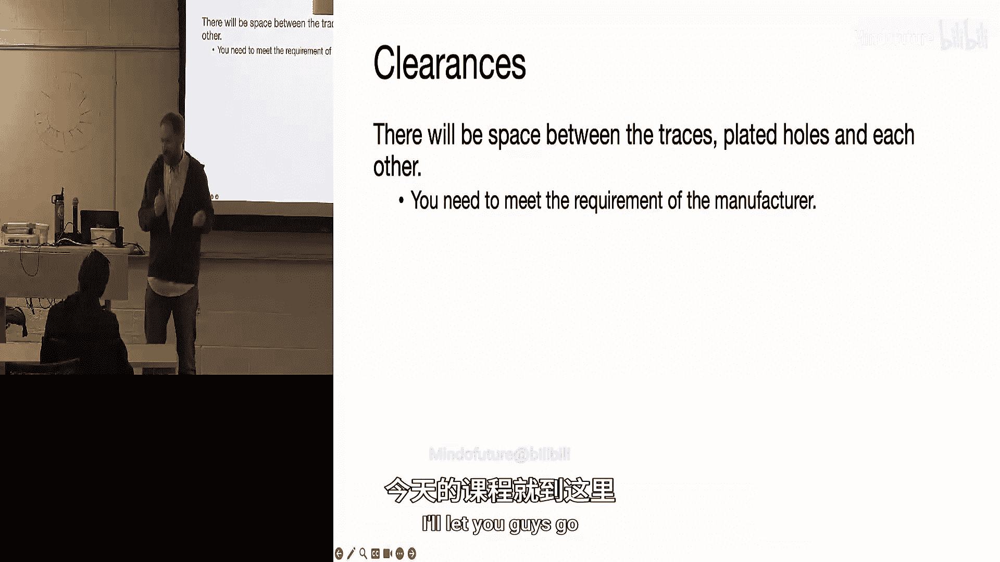

And I'll see you on Friday。

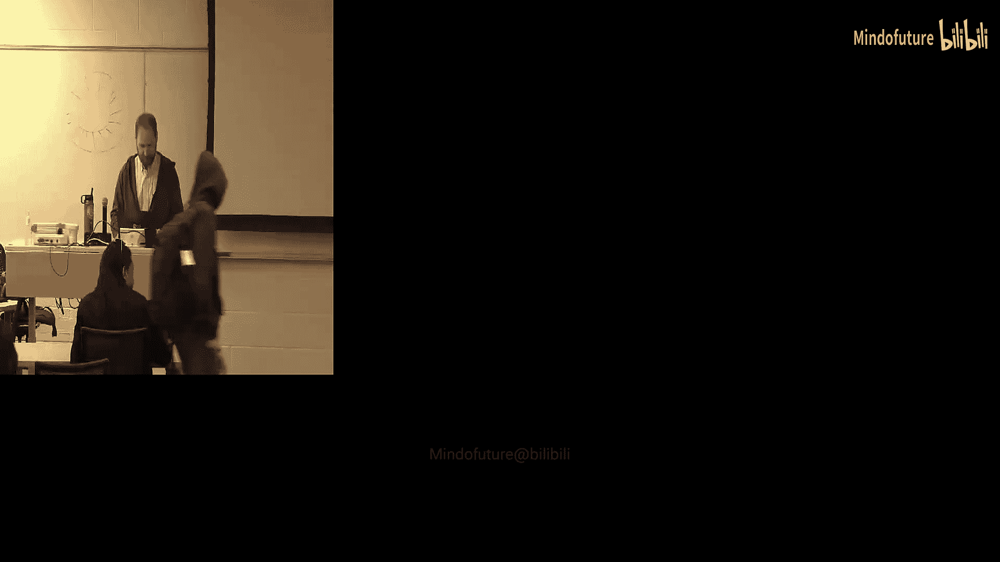