# 嵌入式系统设计导论：课程17：DMA与PCB

## 概述

在本节课中，我们将完成对模数转换器的复习，并介绍直接内存访问的基本概念。此外，我们还将讨论学生项目展示的期望，并简要介绍印刷电路板的设计基础。

---

## ADC复习与答疑

上一节我们快速回顾了ADC。现在，我们来看看大家可能存在的疑问。

以下是关于ADC的一些常见问题：

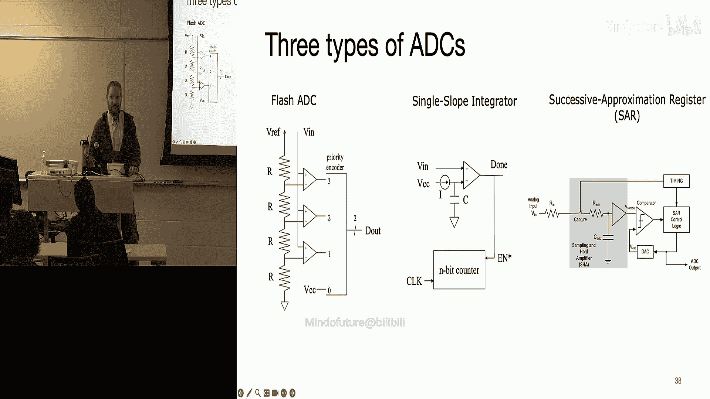

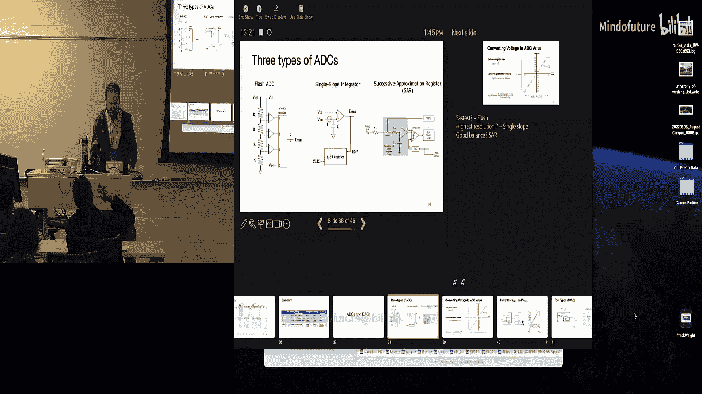

*   **分辨率公式**：ADC的分辨率通常表示为 **2^n** 或 **2^n - 1**。数据手册常用 **2^n**，但 **2^n - 1** 在理论上更精确，因为它考虑了从0到满量程电压的所有量化电平。对于高分辨率ADC，两者差异很小。
*   **ADC类型识别**：可以通过结构识别ADC类型。
    *   **逐次逼近型ADC**：包含一个DAC、一个比较器和控制逻辑，通过二分搜索逼近输入电压。
    *   **斜率积分型ADC**：包含一个电流源、一个积分电容和一个计数器，通过测量电容充电到输入电压所需的时间来转换。
    *   **闪存型ADC**：包含一个电阻分压器和一组并行的比较器，转换速度最快。
*   **转换时间与分辨率**：在斜率积分型和逐次逼近型ADC中，可以通过增加转换时间（例如，降低时钟频率或增加比较次数）来换取更高的分辨率。
*   **采样率**：根据**香农采样定理**，为了无失真地重建信号，采样频率必须至少是信号最高频率的两倍。在实际应用中，为了让人眼或算法更好地观察波形，通常采用**5倍或更高**的过采样率。

---

## 直接内存访问

上一节我们讨论了数据在CPU控制下的传输。本节中，我们来看看如何让数据在内存和外围设备之间直接传输，从而解放CPU。

### DMA简介

直接内存访问是一种允许外围设备与内存之间直接进行数据传输的技术，无需CPU的持续干预。其核心目的是**提高系统效率**，让CPU可以处理其他任务，同时减少总线拥塞。

**应用场景**：
*   ADC连续采样数据到内存缓冲区。
*   从内存缓冲区向DAC发送数据以播放音频。
*   在外设（如UART、SPI）和内存之间传输大量数据。

### DMA工作原理

DMA控制器作为总线上的一个独立模块，可以像第二个简化版CPU一样被配置。CPU通过设置源地址、目标地址、传输数据量等参数来启动DMA传输。

**传输模式**：
1.  **外设到内存模式**：例如，ADC采样值直接存入指定的内存数组。
2.  **内存到外设模式**：例如，将内存中的波形数据块发送到DAC。
3.  **内存到内存模式**：在某些架构中支持，用于高效的数据块搬移。

**关键概念：通道与仲裁**
复杂的微控制器具有多通道DMA和总线矩阵。不同外设可能被分配到特定的DMA通道。设计时需要确保源和目标外设能在同一通道上有效通信，或通过DMA控制器中转。

### 数据缓冲区管理

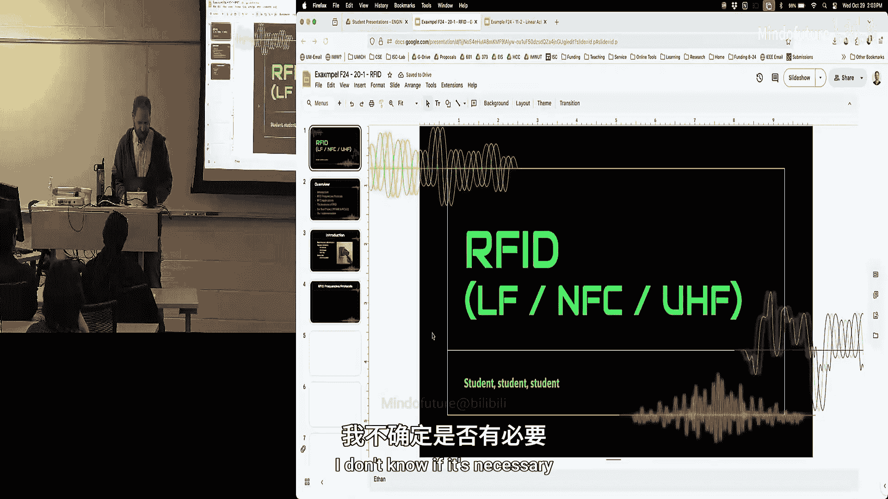

DMA常与特定的数据缓冲区结构配合使用，以实现流式数据的无缝处理。

以下是两种常见的数据缓冲区模式：

*   **环形缓冲区**：DMA配置为循环模式。当指针到达缓冲区末尾时，自动回到开头继续写入。CPU从缓冲区中读取数据。这需要软件妥善管理读/写指针，防止数据覆盖。
*   **乒乓缓冲区**：使用两个缓冲区（A和B）。当DMA向缓冲区A填充数据时，CPU处理缓冲区B中的数据。当A满时，触发中断，DMA自动切换到向缓冲区B填充数据，CPU则转而处理缓冲区A。如此交替，实现连续处理。

### 使用建议

*   **适用场景**：DMA非常适合有实时性要求、数据量大或需要CPU同时处理其他任务的应用，如音频播放、数据采集、图像传输等。
*   **配置工具**：像STM32CubeIDE这样的工具提供了图形化配置DMA的功能，简化了设置过程。但对于复杂或边缘情况，可能需要直接查阅参考手册并编写底层代码。

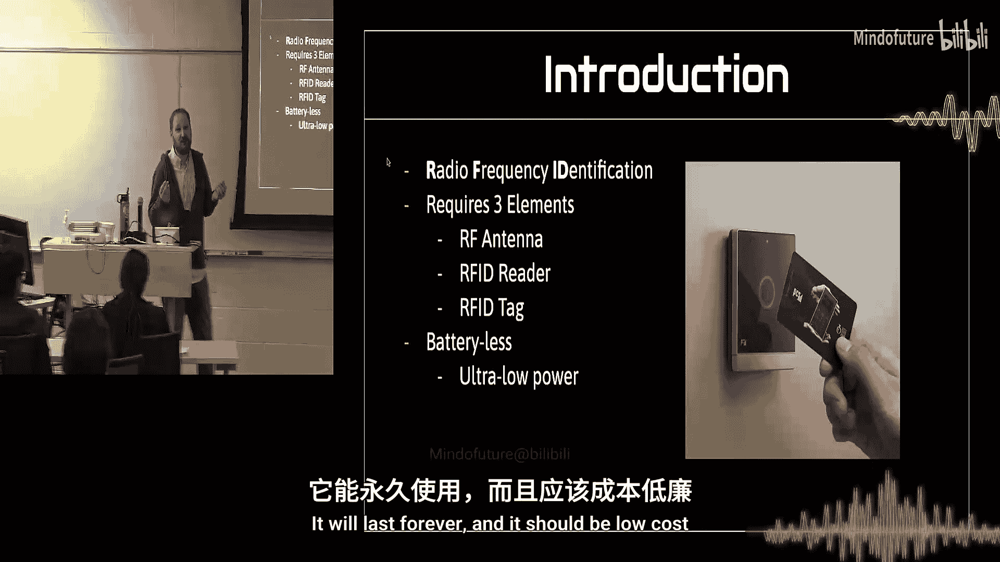

---

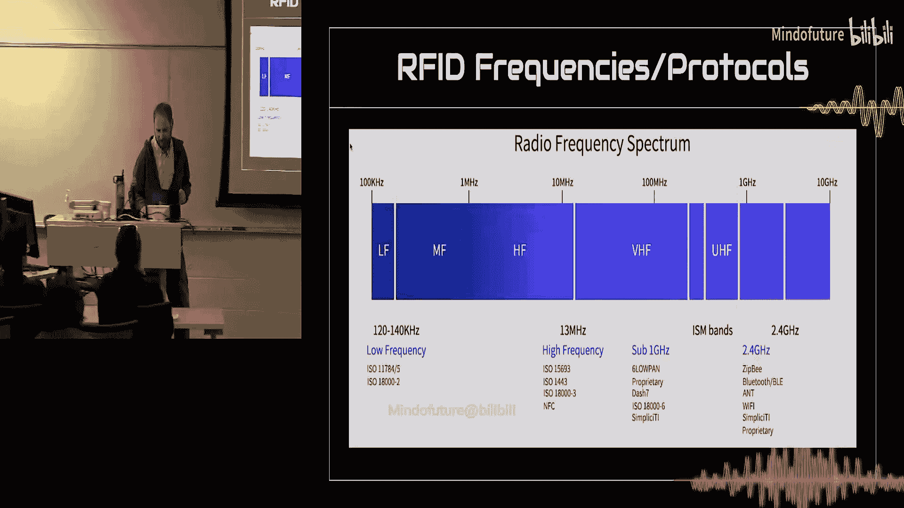

## 学生项目展示指南

在学习了DMA之后，我们将注意力转向课程的另一项重要活动：学生项目展示。本节将说明展示的期望和目标。

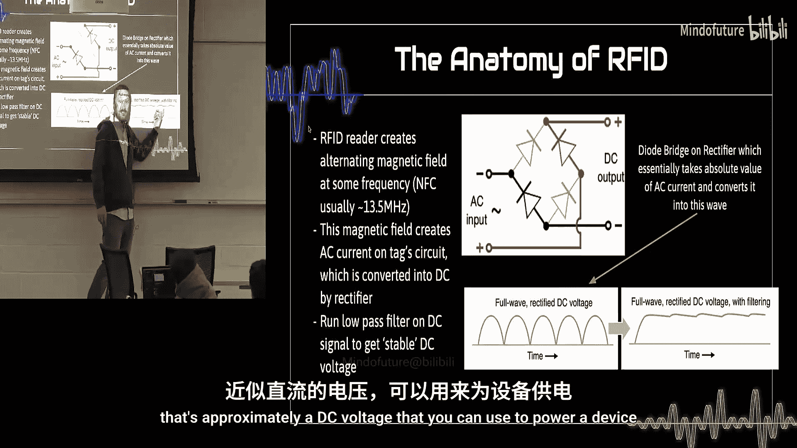

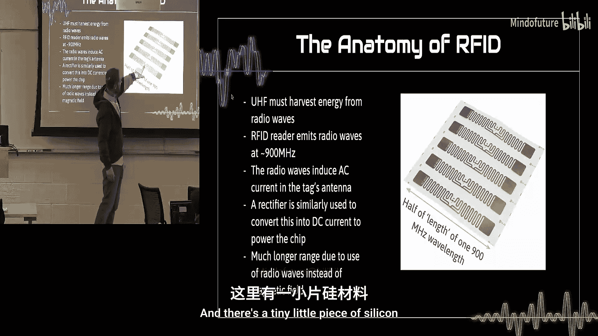

### 展示目标

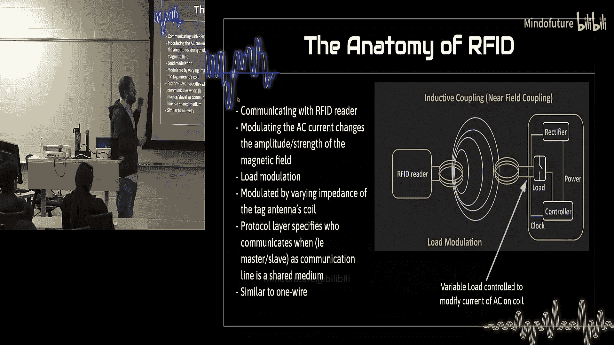

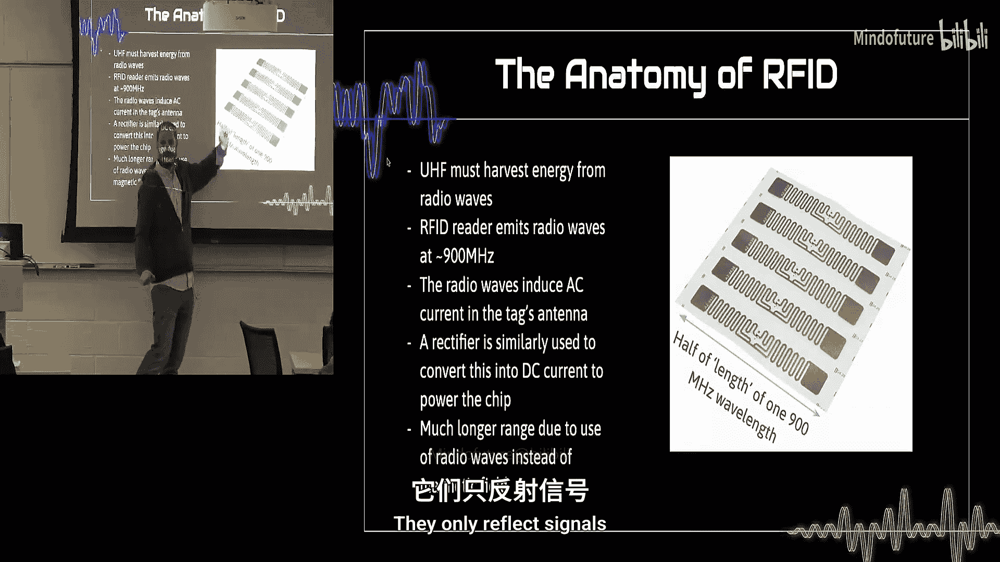

每个小组需要进行一次10-12分钟的展示，向全班介绍一个与最终项目相关的硬件组件或技术。目标是：
1.  深入学习该组件，为小组项目做好准备。
2.  将知识传授给同学，他们可能在项目中用到类似组件。
3.  满足课程要求的展示能力认证。

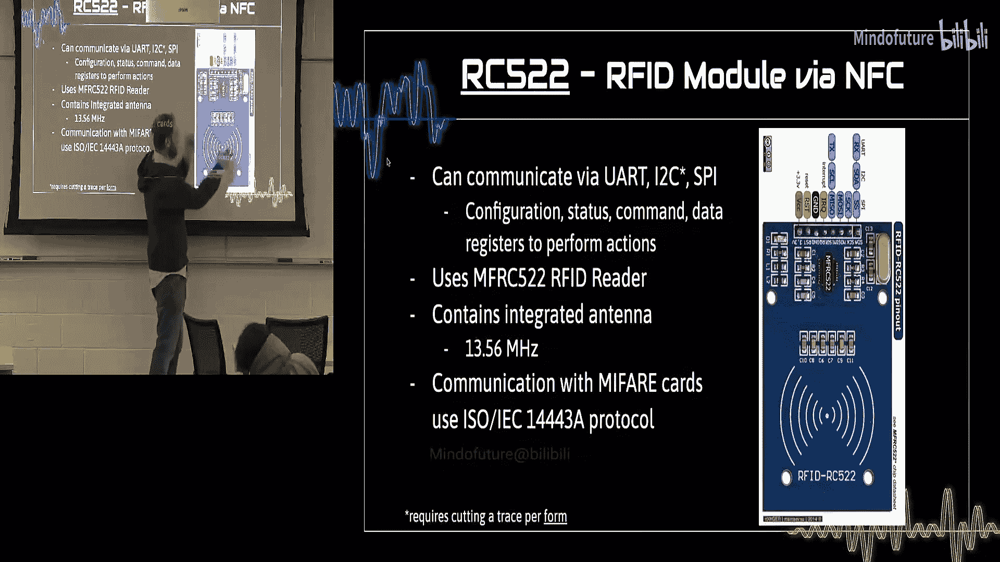

### 内容与结构建议

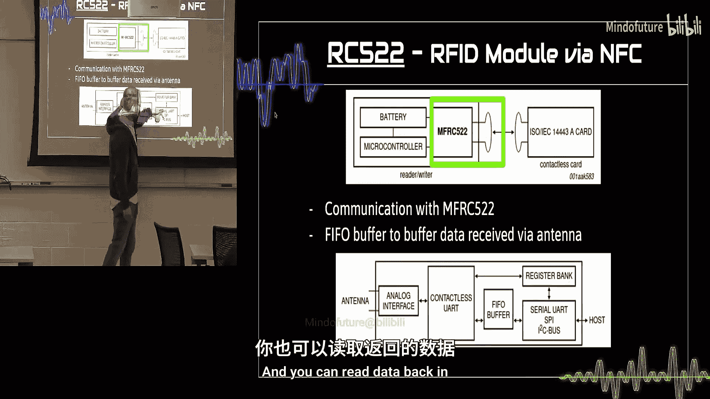

一个有效的展示应包含以下要素：

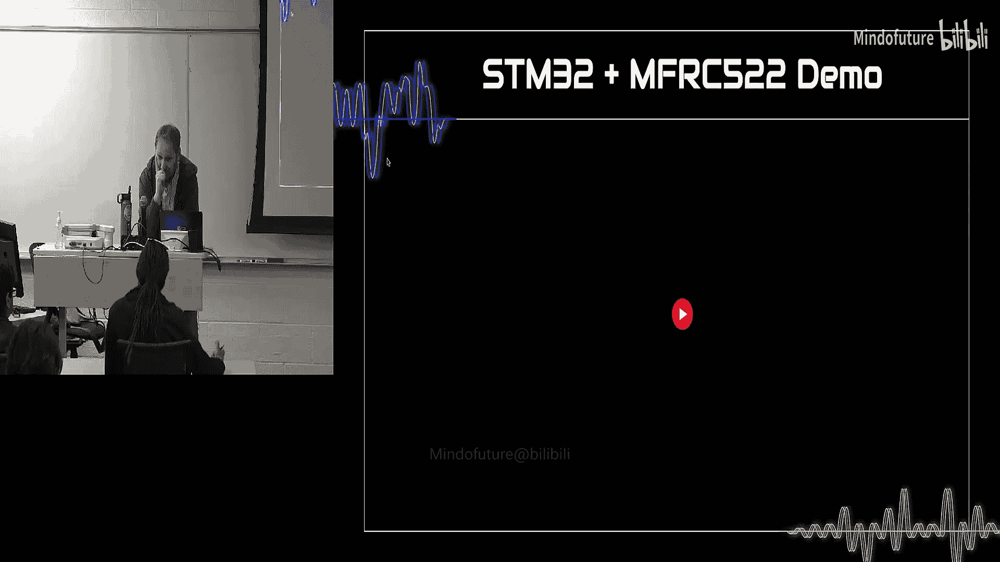

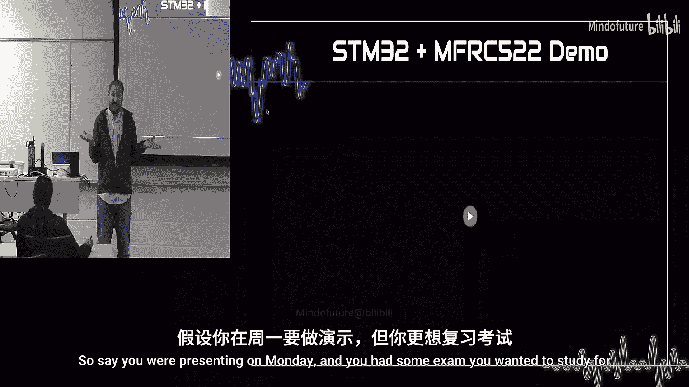

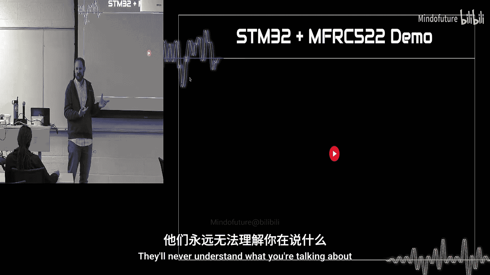

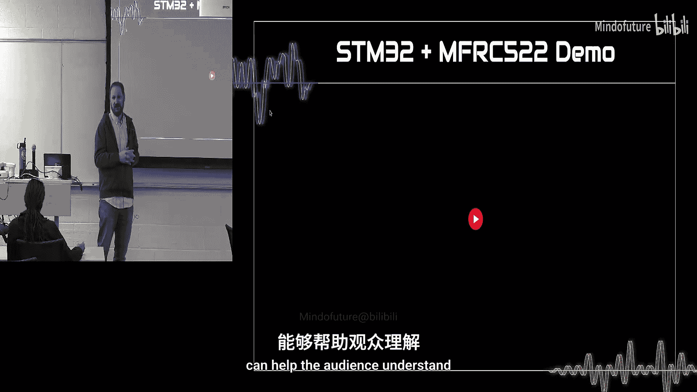

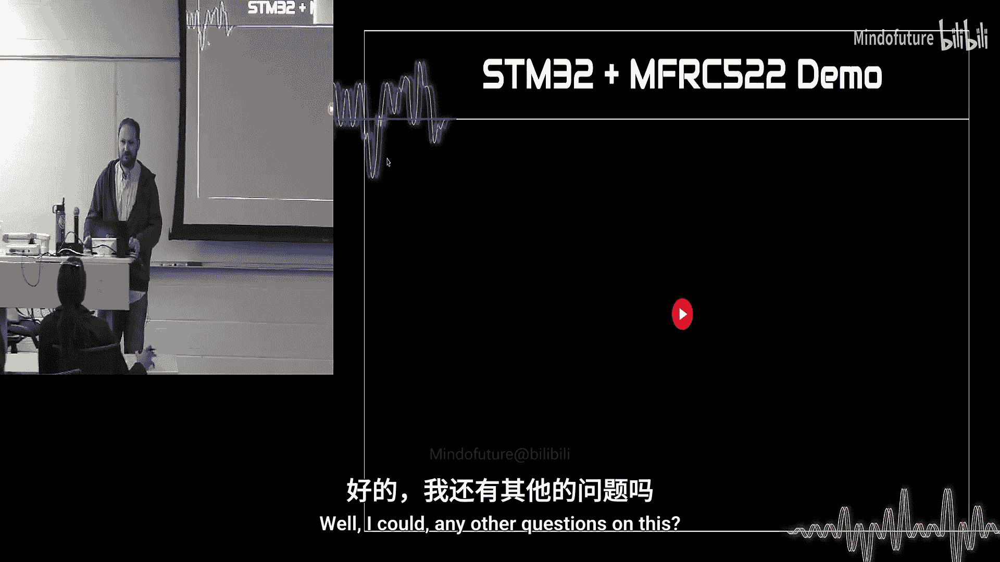

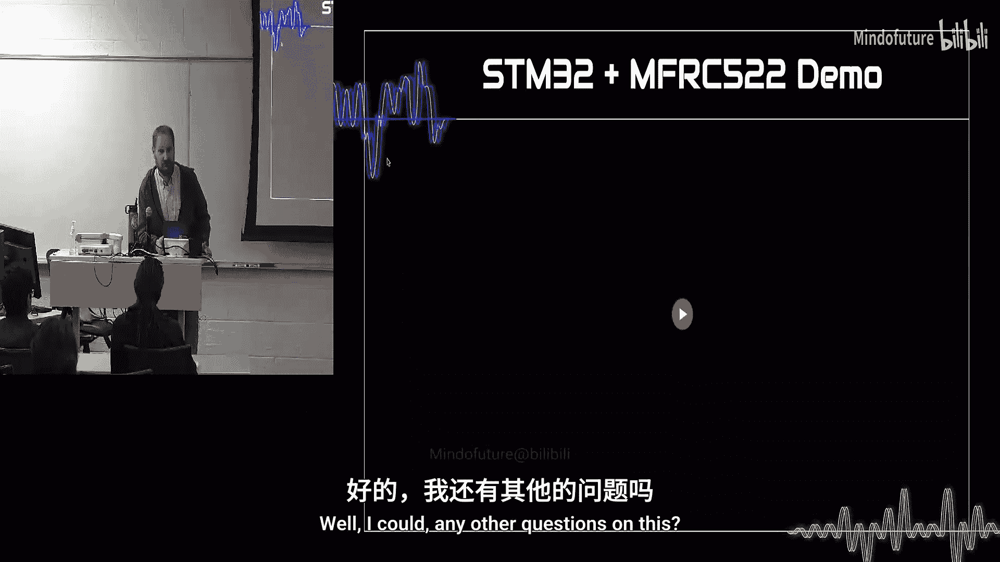

*   **引言与动机**：从大家熟悉的场景或问题引入，解释为什么需要学习这个组件。
*   **背景知识**：简要介绍该技术的基本原理和工作方式，建立共同的理解基础。
*   **核心组件详解**：聚焦于你们选定的具体模块（如某个传感器、通信模块的型号）。
    *   讲解其关键特性、接口（如I2C、SPI引脚）。
    *   展示如何阅读数据手册，提取关键信息。
*   **实战指南**：提供“如何上手”的具体步骤。
    *   如何初始化。
    *   如何读写数据。
    *   分享代码片段或配置示例。
*   **演示**：尽可能进行实物演示或播放视频，直观展示组件的工作效果。避免枯燥的终端输出演示。
*   **总结与资源**：回顾要点，指出常见陷阱，并提供进一步学习的资源（如数据手册链接、示例代码库）。

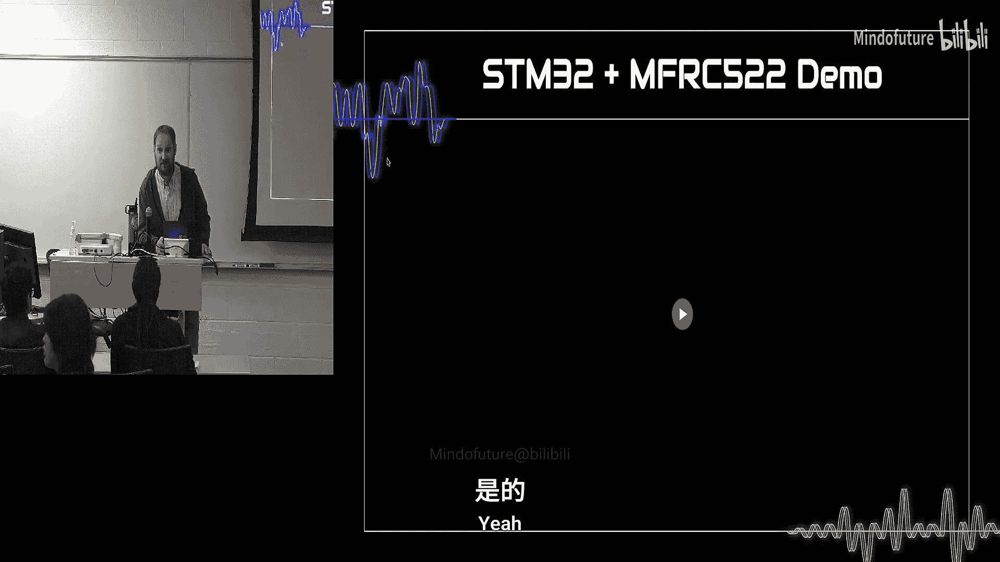

### 准备提示

*   **了解观众**：同学是嵌入式系统初学者，讲解要由浅入深。
*   **提供实用价值**：确保听众听完后，有能力开始使用这个组件。
*   **视觉辅助**：使用清晰的幻灯片，避免杂乱或花哨的字体。图表和实物照片比纯文字更有效。
*   **时间管理**：精心排练，确保在规定时间内完成。

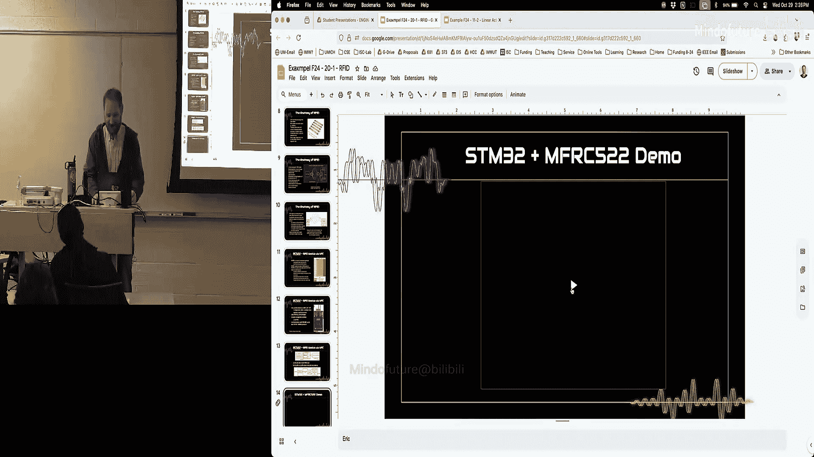

---

## 印刷电路板设计基础

最后，我们简要探讨一下PCB设计，这对于整合复杂项目非常有用。

### PCB是什么？

印刷电路板是用以机械支撑和电气连接电子元件的基板。它本质上是**定制化的导线**，将面包板上的连接固定化和微型化。

**主要类型**：
*   **通孔板**：元件引脚穿过板上的孔进行焊接。易于手工焊接，但占用空间大。
*   **表面贴装板**：元件直接焊接在板表面的焊盘上。体积小，适合自动化生产，是现代电子产品的主流。

### PCB制造简析

PCB制造是一个多层材料压合与图形化的过程：

1.  **基材**：通常使用FR-4玻璃纤维板，两面覆铜。
2.  **图形转移**：通过光刻工艺，将设计好的电路图（由Gerber文件定义）转移到覆铜板上，腐蚀掉不需要的铜，留下导线和焊盘。
3.  **钻孔与电镀**：钻出通孔、过孔，并通过化学镀使孔壁金属化，实现层间电气连接。
4.  **阻焊层**：涂上绿色（或其他颜色）的阻焊漆，保护导线，防止焊接短路。
5.  **丝印层**：印上元件标识、版本号等文字，便于组装和调试。
6.  **表面处理**：在暴露的铜焊盘上进行镀锡、沉金等处理，防止氧化，增强可焊性。

### 设计入门要点

*   **层叠设计**：对于初学者项目，四层板是一个不错的起点：顶层（元件）、底层（元件）、一个内电层（地平面）、一个内电层（电源或信号布线）。
*   **关键设计规则**：向PCB制造商下单前，必须了解并设置其工艺能力：
    *   **最小线宽**：例如6 mil（千分之一英寸）。
    *   **最小线间距**：例如6 mil。
    *   **最小孔径**：例如8 mil（针对过孔和插件孔）。
*   **设计流程**：使用EDA工具（如KiCad， Altium Designer）进行原理图设计、PCB布局布线，然后导出Gerber文件提交给制造商。
*   **实用建议**：对于课程项目，**务必先使用开发板和面包板实现功能原型**，确认设计无误后，再考虑制作定制PCB。这是一个高风险、高回报的步骤，需要预留充足的交付和调试时间。

---

## 总结

本节课中我们一起学习了以下内容：
1.  回顾了ADC的核心概念，包括不同类型ADC的识别、分辨率计算以及采样率的选择原则。
2.  介绍了直接内存访问技术，理解了DMA如何提高系统效率，以及环形缓冲区和乒乓缓冲区等数据管理方法。
3.  明确了学生项目展示的目标和结构，为接下来的展示做好准备。
4.  初步了解了印刷电路板的构成、制造过程以及基本设计规则，为硬件集成提供了知识基础。

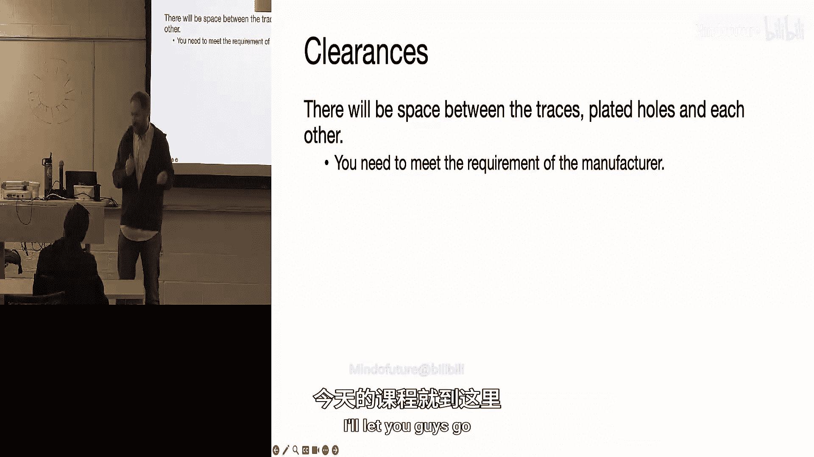

希望这些知识能帮助你们更好地完成最终项目。