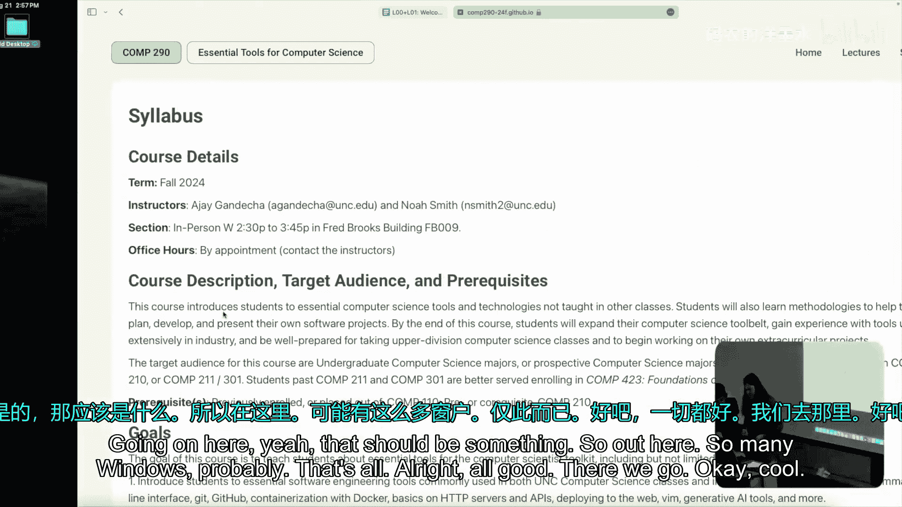
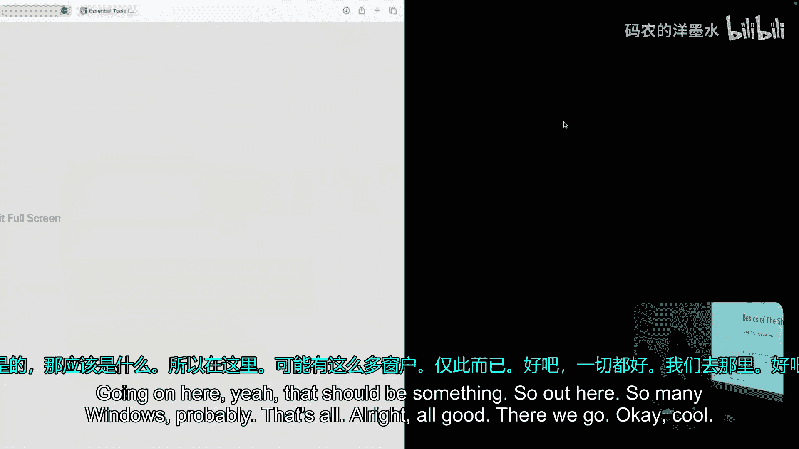
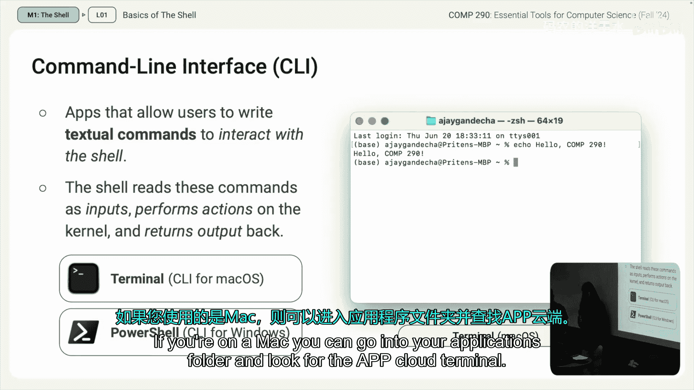
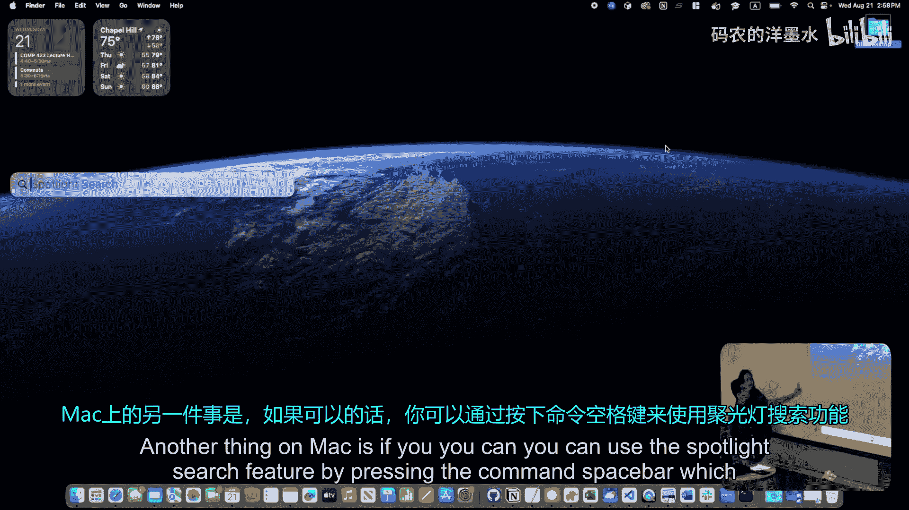
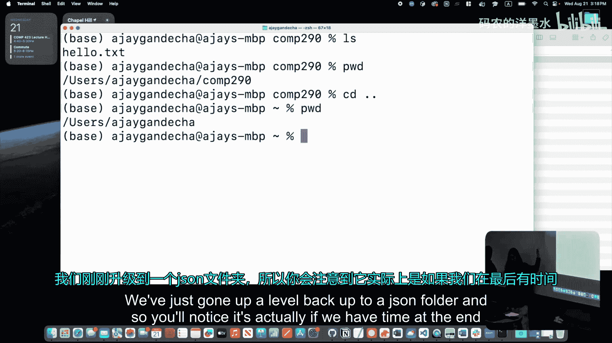
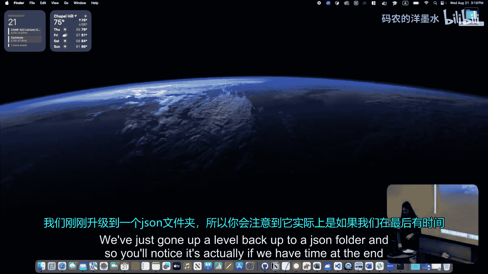

# 001：入门与Shell简介 😊

在本节课中，我们将学习计算机科学工具链课程的基本介绍，并初步探索命令行（Shell）这一强大工具。我们将了解课程结构、学习目标，并掌握Shell的基础概念和操作。

---

## 课程概述与介绍

大家好，欢迎来到COMP 290《计算机科学必备工具》的第一讲。在开始之前，请注意，由于现场授课的技术限制，视频质量可能不如其他视频，我们对此表示歉意，并会在未来的视频中努力改进。

如果您不是北卡罗来纳大学的学生，但希望跟随本课程学习，可以在视频描述中找到课程网站的链接，以获取更多关于课程和作业的信息。

现在，让我们开始吧。

---

## 讲师介绍与课程背景

我是克里斯·乔丹，我的名字会出现在课程列表中，但这主要是出于大学课程管理的技术性要求。这门特殊课程实际上由两位优秀的本科生——阿杰和诺亚——主导讲授。他们都是计算机科学社区的高级成员，曾担任多门课程的助教，并在我的适度监督下开发了这门课程材料。看到本科生教授本科生，并以此作为高年级的顶点项目，真是令人兴奋。让我们热烈欢迎本学期的两位主讲讲师。

大家好，欢迎来到COMP 290。我们非常高兴大家能来。如果你是观看录播视频的同学，所有讲座录像都会发布在我们的网站上，所以如果你在听讲时错过了什么，可以随时在线查看。

首先介绍一下我自己。我叫阿杰，是北卡大学的大四学生，主修计算机科学，辅修数据科学。我在系里参与了一些工作，例如担任COMP 423（软件工程基础）的LTA，并为CSX（计算机科学体验）担任开发人员。我们希望通过这门课和系里的活动，让大家更多地融入计算机科学社区。

大家好，我是诺亚，也曾是几门课程的助教。我和阿杰在COMP 423课程中相识。如果你们上学期在COMP 110中用过Trailhead，那是我和克里斯一起开发的。另外，如果你有Docker相关的问题，我或许可以帮忙。

---

## 课程定位与目标学生

为了了解大家的情况，我们来做个调查。有多少人目前正在上COMP 210？很好。有多少人正在上COMP 110？很好。有人在上COMP 211吗？很好。

正如大家所见，这是计算机科学的入门课程序列。你们中的大多数人现在正在上COMP 110或COMP 210，这些都是进入专业前的入门课程。COMP 290正处在这个入门阶段。无论你是已经完成COMP 110的学生，还是正在学习它，这门课都适合你。我们将教授许多工具，这些工具不仅会帮助你在COMP 110和210等课程中，而且会贯穿你的整个CS专业生涯，甚至在未来工作中发挥作用。

---

## 课程理念：参与与协作

克里斯已经提到了一点，随着课程的深入，你们会意识到这门课更侧重于参与和实践，鼓励大家积极互动，成为内容的主动学习者。我们知道这是一门一学分的课程，所以我们不想用大量信息压垮你们，而是希望创造一个更轻松的环境，让你们成为学习的积极参与者。

你们会发现，无论是在其他课程中，还是在未来的软件工程工作中，协作都是关键。软件工程是一项团队运动。虽然计算机科学专业的学生可能被刻板地认为是埋头在电脑前、不与人交流，但现实世界并非如此。希望这门课能帮助你们打破隔阂，在未来的高级课程和工作中更愿意成为团队的一员。

为了开始这个过程，我们将给大家一些时间互相介绍。我知道一些有趣的破冰问题可能会让人紧张，所以如果你前几天加入了课程，应该已经收到了一份介绍调查，其中包含了这个问题，你已经有一些时间思考了。请向你旁边的人介绍自己：姓名、专业、年级，以及为什么对计算机科学感兴趣。我们大约进行三分钟，然后一起回来。

（课堂互动时间）

听到了很多很好的交流，这很棒。我们想强调这门课的参与性，成绩不是主要部分，但请多和我们交流你们的兴趣。我们也在做自己的项目，我们在这里教你们，也对你们在做的事情感兴趣。你们会看到，项目是这门课的一个重要组成部分，我们稍后会详细讨论。这实际上是一条双向的街道。

另外，请叫我诺亚，不要叫我“教授”之类的。

---

## 学生兴趣与课程目标

是的，如果你在Canvas或邮件中看到了公告，可能有一个介绍调查的链接。这对我们非常有帮助，因为我们可以了解班上的同学以及大家的兴趣。我们问的一个问题是：“你学习这门课的目标是什么？你想学些什么？”我们提取了一些常见的元素，制作了一个词云。

你们可以看到，很多人对“完成个人项目”感到兴奋，这当然是这门课的一个重要组成部分。其他工具如Git和GitHub、Web开发、职业路径也是很多人感兴趣的，这些通常是主流课程中没有涵盖的内容。你们会注意到，我们将在课程中重点讲解这些内容。当然，也有一些我们可能无法涵盖的内容。

不过，我稍后会谈到期末项目，期末项目也会给你们机会去探索一些我们没有在讲座中涉及的内容。我们正在努力将你们所有的反馈和数据融入课程，使其对尽可能多的人都有吸引力。

---

## 核心课程目标

以下是我们的一些课程目标。正如阿杰所说，项目将是一个重要部分，旨在填补常规CS课程可能没有覆盖的空白。这包括：
*   必要的软件工程工具，如GitHub，可能还有其他云工具。
*   有效的自主学习策略。这与创建软件个人项目非常契合，因为从根本上说，计算机科学的很多内容都需要你自学。因此，能够自我激励并找到起点至关重要。我记得我刚开始时最大的困难之一就是不知道如何开始一个项目。我希望我们能帮助你们克服这个障碍，达到能够熟练地深入研究任何你们想解决的问题的程度。
*   总的来说，增加对北卡大学计算机科学社区的了解。这里有很多精彩的资源，我知道我直到几年后才了解其中一些。希望让你们早点开始，接触到我们所能提供的一切。

---

## 课程内容概览

我们还没有发布正式的日程表，可能很快就会发布，因为我们仍在根据你们的反馈调整一些内容。不过，这是我们计划讲授的讲座内容，以及你们将完成的相关项目和作业。

我们将从讨论**命令行**和**Shell**开始。如果你完全不知道这是什么，别担心，希望到今天结束时你会有所了解。我们将讨论如何使用编程语言（这里我们将使用Python）来控制计算机并与硬件交互。

还有一些其他工具，比如**Docker**（这是诺亚的专长），这在尝试制作个人项目并分享到互联网上时非常有用。**Git和GitHub**，你们可能在COMP 110的作业中已经接触过，这是跟踪代码、在团队环境中协作和分享代码的重要方式。即使你是CS专业的新生，也可能听说过GitHub。GitHub是分享代码和建立作品集的绝佳平台。

这门课的一个重点是，你们将致力于建立一个**个人作品集**。在课程结束时，你们将拥有一个可以展示的有形成果。

还有一些其他内容，我不想在这里深入细节，我们会在讲座中详细解释。如果你们之前见过这些术语，我们都会涵盖。

---

## 期末项目介绍

诺亚提到了期末项目，这是这门课的一个重要组成部分。当然，这是一门一学分的课，我们每周只有一次讲座，你们有一整周的时间来完成各种任务。在整个学期中，你们将逐步为这个项目做准备。

期末项目基本上是让你们为创建自己选择的某种个人项目制定一个行动计划。无论是应用程序、AI驱动的网站还是其他什么。你们将学习如何研究这些不同的领域，如何了解所需的工具，有哪些资源可供学习，以及从哪里开始。到课程结束时，你们将拥有一个可以遵循的时间线，以便在课程结束后实际开展这个项目。这是你们在课程结束时将拥有的一个有形成果。

另一个关键点是，正如你们在整个过程中听到的，编程语言和技术种类繁多。在介绍调查中，你们看到了一个长长的兴趣列表：移动开发、Web、AI、网络安全、理论等等。对于所有这些领域，你们可能需要使用不同的编程语言和技术。因此，期末项目的一个部分就是实际深入你们选择的语言。你们有机会真正选择自己感兴趣的东西，并开始学习它。这是我们真正想加入这门课的内容，因为在大多数情况下，尤其是在入门课程序列中，很多作业是布置给你们的，你们可能只是为了完成而完成，不一定真正感兴趣。在这里，如果你有机会选择自己感兴趣学习的内容，不仅会增加你在课程结束后真正开始个人项目想法的机会，也应该有助于你保持参与感和对所学科目的兴趣。

---

## 项目方向与个性化支持

这里有一些预览方向，我们会在整个学期中更新，但我们已经开始开发并整理了一些资源。你们期末项目可能感兴趣的方向包括：
*   iOS开发
*   Android开发
*   Web开发
*   数据科学与AI（表格中显示很多人对此感兴趣）
*   游戏开发（这通常是系里和计算机科学选修课的内容）

如果你们有超出这个列表的其他想法，我们也会与你们合作。如果你们联系我们谈自己的想法，我和诺亚会花时间为你寻找资源并制定定制计划。我们真的希望你们能感到兴奋，并拥有自我启动的动力。

---

## 课程网站与作业提交

这是一些后勤信息。课程网站（希望你们在Canvas公告中看到了）是我们所有讲座结束后发布信息的地方。

**Gradescope**，我相信你们已经用过，你们的作业将在这里提交。目前，完整的作业在Gradescope上。你们会看到今天有一个“参与”项目，现在不用担心。还有一个作业稍后会开放。这些都将在Gradescope上提交。所以，Gradescope和Canvas（用于成绩和一般公告）是你们的主要平台。

另外，我今天早上尝试同步了Gradescope名单。如果你们在今天上午10点之前加入了课程，应该已经在Gradescope里了。如果不在，请不要担心，我可以手动添加你们，课后找我们就行。

我想快速浏览一下网站。这是链接，如果你们带着电脑，可以输入这个网址，我们一起探索一下。

（演示网站）

这是网站主页，有一些关于课程的信息。你们可能最感兴趣的两个主要标签是“讲座”和“教学大纲”。

我先从“讲座”页面开始，因为这比较简单。每周这里都会添加一个新的区块，包括我们所讲内容的概要、发布的讲座幻灯片、视频（因为需要一些视频编辑，可能周四发布，不会在课后立即发布，但因为我们每周只上一次课，希望影响不大）、任何相关作业（我们会在教学大纲部分讨论）、以及课外活动。

课外活动部分很重要，校园里有很多专门针对你们这些入门级CS学生的活动，我们真的想强调这一点，让你们有机会融入CS社区。我会更新这个部分。

额外资源部分不是必须完成的，但如果你对某个主题想了解更多，会很有帮助。

关于作业的一个细节：任何需要提交的内容都在Gradescope上。这里可能有一些阅读材料，但没有成绩。我们理解这是一门一学分的课，你们还有其他很多课。介绍表中有一个问题是“你修了多少学分”，有些人修了17或18个学分。所以我们知道，即使我们布置了阅读，你们也可能不太愿意读很多章节。因此，我们真的希望这些阅读材料（如果有的话）是简短的，或者我们会提供短视频。这些材料的目的是在讲座前，让每个人对主题有相同的初步了解。请注意相关公告，了解重要事项和截止日期等。

第一份阅读材料是由我们的克里斯·乔丹撰写的。

---

## 教学大纲要点

关于教学大纲，我们会简要过一下，因为你们可以自己阅读。这里有一些信息。

我要强调的一点是**办公时间**。目前是通过预约进行的，我们没有设定特定的时间。如果你有兴趣与我们见面，请随时给我们发邮件，我们会在有空时很高兴与你们见面。我个人（阿杰）在这节课后也有大约30-40分钟的空闲时间，如果你想留下来聊聊，欢迎。

另一件重要的事是**出勤政策**。我们每周三线下见面，整个学期只有15次会面。因为我们每周只见一次面，所以出席很重要，我们每次会议都尽量让它有价值。因此，出勤是必须的。当然，事情总有发生，这里有一个政策：如果出现一些问题，你可以不通知我们缺席一次。如果有正当理由（例如生病），我们表示理解，不会因此惩罚你。请提前给我们发邮件，我们可以帮忙解决。

**评分标准和分数构成**，这只是北卡大学的标准评分标准，应该不会太糟糕。包括参与、作业和期末项目的细分。

正如诺亚所说，每当老师讲解评分标准和分数构成时，你们可能会感到有点压力。请不要担心。只要你在提交的作业上付出了良好的努力，你就会做得很好。我们不是来这里让你们为这些东西感到压力的，只是为了让大家负起责任。我们不是来让你们不及格的。

除非你根本不来上课，但如果是那样，我们可能会联系你。所以应该没问题。

再次强调，出勤占参与分的20%（占总分的20%），参与讲座和其他活动占参与分的剩余部分。只要和大家交流，不要在后面刷TikTok或做其他不专心或干扰他人的事情，可能就不会有问题。如果有问题，我们可能会联系你。

关于期末项目的详细信息将在适当的时候公布，所以现在不用担心。所有这些稍后都会详细解释。

根据北卡大学政策，期末考试必须线下进行。我们没有期末考试，当然也没有测验。这是一门一学分的课。不幸的是，我们不得不在周五早上8点见面，我们对此表示歉意，但无能为力。这应该是一个低风险的展示，主要是庆祝你们所做的工作，所以不用太担心。

教学大纲就这些。你可以在课程网站上访问它，如果需要，也可以在Canvas主页上找到。

（快速感谢阿杰制作了漂亮的网站）

---

## 引入Shell：从图形界面到命令行

好了，我们开始进入正题。我想我们今天从Shell基础开始。

首先，我想用一个简短的故事来引入。谁听说过施乐（Xerox）这家公司？谁能喊出你们对它的了解？复印？传真？是的，打印机、传真，这是大多数人对它的了解。在过去，他们是计算机行业的重要参与者。有一个关于他们的故事：当苹果公司刚起步时（那时你甚至还不能买他们的股票），施乐想早期投资他们，所以他们邀请史蒂夫·乔布斯去他们的园区，说：“来看看我们在做什么。”故事是这样的，乔布斯去了，他们带他参观，他起初不感兴趣，然后他们给他看了一台原型计算机，他立刻被吸引了。原因是这台计算机与之前任何人使用个人电脑的方式都 fundamentally 不同。它有一个鼠标，有一个图形用户界面（GUI）——你现在电脑上熟悉的一切，第一次出现在这台机器上。

我认为这个故事真正重要的一点是，它实际上并不完全真实。但它之所以如此流行，是因为它说明了我们与计算机的交互方式是非常根本的。我们每天都在使用这些图形系统而不加思索，但在此之前，只有基于文本的东西。在此之前，没有图形，没有这些东西。只有像这样的东西。

（展示终端截图）

你们中有多少人已经用过终端了？希望有不少人。我看到有些人没举手。没关系。

但这就是过去与计算机交互的方式：只是一个基于文本的界面，你输入一些东西，然后得到输出。一开始这可能有点吓人，因为我们非常习惯于有某种视觉指示来告诉我们正在做什么。但在这里，一切都是文本。我们将深入探讨，展示一些有趣的命令以及如何有效使用它们。

但我真正希望你们思考的是，我们将要展示的很多内容，与你们在图形界面下能做的事情存在一一对应的关系。想想在电脑上我们经常用它做什么？很多时候是移动文件、复制文件、发送东西、删除文件。文件非常重要，你有一个文件资源管理器。我们可以在命令行中完成所有这些操作。所以，当你移动、复制东西时，底层基本上有一个等效的命令可以在命令行中运行。

我发现，当我刚开始学习终端时，真正帮助我适应的是，对于每一个命令，我都会想：“好吧，那么它在图形界面中的对应操作是什么？”我希望你们在接下来的过程中记住这一点，我会在可能的时候提到它：“好的，这是文本形式，那么图形等效操作是什么？”希望通过这个过程，你们能对这里真正发生的事情感到更适应。

---

## 打开终端与基本概念

不用担心，出了点小问题（屏幕切换）。好了。

你会看到它被称为**Shell**，有时也叫**命令行界面**，**终端**是另一个名字。在Mac上叫Terminal，在Windows上叫PowerShell，但它们是类似的东西（虽然不完全相同）。你输入文本，这是一种在文本层面上与计算机交互的方式。

在我们继续之前，我还想确保你们能在自己的电脑上访问这个。如果你是Mac用户，可以进入应用程序文件夹，找到“终端”应用。另一个方法是使用Spotlight搜索功能，按 `Command + 空格键`，打开搜索，输入“terminal”然后按回车，它应该会打开应用。如果你是Windows用户，尝试打开PowerShell。

（演示如何打开终端和PowerShell）

完美，很好。

所以，在你的终端里，你会看到基本上当我们想输入命令时，一切都以一个**程序名**开始。如果你上过COMP 110，可能已经见过这个，比如你有一个像Python这样的程序，然后传递一些东西给它。程序名是终端知道一开始要运行什么的方式。你给它的第一个东西，它会去你的电脑上寻找那个程序，然后说：“好的，这个在哪里？让我试着找到它并运行它。”如果找不到，那就会出错，它会说找不到程序。

你会看到第二部分叫做**参数**，即程序名之后、空格之后的任何内容。这些基本上是你想发送给程序的特殊数据位。所以，如果我们只运行 `python`，我们会进入一个交互式Shell（你可以在电脑上试试，如果你安装了Python的话）。如果你想退出，可以按 `Ctrl+D`（在Mac上是 `Command+D`）。但在这个例子中，我们想运行 `hello.py`，所以我们告诉它：这是我们的程序名，运行它，然后这些数据就在终端启动程序时发送给Python。

你还会看到这些用短横线 `-` 表示的东西，它们被称为**标志**。我们稍后会更多地了解这些，但这就是你告诉程序你正在发送什么类型数据的方式。

---

## 基础命令示例：`date` 与 `echo`

好的，我们来看一个小例子。感谢阿杰。

这里有很多你的电脑自带的**内置程序**。第一个我们直接运行 `date`。如果你在电脑上运行它，你会看到它直接给出了日期。这是一个非常基本的命令。

另一个你可能在之前的截图中看到的命令叫 `echo`。你会注意到，运行 `date` 时，我们没有传递任何东西给它，只是调用了 `date`，它非常简单，只返回当前日期。

让我们试试一个可以传递东西给它的命令：`echo`。现在输入 `echo hello world`。

（演示 `echo hello world`）

它只是输出了“hello world”，这对于一个叫“回声”的程序来说很合理。基本上，它把你传递给它的任何东西直接写回给你。

我想在这里指出，如果你看幻灯片上的例子，你会看到我们有程序名和参数。在我们的例子中，你会注意到有两种不同的情况：一种是只写了程序名（`date` 不需要任何参数，因为它唯一的工作就是输出日期）；然而，第二种情况（`echo`）需要输入，因为它接收你的输入并直接输出到终端，所以我们需要提供一个输入，我们以字符串的形式提供输入。

如果你在上COMP 110，可能还没学到那里。字符串基本上是我们在计算机中表示文本的方式。你会注意到我们输入了 `date` 和 `echo`，这只是文本。计算机需要区分什么是程序名，什么是我们试图输入的文本。因为，比如说……诺亚，你可以做这个例子，试试输入 `echo date`，看看会发生什么。

（演示 `echo date`）

这在这里会起作用……如果你交换顺序，它也可能不起作用。实际上，我从来没……我在想一个例子，但它在这里确实起作用了，很好。但基本思想是，当你传递东西时，如果你在使用编程语言，这会更清楚。Shell在管理这些东西时有点智能，因为你用空格分隔的每个部分都被视为一个新参数。`echo` 所做的几乎就是把传递给它的任何东西原样输出。

但非常重要的一点是，随着我们继续学习，尤其是当我们处理文件和文件夹时，你会看到这一点。因为当你处理文件夹时，你的文件夹名或文件名中可能有空格。当你尝试对一个有空格的文件运行命令时，程序可能会接收不同顺序的参数或输入。所以，如果你两边不加引号，程序可能无法区分你试图输入的内容和程序名或其他保留字。

---

## 文件系统基础：工作目录与路径

很好。阿杰刚才说的，在终端中总是有文件和文件夹的概念。无论你在终端的哪个位置，你实际上总是在一个文件夹里。这可能现在听起来不太明白，但我来展示一下这是什么意思。

如果我们输入 `pwd`，意思是“打印工作目录”。我们输入它，会看到：好的，我们目前在 `/Users/aj` 主文件夹里。所以这个位置，基本上，如果我打开访达（Finder），我们可以看到完全一样的东西。我们实际上可以这样做。为了演示，在Mac上是访达，在Windows上是文件资源管理器。你可以按“前往”->“电脑”。你会看到，实际上……我们这样做：电脑。

（演示在访达中导航到相同路径）

在我的电脑里，你会看到我们有这个……让我看看，能把它弄大点吗？好了。我们有一个“用户”文件夹。当我打开“用户”，我有……我的文件夹，我的文件夹，还有“共享”。当你打开“共享”……这些是与我在电脑上的用户相关的所有文件。所以当你打开终端时，它会自动把你放在这个文件夹里。因此，如果我们在这里运行某些命令和程序，我们或许可以处理我们所在文件夹内的文件。这一点非常重要。

我想在这里稍微提前讲一点，多谈谈这个和**文件路径**。我们目前讨论的，这个“pwd”显示的是**当前工作目录**。工作目录是你的终端当前在电脑中的位置，在文件系统中的位置。你的电脑可能有成百上千个文件夹，可能有不同的用户，你的终端当前“停”在哪里？它允许你使用那个位置作为当前工作目录。所以我们使用命令或程序 `pwd`（“打印工作目录”的缩写），它只是在这里显示你的工作目录。

这是非常重要的术语，你在未来的课程中可能也会看到，比如如果他们谈到工作目录，那就是你的终端当前所在的位置。

你会看到，无论是在许多教程、其他课程中，还是在这里的Shell中，我们有两种不同的方式来表示如何访问或定位电脑上的文件。

如果你住在房子或公寓里，当你填写表格获取北卡大学的学生卡时，你必须填写某种邮寄地址或居住地址。通常你有一个门牌号或公寓号，一条路，一个城市，州等等。那是你们都习惯的正常地址。电脑上的文件也有类似的东西，我们称之为**路径**。路径基本上定义了文件在电脑上的位置，就像地址可能表明你住在世界上的哪里一样，是非常相似的概念。

有两种不同的方式来表示这些。一种是我们所说的**绝对路径**。这是地址的完整长格式，基本上是从最顶层开始，一直到文件所在位置的完整地址。就像你看到的，当我们去我的文件时……注意这里显示的是“Macintosh HD -> aj”。这是我的电脑。我从最顶层开始，然后必须打开一堆文件夹才能进入我的用户文件夹，对吧？所以我必须去“用户”，然后去我的名字，然后才能访问这里。所以从最顶层开始，然后经过所有不同的文件夹，最终到达一个文件，那就是绝对路径。

你会注意到，你可能只是通过使用电脑就见过文件路径。斜杠表示不同的层级。我从这个斜杠开始，那是我的Macintosh HD文件夹（在Windows上可能是C盘驱动器之类的）。然后你打开它，所以那是一个斜杠。然后你有一个叫“用户”的文件夹。然后是一个斜杠。然后是我的名字，我的用户名。然后可能还有……你可以看到一路向下，打开用户文件夹，我的文件夹，Developer，comp290，lecture00，sample，最终会到达某个文件。那就是你可以用来引用该文件的地址。

我实际上可以展示给你看。希望我还有这个。但如果我一路点到最顶层，我可以打开用户 -> 我的文件夹 -> Developer -> comp290 -> lecture00 -> sample.txt。所以你可以看到这是一个真实的文件。如果你在Mac上（抱歉，我在Mac上演示，我想在Windows上过程类似），如果你右键点击并选择“显示简介”，应该有一种方式……是的，格式略有不同，因为Mac试图让东西对用户更友好，并隐藏一些东西。但你可以看到，那就是我采取的相同路径，对吧？从最顶层开始，用户，一路向下经过所有这些文件夹到达这里。另外，如果你……我想有一种方法，右键点击时按住某个键。是的，如果你按住Option键（这是一个Mac上的小技巧），右键点击，你应该会看到“将‘sample.txt’拷贝为路径名称”，如果你点击那个并粘贴到某个地方，你可以看到那是相同的绝对路径。

所以电脑对于文件位于哪里没有任何混淆。如果你需要定位一个文件，你总是可以依赖绝对路径。

---

## 相对路径：便捷的快捷方式

我正要谈到，不是……是的，当然。

你会注意到在那之后，我有两个麦克风……有一个叫做**相对路径**的东西。就像阿杰说的，绝对路径就像一个完美的地址，无论你在世界的哪个地方，你都可以精确定位那个确切的地址。类似地，在你的命令行中，无论你碰巧在哪个目录，你都知道那个文件的确切位置。

还有另一个叫做相对路径的东西，它实际上就像一种简写。相反，如果我要给出我的地址，我会说……我不会给出完整的地址，但如果我想让它更容易，比如也许他们问的是我朋友的地址，我会说“哦，就在这条街往上走，然后右转”。这不会从世界上的任何地方都有效，只从我所在的位置有效。但这被称为相对路径，意思就是相对于我现在的位置，我如何到达这个文件。

所以你会看到底部有一堆小分隔符，不是底部的小符号，我们会展开讲这些。但你可以在这里看到，例如，从aj的位置，如果我们已经在……抱歉，是……所以如果我们已经在上面的……Lectures -> Developer。好的，好的，所以我们在Developer文件夹里。

你会注意到，这里的整个片段与末尾的片段匹配。这表示，假设我们在Developer文件夹里。它说的是：从你当前的位置（这就是数据所表示的，从当前目录出发），去comp290，去lecture00，然后就是你的文件。

但请注意，如果我们再往上走一层，比如说，让我们一直往上走到aj的主文件夹，现在我们尝试遵循这个路径。那里，好的，有一个comp290。那没问题，但这不是正确的comp290，对吧？这就是绝对路径和相对路径的区别。如果我在这里给出一个相对路径，它不会起作用。但如果我给出绝对路径，我就能找到那个文件。

所以你可能会想，好吧，相对路径有什么意义？任何你能用相对路径做的事情，你都可以用绝对路径代替，你可以把完整的东西替换出来。但在实践中，当我们快速编写东西时，我们想与文件交互，如果文件就在同一个目录里，写出整个路径是非常繁琐的。所以我们想出了这些非常有用的简写符号。所以就说，好的，相对于我所在的位置，往下走一个文件夹，找到那个路径。但是的，我认为要记住的非常重要的一点是，任何时候你使用相对路径，你都可以使用绝对路径。相对路径只是为了方便。

---

## 核心文件操作命令：`ls`, `cd`, `cat`

基于这一点，类似于我们能够查看文件夹中的所有文件，让我们在这里看看。你会注意到我默认做了这个，有一个叫做 `clear` 的命令，它非常自解释，可以重置你的终端，一旦有点乱的时候非常有用。但假设我在我的文件夹里，让我打印工作目录，`/Users/aj`，我想看看这里的所有文件。我如何列出它们？有一个非常方便的程序叫 `ls`，它只是列出这里的所有文件。

如果我打开文件资源管理器，你会注意到，哦，好的，这些是完全相同的文件。只是一个图形表示，一个文本表示。所以comp290在那里，anaconda3在那里。一切都在这里。

那么，为了这个例子，假设我想在comp290里面操作，那里有一些我想访问的文件。我如何让我的当前工作目录从 `/Users/aj` 变成这个？我们想改变我们的目录。所以有一个非常方便的命令叫 `cd`（改变目录）。这个命令要记住，它后面需要一个参数。如果你只告诉它 `cd`，它会说，好的，cd到哪里？它不会做任何事情。但如果你输入 `cd`，然后我说 `comp290`，因为它存在。

你还会注意到，这刚刚改变了。前面这里写着整个东西加上comp290。这是什么意思？你的终端，大多数终端都非常有帮助，它们会告诉你你现在大致在哪里。所以你不需要总是输入 `pwd` 来检查你在哪里。它告诉我们，好的，我们在comp290文件夹里。在我刚刚输入 `pwd` 之后，你可以看到它确实改变了。所以它以前是 `/Users/aj`，现在变成了那个，并且我们在comp290子文件夹里。

所以我们现在可以继续。这起初感觉非常陌生，但这些命令是关键。你只需要知道几个：`cd`、`ls`，这就是你与任何文件系统交互的方式。

那么，再次 `ls`，因为现在我们在comp290里，你想看看里面有什么文件。hello.txt，很好。所以展示一下，如果我们打开，因为你习惯使用文件资源管理器，所以如果我在文件资源管理器中打开comp290（非常小，但你可以看到hello文件在那里），它与终端中列出的文件夹内的文件列表完全匹配。

现在我想快速做的一件事是，我想给你们所有人一个机会稍微玩一下这个。打开你的终端，先尝试输入 `ls`，看看你在哪里。你也可以输入 `pwd`。我想给你们几分钟时间，试着导航到……也许你今天在某一门课上有一个文件，看看你是否能尝试只用 `cd` 和 `ls` 找到那个文件。我们大概花三分钟左右来做这个，另外，如果你对我们谈到的任何内容有任何疑问，比如绝对路径、相对路径，请随时举手，我们也可以帮助你，这可能也对全班有帮助。

---

## 导航技巧：返回上级目录与特殊符号

是的，有个问题。我们刚收到一个问题：如何返回上一个目录？这是一个很好的问题。很常见的情况是，你进入一个目录，然后想，哎呀，我不想到这里，我需要上去。

那么，让我们看看当前工作目录，再次 `pwd`。好的，所以我们在 `/Users/aj/comp290`。假设我们想回到aj的文件夹。那基本上是往上走一层。我的意思是，你看每个斜杠代表一个层级。假设我想去，我不想让这个成为工作目录，我想回到上面。这是你见过的一个特殊的简写符号，就是两个点：`..`（父目录）。如果你能在那里看到的话，就两个句点，就这样。

所以如果我到终端，输入改变目录 `cd ..`。现在让我们打印工作目录，我们刚刚往上走了一层，回到了aj的主文件夹。

你会注意到……实际上，如果我们最后有时间，我会展开讲这个。但请记住，任何时候你需要往上走一层，只需使用两个点 `..`，它会让你往上走一层。你还可以把它们连在一起。如果我想一路回到根目录，也就是第一个斜杠，我可以输入 `cd ../..`。句点句点，我在父目录，然后又是句点句点，这让我往上走了两层。现在如果我打印工作目录，我在根目录，可能的最低层级。

有人提到的一件事，我认为也很有用，因为你知道诺亚和我都在Mac上，你可能注意到了这个百分号 `%`。如果你在Windows电脑上，看起来会略有不同，你不需要包含这个百分号。所以如果你在输入，确保只输入那个符号之后的内容，它在Windows上会等同于我们在Mac上所做的。

好的，还有……实际上，我要切换到这里，这也是展示另一件事的好时机。

你会注意到，当我们最初打开终端时，实际上我再打开一个……哦，天哪，那个非常小，但好吧。所以我打开了一个新的，我还没有向它发送任何东西。让我们看看工作目录是什么。`/Users/aj`，那是我们的主文件夹。这是惯例：当你打开终端时，它会在你的主文件夹中打开。所以在你的电脑上，在Mac上，你会看到是 `/Users/你的用户名`。在Windows上，我不确定，但也有主文件夹的概念。

所以，当我们……我切换回这个终端。现在我们在根目录，我想快速回到主文件夹，因为那是我们经常操作的地方，我所有的文件都在那里。有另一个很好的简写符号：就是波浪号 `~`，在你键盘上数字1键的左边，如果你看到的话。如果我输入 `cd ~`，那就会直接带我回到主文件夹。

这并不是超级重要，我的意思是它非常有用，你可能会习惯它，但这只是一个非常好的快速简写，可以回到你想操作的地方。

另外，请记住我们正在谈论的所有符号和东西，记住所有的幻灯片和一切都会发布，所以你不需要觉得……我知道，尤其是当你刚开始使用这个时，有很多符号，很多术语。你不需要觉得必须记住任何东西。这些只是工具，我们想展示它们。但如果你感到有点不确定，还不太适应，请不要担心。我们整个学期都会处理这类事情，资源都会在线提供。只要你能跟上我们的讲解，不用担心记忆。

---

## 查看文件内容：`cat` 命令

非常快，在我们继续之前，我要展示最后一个有用的小命令。这在Windows上可能不存在，我在想。在Mac上你会看到它，而且你的作业中也能用到。

但是，我刚改目录回到comp290，我列出了我的文件，我们在看hello.txt。假设我想看一个文件的内容，有一个非常方便的命令叫 `cat`。我们输入 `cat`，然后它需要……我想cat什么？我必须告诉它。所以我要告诉它这个文件。实际上，让我们非常具体。假设我们给它一个路径，因为 `cat` 期望一个路径，对吧？假设……我当前目录的简写是什么？点 `.`，斜杠 `/`，hello.txt。你会经常看到这个：`./`，它只是表示“我现在所在的位置”。所以 `./hello.txt`。然后就好了。我们文件的内容打印到了屏幕上。

是的，我可以展示给你们所有人看，这样你们就能确认它没有对开发环境做任何事。我可以打开文件，你会看到文件里也有这段文本。所以，你知道，那就是……是的。

你可以说，这就是诺亚刚才谈到的，你将在整个课程中开始学习的东西：你习惯用鼠标在电脑上点击图形用户界面做的事情，通常在终端上也有等效的操作，尤其是在选择文件时。你可以在两个地方做事情，这非常令人惊讶，尤其是当你开始阅读和学习更多时，你会发现在屏幕上能做多少事情。

---

## 课堂练习：路径理解与应用

很好，所以我们要继续了。在继续之前，关于路径和绝对/相对路径的区别，有人有任何问题吗？

很好。另外，你知道，特别是因为这可能只是你们前几门COMP课程之一，而且这是一个小班，如果你因为任何原因对举手在全班面前发言感到紧张，那也没关系。如果你有具体的问题，也可以课后找我们，我们很乐意回答。但我们希望，因为这是一个小班，我们想努力保持参与和互动，所以不要觉得太害羞，即使你可能认为问题很简单，也要问出来。

是的，有个问题：如果文件名有空格怎么办？很好的问题。你会注意到 earlier，我们的第一个例子，我不知道你是否看到了，但当我做 `echo` 时，我传递了一段中间有空格的文本，对吧？这对 `echo` 来说不是必须的，但当你处理文件时，惯例是，如果文件名有空格，就加上引号，因为这样它就被作为一个字符串传递，它知道，好的，这整个东西需要保持在一起。

是的，我们创建一个文件试试看。让我们看看，touch……只是为了展示这个实际操作，你实际上可以看到它。是的，谢谢你提出来。那么让我们再 `ls` 一次，看看这里的所有文件夹或文件。很好。现在我们有了 `hello world.txt` 和 `hello.txt`。这是一个很好的例子。假设，好的，我想看 `hello world.txt` 的内容。好的，所以如果我只用 `cat`，先不加引号试试。`cat hello world.txt`。

（演示 `cat hello world.txt` 报错）

你会看到这里“没有那个文件或目录”。基本上，`cat` 这里的行为是，它把每个由空格分隔的部分都当作独立的参数，试图打开它们，然后说，哦，这两个都不存在。为了解决这个问题，我们将用引号把它作为一个值传递。

（演示 `cat "hello world.txt"`）

然后就好了。所以是的，很好的问题：无论何时处理任何有空格需要保留的东西，在终端里就用引号括起来。

---

## 随堂测验：巩固路径知识

好了，这是我们每节课都会做的事情。这次不算，因为你们中的一些人可能由于各种原因还没有加入Gradescope，而且你们都在这里，这不会正式计入出勤分数。在未来的讲座中，它会算入。所以任何时候你在屏幕左上角看到一个蓝色的感叹号，那表示这是一个出勤检查，应该也有文字说明。对于这些出勤检查，我们不要求正确性，这是非常重要的一点：你可以猜，可以出错，没关系。主要的是，我们希望你能够提交一些东西，以表明你在这里，并且你提交的内容与幻灯片上的内容大致相符，这样我们就知道你不是在富兰克林街上拿着电脑试图……对吧？

这里有四个问题，我想让你们思考一下，在这个文件结构中，这些不同文件的绝对路径和相对路径是什么。

（解释测验界面和问题）

抱歉。好了，我们现在就修复它，或者诺亚会修复。与此同时，我只想展示这个。这是一个假设的文件结构，所以想象这是你的电脑。你有一个用户文件夹，一个文档文件夹，在文档里面，你看到这些线条表示层级，就像缩进一样。所以在用户下面，这里的一切，我们有一个文档和一个照片文件夹。在文档里面，我们有一个学校和一个重要文件夹。我们有我们的社保卡（现实生活中别这么做），comp290，comp110。让我们假设，为了这个例子，如果你输入 `pwd`，你会得到 `/Users/Documents/School/comp290`。你的当前工作目录就在这里。

所以我们会给你们几分钟时间讨论这个：`hello_world.py` 文件的绝对路径是什么？然后 `sample.txt`、`ss_card.txt` 的相对路径是什么？以及作为一个挑战，下面这里的 `well.png`。我应该……它应该已经打开了，对吧？而且修复了，第一个问题现在应该不同了。很好。

所以请随意，可以和你周围的人讨论。这个教室很酷的一点是，每排大约有四到五个学生，所以你们这边的人可以在你们这一排讨论，后面也一样。请随意讨论，我们几分钟后回来。

（课堂讨论时间）

抱歉，我们能快速举手表决一下吗？如果你对这种路径概念真的很适应，请竖起大拇指；如果还在理解中，请拇指朝中；如果还不明白，请拇指朝下。好的，看到一些大拇指朝上和一些朝中。很好，这是一个不错的混合。希望我们看看答案，也许就能明白了。当然。

当我们讲解这些时，尤其是第一次教某个东西时，如果你处于中间状态，那没关系。整个学期我们会有很多时间来处理这个。坦率地说，像这些文件路径，如果你最终成为一名软件工程师，你可能在未来几十年里都会用到它们，所以你会有很多时间练习。

不幸的是，幻灯片没有动画，所有这些都是一次性显示的，但我们会尽力让你们跟上。

---

##