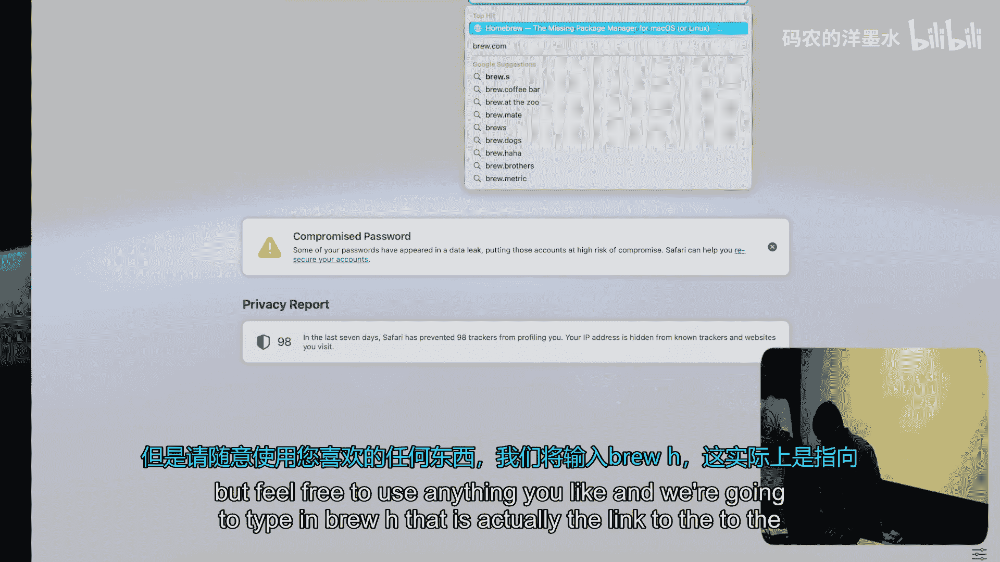

# 002：文件与Shell脚本编程

在本节课中，我们将学习文件系统的基本概念，包括文件权限、隐藏文件，以及如何使用包管理器安装和使用外部工具。我们还将探索一个名为 `fzf` 的强大文件搜索工具，并学习如何通过环境变量来定制它的行为。

---

## 课程公告与回顾

上一节我们介绍了Shell的基础知识和环境变量。本节中，我们首先来看一些课程相关的公告，并快速回顾上周的内容。


**作业更新**：第一次作业 `a01` 的截止日期已延后一天，现定于本周四截止。如果在设置Docker或完成作业时遇到任何技术问题，请使用以下资源：
*   **Canvas讨论区**：在Canvas左侧工具栏点击“讨论”，找到名为“a01技术调试中心”的置顶帖子。请按照帖子中的步骤（如提供截图、电脑类型等）提问，助教会尽快回复。
*   **课后答疑**：课程结束后至下午4:30，在SN136房间进行。你可以带着作业或设置问题前来咨询。

**作业提交**：第一次作业支持在GradeScope上重新提交答案，直到全部正确为止。这有助于应对因大小写等格式问题导致的判分错误。

**学生组织活动**：
1.  **卡罗来纳数据挑战赛**：UNC的数据科学黑客松，将于9月28日至29日在Cson Hall举行，面向所有技能水平的学生开放。可通过幻灯片上的二维码注册。
2.  **UNC人工智能俱乐部**：一个专注于人工智能和机器学习的实践性俱乐部。提供工作坊、学生项目团队，并有年度展示活动。有兴趣的同学可以扫描幻灯片上的二维码了解更多信息或参加9月6日的招新说明会。

现在，让我们简要回顾一下上周的核心概念：
*   打开Shell和使用命令行界面。
*   运行基础命令，如 `date`、`echo`、`pwd`、`ls`。
*   理解并使用绝对路径与相对路径。
*   使用命令在计算机的文件系统中导航。
*   环境变量的基本概念。


如果对以上任何内容有疑问，可以在答疑时间提出。

---

## 文件系统术语与概念

在深入新内容之前，我们先明确一些重要的术语。这些概念是理解后续操作的基础。

**目录**：在命令行中，我们通常使用“目录”这个术语，它等同于你在图形化文件管理器（如Windows的资源管理器或macOS的访达）中看到的“文件夹”。目录用于组织文件，使其更易于管理。重要的是，目录可以包含其他目录（子文件夹）和文件。

**文件扩展名**：文件通常有唯一的扩展名，用于描述其类型。扩展名是文件名中最后一个点（`.`）之后的部分。例如：
*   文本文件：`.txt`
*   PowerPoint演示文稿：`.pptx`
*   Word文档：`.docx`
在文件管理器和命令行中，你都能看到这些扩展名。

**绝对路径**：每个文件在系统中都有一个唯一的绝对路径，用于精确定位其位置。我们将在操作文件时频繁使用路径。

---

## 深入探索 `ls` 命令与文件权限

我们已经知道 `ls` 命令可以列出当前目录的内容。但通过添加“标志”，我们可以获得更多信息。标志就像开关，能为命令启用额外的选项。

对于 `ls` 命令，一个非常有用的标志是 `-l`（小写L），它能以“长格式”列出文件和目录的详细信息。

运行命令：
```bash
ls -l
```
你会看到类似以下的输出（不同系统可能略有差异）：
```
drwxr-xr-x  5 ajaycha  staff   160 Aug 28 10:15 backend
-rw-r--r--  1 ajaycha  staff  1234 Aug 27 14:30 notes.txt
drwxr-xr-x  3 ajaycha  staff    96 Aug 26 09:45 frontend
-rwxr-xr-x  1 ajaycha  staff  5678 Aug 25 16:20 script.sh
```
这些输出的每一列都包含了特定信息。以下是关键部分的解释：

*   **文件权限**：第一列（如 `drwxr-xr-x`）是一个10字符的字符串，描述了文件的类型和权限。
*   **链接数**：第二列，与本次课程关联不大，可暂时忽略。
*   **所有者**：第三列，表示创建或拥有该文件的用户。
*   **所属组**：第四列，表示文件所属的用户组。
*   **大小**：第五列，表示文件的大小（以字节为单位）。
*   **修改时间**：第六列，表示文件最后被修改的日期和时间。
*   **名称**：最后一列，文件或目录的名称。

让我们重点解析**文件权限**字符串。它可以分解为以下部分：
```
类型 用户权限 组权限 其他用户权限
d    rwx     r-x     r-x
```
1.  **类型**：第一个字符表示文件类型。
    *   `-` 表示普通文件。
    *   `d` 表示目录（文件夹）。
2.  **权限组**：后续9个字符，每3个为一组，分别代表：
    *   **用户权限**：文件所有者的权限。
    *   **组权限**：文件所属用户组中其他成员的权限。
    *   **其他用户权限**：系统上所有其他用户的权限。
3.  **权限字符**：每组中的三个字符分别代表：
    *   `r`：读取权限。
    *   `w`：写入权限。
    *   `x`：执行权限（对于文件意味着可以像程序一样运行，对于目录意味着可以进入）。
    *   `-`：表示没有对应权限。

**示例分析**：
*   对于 `notes.txt` (`-rw-r--r--`)：
    *   所有者（ajaycha）可以读（`r`）和写（`w`），但不能执行（`-`）。
    *   组用户和其他用户只能读（`r`），不能写或执行。
*   对于 `backend` 目录 (`drwxr-xr-x`)：
    *   所有者可以读、写、执行（进入）。
    *   组用户和其他用户可以读和执行（进入），但不能写（即不能在该目录内创建或删除文件）。

理解权限对于系统安全和多用户环境至关重要。在后续课程（如COMP 211系统基础、COMP 530操作系统）中会深入探讨。

---

## 隐藏文件

除了常规文件，你的目录中还可能包含“隐藏文件”。这些文件在默认的图形化文件管理器或普通的 `ls` 命令中是不可见的，因此常被比喻为“幽灵”。

在命令行中，隐藏文件通常以点（`.`）开头，例如 `.gitignore` 或 `.bash_profile`。要查看包括隐藏文件在内的所有文件，我们需要为 `ls` 命令添加另一个标志 `-a`（代表all）。

运行命令：
```bash
ls -a
```
或者结合 `-l` 标志一起使用：
```bash
ls -la
```

现在，请与你的邻座讨论一下：为什么操作系统或软件要创建这些我们通常看不到的隐藏文件？它们可能有什么用途？

**讨论要点总结**：
1.  **配置文件**：许多程序将它们的设置和配置存储在隐藏文件中。如果所有这些文件都默认显示，会干扰用户浏览自己的文档、图片等主要文件。
2.  **系统文件**：操作系统本身会使用许多隐藏文件来管理内部进程和状态，普通用户不需要也不应该直接与它们交互。
3.  **防止误操作**：一些隐藏文件包含关键的系统配置或程序数据。将它们隐藏起来可以降低用户意外修改或删除的风险，这对于非技术用户来说是一种安全保护。




---

## 包管理器与安装外部工具

到目前为止，我们使用的命令（如 `ls`、`pwd`、`cat`）大多是操作系统内置的。然而，软件开发的世界是共享的，我们经常希望使用他人编写的优秀工具来提升效率。这就需要“包管理器”。

**包管理器**是一种工具，它可以自动从互联网上的软件仓库查找、下载、安装和配置软件“包”。你可以把“包”想象成一个精心包装好的代码礼物。

不同的操作系统有不同的包管理器：
*   **macOS**：常用的是 **Homebrew**。
*   **Windows**：常用的是 **Winget**（通常已预装）。
*   **Linux**：不同发行版有不同工具，如 `apt`、`yum`。

接下来，我们将演示如何在macOS上安装Homebrew，然后使用它来安装一个强大的第三方工具。

### 安装Homebrew（仅限macOS用户）

1.  打开你的网页浏览器，访问 `brew.sh`。
2.  在页面中找到安装命令（通常是一个以 `/bin/bash -c “$(curl -fsSL …)` 开头的长命令），并点击旁边的“复制”按钮。
3.  打开终端（Terminal），粘贴命令并按下回车。
4.  安装过程中，系统会提示你输入**电脑登录密码**。请注意，在终端输入密码时，屏幕上**不会显示任何字符**（没有星号`*`，也没有光标移动）。这是正常的安全设计，请仔细输入密码后按回车。
5.  根据提示按回车继续安装。安装过程可能需要几分钟。

安装完成后，Homebrew会自动将自己添加到系统的 `PATH` 环境变量中。你可以通过运行 `echo $PATH` 来查看，输出的路径列表中应该包含Homebrew的安装目录。

### 安装并使用 `fzf` 工具

`fzf` 是一个命令行下的“模糊查找器”，它可以让你快速、交互式地搜索文件和目录，即使你只记得文件名的一部分。

**安装命令**：
*   **macOS**：`brew install fzf`
*   **Windows**：`winget install fzf`

安装完成后，直接在终端输入 `fzf` 并回车即可运行。你会看到一个交互式界面，列出了当前目录下的文件（包括隐藏文件）。你可以：
*   使用**上下箭头键**浏览。
*   在底部的搜索栏输入文字进行**模糊搜索**（例如输入 `ofhr` 可能匹配到 `office_hours.txt`）。
*   按 `Ctrl + C` 退出程序。

`fzf` 支持许多高级功能，开发者在其GitHub页面的“README”文件中提供了详细说明。例如，你可以使用**参数**来改变其行为：

```bash
fzf --height 40% --layout=reverse --border
```
这个命令将 `fzf` 的窗口高度设置为屏幕的40%，布局反转（搜索栏在上方），并添加一个边框。

---

## 使用环境变量定制工具行为

上一节我们介绍了环境变量。现在，我们来看看如何利用环境变量来持久化保存 `fzf` 的偏好设置，避免每次都要输入一长串参数。

`fzf` 程序会检查一个名为 `FZF_DEFAULT_OPTS` 的环境变量。如果这个变量被设置，它的值就会自动作为每次运行 `fzf` 时的默认参数。

首先，查看这个变量当前的值（默认为空）：
```bash
echo $FZF_DEFAULT_OPTS
```

接下来，我们使用 `export` 命令来设置这个环境变量：
```bash
export FZF_DEFAULT_OPTS=“--height 40% --layout=reverse --border”
```
**注意**：设置变量时，变量名**不加**美元符号（`$`），并且等号（`=`）两边不能有空格。

现在，再次运行 `fzf`，你会发现它自动应用了我们刚才设置的参数（40%高度、反转布局、带边框）。

你还可以尝试更酷的“预览”功能，在搜索时实时查看文件内容：
```bash
fzf --preview “cat {}”
```
这里的 `{}` 是一个占位符，`fzf` 会在运行时将它替换为当前选中的文件名。这样，当你用箭头键浏览文件列表时，右侧就会显示该文件的内容。

---

## 本节课总结与作业

在本节课中，我们一起学习了：
1.  **文件系统核心概念**：明确了目录、文件扩展名和绝对路径的含义。
2.  **文件权限**：通过 `ls -l` 命令理解了文件权限字符串（`rwx`）如何定义用户、组和其他人对文件的操作权限。
3.  **隐藏文件**：了解了以点（`.`）开头的隐藏文件及其作用（存储配置、系统文件等），并学会了使用 `ls -a` 命令查看它们。
4.  **包管理器**：认识了Homebrew（macOS）和Winget（Windows）等工具，它们用于轻松安装和管理第三方软件。
5.  **实践工具 `fzf`**：安装并体验了强大的模糊文件搜索工具，学习了其基本交互和通过参数进行定制。
6.  **环境变量的应用**：使用 `export` 命令设置 `FZF_DEFAULT_OPTS` 环境变量，实现了对 `fzf` 工具的持久化配置。

**课后任务**：
1.  **观看视频**：请观看课程网站上名为“Docker in 100 Seconds”的短视频（约100秒），为下周内容做准备。
2.  **确保安装**：确认你的电脑上已安装好Docker和VS Code。
3.  **签到**：在GradeScope上完成本次课程（L02）的签到。只需提交一张你尝试运行本节课任何命令的终端截图即可，即使有错误也没关系。


如果你在安装或使用过程中遇到任何问题，欢迎在课后答疑时间（SN136房间）前来咨询。祝大家周末愉快，我们下周见！