# 003：Docker与容器化 🐳

在本节课中，我们将要学习Docker与容器化技术。我们将探讨为什么程序在不同计算机上运行会遇到问题，以及Docker如何通过打包整个运行环境来解决这些问题。课程将涵盖Docker的核心概念、基本操作，并通过一个实际例子演示如何创建和运行一个Docker容器。

---

## 课程公告

首先是一些快速公告。原定于上周但因时间关系未完成的作业现已开放，截止日期是下周二10号。这份作业非常简短，只需要在GitHub上寻找Shell脚本的例子，链接并阅读即可。例如，我们上周看到的FCF程序就是一个命令行程序的例子。你需要在线找到另一个类似的程序并进行探索。这份作业不需要编程，你有整整六天时间来完成。

此外，如果你在官方的计算机科学邮件列表上，应该已经收到了Pearl Hacks的委员会申请。Pearl Hacks是一个黑客马拉松活动。如果你有兴趣担任委员会成员，请务必查看申请详情。截止日期是某个时间点，具体请查看邮件。

现在，我将把时间交给Noah来讲解Docker。

---

## 什么是Docker？

首先，我想了解一下，有多少人听说过Docker？很好，看来大家至少对这个名字有所了解。那么，Docker到底是什么呢？根据谷歌的定义，Docker是一套平台即服务产品，它使用操作系统级虚拟化来交付称为容器的软件包。

有人知道这是什么意思吗？有人想尝试解释一下吗？我想没有。说实话，我自己也不完全理解这个定义。当你开始接触新技术时，经常会遇到很多类似这样非常专业的术语，但这并不总是最有帮助的。让我们换个方式再试一次。

请大家回想一下上周我们尝试在一些同学的设备上安装Homebrew时遇到的问题。特别是在Windows上，我和Jay用的是Mac，我们只在Mac上测试过，但在Windows上运行得不太好。我希望大家还记得这件事。

你们以后会经常遇到这种情况。有没有人遇到过这样的情况：在一台电脑上写的东西，在另一台电脑上无法正常运行，或者你本以为可以正常运行的程序却出了问题？可能现在遇到的不多，但以后肯定会遇到。因为从根本上说，我们的机器不同，环境不同，安装的程序也不同。我们不能总是假设同一件事在每个人的电脑上都能成立。因此，你经常会发现，一个程序在一台机器上运行良好，但在另一台机器上却无法轻松运行。

这是因为我们编写的程序不仅仅依赖于代码本身。很多时候我们认为，我写好了Python脚本，写好了作业，它就能在任何地方运行。但正如我们上周发现的那样，或者根据你其他的经验，情况并非总是如此。它依赖于代码之外的许多因素。

今天想请大家思考并分组讨论的问题是：除了代码本身，一个程序还可能依赖哪些外部因素？请打开GradeScope并尝试回答这个问题，互相讨论一下。我很好奇大家会得出什么结论，稍后会请几位同学分享。

---

## 程序依赖的外部因素

讨论似乎接近尾声了。有哪个小组愿意分享一下你们的结论？除了代码，程序还可能依赖什么？

*   **系统架构**：很好。能稍微详细说明一下吗？比如x64架构，这基本上是你的计算机处理二进制代码的实际方式。确实，不同的计算机会以不同的方式处理。
*   **外部程序**：很好的答案，外部程序。这是我们经常遇到的问题，杀毒软件就是一个很好的例子，它可能会干扰我们的程序运行。
*   **内存空间**：是的，因为其他程序可能会占用我们的内存空间。这与杀毒软件的问题类似。而且，我们并不确切知道代码会在内存的哪个位置运行，如果你深入到非常底层的层面的话。
*   **编程语言版本**：这是一个关键点。例如，现在大家都用Python 3，但就在几年前，Python 2还是主流，并且存在不兼容的更改。如果你尝试在Python 2中运行Python 3的程序，它是不会工作的。Java也是如此，你的程序可能使用了新版本Java的某些特性，而这些特性在别人安装的旧版本上无法运行。这一点非常重要，我们稍后会详细展开。
*   **不兼容的文件类型**：是的，你的机器可能原生支持的文件类型，在另一台机器上可能不被支持。
*   **依赖项**：这也是一个非常好的答案。我们很少编写完全孤立的程序。通常，我们的程序会依赖一些外部的东西，比如进行API请求或获取用户输入时，我们可能会依赖别人编写的代码。我们不能保证这些代码会存在于每个人的电脑上。
*   **权限**：这与上一节课的内容紧密相关。文件权限——我们不知道每个人是否拥有相同的权限，他们是否被允许运行程序，或者他们对与我们相同的文件是否具有读写权限。

这些都是非常好的观点，而Docker的目标正是解决所有这些问题。

---

## 环境与容器化

这里有一个关键术语希望大家理解：所有这些因素的总和，即我们运行程序时机器上的一切，被称为我们的**环境**。这与环境变量有关，这些是我们环境中可以改变值的变量。当人们问你“在什么环境下工作”时，他们问的就是这个意思：你在什么平台上，使用什么软件。

Docker的核心目标就是解决所有这些环境不一致的问题。关键问题是：我们能否以某种方式打包程序运行所需的一切，形成一个单一的实体？这就是Docker的根本作用。如果我们能把环境中的所有东西打包起来，使其在不同计算机之间保持一致，那么我们就能把它打包、发送到你的电脑上，并且确信它能运行。

这最终成为一项非常强大的技术。表面上看来，它只是方便、很酷。但你会发现，人们的机器差异很大，因此能够将你的程序打包并保证它在其他地方都能运行，这一点真的非常重要。你会看到，行业中的任何大公司都在某种程度上使用这项技术。事实上，Docker的核心前身叫做Cgroups，最初是由谷歌构思的，因为他们需要能够在需要时启动程序，并在不需要时关闭，而不想每次都重复设置相同的环境，这非常繁琐。

在课程中你也会经常看到它。110课程的一些教学内容可能已经使用了它，你会看到它被反复使用。我们的课程已经用它布置了一次作业。211、423、530等课程中，它无处不在。从教师的角度来看，我们之所以在第一次作业中使用它，也是因为同样的问题：我不知道你们用的是Mac还是Windows，我需要一种可预测的方式，确保我电脑上运行的东西，你们也能运行。这就是Docker允许我们做到的。

这种将你的环境打包、压缩成一个可以随处传递的单一实体的整个过程，被称为**容器化**。如果你自己研究Docker或更广泛地了解这方面内容，你会看到这个术语。之所以叫容器化，是因为我们本质上是在创建一个**容器**，它包含了我们程序成功运行所需的一切。

从根本上说，容器化过程进一步分解为两个步骤：
1.  创建一个**镜像**。
2.  启动该镜像的一个运行实例，即**容器**。

我知道这听起来有点奇怪：为什么容器化不直接使用容器，还要有镜像这个部分？我们稍后会深入探讨。但本质上，你可以这样理解：

*   **镜像**本质上是你的系统的一个快照。从你的环境中，我们看到：我们在什么系统上（Windows、Mac OS、Linux）？我们使用什么程序（Python）？我们的依赖项是什么？如果我们能冻结我们的系统，给它拍一张快照，那就是镜像。这类似于一份冷冻晚餐——它还没准备好食用，但它是你所需东西的完美保存版本。
*   **容器**本身是镜像（以及你放入其中的任何程序）的一个运行实例。这类似于把那份冷冻晚餐加热，现在它就可以食用了。换句话说，容器就像一个激活的镜像。镜像本身不运行，它只是一个静态的东西；容器则是获取那个镜像并运行它。

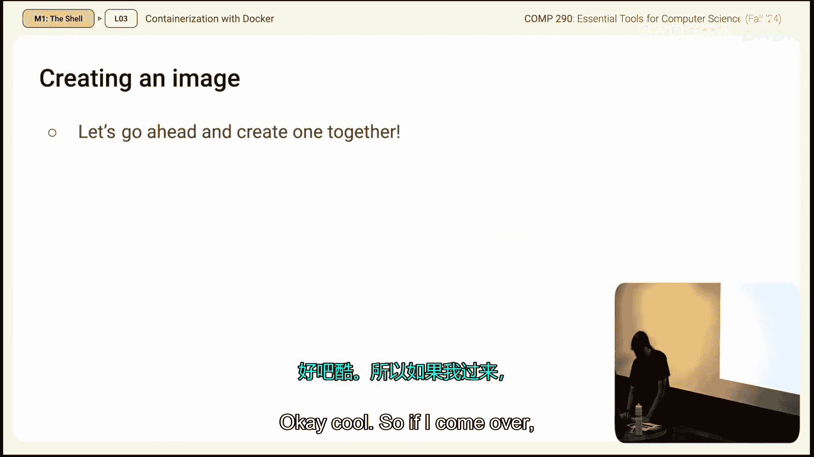

我知道现在听起来很高层次、很抽象。一旦我们开始实际操作Docker，你会看到基本上有对应的命令来完成所有这些事情。

到目前为止有什么问题吗？对于Docker的基本目的，大家感觉如何？可以给我看看大拇指（向上表示明白，中间表示一般，向下表示不明白）吗？好的，看起来不错。

---

## 创建镜像：Dockerfile

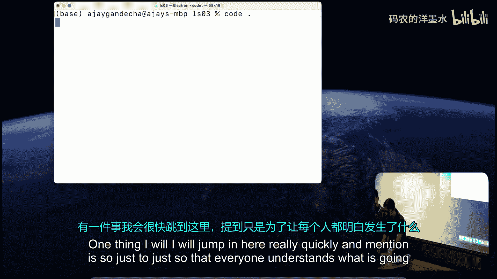

要创建镜像，这是第一步。有了镜像，我们就可以直接用它来启动容器。创建镜像是比较困难的部分，但幸运的是，Docker通过一个叫做**Dockerfile**的东西使这个过程变得非常容易。

Dockerfile本质上是创建镜像的逐步说明。你可以这样理解Dockerfile的作用：你总是从一个**基础镜像**开始。基础镜像就像你刚拿到一台新电脑，刚从盒子里拿出来，准备开始设置。基础镜像就是一些预安装的非常基本的东西。当你从盒子里拿出电脑时，也许现在它们预装了Python，但以前并不总是这样，所以你必须安装Python，安装你的依赖项。

本质上，如果你要把你的程序放到一台新电脑上，你需要采取哪些步骤才能让它运行？Dockerfile就是这些步骤的列表。我们稍后会看一个例子，它非常简单，只是从上到下按顺序运行，没有条件判断，没有if语句，你做的每一件事都按顺序运行。

相关的术语是：镜像通过Dockerfile**构建**。继续之前的类比，如果镜像是冷冻晚餐，那么Dockerfile就是食谱，它是非常详细的逐步说明，确保我们每次都能可预测地得到完全相同的冷冻晚餐（镜像）。

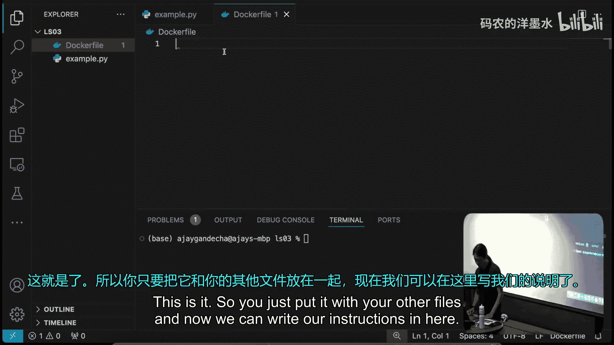

这里有一个参考列表，我不会花太多时间详细讲解，但这些都是我们稍后会用到的一些非常常见的Dockerfile指令：
*   `CMD`：这本质上标记了当你输入像 `python myprogram.py` 这样的命令来启动程序时，Docker将要运行的最终命令。这就是你的程序。
*   `COPY`：在构建镜像时，这非常有用。就像把文件复制到新电脑上一样，在Docker中你也需要复制所需的文件。
*   `ENV`：用于设置环境变量，不一定会总是使用，但很有帮助。
*   `FROM`：指定基础镜像，即起点。就像你想基于什么样的新电脑来构建。
*   `RUN`：运行任意命令。你会发现这个指令非常常见且强大，因为它允许你以任何方式修改系统。你可以把它想象成打开终端并在里面运行一个命令。任何你能在终端里做的事情，现在都可以在Dockerfile里做。
*   `WORKDIR`：我不太喜欢这个名字，我希望他们叫它`CD`，因为它在终端中等效于`cd`（改变目录）。`WORKDIR`就是说：让这个目录成为我们Dockerfile中的工作目录，然后当我开始复制文件等操作时，都会相对于这个目录进行。

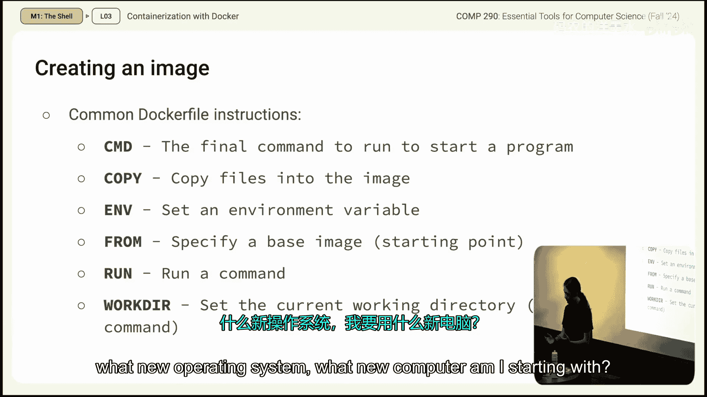

就像我说的，这是一个很好的参考。我认为这些是最基本的指令，你甚至不需要所有这些就能创建一个可工作的Dockerfile，但这些是你将反复看到的关键指令。

---

## 实战：创建一个Docker镜像

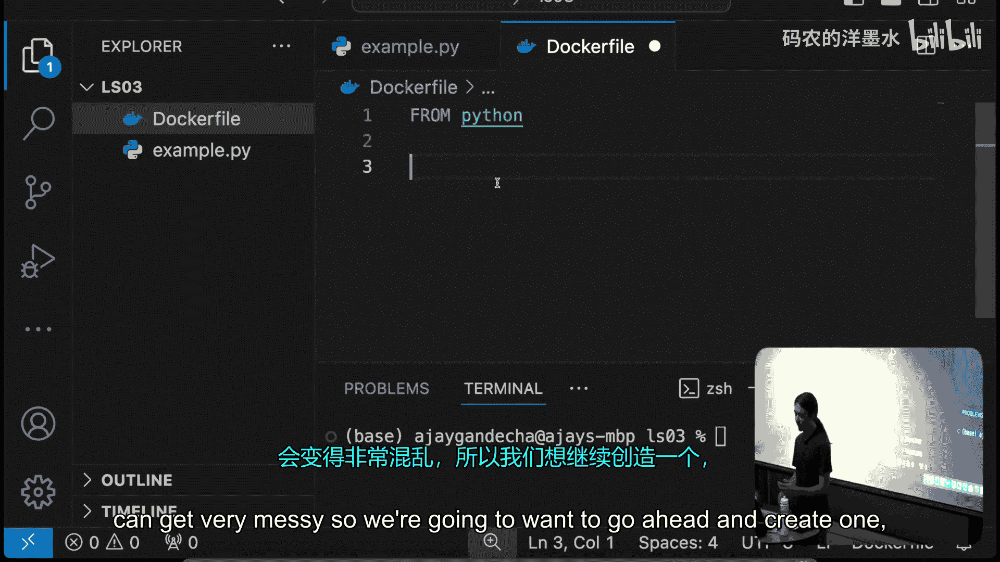

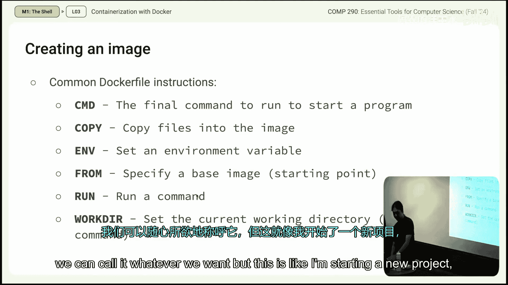

现在，让我们一起来创建一个镜像。请注意，这不是推送给你们的，更多的是我在上面演示，但我们会逐步进行，以便了解创建Dockerfile的过程，并真正掌握它。

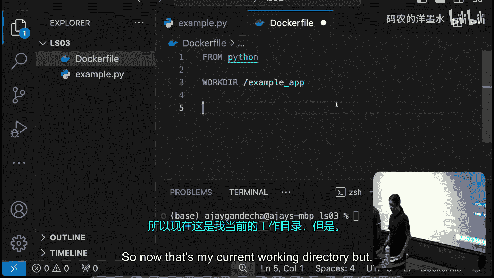

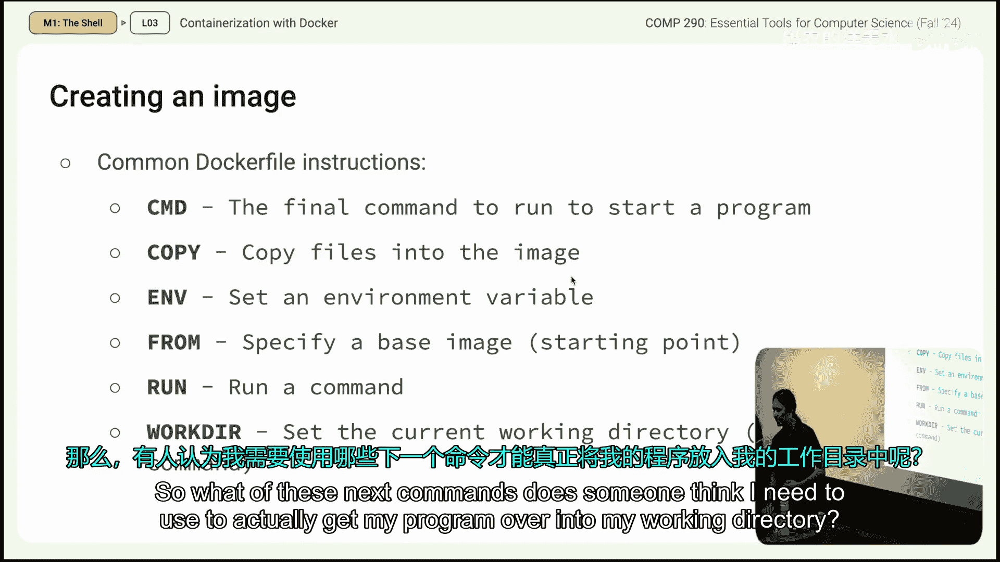

假设我们有一个名为 `example.py` 的Python程序。如果我们尝试直接运行它（`python example.py`），可能会遇到错误，因为代码在我写的环境下能运行，但在Jay的电脑上由于Python版本或其他环境差异可能无法运行。这不行。

所以，我们需要创建一个Dockerfile，以便我们可以在一个一致的环境中运行这个程序。

首先，我们进入包含 `example.py` 的文件夹（例如 `lesson3`），然后使用 `code .` 命令在VS Code中打开当前目录。这个命令会在指定的文件路径打开一个VS Code窗口。

现在，我们来创建Dockerfile。它是一个文件，我们新建一个文件，命名为 `Dockerfile`（没有扩展名）。VS Code会识别它并显示一个特殊的图标。

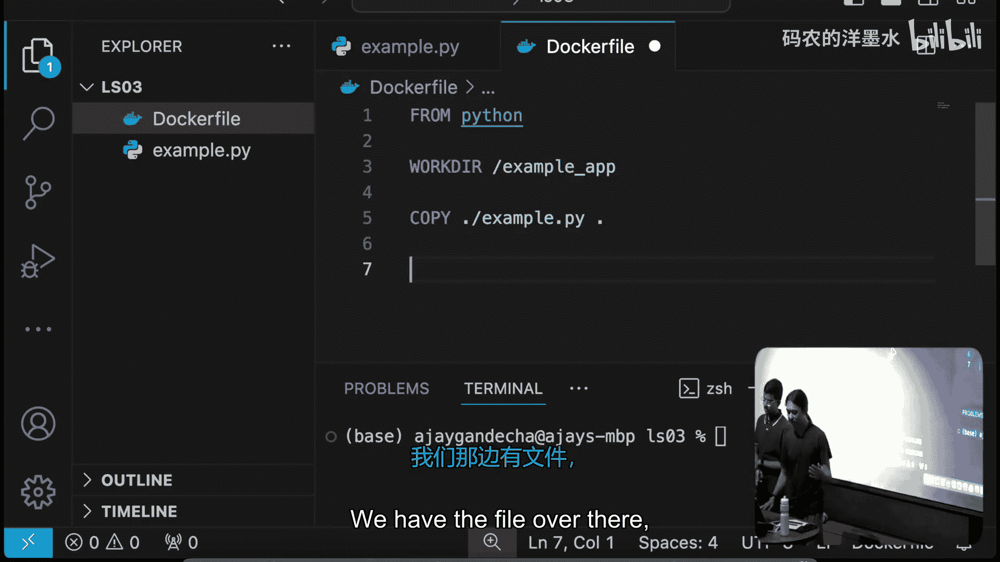

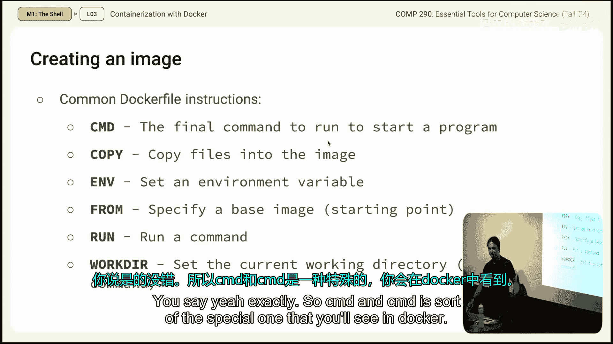

我们将在这个文件中编写指令。通常，Dockerfile的第一个指令是 `FROM`，因为我们必须指定使用什么基础镜像。就像拿到一台新电脑，我们从什么样的新操作系统、新电脑开始？

对于这个例子，我们使用一个名为 `python` 的基础镜像。这是由Docker社区提供的预构建镜像，它已经预装了Python，省去了我们自己安装的麻烦。

接下来，我们设置一个工作目录。默认情况下，工作目录是根目录，这可能会很混乱。我们创建一个目录，比如叫 `/example_app`。使用 `WORKDIR` 指令，它相当于在终端中创建目录并 `cd` 进入。

现在，我们的新系统有了Python，并且进入了 `/example_app` 目录，但里面什么都没有。我们需要将我们的程序文件复制到这个工作目录中。使用 `COPY` 指令。它需要源路径和目标路径。

源路径是相对于我们主机（个人电脑）上Dockerfile所在位置的路径。我们的 `example.py` 和 `Dockerfile` 在同一个目录，所以源路径是 `./example.py`（或者直接 `example.py`，因为`.`代表当前目录）。

目标路径是相对于我们在Docker容器内的工作目录（即 `/example_app`）。我们可以使用`.`表示当前工作目录（即 `/example_app`），或者直接写 `/example_app`。通常简写为`.`。

复制文件后，我们基本上具备了运行程序所需的一切：文件已经到位，Python也已安装。那么，运行程序的最终命令是什么？是的，`CMD`。`CMD` 是一个特殊的指令，通常放在Dockerfile的末尾，因为它是要执行的最后一步。它告诉Docker：在按照所有步骤设置好镜像后，这就是我想要运行的入口点，是这个镜像的根本目的。我们传入想要运行的命令：`python example.py`。

这样，我们就有了一个非常基本但完全有效的Dockerfile。它告诉我们：从一个公开可用的Python基础镜像开始，`cd` 到 `/example_app` 目录（`WORKDIR` 也会创建该目录），将 `example.py` 文件（相对于Dockerfile的位置）复制到工作目录中，然后启动它。

流程是：Dockerfile -> 镜像 -> 容器。现在我们有了Dockerfile，下一步是创建我们的镜像。

---

## 构建和运行镜像

我们通过命令行来构建镜像。在VS Code中，通常有一个集成终端，其当前工作目录已设置为当前活动目录。

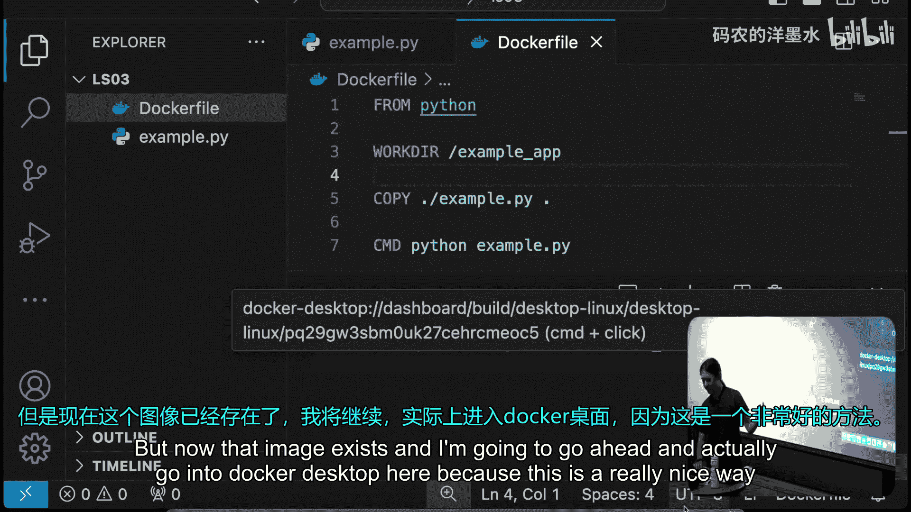

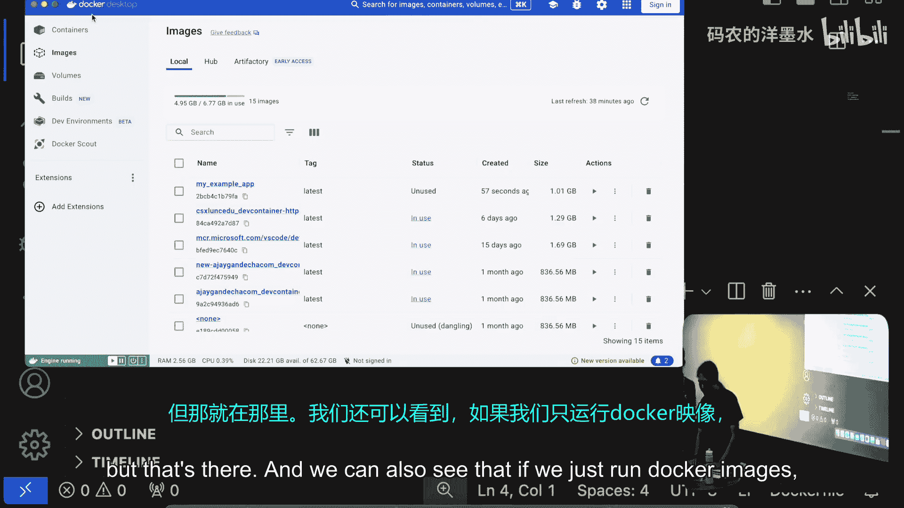

确保你已经安装了Docker Desktop，这样就可以从命令行访问Docker命令。运行 `docker` 命令会显示很多可用的命令，一开始可能让人不知所措，但真的只需要掌握几个关键命令。

构建镜像的命令是 `docker build`。它需要知道我们的Dockerfile在哪里。因为我们当前就在包含Dockerfile的目录中，所以可以使用快捷方式`.`表示当前目录。

此外，默认情况下，构建的镜像会有一个随机的ID，很难处理。我们可以使用 `-t`（tag）选项给它一个人类可读的名称。命令如下：
```bash
docker build -t my-example-app .
```
运行这个命令。它会输出很多信息，看起来可能很复杂，但关键是要看它执行的步骤。它会按照Dockerfile中的指令一行一行地执行：下载基础镜像（`FROM`），创建工作目录（`WORKDIR`），复制文件（`COPY`）等等。最后，镜像构建完成。

我们可以通过运行 `docker images` 命令来查看本地已有的镜像，应该能看到我们刚构建的 `my-example-app`。

有了镜像之后，下一步就是运行它来启动容器。Docker提供了一个方便的 `docker run` 命令。我们只需提供镜像的名称：
```bash
docker run my-example-app
```
运行后，我们会看到程序的输出。例如，如果程序是打印环境变量 `PATH`，那么输出会显示Docker容器内部的 `PATH` 值。

为了对比，我们可以在本地机器上（不在Docker内）直接运行同一个Python脚本（`python example.py`）。你会看到，本地机器上打印的 `PATH` 值与Docker容器内打印的值是不同的。这是因为在Docker内部，我们的环境是独立的，与我们计算机本身的实际环境是分离的。我们指定了Python基础镜像，它是一个定制的、只包含Python的环境，所以它是一个完全不同的东西。这正好体现了环境变量的不同。

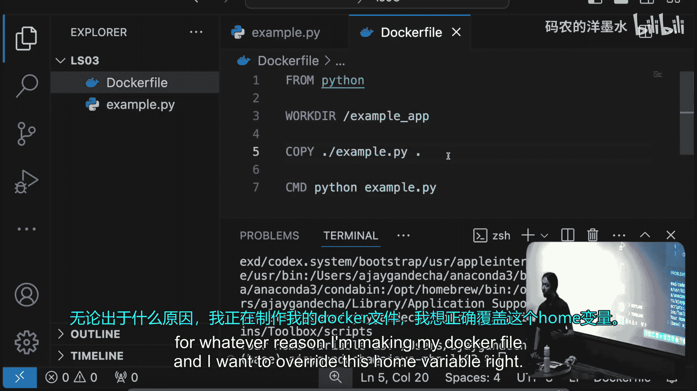

这向每个人说明了为什么这些路径变量是不同的吗？好的。

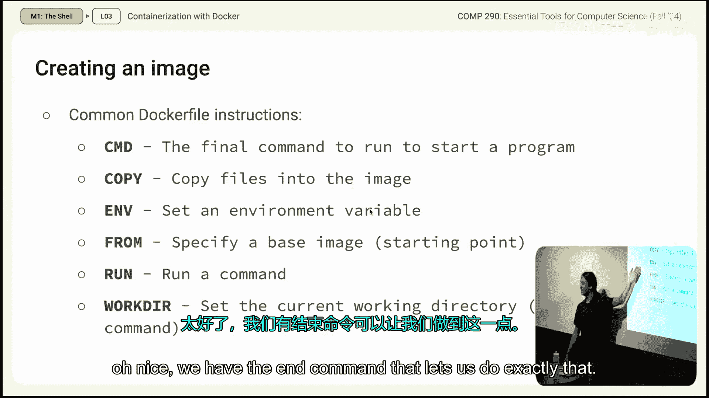

---

## 修改Dockerfile与环境变量

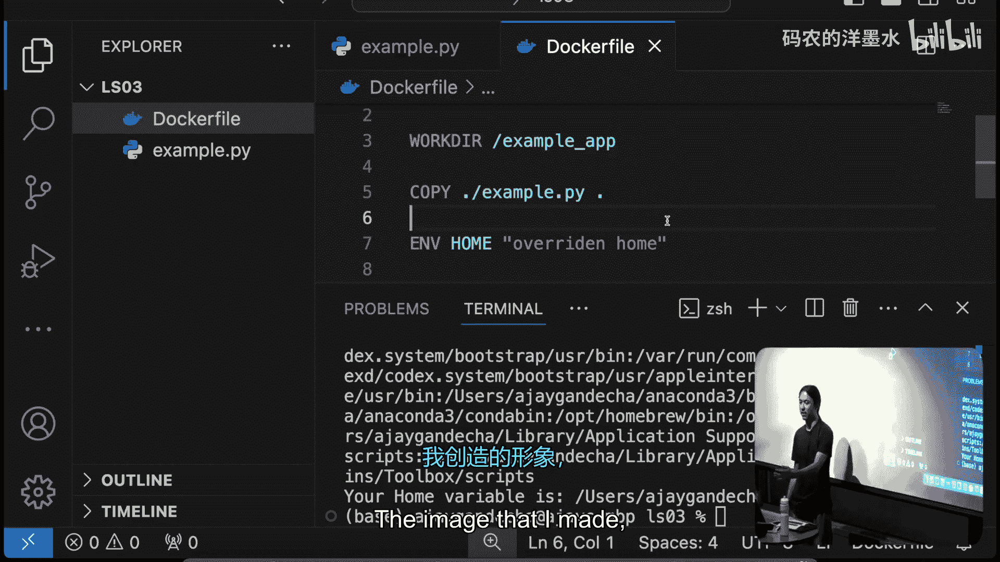

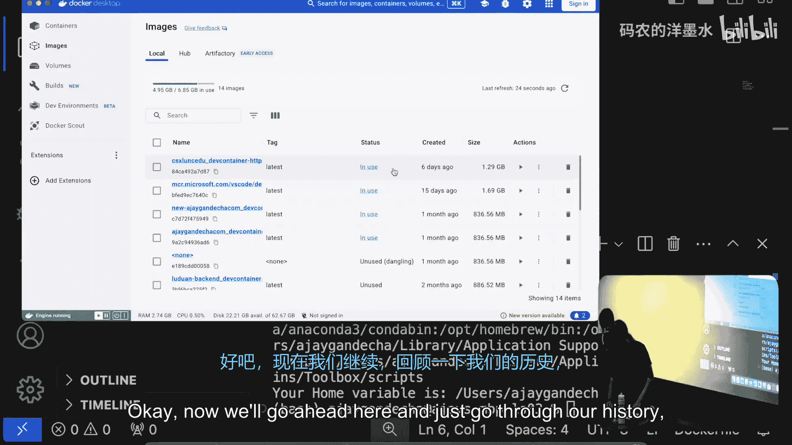

让我们扩展一下这个例子。假设我们的 `example.py` 现在打印两个环境变量：`PATH` 和 `HOME`。在本地机器上运行，会得到本机的 `HOME` 变量值。

现在，假设出于某种原因，我们在制作Dockerfile时想要覆盖这个 `HOME` 变量。我们可以使用 `ENV` 指令来设置环境变量。

我们在Dockerfile中靠近末尾的地方（在 `COPY` 之后，`CMD` 之前）添加一行：
```
ENV HOME="overridden_home"
```
现在，当我们在Docker上下文中运行时，`HOME` 变量应该会被覆盖为我们设置的值。

但是请注意，当我们更改Dockerfile后，已有的镜像并不会自动更新。镜像仍然是几分钟前构建的那个。每次更改Dockerfile后，如果我们想更新镜像，就必须重新构建它。这可能会有点繁琐。

我们需要先删除旧的容器（如果它正在运行），然后删除旧的镜像，最后用相同的命令重新构建：
```bash
docker build -t my-example-app .
```
你会发现这次的构建速度比第一次快得多。这是因为Docker内部的一个有趣机制：**层**。

Dockerfile中的每一条指令（如 `FROM`、`WORKDIR`、`COPY`、`ENV`）都会产生一个层。你可以把它看作一种分层构建的方法。我们从基础镜像（底层）开始，然后每一层都是我们添加的更改。`CMD` 指令不会创建自己的层，它只是指定在该层中应该做什么。

这次构建这么快的原因是，我们没有更改前面的层（`FROM`、`WORKDIR`、`COPY`），只更改了从 `ENV` 往后的部分。Docker发现前面的层已经构建好了，所以它直接复用它们，只添加新的层，而不是从头开始重建。这是Docker强大的另一个原因：可重用性。如果存在共同的部分，就尽量复用，以最小化需要做的工作。

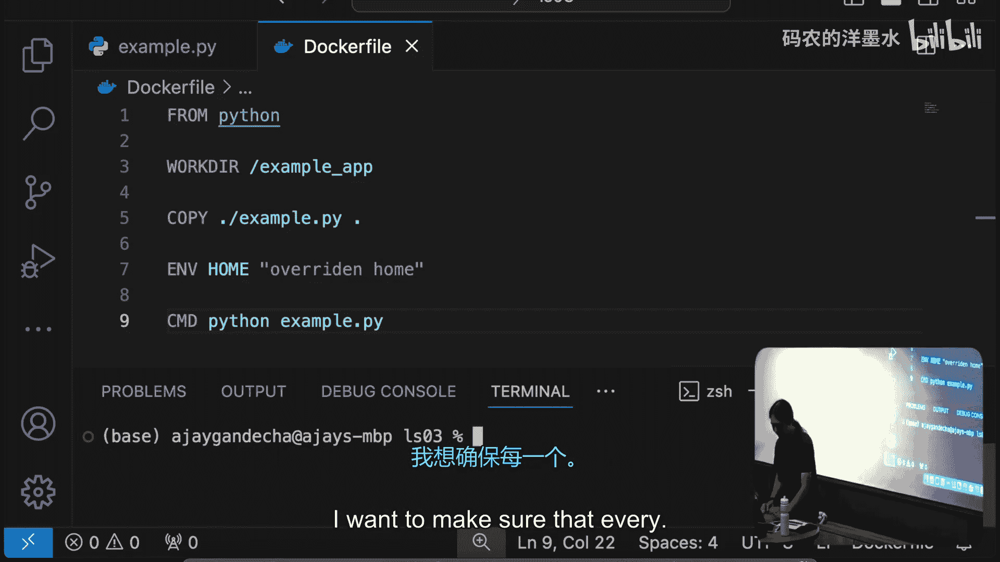

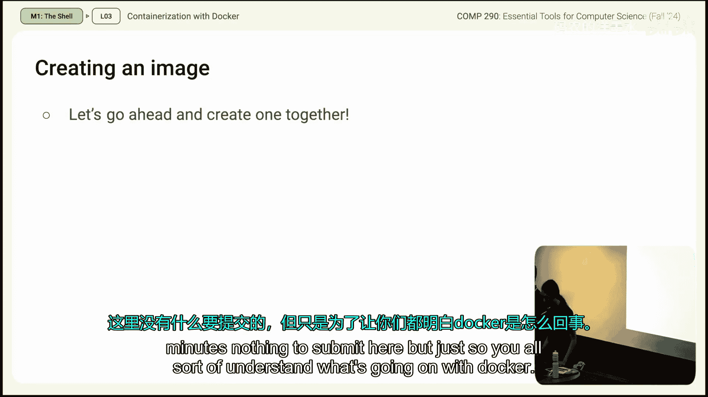

构建完成后，再次运行容器：
```bash
docker run my-example-app
```
现在，我们可以看到 `HOME` 变量的输出变成了 `overridden_home`，说明我们的覆盖生效了。

---


## Docker的优势与用例

从使用Docker运行一个程序的角度来看，基本过程就是这样。在更高级的课程中，特别是当你需要部署应用程序时，你将不得不经历这个过程：制作Dockerfile，将所有东西打包，构建镜像，然后将该镜像发送到某个地方运行。如果你做个人项目，这也是一个非常强大、非常有用的工具。

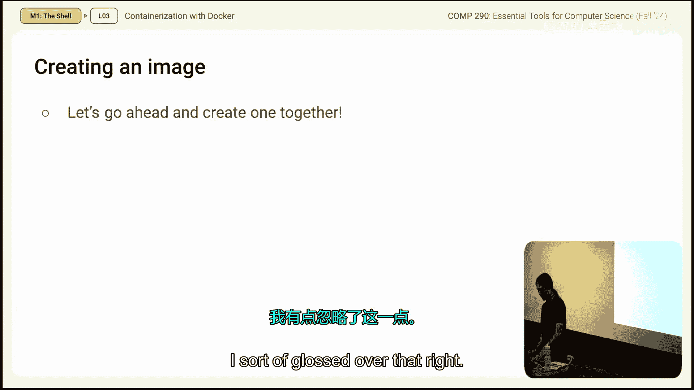

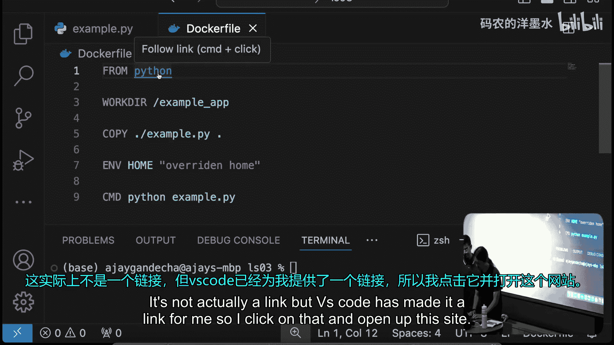

我知道刚才讲了很多内容。现在我想请大家再次分组，回顾一下Docker的要点：Docker的重要部分是什么？关键要点是什么？它的优势是什么？它的使用场景有哪些？讨论几分钟，不需要提交，只是为了让大家理解Docker是怎么回事。

（讨论时间）

好的，大家请集中一下。听到了一些很好的讨论。有谁能简要总结一下你们小组的收获吗？为什么Docker很重要？

*   **标准化**：很好，能展开说说吗？在软件工程团队中，你有自己的网络和包，我有我的，可能我用Mac，你用Windows，平台不同，包也不同。但Docker可以创建一个容器，为我们提供一个共同的基础。这样我们就不必各自费劲去搞清楚所有的配置，而是可以基于一个共同的开发环境进行协作。非常好的观点。

Docker确实是为了标准化，在你我的机器之间共享某些东西，这样我们就不必总是问“我安装了这个程序，你安装了吗？”它提供了一个标准化的层次。

还有人想到Docker其他有趣的地方或关键点吗？

一个很好的问题是：如果我在个人项目中使用Docker，我怎么知道该使用哪个基础镜像？这是一个非常好的问题，我刚才只是粗略地提了一下。我说就相信存在一个Python基础镜像，它确实存在。实际上，有一个叫做 **Docker Hub** 的网站，非常像GitHub。它是一个人们可以制作和分享镜像的地方。Python的维护者提供了官方的Python镜像。你甚至可以通过 `docker pull python` 命令获取它。Dockerfile足够智能，如果本地没有，它会自动拉取。在Docker Hub上，你可以探索很多官方镜像，比如Nginx（用于Web开发）、Alpine（一个轻量级Linux发行版）等等。你可以查看这些镜像的文档，了解它们包含什么，以及如何使用它们。如果你有兴趣使用Docker，我建议你探索一下Docker Hub，看看哪些镜像可能对你的项目有用。

---

## 真实世界案例与总结

我想快速展示一个真实世界的使用案例。这个网站（可能指某个校内CS相关网站）目前运行在互联网上，被我们所有的CS学生使用，而这个网站也运行在一个Docker化的容器中。所有的功能、安装，一切都在容器内。它的源代码在GitHub上，你可以看到那里有一个Dockerfile。这个Dockerfile更大、更复杂一些。你可以看到它有前端和后端，使用了不同的基础镜像（如Node.js用于前端，Python用于后端）。这个例子说明了Docker如何让多人协作开发变得容易（大家环境一致），也使得将代码部署到服务器变得简单（确保程序在服务器上也能运行）。这是一个你们现在就在使用的、由Docker驱动的工具的真实例子。

这提醒了我一点：当我刚开始学习Docker时，很难理解一件事：我们刚才的例子只是一个一次性的程序，我们创建了一个完整的Docker镜像，从命令行运行它，然后它就结束了，没有等待任何输入。但Docker适用于所有场景。它适用于一次性程序，也适用于长期运行的程序，比如Web服务器，它等待人们连接。它之所以能用于任何场景，是因为它从根本上说只是一种传输整个环境、确保程序能在任何地方运行的方式。你在电脑上能制作的任何程序，都可以利用Docker让它更容易地在别人的电脑上运行。

任何你编写的程序，都可以以某种方式使用Docker。你甚至会在一些高级课程中看到“开发容器”这种特定的Docker用例。其理念是：Docker非常适合部署应用，但我们在开发时呢？我们甚至不知道每个人的机器是否相同。有没有办法在开发时也标准化环境？答案是：可以使用Docker确保每个人拥有相同的环境，然后他们基本上就在那个Docker容器内工作、进行修改。这是一个非常通用的工具，几乎可以用于任何事情。如果你想运行一个Minecraft服务器，也有一个Docker镜像可以下载并启动。它非常多功能，我强烈鼓励大家更多地了解它。

随着时间推移，你会越来越多地看到人们说“哦，就下载这个的Docker镜像来用”。如果你不太清楚怎么做，可能会有点困惑。所以，这是一个非常实用、非常强大的工具，很可能在你未来的计算机科学生涯中某个时刻会用到。

我希望大家从中学到了一些关于Docker的知识，理解了它为什么重要。将会有一份相关的作业发布（虽然现在还没完全准备好），内容是一些基础的东西，帮助大家真正理解Dockerfile和Docker的理念。

---

## 结尾与预告

最后提醒一下，除了这份与上节课相关的简短练习（已在GradeScope上），还会有两个视频链接（稍后更新到网站）。一个是“Git in 100 Seconds”视频，另一个是Chris Jordan为下周主题录制的视频（他会很好地解释并绘制图表）。此外，还会提供一些补充资源，如果你想提前阅读一点的话。

这就是我今天要讲的全部内容。如果任何人需要帮助，我会在这里再待一会儿，可以上前来问。

---


本节课中，我们一起学习了Docker与容器化的核心概念。我们了解了程序运行对环境（如系统架构、软件版本、依赖项等）的依赖，以及环境不一致带来的“在我机器上能运行”的问题。Docker通过**容器化**技术解决了这一问题，它将程序及其完整运行环境打包成一个独立的、可移植的**镜像**。我们学习了如何使用**Dockerfile**（像食谱一样）定义构建镜像的步骤，包括选择基础镜像（`FROM`）、设置工作目录（`WORKDIR`）、复制文件（`COPY`）、设置环境变量（`ENV`）和指定启动命令（`CMD`）。通过 `docker build` 命令可以将Dockerfile构建成镜像，再通过 `docker run` 命令可以将镜像运行为一个活动的**容器**。Docker的**分层**机制使得镜像构建高效且可复用。这项技术对于标准化开发与部署环境、确保应用跨平台一致性至关重要，是现代软件开发中一项基础且强大的工具。