# 005：Git进阶概念与分支管理 🚀

在本节课中，我们将继续学习Git，扩展你的Git工具箱。我们将深入探讨分支的概念、如何创建和切换分支，以及如何通过合并（merge）将不同分支的工作整合到一起。这些是团队协作和项目管理中至关重要的技能。

---

## 课程回顾 📚

上一节我们介绍了Git的基本概念，包括版本控制、仓库、提交（commit）以及暂存区（stage）。提交是项目时间线上的检查点，记录了自上次提交以来的所有更改。每个提交都包含一个唯一的ID、一条描述信息、作者和时间戳。

---

## 热身练习：理解Git操作流程

以下是理解Git基本操作流程的一个练习。我们将通过一系列命令，观察仓库状态的变化。

首先，我们创建一个新目录并进入其中，这将是我们的工作目录。

```bash
mkdir warmup
cd warmup
```

1.  **初始化Git仓库**：使用 `git init` 命令在当前目录创建一个新的Git仓库。
2.  **创建文件**：使用 `echo “sub” > hi.txt` 命令。`>` 是输出重定向符，它将 `echo` 命令的输出（文本“sub”）写入（或覆盖）到 `hi.txt` 文件中。
3.  **暂存更改**：使用 `git add hi.txt` 命令。这会将创建 `hi.txt` 文件的更改添加到暂存区（即“草稿提交”）。
4.  **创建提交**：使用 `git commit -m “first”` 命令。这将正式创建一个提交，保存暂存区中的所有更改，并清空暂存区。此时，仓库时间线上有了第一个提交点。
5.  **修改文件**：使用 `echo “world” >> hi.txt` 命令。`>>` 是追加操作符，它将“world”添加到 `hi.txt` 文件的末尾，而不是覆盖。
6.  **创建新文件**：使用 `echo “cookie” > food.txt` 命令，创建第二个文件。
7.  **暂存部分更改**：使用 `git add food.txt` 命令。注意，这里只暂存了新文件 `food.txt`，而 `hi.txt` 的修改并未被暂存。
8.  **创建第二个提交**：使用 `git commit -m “second”` 命令。这个提交只包含了添加 `food.txt` 的更改。`hi.txt` 文件中的“world”修改虽然存在于工作目录的文件中，但**并未被记录在Git的历史中**，因为我们没有将其暂存。

**关键点**：为了避免遗漏更改，一个常见的做法是使用 `git add .` 命令。`.` 代表当前目录，这个命令会暂存工作目录中所有已修改和新建的文件。

**为什么需要暂存区？** 暂存区允许你精心挑选哪些更改要纳入下一次提交。例如，你可以只提交与某个功能相关的文件，而将调试代码或包含敏感信息（如API密钥）的文件排除在版本历史之外。

---

## Git分支 🌿

本节中我们来看看Git中一个强大的功能：分支（branch）。

### 什么是分支？

一个分支本质上只是一个**指向特定提交的标签**。默认情况下，Git会创建一个名为 `main` 的分支。`HEAD` 是一个特殊的指针，它指向你当前“正在查看”的分支。

**重要理解**：分支不是指一整条开发线，它仅仅是一个可以移动的标签。当你创建新的提交时，你当前所在的分支标签会向前移动到最新的提交，`HEAD` 也随之移动。

### 创建与切换分支

*   **创建分支**：使用 `git branch <分支名>` 命令。这会在当前 `HEAD` 指向的提交上创建一个新的分支标签。
*   **切换分支**：使用 `git switch <分支名>` 命令。这会将 `HEAD` 移动到指定的分支，同时你工作目录中的文件也会更新，以反映该分支所指向的提交状态。这就像在时间线上跳转。
*   **分离头指针（Detached HEAD）**：如果你使用 `git checkout <提交ID>` 直接跳转到某个历史提交，`HEAD` 将不再指向任何分支，而是直接指向提交。这种状态称为“分离头指针”。要修复此状态，你可以在该提交上创建一个新分支（`git branch <新分支名>`），然后切换过去。

### 分支的用途

分支允许你在主开发线（如 `main` 分支）之外，开辟独立的开发环境。例如，你可以创建一个 `feature-a` 分支来开发新功能A，同时另一个同事在 `feature-b` 分支上开发功能B，彼此互不干扰。

---

## 合并分支 🤝

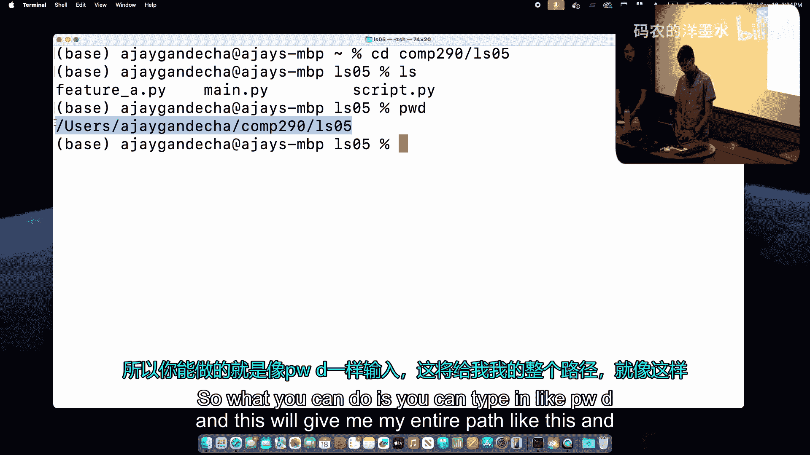

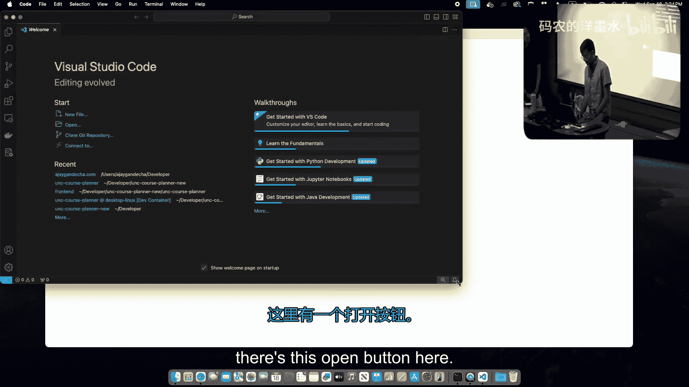

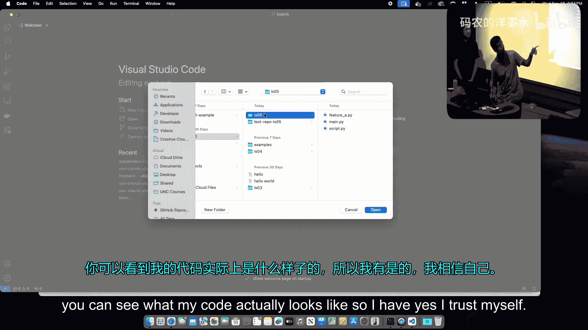

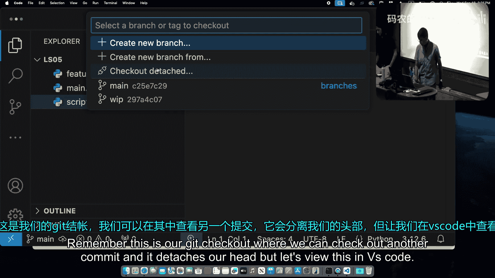

上一节我们介绍了如何创建独立的分支进行开发。本节中我们来看看如何将不同分支的工作成果整合到一起，这需要通过合并（merge）来实现。

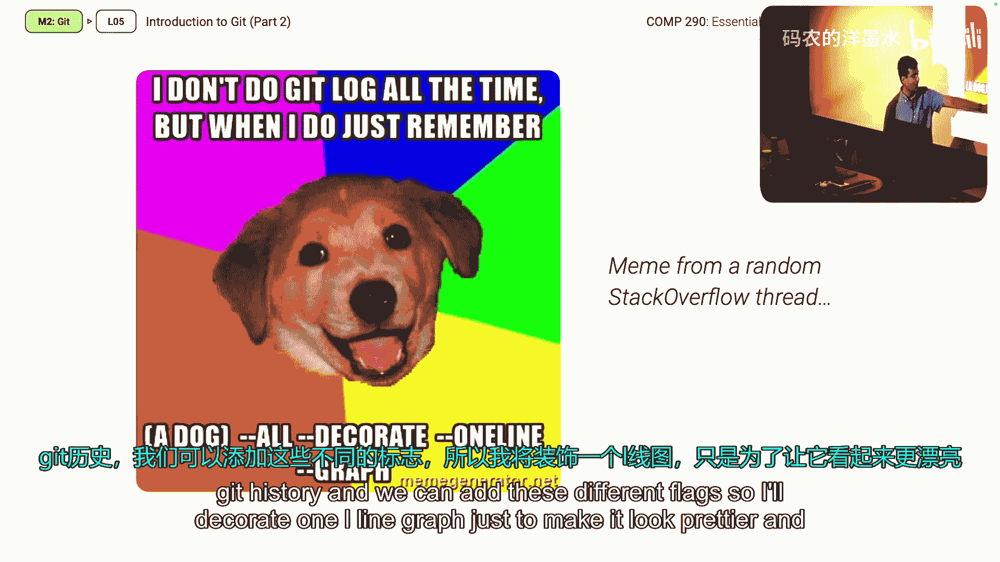

### 什么是合并？

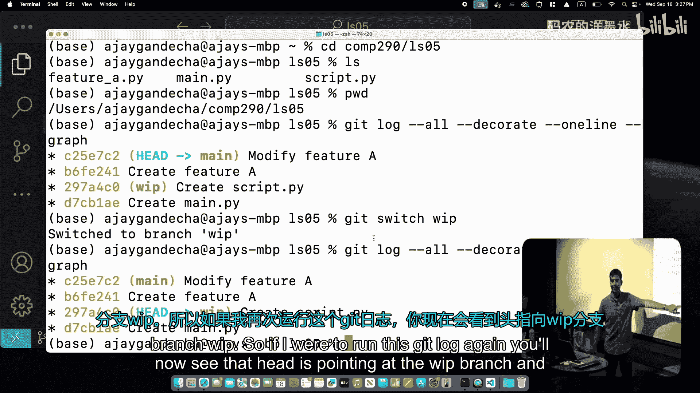

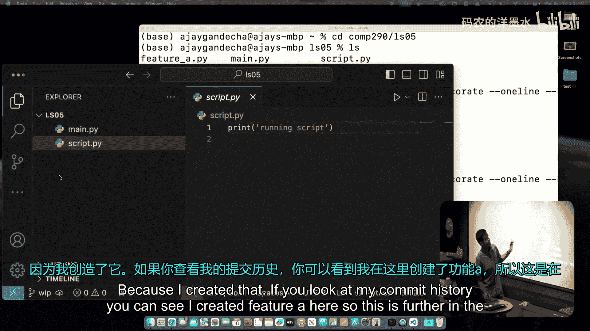

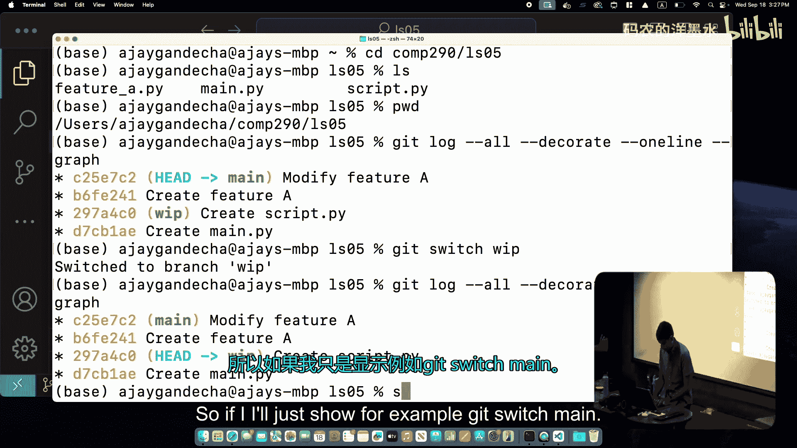

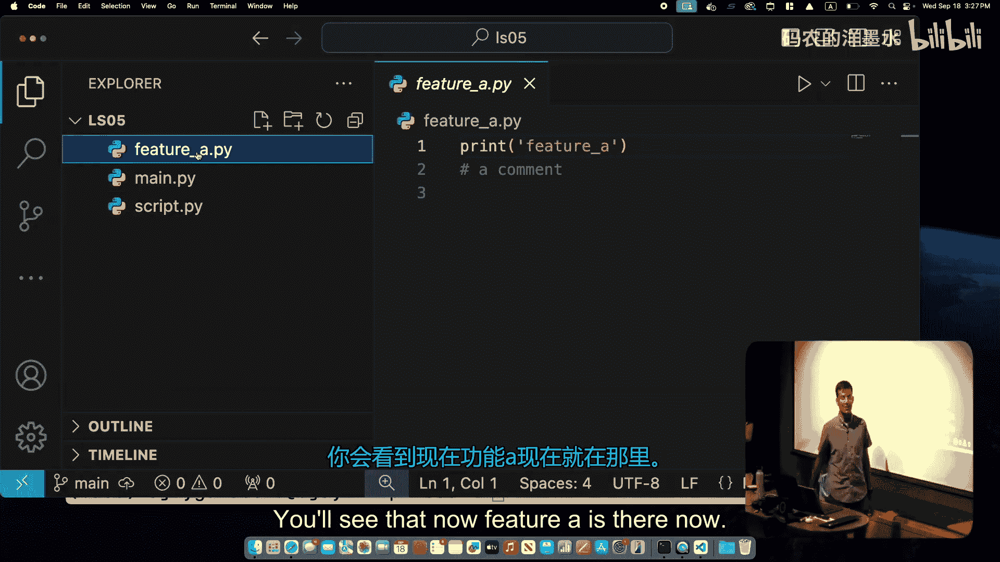

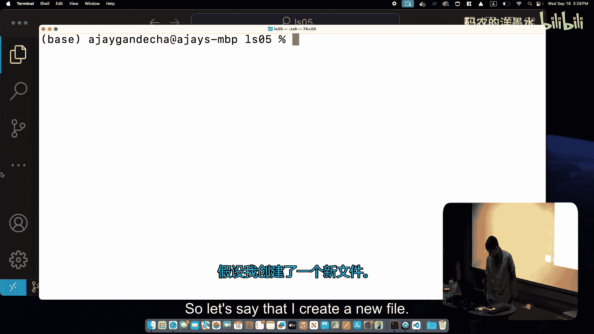

合并是将两个分支的历史整合到一起的操作。Git会尝试自动将来自不同分支的更改组合起来，并创建一个新的“合并提交”。这个合并提交比较特殊，它有两个父提交。

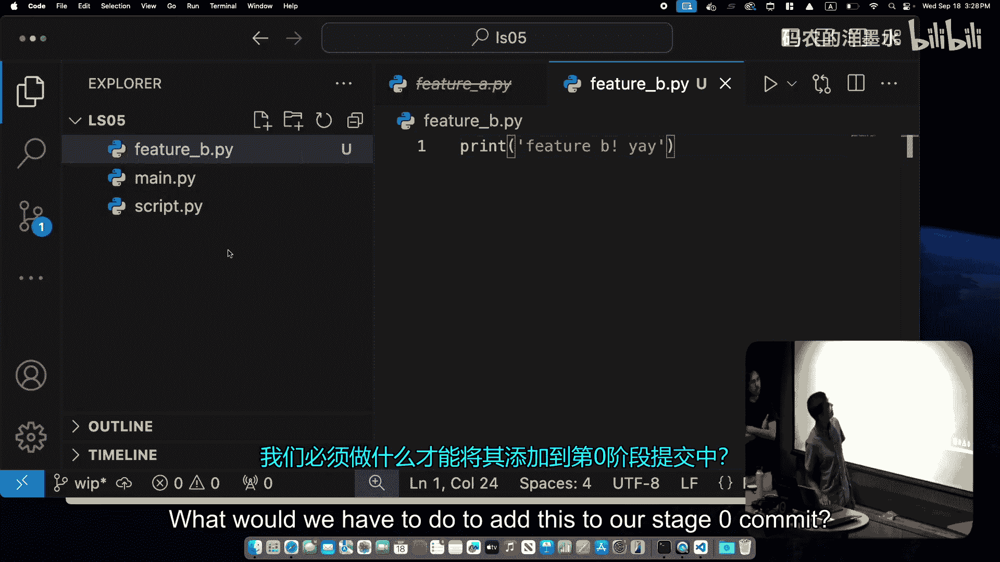

### 如何进行合并？

假设你在 `feature-b` 分支上完成了工作，现在想将其合并到 `main` 分支：

1.  **切换到目标分支**：首先，确保你位于想要接收更改的分支上。`git switch main`
2.  **执行合并**：然后，运行合并命令，指定你想要合并过来的源分支。`git merge feature-b`
3.  **处理合并结果**：如果两个分支的修改没有冲突（例如，修改了不同的文件），Git会自动创建合并提交。如果有冲突（例如，两个分支修改了同一文件的同一行），则需要手动解决冲突。

### 合并冲突

当Git无法自动决定如何合并两个分支的更改时，就会发生合并冲突。例如，一个分支删除了某个文件，而另一个分支修改了同一个文件。此时，Git会标记出冲突的文件，你需要手动编辑这些文件，决定保留哪些内容，然后使用 `git add` 标记冲突已解决，最后完成提交。

---

## 总结 🎯

本节课中我们一起学习了Git的进阶概念：
1.  **操作流程回顾**：我们通过练习巩固了 `git add`、`git commit` 的工作流程，理解了暂存区的作用以及使用 `git add .` 的便利性。
2.  **分支管理**：我们明白了分支只是一个指向提交的标签，学会了使用 `git branch` 创建分支和 `git switch` 切换分支。
3.  **分支合并**：我们了解了使用 `git merge` 将不同分支的工作合并到一起的基本过程，并知道了合并冲突的存在及其处理思路。


掌握分支和合并是进行高效团队协作开发的基础。在接下来的实践中，你会更深入地体会到它们的强大之处。