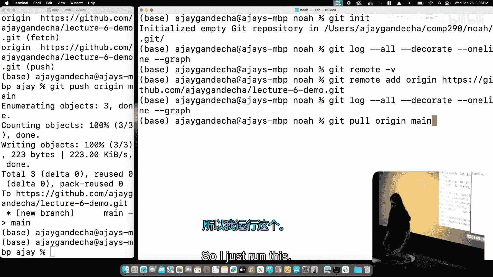
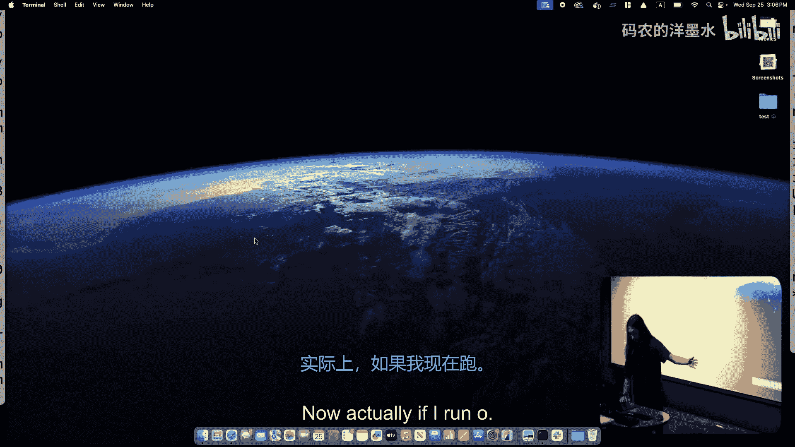
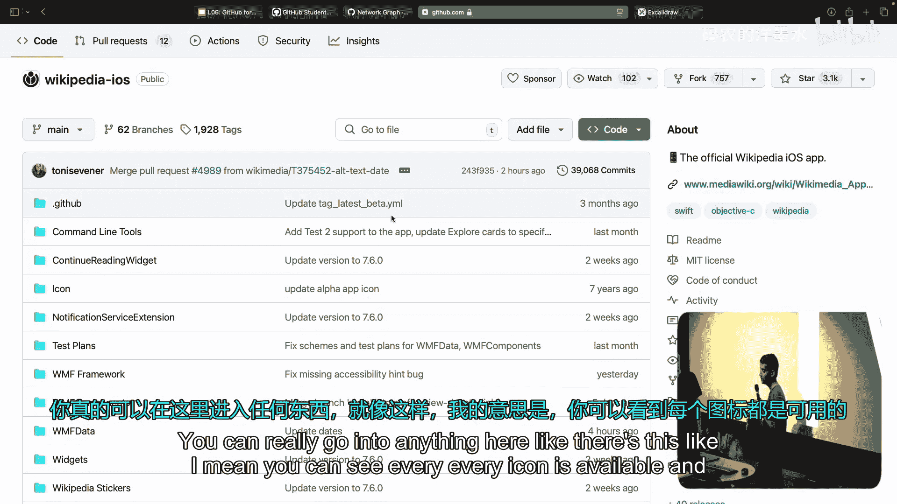
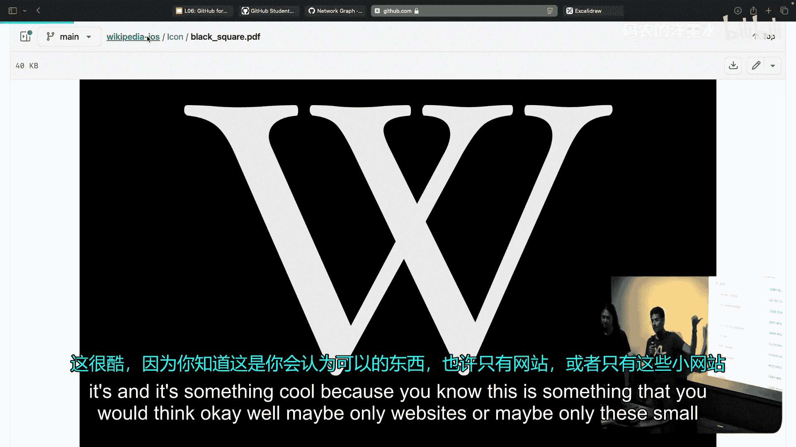

# 006：GitHub在软件工程中的应用

## 概述
在本节课中，我们将要学习GitHub，这是一个基于Git的协作平台。我们将了解Git与GitHub的区别，学习如何将本地仓库与远程仓库同步，并探索GitHub的核心功能，如问题追踪和拉取请求。最后，我们将讨论开源软件的概念及其重要性。

---

## Git与GitHub的区别
上一节我们介绍了Git作为版本控制工具的核心概念。本节中，我们来看看GitHub是什么，以及它与Git有何不同。

Git是一个**分布式版本控制系统**，它允许你在本地管理代码的版本历史。其核心操作可以概括为以下命令流程：
```bash
git init          # 初始化仓库
git add .         # 添加更改到暂存区
git commit -m "提交信息" # 创建提交
```

GitHub则是一个**基于Git的代码托管和协作平台**。你可以把它想象成一个云存储服务，专门用于存放Git仓库，并在此基础上添加了网页界面、问题追踪、代码审查等协作功能。

**关键区别**：
*   **Git**： 本地命令行工具，负责版本控制。
*   **GitHub**： 远程网站服务，负责托管仓库和促进协作。

你可以使用Git而不使用GitHub，但GitHub极大地简化了多人协作的流程。

---

## 远程仓库操作：推送与拉取
理解了基本区别后，我们来看看如何连接本地仓库和GitHub上的远程仓库，并进行数据同步。

在Git术语中：
*   **本地仓库**： 存储在你个人电脑上的仓库。
*   **远程仓库**： 存储在GitHub等服务器上的仓库，通常命名为 `origin`。

以下是连接和同步的核心命令：

**添加远程仓库**
```bash
git remote add origin <GitHub仓库URL>
```

**推送更改到远程仓库**
```bash
git push origin main
```

**从远程仓库获取更新**
```bash
git fetch origin
```

**获取并合并远程更新到本地**
```bash
git pull origin main
```

**工作流程比喻**： 你可以将 `git push` 理解为将文件上传到Google Drive，将 `git pull` 理解为从Google Drive下载最新版本的文件。`git fetch` 则是查看云端有哪些新文件，但暂不下载覆盖本地。





---

## GitHub核心功能导览
成功同步代码后，GitHub的网页界面提供了强大的工具来管理项目。本节我们将探索这些功能。

以下是GitHub仓库页面的主要功能区域：

1.  **代码**： 浏览项目文件、提交历史和分支。
2.  **问题**： 用于报告Bug、提出新功能建议或跟踪任务。它是一个内置的任务管理系统。
3.  **拉取请求**： 这是协作的核心。当你想将某个分支的代码合并到主分支时，可以创建一个拉取请求。其他贡献者可以在此审查你的代码、提出修改意见，讨论通过后再进行合并。它本质上是一个**代码审查和合并请求流程**。
4.  **项目**： 一个看板式的项目管理工具，可以将问题卡片拖拽到不同列（如“待办”、“进行中”、“完成”）来可视化工作进度。
5.  **洞察**： 提供仓库的统计数据和图表。其中的“网络”图功能尤其有用，它能可视化整个仓库的提交历史和分支结构，就像我们之前画出的图表一样。

---

## 开源软件简介
我们看到了GitHub上托管着无数项目。这些项目大多属于“开源软件”。本节我们来探讨这个概念。

**开源软件**是指其**源代码公开**，任何人都可以查看、使用、修改和分发的软件。例如，Python语言本身、维基百科的移动应用，以及许多人工智能框架都是开源的。

与之相对的是**闭源软件**，其源代码不公开，通常由公司所有和控制，例如微软的Windows或苹果的iOS。

**开源的优势包括**：
*   **透明与信任**： 用户可以检查代码如何工作。
*   **协作与创新**： 全球开发者可以共同改进项目。
*   **可持续性**： 即使原维护者停止支持，社区也可以接手。
*   **学习资源**： 是初学者学习优秀代码实践的宝库。

**闭源软件的优势可能在于**：
*   **商业控制**： 保护知识产权和商业模式。
*   **简化体验**： 通常提供统一的支持和用户界面。

---

## 创建你的GitHub个人资料
探索了开源世界后，你可能会想如何参与其中。一个很好的起点是完善你的GitHub个人资料。

GitHub个人资料是你的开发者名片。你可以通过创建一个特殊的仓库来定制它。以下是你可以展示的内容：

*   **个人简介**： 介绍你的技能、兴趣和学习领域。
*   **置顶仓库**： 展示你最引以为豪的项目。
*   **贡献图**： 自动显示你长期的提交活动。
*   **自定义链接**： 链接到你的个人网站、博客或简历。





一个精心维护的GitHub个人资料对于求职、寻找合作者或单纯地记录你的编程之旅都大有裨益。

---


## 总结
本节课中我们一起学习了GitHub在软件工程中的关键作用。我们明确了Git（版本控制工具）与GitHub（协作平台）的区别，掌握了使用`push`、`pull`、`fetch`命令在本地与远程仓库间同步代码的方法。我们还浏览了GitHub的问题追踪、拉取请求和项目管理等核心协作功能。最后，我们讨论了开源软件的概念及其重要性，并鼓励大家通过完善GitHub个人资料来开启自己的协作与展示之旅。掌握这些工具将为你未来的课程项目和职业发展打下坚实的基础。