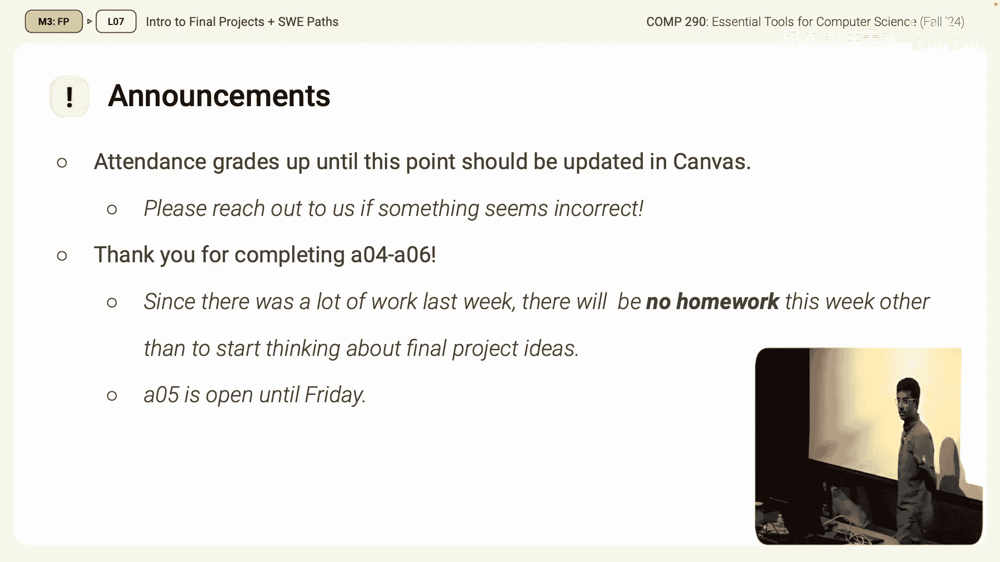
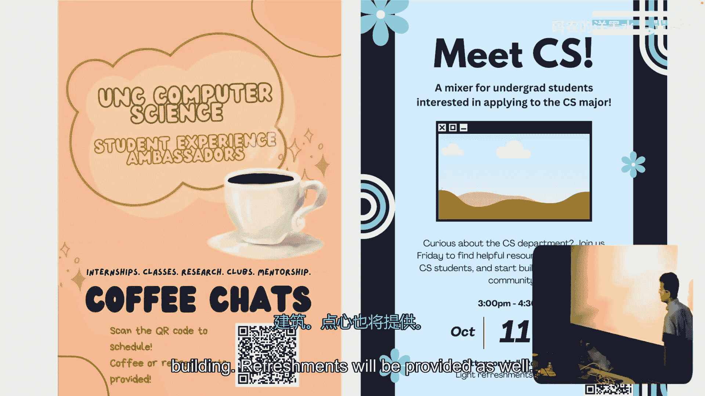
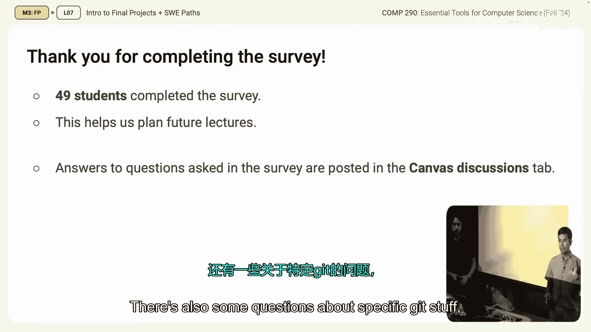
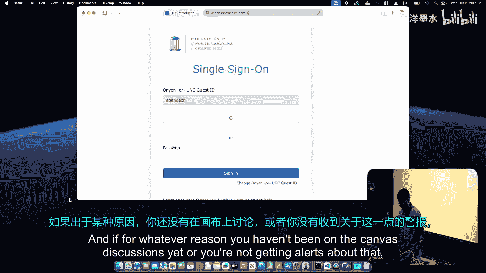
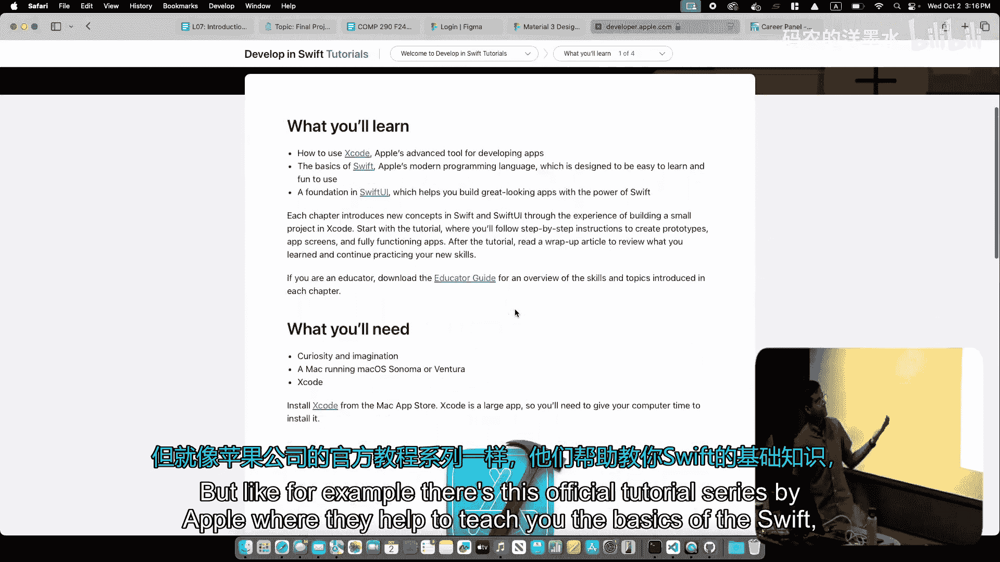
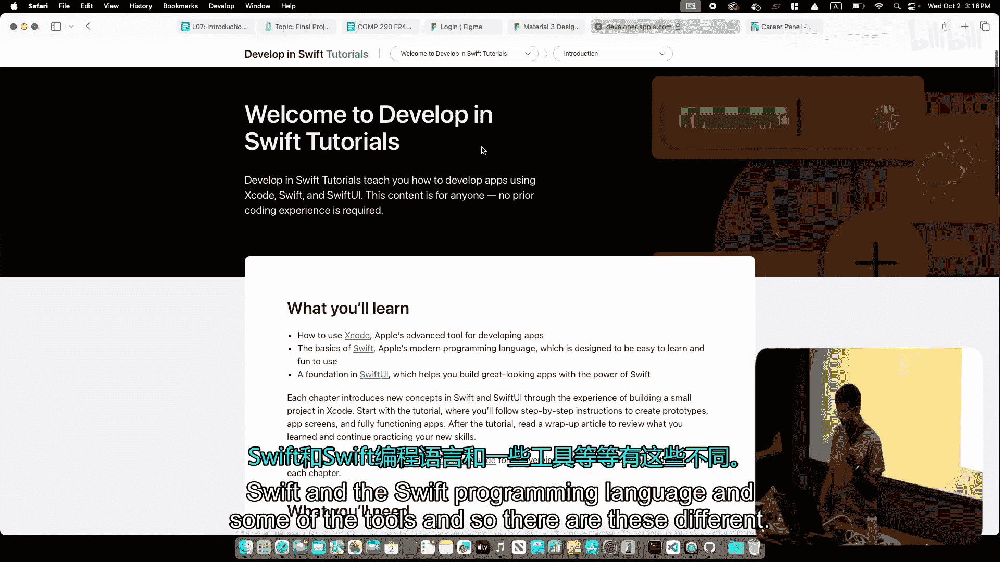
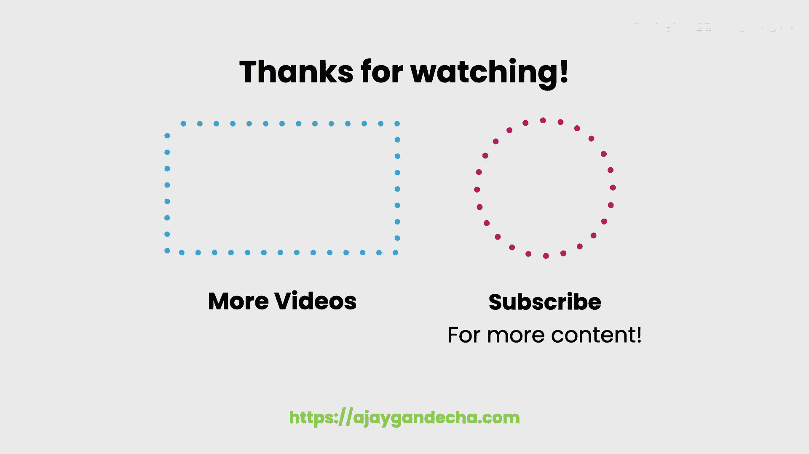

# 007：期末项目 🎓

在本节课中，我们将详细介绍本课程的期末项目。该项目旨在帮助大家探索计算机科学领域的多样性，并开始学习一项你感兴趣的新技能。我们将介绍项目的整体结构、各个组成部分以及如何开始规划。

---

## 课程概述与公告 📢

欢迎回到第七次讲座。感谢大家到目前为止的出色工作。我们理解近期作业时间线较为紧凑，并且练习4出现了一些问题，我们仍在处理中，感谢大家的耐心。

首先是一些公告：
*   **出勤成绩**：截至目前（包括本次讲座）的出勤成绩已更新在Canvas上。我们已根据课程大纲，自动剔除了最低的一次出勤分。如果发现任何错误，请告知我们。
*   **作业情况**：感谢大家完成了过去两周的三项练习。关于A05，我们已将其在Gradescope上的截止日期调整至与公告一致。如果你已经完成，那么本周将没有其他作业。
*   **作业目的**：我们布置作业的核心目的是让大家接触并了解我们认为重要的知识。作业有时可能看起来内容较多，但并非为了刁难大家。如果遇到困难或时间冲突，请随时通过邮件或在课下与我们沟通，我们会尽力提供帮助，确保大家有时间学习并掌握知识。

有任何关于上述事项的问题吗？

---

## 近期活动与资源 🔗

接下来，我们回顾一下上周提到的一些活动和资源：
*   **咖啡聊天与学生大使**：活动仍在进行中。如果你对课程、社团、实习、导师指导等话题感兴趣，可以扫描二维码与我们的学生体验大使交流。
*   **Meet CS活动**：原定于上周五的活动因天气原因改期至**10月11日**。这是一个面向有意申请CS专业的本科生的活动，非常适合本课程的同学参加。
*   **HackNC注册**：HackNC的注册现已开放，相关邮件已发出，建议大家关注。
*   **招聘方座谈会**：今天（讲座当天）下午6:30至8点，在SN 114有一场招聘方座谈会。届时将有来自多家科技公司的招聘人员分享招聘流程，并提供披萨。详细信息可在CS系官网或Canvas公告中找到。

---

## 课程反馈与答疑 💬

感谢那些完成了课程反馈调查的同学，这对我们规划未来的课程非常有帮助。我们收到了很多关于课程内容和Git相关的好问题。

我已经在Canvas的讨论区回答了较早提交的问题。对于那些在截止日期前（因延期）提交的问题，我将在今晚前尽力回答。你可以在Canvas的“讨论”板块找到“反馈与问题回复”主题来查看所有问答。

---

## 回顾作业A6：GitHub个人主页 🏠

恭喜大家完成了A6作业——创建GitHub个人主页。我已经浏览了许多同学的主页，它们看起来都非常棒！这是一个非常积极的信号。事实上，许多高年级的学长学姐可能都没有充分利用GitHub来展示自己。你们已经迈出了建立数字形象和平台的重要一步，这在当今时代越来越有用和重要。

此外，我们鼓励大家不仅将本课程的作业，也将其他课程（需注意，部分课程如COMP 210和301可能不允许公开作业代码）、个人项目或参与过的研讨会内容放到GitHub上。这有助于展示你的技能和持续学习的过程。过去几周学习的GitHub操作知识，将帮助你更好地展示自己。

---

## 课堂互动：分享与头脑风暴 💡

现在，让我们开始今天的互动环节。首先，请大家站起来，在教室里走动，与之前可能没交流过的同学组成小组，互相展示你们的GitHub个人主页。今天的出勤签到将与这个活动相关。你们可以以此为契机互相认识。

（互动时间）

接下来，请与你现在小组的成员一起，思考并讨论以下问题：**计算机科学家可能从事哪些职业？在这些职业中，你可能会想从事哪些类型的项目？** 答案可以显而易见，也可以富有创意。

（讨论时间）

让我们听听大家的想法：
*   **系统架构师/设计师**：不仅编写特定应用的代码，还负责创建整个系统的架构图、技术选型和设计。
*   **数据架构师/数据科学**：专注于数据相关的领域。
*   **应用开发**：开发手机App（iOS/Android）或网站等。
*   **数字无障碍设计**：致力于让网站和用户界面对残障人士更友好。
*   **计算科学**：将计算机科学与其他学科（如生物、物理）结合的研究领域。

感谢大家的分享！这些答案都非常棒。我们列出这些职业的目的是想告诉大家，计算机科学领域的职业道路远比想象中丰富。很多人（包括曾经的我）可能以为“软件工程师”是唯一的出路。实际上，即使是在“软件工程师”这个大类下，也因技术领域不同而存在许多分支。

不同的领域通常需要学习不同的编程语言和工具。例如：
*   **iOS开发** 使用 **Swift**
*   **Android开发** 使用 **Kotlin**
*   **游戏开发** 可能使用 **C#**
*   **数据科学** 广泛使用 **Python**

UNC的核心CS课程旨在为大家打下坚实的计算机科学基础，但可能不会深入覆盖所有这些特定的语言和工具。因此，学生往往需要在课余时间自主探索感兴趣的领域。我们的期末项目正是为了帮助大家获得这种探索的经验和技能。

---

## 期末项目详解 🚀

期末项目将取代传统的期末考试。我们提前介绍它是为了给大家充足的时间准备，并希望项目内容能对大家未来的黑客松或冬季项目规划有所帮助。

### 项目目标
1.  为你选择的软件类副项目创建一个计划。
2.  开始学习你选择的一门编程语言或工具的基础知识。
3.  帮助你熟悉如何进行研究、阅读开发者文档，从而为启动一个项目做好准备。

### 项目结构与评分
项目总分占课程总评的30%。它分为三个主要部分，我们将提供清晰的评分标准和提交表单。

**最终汇报**：我们将在学校规定的期末考试时间（周五上午8点）进行简短、轻松的面对面汇报，分享你的学习成果。

### 第一部分：项目提案 (30%)
这是项目的起点，你需要构思并规划你的想法。

**项目大纲**：
你需要回答一系列问题来描述你的项目构想。这非常开放，你可以选择任何你感兴趣的计算机科学相关领域（不仅是软件工程，也包括网络安全、技术写作等）。例如：
*   **项目类型**：你想做什么类型的项目？（例如：移动应用、网站、数据分析工具、游戏、安全研究等）
*   **项目动机**：为什么选择这个项目？
*   **目标用户/解决的问题**：你的项目面向谁？或旨在解决什么问题？
*   **所需技术**：可能需要学习哪些编程语言或工具？

**项目草图**：
你需要提交一份项目草图或线框图。这可以是手绘的，也可以使用专业工具（如 **Figma**）。
*   对于App或网站，可以绘制界面草图。
*   对于系统、数据流或游戏设计，可以绘制架构或流程图。
*   使用Figma等工具可以制作更专业的**线框图**。苹果和谷歌都提供了官方的Figma设计资源库（Apple Design Resources, Material Design），其中包含了标准的UI组件，这对未来实际开发很有帮助。
*   出色的草图设计可能会获得额外加分。

### 第二部分：入门教程 (30%)
这部分旨在让你真正开始动手学习。

我们将为几个热门方向提供预设的“学习路径”，包含精心挑选的官方或高质量的入门教程。你需要完成教程中的练习，并将代码提交到GitHub仓库。

**预设路径示例**：
*   **iOS开发**：苹果官方的Swift教程（需Mac电脑）。
*   **Android开发**：谷歌官方的Kotlin教程。
*   **网页开发**：涵盖前端基础的教程资源。
*   **AI应用开发**：使用Python构建AI应用的入门课程（COMP 110的知识已足够起步）。
*   **游戏开发**：Unity引擎的入门教程。

**重要说明**：
*   评分**不基于代码准确性**，而是基于你的参与和学习过程。
*   如果你感兴趣的方向不在列表中，**请尽快告诉我们**，我们可以为你定制学习路径。
*   如果你已有更合适的学习资源，也可以与我们沟通后使用。

### 第三部分：行动计划 (30%)
在有了想法并学习了基础知识后，你需要制定一个切实可行的计划，将大项目分解为可执行的小任务。

你需要创建一个包含 **6到8个阶段** 的计划表。每个阶段包含：
*   **目标**：在这段时间内希望实现什么？（例如：学习新技能、完成某个功能模块、进行用户调研等）
*   **任务**：为实现目标需要完成的具体、可操作的小任务清单。
*   **资源**：可能用到的学习资源链接（如教程、文档、论坛）。

这个计划旨在帮助你学会分解项目，而不是一个必须严格执行的日程表。我们不会因为你后续没有按计划执行而扣分。

### 最终汇报 (10%)
在期末考试时段，每人将进行一个简短的汇报。无需紧张，只需轻松地分享以下四点：
1.  你的项目想法是什么？
2.  你从入门教程中学到了什么？
3.  你的行动计划是怎样的？
4.  你从整个项目经历中收获了什么？

我们希望能让这次汇报成为一个有趣、轻松的体验。

### 其他方向
除了上述方向，如果你对**学术研究**、**攻读更高学位** 或 **计算机科学教育**（如制作教学视频、资源）感兴趣，也请告诉我们，我们可以为此定制项目路径。

---

## 本周任务与下一步 🎯

由于时间关系，我们今天的讲座即将结束。

**本周的“作业”**：没有需要提交的内容。请大家利用课余时间，开始**思考**你对哪个领域感兴趣，可能想做什么样的项目。你可以浏览我们提供的“入门教程”路径中的资源来寻找灵感。

如果你有任何问题，或者有了初步想法但不确定是否可行，随时可以通过邮件或课下与我们交流。

---

## 总结 📝

本节课中，我们一起学习了期末项目的完整框架。这个项目是一个开放式的探索机会，旨在让你：
1.  深入了解计算机科学的一个特定领域。
2.  动手学习该领域的基础编程语言或工具。
3.  掌握如何为一个想法进行研究、规划和分解任务。

记住，这个项目的核心是**探索和学习**，而不是制造压力。我们鼓励你选择真正感兴趣的方向，并享受这个过程。