# 008：互联网与网络技术 🌐

在本节课中，我们将要学习互联网与网络技术的基础知识。我们将从互联网的历史和基本定义开始，逐步深入到网络协议、TCP/IP模型、IP地址、端口以及HTTP协议的工作原理。通过本节课的学习，你将能够理解数据如何在网络中传输，以及支撑现代互联网的关键技术。

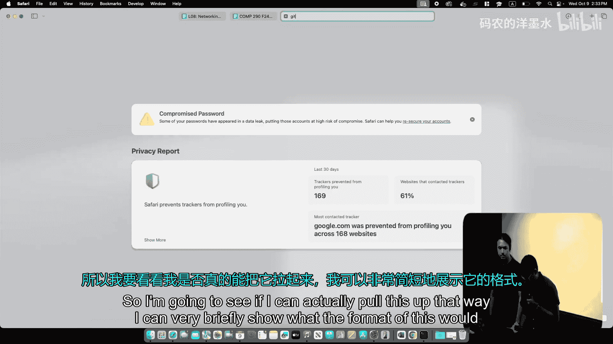

---

## 互联网简介

互联网是一个全球性的互联计算机网络系统。它由遍布全球的物理硬件（如服务器、路由器、海底光缆）连接而成。网络最基本的定义是两个或更多计算机的连接。你的家庭网络、学校网络都是网络，而互联网则是这些网络相互连接形成的全球性网络。

互联网常与万维网（WWW）混淆，但两者并不相同。互联网是计算机之间的连接基础设施，而万维网只是运行在互联网之上的众多服务之一，其他服务还包括电子邮件、文件共享和语音通话等。

---

## 互联网的历史

互联网的前身是ARPANET（高级研究计划局网络），由美国国防部在20世纪60年代末至70年代初创建。其最初目的是让研究机构和大学共享计算资源和研究成果，因为当时的大型计算机非常昂贵且稀缺。

1969年，UCLA和斯坦福研究院之间建立了第一个成功的连接，这是互联网的雏形。到1973年，ARPANET已经连接了许多研究机构。随着越来越多的人希望接入网络，1983年1月1日，网络协议正式从ARPANET切换为我们今天所知的互联网，使其向公众开放。

---

## 互联网的关键特性

互联网的设计基于几个关键原则：
*   **去中心化**：没有单一的中央控制节点。虽然实际存在一些枢纽，但没有一个实体能完全关闭整个互联网。
*   **公开性**：与早期的ARPANET不同，现代互联网对公众开放。
*   **容错性**：系统的一部分出现故障时，其余部分应能继续工作。

全球互联网依赖于一个庞大的**海底光缆**物理网络。令人惊讶的是，全球99%的互联网流量都通过这些光缆传输，只有约1%通过卫星传输。这些光缆的物理安全至关重要，一旦损坏可能造成大范围网络中断。

---

## 网络协议基础

计算机通过网络电缆通信时，本质上是在发送一系列的1和0（比特）。为了让双方理解这些数据的含义，必须事先约定一套规则，这套规则就是**协议**。

一个简单的例子是**摩尔斯电码**，它用短脉冲（点）和长脉冲（划）的组合来编码字母。然而，互联网需要传输的不仅仅是文本，还有图像、文件等各种数据，因此需要更通用和复杂的协议。

以下是互联网中一些常见的应用层协议：
*   **HTTP/HTTPS**：超文本传输协议（安全版），最初用于传输网页（HTML），现已成为最通用的数据交换协议之一。
*   **SMTP**：简单邮件传输协议，用于发送电子邮件。
*   **FTP**：文件传输协议，用于在网络上传输文件。
*   **SSH**：安全外壳协议，用于安全地远程访问另一台计算机的命令行。
*   **IPFS**：星际文件系统，一种新的、更去中心化的文件共享协议。

---

## TCP/IP模型：网络的分层结构

为了理解各种协议如何协同工作，我们需要引入**TCP/IP模型**。该模型将网络通信分为四个独立的层次，每一层只关心自己层内的数据，并对上层的数据进行封装。

**TCP/IP模型四层结构：**
1.  **应用层**：包含用户直接交互的协议，如HTTP、SMTP、SSH。这一层是“写好的信件”。
2.  **传输层**：主要负责将数据分割成小块（数据包），并确保可靠传输。主要协议是**TCP**。这一层是“把信装进信封”。
3.  **网络层**：负责将数据包路由到正确的目的地。核心协议是**IP**。这一层是“在信封上写地址”。
4.  **网络接口层**：负责在物理网络中实际传输数据帧，如以太网或Wi-Fi。这一层是“邮差送信”。

数据发送时，从应用层向下传递，每层都会添加自己的头部信息（封装）。接收时，则从下向上解封装。这种分层设计使得各层协议可以独立发展和更换。

---

## 深入IP与网络寻址

上一节我们介绍了TCP/IP模型的分层结构，本节中我们来看看网络层和传输层如何实现精确寻址。

**IP地址**是互联网上设备的唯一标识。目前最常用的是**IPv4**地址，它是一个32位的数字，通常表示为四组由点分隔的数字（例如 `152.23.61.188`）。每组数字范围是0-255。

**IPv4地址格式示例：**
```
152 . 23 . 61 . 188
```

IPv4最多能提供约43亿个地址，这已无法满足全球设备的需求。因此，**IPv6**被引入，它使用128位地址，提供了近乎无限的地址空间。目前我们通过**网络地址转换**等技术来缓解IPv4地址短缺的问题。

仅有IP地址还不够，我们还需要**端口**来指定目标设备上的具体服务。端口是一个0到65535之间的数字。

**IP地址与端口组合格式：**
```
152.23.61.188:25565
```

可以将IP地址理解为**宿舍楼地址**，而端口则是**具体的房间号**。常见的协议有默认端口，例如HTTP使用80，HTTPS使用443，SSH使用22。服务可以运行在其他端口，但客户端需要知道才能访问。

---

## 数据包、路由与DNS

数据在传输前，传输层（TCP）会将其分割成较小的**数据包**。这样做的好处是：数据包可以独立选择最佳路径传输，提高效率和可靠性；即使某个路由节点失效，数据包也能通过其他路径到达。

我们不需要手动指定数据包的传输路径。网络中的**路由器**会根据IP地址自动决定最佳路径，就像邮政系统处理信件一样。你可以使用 `traceroute` 命令查看数据到达目标服务器所经过的所有中间节点。

由于IP地址难以记忆，我们使用**域名**（如 `google.com`）来访问网站。**域名系统（DNS）** 就像一个全球电话簿，负责将域名翻译成对应的IP地址。你可以使用 `ping` 命令来查询一个域名的IP地址。

**使用 `ping` 命令查询域名：**
```bash
ping example.com
```

---

## 应用层协议：以HTTP为例

在了解了底层的寻址和路由机制后，我们现在可以专注于应用层协议。**HTTP**是万维网数据通信的基础。

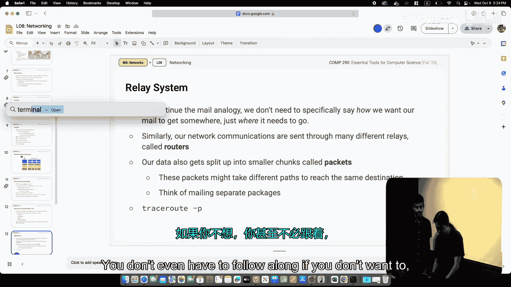

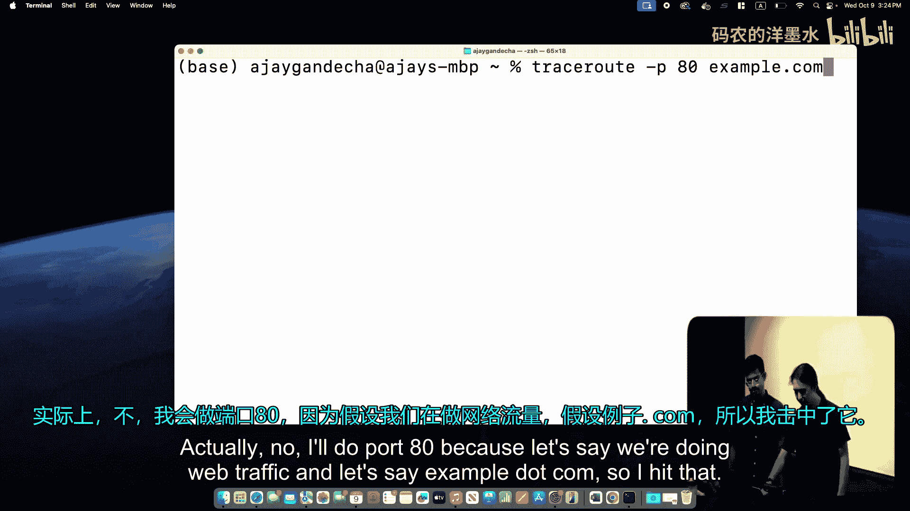

一个HTTP响应有标准的格式。我们可以使用 `curl` 工具来发起一个简单的HTTP请求并查看原始响应。

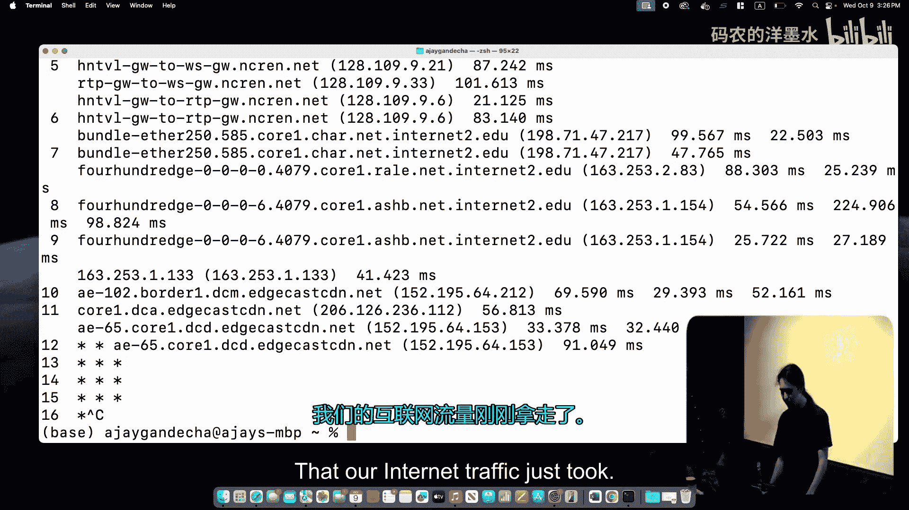

**一个HTTP响应示例：**
```
HTTP/1.1 200 OK
Date: Mon, 23 Oct 2023 12:00:00 GMT
Content-Type: text/html; charset=UTF-8
Content-Length: 1234

<!DOCTYPE html>
<html>
<head><title>Example</title></head>
<body>Hello, World!</body>
</html>
```

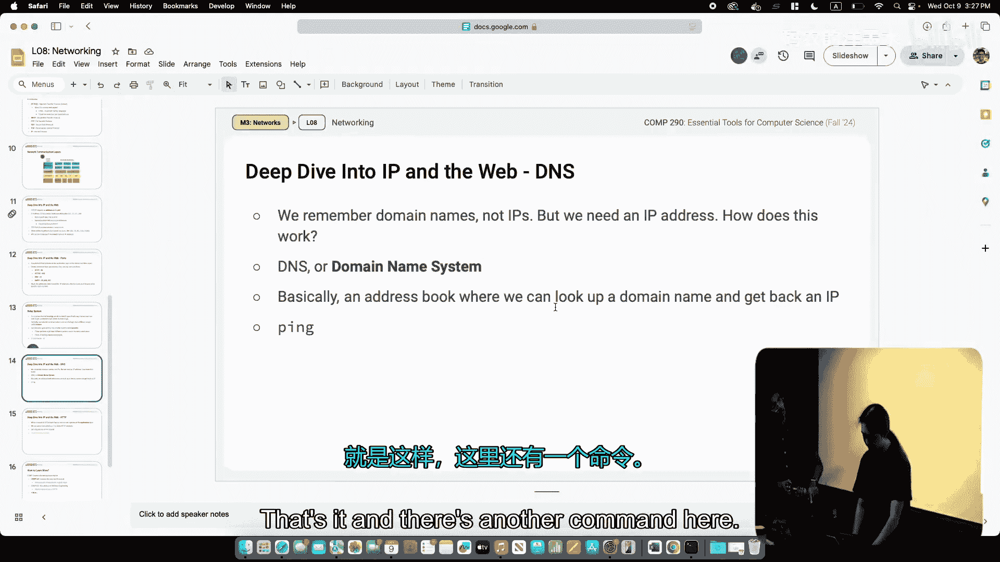

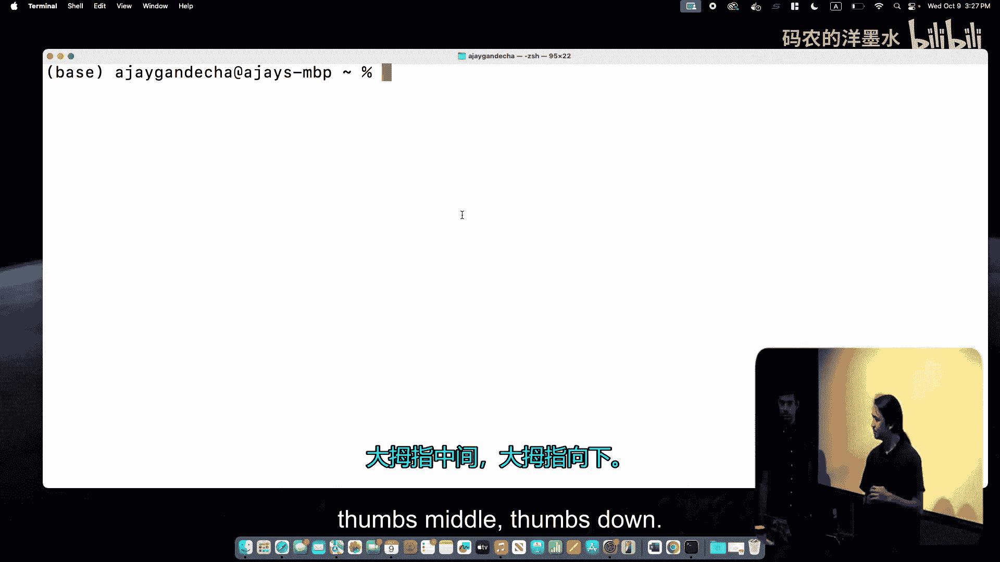

响应包含：
1.  **状态行**：包含协议版本和状态码（如 `200 OK` 表示成功，`404` 表示未找到）。
2.  **响应头**：包含关于响应的元数据，如内容类型、长度、最后修改日期等。
3.  **空行**：分隔头部和主体。
4.  **响应主体**：实际的传输内容，如HTML代码。

这就是浏览器获取并渲染网页背后的原始数据交换过程。

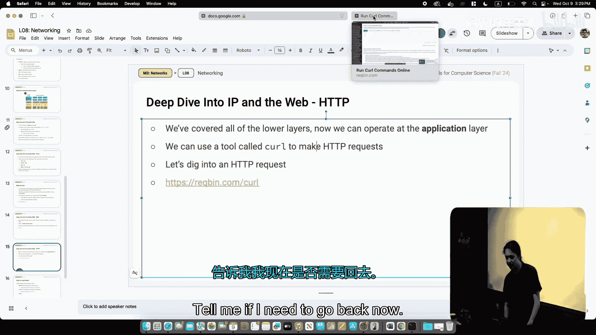

---

## 网络的物理限制与内容分发

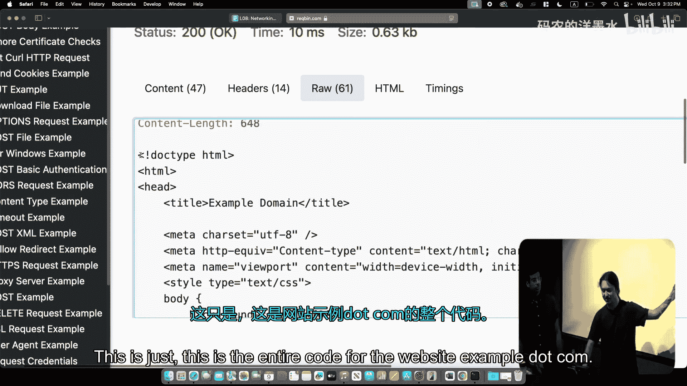

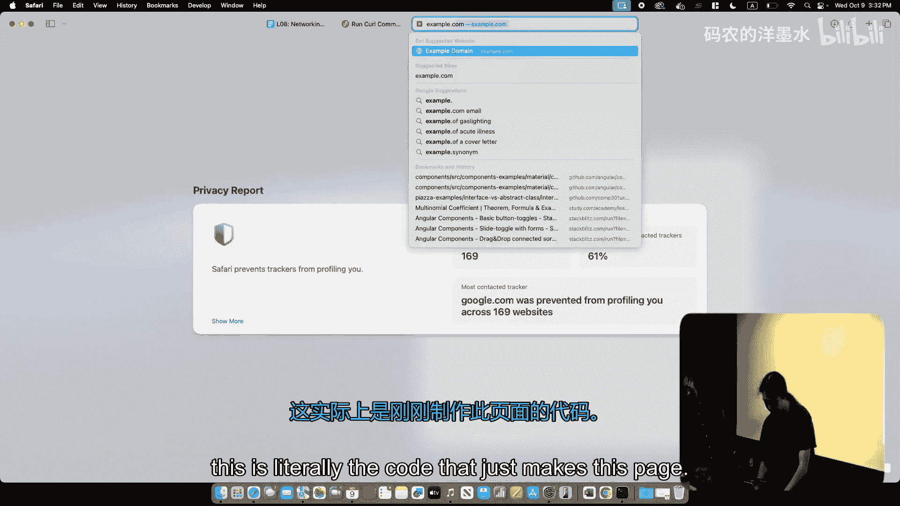

最后，我们需要认识到互联网受到物理世界的限制。数据通过光缆以光速传播，但距离越远，延迟（ping值）就越高。例如，从美国访问澳大利亚的服务器，延迟可能超过300毫秒，而访问本地服务器可能只需20-30毫秒。

为了给全球用户提供快速体验，像谷歌、YouTube这样的大型服务商会使用**内容分发网络（CDN）**，在全球各地部署服务器来存放数据副本，使用户能从地理上最近的服务器获取内容，从而显著降低延迟。

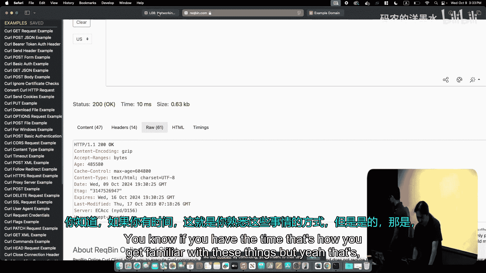

---

## 总结

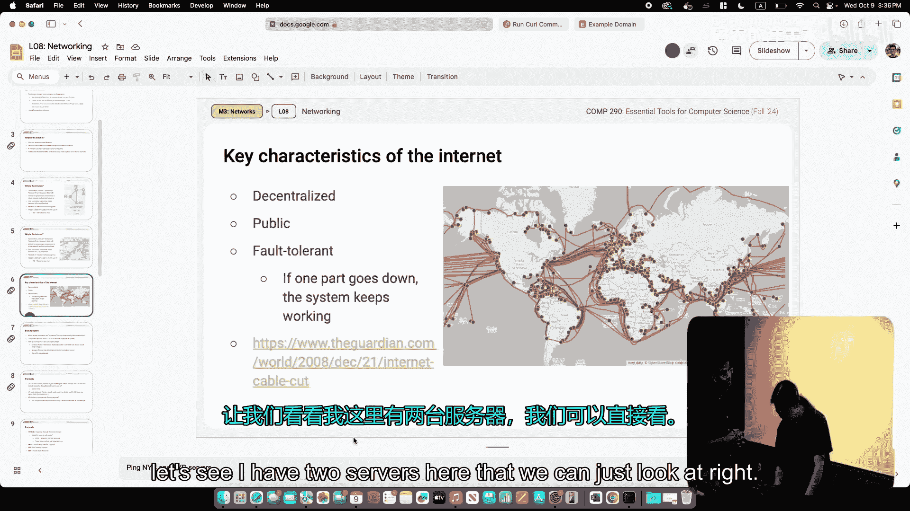

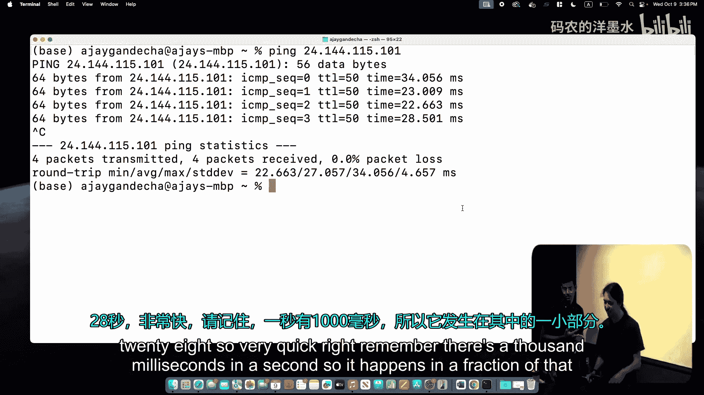

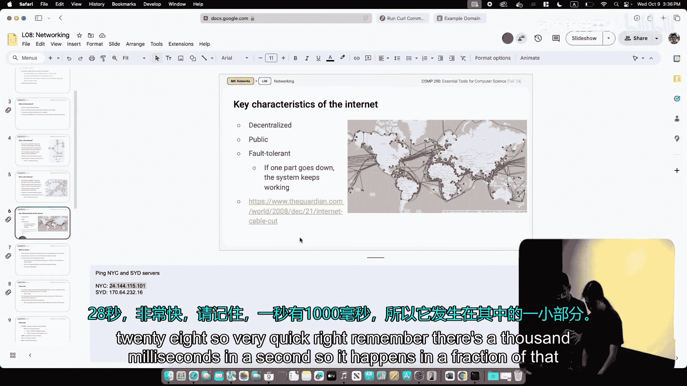

本节课中我们一起学习了互联网与网络技术的核心概念。我们从互联网的历史和定义出发，理解了**协议**是计算机通信的基础。通过**TCP/IP四层模型**，我们看到了网络通信如何分层工作，每层各司其职。我们探讨了**IP地址**和**端口**如何实现精确寻址，以及**DNS**如何将域名转换为IP地址。我们还剖析了**HTTP协议**的响应格式，并认识到物理距离对网络延迟的影响。

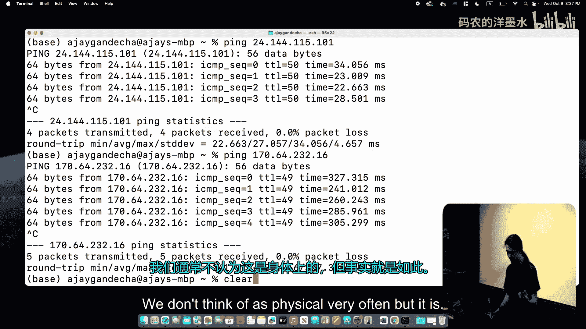


这些知识是理解现代软件开发、网络编程和系统架构的重要基石。如果你对网络底层原理感兴趣，可以进一步学习计算机网络相关的课程。