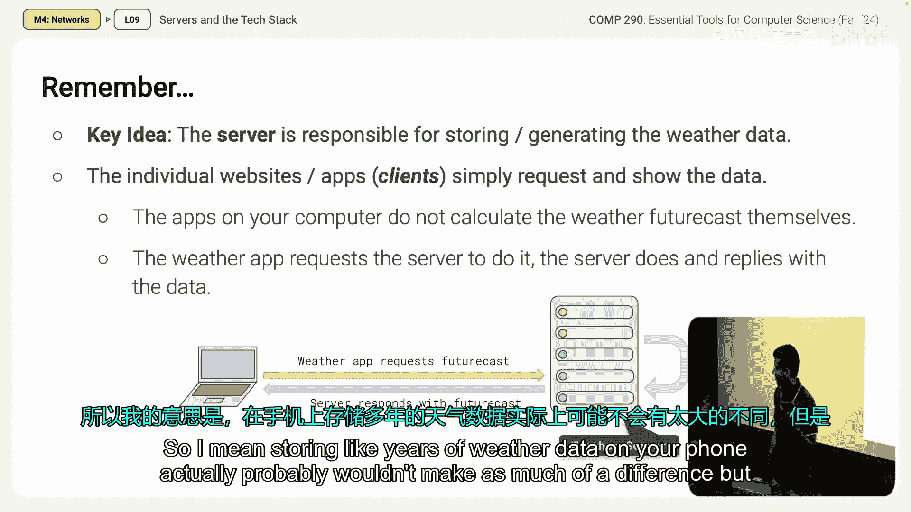
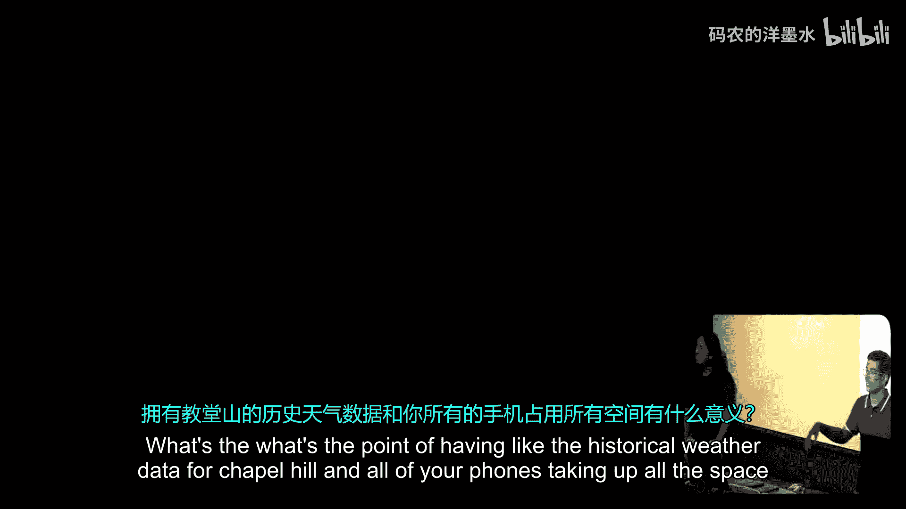
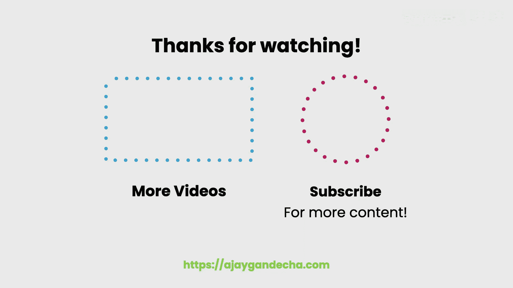

# 009：服务器、客户端与技术栈概述 🖥️

在本节课中，我们将学习服务器、客户端以及构成现代应用程序的技术栈。我们将从网络通信的基础概念出发，逐步理解前端、后端以及它们如何协同工作。

## 课程公告与时间线 📢

在开始之前，有一些重要的课程公告需要说明。

A6（网络作业）的提交截止日期已延长一周，目前仍接受迟交。上周三的异步活动（关于在线查找资源和文档的技巧）将于本周五截止，该活动不涉及编码。关于期末项目的Airtable表格已发布，用于收集大家的项目兴趣和问题。请注意，课程提供的所有资源都应是免费的，如果发现任何需要付费的链接，请及时告知我们。

以下是期末项目的时间线：
*   **项目提案**：截止日期为11月8日（周五）。请在GradeScope上提交。
*   **入门教程与进度检查**：这是一个非评分的基准检查点，旨在确保大家在项目中期取得良好进展。
*   **最终提交**：课程最后一天提交完整的项目计划和入门教程成果。

## 回顾：网络与HTTP请求 🌐

上一节我们介绍了网络基础，本节中我们来看看如何将其应用于实际场景。

关键点是计算机通过互联网进行通信。在作业中，你们学习了如何使用HTTP协议来请求数据。例如，使用`curl`命令或直接在浏览器中输入网址（如 `https://comp290.com`）时，你的计算机会向托管该网站的服务器发送一个HTTP请求，服务器则会返回所请求的网页内容。

服务器本质上是一台为网络（即互联网）上其他计算机提供资源的计算机。我们通过IP地址来定位服务器。当你在浏览器中输入网址（URL）时，DNS（域名系统）会将其转换为对应的IP地址。

一个服务器可以同时响应许多客户端的请求。例如，教室里的每个人都可以访问同一个网站。

## 深入服务器：不仅仅是文件仓库 🗄️

既然服务器是一台计算机，那么它具备计算机的所有特性。

服务器有自己的操作系统（通常是Linux）、文件系统（可以存储和访问文件）和命令行界面（CLI）。更重要的是，服务器可以运行程序。后端工程师就是编写这些在服务器上运行的代码的人。

由于服务器通常没有直接的键盘、鼠标和显示器，我们主要通过命令行远程控制它们。这就需要用到SSH协议。

## 实践：通过SSH连接服务器 🔑

上一节我们介绍了HTTP用于请求资源，本节中我们来看看SSH，它用于建立安全连接以远程控制服务器。

我们将使用Docker在本地模拟一个服务器环境。请确保Docker已运行，然后在终端中执行以下命令来启动服务器容器：

```bash
docker run -d -p 22:22 --name ssh-server noahgift/ssh-server
```

容器运行后，使用SSH命令连接到这个本地服务器。`localhost` 或 `127.0.0.1` 代表你当前的计算机。

```bash
ssh comp290@127.0.0.1
```
系统会提示输入密码，密码是 `password`。连接成功后，你将进入服务器的命令行界面。你可以在这里执行命令，例如创建文件或运行Python代码，这些操作都发生在服务器上，而非你的本地电脑。

通过输入 `exit` 可以断开SSH连接。

## 客户端-服务器模型：以天气应用为例 ⛅

资源不仅可以是网页或文件，也可以是数据。以天气应用为例，你的手机应用（客户端）并不会自己计算天气预报，而是向一个天气数据服务器发送HTTP请求。服务器进行计算或查询后，将数据返回给客户端。

这种设计有几个原因：
1.  **计算能力**：服务器通常比个人设备更强大。
2.  **存储效率**：所有数据集中存储，避免在每个客户端重复存储。
3.  **数据一致性**：确保所有用户获取的信息来源一致。

客户端（如App或网站）通过API（应用程序编程接口）与服务器通信。API定义了一套规则，允许程序之间进行数据交换。

## 技术栈：前端与后端 🥞



现代应用通常由两部分组成：前端和后端。



*   **前端**：也称为客户端，是用户直接交互的部分（如网页、App界面）。前端代码运行在用户的设备上。
*   **后端**：即服务器端，负责处理业务逻辑、计算和数据存储。后端代码运行在服务器上。

前端与后端通过HTTP请求和响应进行通信。这两者共同构成了应用的“技术栈”。例如，在COMP课程体系中：
*   COMP 426（Web编程）和COMP 433（移动开发）更侧重于前端。
*   COMP 421（文件与数据库）和COMP 431（Web服务）更侧重于后端。
*   COMP 423（软件工程基础）则涵盖了前后端协作的整体架构。

## 总结 📚



本节课中我们一起学习了服务器和客户端的基本概念。我们了解到服务器是提供资源的远程计算机，可以通过HTTP请求资源，也可以通过SSH进行远程控制。现代应用通常采用客户端-服务器架构，前端负责用户界面，后端负责数据处理，二者通过API进行通信，共同构成了应用程序的技术栈。理解这些概念是进行软件开发和参与未来计算机科学课程的重要基础。