# 010：集成开发环境与开发者工具 🛠️

在本节课中，我们将要学习集成开发环境（IDE）以及一系列核心的开发者工具。这些工具旨在帮助开发者更高效地编写、调试、测试和优化代码。

## 课程概述

本节课是开发者工具模块的开始，将持续大约三周。我们将探讨各种帮助开发者工作的工具。今天，我们将首先介绍集成开发环境（IDE），然后深入了解几种关键的开发者工具：调试器、单元测试和性能分析工具。

## 公告与提醒

在开始之前，有一些课程相关的公告需要说明。

上周没有布置作业。请记住，期末项目提案的截止日期即将到来。提交是通过GradeScope进行的，你可以在GradeScope上查看如何开始的说明。

以下是项目的时间线提醒：
*   项目提案是期末项目的第一部分，是第一个需要提交的环节。
*   随后是教程的进度检查。这并非要求教程100%完成，也不计入最终成绩，只是为了确保大家按计划进行，避免在学期末堆积任务。进度检查的截止日期是11月15日。
*   最终的项目计划和所有内容将在学期的最后一天截止。相关提交入口将在几周后开放，你也可以提前提交。

如果你已经选择了方向但对应该遵循哪个教程不确定，或者在访问我们链接的教程时遇到任何问题，请随时联系我们。课后我们也会留出一些时间，如果你还没有确定方向，请告诉我们。

此外，今晚6点在SN14将有一个关于API介绍的协作研讨会，由COMP 290和HackNC联合举办。这是获得额外学分的机会，参加将为你的最终出勤成绩增加10%。出勤成绩可以超过100%，所以这是弥补未来练习或期末项目分数的好方法。研讨会将提供饼干，并且对所有学生开放，包括COMP 110的学生。这是一个将过去几节课（尤其是关于服务器的内容）所学知识付诸实践的绝佳机会，强烈推荐参加。

关于注册的澄清：你不需要为参加此研讨会进行任何注册，可以直接参加，无需填写HackNC的表格。

## 什么是集成开发环境（IDE）？💻

上一节我们介绍了课程安排，本节中我们来看看今天课程的核心概念之一：集成开发环境。

IDE代表集成开发环境。它是一种专门的软件，基本上就是你用来编写代码的软件。在COMP 110中，你可能使用过VS Code，我们在290中也使用过它。Visual Studio Code是最常见、最受欢迎的IDE，适用于许多不同类型的项目和编程语言。

如果你在COMP 210或301，可能会使用名为IntelliJ的IDE（有些教授可能使用Eclipse）。这些IDE用于Java应用程序，并内置了许多Java工具。如果你已经开始着手期末项目的入门教程，你可能也见过Xcode或Android Studio。这些也是可以下载并用于编码的软件，它们有特定的用例：Xcode用于开发iOS应用程序，Android Studio用于开发Android应用程序。

还有很多其他的IDE。例如，在统计学课程中，你可能见过像Jupyter和Jupyter Notebooks这样的环境。存在许多不同类型的开发环境。

关键点在于，正如我们在Xcode、Android Studio、IntelliJ等例子中看到的，每个IDE通常都是为特定用例设计的。例如，Xcode和Android Studio用于开发移动应用程序，因此当你下载这些应用并尝试运行它们时，它们还会附带模拟器，以便你可以在电脑上模拟iOS或Android环境。

尽管所有这些IDE都有不同的功能，但大多数都包含一套所有IDE共有的核心功能集。这些就是我们今天要讨论的开发者工具。它们使开发、调试和编写代码的过程变得显著更容易。

## 代码调试方法 🐛

上一节我们了解了IDE的概念，本节中我们来看看开发者面临的一个核心挑战：调试。

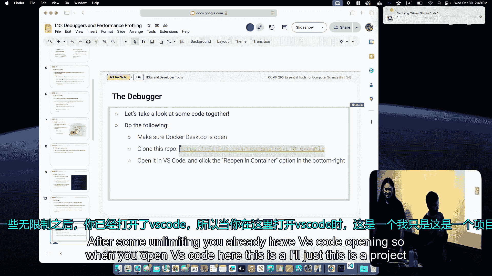

每个人编写的任何代码都可能存在错误。调试代码是我们工作的重要组成部分。可以说，编写代码的很大一部分时间就是找出错误并尝试修复它们。

以下是三种主要的调试方法：

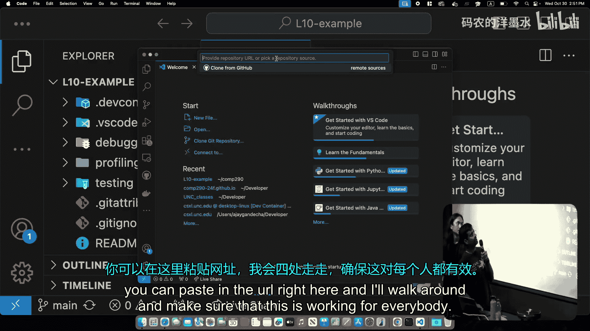

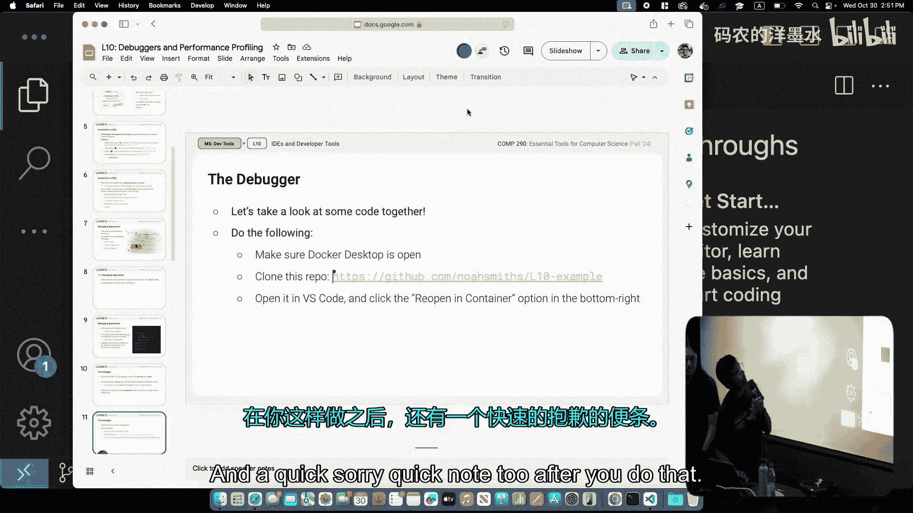

**代码追踪**
*   这种方法是指逐行查看你的代码，手动（甚至不在计算机上运行）尝试理解每一行的逻辑，预测代码将如何执行。

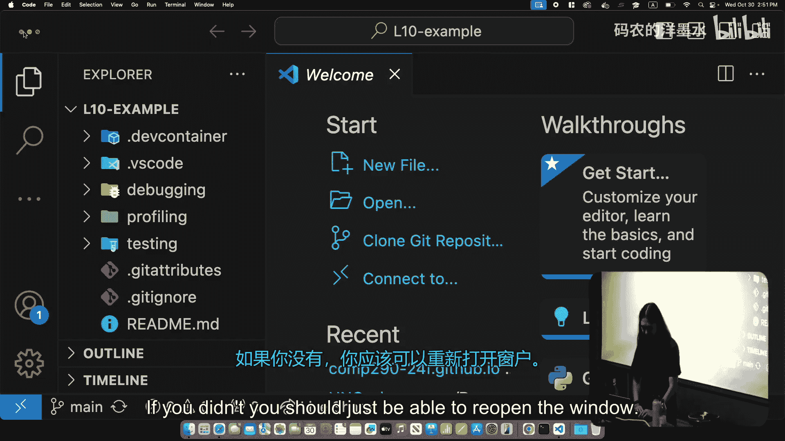

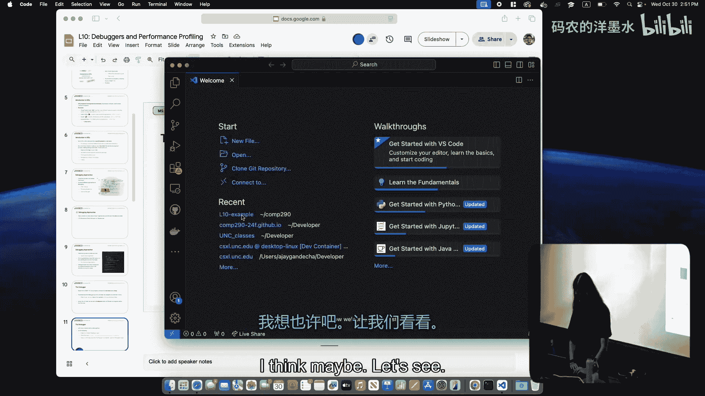

**打印和日志语句**
*   这是一种非常常见的方法。你会在代码中插入类似 `print(some_value)` 的语句，以查看该值在代码执行过程中如何变化，从而获得实时反馈。

**使用调试器**
*   这是Jay提到的IDE内置工具之一。调试器是为特定语言设计的专用程序，可以帮助你深入分析代码。我们稍后会看看它的一些特性。

在深入探讨调试器之前，我们先进行一个简短的互动。请与周围的同学分组，讨论列出的这三种方法，并为每种方法想出一个优点和一个缺点，然后提交到GradeScope。

讨论结束后，我们来分享一些观点。

对于代码追踪：
*   **优点**：不需要任何外部工具，你只需要查看代码。
*   **缺点**：如果代码变得更复杂，很难进行可视化和跟踪。

对于打印/日志语句：
*   **优点**：它为你提供代码的实时反馈，让你看到值是什么。
*   **缺点**：当出现问题时，你仍然无法确切知道是什么出了问题。此外，当代码复杂时，它可能很快变得非常混乱，你会有一大堆打印语句，需要注释掉很多东西。

对于调试器：
*   **优点**：它易于使用，是专门为此设计的工具。
*   **缺点**：例如，如果你有一个循环，需要200万次迭代才出错，使用调试器可能会很慢，因为调试器会临时冻结代码执行，直到你告诉它继续。通常，调试器运行程序会更慢，因为它内部需要做很多工作来监控你的程序。

## 深入调试器 🔍

上一节我们比较了不同的调试方法，本节中我们重点看看其中最强大的工具：调试器。

当其他方法失效时，调试器是调试的终极工具。回忆一下COMP 110的内容，程序从根本上由调用栈和堆组成，它们都在内存中。调用栈是我们的函数调用，堆是当我们创建新对象等时存储它们的地方。

调试器本质上允许我们在某个时间点冻结程序，然后查看该时刻的内存状态。当我们暂停程序时，我们就是在说：“在某个点，我想暂停它，并保持调用栈和堆在该时刻的状态，让我查看它。” 这就是调试器的核心功能。

我们通过使用**断点**来实现这一点。断点告诉调试器：“当你执行到这一行时，暂时冻结程序，然后显示调用栈和堆。” 这样我们就可以在特定时间点停止并查看程序状态。这是与任何调试器交互的基本方式。

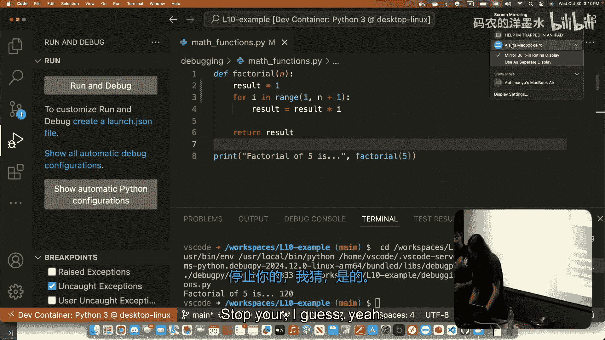

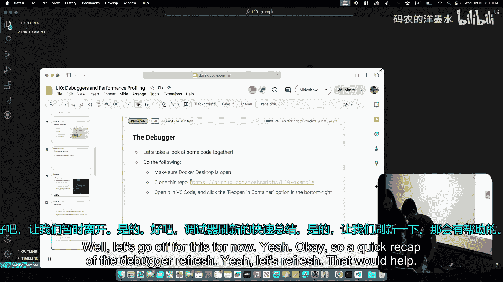

现在，让我们通过一个实际例子来演示调试器的使用。

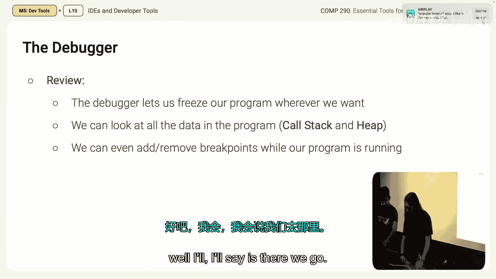

首先，我们需要获取示例代码。许多IDE（包括VS Code）都有一个很好的功能，就是与Git和GitHub集成。你可以在VS Code中直接克隆仓库，而无需使用命令行。

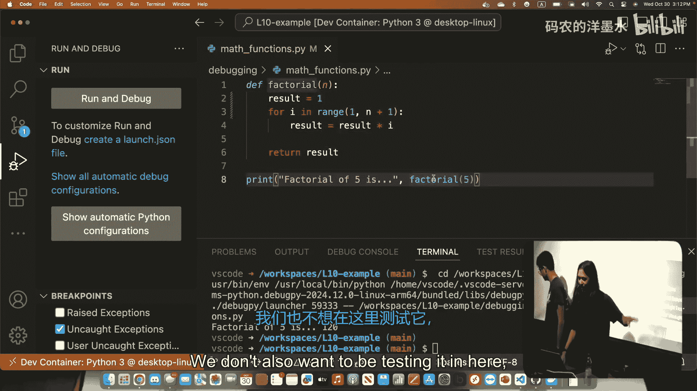

在VS Code中，你可以通过“克隆Git仓库”选项，粘贴仓库URL，然后选择本地目录来克隆项目。克隆完成后，如果出现“在容器中重新打开”的提示，请点击它。

在示例项目中，我们有一个计算阶乘的函数，但其中故意包含了一些错误。如果我们运行它，会发现 `factorial(5)` 的结果是0，这显然是错误的。

使用调试器的第一步是确定你想在程序的哪个位置暂停。例如，我们可以在执行计算的那一行设置断点。在VS Code中，只需点击行号旁边，就会出现一个红色圆点，这就是断点。

接下来，我们需要使用调试器运行程序。在VS Code中，选择“调试Python文件”选项。程序开始运行，并在断点处暂停，该行会高亮显示黄色。

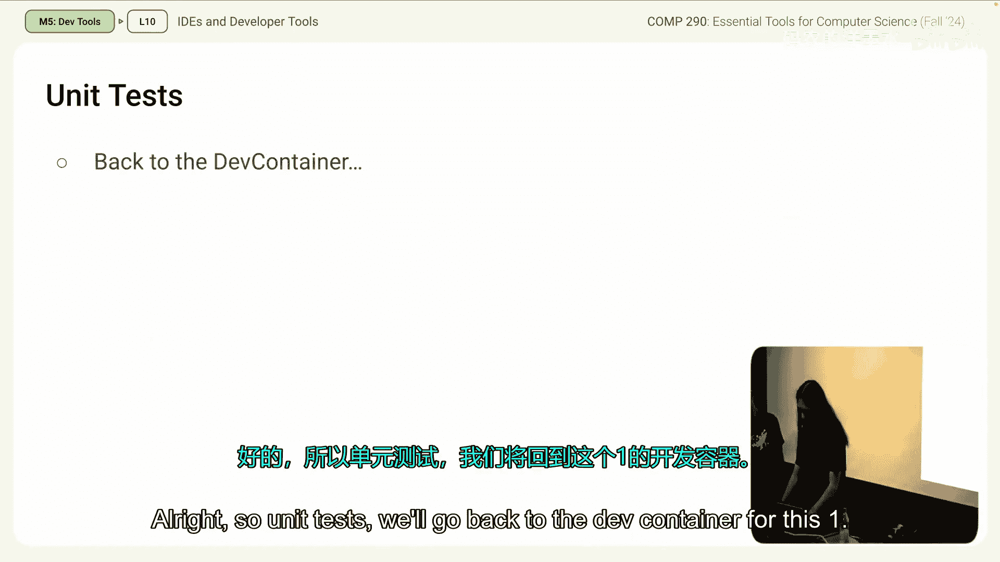

此时，程序被冻结。调试器的意义在于让我们查看程序在该时刻的内存状态。在左侧，我们可以看到“局部变量”窗口，它显示了当前栈上的所有变量（例如循环变量 `i`、参数 `n`、结果变量 `result`），以及“调用栈”窗口。

由于我们处在一个循环中，我们可以告诉调试器继续执行，直到再次遇到这个断点。观察变量值的变化，我们发现 `result` 初始化为0，导致每次乘法结果都是0。这就是第一个错误。

我们停止调试，将 `result` 初始值改为1，然后再次运行调试。逐步执行后，我们发现第一次迭代时 `i` 为0，`result * i` 结果又是0。这是因为 `range(n)` 默认从0开始。所以我们改为 `range(1, n+1)`。

通过调试器，我们可以动态地添加或移除断点，甚至在程序运行中途也可以。例如，我们可以在 `return result` 前添加一个新断点，查看最终结果。

调试器的核心在于，它允许你在任意时刻冻结程序，并查看该时刻的所有变量和调用栈状态。相比之下，使用打印语句会很快变得混乱，并且你无法精确控制程序的执行流程。

## 单元测试：可靠地验证代码 ✅

上一节我们学会了如何使用调试器检查运行时的程序状态，本节中我们来看看如何系统化地验证代码的正确性。

使用调试器测试代码时，我们仍然需要手动调用函数。例如，要测试多种情况（正数、负数、零），我们可能需要写很多个 `print` 语句，这会使文件变得杂乱。理想情况下，我们只希望文件包含逻辑本身，而不是测试代码。

此外，调试器无法一致地复现测试。特别是当需要用户输入时，每次测试都要手动输入，非常繁琐。验证输出是否正确也需要人工核对。

为了解决这个问题，我们引入**单元测试**。单元测试允许我们轻松地为代码的每个部分创建测试。之所以叫“单元”测试，是因为理想情况下，每个测试只测试一个功能单元，通常就是一个函数。

和IDE一样，每种语言都有特定的单元测试框架。Python使用 **pytest**，Java使用 **JUnit**，Swift使用 **XCTest**。

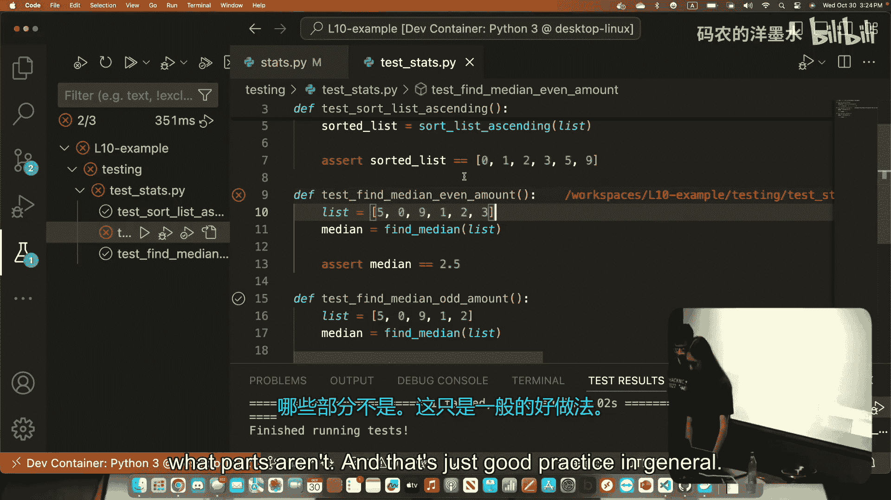

需要记住的是，单元测试和调试器并不冲突，我们可以在运行单元测试时仍然使用调试器。单元测试只是让我们能够更简单、更分离地设置测试代码。

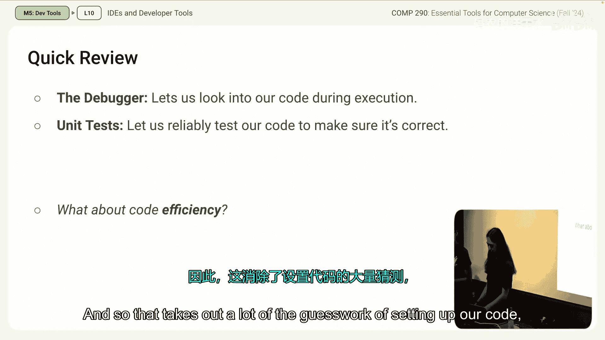

让我们看一个单元测试的例子。在示例项目中，我们有一个 `stats.py` 文件，包含一个排序函数和一个查找中位数的函数。按照惯例，测试文件被命名为 `test_stats.py`。

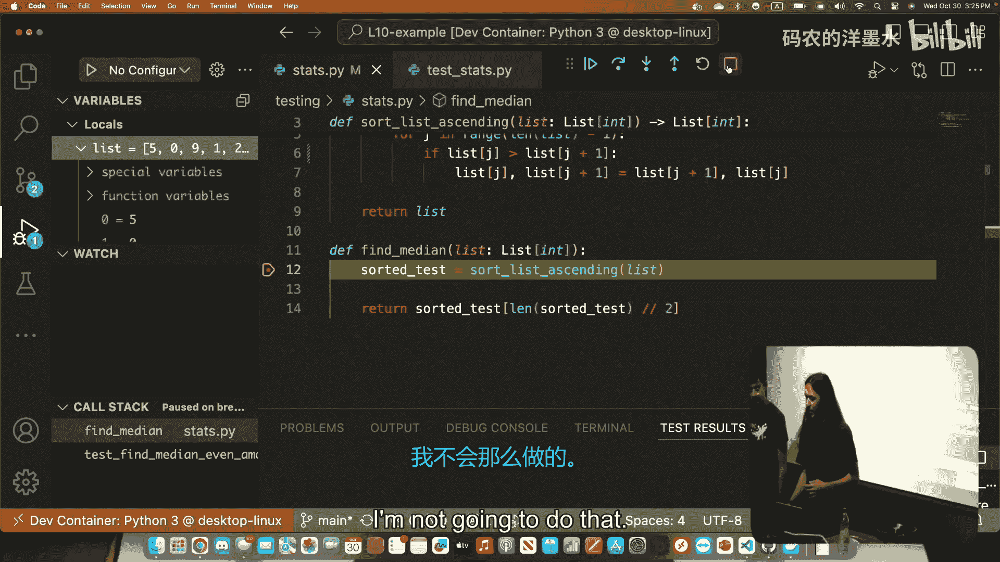

单元测试的工作方式是，你为每个想测试的功能编写一个测试函数。命名约定是 `test_` 开头。在测试函数中，你设置输入数据，调用要测试的函数，然后使用 **`assert`** 语句来断言结果是否符合预期。如果断言为真，测试通过；如果为假，测试失败并报错。

在VS Code中，每个测试函数旁边都有一个播放按钮，可以单独运行该测试。测试运行后，会清楚地显示是通过（绿色对勾）还是失败（红色错误信息），并指出预期结果和实际结果的差异。

VS Code还有一个“测试”侧边栏窗口，可以显示项目中所有的测试，并允许你一键运行所有测试。这在大型项目中非常有用。

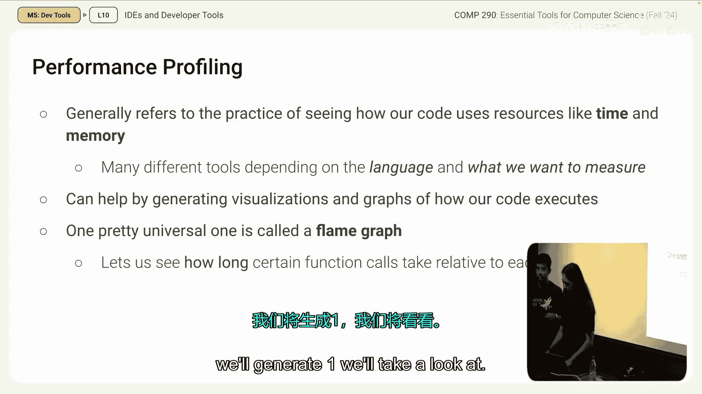

另外，在COMP 110和210中，当你提交代码到GradeScope时，那个自动评分系统背后运行的其实就是一系列单元测试。你的代码会针对这些测试用例运行，从而得出分数。

你甚至可以在运行特定单元测试时使用调试器。只需在测试代码或被测代码中设置断点，然后点击测试旁边的“调试”按钮即可。这样既拥有了单元测试的可重复性，又拥有了调试器深入查看状态的能力。

## 性能分析：洞察代码效率 ⚡

上一节我们学习了如何确保代码正确性，本节中我们来看看如何评估和优化代码的效率。

调试器和单元测试让我们了解代码如何运行以及是否正确，但它们不告诉我们代码的效率如何。调试器下运行甚至会更慢，我们只能大致了解内存使用，无法获得精确的时间或内存数据。

这就是**性能分析**的用武之地。性能分析广义上指的是观察代码如何使用资源（主要是时间和内存）的实践。时间和内存是制约任何程序的两个主要因素。

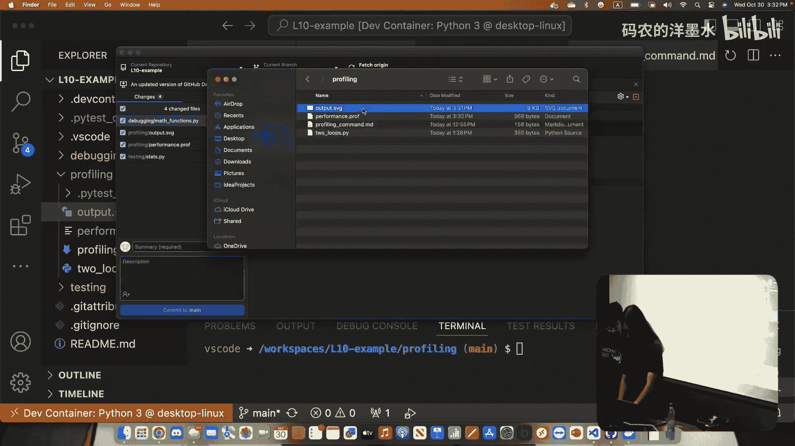

和IDE、测试框架一样，根据语言和测量目标（时间或内存），也有许多不同的性能分析工具。很多工具不仅能生成数字，还能生成图表，帮助我们直观地理解不同部分的相对性能。

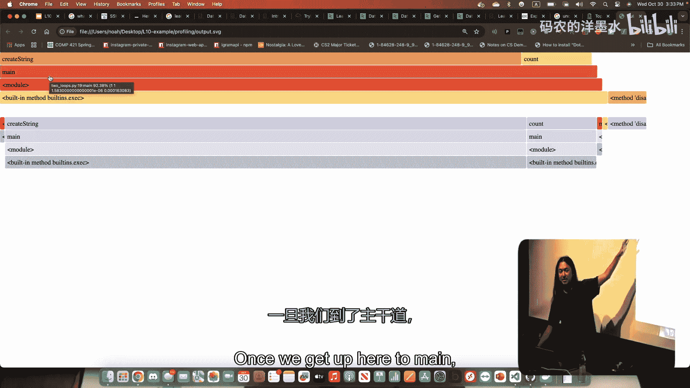

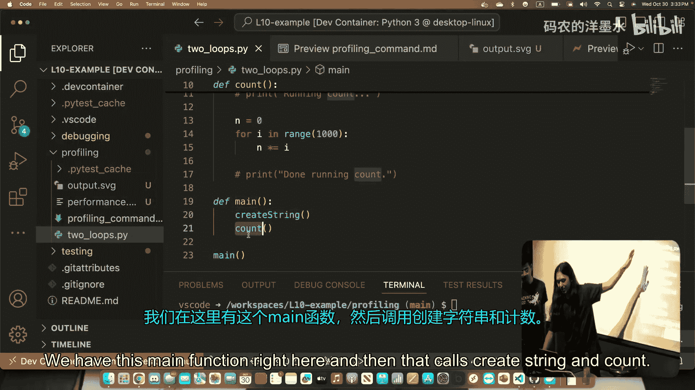

其中一种非常常见的图表叫做**火焰图**。火焰图让我们能够看到不同函数调用所花费的时间相对比例，以及我们在每个函数调用内部花费了多长时间。

让我们生成一个火焰图看看。在示例的 `profiling` 目录下，有一个 `two_loops.py` 文件，包含两个函数：一个拼接字符串，一个进行数字累乘。我们凭直觉可能认为其中一个更快，但我们需要数据来证实。

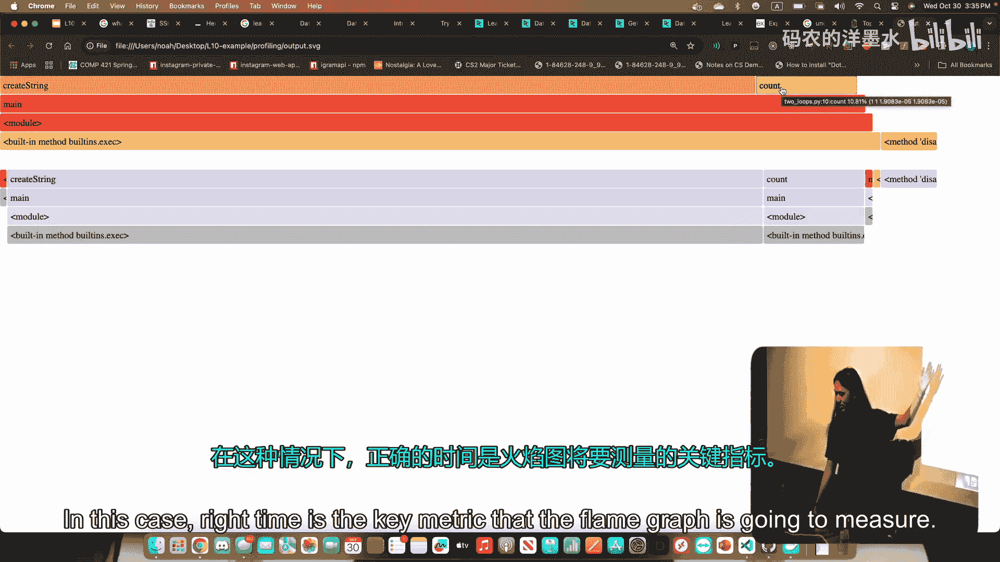

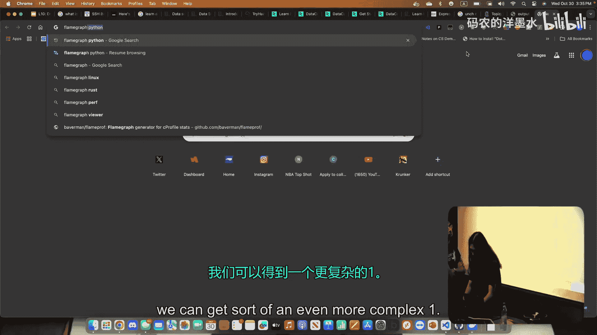

我们可以使用Python内置的 `cProfile` 模块来生成性能数据文件（`.prof`），然后使用 `flameprof` 工具将其转换为SVG格式的火焰图。

打开火焰图后，我们主要关注黄色和橙色的部分（上半部分）。火焰图的每一层代表一个函数调用。底层是Python内部调用，往上是我们关心的 `main` 函数，再往上是 `create_string` 和 `count` 函数。

每个矩形的宽度代表了在该函数（及其子调用）中花费的时间比例。将鼠标悬停在矩形上，可以看到精确的百分比。在这个例子中，`create_string` 花费了约80%的时间，而 `count` 只花了约11%，证实了我们的直觉。

火焰图的强大之处在于，当代码超时或在生产环境中响应过慢时，你可以通过它精确地定位是哪个函数消耗了最多时间，从而知道应该优化哪里。

火焰图主要展示的是时间消耗，它不显示内存使用情况。要分析内存，需要使用其他工具。

性能分析中，时间和空间哪个更重要取决于具体场景。例如：
*   **自动驾驶汽车**：计算能力强大，内存相对充足，但对实时性要求极高，因此**时间**是首要优化目标。
*   **太空旅行或Roomba扫地机器人**：设备上的计算机体积和资源有限，可以接受较长的计算时间，但**内存**是更关键的约束。

性能分析甚至在网络安全领域也有重要意义。例如，如果发现某个程序（如SSH）运行时间异常变长，通过性能分析可能发现其中存在恶意代码或未授权的资源占用（如加密货币挖矿）。历史上就曾有工程师通过SSH响应变慢这一线索，利用性能分析发现并阻止了一次大规模的后门攻击。

## 课程总结与预告 📚

本节课我们一起学习了集成开发环境以及三大核心开发者工具。

*   **调试器**：允许我们在程序执行期间冻结它，查看特定时刻的内存状态（变量、调用栈），是深入排查错误的有力工具。
*   **单元测试**：使我们能够可靠、一致地测试代码功能，确保其正确性，并将测试代码与业务逻辑分离。
*   **性能分析**：帮助我们了解代码的效率，分析其时间和内存资源的使用情况，像火焰图这样的工具可以直观地展示性能瓶颈。

这三者通常协同工作：你可能用单元测试来复现问题，用调试器来定位问题，再用性能分析来优化已修复的代码。

下节课，我们将开始学习一个名为 **Vim** 的文本编辑器。有两段由Chris Jordan教授制作的视频已发布在课程网站上，请大家提前观看以便准备。Chris教授下周也会亲自来课堂参与教学。

如果你对期末项目或所选方向仍有疑问，课后可以到前面来咨询。