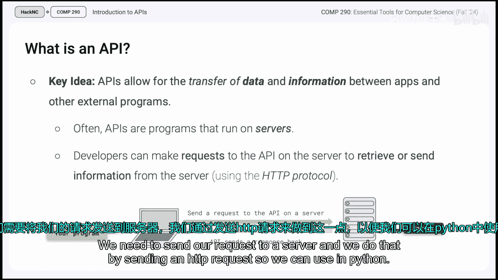
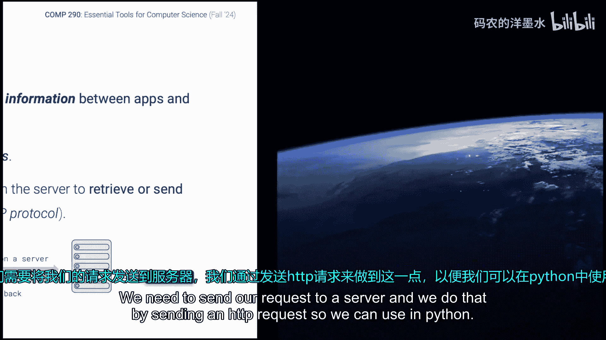

# 011：API入门 🚀

在本节课中，我们将要学习什么是API（应用程序编程接口），以及如何在编程中利用API从互联网获取数据。我们将通过一个具体的天气API示例，演示从发送请求到处理数据的完整流程，并介绍如何将原始数据转换为易于使用的编程对象。

---

## 什么是API？ 🤔

API是**应用程序编程接口**的缩写。简单来说，API是一种工具，它允许一台计算机访问另一台计算机的数据，并实现两者之间的轻松通信。本质上，API实现了数据的传输，即能够向服务器发送数据和从服务器检索数据。

这是软件工程和计算机科学工具包中一个非常强大的组成部分。通过使用API，软件工程师可以将他们编写的程序通过互联网连接到其他程序或计算机。

上一节我们介绍了API的基本概念，本节中我们来看看为什么我们需要让程序连接到互联网。

以下是程序连接到互联网可能带来的一些好处：
*   访问外部数据和资源，无需自己重新构建或收集。
*   利用互联网上公开的海量数据，例如成千上万的数据点。
*   使程序能够获取实时或动态变化的信息。

---

## API如何工作？ 🔄

关键思想是，我们希望能够从互联网上的其他地方（例如服务器）传输数据和信息，并在我们自己的程序中访问这些数据。我们有一个模型：我们的程序（可以看作一台笔记本电脑）向某个服务器请求数据，然后服务器响应并返回数据。这个过程通过互联网进行。

具体来说，我们使用一种叫做**HTTP**的协议。当你在谷歌搜索栏中输入内容或访问网站时，你可能见过“HTTP”，这里的原理是相同的。我们希望能够从某个来源请求数据，然后在我们的应用程序中访问它，而无需事先手动下载所有数据或进行硬编码。

我们已经讨论了为什么需要API，接下来让我们思考一下，有哪些类型的应用程序或项目会利用外部数据。

以下是可能利用外部数据的应用程序类型：
*   **AI和聊天机器人**：例如ChatGPT，你发送消息，它返回响应。
*   **航班信息应用**：需要获取实时航班数据。
*   **股票价格应用**：需要访问动态的金融市场数据。
*   **健身追踪器**：可能同步在线数据。
*   **天气应用**：需要获取最新的天气预报数据。

任何需要**实时数据**或**动态数据**（即不断变化的数据）的应用程序都会使用API。你会发现，现在手机上的几乎每一个流行应用、内置应用都以某种方式使用互联网，而它们都使用了API。网站也同样使用API。因此，如果你能开始学习和使用API，你就为大多数软件项目解锁了非常庞大的功能。

---

## 实践示例：天气API 🌤️

我们将要查看的示例是天气应用。常见的场景是，你可以有许多不同的应用，比如天气网站、天气应用，甚至智能手表应用，它们都可能做同样的事情：向某个中央天气服务器请求数据，然后服务器响应数据。服务器的工作基本上是，每当有人请求数据时，它就发送数据，而这些数据应该是**最新的天气信息**。

现在，让我们从更宏观的角度来看。我们谈论API，而这是一个为HackNC准备的研讨会。在HackNC中，你们将从事许多不同类型的项目。有些人会制作网站，有些人会制作应用，有些人会制作完全不同的东西，所有这些不同类型的项目使用不同的编程语言。

例如，如果你正在开发一个网站，或者某种数据科学应用、AI应用，你很可能会使用Python。如果你正在制作一个Web应用，你可能会使用JavaScript/TypeScript；如果是iOS应用，可能会用Swift等。

尽管我们今天要做的示例将使用Python（因为这对Comp 110的学生来说最容易上手），但我们要讨论的所有概念都可以在所有语言中使用。事实上，在很多幻灯片中，当我提到Python的某些内容时，我至少会提及其他语言中的替代方案。关键是学习概念，一旦你学会了概念，你就能够在你选择的任何语言中应用它。





---

## 使用Google Colab进行编码 💻

有一个非常酷的网站叫**Google Colab**。如果你上过统计课，可能用过它。它允许我们以笔记本风格的格式编写和运行代码。使用这个链接，你可以访问我们准备好的笔记本。

当你访问这个链接时，请尝试转到“文件”选项卡，选择“在云端硬盘中保存副本”。这样你就有了自己的版本，我们可以在上面进行操作。

这个笔记本允许你非常方便地以这种“单元格”格式运行代码。我选择使用Colab而不是像Visual Studio Code这样的Python项目环境，是因为后者通常需要很多设置步骤，而在Google Colab中，设置一切都非常简单，这样你们都能跟上进度，而不会被设置问题困扰。

---

## 第一步：发送HTTP请求并获取数据 📡

首先，我们需要一个工具来发送HTTP请求。在Python中，有一个非常好用的包叫做 **`requests`**。我们可以导入这个包，它允许我们发出HTTP请求。

```python
import requests
```

接下来，我们需要一个API的URL。例如，我们有一个天气API的URL：`http://goweather.xyz/api/weather/{city}`。如果我们访问这个URL（比如在浏览器中输入`http://goweather.xyz/api/weather/raleigh`），我们不会看到一个典型的网站，而是会看到一些原始文本数据，其中包含天气相关信息，如温度、风速、描述和预报。

在浏览器中，每当你输入一个URL，你的计算机就会向托管该网站的服务器发送一个HTTP请求，然后服务器会响应并返回网站内容。同样，我们也可以使用这个原理来访问数据。

在我们的Python代码中，我们可以使用这个URL来获取数据。使用`requests`包，我们可以发送一个**GET**请求（这是四种HTTP请求类型之一，今天我们只关注用于检索信息的GET请求）。

```python
url = "http://goweather.xyz/api/weather/raleigh"
response = requests.get(url)
```

运行这段代码后，我们会得到一个响应对象。这个对象包含一个状态码，例如**200**，这表示请求成功。但是，我们还没有直接看到数据，数据包含在这个响应对象中。

为了从响应中提取数据，我们可以使用`.json()`方法。这会以JSON格式返回数据。

```python
data = response.json()
```

现在，`data`变量包含了我们从API获取的天气信息，它是一个Python字典。我们可以像操作普通字典一样访问其中的数据，例如`data[‘temperature’]`或`data[‘wind’]`。

为了更方便地重复这个过程，我们可以编写一个函数。

```python
def get_weather(location):
    # 1. 创建URL
    url = f"http://goweather.xyz/api/weather/{location}"
    # 2. 发送GET请求
    response = requests.get(url)
    # 3. 从响应中提取JSON数据
    data = response.json()
    # 4. 返回数据
    return data

# 使用函数
raleigh_data = get_weather("raleigh")
charlotte_data = get_weather("charlotte")
newyork_data = get_weather("newyork")
```

---

## 第二步：理解JSON和数据建模 🧱

我们的API返回的数据是**JSON**格式。JSON是一种文本数据格式，用于表示结构化的数据对象。它易于在不同计算机系统之间传输。

然而，直接使用原始的JSON文本数据在代码中并不方便。我们更习惯于使用我们编程语言中的原生对象（例如Python中的类实例）。

因此，处理API数据的典型流程包括：
1.  **检索数据**：从URL获取JSON数据（我们已完成）。
2.  **数据建模/反序列化**：将JSON数据转换为我们编程语言中的对象。

我们需要创建一个模板（类），来定义我们想要的数据对象应该是什么样子。然后，我们可以将JSON数据转换（反序列化）为这些类的实例。

在Python中，我们可以使用一个名为 **`pydantic`** 的库来简化这个过程。它可以帮助我们定义数据模型并自动进行验证和转换。

首先，我们需要安装（如果尚未安装）并导入`pydantic`。

```python
!pip install pydantic
from pydantic import BaseModel
```

现在，让我们根据天气数据的结构来定义我们的数据模型。

```python
# 定义一个天气预报中单日数据的模型
class ForecastItem(BaseModel):
    day: str
    temperature: str
    wind: str

# 定义主天气数据的模型
class Weather(BaseModel):
    temperature: str
    wind: str
    description: str
    forecast: list[ForecastItem]  # 这是一个ForecastItem对象的列表
```

注意，类中属性的名称（如`temperature`）必须与JSON数据中的键名完全匹配，`pydantic`才能正确映射。

定义好模型后，我们就可以将之前获取的JSON数据转换为`Weather`对象。

```python
# 获取JSON数据
raleigh_json = get_weather("raleigh")
# 使用Pydantic模型将JSON转换为Weather对象
raleigh_weather = Weather.model_validate(raleigh_json)
```

现在，`raleigh_weather`就是一个`Weather`类的实例，我们可以像使用普通Python对象一样使用它：

```python
print(raleigh_weather.temperature)
print(raleigh_weather.forecast[0].day)
```

我们也可以轻松地将对象转换回JSON：

```python
json_again = raleigh_weather.model_dump_json()
```


---

## 使用API包装库和寻找免费API 📚

有时，API的开发者或社区会创建**包装库**。这些库将我们刚才做的所有步骤（发送请求、处理JSON、数据转换）封装起来，让你可以用更直观、更符合语言习惯的方式来调用API。

例如，有一个非常流行的**PokeAPI**，它提供了海量的宝可梦数据。直接使用其原始API接口会比较复杂，但存在一个Python包装库叫`pokepy`。安装后，你可以简单地调用`get_pokemon(‘pikachu’)`，它就会返回一个包含所有数据的宝可梦对象，无需你手动处理URL和JSON。

在HackNC这样的活动中，如果你想在项目中使用外部数据，寻找一个现有的包装库可以节省大量时间。

另外，许多API是免费的，但有些是收费的，或者免费但有速率限制（例如每小时只能调用N次）。对于像HackNC这样的项目，你肯定希望寻找免费的API。

一个很好的资源是 **“Public APIs”** 列表（例如GitHub上的相关项目）。这些列表按类别（如动物、动漫、体育、金融、天气等）整理了大量的API，并通常会注明其认证方式（如是否需要API密钥）和是否免费。在构思项目时，浏览这些列表可能会给你带来灵感。今年HackNC的主题是“太空与银河系”，也有许多相关的太空主题API可供探索。

---

## 总结 🎯

本节课中我们一起学习了API的核心概念和工作原理。我们了解到API是程序间通过互联网交换数据的桥梁。通过一个天气API的实践，我们掌握了使用Python发送HTTP GET请求、接收JSON响应、以及利用`pydantic`库将原始JSON数据反序列化为结构化Python对象的基本流程。我们还提到了使用API包装库可以简化开发，并推荐了寻找免费API资源的途径。掌握这些知识，你就为开发能够利用丰富网络数据和服务的应用程序打下了坚实的基础。

---


**温馨提示**：本教程是基于一个研讨会内容整理而成，其中提到的具体API（如`goweather.xyz`）和链接可能随时间变化。在实际学习和开发中，请以相关API的最新官方文档为准。