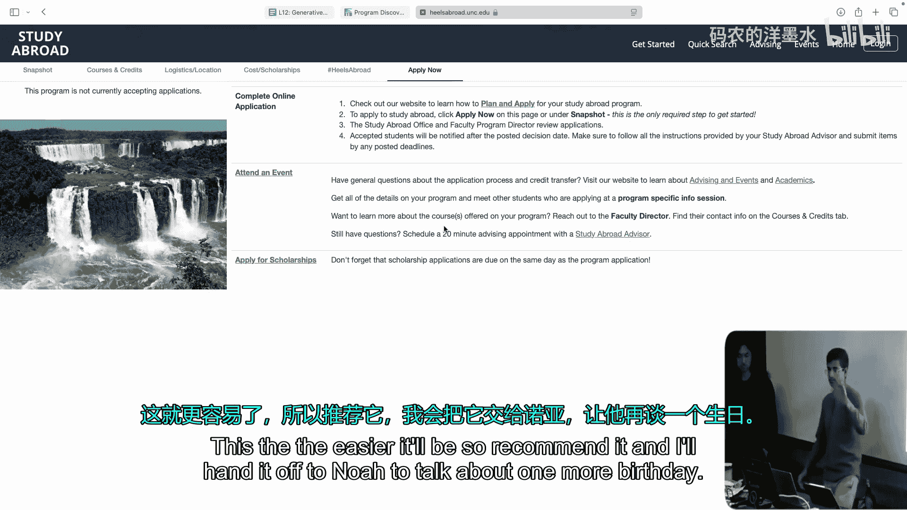
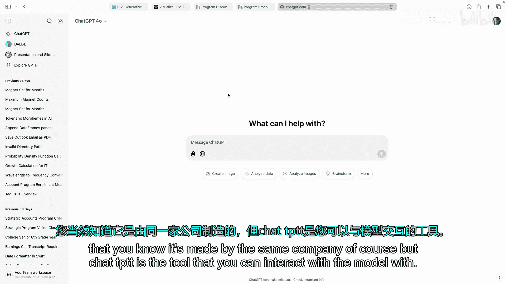
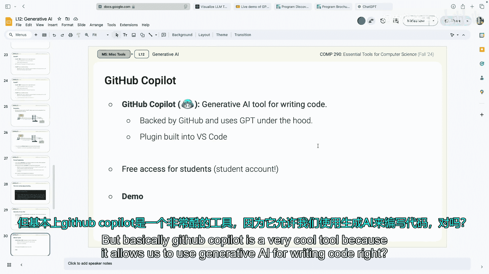
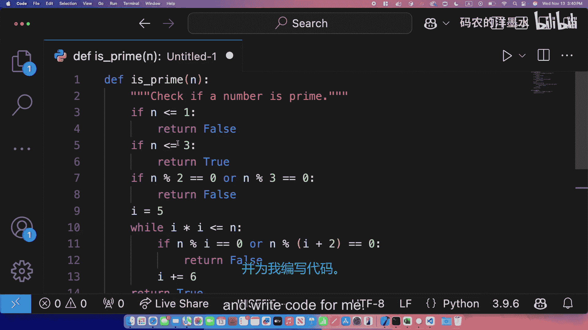

# 012：生成式人工智能 🧠

在本节课中，我们将学习生成式人工智能（Generative AI）的基本概念、工作原理，以及它如何作为开发工具来提升我们的工作效率。我们将从大型语言模型（LLM）的基础知识开始，探讨其内部工作机制，并了解如何在实际开发中负责任地使用这类工具。

---

## 课程概述与公告 📢

大家好，欢迎回到COMP 290课程的第12讲。学期已接近尾声，这是倒数第三节课。在开始今天的主题之前，我们先回顾一些重要事项。

首先，关于上周五提交的期末项目提案，大家完成得非常出色。提案构思周全，想法很棒，文档和设计也做得很好。成绩已发布在Canvas上，如有任何问题请及时联系。

需要强调的是，期末项目占总成绩的很大一部分（约40%），而提案占其中的30%。因此，请务必按时提交。考虑到一些特殊情况，我们已将截止日期延长至今天，请尚未提交的同学尽快完成。

其次，学期末的课程评估即将开始。这对于像COMP 290这样的试点课程尤为重要，你们的反馈将直接决定这门课程未来是否继续开设。请留意相关邮件并认真填写。

关于期末项目的时间线：进度检查将于本周五截止。请注意，进度检查不计入最终成绩，它只是一个确保项目完成度超过50%的检查点，旨在帮助大家合理安排时间，避免在感恩节和期末考试期间过于忙碌。

项目启动教程和项目计划提交现已开放，模板在GitHub仓库中。最终的项目演示将与期末考试时间（周五上午8点）结合进行，形式将较为轻松，以小组形式展示你们的学习成果，无需紧张。

---

## 课程相关机会 🌍

接下来，诺亚将介绍一些计算机科学项目中的有趣机会。

第一个是即将在明年夏季开展的海外学习项目，由本系的C.C. McMahon讲师带领。她是一位优秀的教师，曾获得本科教学奖。项目包括在哥本哈根开设的COMP 311（计算机工程硬件主题）和在斯德哥尔摩开设的COMP 380（满足数据科学辅修要求的课程）。这是一个与优秀教师一起海外学习的绝佳机会。更多信息可以在UNC海外学习网站上找到，搜索“教师主导项目”即可。

第二个机会是即将在2月15日至16日举行的Pearl Hacks黑客马拉松。这是一个专为女性和性别非二元学生举办的、对新手非常友好的活动。活动有导师指导，并提供丰厚的奖品，同时也是结识其他学校同学、拓展人脉的好机会。

---

## 引入生成式人工智能 🚀

在之前的课程中，我们讨论了Vim、IDE和其他开发工具，这些都是为了提升“开发者体验”（DevX），让我们的日常工作更轻松。

近年来，出现了一种新的工具，它不仅改变了计算机科学领域，也影响了其他许多方面，那就是生成式人工智能。这是课程调查中最受期待的主题之一。今天，我们将全面介绍生成式人工智能，探讨其工作原理，以及如何利用它来改善我们的软件开发任务。

首先，我们来谈谈什么是生成式人工智能。

生成式人工智能是一个根据用户输入的提示（Prompt）来生成新内容的系统。生成的内容可以是文本、图像、视频或音频。例如，向ChatGPT提问，它就会在幕后进行一些处理，然后输出内容。

这个“幕后处理”的核心，我们称之为**生成式人工智能模型**。在计算机科学中，“模型”这个词含义很广，但在生成式AI的语境下，模型本质上就是一个算法或系统。你输入一些内容，它就会输出一些内容，这和你用过的任何其他计算机程序没有本质区别。

然而，人们常常将这些AI工具视为魔法，一个无所不能、可以完全信赖的存在。这种看法会导致一些问题，比如强化对模型工作原理的误解，或者错误地期望模型总能给出正确答案。理解其背后的机制至关重要。

---

## 大型语言模型（LLM）揭秘 🔍

大多数现代的文本生成式AI工具（如ChatGPT）都使用了一种称为**大型语言模型**的技术。LLM是一种算法，它能够执行各种语言处理任务，如识别文本、进行预测以及在特定上下文中生成文本。

之所以称为“大型”，是因为它们是在海量数据上训练的。例如，ChatGPT几乎阅读了互联网上的所有内容，利用数PB的数据来调整算法，使其能够从文本序列中发现模式并推断含义。

为了处理如此庞大的数据并捕捉其复杂性，模型本身也必须非常庞大。一些顶级的开源模型需要数百个专用GPU才能运行，这对计算资源和环境都产生了显著影响。

---

## 令牌（Token）与文本生成过程 📝

那么，语言模型是如何生成文本的呢？我们从**令牌**这个概念开始。

令牌是大型语言模型使用的基本文本单位。当你输入一个句子时，模型会将其分割成一个个令牌。这些令牌可以是短单词、长单词的一部分或标点符号。不同的模型有不同的分词方式。

例如，句子“Wow, generative AI is so cool.”可能会被分成9个令牌。你可以通过在线工具直观地看到不同模型的分词结果。

了解了令牌之后，我们来看文本生成过程。模型的基本工作方式是：输入一个令牌序列，模型预测下一个最可能出现的令牌，并将其输出。

具体来说，假设我们输入令牌序列 `["keep", "calm", "and", "carry"]`。模型会分析其训练数据，计算在所有可能的下一个令牌中（如 `"on"`, `"the"`, `"it"`），哪个出现的概率最高，然后生成那个令牌。

这个过程并非总是确定性的。模型有一个称为**温度**的参数，可以控制输出的随机性。温度越高，输出越多样；温度设为0，则每次都会得到相同的输出。

当我们向ChatGPT提问时，它给出的回复通常很长，而不仅仅是单个令牌。这是通过**迭代生成**实现的：模型生成第一个令牌后，将这个新令牌与原始输入组合，再次输入模型，生成第二个令牌，如此循环，直到生成一个表示结束的特殊令牌或达到其他停止条件。

---

## 模型的局限性：幻觉与上下文丢失 ⚠️

这种逐令牌生成的方式会带来一些问题。一个主要问题是**幻觉**，即模型自信地生成不正确或编造的信息。这是因为如果在生成链条的某个环节，模型选择了一个概率稍低或不正确的令牌，这个错误会不断累积，导致后续输出完全偏离正轨。

另一个问题是**长上下文下的信息丢失**。当输入非常长的文本时，模型可能难以记住或有效利用开头部分的信息，这被称为“大海捞针”问题。

因此，**绝不能盲目相信模型生成的内容**。理解其工作原理有助于我们更批判性地使用这些工具。

---

## 交互界面：为何是聊天机器人？ 💬

生成式AI工具大多以聊天机器人的形式出现，这是为什么呢？主要原因是**交互成本低**。聊天界面是最自然的交互方式，就像与人对话一样。它允许进行多轮对话，保持上下文，用户体验流畅。

当然，也存在其他交互形式，例如语音对话。OpenAI已经展示了非常拟人化的语音交互功能，这虽然强大，但也引发了关于伦理和真实感的讨论。

从技术架构上看，使用这些工具类似于客户端-服务器模型：你的计算机（客户端）将提示发送到服务器（如ChatGPT服务器），服务器运行LLM模型生成响应，再发送回客户端。

---

## 提示工程：如何与AI有效沟通 🛠️

模型响应的质量很大程度上取决于用户提问的方式。**提示工程**就是研究如何编写有效的提示，以从LLM获得更可靠、更符合预期的结果。

许多AI应用的核心就是精心设计一个系统提示，确保无论用户如何提问，应用都能向底层模型（如ChatGPT）提出结构良好的问题，从而得到最佳回复。

例如，网上泄露的Apple AI系统提示中，就包含了“请将回复限制在50字以内”、“不要产生幻觉”、“不要编造事实信息”等指令。这就是通过提示工程来控制模型行为。

作为开发者，学习提示工程是一项宝贵技能。课程将提供一项关于“ChatGPT开发者提示工程”的练习，完成后可获得证书，帮助大家掌握这项技术。

---

## 实践工具：GitHub Copilot 🤖

生成式AI在编程领域的典型应用是**GitHub Copilot**。它是一个集成在VS Code等编辑器中的AI编程助手。

安装Copilot后，你可以通过快捷键唤出聊天界面，直接提出需求，例如“写一个判断数字是否为质数的函数”。Copilot会读取当前代码文件的上下文，生成相应的代码片段供你接受或拒绝。

此外，在编写代码时，Copilot还能提供实时的行内代码补全建议，甚至自动生成文档注释。它支持多种编程语言，能显著提升开发效率。

---

## 负责任地使用AI：学术诚信与未来准备 ⚖️

生成式AI功能强大，但**能力越大，责任越大**。在学术环境中，尤其需要注意。

AI工具应该用作学习的助手，帮助你理解概念、检查语法或获取灵感，而不应成为完成作业的“拐杖”。计算机科学基础课程的目标是让你掌握未来职业所需的核心编程技能。如果完全依赖AI完成作业，虽然可能获得高分，但在面试或需要独立解决问题的实际工作中，你将面临巨大困难。

作为助教，我们能够识别出AI生成的代码。例如，使用过时的语法、不符合课程当前教学水平的复杂结构，都是可疑迹象。遵守课程大纲关于AI使用的规定（如要求引用），是负责任的做法。

总之，请将AI视为强大的学习伙伴和效率工具，但务必确保自己真正理解并掌握了核心知识。

---

## 总结与展望 🌟

本节课我们一起探索了生成式人工智能的世界。我们学习了大型语言模型的基本概念、令牌化与文本生成过程，以及其局限性如“幻觉”。我们还探讨了如何通过提示工程与AI有效沟通，并介绍了GitHub Copilot这一实用的开发工具。

生成式AI正在深刻改变学习、工作和创造的方式。作为即将步入行业的学生，理解其原理、掌握其应用并警惕其伦理影响，对我们至关重要。希望本课能帮助大家更明智、更有效地将这项技术融入你们的开发者工具箱中。

如果对项目或课程内容有任何疑问，欢迎课后讨论或通过邮件联系我们。谢谢大家，我们下周见。