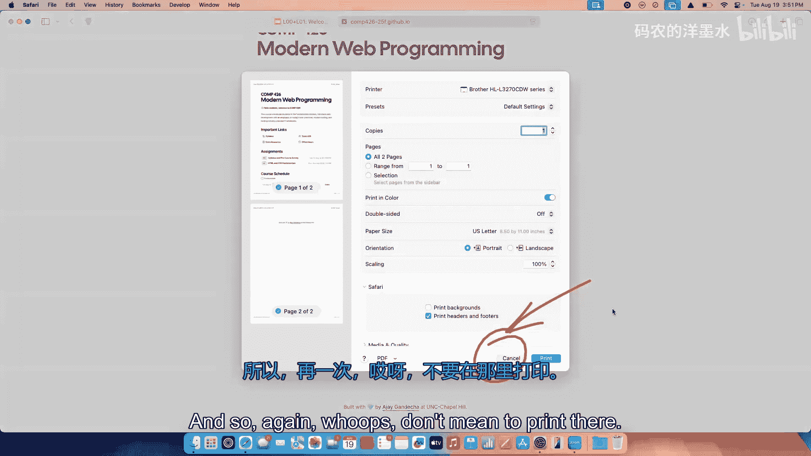
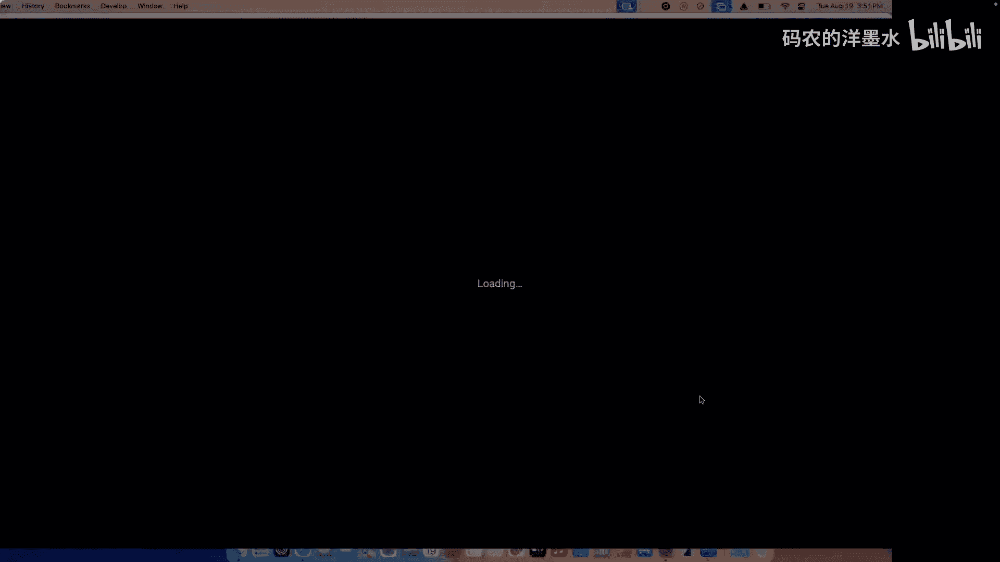
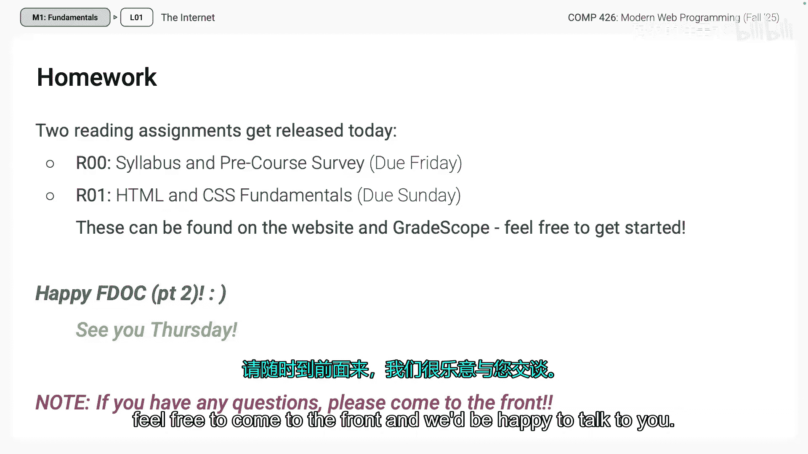

# 001：课程与互联网概述 🚀

在本节课中，我们将要学习现代Web编程课程的基本介绍，并探讨互联网和万维网的基础工作原理。我们将从课程目标、结构开始，逐步深入到客户端与服务器如何通过网络进行通信的核心概念。

## 课程介绍与目标 🎯

欢迎来到COMP 426现代Web编程课程。本课程旨在教授全栈Web开发，特别强调现代工具、最佳实践以及行业主流的技术和方法论。

我们的核心目标是让学生理解这类应用程序的架构和工作流程。这样，即使你在实习或工作中遇到不同的工具，也能凭借对核心概念的理解快速上手。Web开发领域发展迅速，新工具层出不穷，掌握基本原理是关键。

此外，我们将探讨前端和后端概念，以构建完整的全栈应用程序。本课程的一个独特之处在于，我们将讨论如何从用户界面和用户体验的角度设计优秀的应用程序。代码效率固然重要，但用户最终看到和体验的是前端界面。

我们还将培养阅读技术文档的技能。你将学习如何理解开发者编写的技术文档，并从中提取有用信息。最终，本课程旨在为学生从事全栈开发相关的实习和行业职业做好准备。

## 课程结构与要求 📅

本课程内容分为几个模块。首先，我们将讨论Web编程基础，为后续学习打下坚实基础。接着，我们将探讨现代框架和Web应用架构，学习如何构建更大型、更接近生产环境的应用程序。然后，我们会深入后端概念，了解如何为大型应用提供核心功能支持。最后，我们将讨论更高级的Web编程主题，包括一些重要的工具，例如AI工具的使用。

关于出勤率，本课程要求周二和周四的课堂出勤。出勤情况将占成绩的一小部分，每日会有简单的签到。这样设计有几个重要原因：首先，课程包含许多主动学习活动，需要大家在课堂上共同参与和讨论。研究表明，主动学习在高等教育和计算机科学教育中非常有效。其次，沟通技巧等软技能在求职中至关重要。通过课堂上的讨论和解释，你可以锻炼表达技术想法的能力，这在面试和职业生涯中会为你加分。

我们理解生活中总有意外，因此提供了三次无理由缺席的机会。此外，所有课程都会被录制并尽快发布，方便大家复习。

## 互联网基础 🌐

现在，让我们开始学习一些基础知识，这些内容将为我们整个学期构建Web应用奠定基础。我们从“基础”模块开始，首先谈谈互联网。

### 什么是万维网与互联网？

“Web”是万维网的简称。万维网是一个信息系统，它使我们能够在互联网上共享信息。

那么，什么是互联网？互联网源于“互联网络”这个术语。它就是一个由全球计算机连接而成的网络。需要明确的是，这里的“网络”指的是两台或更多计算机之间的任何通信或连接。因此，万维网是在互联网上所有不同设备或计算机之间共享内容的系统。

值得注意的是，这里的“计算机”不仅指我们常用的笔记本电脑和台式机。任何可以连接到互联网的设备，如平板电脑、手机，甚至如今能联网并通知你衣物洗好的洗衣机，都是计算机。它们都连接在这个网络中。

### 设备识别与IP地址

整个网络的意义在于让计算机能够相互通信。但我们需要一种方法来识别网络上的设备。如果一台计算机想与另一台通信，它需要知道如何找到那台计算机。我们通过一个唯一的标识符来找到它们。

我们使用一种叫做**IP地址**的东西来实现这一点。IP地址本质上是一系列数字，用于标识网络上的设备。你可以把它想象成道路网络中的地址。例如，“201 South Columbia Street”是计算机科学学院大楼的地址。如果有人想寄信到那里，他们通过这个地址就知道位置。同样，我们需要一种方法来识别网络上的节点。

### 通信模型：请求与响应

这些设备究竟如何通信呢？网络运作的整个前提，也是我们课程中会反复提到的模型，是计算机使用所谓的**请求-响应模型**进行通信。

如果一台计算机想要与网络上的另一台计算机通信，获取一些信息，它会向那台计算机请求资源。所以，你可以看到这里有一台计算机想要从另一台获取东西，那么这台计算机就会请求某个资源，然后目标计算机会响应并返回资源。

这里的“资源”可以是我们在互联网上交互的任何类型的文件，例如图像、文件、数据，甚至是网站。

### 客户端与服务器

现在，我想介绍另一个你可能见过的术语：**服务器**。网络上有许多设备，这些可能是个人设备，比如我的笔记本电脑或助教的笔记本电脑，也可能是宿舍里某台洗衣机。这些都是人们正在使用的设备。但网络上还存在一些执行特定任务的特殊类型计算机，其中关键的一种就是服务器。

服务器是一种专用计算机，其主要工作就是向网络上的其他设备提供资源。回顾一下，我们说过一台计算机请求资源，另一台响应。服务器的主要工作就是接收请求，然后向另一台计算机返回响应。你可以把这想象成餐厅里的服务员：你点餐，服务员可能会把订单交给厨师烹饪，最终把食物端给你。这里的理念是一样的：计算机请求某物，服务器最终提供该资源。

另一个我们将大量使用的术语是**客户端**。客户端是请求服务器资源的任何计算机。在这个特定的图表中，哪台计算机正在向服务器请求资源？就是这一台。所以，这台计算机被称为客户端。你也可以在现实世界中思考这个概念：走进一家企业的人就是你的客户，他们向你请求某种服务。这里的理念类似，因为我们有客户端和服务器。

### 通信协议：HTTP/HTTPS

这里还有一个重要点：信息通过网络发送。正如我们提到的，设备类型繁多，计算机（如笔记本电脑）可能有Windows或其他各种变体，操作系统和软件也有各种版本。你还有一些更小、嵌入式的设备，比如洗衣机内部的小型计算机。为了让通信能够工作，并且让任意数量的计算机都能与同一台服务器通信，这些请求必须以双方都能理解的方式格式化。

我们在这里使用的一个常见术语是**协议**。协议只是一组预定义的规则，它规定了计算机之间如何交谈。如果我们设定某种基线格式，即服务器期望的格式，那么每台试图向该服务器请求的计算机都应遵循这些规则，通信才能成功。

具体来说，我们讨论的、并且为网络大部分提供动力的协议是**HTTP**。你可能在浏览任何URL时见过这个。HTTP代表超文本传输协议，它是一种用于确保客户端向服务器请求数据时格式一致的协议。该协议主要由两个部分组成，实际上我们已经在高层次上讨论过，即**请求**和**响应**。

当我们使用这个协议进行通信时，我们有两个部分：一个是请求，它规定了计算机向服务器请求某物的格式；另一个是响应，它将包含该资源，协议的这一部分规定了计算机应从服务器期望的响应格式。所以，它是一个关于我们的请求和响应应如何格式化的固定格式。

所有通信每次都根据HTTP设定的规则集一致地格式化。我们目前不讨论实际格式，你将来会看到，因为你会实际看到计算机和服务器之间请求和响应的内容。但现在，你只需要知道存在一个格式，我们发送的东西称为HTTP请求（从客户端到服务器），而HTTP响应是服务器发送回客户端的东西。

一个简短的补充说明：**HTTPS** 只是HTTP的安全版本。当我们使用这个协议时，通信内容被加密。这很重要，因为它可以防止窃听。如果两个人正在通信，你不会希望第三方能够窥探，这样你发送的内容只有试图相互通信的双方才能理解。HTTPS实际上是我们网络上通信使用的真实协议。

### 统一资源定位符

我们刚刚演示的是，当我们通过网络通信时，我们使用URL向服务器请求网站。

所以，当我们访问`https://apple.com`时，URL的格式设置为首部分是使用的协议（本例中是HTTPS），之后是所谓的**域名**。域名是我们网站的人类可读版本，例如`apple.com`，我们人类知道它与苹果公司相关。

这里我想强调的第一个关键点是，当我们在计算机上加载网页时，例如我在手机上输入`apple.com`，这就是我的客户端，因为这是网络上的一个设备，我正在向某处的服务器请求网站。`apple.com`的实际网站位于服务器上，我将请求该网站，然后服务器将用网站内容响应，以便我可以在屏幕上显示它。这就是我们获取网站的方式，也是网站更新的方式，因为每次我请求网站时，从服务器获得的版本将是新版本。

同样，URL只是一种方式，我们告诉浏览器我们正在尝试请求某个网站或资源，因此这里有一个供我们使用的格式。

在域名之后，我们可以包含一个**路径**，这基本上使我们能够更具体地指定我们想要从服务器获取什么。如果我们有网站`apple.com`，但我们想查看iPhone的页面，我们可以在路径中添加`/iphone`，然后我们的浏览器从服务器接收到的就只是iPhone的页面，而不是所有内容。如果我们不包含任何路径，它只会将我们带到他们定义的主页。

### 域名系统

这里可能有一个你已发现的问题。早在几页幻灯片之前，我们谈到有一个计算机网络，该网络上有所有这些计算机，网络上有服务器。我们说的是，当我在手机上输入`apple.com`时，我的手机会向某处的服务器请求网站。问题是，我们向哪台服务器请求该网站？我们提供给浏览器的只是一个域名，即某个网站的人类可读名称，这并没有指定任何特定的服务器来发送请求。

因此，当我们在浏览器中输入`apple.com`时，浏览器必须弄清楚该网站存储在网络的哪个位置，即存储它的服务器是什么。因此，当我们输入像这样的URL或域名时，浏览器会利用一种叫做**DNS**的东西。DNS代表域名系统。你可以把它想象成地址簿。它是从人类可读的域名（如这里的`apple.com`）到存储该网站的服务器IP地址的映射。

这是一个非常重要的步骤。因为如果我们试图与服务器通信，我们需要知道该服务器在哪里，我们需要能够识别它。就像在常规道路网络中，如果你是一名大一新生，听说在计算机科学学院大楼有课，你必须找到它在哪里，然后你输入地址，得到一个地址，这样你就知道去哪里了。同样的理念在这里，我们需要一个实际的地址，DNS帮助我们的浏览器获取它。因此，当我们在浏览器中输入某个域名时，它会检查并返回该服务器所在位置的IP地址。

我想让你做的是访问下面这个网站（如果不够大，可以访问`www.nslookup.io`）。这个网站非常有趣，我认为这是我们这里讨论内容的一个很好的例子。

这个网站允许我们模拟浏览器在DNS查询时的行为。我们有一个搜索栏，让我在这里输入`apple.com`。我们提供一个域名，域名就是我们URL中的内容，所以是`apple.com`。

现在你会看到这里有不同的记录。你看到这里有一个记录是IPv4地址，它告诉我们互联网上某个服务器的IP地址。这个IP地址就是我们网站文件来源的地方。因此，当我们的手机访问`apple.com`时，所有这些过程作为用户是看不到的，它发生在幕后，但你的浏览器会去DNS获取IP地址，然后向该IP地址请求网站。

这很酷，因为你可以在这里看到这些服务器实际位于哪里。我们有整个国家，整个世界，那里有所有这些服务器。所以你可以看到，苹果的服务器在加利福尼亚州的库比蒂诺，这是他们总部所在地，这是合理的。

让我们试试像`unc.edu`这样的域名。`unc.edu`是我们经常访问的网站。让我们看看这个记录。

非常有趣的是，即使我们在北卡罗来纳州，当我们访问`unc.edu`时，我们的手机正在向加利福尼亚州的一台服务器发送请求以获取信息或网站。这些服务器分布在全国各地。理想情况下，大多数时候我们试图让服务器更靠近用户，这样加载内容就不会花太长时间。在这个案例中，似乎不是这样，但看到这些网站实际存在的位置，这些服务器的位置，真的非常有趣。

你可以随意尝试这个网站，它真的非常有趣，希望能让你深刻理解这一点：即使我们经常使用某些域名，如`microsoft.com`、`apple.com`、`unc.edu`，我们的手机或任何试图加载该网站的计算机都需要知道这个网站存储在国家的哪个位置，哪台服务器存储着它，这样我们才能实际检索并在浏览器上显示它。

## 网页加载全过程 🔄

综上所述，当用户在浏览器中输入`apple.com`时，浏览器会说：“好的，我们有`apple.com`，需要找出这个网站存储在哪个IP地址上。” 这里需要注意一点：你的浏览器可能有本地缓存，如果你多次访问一个网站，浏览器可能会记住这个IP地址，这样就不必每次都花时间查找，尤其是当你经常访问该网站时。但无论如何，我们需要找出服务器的IP地址。

在获得IP地址后，我们的计算机就可以向该服务器请求文件。这就是最终当您访问任何网站时，在设备上看到网站的原因：构成网站所需的所有文件都存储在服务器上，我们的计算机请求它，然后服务器将其返回。

这里我注意到，因为这是今天课堂上较长的一段内容，我们提出了很多定义和不同的概念。但在周四开始时，我们也会有更多的活动和相互讨论的机会。

具体来说，我这里使用了一个很大的术语，只是说我们的计算机向服务器请求一些文件，然后服务器用“网站”来响应。我的意思是，有许多不同的文件共同构成了我们的网站，浏览器需要这些文件才能在屏幕上显示网站。我们将在下节课探讨这些文件是什么以及它们是如何结构的。但有一件事我要指出，今天会有一篇阅读材料发布，你可以用它来帮助了解我们周四将要讨论的内容。

## 课程安排与阅读材料 📖

我想在这里说明一下：实际上已经有很多学生（包括一些旁听生）已经完成了教学大纲部分。所以，如果你已经在GradeScope中，你可以完成它。我们有两篇不同的阅读作业即将发布。

第一篇是阅读教学大纲，还有一份课前调查问卷，我希望你填写。这对我了解你正在上的其他课程、一些先前的经验非常有帮助，这使我们能够调整课程，决定我们在哪里花时间、讨论什么等等，还包括考试安排等。所以这对我们非常有帮助，我们要求你在周五前填写。

另一篇是关于HTML和CSS的阅读材料，这将是我们下次课要讨论的内容。如果你以前从未听说过这两样东西，我建议在周四上课前略读一下阅读材料。这样，你就不会觉得……今天有很多定义之类的内容，我不希望周四也感觉那么吃力。如果很多人可能以前在各种场合见过HTML和CSS，那么你应该没问题。否则，请随意查看阅读材料，但你不必在周日之前完成它。

我还要在这里快速说明一下：在最初的大约两周里，你会看到我们已经有两篇阅读材料，阅读量稍多一些，只是因为有一些介绍性内容。之后，我们会开始放松，节奏会更宽松，所以不用太担心。

## 总结 📝

本节课中，我们一起学习了现代Web编程课程的介绍，包括其目标和结构要求。我们深入探讨了互联网和万维网的基本概念，包括客户端与服务器模型、IP地址、DNS系统以及HTTP/HTTPS协议。理解这些基础是构建Web应用程序的基石。下节课我们将开始学习构成网页的具体文件：HTML和CSS。