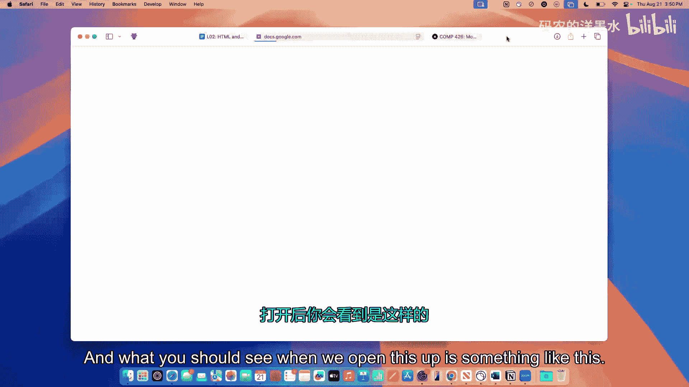
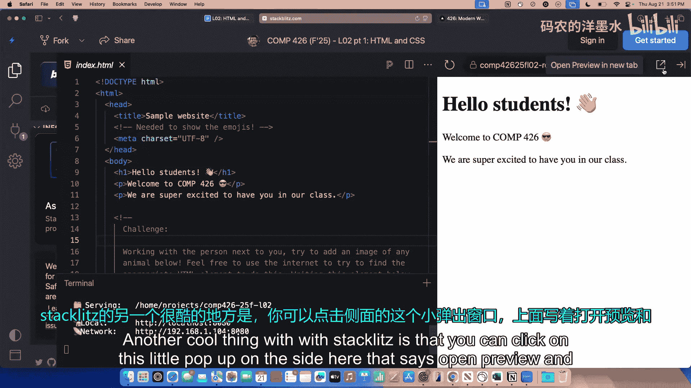
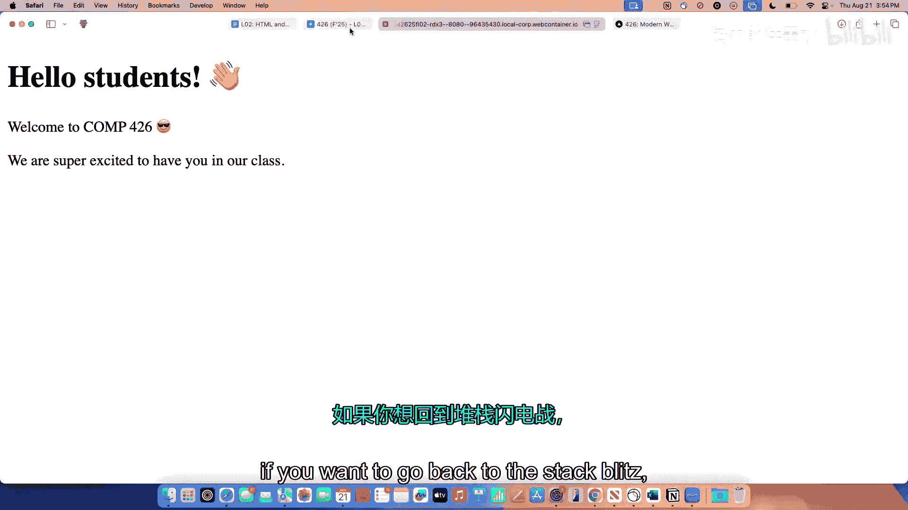
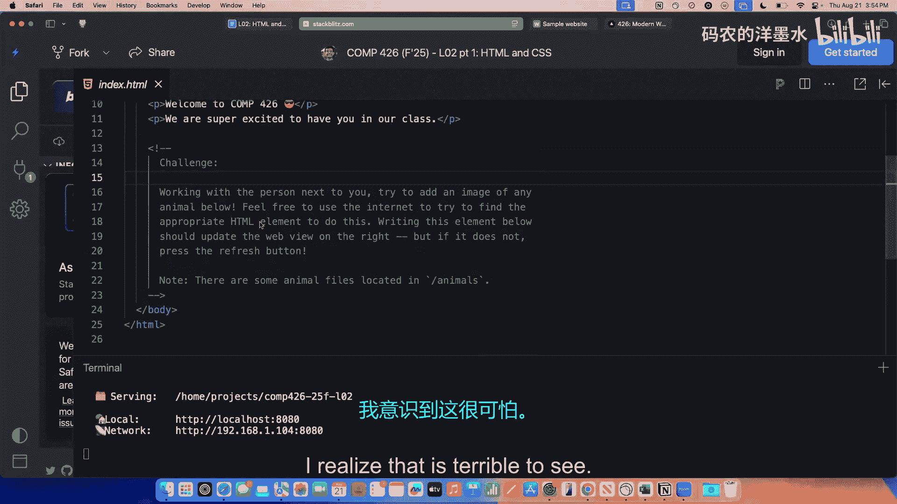
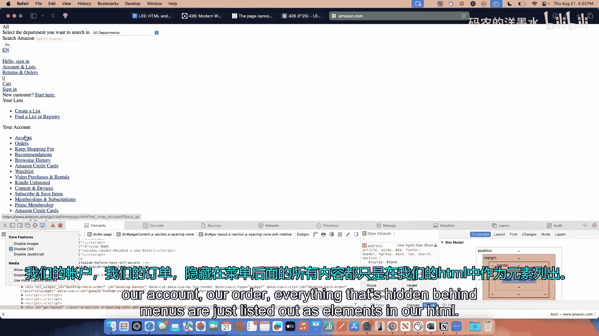
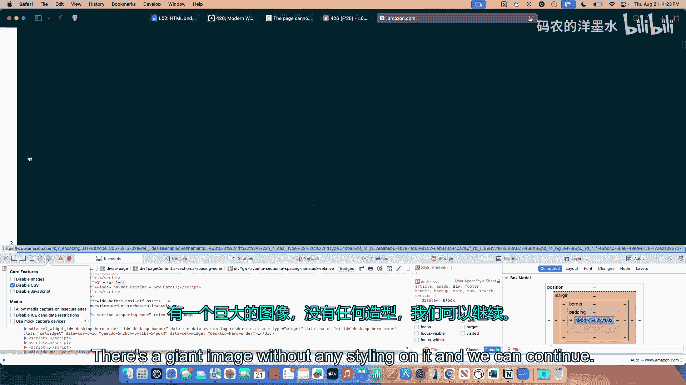

# 002：HTML与CSS

## 概述
在本节课中，我们将学习构成网页的两大核心技术：HTML与CSS。我们将了解HTML如何定义网页的内容与结构，以及CSS如何为这些内容添加样式和布局。通过本节课，你将能够理解网页的基本构成，并开始创建自己的简单网页。

---

## 回顾：客户端与服务器
上一节我们介绍了客户端与服务器的通信模型。本节中，我们来看看构成网页的具体文件是什么。

当客户端（如浏览器）向服务器请求一个网页时，服务器会返回一些文件。这些文件主要包含两种类型：HTML文件和CSS文件。

---

## 什么是HTML？📄
HTML（超文本标记语言）的核心作用是**指定网页的内容和结构**。它定义了页面上存在哪些元素。

HTML文档由一系列**元素**构成。每个元素通过**标签**来定义。

### HTML元素与标签
一个HTML元素通常由一个开始标签、内容和结束标签组成。

**公式/代码示例：**
```html
<p>这是一个段落。</p>
```
*   `<p>` 是开始标签，表示一个段落元素的开始。
*   `这是一个段落。` 是元素的内容。
*   `</p>` 是结束标签，表示该段落元素的结束。结束标签在标签名前有一个斜杠 `/`。



### 元素的嵌套
元素可以包含在其他元素内部，这称为嵌套。这种嵌套关系形成了网页的层级结构。



**代码示例：**
```html
<body>
    <p>这是一个嵌套在body元素内的段落。</p>
</body>
```

### 完整的HTML文档结构
一个标准的HTML文档具有固定的结构。





以下是其基本框架：
```html
<!DOCTYPE html>
<html>
    <head>
        <!-- 元数据，如页面标题 -->
        <title>我的网页</title>
    </head>
    <body>
        <!-- 页面上所有可见内容 -->
        <h1>欢迎</h1>
        <p>这是一个段落。</p>
    </body>
</html>
```
*   `<html>` 标签是整个文档的根元素。
*   `<head>` 部分包含页面的**元数据**，例如标题（显示在浏览器标签页上），这些信息不直接显示在页面主体中。
*   `<body>` 部分包含所有会在浏览器中显示的**内容元素**。

### 元素的属性
某些元素需要额外信息，这些信息通过**属性**来提供。属性位于开始标签内。

**代码示例（图像元素）：**
```html

```
*   `src` 是属性名，用于指定图片来源的路径。
*   `"squirrel.jpg"` 是属性值。
*   像 `` 这样的元素通常没有结束标签，称为自闭合标签。

### 通用属性：class 和 id
所有HTML元素都可以拥有 `class` 和 `id` 这两个通用属性。
*   `class`：用于为多个元素分配相同的类名，以便将它们归为一组。
*   `id`：用于为单个元素指定唯一的标识符。

---

## 查看网页的HTML
浏览器提供了开发者工具，可以查看任何网页的HTML源代码。
1.  在网页上右键点击。
2.  选择“检查”或“Inspect”。
3.  开发者工具会显示当前页面的完整HTML代码。
4.  你可以使用元素选择工具高亮页面上的部分，并查看对应的HTML代码，甚至可以实时编辑它们以预览效果。

---

## 什么是CSS？🎨
HTML定义了内容，但默认的网页看起来非常朴素，只有文字和基本的排列。CSS（层叠样式表）的作用就是为HTML元素应用**样式**和**布局**。

### 链接CSS文件
CSS代码通常写在独立的 `.css` 文件中，并通过HTML的 `<link>` 标签引入。

**代码示例（在HTML的 `<head>` 中链接CSS）：**
```html
<head>
    <link rel="stylesheet" href="styles.css">
</head>
```

### CSS规则：选择器与声明
CSS规则由两部分组成：**选择器**和**声明块**。

**公式/代码示例：**
```css
p {
    color: blue;
    font-size: 16px;
}
```
*   `p` 是**选择器**，它选择了所有 `<p>` 段落元素。
*   `{ color: blue; font-size: 16px; }` 是**声明块**，包含一条或多条样式声明。
*   `color: blue;` 是一条**声明**，其中 `color` 是属性，`blue` 是值。

### 使用 class 和 id 进行选择
这就是HTML中 `class` 和 `id` 属性发挥作用的地方。
*   **选择class**：使用 `.` 前缀。
    ```css
    .text { color: green; } /* 选择所有 class="text" 的元素 */
    ```
*   **选择id**：使用 `#` 前缀。
    ```css
    #header { color: red; } /* 选择 id="header" 的元素 */
    ```





---

## CSS与布局
CSS不仅控制颜色和字体，更重要的是控制**布局**。没有CSS，所有元素只会从上到下、从左到右堆叠。

### 视口
浏览器显示网页内容的区域称为**视口**。它有宽度和高度，单位通常是像素（px）。视口的大小取决于用户设备的屏幕。

在视口中，坐标原点 `(0, 0)` 位于**左上角**。X轴向右为正方向，Y轴**向下**为正方向。

### 盒模型
CSS布局的核心概念是**盒模型**。每个元素都被视为一个矩形盒子，这个盒子由内到外包括：
1.  **内容**：元素的实际内容（如文本、图片）。
2.  **内边距**：内容与边框之间的透明区域。
3.  **边框**：围绕内边距和内容的边界线。
4.  **外边距**：边框与其他元素之间的透明区域。

**相关CSS属性示例：**
```css
div {
    width: 200px;        /* 内容宽度 */
    height: 100px;       /* 内容高度 */
    padding: 20px;       /* 内边距 */
    border: 2px solid black; /* 边框 */
    margin: 30px;        /* 外边距 */
}
```
**重要提示**：`width` 和 `height` 属性仅设置**内容区域**的尺寸。元素在页面上占据的总宽度/高度需要加上内边距、边框和外边距。

### Flexbox布局
默认情况下，元素是块级排列（纵向）。要实现横向排列等复杂布局，可以使用 **Flexbox** 模型。

**核心思想**：将一个容器元素设置为 `display: flex;`，其内部的子元素就会成为“弹性项目”，可以方便地按行或列排列。

**代码示例：**
```css
.container {
    display: flex;
    flex-direction: row; /* 子元素横向排列 */
    /* flex-direction: column; */ /* 子元素纵向排列 */
}
```
```html
<div class="container">
    <div>项目1</div>
    <div>项目2</div>
    <div>项目3</div>
</div>
```

---

## 总结
本节课中我们一起学习了：
1.  **HTML** 是网页的骨架，它使用标签和元素来定义网页的**内容和结构**。
2.  **CSS** 是网页的外观设计师，它通过选择器和规则为HTML元素添加**样式**，并利用盒模型和Flexbox等技术控制**布局**。
3.  网页的最终呈现是HTML（结构）与CSS（样式和布局）共同作用的结果。
4.  浏览器开发者工具是查看和调试HTML与CSS的强大助手。


理解HTML和CSS的关系是进行现代Web编程的基础。下一讲，我们将探讨如何让网页变得交互式。