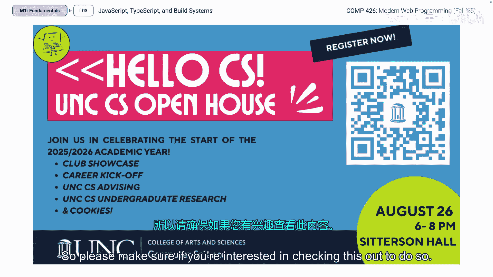
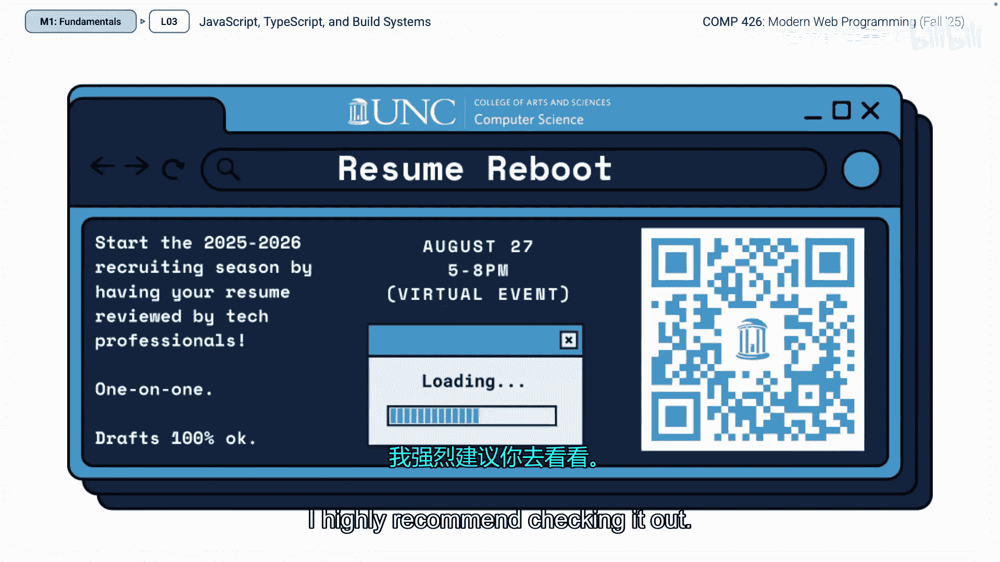
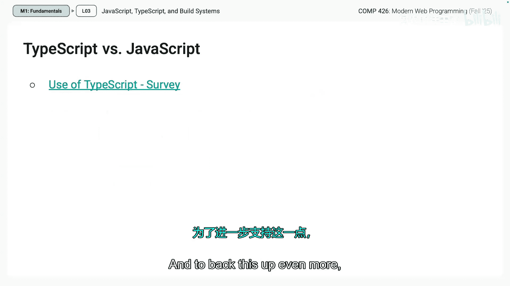
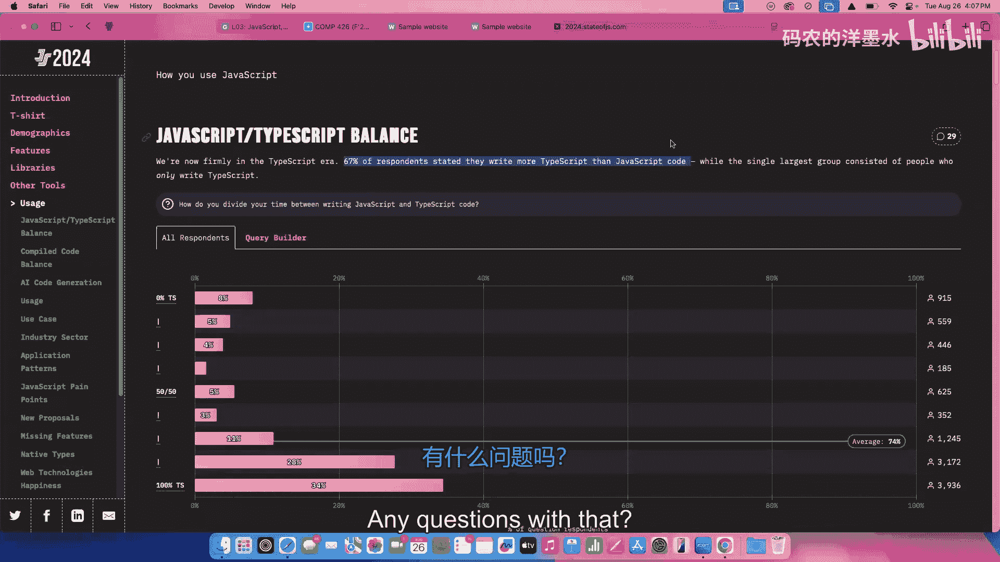

# 003：JavaScript、TypeScript与构建系统 🚀





在本节课中，我们将学习如何为网页添加功能。我们将介绍JavaScript语言，并探讨它与TypeScript的关系。我们还将了解如何将TypeScript代码转换为浏览器可以理解的JavaScript，以及构建工具和开发环境在此过程中扮演的角色。

---

## 网页功能的核心：JavaScript

上一节我们介绍了HTML和CSS，它们分别负责网页的结构和样式。本节中我们来看看如何为网页添加功能。

我们通过一种名为JavaScript的语言来为网页提供功能。JavaScript是构成现代网页的第三块基石，与HTML（结构）和CSS（样式）并列。

JavaScript通常以扩展名为`.js`的文件形式存在，并与HTML文件放在一起。HTML文件通过`<script>`标签链接到特定的JavaScript文件。

```html
<script src="app.js"></script>
```

这段代码告诉浏览器，`app.js`是与该网站关联的JavaScript文件。

---

## 在浏览器中运行JavaScript

当浏览器加载一个链接了JavaScript文件的网页时，它会从服务器获取该文件，并从上到下执行其中的代码。

一个常见的调试方法是使用`console.log()`语句，它类似于Python中的`print()`，可以将信息输出到浏览器的开发者工具控制台中。

要查看控制台，可以在网页上右键点击并选择“检查”（Inspect），然后在开发者工具中找到“控制台”（Console）标签页。

---

## 静态类型与动态类型：TypeScript的优势

您可能注意到，上周的阅读材料是关于TypeScript的。那么，TypeScript和JavaScript有什么区别呢？

TypeScript是JavaScript的一个**超集**。它在JavaScript的基础上添加了额外功能，核心仍然是JavaScript，但为开发者提供了更强大的工具。

TypeScript与JavaScript的一个关键区别在于**类型系统**：
*   **JavaScript是动态类型语言**：变量的数据类型在**运行时**确定，并且同一个变量可以在程序的不同阶段被赋予不同类型的值。
*   **TypeScript是静态类型语言**：变量的数据类型在**编译时**（程序运行前）就确定了。

以下是两种语言在类型安全上的对比示例：

**JavaScript（动态类型，可能产生意外结果）**
```javascript
function add(a, b) {
    return a + b;
}
console.log(add("2", "3")); // 输出 "23"（字符串拼接），而非数字5
```

**TypeScript（静态类型，在编译时捕获错误）**
```typescript
function add(a: number, b: number): number {
    return a + b;
}
console.log(add("2", "3")); // 编译错误：类型“string”的参数不能赋给类型“number”的参数
```





静态类型的主要优势在于：
1.  **早期错误检测**：类型错误在代码编译阶段就会被发现，而不是在运行时才出现意外行为。
2.  **更好的开发体验**：代码编辑器可以提供更智能的代码补全和错误提示。
3.  **提高代码可维护性**：类型声明充当了文档，使代码意图更清晰。

研究表明，使用TypeScript可以帮助减少近20%在纯JavaScript开发中会出现的错误。因此，TypeScript在工业界和本课程中都被广泛采用。

---

## 构建流程：从TypeScript到JavaScript

然而，浏览器只能理解和运行JavaScript代码，无法直接运行TypeScript。因此，我们需要一个步骤将TypeScript代码“转换”或“转译”为JavaScript。

这个过程称为**构建**。构建是指将我们的项目代码（包括TypeScript）准备好，以便部署到服务器上。

在此转换步骤中，TypeScript编译器会首先检查所有类型是否正确。只有通过类型检查后，它才会移除类型注解，生成纯JavaScript代码。

这个过程与您在其它编程课程中见过的类似：
*   **COMP 211 (C语言)**：使用GCC编译器将C代码转换为可执行的机器码。
*   **COMP 301 (Java)**：使用Maven或Gradle将Java代码编译为字节码（.class文件），在JVM上运行。
*   **本课程**：使用构建工具将TypeScript代码转换为JavaScript，以便在浏览器中运行。

---

## 构建工具与开发环境：Vite和Node.js

我们将使用一个名为**Vite**的现代构建工具来完成TypeScript到JavaScript的转换和项目构建。Vite速度非常快，并且提供了优秀的开发体验。

但Vite本身是一个用TypeScript/JavaScript编写的工具程序。要运行它，我们需要一个能在计算机本地（**浏览器环境之外**）运行JavaScript代码的环境。

这就是**Node.js**的作用。Node.js是一个运行时环境，允许我们在计算机上直接执行JavaScript代码，就像运行Python或Java程序一样。

为了使用他人编写的工具（如Vite），我们需要一个**包管理器**来将这些工具安装到我们的本地Node.js环境中。在JavaScript/TypeScript生态中，最常用的包管理器是**npm**。

以下是相关概念的类比：
*   **Node.js环境** 类似于 **Python环境**。
*   **npm (包管理器)** 类似于 **pip (Python包管理器)**。
*   **`npm install` (安装包)** 类似于 **`pip install`**。

---

## 本地开发服务器

在开发过程中，我们通常没有远程服务器。Vite可以启动一个**本地开发服务器**来模拟真实环境。

这个开发服务器在你的计算机上运行，托管你的HTML、CSS和JavaScript文件。然后，你可以通过一个类似 `http://localhost:5173` 的本地地址在浏览器中访问你的网站，就像访问互联网上的真实网站一样。

这个过程模拟了客户端（浏览器）从服务器请求文件的全过程，但所有操作都在本地完成，便于开发和测试。

---

## 实践流程总结

以下是使用TypeScript进行Web开发的核心流程总结：

1.  **编写代码**：使用TypeScript为网页添加功能。
2.  **安装依赖**：通过`npm install`安装项目所需的工具（如TypeScript编译器、Vite）。
3.  **启动开发**：运行`npm run dev`命令。这会触发Vite：
    *   将TypeScript代码转换为JavaScript。
    *   启动一个本地开发服务器。
    *   托管所有网页文件（HTML, CSS, JS）。
4.  **访问测试**：在浏览器中打开Vite提供的本地地址（如`localhost:5173`），即可查看和测试你的网站。

---


本节课中我们一起学习了JavaScript如何为网页注入活力，以及TypeScript如何通过静态类型系统让开发更稳健。我们理解了浏览器只能运行JavaScript，因此需要构建工具（如Vite）将TypeScript转换为JavaScript，并且这一切依赖于Node.js环境。最后，我们看到了如何使用本地开发服务器来模拟真实的网站访问体验。掌握这些概念是进行现代Web开发的基础。