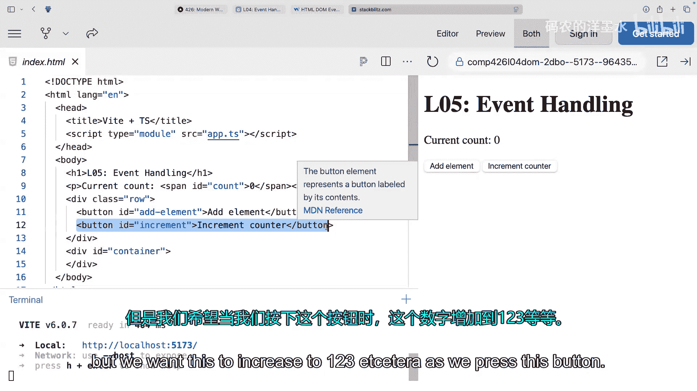
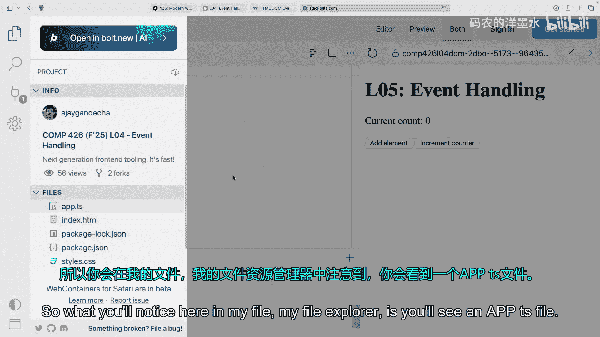
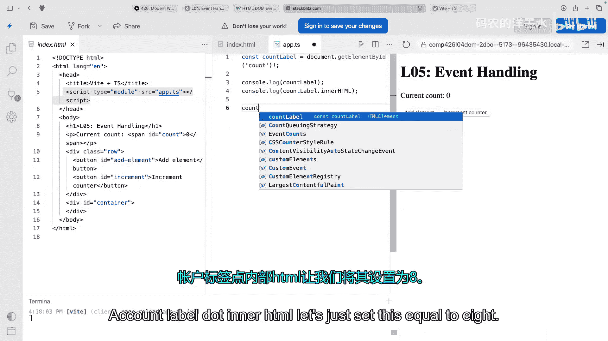
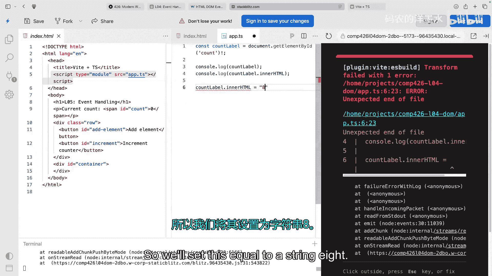
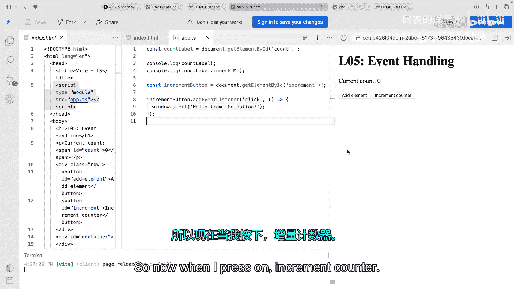
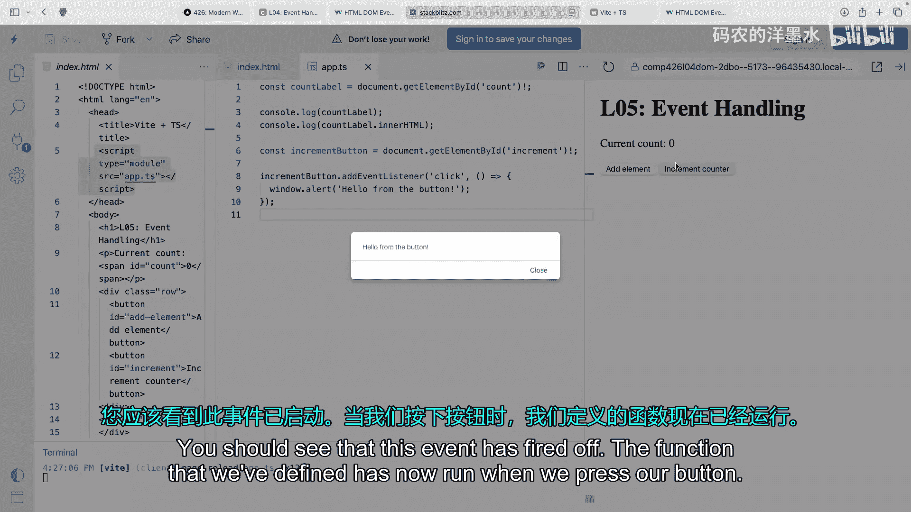

# 004：事件处理与文档对象模型 🖱️🌳

在本节课中，我们将要学习如何让网页变得具有交互性。我们将探索用户如何与网页互动，并学习如何使用TypeScript来响应这些互动。核心在于理解文档对象模型（DOM），它是连接HTML元素和TypeScript代码的桥梁。

上一节我们介绍了HTML和CSS如何构建网页的结构与样式，以及TypeScript如何为网页添加功能。本节中我们来看看如何让网页响应用户的操作。

## 用户交互与事件

为了让网页具有功能，我们需要响应用户的交互。用户交互在网页编程中被称为“事件”。

以下是用户在网页上可能进行的一些常见交互方式：
*   **点击**：例如点击按钮或链接。
*   **悬停**：将鼠标指针移动到某个元素上。
*   **键盘输入**：例如在表单中输入文字或使用方向键玩游戏。
*   **拖放**：拖动页面上的元素。
*   **提交表单**：填写并提交信息。

当这些事件发生时，我们希望运行我们预先定义好的TypeScript代码。但这里存在一个问题：我们的TypeScript代码如何知道并操作HTML中定义的元素呢？

## 文档对象模型（DOM）

为了连接TypeScript代码和HTML元素，我们需要一个中间表示。这就是**文档对象模型**。

DOM是一个树形数据结构，它代表了网页上所有元素的状态、内容和结构。浏览器在加载HTML文件时会自动创建这个DOM树。通过TypeScript访问这个DOM，我们就可以找到并操作具体的HTML元素。

### DOM树示例

考虑以下简单的HTML代码：
```html
<html>
  <body>
    <div>
      <p>Hi!</p>
    </div>
    <div>
      <a href="url">Link</a>
    </div>
  </body>
</html>
```
其对应的DOM树结构如下所示：
*   **document** (根节点)
    *   **<html>** (根元素)
        *   **<body>** (元素)
            *   **<div>** (元素)
                *   **<p>** (元素)
                    *   `"Hi!"` (文本节点)
            *   **<div>** (元素)
                *   **<a>** (元素)
                    *   `href="url"` (属性节点)
                    *   `"Link"` (文本节点)

在这个树中，每个HTML元素、文本和属性都成为一个节点。嵌套的元素成为子节点，从而形成层次结构。

## 在TypeScript中访问DOM

在浏览器环境中，DOM被存储在一个名为 `document` 的全局对象中。我们可以使用这个对象提供的方法来获取HTML元素的引用。

最常用的方法之一是 `getElementById`，它通过元素的唯一ID在DOM树中查找并返回该元素。

```typescript
// 获取ID为 ‘count‘ 的元素
const countLabel = document.getElementById(‘count‘);
```
> **注意**：`getElementById` 可能返回 `null`（如果未找到元素）。TypeScript会提示我们处理这种可能性。我们可以使用非空断言操作符 (`!`) 来告诉TypeScript我们确信该元素存在，但这在生产环境中需谨慎使用。
> ```typescript
> const countLabel = document.getElementById(‘count‘)!; // 确信元素存在
> ```





获取到元素后，我们可以修改它的属性来动态改变网页内容。例如，修改元素的 `innerHTML` 属性可以改变其显示的文本。

```typescript
// 将元素内容改为 ‘8‘
countLabel.innerHTML = ‘8‘;
```

## 响应事件

现在我们已经可以获取并修改元素了，下一步是让代码在用户交互（事件）发生时自动运行。这通过为元素添加**事件监听器**来实现。





`addEventListener` 方法用于为元素绑定特定事件和对应的处理函数。它接受两个主要参数：
1.  事件名称（字符串），例如 `‘click‘`。
2.  当事件触发时要运行的函数。

```typescript
// 获取按钮元素
const incrementButton = document.getElementById(‘increment‘)!;

// 为按钮添加点击事件监听器
incrementButton.addEventListener(‘click‘, () => {
    // 当按钮被点击时，执行这里的代码
    alert(‘Hello from the button!‘);
});
```
上面代码中，我们传递了一个**箭头函数** `() => { ... }` 作为第二个参数。这是一种在TypeScript中定义函数的简洁方式，并且在这里它作为一个“值”被传递给了另一个函数（`addEventListener`），这种函数被称为**高阶函数**。

### 综合示例：创建一个计数器

让我们结合所学，创建一个点击按钮会增加数字的计数器。





1.  **HTML结构**：
    ```html
    <button id="increment">Increment Counter</button>
    <span id="count">0</span>
    ```
2.  **TypeScript逻辑**：
    ```typescript
    // 获取显示数字的标签和按钮
    const countLabel = document.getElementById(‘count‘)!;
    const incrementButton = document.getElementById(‘increment‘)!;

    // 初始化计数器变量
    let counter = 0;
    countLabel.innerHTML = `${counter}`; // 初始显示为0

    // 为按钮添加点击事件
    incrementButton.addEventListener(‘click‘, () => {
        counter += 1; // 增加计数器
        countLabel.innerHTML = `${counter}`; // 更新显示
    });
    ```
    关键点：每次修改 `counter` 变量后，必须手动更新 `countLabel` 的 `innerHTML`，它们之间没有自动绑定。

## 动态创建新元素

除了修改现有元素，我们还可以使用DOM API动态创建全新的元素并添加到页面中。

```typescript
// 获取“添加元素”按钮和容器
const addButton = document.getElementById(‘addElement‘)!;
const container = document.getElementById(‘container‘)!;

// 为按钮添加点击事件
addButton.addEventListener(‘click‘, () => {
    // 1. 创建一个新的段落元素
    const newParagraph = document.createElement(‘p‘);
    // 2. 设置段落的内容
    newParagraph.innerHTML = ‘Hello!‘;
    // 3. 将新段落追加到容器末尾
    container.appendChild(newParagraph);
});
```
使用 `document.createElement(‘tagName‘)` 可以创建任何类型的HTML元素，然后使用 `appendChild` 方法将其插入到DOM树中的指定位置。

## 内存模型回顾（简要）

为了深入理解高阶函数和事件处理程序如何在底层工作，简要回顾一下程序的内存模型会很有帮助。这主要涉及**栈**和**堆**。

*   **栈**：用于管理函数调用。每个函数调用会创建一个新的栈帧，其中存储局部变量和返回地址。
*   **堆**：用于存储动态分配的数据，例如对象和**函数定义**本身。

当我们在代码中定义一个函数（包括箭头函数）时，该函数的定义被存储在堆中。而变量（如 `incrementButton.addEventListener` 中的函数参数）则持有指向堆中该函数定义的引用。当事件触发时，通过这个引用找到并执行对应的函数代码。

这种机制使得我们可以将函数作为值传递和存储，这是实现事件驱动编程的基础。

---


本节课中我们一起学习了网页交互的核心概念。我们了解了什么是用户事件，并认识了**文档对象模型（DOM）**——它是连接静态HTML与动态TypeScript代码的树形数据结构。我们学会了如何使用 `document.getElementById` 获取元素引用，如何使用 `addEventListener` 为元素绑定事件，以及如何通过修改 `innerHTML` 或使用 `createElement` 和 `appendChild` 来动态更新网页内容。最后，我们简要回顾了内存模型，以理解函数作为值传递的原理。掌握这些知识，你就已经迈出了创建交互式网页的第一步。