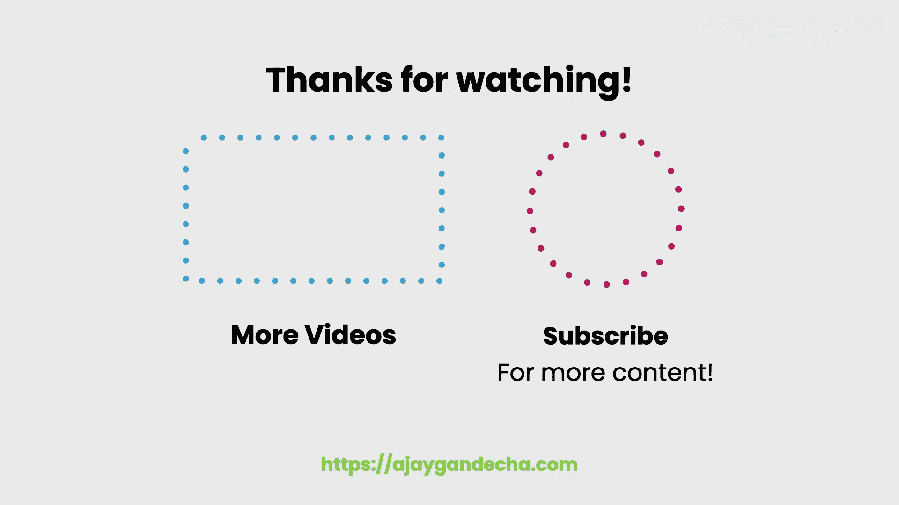

# 006：异步与TypeScript

在本节课中，我们将要学习异步编程的核心概念，以及如何在TypeScript中处理需要长时间运行的操作，例如从服务器获取数据。我们将探讨Promise对象、`async/await`语法，以及如何将这些概念与之前学过的DOM操作和事件处理结合起来。

---

## 概述：客户端、服务器与数据交换

上一节我们介绍了Web应用的基本架构。现在，我们来看看客户端与服务器之间除了交换文件（如HTML、CSS、JavaScript）之外，如何交换原始数据。


服务器可以暴露一个特殊的URL，当客户端访问它时，服务器会返回原始数据，而不是一个网页。这种用于获取数据的URL通常被称为**API端点**。


API（应用程序编程接口）是系统的一个通信入口点。对于服务器而言，API端点就是一个允许网络上的其他计算机与之通信以获取信息的入口。


例如，访问以下URL会返回关于UNC计算机科学学生组织的数据，而不是一个格式化的网页：
```
https://csxl.unc.edu/api/organizations
```

你可以直接在浏览器中打开此链接，或使用命令行工具`curl`来获取数据。返回的数据格式称为**JSON**（JavaScript对象表示法）。

---

## 理解JSON数据格式

JSON是一种用于表示数据的标准化文本格式，它使用键值对的结构，类似于Python中的字典或TypeScript中的对象。

以下是返回数据的一个示例片段：
```json
{
  "data": [
    {
      "name": "App Team Carolina",
      "shorthand": "appteam",
      "description": "A student-run mobile app development team."
    },
    // ... 更多组织数据
  ]
}
```

JSON的优点在于其标准化。无论你的Web应用、iOS应用（Swift）、Android应用（Kotlin）还是后端服务（Python）使用何种语言，只要数据遵循JSON格式，这些应用程序都能轻松解析和使用它。

---

## 在TypeScript中获取数据：`fetch`函数

要从API端点加载数据到我们的TypeScript代码中，我们可以使用内置的`fetch`函数。`fetch`函数会向指定的URL发起请求，并返回服务器响应的数据。

然而，这里存在一个问题。考虑以下看似合理的代码：
```typescript
console.log("开始");
const data = fetch("https://csxl.unc.edu/api/organizations");
console.log(data);
console.log("结束");
```

我们期望按顺序输出“开始”、数据、“结束”。但实际上，由于`fetch`操作（涉及网络连接、请求和接收数据）可能非常缓慢，而JavaScript/TypeScript是**单线程语言**，这意味着它一次只能执行一个操作。如果`fetch`阻塞了线程，那么整个程序（包括用户界面）在数据返回之前都将被冻结，导致糟糕的用户体验。

---

## 解决方案：异步编程

为了解决这个问题，我们引入了**异步编程**。其核心思想是：启动一个耗时的操作（如`fetch`），但将其交给浏览器在后台处理，同时允许我们的主代码继续执行。当操作完成后，浏览器会通知我们的程序，然后我们再处理结果。

在TypeScript中，我们通过`async`和`await`关键字，以及`Promise`对象来实现异步编程。

### `async` 与 `await`

任何包含`await`关键字的函数，都必须用`async`关键字标记。`await`用于调用一个返回`Promise`的异步操作，它会“等待”该操作完成，但不会阻塞主线程。

```typescript
async function performExpensiveOperation() {
  // 模拟一个耗时操作
  const result = await someLongRunningTask();
  return result;
}
```

### 理解 `Promise`

当一个异步函数被调用时，它不会立即返回最终值，而是返回一个`Promise`对象。你可以将`Promise`看作一个未来值的“占位符”或“空壳”。它承诺最终会包含一个值（成功时）或一个错误原因（失败时）。

`Promise`是一个泛型对象。例如，一个最终会返回字符串的异步操作，其`Promise`类型为`Promise<string>`。

---

## 处理 `Promise`：`.then()` 与 `.catch()`

我们不能直接使用`Promise`对象的值。相反，我们需要使用`.then()`方法来注册一个回调函数，该函数将在`Promise`成功完成（即“兑现”）时被调用，并接收操作结果作为参数。

```typescript
performExpensiveOperation().then((result) => {
  console.log(result); // 当操作完成后，这里会打印结果
});
console.log("主程序继续执行");
```

执行顺序将是：
1.  调用`performExpensiveOperation()`，它立即返回一个`Promise`并开始后台操作。
2.  立即执行下一行，打印“主程序继续执行”。
3.  稍后，当后台操作完成时，调用传递给`.then()`的函数，打印出结果。

如果异步操作可能失败（例如网络错误），我们可以使用`.catch()`方法来处理错误情况。

```typescript
fetch(someUrl)
  .then((response) => {
    // 处理成功响应
  })
  .catch((error) => {
    console.error("请求失败:", error); // 处理错误
  });
```

---

## 实践：整合 `fetch`、`Promise` 与 DOM

现在，让我们将所学知识整合起来，创建一个点击按钮后从API获取数据并显示在网页上的示例。

假设我们有一个按钮和一个用于显示内容的容器：

```html
<button id="fetchBtn">获取组织信息</button>
<div id="dataContainer"></div>
```

我们的TypeScript代码如下：

```typescript
// 1. 获取DOM元素引用
const fetchButton = document.getElementById('fetchBtn') as HTMLButtonElement;
const dataContainer = document.getElementById('dataContainer') as HTMLDivElement;

// 2. 定义数据类型（根据API返回的JSON结构）
interface Organization {
  name: string;
  shorthand: string;
  description: string;
}

// 3. 为按钮添加点击事件监听器
fetchButton.addEventListener('click', () => {
  // 4. 发起异步fetch请求
  fetch('https://csxl.unc.edu/api/organizations')
    .then((response) => {
      // response.json() 也是一个异步操作，返回 Promise
      return response.json();
    })
    .then((jsonData: any) => {
      // 5. 转换数据并指定类型
      const organizations: Organization[] = jsonData.data;
      
      // 6. 清空容器并遍历数据，创建DOM元素
      dataContainer.innerHTML = ''; // 清空现有内容
      for (const org of organizations) {
        const paragraph = document.createElement('p');
        paragraph.textContent = `组织: ${org.name} (${org.shorthand})`;
        dataContainer.appendChild(paragraph);
      }
    })
    .catch((error) => {
      // 7. 错误处理
      console.error('获取数据失败:', error);
      dataContainer.textContent = '抱歉，数据加载失败。';
    });
});
```

**代码解释：**
*   我们使用`.then()`链式调用来依次处理`fetch`的响应和将响应体解析为JSON。
*   在第二个`.then()`中，我们获得了JSON数据，将其转换为`Organization[]`类型，并动态创建`<p>`元素来显示每个组织的名称。
*   使用`.catch()`来处理请求或解析过程中可能发生的任何错误。

你也可以使用`async/await`语法来编写，这有时更清晰：

```typescript
fetchButton.addEventListener('click', async () => {
  try {
    const response = await fetch('https://csxl.unc.edu/api/organizations');
    const jsonData = await response.json();
    const organizations: Organization[] = jsonData.data;

    dataContainer.innerHTML = '';
    for (const org of organizations) {
      const paragraph = document.createElement('p');
      paragraph.textContent = `组织: ${org.name} (${org.shorthand})`;
      dataContainer.appendChild(paragraph);
    }
  } catch (error) {
    console.error('获取数据失败:', error);
    dataContainer.textContent = '抱歉，数据加载失败。';
  }
});
```


---

## 总结

本节课中我们一起学习了现代Web编程中至关重要的异步编程概念。

1.  **数据交换**：服务器通过API端点提供原始数据（常为JSON格式），客户端可以请求这些数据。
2.  **异步必要性**：像网络请求这样的操作很耗时，在单线程的JavaScript/TypeScript中，必须使用异步编程来避免阻塞主线程和冻结用户界面。
3.  **核心机制**：`Promise`对象是异步操作的占位符。我们使用`.then()`方法来处理成功结果，使用`.catch()`来处理失败。
4.  **语法糖**：`async`和`await`关键字提供了更简洁、更类似同步代码的方式来编写和处理异步操作。
5.  **实践整合**：我们成功地将`fetch` API、`Promise`处理、TypeScript类型定义以及DOM操作结合在一起，实现了一个从服务器动态获取并显示数据的交互式网页功能。



掌握异步编程是构建高效、响应式现代Web应用程序的基石。