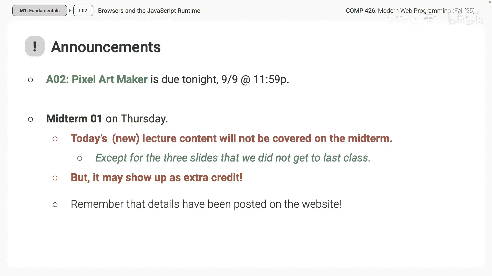
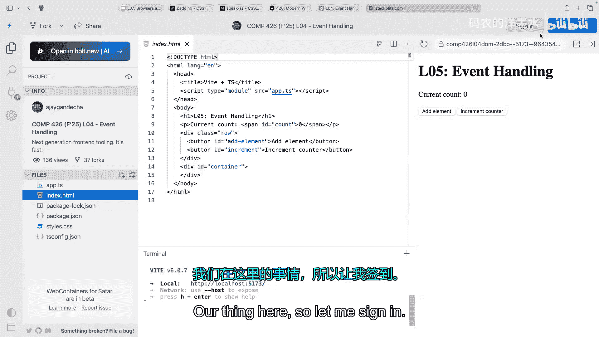
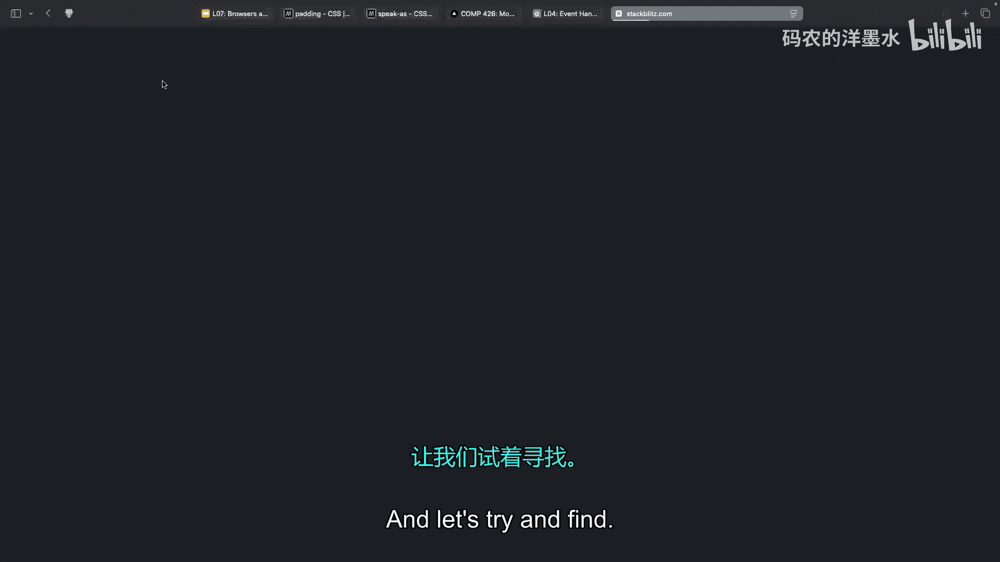
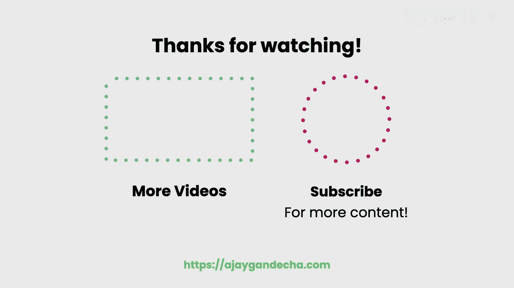

# 007：浏览器、JavaScript运行时与事件循环 🖥️



在本节课中，我们将要学习浏览器的工作原理、JavaScript运行时的核心组件，以及事件循环如何管理异步任务。这些知识将帮助我们理解Web应用在浏览器中是如何运行的。

---


## 课程概述

上一节我们介绍了异步编程的两种实现方式。本节中，我们将深入探讨浏览器如何执行JavaScript代码，并了解事件循环、任务队列和微任务队列等核心概念。

---

## 浏览器是什么？🌐

浏览器是一个用于从互联网检索和显示信息的应用程序。例如，当我们访问一个网站时，浏览器会获取HTML文件并将其内容显示在屏幕上。常见的浏览器包括Chrome、Safari、Firefox和Edge。

不同的浏览器由不同的公司开发，它们对Web标准的支持可能存在差异。例如，某些CSS属性（如`speak-as`）可能只在特定浏览器中可用。因此，在开发网站时，确保所用功能在目标浏览器中得到支持非常重要。

---

## 浏览器的核心组件

浏览器由多个核心组件构成，它们共同协作以提供完整的功能。

以下是浏览器的主要组成部分：

1.  **渲染引擎**：负责将DOM（文档对象模型）转换为可视化的网页内容。
2.  **网络服务**：处理网络请求，例如获取HTML、CSS和JavaScript文件。
3.  **存储**：提供本地数据存储能力。
4.  **输入/输出（I/O）**：管理摄像头、麦克风等硬件设备的输入输出。
5.  **JavaScript运行时**：执行JavaScript代码的核心环境。

---

## JavaScript运行时

JavaScript运行时是浏览器中执行JavaScript代码的“引擎”。它包含几个关键部分，共同管理代码的执行。

### 调用栈与堆内存



调用栈用于跟踪当前正在执行的函数。每当调用一个函数，就会在栈顶创建一个新的栈帧。当函数执行完毕，其栈帧会被弹出。



堆内存用于存储对象等动态分配的数据。

**代码示例**：
```javascript
function greet() {
    let message = "Hello"; // 存储在堆中
    console.log(message);
}
greet(); // 调用栈中添加 greet 的栈帧
```

### Web API

Web API是浏览器提供的接口，允许JavaScript代码与浏览器功能（如DOM操作、网络请求、定时器等）进行交互。

常见的Web API包括：
*   `document`：用于操作DOM。
*   `fetch`：用于发起网络请求。
*   `setTimeout`：用于设置定时器。
*   `console`：用于在控制台输出信息。

当JavaScript代码调用如`addEventListener`或`fetch`这样的Web API时，控制权会暂时交给浏览器。

---

## 事件处理与任务队列

当我们为按钮添加点击事件监听器时，关联的函数不会立即执行。这是因为JavaScript是单线程的，同一时间只能执行一个任务。

以下是事件处理的基本流程：

1.  调用`element.addEventListener('click', handlerFunction)`。
2.  Web API会记录这个事件与处理函数的关联。
3.  当用户点击按钮时，浏览器会将`handlerFunction`放入一个叫做**任务队列**的数据结构中排队，而不是直接将其推入调用栈。
4.  这样做是为了避免打断当前正在执行的代码。

**代码示例**：
```javascript
document.getElementById('myButton').addEventListener('click', function() {
    console.log('按钮被点击了！');
});
// 点击事件触发后，处理函数被加入任务队列
```

---

## 事件循环 🔄

事件循环是JavaScript运行时的核心调度机制。它持续监控调用栈和任务队列。

事件循环的工作流程非常简单：
1.  检查调用栈是否为空。
2.  如果调用栈为空，则检查任务队列中是否有等待的任务。
3.  如果任务队列中有任务，事件循环会将其取出并推入调用栈执行。

这个过程确保了异步任务（如事件处理、`setTimeout`回调）能够在主线程空闲时有序执行。

---

## 微任务队列

除了常规的任务队列，JavaScript运行时还有一个**微任务队列**，它主要用于处理Promise相关的异步操作。

微任务队列与任务队列的关键区别在于**优先级**：事件循环会优先清空微任务队列中的所有任务，然后才会处理任务队列中的任务。

**代码示例**：
```javascript
console.log('脚本开始'); // 同步任务

setTimeout(() => {
    console.log('setTimeout 回调'); // 任务队列
}, 0);

Promise.resolve().then(() => {
    console.log('Promise 回调'); // 微任务队列
});

console.log('脚本结束'); // 同步任务

// 输出顺序：
// 脚本开始
// 脚本结束
// Promise 回调 (微任务优先)
// setTimeout 回调 (普通任务)
```

---

## 异步编程模型回顾

现在，我们可以用完整的运行时模型来理解不同的异步编程方式。

*   **回调函数（如`setTimeout`）**：通过Web API注册，完成后其回调函数被放入**任务队列**。
*   **Promise**：通过Web API（如`fetch`）发起异步操作，`.then()`或`await`后的处理函数被放入**微任务队列**。

一个包含`fetch`的脚本执行过程如下：
1.  同步执行代码，调用`fetch`启动网络请求。
2.  主线程继续执行，全局栈帧进入空闲状态。
3.  网络请求完成后，Web API将对应的处理函数放入**微任务队列**。
4.  事件循环发现调用栈空闲，优先执行微任务队列中的函数。
5.  该函数被推入调用栈执行，完成诸如`console.log`等操作。

---

## 课程总结

本节课中我们一起学习了浏览器和JavaScript运行时的核心机制。我们了解了：
*   浏览器的基本构成。
*   JavaScript运行时中的调用栈、堆、Web API。
*   事件循环如何通过任务队列和微任务队列来调度异步任务，并理解了微任务优先于普通任务的执行顺序。

这是Web编程的基础模块的收官之作。无论未来使用多么高级的工具（如React），其底层最终都是在JavaScript运行时中执行代码。理解这些原理将帮助我们更好地构建和调试Web应用程序。



---
*下一讲，我们将开始学习新的工具，构建更复杂、交互性更强的Web应用。*