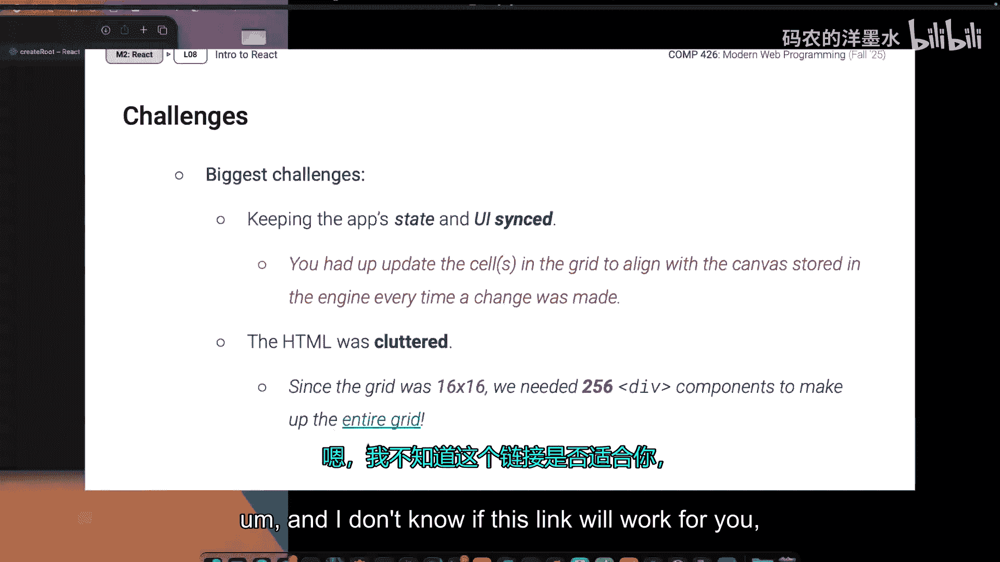
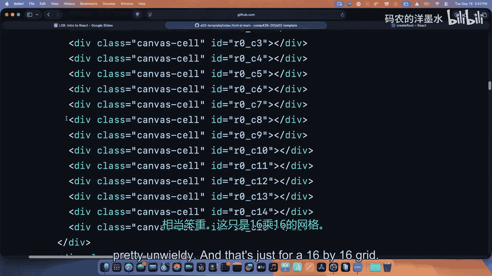
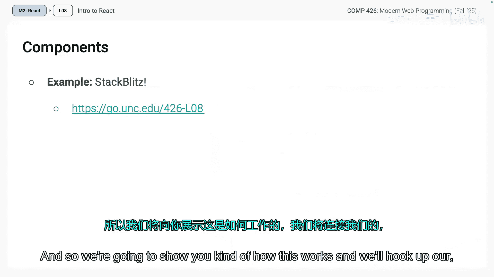
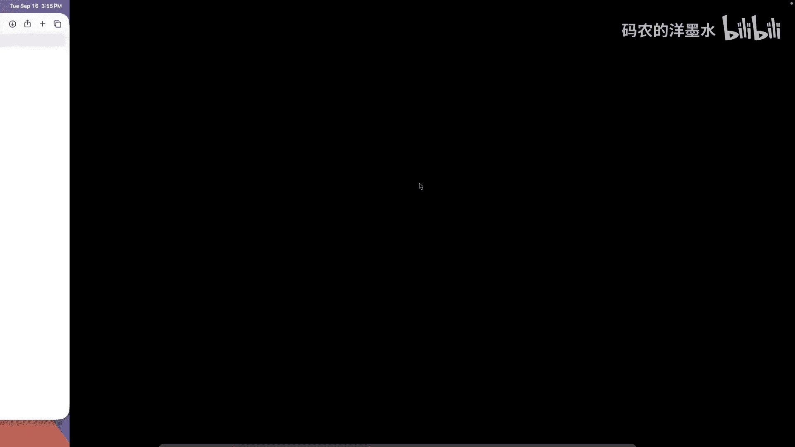
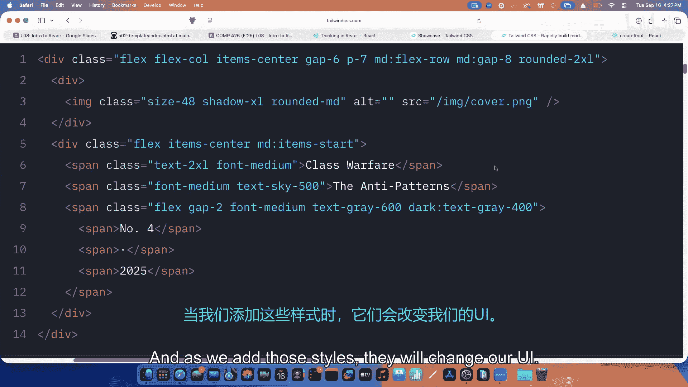
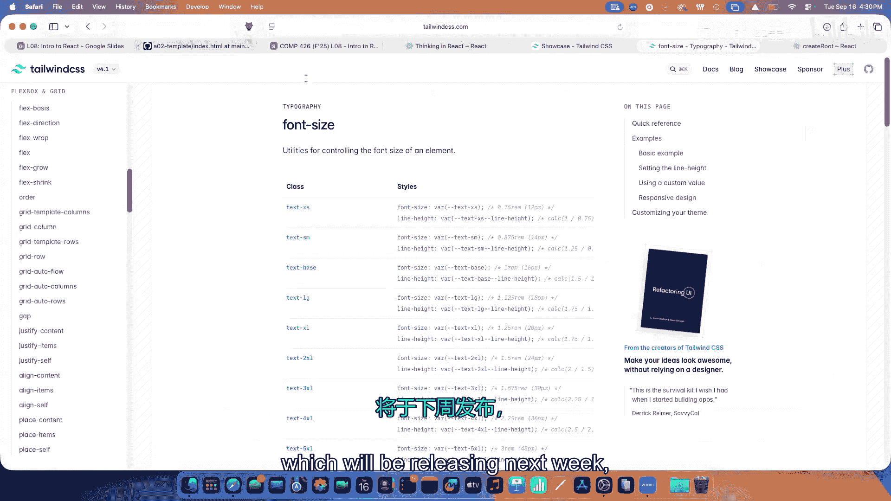
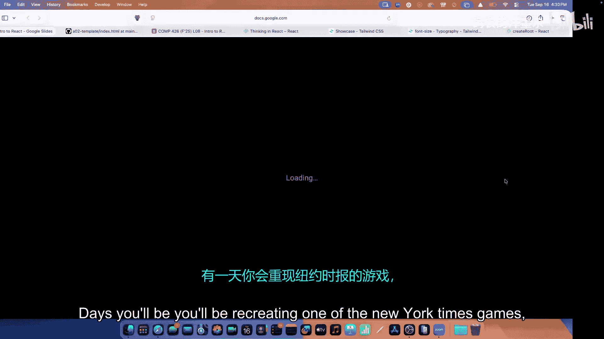
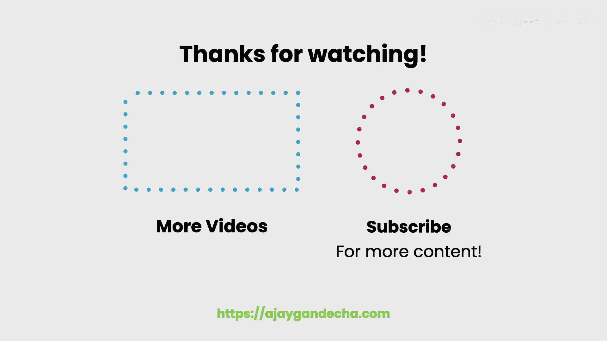

# 008：React入门 🚀

在本节课中，我们将要学习一个名为React的现代前端库。我们将探讨传统Web开发方法面临的挑战，并了解React如何通过其组件化模型和声明式UI来解决这些问题，从而提升开发体验。

---

## 传统Web开发的挑战 😕

上一节我们介绍了使用HTML、CSS和JavaScript构建Web应用的基础方法。这种方法虽然有效，但随着应用规模扩大，会面临一些挑战。

以下是传统方法面临的两个主要问题：

1.  **状态与UI同步困难**：应用的数据（状态）和用户界面（UI）需要手动保持同步。每次数据变化，都需要编写代码来更新DOM，这个过程容易出错且繁琐。
2.  **UI缺乏可组合性**：HTML本身不支持创建自定义的可复用UI元素。这导致代码重复，尤其是在需要大量相似元素（如网格、列表项）时，HTML文件会变得冗长且难以维护。

以像素画生成器作业为例，每次在画布上点击一个单元格时，需要执行以下步骤：
*   触发事件处理器。
*   调用引擎中的 `paint` 函数更新底层二维数组（状态）。
*   手动调用 `syncCanvasWithEngine` 函数，遍历所有单元格并更新其颜色，以使UI与新的状态同步。






这个过程不仅复杂，而且容易遗漏同步步骤，导致UI与数据不同步。

---

## React的解决方案：组件化UI 🧩

为了解决上述问题，我们引入了React。React是一个用于构建用户界面的JavaScript库，它由Meta（原Facebook）的工程师创建和维护。它的核心目标是：
*   使UI具有**可组合性**，便于复用。
*   更好地管理应用**状态**与UI的同步。

本节中，我们重点探讨React如何实现可组合的UI。

### 什么是React组件？

React组件是构建UI的基本单元。你可以将组件理解为自定义的、可复用的UI元素。

组件通过一个JavaScript/TypeScript函数来定义，这个函数返回一段描述UI的**JSX**（JavaScript XML）代码。JSX是一种语法扩展，允许我们在JavaScript代码中编写类似HTML的标记。

以下是一个简单的React组件示例：

```tsx
function StudentListing(props: {name: string, major: string}) {
  return (
    <div>
      <p>姓名：{props.name}</p>
      <p>专业：{props.major}</p>
    </div>
  );
}
```



这个名为 `StudentListing` 的组件接收 `name` 和 `major` 作为属性（props），并返回一个包含这两个信息的UI片段。`{props.name}` 的语法用于在JSX中嵌入JavaScript表达式。



### 组件的优势

使用React组件带来了以下好处：

*   **复用与组合**：定义一次组件，即可在应用任何地方多次使用。组件内部还可以嵌套其他组件，形成清晰的层级结构。
*   **关注点集中**：与UI相关的标记（JSX）和逻辑（JavaScript）被封装在同一个文件中，更易于理解和维护。
*   **简化事件处理**：可以直接在JSX元素上设置事件处理器，无需手动通过 `getElementById` 获取DOM元素再绑定事件。

```tsx
<button onClick={() => alert('你好！')}>点击我</button>
```

*   **动态渲染列表**：可以轻松地基于数据数组动态生成一系列组件。

```tsx
const students = [{name: '张三', major: '计算机科学'}, {name: '李四', major: '数学'}];

function App() {
  return (
    <div>
      {students.map((student, index) => (
        <StudentListing key={index} name={student.name} major={student.major} />
      ))}
    </div>
  );
}
```

### 如何启动一个React应用？

一个React应用通常从一个几乎为空的HTML文件开始，其中包含一个容器元素（例如 `<div id="root"></div>`）。应用的入口TypeScript文件会使用React库将根组件渲染到这个容器中。

```tsx
// main.tsx
import { createRoot } from 'react-dom/client';
import App from './App';

const container = document.getElementById('root');
const root = createRoot(container!);
root.render(<App />);
```

```html
<!-- index.html -->
<body>
  <div id="root"></div>
  <script type="module" src="/src/main.tsx"></script>
</body>
```

React会接管这个容器内的DOM管理，并根据组件定义自动更新UI。

---

## 提升样式开发体验：Tailwind CSS 🎨

上一节我们了解到React将UI和逻辑结合，减少了文件切换。然而，样式（CSS）通常仍是一个独立的文件。管理大量的CSS类、避免样式冲突以及在不同文件间切换，在大型项目中依然是个挑战。

为此，我们引入 **Tailwind CSS**。它是一个实用优先的CSS框架，提供了大量内置的、功能单一的CSS类，可以直接在HTML或JSX的 `className` 属性中应用。

### Tailwind 的工作原理

使用Tailwind时，你不再需要编写大量的自定义CSS类。相反，你直接在元素上组合使用Tailwind提供的工具类来构建样式。

例如，创建一个带内边距、蓝色背景和白色粗体文字的按钮：
```html
<button className="px-4 py-2 bg-blue-500 text-white font-bold rounded">
  按钮
</button>
```
*   `px-4`: 水平内边距
*   `py-2`: 垂直内边距
*   `bg-blue-500`: 蓝色背景
*   `text-white`: 白色文字
*   `font-bold`: 粗体
*   `rounded`: 圆角



### Tailwind 的优势



*   **开发速度快**：无需在CSS和JSX文件间来回切换，样式就在元素旁边。
*   **一致性高**：使用预设的颜色、间距、大小等尺度，有助于保持设计一致性。
*   **灵活性好**：也可以通过类似 `text-[19px]` 的语法使用任意值。
*   **生产包优化**：在项目构建时，Tailwind会进行“摇树优化”，只生成并包含项目中实际使用到的CSS类，最终生成的CSS文件非常小，有利于性能。
*   **减少命名负担**：无需为每个样式绞尽脑汁想类名。



通过结合React和Tailwind，我们可以将UI结构、逻辑和样式高度集中地管理在组件文件中，极大地提升了开发效率和可维护性。

---

## 总结与展望 📚

本节课我们一起学习了现代Web开发中的两个重要工具：
1.  **React**：它通过**组件化**模型解决了UI复用和组合的问题。我们学会了组件是返回JSX的函数，可以接收属性、包含逻辑并处理事件。
2.  **Tailwind CSS**：它通过提供一系列工具类，允许我们在标记中直接编写样式，解决了传统CSS难以维护、文件分离的问题，并优化了最终产出的样式文件。

现在，我们的应用架构从传统的HTML、CSS、JS分离模式，演进为以React组件为核心，内聚了模板、逻辑和样式的现代模式。

在下节课中，我们将深入探讨React的另一个核心特性：**状态管理**。我们将学习React如何更优雅地解决本课开头提到的“状态与UI同步”的挑战，使数据驱动UI更新变得简单而高效。



---
**本节课中我们一起学习了React组件的基础概念、JSX语法以及Tailwind CSS工具，为构建现代、可维护的Web应用界面打下了坚实的基础。**