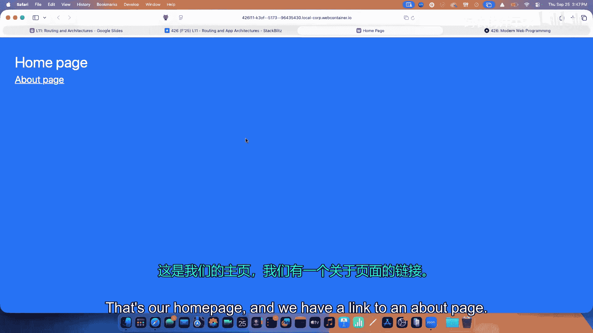
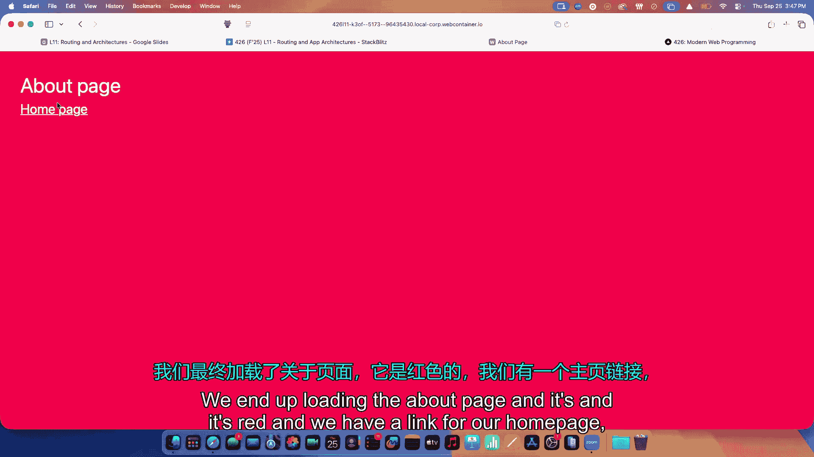
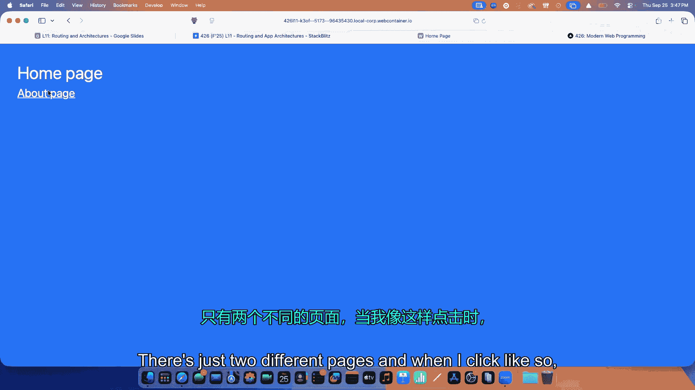
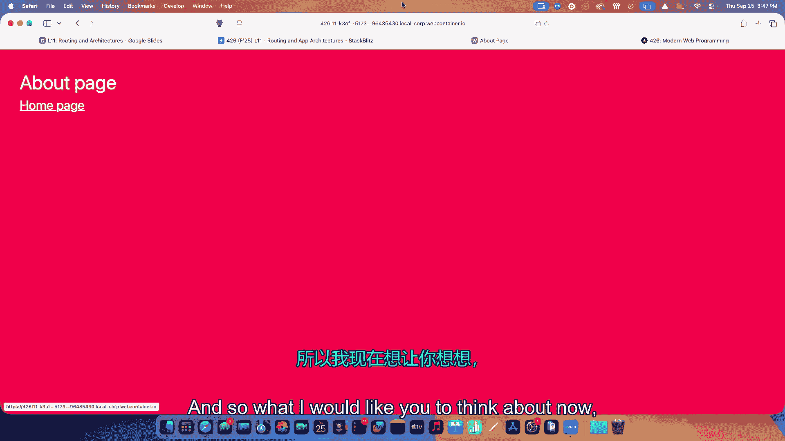
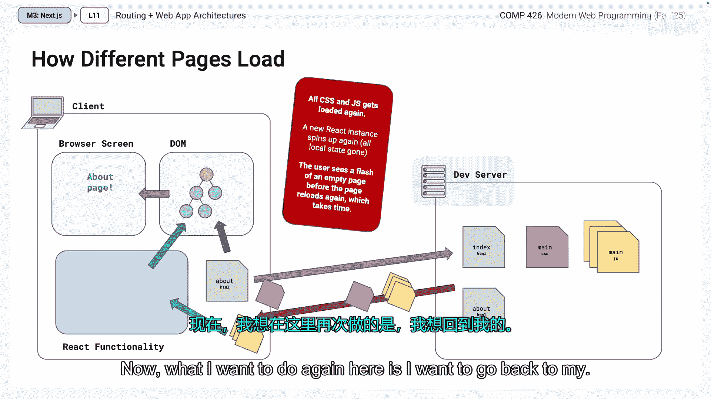
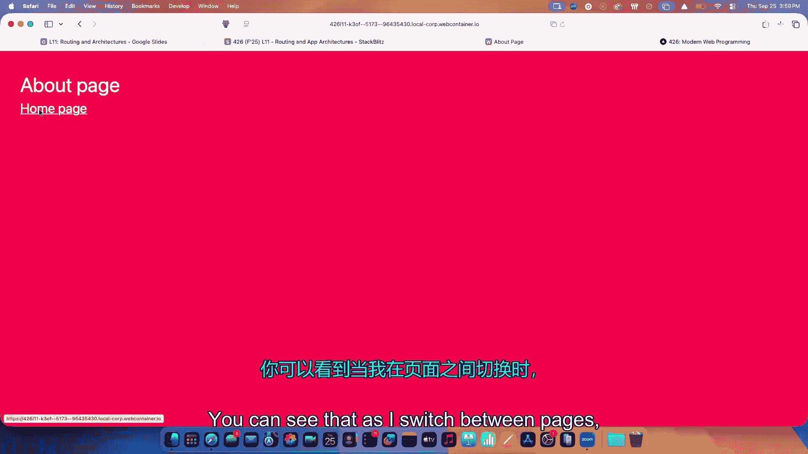
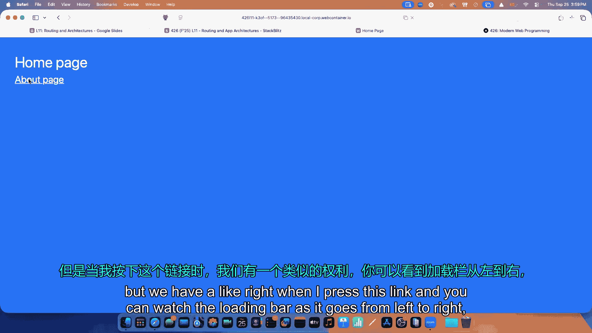
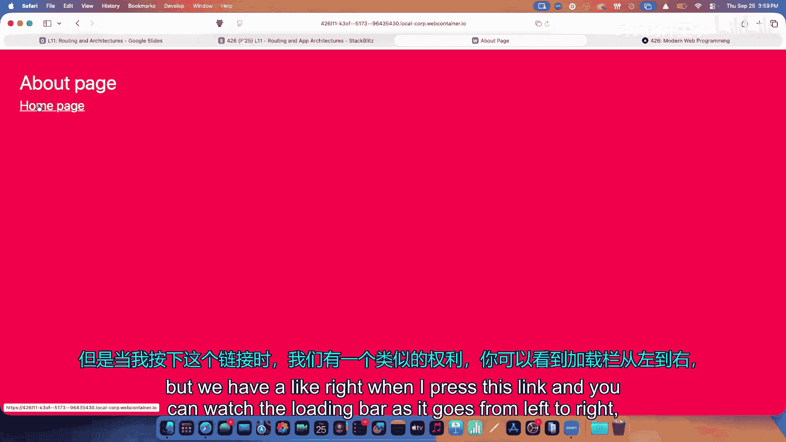
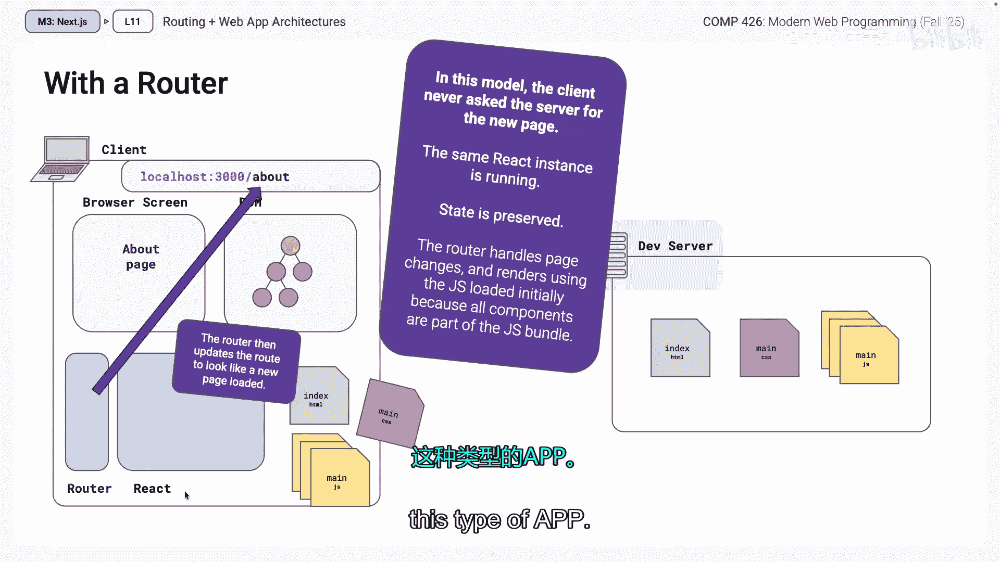
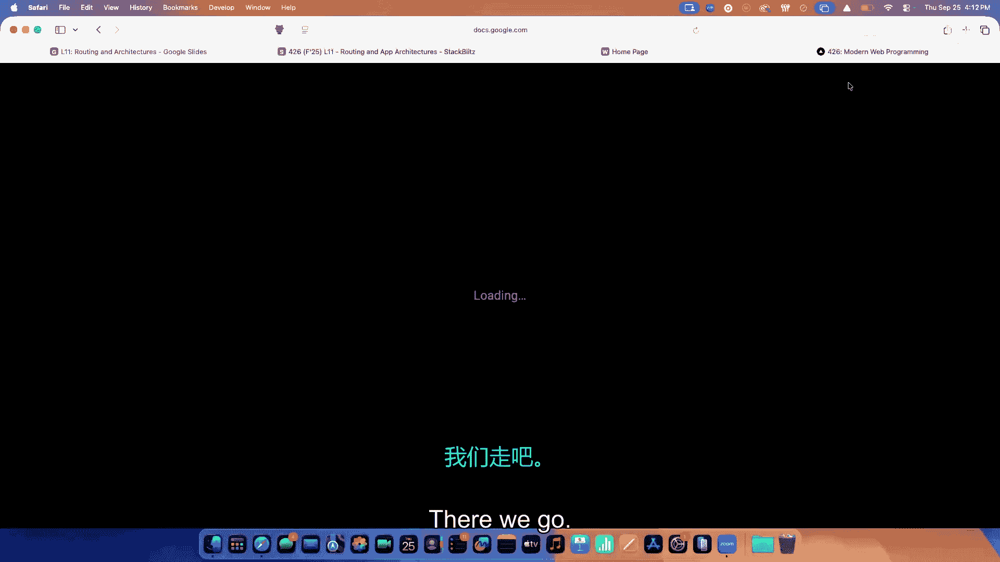

# 011：路由与Web应用架构 🚀

在本节课中，我们将学习如何从基础的React库扩展到构建完整Web应用的框架。我们将探讨两种主要的Web应用架构：多页面应用（MPA）和单页面应用（SPA），并理解路由（Router）在其中的关键作用。

上一节我们介绍了React的核心概念，如组件、状态管理和副作用。本节中，我们来看看如何利用这些概念构建更复杂的、包含多个页面的Web应用。

## 从React到完整应用

React是一个强大的库，它允许我们通过组件来构建和管理用户界面。然而，React本身并不提供构建完整Web应用所需的所有工具，特别是处理页面导航的方式。

## Web应用加载模型回顾

为了理解路由的必要性，让我们先回顾一下Web应用的基本加载模型。

1.  **开发与构建**：我们首先在开发环境中编写代码（如TypeScript、JSX）。然后，使用构建工具（如Vite）将代码“构建”成浏览器可以理解的格式。这个过程会将TypeScript转换为JavaScript，将Tailwind CSS处理成独立的CSS文件。最终，服务器上存放的是标准的HTML、CSS和JavaScript文件。
    *   **公式**：`开发代码 (TS/JSX) -> 构建过程 -> 部署文件 (HTML, CSS, JS)`









2.  **初始加载**：当用户访问网站首页（例如 `index.html`）时，浏览器会向服务器请求该HTML文件。服务器返回一个近乎“空壳”的HTML文件，其中只包含一个根 `div` 容器和对CSS、JavaScript文件的引用。
    *   **代码示例 (index.html)**:
        ```html
        <!DOCTYPE html>
        <html>
          <head>
            <link rel="stylesheet" href="/styles.css">
            <script src="/main.js" defer></script>
          </head>
          <body>
            <div id="root"></div> <!-- 空的容器 -->
          </body>
        </html>
        ```

3.  **渲染与交互**：浏览器下载CSS和JavaScript文件后，开始执行JavaScript代码。React库被初始化，并通过 `ReactDOM.render()` 等方法将根组件渲染到之前那个空的 `div` 容器中，用户此时才看到完整的页面。当用户与页面交互（如点击按钮）导致状态变更时，React会高效地更新DOM，重新渲染相关组件。

## 多页面应用（MPA）的挑战









在传统的多页面应用架构中，每个页面（如首页、关于页）都是一个独立的HTML文件。

以下是其工作流程：
1.  用户访问首页 (`index.html`)，加载首页的React组件。
2.  用户点击链接跳转到关于页。
3.  浏览器向服务器请求一个新的HTML文件 (`about.html`)。
4.  **关键问题**：浏览器会**清除当前页面所有内容**（DOM、JavaScript状态等），导致用户看到一个白屏。
5.  服务器返回 `about.html`，浏览器重新开始整个加载过程：下载CSS、JS，重新初始化React，最后渲染关于页组件。

这个过程带来了明显的用户体验问题：页面切换时有“白屏”闪烁，加载速度较慢，因为每次都需要重新请求资源和初始化应用。

## 引入路由：迈向单页面应用（SPA）

为了解决MPA的问题，我们引入了**路由（Router）**库。路由改变了页面导航的底层机制。

以下是使用路由后的工作流程：
1.  初始加载与MPA相同：下载包含**所有页面组件代码**的JavaScript包。
2.  用户点击一个由路由库提供的特殊 `Link` 组件（而不是普通的HTML `<a>` 标签）。
    *   **代码对比**:
        ```jsx
        // 传统方式 (触发页面重载)
        <a href="/about">About</a>

        // 路由方式 (客户端导航)
        <Link to="/about">About</Link>
        ```
3.  **关键改进**：点击 `Link` 后，浏览器**不会**向服务器发起新请求。路由库会：
    *   通知React将当前显示的组件从DOM中移除。
    *   立即从已下载的JavaScript包中找到“关于页”对应的组件，并渲染它。
    *   使用浏览器History API更新地址栏的URL，让用户感觉页面已经切换。
4.  整个过程几乎瞬间完成，没有白屏，无需重新加载资源或重置React状态。





这种架构被称为**单页面应用（SPA）**。整个应用在初次访问时一次性加载，之后的页面切换都在客户端完成，提供了极其流畅的用户体验。

## MPA与SPA的权衡

虽然SPA在用户体验和性能上优势明显，但它也存在一个重大缺点：**搜索引擎优化（SEO）** 问题。

*   **MPA的优势**：每个页面有独立的URL和HTML文件。搜索引擎爬虫可以轻松抓取和索引每个页面的内容（标题、元描述、正文等）。
*   **SPA的挑战**：SPA只有一个 `index.html` 文件，页面内容依赖JavaScript动态渲染。许多搜索引擎爬虫**不会或不能很好地执行JavaScript**，因此它们可能只能看到一个空页面或首页的内容，无法索引其他路由下的独特内容。这对于内容型网站（如博客、电商产品页）是致命的。

## 展望未来：混合架构与Next.js

现代Web开发框架（如我们将要学习的 **Next.js**）旨在融合MPA和SPA的优点，实现“鱼与熊掌兼得”。它们采用了一种称为**服务器端渲染（SSR）** 的混合架构：

1.  **首屏加载像MPA**：当用户直接访问一个URL时，服务器会预先执行React组件，生成包含完整内容的HTML发送给浏览器。这对SEO友好，且用户能立即看到内容。
2.  **后续导航像SPA**：页面加载后，应用转变为SPA模式。用户点击链接进行导航时，只在客户端进行组件切换，无需整页刷新，体验流畅。
3.  **框架集成**：Next.js 这样的框架将React、路由、TypeScript、Tailwind CSS以及SSR等能力开箱即用地整合在一起，提供了完整的开发工具箱。


本节课中我们一起学习了Web应用从MPA到SPA的演进，理解了路由的核心原理，并认识了MPA与SPA在用户体验和SEO上的权衡。下一讲，我们将开始探索Next.js框架，看看它如何通过服务器端渲染等现代技术来构建更强大的Web应用。