# 012：Next.js入门与服务端渲染 🚀

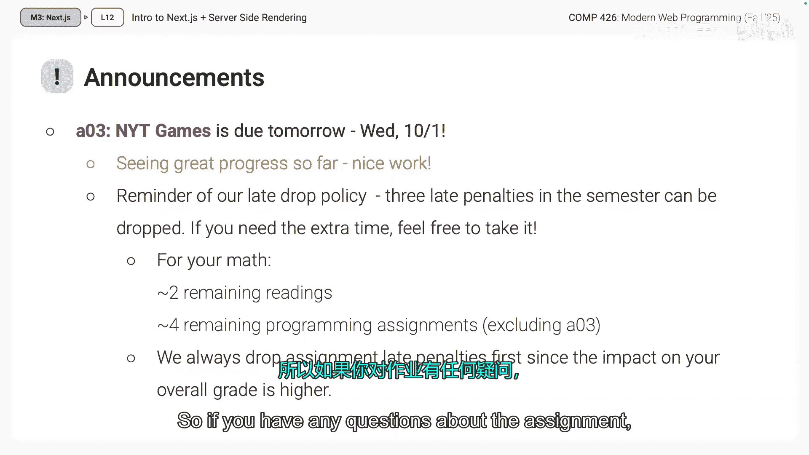

在本节课中，我们将要学习现代Web应用架构的核心概念，特别是单页应用（SPA）与多页应用（MPA）的区别，并深入探讨Next.js框架如何通过服务端渲染（SSR）技术，巧妙地结合两者的优点，以解决性能与搜索引擎优化（SEO）的难题。


## 回顾：MPA与SPA架构


上一节我们介绍了Web应用架构的两种主要模式。本节中，我们来看看它们的具体区别。

### 多页应用（MPA）

在多页应用中，每次用户导航到新页面时，浏览器都会向服务器发起一个新的请求。服务器会返回一个完整的、全新的HTML文件。

**核心流程如下：**
1.  用户请求一个页面（例如，主页）。
2.  服务器返回对应的 `index.html` 文件。
3.  浏览器解析HTML，发现需要加载CSS和JavaScript文件，于是向服务器发起额外请求。
4.  服务器返回CSS和JavaScript。
5.  浏览器执行JavaScript（例如React代码），将UI渲染到页面上。
6.  当用户点击链接跳转到“关于”页面时，浏览器会向服务器请求 `about.html`。
7.  服务器返回 `about.html`，**浏览器会清除当前页面所有内容（DOM、JS、CSS）**，然后重复步骤3-5来渲染新页面。

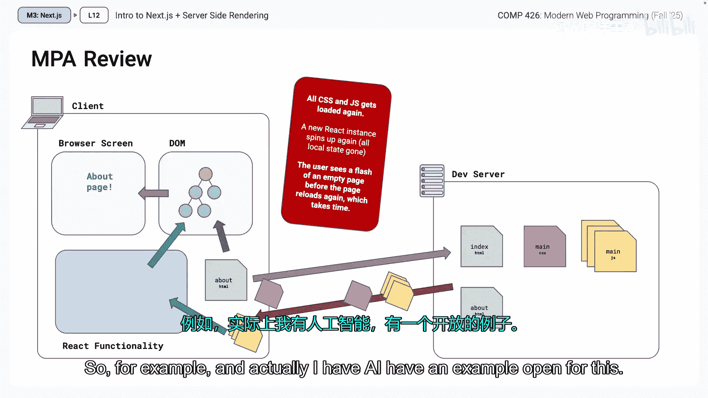

这种模式的缺点是每次页面跳转都涉及完整的网络请求和页面重建，速度较慢，用户体验有卡顿感。

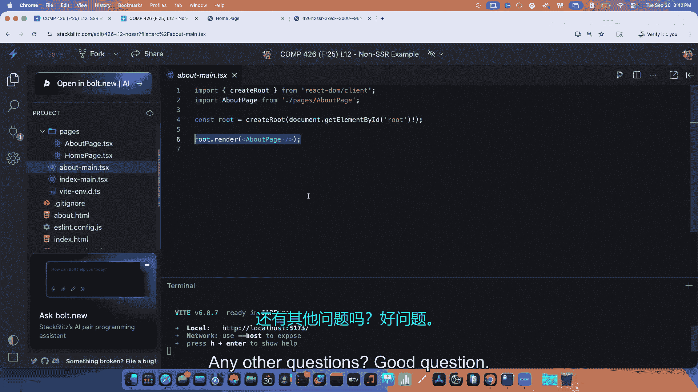

### 单页应用（SPA）

单页应用通过引入“路由器”（Router）来解决MPA的跳转性能问题。在SPA中，网站只有一个HTML入口文件。

**核心流程如下：**
1.  用户首次访问网站，加载唯一的 `index.html`（通常内容为空，只有一个根容器）。
2.  浏览器加载并执行JavaScript包（包含React和路由器）。
3.  React将初始页面（例如主页）渲染到DOM中。
4.  当用户点击导航到“关于”页面时，**路由器会拦截这次跳转**，阻止浏览器向服务器发起新请求。
5.  路由器通知React，React直接在当前页面内，动态地将主页组件替换为“关于”页面组件。
6.  路由器同时更新浏览器地址栏的URL，以反映页面变化。

SPA的优点是页面切换极其迅速、流畅，因为不需要重新加载资源或重新初始化JavaScript环境。但其主要缺点是**搜索引擎优化（SEO）困难**，因为搜索引擎爬虫通常不会执行JavaScript，它们只能看到那个初始的空HTML文件，无法索引网站的实际内容。

### 客户端渲染（CSR）

无论是MPA还是SPA，在上述流程中，页面的UI内容最终都是由**运行在浏览器（客户端）的JavaScript（如React）** 负责渲染生成的。这种渲染方式被称为**客户端渲染（Client-Side Rendering, CSR）**。

## 引入Next.js与服务器端渲染（SSR）

为了解决SPA的SEO问题，同时保留其优秀的用户体验，我们引入了Next.js框架及其核心特性：**服务器端渲染（Server-Side Rendering, SSR）**。

Next.js是一个全功能的React框架，它集成了React、路由、TypeScript、Tailwind CSS等工具，提供了一个开箱即用的“工具箱”。

### 什么是服务器端渲染（SSR）？

与CSR不同，SSR将渲染工作从浏览器转移到了服务器。

**Next.js SSR核心流程如下：**
1.  用户请求一个页面（例如，主页）。
2.  **Next.js服务器（运行Node.js代码）接收到请求。**
3.  服务器使用React**预先渲染**请求的页面组件，生成一个**包含完整页面内容的HTML文件**。
4.  服务器将这个完整的HTML文件发送给浏览器。
5.  浏览器接收到HTML后，**能够立即显示页面的全部静态内容**，用户无需等待JS执行就能看到文字和结构。
6.  同时，浏览器会加载该页面所需的CSS和JavaScript。
7.  JavaScript加载执行后，其中包含的React代码会“接管”这个已经存在的静态HTML页面。这个过程叫做**水合（Hydration）**。React会将事件处理函数、状态管理等交互功能“附加”到已有的DOM元素上，使静态页面变得可交互。
8.  水合完成后，应用就变成了一个标准的SPA。后续的页面导航将由客户端路由器处理，实现快速的无刷新跳转。

### SSR如何解决SEO问题？

让我们从搜索引擎爬虫的视角来比较CSR（传统SPA）和SSR（Next.js）：

**CSR (传统SPA) 对爬虫：**
1.  爬虫请求页面。
2.  服务器返回一个几乎为空的 `index.html`。
3.  爬虫无法执行JavaScript，因此**只能看到一个空白页面**，无法索引任何内容。

**SSR (Next.js) 对爬虫：**
1.  爬虫请求页面。
2.  Next.js服务器渲染组件，并返回一个**包含全部页面内容的完整HTML**。
3.  爬虫无需执行JavaScript，**直接就能读取和分析页面上的所有文本和链接**，从而正确地为页面建立索引。

因此，SSR完美地兼顾了二者：它提供了SPA般流畅的后续交互体验，又像传统MPA一样，在首次加载时就能向爬虫和用户提供立即可见的内容。

## 动手创建Next.js应用 🛠️

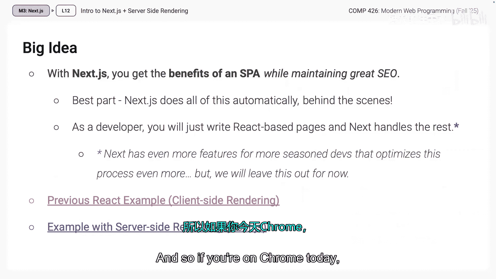

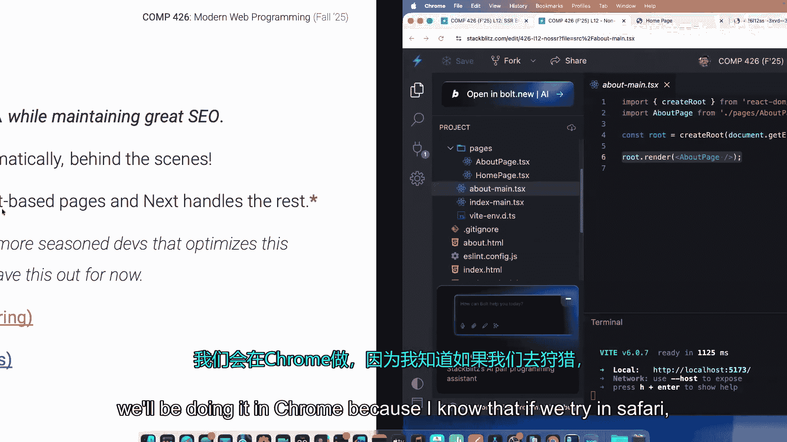

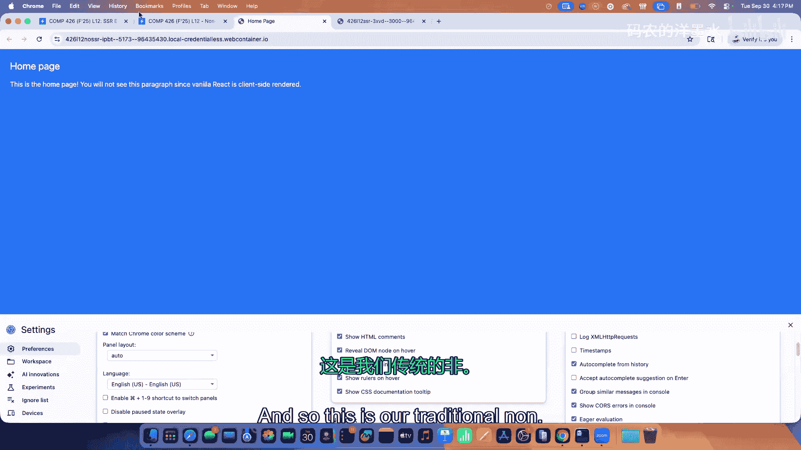

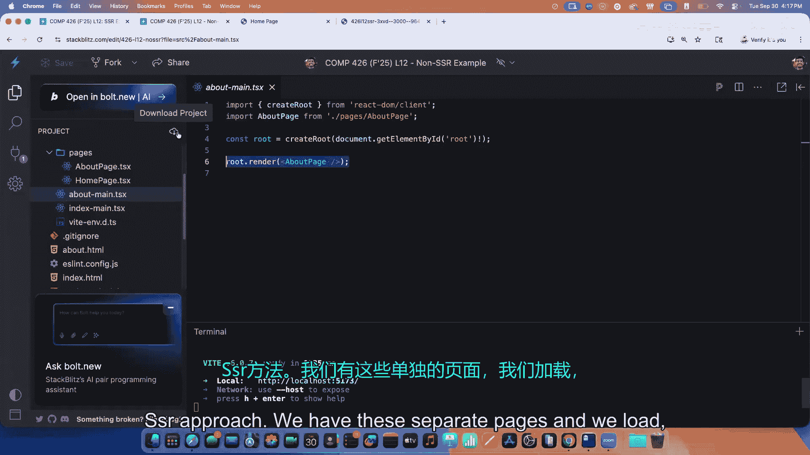

理解了理论之后，本节中我们来看看如何快速创建一个Next.js项目。

以下是创建步骤：
1.  确保系统已安装Node.js。
2.  打开终端，运行以下命令来创建新项目：
    ```bash
    npx create-next-app@latest
    ```
3.  根据命令行提示进行配置：
    *   项目名称：`my-next-app` (或任意名称)
    *   是否使用TypeScript：**是**
    *   是否使用ESLint：**是** (默认)
    *   是否使用Tailwind CSS：**是**
    *   是否使用 `src/` 目录：**否** (默认)
    *   **是否使用App Router：务必选择 `否`**，本课程使用Pages Router。
    *   是否启用Turbopack：可选

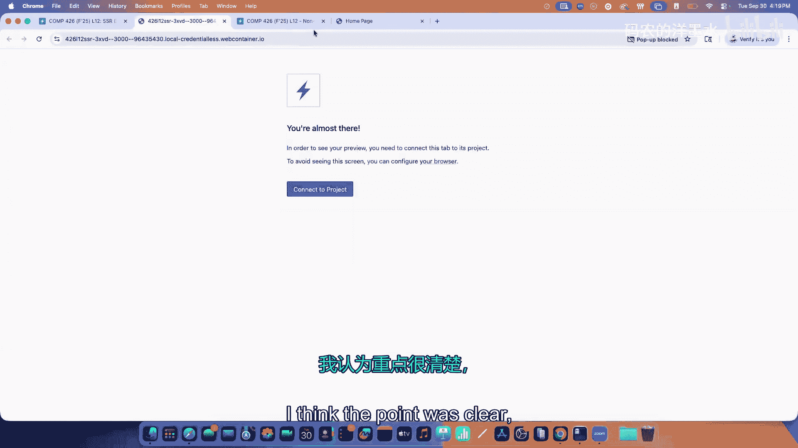

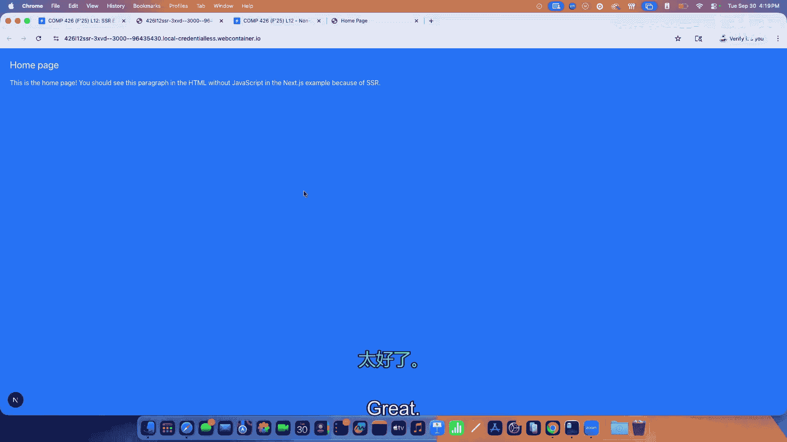

### 项目结构与基于文件的路由

Next.js (使用Pages Router时) 采用一种直观的**基于文件的路由系统**。`pages` 目录下的文件结构直接映射到网站的路由（URL）。

以下是关键规则示例：
*   `pages/index.tsx` → 对应网站根路径 `/` (主页)
*   `pages/about.tsx` → 对应 `/about` 路径
*   `pages/courses/index.tsx` → 对应 `/courses` 路径
*   `pages/courses/comp426.tsx` → 对应 `/courses/comp426` 路径

每个 `.tsx` 文件都需要导出一个默认的React组件，该组件就是该页面的内容。

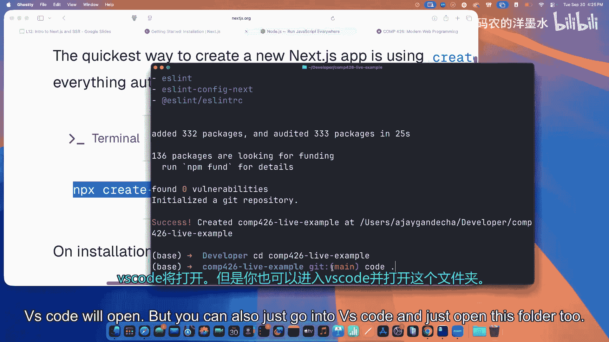

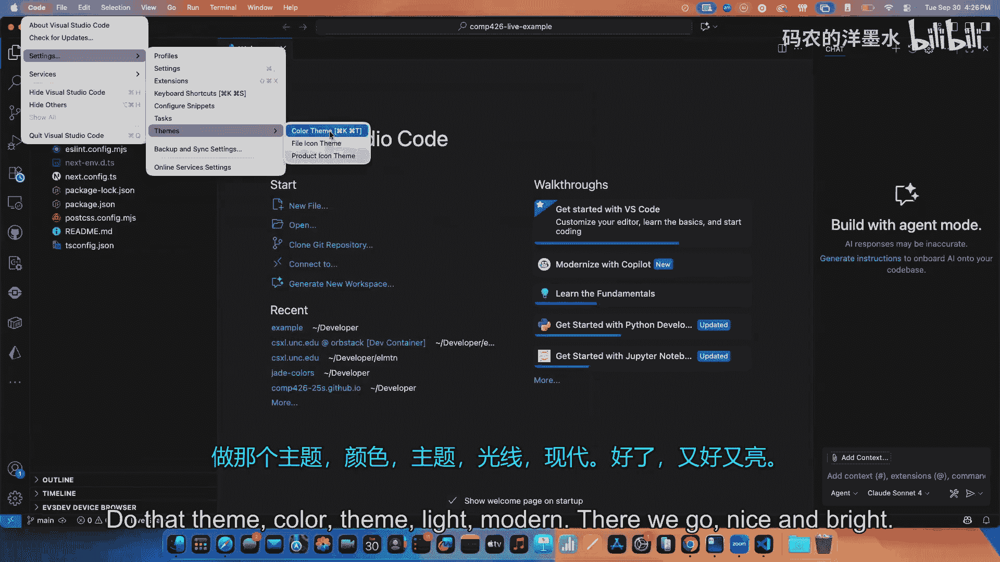

### 页面间导航

在Next.js中，为了实现SPA式的客户端导航（避免整页刷新），我们不能使用传统的 `<a>` 标签，而应使用 `next/link` 提供的 `Link` 组件。

**示例代码：**
```jsx
// 在 pages/index.tsx 中
import Link from 'next/link';

export default function Home() {
  return (
    <div>
      <h1>主页</h1>
      {/* 使用 Link 组件进行客户端导航 */}
      <Link href="/about">
        前往关于页面
      </Link>
      <Link href="/courses">
        前往课程页面
      </Link>
    </div>
  );
}
```
使用 `Link` 组件后，点击链接将在客户端瞬间完成页面切换，带来无缝的用户体验。

## 总结

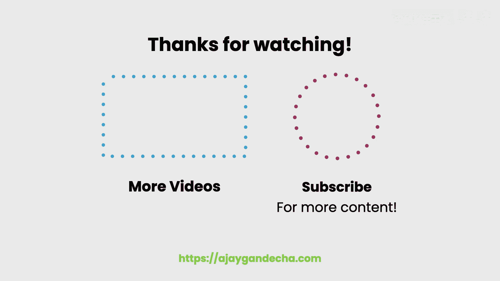

本节课中我们一起学习了现代Web开发中关键的架构演进。我们从多页应用（MPA）和单页应用（SPA）的对比入手，理解了SPA在用户体验上的优势及其在搜索引擎优化（SEO）上的致命缺陷。接着，我们深入探讨了Next.js框架如何通过服务器端渲染（SSR）这一核心技术，在服务器上预先渲染React组件为完整的HTML，从而完美解决了SEO问题。SSR使得首屏内容能够被快速加载并被爬虫抓取，而在水合（Hydration）之后，应用又保留了SPA的流畅交互特性。最后，我们实践了如何创建Next.js项目，并了解了其基于文件的路由系统和用于客户端导航的 `Link` 组件。Next.js的这套混合渲染策略，为我们构建高性能、对搜索引擎友好的现代Web应用提供了强大的解决方案。