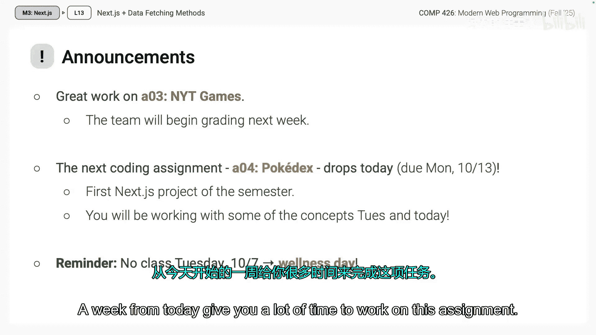

# 013：Next.js与数据获取方法 🚀




在本节课中，我们将学习Next.js框架的核心概念，并深入探讨两种主要的数据获取方法：客户端获取与服务器端获取。我们将通过对比分析，理解它们各自的优缺点及适用场景。

## 课程回顾与公告 📢

上一节我们介绍了多页面应用与单页面应用的区别。本节中，我们来看看Next.js如何结合两者的优点。

首先是一些课程公告。A03作业提交情况良好，我们将在下周开始评分。新的作业A04（宝可梦图鉴）将于今天发布，截止日期为下周一。该作业将重点练习Next.js及其相关功能。请注意，下周二为健康日，没有课程。

另外，HackNC活动的报名截止日期是明天，请尚未报名的同学及时注册。

## Next.js 与 服务端渲染 🔄

我们之前介绍了Next.js，这是一个由Vercel维护的React框架，也是目前最流行的框架之一。它使用React作为组件库，并集成了Tailwind CSS、TypeScript等工具，还自带基于文件系统的路由器。

Next.js的架构采用了混合方法，融合了MPA和SPA的优点，这被称为服务端渲染。SSR允许我们在拥有SPA优秀用户体验的同时，也具备良好的搜索引擎优化能力。在SSR中，当用户首次请求页面时，服务器会预先渲染React组件，生成完整的HTML文件并发送给客户端。

为了更直观地理解，我们可以参考以下时序图。用户发起请求后，服务器需要时间生成HTML，此时浏览器显示空白页或加载条。生成完成后，完整的HTML返回，页面内容首次绘制到屏幕上，这被称为**首次内容绘制**。此时页面已可见，但还不可交互。

> **注意**：此时CSS文件可能尚未加载，因此样式可能不完整。

随后，浏览器会请求并下载JavaScript文件。下载完成后，JavaScript开始运行，这个过程称为**水合**。水合完成后，页面才变得完全可交互，从页面加载到可交互的这段时间被称为**可交互时间**。

需要强调的是，SSR主要影响首次页面加载。之后在网站内跳转页面时，会使用Next.js自带的客户端路由器，无需再次向服务器请求完整的HTML，从而保持SPA的流畅体验。

## Next.js 路由系统 🗺️

接下来，我们深入了解一下Next.js的路由系统。

Next.js使用基于文件系统的路由。项目`pages`目录下的所有React组件都会被自动视为页面。其路径由文件在目录中的位置决定。

例如：
*   `pages/index.tsx` 对应根路径 `/`（首页）。
*   `pages/about.tsx` 对应路径 `/about`。
*   `pages/blog/index.tsx` 对应路径 `/blog`。

### 动态路由

对于需要根据参数生成大量相似页面的情况（如课程详情页、产品页），创建无数个独立组件是不现实的。这时可以使用动态路由。

动态路由的文件名需用方括号包裹，例如 `pages/courses/[course].tsx`。在这个组件中，我们可以通过Next.js提供的 `useRouter` Hook来访问路由参数。

```typescript
import { useRouter } from 'next/router';

const CoursePage = () => {
  const router = useRouter();
  const { course } = router.query; // 获取动态路由参数

  return (
    <div>
      <h1>{course} 课程页面</h1>
    </div>
  );
};

export default CoursePage;
```

访问 `/courses/comp426` 时，`course` 参数的值就是 `comp426`。这样，一个组件就能处理所有不同的课程页面。

### 布局与共享组件

Next.js 有两个特殊的文件用于定义应用的全局结构和元数据：

1.  `pages/_document.tsx`：用于自定义整个应用的HTML文档结构（如`<head>`中的内容）。在大部分作业中无需修改。
2.  `pages/_app.tsx`：这是一个包装组件，是所有页面的根组件。如果你想在所有页面共享一些UI（如导航栏、页脚），可以在这里添加。

例如，在 `_app.tsx` 中添加一个网站标题：

```typescript
function MyApp({ Component, pageProps }) {
  return (
    <div>
      <h1>网站标题</h1>
      <Component {...pageProps} /> {/* 这里会渲染具体的页面组件 */}
    </div>
  );
}

export default MyApp;
```

这个标题将出现在网站的每一个页面上。

## 数据获取方法 ⚡

数据获取是现代Web应用的核心。到目前为止，我们一直在使用的方法是：在React组件内（通常在`useEffect`中）使用`fetch`函数从外部API获取数据，然后使用`useState`更新状态并渲染UI。

这种方法被称为**客户端数据获取**。其流程如下：页面加载并执行JavaScript后，客户端向数据服务器发起请求，在等待响应期间，页面可以显示“加载中”状态。收到数据后，再更新UI显示内容。

然而，这种方法存在一个关键问题：**搜索引擎优化**。如果搜索引擎爬虫在抓取页面时禁用了JavaScript（许多爬虫确实如此），它们将无法执行获取数据的代码，因此只能看到一个空白或仅有“加载中”提示的页面，无法索引真实内容。

为了解决SEO问题，Next.js提供了**服务器端数据获取**的选项。

## 服务器端数据获取 🖥️

服务器端数据获取的思路是：在服务器渲染页面HTML时，就提前获取页面所需的所有数据。这样，生成的HTML文件本身就包含了完整的数据内容。

其流程如下：用户请求页面 -> Next.js服务器在渲染组件前，先执行数据获取逻辑 -> 将获取到的数据作为属性传递给页面组件 -> 服务器渲染出包含数据的完整HTML并发送给客户端。因此，在首次内容绘制时，数据就已经显示在页面上了，即使禁用JavaScript也是如此。

以下是两种方法在关键指标上的对比：

| 特性 | 客户端数据获取 | 服务器端数据获取 |
| :--- | :--- | :--- |
| **首次内容绘制** | 较快（先显示框架，后加载数据） | 较慢（需等待数据获取完成才能渲染） |
| **可交互时间** | 可能较长（需先加载JS，再获取数据） | 可能较短（数据已就绪，主要等待JS） |
| **搜索引擎优化** | 差（爬虫看不到数据） | **优秀**（数据直接存在于HTML中） |
| **用户体验** | 通常更好（可显示加载状态） | 首屏可能感觉较慢 |
| **服务器负载** | 低（数据获取分散到各客户端） | 高（服务器需处理所有数据请求） |

**如何选择？**
*   优先考虑**用户体验和性能**时（如仪表盘、后台管理界面），选择**客户端数据获取**。
*   当**SEO至关重要**时（如博客、新闻文章、电商产品页），选择**服务器端数据获取**。
*   许多实际应用会混合使用，例如首页列表使用客户端获取以求快，而具体的文章/产品页使用服务器端获取以求SEO。

## 在Next.js中实现服务器端获取 💻

在Next.js中实现服务器端数据获取，需要在页面组件文件中导出一个名为 `getServerSideProps` 的异步函数。

这个函数在每次页面请求时都会在服务器端运行。它获取所需数据，并作为 `props` 返回给页面组件。

以下是一个示例，与之前的客户端获取例子功能相同：

```typescript
// pages/organizations/server-fetching.tsx
import { GetServerSideProps } from 'next';

// 定义数据类型
interface Organization {
  id: number;
  name: string;
}

interface PageProps {
  organizations: Organization[];
}

// 页面组件接收从getServerSideProps传入的props
const OrganizationsPage = ({ organizations }: PageProps) => {
  return (
    <div>
      <h1>CS学生组织</h1>
      <ul>
        {organizations.map(org => (
          <li key={org.id}>{org.name}</li>
        ))}
      </ul>
    </div>
  );
};

export default OrganizationsPage;

// 服务器端数据获取函数
export const getServerSideProps: GetServerSideProps<PageProps> = async () => {
  // 在服务器端执行fetch
  const res = await fetch('https://api.example.com/organizations');
  const organizations: Organization[] = await res.json();

  // 返回的数据将作为 `props` 传递给页面组件
  return {
    props: {
      organizations,
    },
  };
};
```

当访问该页面时，Next.js会先调用 `getServerSideProps` 获取组织数据，然后将数据 `organizations` 作为属性传递给 `OrganizationsPage` 组件进行渲染，最终输出包含数据的HTML。

## 总结 🎯

本节课中我们一起学习了：

1.  **Next.js核心**：回顾了Next.js的服务端渲染架构，它结合了MPA的SEO优势和SPA的流畅用户体验。
2.  **路由系统**：掌握了基于文件系统的路由，特别是如何使用动态路由 `[param].tsx` 和 `useRouter()` 来处理参数化页面。
3.  **数据获取策略**：深入分析了**客户端数据获取**与**服务器端数据获取**的原理。
    *   **客户端获取**：利于用户体验，但不利于SEO。
    *   **服务器端获取**：利于SEO，但可能增加服务器负载和延迟首屏显示。
4.  **实践实现**：学习了如何在Next.js中通过 `getServerSideProps` 函数实现服务器端数据获取。


理解这些概念和权衡，将帮助你在构建Web应用时做出更合适的技术决策。在接下来的A04作业中，你将有机会实践这两种数据获取方法。