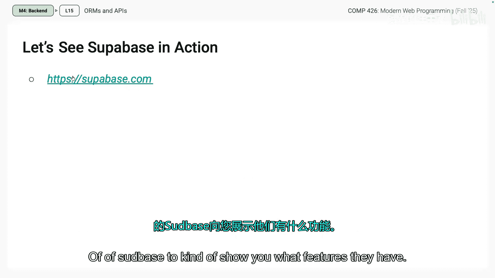
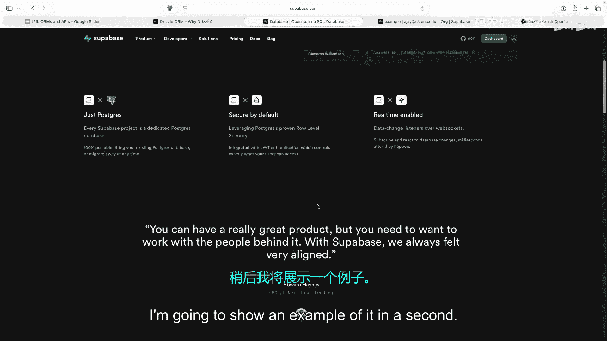

# 015：对象关系映射与应用程序编程接口

在本节课中，我们将要学习如何让我们的Web应用程序与数据库安全、高效地交互。我们将介绍两个核心概念：**对象关系映射**和**应用程序编程接口**，并了解它们如何共同构成现代Web应用的三层架构。

## 课程概述

上一节我们介绍了数据库和CRUD操作。本节中我们来看看如何在实际的TypeScript项目中与数据库交互，并解决由此带来的安全问题。

## 对象关系映射


直接使用SQL字符串与数据库交互存在一些问题。SQL脚本是纯文本字符串，这意味着我们失去了TypeScript的类型检查和语法提示等开发优势。此外，数据库返回的结果也是字符串格式，我们需要手动解析才能使用。

为了解决这些问题，我们引入一类称为**对象关系映射**的工具，通常简称为**ORM**。

ORM是连接我们的应用程序（如TypeScript项目）和SQL数据库的桥梁。它的核心功能是进行双向转换：
*   将我们的编程语言函数调用转换为数据库能理解的SQL语句。
*   将数据库返回的原始字符串数据转换为我们编程语言中易于使用的对象。

使用ORM后，开发者只需关注调用TypeScript函数和处理返回的TypeScript对象，中间的转换工作由ORM自动完成。

在本课程中，我们将使用一个名为 **Drizzle** 的ORM。它是一个为TypeScript生态编写的高性能、易用的ORM。使用Drizzle，与数据库的交互看起来像这样：

```typescript
// 使用Drizzle查询，而非原始SQL字符串
const result = await db.select().from(countriesTable);
// `result` 是一个类型完备的TypeScript对象数组
```

## 安全漏洞与架构演进

然而，将ORM直接用在客户端代码中会引发严重的安全问题。考虑以下流程：客户端从服务器下载包含Drizzle连接代码的JavaScript文件，其中硬编码了数据库连接URL。任何用户都可以通过浏览器开发者工具查看此URL，从而获得直接访问和操作数据库的权限。

这暴露了我们初始架构的根本缺陷：**敏感数据库凭证不应存在于客户端**。

解决方案是调整我们的应用架构。我们需要将数据库操作从客户端移动到服务器端执行。这样，数据库连接URL和凭证将只保存在受信任的服务器环境中，永远不会暴露给客户端。

## 应用程序编程接口

既然数据库操作移到了服务器，客户端就需要一种方式来请求服务器执行这些操作。这通过**应用程序编程接口**实现。

API定义了一组端点，客户端可以通过向这些端点发送HTTP请求来与服务器通信。HTTP方法直接对应了数据库的CRUD操作：
*   **GET** -> 读取数据
*   **POST** -> 创建数据
*   **PUT** -> 更新数据
*   **DELETE** -> 删除数据

以下是客户端与服务器交互的流程：
1.  客户端（前端）使用`fetch`函数向服务器API端点发送一个HTTP请求（例如，GET请求获取产品列表）。
2.  服务器（后端）收到请求，使用ORM执行相应的数据库操作（例如，查询产品表）。
3.  服务器将数据库返回的数据（通常是TypeScript对象）转换为JSON格式，并通过HTTP响应发送回客户端。
4.  客户端收到JSON数据，并在前端界面中渲染展示。

你们已经在之前的练习中多次使用过这种模式，例如获取宝可梦数据或《纽约时报》游戏数据。

## 三层架构

至此，我们形成了现代Web应用标准的**三层架构**：
1.  **前端**：运行在客户端的代码（Next.js/React），负责用户界面和交互。
2.  **后端**：运行在服务器的代码，负责处理业务逻辑、接收API请求并与数据库交互。
3.  **数据层**：数据库或其他持久化存储服务。

这种架构清晰分离了关注点，也是软件工程中不同职业方向（前端工程师、后端工程师、数据工程师）的基础。

## 后端即服务与Supabase

手动搭建和维护数据库服务器是一项复杂的工作。**后端即服务**提供商可以帮助我们管理数据平台等基础设施。

我们将使用 **Supabase** 作为我们的BaaS。它提供以下关键特性：
*   基于**PostgreSQL**的全功能关系数据库。
*   慷慨的免费额度，非常适合学习和开发。
*   集成了身份验证、文件存储、实时订阅等服务。
*   开源，避免了供应商锁定。

在Supabase控制台，你可以：
*   可视化地创建和管理数据库表。
*   查看自动生成的数据库关系图。
*   获取数据库连接URL，以便在Drizzle配置中使用。



连接Drizzle和Supabase的代码非常简单：
```typescript
import { drizzle } from 'drizzle-orm/neon-http';
const db = drizzle(process.env.DATABASE_URL!); // 从环境变量获取Supabase提供的URL
```



## 总结

本节课中我们一起学习了：
1.  **ORM**的作用是作为应用程序与数据库之间的转换层，让我们能用熟悉的编程语言方式操作数据库。
2.  直接将数据库连接置于客户端会导致**安全凭证泄露**。
3.  解决方案是采用**三层架构**，将数据库操作移至**后端**服务器。
4.  前端通过**API**发送HTTP请求来触发后端的数据库操作。
5.  使用**Supabase**这类BaaS可以简化数据库的搭建、管理和扩展。


下节课，我们将在假期后的新作业中开始编写服务器端代码，实践如何创建API端点，并使用Drizzle与Supabase数据库进行交互，构建一个功能更完整的全栈应用。