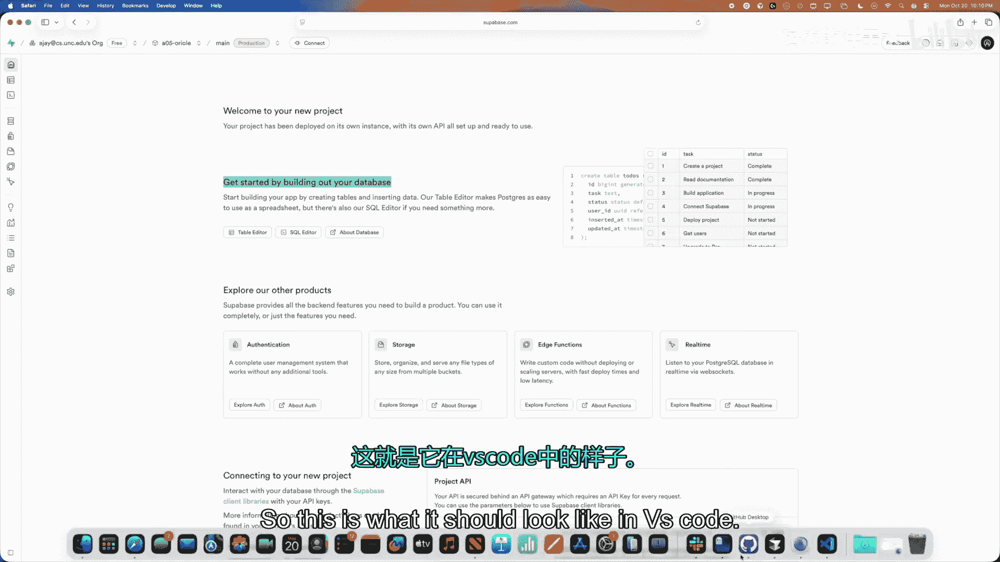
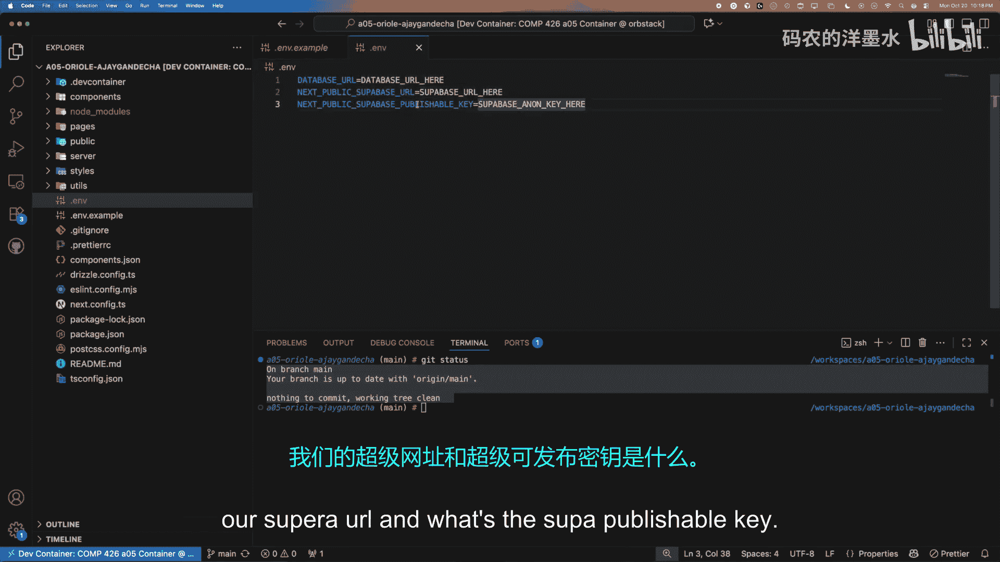
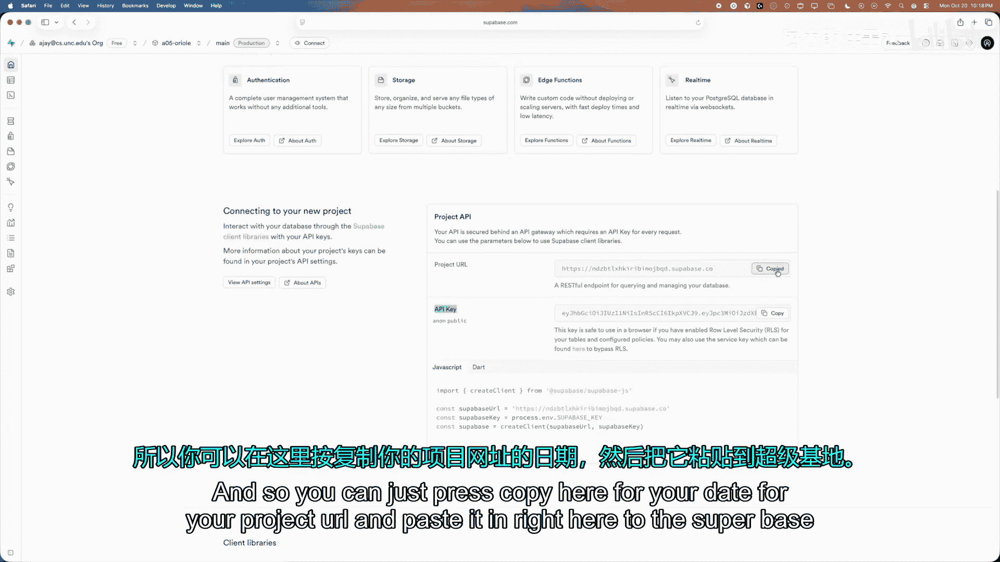
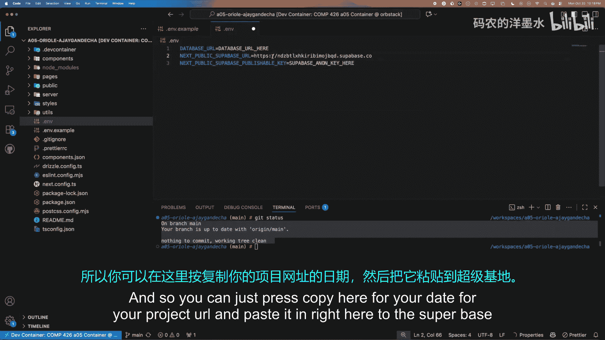
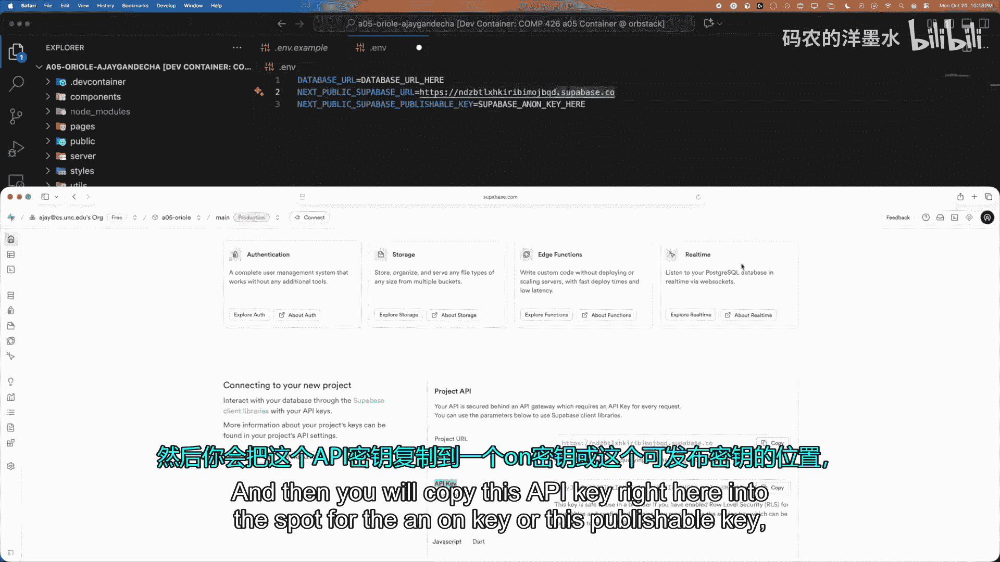
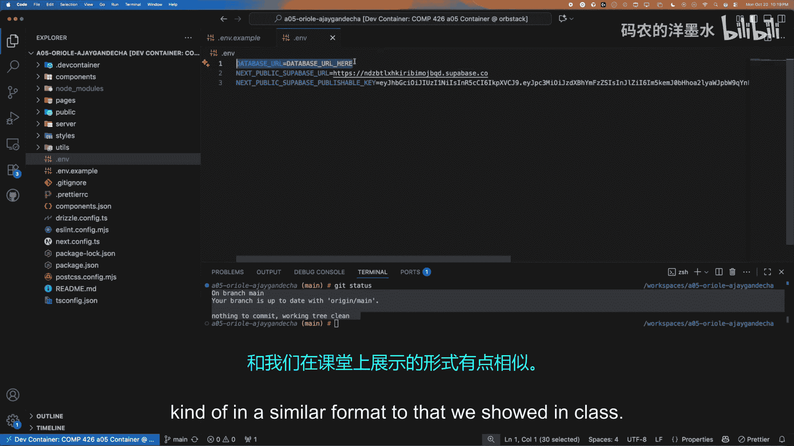
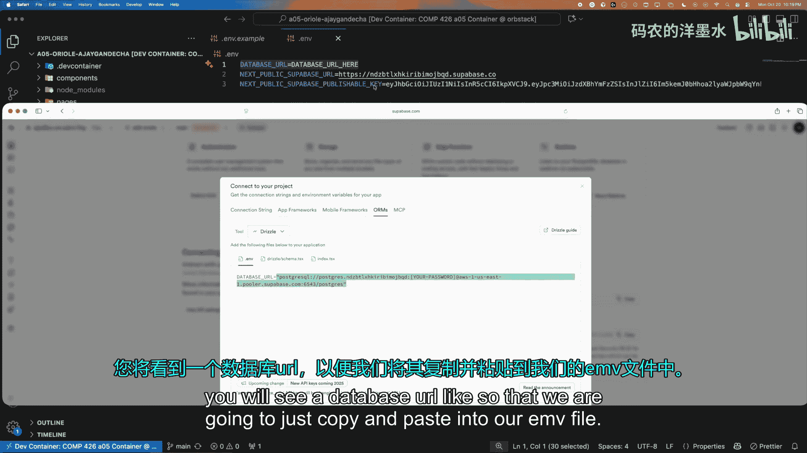
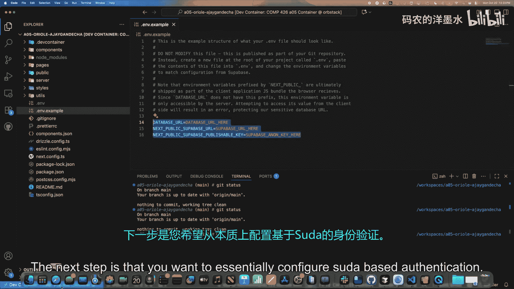
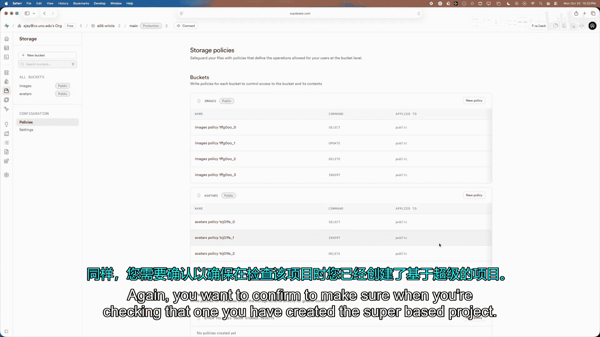
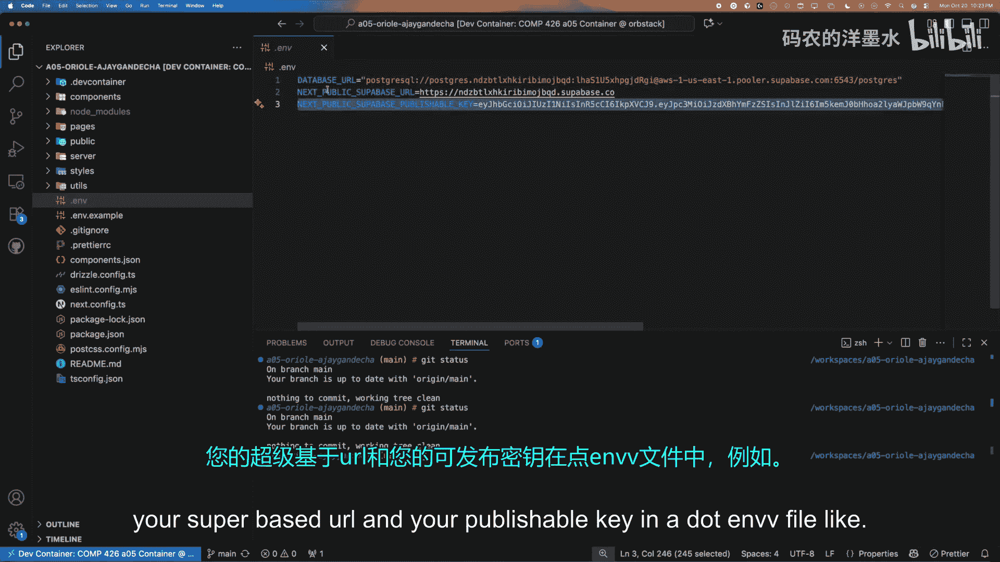

# 016：Oriole环境配置 🛠️

在本节课中，我们将学习如何为A05 Oriole项目配置Supabase环境，包括创建项目、连接数据库、设置身份验证以及配置存储桶。这是项目运行的基础。

## 创建Supabase组织与项目

首先，你需要确保已经创建了一个Supabase组织。在左上角确认你的组织已存在。创建组织是本次作业视频之前步骤的一部分。

你需要确保你的计划设置为免费层。免费层完全足够支持本课程中的所有项目，包括中等规模的项目。免费层功能非常慷慨，足以满足你未来的个人项目需求。

一旦组织配置完成，你将看到创建新项目的页面。我们将创建一个新项目来容纳数据库、身份验证和存储功能。

点击“新建项目”按钮，确保选择了你的免费组织。在项目名称中，你可以输入任何名称，例如“a05 Oriole”。

接下来，设置一个数据库密码。请务必记住、保存或记下这个密码，因为在后续步骤中会用到它，且创建后无法找回。你可以输入一个强密码，或者点击“生成密码”并使用复制按钮。

最后一步是设置你的区域。选择离你的用户最近的区域以获得最佳性能。Supabase将在该区域的服务器上启动数据库和其他功能。建议选择“Americas”默认区域，或者选择离你较近的如“North Virginia”或“East Ohio”。不推荐选择“Northern California”或其他较远的选项。

保持其他两个类别为默认设置，然后点击“创建新项目”。创建完成后，你将看到项目概览页面。

## 连接项目到Supabase

接下来，我们将本地项目连接到刚创建的Supabase项目。首先，确保你已经克隆了本作业的GitHub仓库到本地，并在VS Code中打开。

导航到名为`.env.example`的文件。这个文件展示了我们的`.env`文件应有的格式。`.env`文件用于存储数据库URL和其他重要密钥。

由于`.gitignore`文件中列出了`.env`，该文件不会被Git跟踪或推送到GitHub，这能防止密钥意外泄露，保障安全。

我们将创建一个新的`.env`文件，并将`.env.example`的内容复制进去。在终端运行`git status`可以确认此文件未被跟踪。

现在，我们需要填写三个变量：
1.  `SUPABASE_URL`
2.  `SUPABASE_ANON_KEY`
3.  `DATABASE_URL`

回到Supabase项目概览页面，复制“项目URL”并粘贴到`.env`文件的`SUPABASE_URL`变量中。它应具有`.supabase.co`扩展名。

然后，复制“API密钥”（公开密钥）并粘贴到`SUPABASE_ANON_KEY`变量中。

要获取`DATABASE_URL`，在Supabase项目页面点击“连接”按钮。选择“ORMs”标签页，在工具下拉菜单中选择“drizzle”。你将看到一个数据库连接URL。

复制此URL并粘贴到`.env`文件的`DATABASE_URL`变量中。最后，将URL中的`[YOUR-PASSWORD]`部分替换为你创建项目时设置的数据库密码。

保存文件。再次运行`git status`确认更改未被跟踪。至此，项目与Supabase的连接配置完成。

## 配置Supabase身份验证

下一步是配置Supabase身份验证。只需完成一个关键设置。

在Supabase项目侧边栏中，点击“身份验证”标签，然后进入“登录方式”页面。

你会看到“电子邮件”登录提供程序已配置。关键步骤是**取消勾选“确认电子邮件”选项**。

开启此选项会要求用户在登录前验证邮箱，增加操作复杂度。我们将其关闭以简化流程。

请务必点击“保存”按钮，使设置生效。保存后，页面会提示设置已成功更新。

## 配置Supabase存储桶

最后，我们需要配置Supabase存储桶来存储项目中的资源。我们将创建两个存储桶。

在侧边栏点击“存储”标签。目前没有任何存储桶。

我们需要创建两个存储桶：
1.  用于存储用户社交媒体帖子中的图片。
2.  用于存储用户的个人头像图片。

首先，创建名为 `images` 的存储桶。确保名称准确。勾选“公开存储桶”选项，然后点击“创建”。

接着，创建第二个名为 `avatars` 的存储桶。同样确保名称准确并设置为公开存储桶。

创建完成后，你将看到两个空的存储桶。用户上传的头像将进入 `avatars` 桶，帖子图片将进入 `images` 桶。

## 设置存储桶安全策略

最后一步是为存储桶设置安全策略。为了简化本作业的操作，我们将允许任何人进行创建、读取、更新和删除操作。在实际项目中，你需要定义更严格的安全策略。

首先，在 `images` 存储桶下，点击“创建新策略”，然后选择“完全自定义”。

你可以将策略命名为“images policy”。在权限部分，勾选“选择”、“插入”、“更新”和“删除”所有四个选项。然后点击“复查”，再点击“保存”。

此策略允许任何人对该存储桶进行完全操作。

接着，为 `avatars` 存储桶重复此过程。创建新策略，命名为“avatars policy”，勾选所有四个权限选项，然后复查并保存。

## 配置检查清单

以下是所有配置步骤的检查清单，请逐一确认：
1.  已成功创建Supabase项目。
2.  已在`.env`文件中正确配置了`DATABASE_URL`、`SUPABASE_URL`和`SUPABASE_ANON_KEY`。
3.  在身份验证设置中，已取消勾选“确认电子邮件”选项。
4.  在存储设置中，已创建 `images` 和 `avatars` 两个公开存储桶。
5.  已为两个存储桶设置了允许选择、插入、更新和删除操作的策略。

## 总结

本节课中，我们一起完成了A05 Oriole项目的Supabase环境配置。我们学习了如何创建Supabase项目、将本地项目与之连接、配置身份验证以及设置存储桶和安全策略。这些是构建Web应用的重要基础步骤。如果在配置或后续开发中遇到任何问题，请随时在办公时间寻求帮助。祝你顺利完成作业！