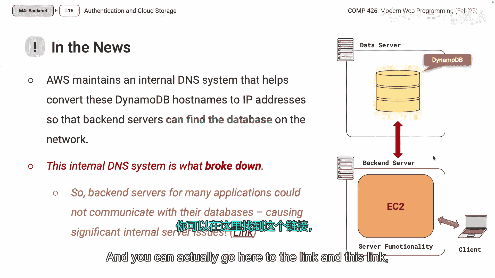
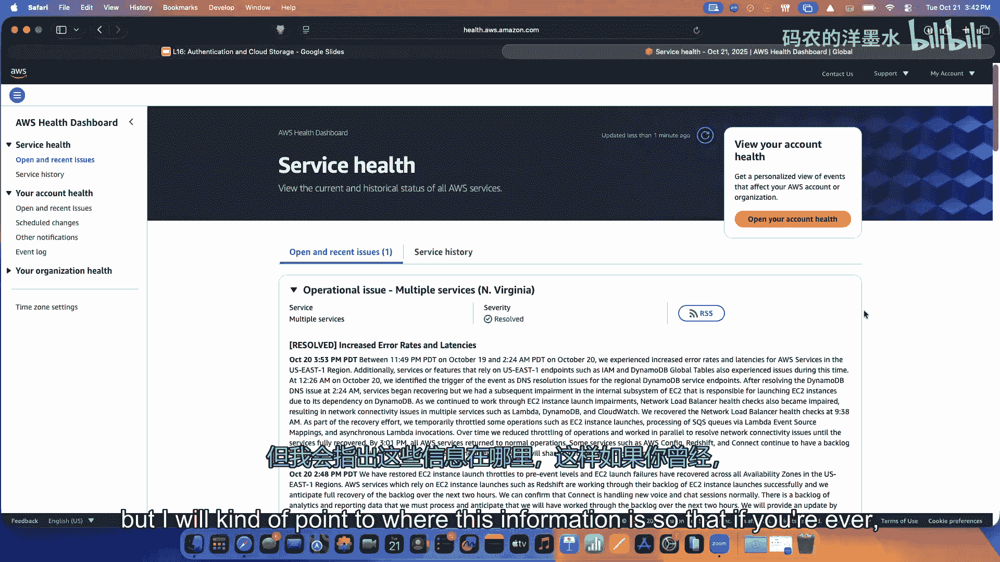
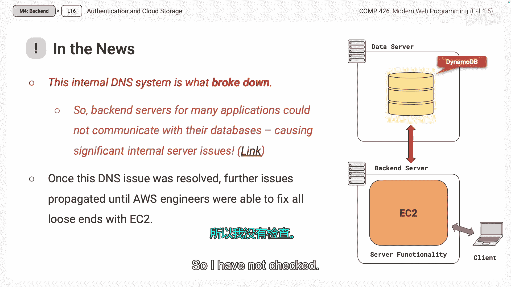
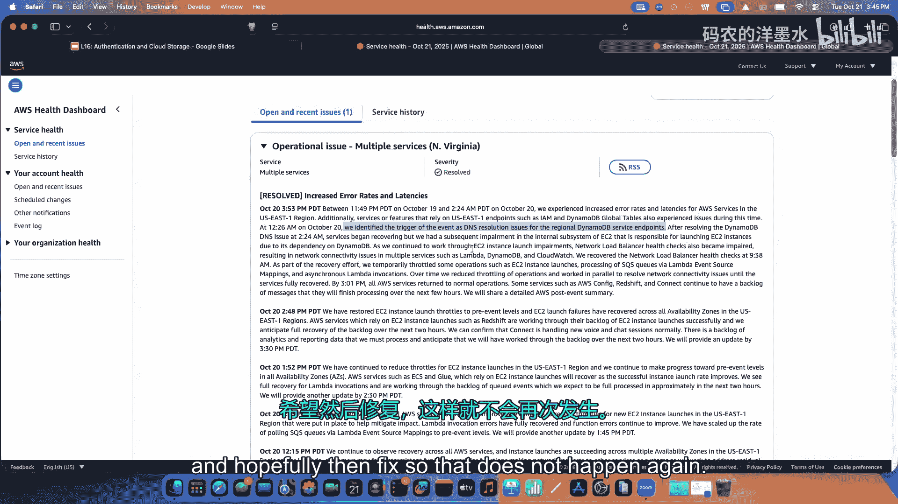
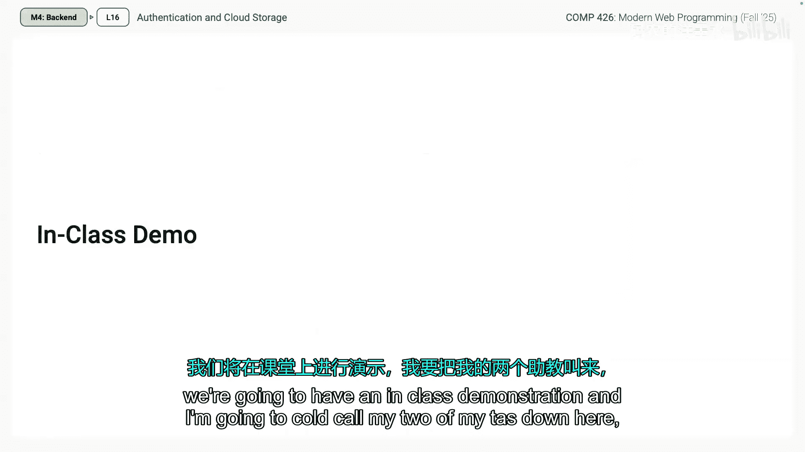

# 017：身份验证与云存储 🛡️☁️

在本节课中，我们将学习现代Web应用中的两个核心概念：身份验证与云存储。我们将探讨如何安全地识别用户身份，以及如何利用云服务提供商来高效地存储和管理数据。课程将从一次真实的大规模服务中断事件开始，分析其背后的技术原理，然后深入讲解两种主要的身份验证方法，并介绍如何使用Superbase这样的后端即服务平台。

## 课程概述与公告 📢

大家好，欢迎回到现代Web编程的第16讲。希望大家都度过了一个愉快的秋假。我们将继续构建应用程序后端所需的工具集。

首先是一些公告。正如昨晚在Canvas上提到的，下一个作业A05“Oriole”已经发布。该作业将于10月底截止，你将为一个社交媒体应用实现完整的后端功能。完成作业后，你将拥有一个功能齐全的社交媒体应用，包括不同的信息流、发帖、关注其他用户、点赞帖子、登录（我们今天将讨论的身份验证）以及上传图片等功能。你还将学习一种非常重要的数据加载技术——无限滚动。在像Twitter或Instagram这样的应用中，你可以一直向下滚动，数据会持续加载。在A04“Pokedex”中，你使用了分页箭头，但这次你将学习如何通过滚动实现无限加载。这是一个非常常见的数据加载技术，我们将在本次作业中探索它。

此外，UI已经预先提供，所以你无需过多担心界面设计，主要工作是实现后端功能，例如与数据库交互等。我再次强烈建议尽早开始这个作业。它规模稍大，不是因为任务清单长，而是因为要让整个应用运行起来需要编写大量代码，这比之前作业中的应用要复杂得多。为了帮助引入本作业中使用的一些新工具，有一篇简短的预读材料。这实际上是作业成绩的一部分：作业本身占95分（满分100分），预读占5分。预读的截止日期是本周五，以确保你能合理安排进度，并在此之前阅读材料。预读只有大约三个问题。所有材料都已发布在课程网站上。

另外，由于AWS服务中断，包括Canvas和Gradescope在内的许多网站在昨天都出现了故障。因此，我们将阅读作业的截止日期又延长了一天。新的截止时间是今晚。大家在前一个作业“Pokedex”中表现很好，我们已经开始批改，看起来非常不错。

## AWS中断事件分析：理论与实践的连接 ⚡

我认为昨天发生的事件与我们课堂讨论的内容高度相关，因此花几分钟时间讨论一下到底出了什么问题是一个很好的插曲。正如大家所知，昨天许多主要网站，包括亚马逊、Canvas、Venmo、Duolingo，甚至Fortnite，都因AWS（亚马逊网络服务）中断而长时间宕机。据估计，这次事件造成了巨大的经济影响，达美航空、美联航等航空公司也受到了影响。正因为如此，大家的阅读作业也获得了一天延期。

我想谈谈这背后到底发生了什么，这与我们一直在讨论的内容联系非常紧密。通过了解这些，你可以看到我们讨论的概念如何与像AWS这样的大规模生产系统相关联。

在过去的几讲中，我们一直在讨论后端服务器的概念。在我们的应用中，这是Next.js服务器功能运行的地方，也是API运行的地方。我们还有数据服务器，用于存储数据库，因为数据库是运行在网络上的某个进程。这与我们前几讲展示的三层架构图是同一类型。

AWS是一个基础设施工具，事实上，按市场份额计算，它是最大的提供商，为大规模应用提供这种基础设施。AWS负责设置、维护和管理这些服务器，许多公司都依赖AWS的基础设施来正常运行。

具体来说，亚马逊有DynamoDB服务，这是他们的数据库平台之一，为许多应用提供支持。因此，我们架构图中的数据服务器可能就是AWS DynamoDB数据库。还有EC2，这是AWS的另一个工具，用于运行API和服务器功能。你可以看到，在我们的架构图中，这两个服务分别对应数据服务器和后端服务器部分。尽管我们在本课程中使用的是不同的工具（我们使用Supabase和Postgres数据库，而不是DynamoDB；我们使用Vercel来托管功能，而不是EC2之类），但原理是类似的，架构图仍然适用。

还记得我们在前几讲中提到，所有数据库都可以通过网络访问，这使我们能够与数据库通信并执行操作。特别是，所有数据库都有某种URL。对于AWS，它可能有一个像 `dynamodb.us-east-1.amazonaws.com` 这样的主机名，这是数据库所在位置的主机。这个主机名是URL的一部分，它允许我们在网络上访问这个数据库。

同时，请记住，从学期初的第一讲我们就讨论过，所有主机名或域名，无论是 `apple.com`、`google.com`、课程网站，还是这个亚马逊AWS地址，实际上都指向某个IP地址，即某处服务器的物理地址。这就是我们跨网络和Web通信的方式：一台计算机想与另一台通信，它会基于IP地址发出请求。

如果有人还记得第一讲的内容，负责将主机名转换为IP地址的是什么？是的，DNS（域名系统）。我们在一开始讨论过，之后就没再深入。DNS负责将像 `dynamodb.us-east-1.amazonaws.com` 这样的URL转换为网络上的实际IP地址。

事实证明，亚马逊维护着他们自己的内部DNS系统，用于将这些DynamoDB URL转换为实际的IP地址，以便所有应用（如Duolingo或Canvas）的服务器功能能够找到数据库并对其执行操作，就像我们讨论的那样。

昨天出问题的正是这个DNS系统。这意味着，对于像我们提到的这类主机名，它们无法被正确转换为正确的IP地址。因此，当这些服务器尝试访问数据库时，数据库本身并没有被删除，它仍然在网络上的某个地方，但这些服务器找不到它。例如，在Canvas中，当你尝试加载公告或主页时，它会尝试从数据库中查找信息，但由于内部DNS系统返回的IP地址无效，它无法在任何地方找到数据库。最终，我们切断了数据服务器和后台服务器之间的连接，导致所有应用崩溃，因为它们无法与数据库通信。

你可以访问AWS官方状态页面查看相关信息。页面内容可能比较晦涩，但你可以看到一条关键说明：“我们已经确定了这些错误的潜在根本原因。问题似乎与DynamoDB端点的DNS解析有关。”这里的“解析”指的就是将主机名转换为IP地址。你可以看到，就是这一个环节出了问题，导致了严重的影响。我们在构建应用时常常依赖这些系统，但背后是像AWS这样的公司在管理所有基础设施。当它出现故障时，就会发生重大中断。事实上，这次中断仅限于美国东部的服务器，西海岸是正常的，但它仍然造成了整体上的巨大问题。

最终，当他们解决了这个DNS问题后，又引发了更多问题，这在开发中很常见。因此，AWS工程师花了一些时间来修复所有遗留问题，并使修复措施在所有应用中生效。这就是为什么Canvas直到昨晚才恢复在线。希望这个插曲对你们有所启发，它能很好地联系我们所讲的内容。通过学习本课程中的这些知识，当未来发生类似事件时，你或许能够理解其背后的技术含义。

## 身份验证：保护用户数据 🔐

现在，我们开始今天的主要内容。我们将扩展我们一直在研究的后端和数据库知识。

我们已经讨论了在数据库中存储数据，并且在A06作业中实践了使用ORM与数据库交互。数据库只是一个结构化的数据集合，以表、列的形式存储信息，并且表之间可以通过关系连接，这在阅读材料中已经看到，例如州与城市的关系（如加利福尼亚州与其城市）。在“Oriole”作业中也会大量出现，因为我们将有多个相互关联的数据库表。

正如我们在AWS中断事件插曲中重新提到的，这些数据库实例由某个数据服务器管理。数据库是运行在服务器上的一个进程，你可以在网络上的某个地方访问它。

再次回顾上次的内容，我们有客户端、后端和数据服务器。所有这些部分相互通信，为我们的应用提供功能。例如，如果我们想进行一些数据库更改，客户端会向服务器发出请求，服务器然后使用ORM与数据库交互，最后返回结果。我们使用API（如上节课所讲，并将在作业中看到）来管理这些数据流。

特别地，我们还提到了“后端即服务”或BaaS提供商的概念。这指的是一些公司或提供商为你管理数据服务器。许多公司不自己管理服务器和启动数据库，而是依赖其他服务来完成。这通常能加快开发速度，因为如果你是独立开发者或小团队，你无需担心所有基础设施、管理、停机、错误等问题，可以让其他服务为你处理。同时，这也更可靠，因为这些公司有专人全职负责确保这些数据库运行。当然，除非发生像AWS中断这样的意外事件。

这些提供商不仅帮助我们管理数据库，还可以帮助我们管理应用中其他非常重要的功能，例如我们今天要讨论的身份验证、文件存储，以及实时更新等更多功能。随着本模块的深入，我们会看到这些。

我们引入了Supabase作为我们将要使用的提供商。Supabase负责管理我们的数据库，我们可以使用Supabase来访问数据。Supabase非常出色，极其可靠，具有与Firebase或AWS等其他流行服务相同的许多功能。它还能很好地集成到不同的技术栈中。无论你是在TypeScript Web应用中工作，还是想创建一个使用相同数据的移动应用，都有各种工具和语言可以轻松访问你的数据。它还有一个非常慷慨的免费套餐，这对本课程很有帮助，提供无限的读写操作。唯一的限制是实际存储空间，但除非你的应用变得非常庞大，否则不会达到这个限制。

另一个优点是，由于Supabase是开源的，如果我们决定不再让Supabase管理这些，而是想运行自己的服务器，我们可以轻松复制Supabase的功能，使用自己的服务器。所以，供应商锁定在这里不是问题。

## 身份验证的必要性与方法 🔑

我们学习了在数据库中存储数据，但肯定有很多情况，我们希望特定的数据被锁定或保护，以便只有特定用户能够访问。例如，在Instagram上，理想情况下，只有用户自己才能为自己发帖，我不应该能够为你们中的任何人发帖，反之亦然。再比如银行，你肯定不希望任何人都能访问你的余额，只有你自己才能访问。因此，能够识别用户并验证该用户确实是其声称的身份非常重要。这就是身份验证的全部意义所在。

我们通过某种身份验证系统来实现这种行为。当我们谈论身份验证这个术语时，用非常简单的、你们在许多应用中熟悉的术语来说，身份验证就是用户能够登录到你的账户、创建新账户和退出登录等，以验证那就是他们自己。

当用户登录时，他们应该能够操作与他们相关的数据。然而，当他们退出登录时，他们就不应再有任何访问该数据的权限，无论是写入数据还是以任何形式访问（例如读取数据）。

用户登录时，通常需要提供用户名和密码。这是我们长期以来标准的登录方式。然而，还有更多用户身份验证的方式。你们肯定都见过“使用Google登录”按钮，只需点击一下，它就会链接你的Google账户，然后你就登录了。另外，如果你使用任何与UNC相关的网站，如Connect Carolina、CX等，你会使用UNC Onyen登录，它会将你重定向，要求你用UNC账户登录，然后将你带回应用，此时你就登录了。所有这些设置都存在。通常，我们称这些身份验证方式为“身份验证提供商”。Google可以是一个提供商，UNC也可以是一个，当然，标准的电子邮件和密码也很好用，这样你就不必连接任何外部系统。

## 会话认证 vs. 令牌认证 🔄

现在的问题是，身份验证实际上是如何工作的？在我们的应用中实现身份验证有两种主要的方法或类型：基于会话的身份验证和基于令牌的身份验证。我们将从高层次讨论这两种方法，然后通过一些示例来解释其底层工作原理。

首先是基于会话的身份验证。在这种方法中，每当用户登录时，我们都会为该用户创建一个新的会话，并将其保存到数据库中。这个“会话”指的是用户登录的时间段，就像你玩游戏时的“游戏会话”一样。这里的想法是，你的数据库需要维护一个表来跟踪会话。例如，你有一个名为“sessions”的表。每次新用户登录时，你都会为该会话创建一个新行。它有一个唯一的ID，可能还包含用户名等信息，表明是我登录了。然后，这个唯一的ID将反映我登录了这个应用。接着，这个ID会被提供给客户端浏览器，并存储在一个叫做“cookies”的地方。Cookies只是与特定网站关联的浏览器中的一个键值存储。我们只是将这个ID存储在浏览器中以备后用。

然后，每当用户执行某个操作时，发送到服务器的请求都会包含这个cookie，即会话ID。你开发的服务器和数据库将检查这个会话是否有效，是否仍然存在于数据库中。它会去数据库检查是否存在该ID的会话，确保其仍然有效，然后允许你继续操作，并可能返回一些数据等。

这种方法的主要问题，也是我们在本课程中不采用这种方法的原因，在于数据库必须存储一个会话表。这意味着，每次我们想要执行任何需要保护或只允许特定用户访问的操作时（例如检查银行余额），我们的后端都必须检查数据库，看看会话是否存在。如果存在，则允许继续；如果不存在，则抛出错误，提示不允许操作。因此，如果你有成千上万的用户同时尝试执行所有这些操作，每次都需要检查数据库以确认会话是否有效，这可能会导致延迟问题，因为你每次都必须对数据库执行这些读取操作来检查用户是否成功登录。这在分布式数据库环境中尤其是个问题。这种方法本身并不差，很多应用都在使用，但这些是它面临的问题。

这里需要注意的关键点是，在基于会话的身份验证中，有一个数据库表随时跟踪谁已登录。每次我们想对数据库执行某种操作时，都会检查该会话是否仍然有效。

## 令牌认证（JWT）详解 🪙

另一种身份验证类型，也是我们将在本课程中实际使用的、Supabase以及像CSX（如果你用过）等网站所使用的，是基于JWT令牌的身份验证。

这里的想法是，我们不使用存储在数据库中的会话来跟踪用户是否登录，而是使用所谓的JWT令牌来实现。JWT代表JSON Web令牌。这些令牌是一种使用JSON格式在客户端和服务器之间安全共享信息的方式。

JWT令牌由三部分组成：
1.  **头部**：描述令牌的类型以及可能使用的算法等信息。
2.  **载荷**：令牌中存储的实际数据。这可能是关于用户的信息。例如，如果我以自己身份登录，我的令牌可能会说这是当前登录用户的信息。这部分数据就放在载荷中。
3.  **签名**：这是令牌中最重要的部分。签名验证了令牌没有被任何人伪造。签名由服务器在用户登录时签署，它只是验证服务器知道该用户已登录。当用户返回进行另一个请求时，服务器可以查看签名并判断：如果是我签署的，那意味着他们没问题，我已经检查过了；如果不是，则意味着他们可能伪造了签名或是无效登录，将被拒绝访问。你可以把它想象成服务器发放的通行证，当有人拿着通行证回来时，服务器会查看并确认：“这是我签发的吗？”如果是，就允许通过。

这种方法的主要区别，以及我们稍后会看到的工作原理，在于服务器最终不会存储任何关于会话的数据。没有需要查询的数据库表。一切都只使用这个令牌来完成。最终，这使得这种身份验证方式更具可扩展性，也减少了数据库的负载。你不需要成千上万个专门用于检查会话数据的数据库请求。

具体流程如下：我们的客户端会向服务器（可能是Supabase服务器）发出某种身份验证请求（例如点击登录或注册按钮）。然后，服务器将基于我这个用户生成一个令牌。这个令牌是经过密码学签名的，由服务器代码签署。这意味着服务器在验证：我看到你尝试登录，我检查了你的邮箱密码，没问题，我确认你已经通过身份验证，我会把这个签名放入令牌。然后，这个令牌将被放置在用户浏览器的cookies中。

之后，每当我们发出某个请求时（例如查询银行信息或余额），我们只需将这个令牌发送回服务器。服务器可以检查：我（服务器）是否签署了这个令牌？如果我签署了，意味着此人已正确通过身份验证。如果我没有签署，则意味着此人可能伪造了某个令牌或试图获得未经授权的访问。因此，我们不会给他们请求的数据。如果令牌是真实有效的，是由服务器创建的，我们就继续处理请求；否则，会显示错误。

## JWT签名与验证的数学原理 🧮

为了更具体地说明签名的工作原理，我们进行一个高层次的分析。JWT由三部分组成：头部、载荷和签名。服务器首先会分配一个载荷，这是存储在令牌中的实际数据，例如用户ID或用户名等用户信息，以便当我们拿回令牌时，我们知道是哪个用户在发出请求。

然后，服务器会为这个令牌生成一个签名，以验证服务器已经确认此人身份合法，并且之后我们可以仅通过查看签名来判断该用户是否真实。

服务器生成这个签名的具体方式是通过某种算法。如果你学过密码学课程，可能听说过“消息认证码”算法，有各种不同的实现方式。基本思想是，我们有一个函数，我们将消息（即载荷）传入这个函数，就会产生一个签名。这里的不同之处在于，为了确保这个签名对服务器是唯一的（即只有这个服务器能产生这个特定签名，这样其他人就无法伪造），这个算法或函数还需要传入一个密钥。这个密钥通常是一个256位的字符串，用于基于任何输入消息创建新的签名。

其思想是，每个运行身份验证的服务器都有一个与该服务器关联的不同密钥，这意味着它们都有一个独特的函数，当传入消息时，会得到一个签名输出。这样，如果我尝试在Google上登录并成功，然后拿着我的令牌试图给Apple.com用，这是行不通的，因为它们有不同的函数和不同的密钥。

最终的令牌将同时包含消息（载荷）和签名。一个非常通用的令牌可能看起来像 `{“payload”: “user_aj”, “signature”: “xyz123”}`，其中签名是基于这个载荷使用特定的密码学工具创建的。

关键在于，密钥只有服务器知道。原因在于，如果这个密钥是公开的，那么任何人都可以创建签名，任何人都可以伪造签名，这将使我们的身份验证无效。如果服务器和恶意用户共享了相同的密钥，恶意用户就可以创建完全相同的签名，从而伪装成服务器。因为密钥相同，函数 `HMAC_K` 也相同，对于相同的消息 `M`，会得到相同的签名，因此有人可以进入我们的应用并访问我们的数据。所以，密钥保密至关重要。

在后续请求中，例如我再次尝试获取银行数据时，我会将这个令牌传回服务器。现在服务器必须验证：发出此请求的人是否真的通过了身份验证？验证方式是：服务器会提取传入令牌中的消息和签名（我们称之为 `M'` 和 `S'`）。如果服务器使用相同的函数和密钥对这个新传入的消息 `M'` 再次进行计算，并且计算结果与传入的签名 `S'` 匹配，那么我们就知道服务器是签署这个令牌的一方。因为，同样地，只有服务器知道这个带有密钥 `K` 的特定函数 `HMAC`。如果所有条件都匹配，那么我们就知道用户是使用我们服务器的算法通过身份验证的。

这背后的整个思想是，我们可以使用数学来验证用户是否已登录。我们不需要查询数据库，也不需要担心管理会话。

## 总结 📝

本节课我们一起探讨了现代Web开发中的关键后端主题。我们从一次真实的AWS大规模服务中断事件入手，分析了DNS解析故障如何导致依赖其基础设施的众多应用瘫痪，这生动地展示了我们所学架构（客户端-后端服务器-数据服务器）在现实世界中的依赖性与脆弱性。

接着，我们深入讲解了身份验证的必要性，即如何安全地识别用户并保护其数据。我们比较了两种主要的身份验证方法：
*   **基于会话的身份验证**：通过在数据库表中存储会话ID来跟踪登录状态，每次请求都需查询数据库验证，简单但可能影响性能和可扩展性。
*   **基于令牌的身份验证（JWT）**：我们重点学习的方法。服务器使用密钥为登录用户生成一个包含用户信息（载荷）和密码学签名的令牌。客户端存储该令牌，并在后续请求中发回。服务器通过验证签名即可确认用户身份，无需每次查询数据库，从而更高效、可扩展。我们还简要剖析了JWT的构成（头部、载荷、签名）及其通过哈希消息认证码（HMAC）等算法进行签名验证的数学原理，理解了密钥保密的重要性。

最后，我们介绍了利用像Supabase这样的后端即服务（BaaS）提供商来简化数据库管理、身份验证、文件存储等复杂功能的开发。Supabase作为我们将要使用的工具，提供了可靠、易集成且对开发者友好的服务。

通过本课的学习，你不仅掌握了身份验证与云存储的核心概念，还看到了这些技术如何支撑起日常使用的应用，以及在出现问题时如何从技术层面进行思考。这些知识将为接下来实现“Oriole”社交应用作业中的登录、数据保护等功能打下坚实的基础。