# 018：生成式人工智能系统 🧠

在本节课中，我们将学习生成式人工智能系统的基本原理、它们在现代Web应用中的角色，以及如何安全有效地将其集成到我们的全栈应用中。

---

## 概述

生成式人工智能是近年来变得非常流行的一类后端技术。许多应用程序都在尝试以某种方式实现AI功能，例如帮助用户或提供新功能。它解锁了大量新的应用可能性，尤其是在文本处理方面。本节课我们将探讨生成式AI是什么、它如何工作、以及如何在我们的Web应用架构中集成它。

---

## 什么是生成式人工智能？

生成式人工智能是任何能够根据用户提示或输入生成新内容的系统。生成的内容可以是文本、图像，甚至视频。其核心是一个模型，它接收用户的输入（提示），并基于此生成新的内容作为输出。

**核心概念**：`输出 = 模型(输入提示)`

我们常常将生成式AI工具视为一个“黑盒”——一个神奇的工具，我们无需思考其内部运作。但这常常会强化对其实际工作原理的误解，并导致对输出的错误期望。

---

## 大型语言模型

现代生成式AI工具（如ChatGPT）使用称为**大型语言模型**的模型来生成响应。LLM是**Large Language Model**的缩写。

LLM本质上是一种算法，能够执行各种自然语言处理任务，例如识别、翻译、预测，当然还有基于给定提示生成新文本。

“大型”一词之所以被强调，是因为这些算法是在**极其庞大的数据集**上构建和训练的。这些数据集几乎包含了互联网、书籍和物理媒体上的所有文本数据。算法通过理解输入文本序列中单词和短语之间的关系来提取意义。

除了LLM，还有大型视觉模型等其他模型，用于生成图像、视频等非文本内容。

---

## 令牌：文本的基本单位

要理解LLM如何工作，首先需要理解**令牌**的概念。

令牌是这类模型使用的文本单位或块。它通常是简短的单词或具有意义的单元。例如，“hello”和“world”通常是独立的令牌。较长的单词可能会根据含义被拆分为多个令牌。标点符号也常被用作自己的令牌。

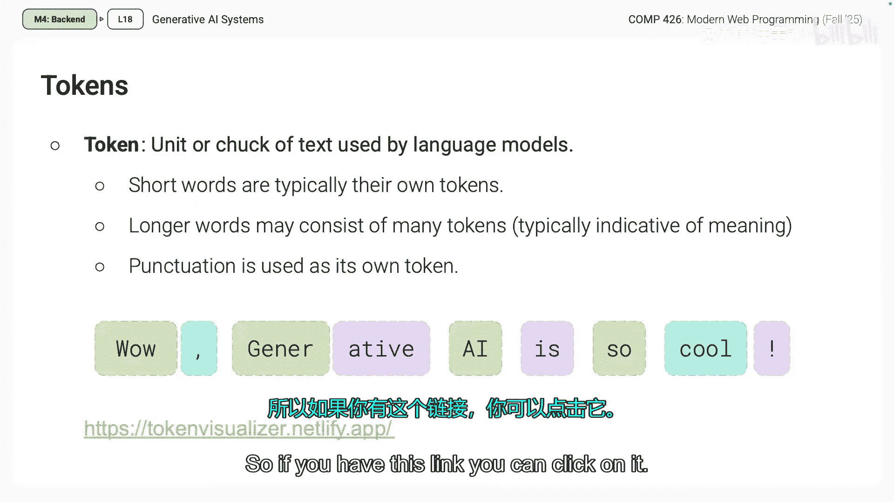

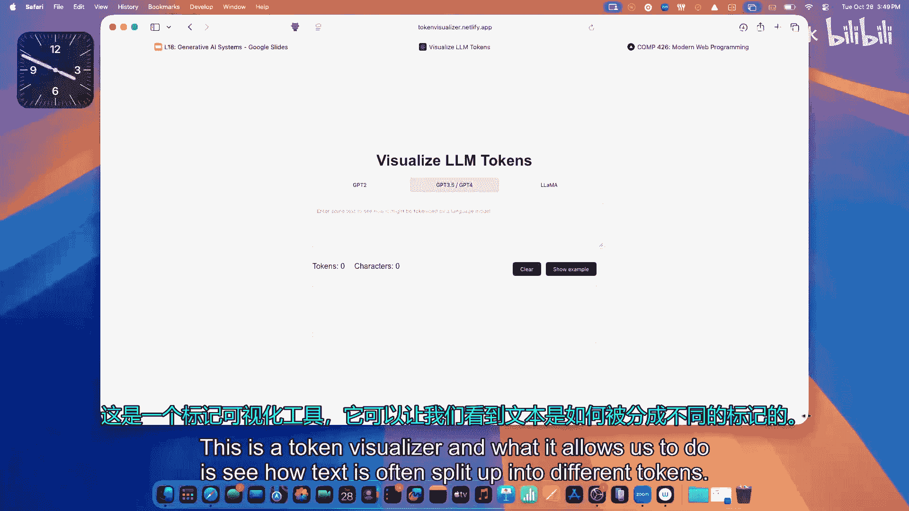

你可以使用[令牌可视化工具](https://platform.openai.com/tokenizer)来查看文本如何被拆分为令牌。例如，句子“Welcome to Comp 426”可能被拆分为9个令牌。模型提供商通常基于生成的令牌数量来计费。

---

## LLM如何生成文本？

LLM生成文本的方式是**逐令牌进行的**。其核心过程如下：

1.  模型接收一系列输入令牌。
2.  模型预测**下一个最可能出现的令牌**是什么。
3.  模型输出这个预测的令牌。

**核心过程**：
```
下一个令牌 = 模型(输入令牌序列)
```

要生成一个长响应，模型会**迭代地重复这个过程**：
*   从初始提示（一系列令牌）开始。
*   生成下一个令牌。
*   将新生成的令牌添加到输入序列中。
*   将这个更长的序列再次输入模型，生成下一个令牌。
*   重复此过程，直到模型输出一个表示结束的特殊令牌。

这就是当你在ChatGPT中输入内容时，它看起来是逐字“流式”输出的原因——它正在逐个计算和生成每个令牌。

---

## 温度与随机性

你可能会问：如果模型总是选择最可能的下一个令牌，为什么相同的提示有时会得到不同的回答？

这是因为模型有一个称为**温度**的内部参数。温度控制着输出的“创造性”或变化程度。

*   **温度 = 0**：模型几乎总是选择概率最高的令牌。输出非常确定，多次运行相同提示会得到几乎相同的结果。
*   **温度 > 0**：模型会从概率较高的一批令牌中随机选择，而不仅仅是选择最高的那个。这引入了变化，使得输出更具“创造性”，但也不那么可预测。

**注意**：较低的**温度并不等同于更高的真实性**。它只意味着输出更一致，但不一定更正确。

---

## 幻觉问题

了解了LLM逐令牌生成的工作原理后，我们可以思考一个关键问题：**这种方法的潜在缺陷是什么？**

主要问题是**错误会传播**。如果在生成的某个步骤中，模型选择了一个错误的令牌（即“幻觉”），那么这个错误的令牌会成为后续生成的新输入。这可能导致整个响应严重偏离正确的答案。

LLM通常**无法检测自己是否发生了幻觉**。它们会非常自信地输出答案，而不会像人类那样表现出不确定或自我纠正。因此，**不能盲目信任AI模型的输出**，尤其是在医疗建议、法律咨询等关键领域。

开发者必须意识到这一点，并在应用中设计相应的保障措施。

---

## 主流模型与API访问

目前有多种流行的生成式AI模型：
*   **GPT**：由OpenAI开发。
*   **Gemini**：由Google开发，通常提供良好的免费层级和定价。
*   **Claude**：由Anthropic开发，在开发者中很受欢迎，尤其在代码生成方面表现良好。

这些公司为开发者提供了**API**，允许我们将提示发送到他们的服务器，模型处理后会返回生成的响应。这类似于我们之前使用的其他Web API。

**计费方式**：通常基于使用的**令牌数量**（包括输入和输出）来计费。

**好消息**：在本课程中，得益于UNC的支持，大家将可以免费使用一定额度的OpenAI API来为期末项目中的功能提供支持。

---

## 在Web架构中集成AI

现在，我们回到经典的三层Web架构图：客户端、服务器端、数据库/存储。

问题是：**我们应该从架构中的哪一部分连接到OpenAI的API服务器？**

以下是需要考虑的选项：
1.  客户端直接连接。
2.  我们的后端服务器连接。
3.  数据库（如Supabase）连接。

正确的答案是：**我们的后端服务器**。

**原因**：与访问数据库类似，调用AI API需要一个**API密钥**（类似于密码）。如果从客户端直接调用，这个密钥会暴露给前端JavaScript代码，任何用户都可以查看并盗用它，从而滥用你的付费服务。因此，必须由受信任的后端服务器来保管密钥并负责调用AI API。

**架构流程**：
1.  用户在客户端（如浏览器）触发一个AI功能（例如，在聊天框中提问）。
2.  客户端将这个请求发送到**我们的后端服务器**。
3.  后端服务器使用其保管的API密钥，将用户的提示转发给**OpenAI的API服务器**。
4.  OpenAI处理请求并将生成的文本返回给我们的后端服务器。
5.  后端服务器再将响应返回给客户端。

**实现流式响应**：如果你想要实现像ChatGPT那样逐字显示的效果，可以在客户端和后端服务器之间建立一个**WebSocket连接**。后端在从OpenAI收到每个令牌时，就通过WebSocket实时推送给客户端。

---

## 提示工程

当我们通过服务器与AI模型通信时，我们需要构建一个**提示**发送给它。提示就是输入给模型的文本。

**提示工程**是指**编写高质量提示的艺术和科学**，目的是从模型获得可靠、结构化、符合预期的输出。许多AI应用的“商业秘密”其实就是它们精心设计的提示。

以下是编写好提示的一些技巧：

*   **将指令放在提示开头**，并使用分隔符（如`"""`或` ``` `）来区分指令和内容。
    ```
    请总结以下用三引号括起来的文本。
    """
    [这里是要总结的文本]
    """
    ```

*   **明确指定输出格式、长度和风格**。越具体越好。
    ```
    请将以下会议记录提取为JSON格式，包含“主题”、“决定”、“行动项”三个字段。行动项是一个字符串数组。
    ```

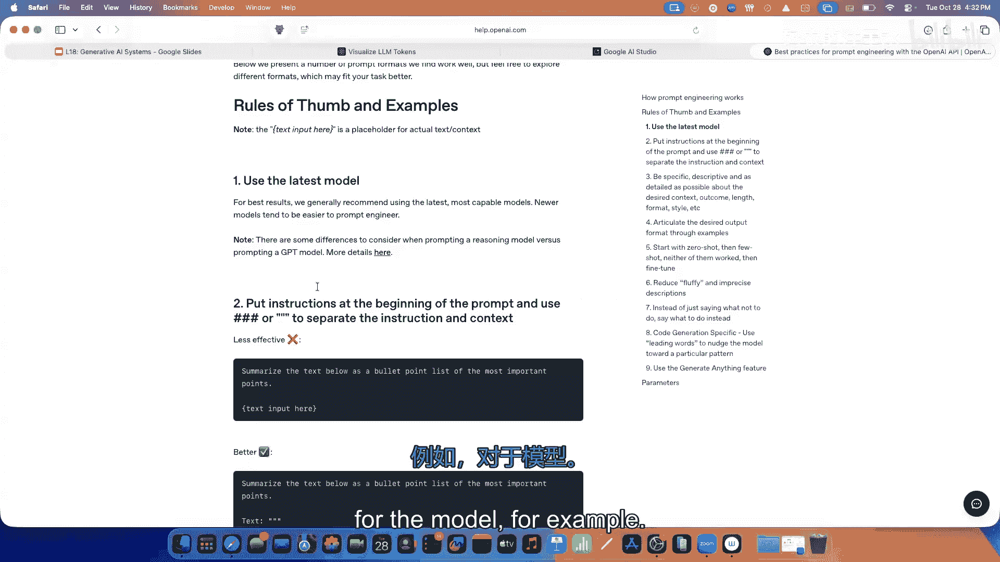

*   **减少模糊和不精确的描述**。用具体数字代替“简短”、“一些”等词。
    *   不佳：“用几句话总结。”
    *   更佳：“用3到5句话总结。”

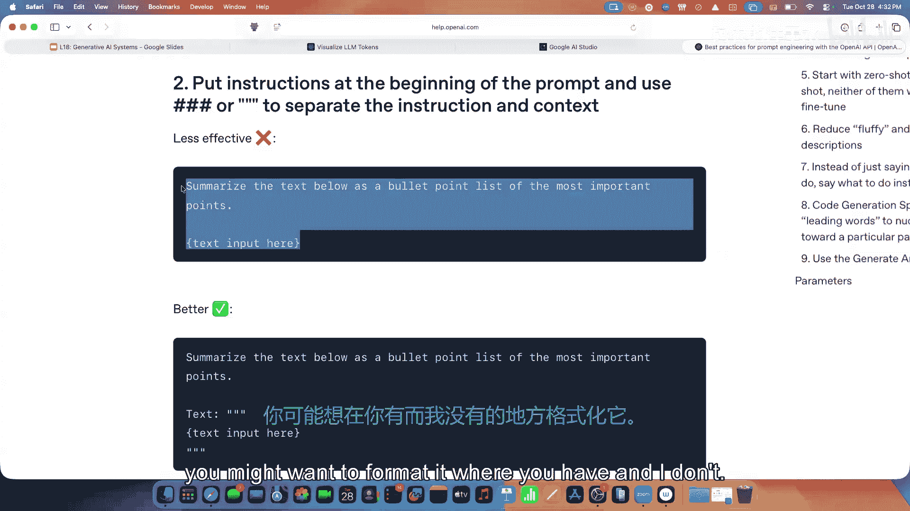

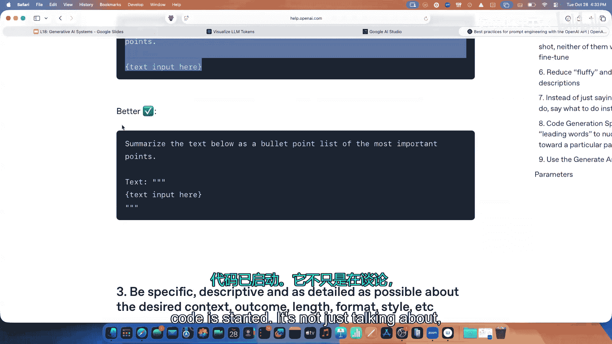

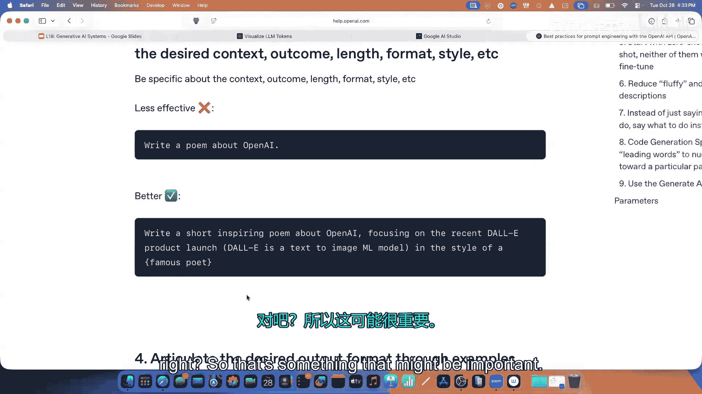

*   **使用引导词**。如果你希望输出代码，可以在提示中开始写代码，模型会倾向于继续这个模式。
    ```
    请用Python编写一个函数。`import`...
    ```

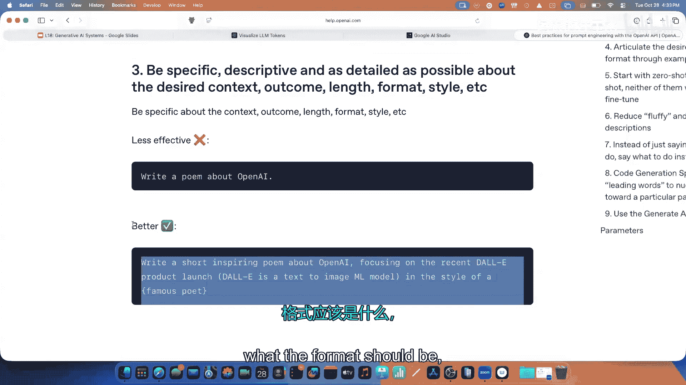

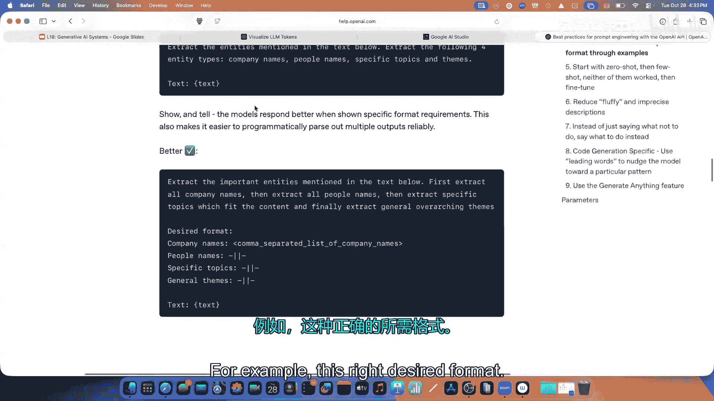

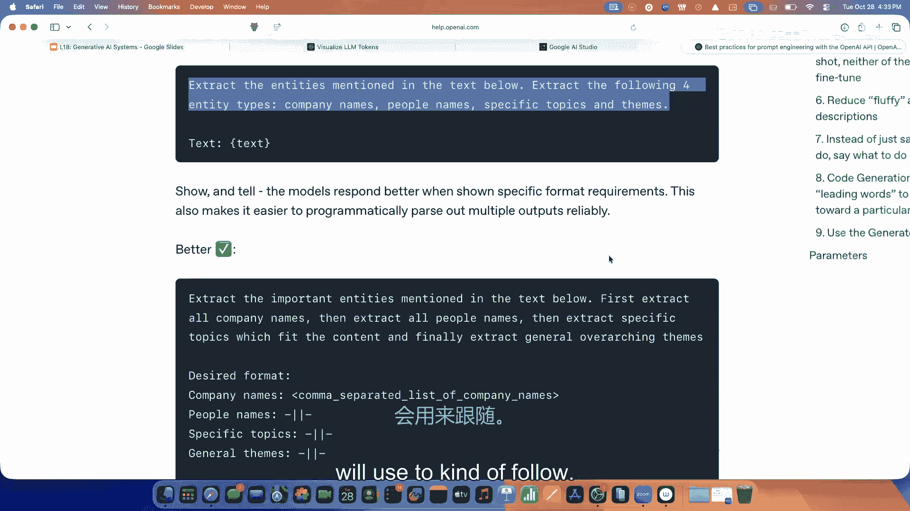

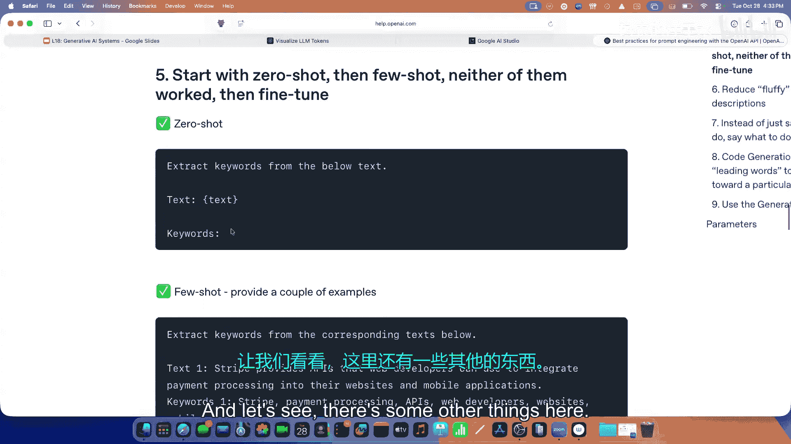

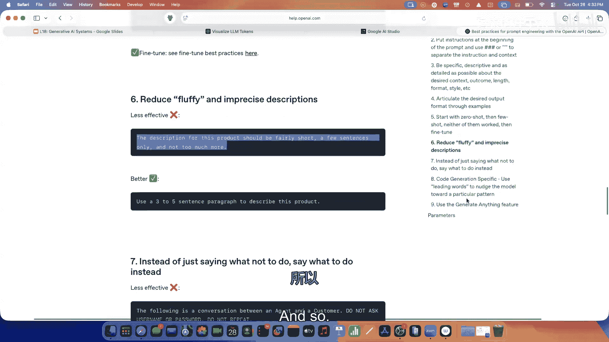

**结构化输出**：有时我们需要AI的输出是结构化的数据（如JSON对象），而不是纯文本。一些工具库（如Python的Pydantic）可以帮助我们定义输出模式，并让AI模型按照这个模式生成内容，然后直接解析成代码中的对象。

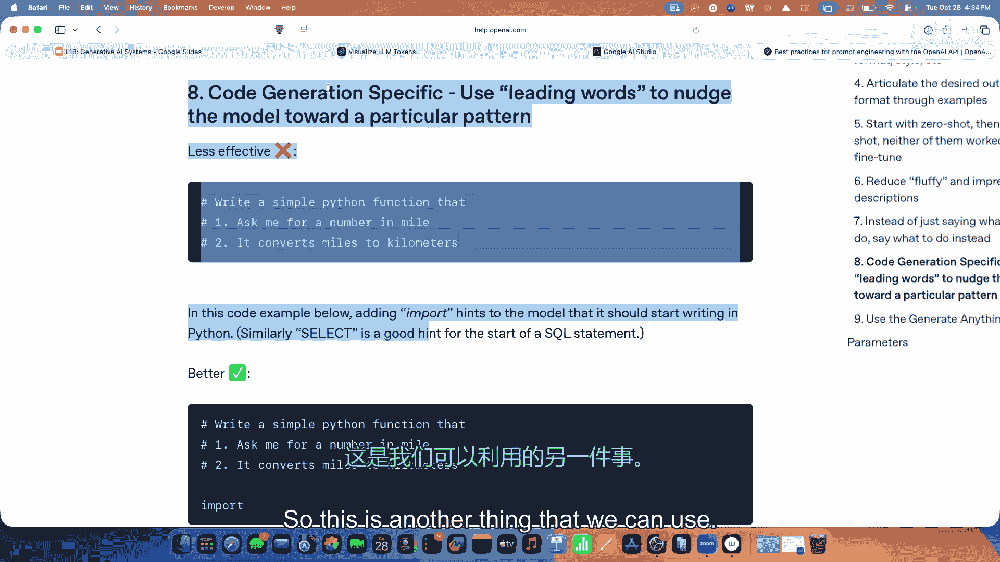

---

## 课程与项目安排

最后，我们来了解一下本课程后续的安排：

*   **期中考试**：下次课进行，占总成绩10%。无需过度紧张，已有大量练习资源。
*   **后续作业**：
    *   **A06**：一个较大的作业，将使用WebSocket等技术构建一个类似Discord/Slack的实时聊天应用。
    *   **A07**：一个较小的设计实验作业，专注于构建美观的用户界面。
*   **期末项目**：将以**4人小组**形式进行。不久后会发布组队表单，你可以选择自己的队友，或由教师根据工作风格、可用时间和项目兴趣进行匹配。项目将应用本学期学到的所有技术，包括生成式AI。

---

## 总结

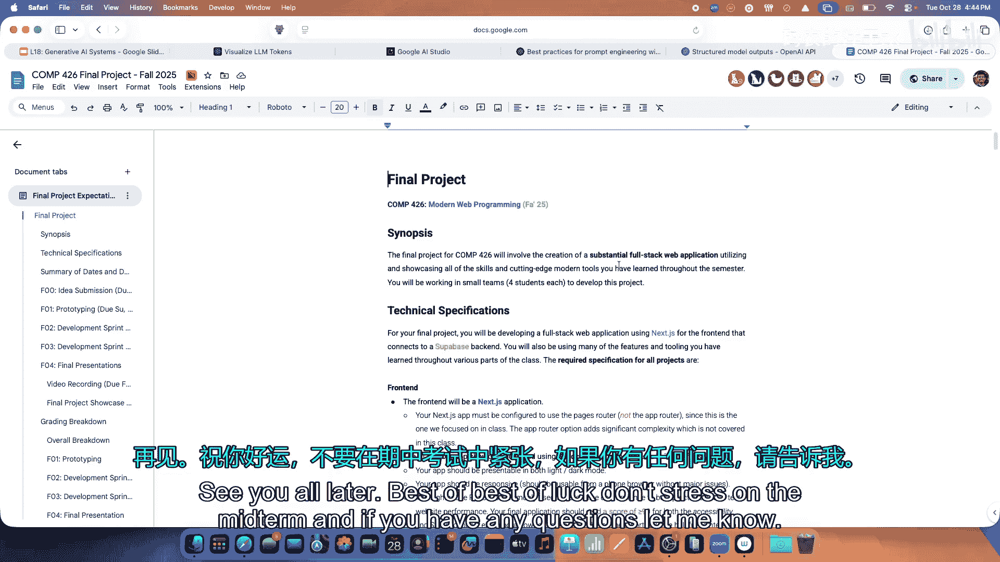

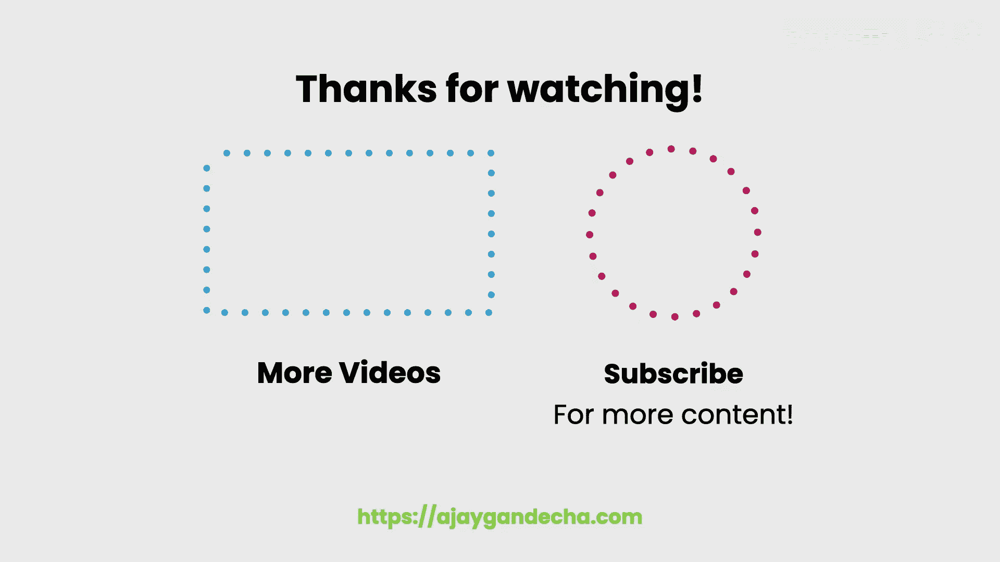

本节课我们一起学习了生成式人工智能系统的核心知识。我们了解了**大型语言模型**如何通过预测**下一个令牌**来逐字生成文本，并认识了**温度**参数和**幻觉**问题。我们探讨了如何在**三层Web架构**中安全地集成AI API（通过后端服务器），并介绍了**提示工程**的基本技巧，以获取更优质的AI输出。最后，我们预览了课程后续的安排。理解这些概念对于在现代Web应用中有效且负责任地使用AI技术至关重要。