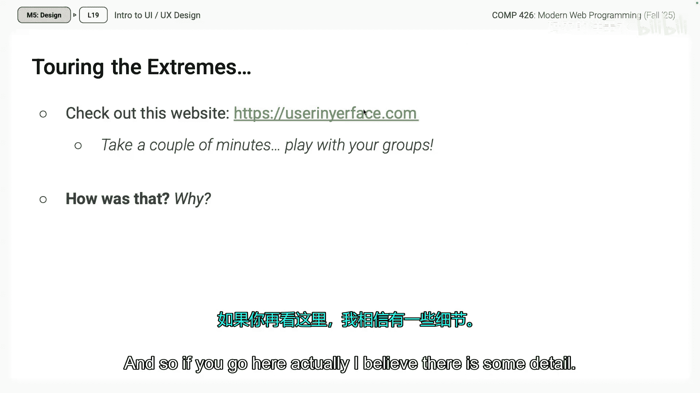
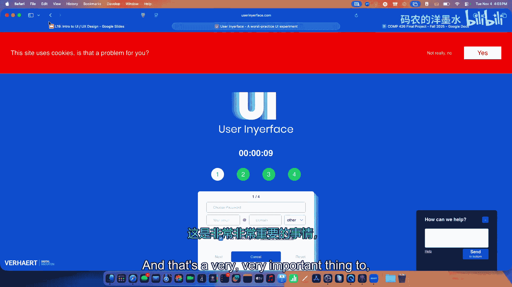
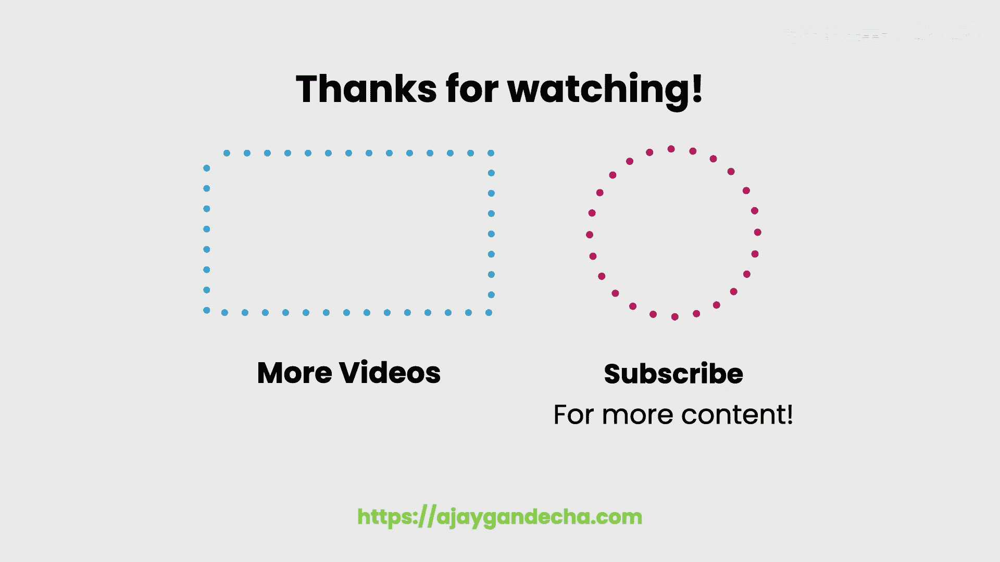

# 019：用户界面与用户体验设计入门 🎨

在本节课中，我们将要学习用户界面（UI）与用户体验（UX）设计的基础概念。我们将探讨什么是好的设计，了解设计的四大支柱，并介绍设计系统与原型设计工具，为后续的实践项目打下基础。

---

## 课程公告与项目安排

上一节我们介绍了课程的基本情况，本节中我们来看看本周的具体安排和项目时间线。

*   **期中考试**：评分工作正在进行中。补考安排好后会尽快公布成绩。
*   **课程进度**：我们还剩下三周完整的课程，共计七次讲座。
*   **作业A06**：将于11月9日（周日）截止。团队已分配完毕，API密钥将于今晚发出。
*   **课前阅读**：本次阅读是A06作业评分的一部分。阅读内容有助于理解整个代码库的上下文，并涉及如防抖（debouncing）、记忆化（memoization）和缓存等Web编程中常见的优化技术。
*   **期末项目**：
    *   **小组分配**：已最终确定，请与组员联系。
    *   **项目构思提交**：本周四晚前提交项目构思，周五上午会给出反馈意见。此部分不计分，仅用于审核项目范围与可行性。
    *   **原型设计阶段**：构思通过后，将进入原型设计阶段。这正是我们今天要开始讨论的新模块内容。
    *   **原型评审**：项目团队将有一个10-15分钟的时间段，向课程教师或助教展示原型并获取直接反馈。具体日程将于明天公布。
    *   **最终展示**：期末考试日将举行期末项目展示会，向全班同学及受邀的业界人士、教授展示成果。这取代了传统的期末考试。
*   **Superbase项目暂停**：如果收到Superbase项目因不活动而被暂停的邮件，请确保重新激活它，以免影响作业评分。

---

## 什么是好的设计？ 🤔

在深入技术细节之前，我们先来思考一个核心问题：一个应用拥有“好的设计”意味着什么？

以下是同学们提出的一些观点：
*   使用起来直观，初次使用不会感到困惑。
*   交互流畅且快速。
*   针对目标用户群体设计，易于他们使用。
*   在不同页面间保持结构和布局的一致性。

值得注意的是，在讨论“好设计”时，大家更多地提到了**可用性**和**用户体验**，而不仅仅是颜色、字体等视觉元素。

正因为“设计”一词含义广泛，我们通常将其分为两个主要类别以便更清晰地讨论：

1.  **用户界面（UI）设计**：通常更直观地与“设计”关联。关注**视觉元素**，如颜色、布局、整体美学、字体选择等。
2.  **用户体验（UX）设计**：关注如何设计和构建应用，以确保用户在使用过程中的**体验**是良好的，让人们愿意使用你构建的应用。

这两者常被合称为“UI/UX设计”，但它们是两个不同的维度。

---

## 设计的四大支柱 🏛️

我们如何评判一个设计的好坏？以下四个核心原则构成了设计的基石，我们将贯穿整个模块反复提及。

### 1. 简洁性
我们追求用户体验的简洁。这意味着页面不应杂乱，只包含目标用户实现关键功能所必需的元素。

### 2. 一致性
用户界面设计应在应用的不同页面间保持一致。同时，也应与跨应用的标准设计实践保持一致。违反一致性原则（例如，绿色按钮通常表示“前进”，但若点击后导致意外操作）会严重破坏用户体验。

### 3. 以用户为中心
应用的设计应始终围绕用户的**目标和需求**。这通常通过创建“用户故事”来实现，即从用户角度描述他们需要完成的任务。有时开发者个人觉得“很酷”的功能，可能会分散核心用户的体验。

### 4. 可访问性
设计应考虑**非传统用户**（例如，有视觉或其他障碍的用户）如何与你的应用交互。确保应用对更广泛的用户群体友好，是优秀设计的重要组成部分，也是大型应用重点关注的方向。

---

## 设计系统 🧩

为了保持一致性，现代应用开发广泛采用“设计系统”。

一个**设计系统**是一套在特定系统或应用套件中通用的UI组件、颜色、字体（排版）和布局元素的集合。

例如：
*   **iOS** 拥有其“人机界面指南”（HIG），规定了所有苹果系统应用的设计标准。
*   **Android** 使用“Material Design”设计标准，谷歌的应用和许多第三方应用都遵循此标准。

这些由大公司投入大量研究制定的设计系统，为开发者提供了经过验证的设计基础，省去了从零开始设计每个元素的麻烦。

对于**Web开发**，由于没有单一的“平台所有者”，存在多种设计系统可供选择。在本课程中，我们将使用 **Shadcn/ui**。

**Shadcn/ui** 是一个为React/Next.js应用提供的高质量、开源UI组件库。它提供了大量预构建的、易于使用的组件（如按钮、表单、日历等），并且内置了良好的可访问性支持。我们之前的作业（A05, A06）已经使用了此设计系统。后续的A07“设计实验”作业将帮助大家熟悉如何使用这些组件。

---

## 原型设计：从构思到可视化 🖍️

在开始编码之前，先进行设计规划总是有益的。这能明确项目方向，避免在编写大量代码后才发现设计问题。

原型设计通常分为两个阶段：

### 1. 低保真原型
这是设计过程的第一步，通常是**快速、粗糙的草图**，可以在纸、白板甚至餐巾纸上完成。它成本低廉，易于快速迭代和修改，非常适合初期头脑风暴。

**课堂练习**：我们进行了低保真原型练习，在纸上为“计算机科学课程笔记应用”绘制了设计草图。

### 2. 高保真原型
在低保真原型迭代出满意方案后，可以进入高保真原型阶段。这需要使用专业工具创建**更详细、更逼真的设计模型**，使其看起来非常接近最终产品。

常用的高保真原型工具是 **Figma**。它是一个免费的、行业广泛使用的设计工具。许多设计系统（包括Shadcn/ui、Material Design）都提供了Figma模板，方便设计师和开发者直接拖拽组件进行设计。

在期末项目中，你们在构思通过后，就需要创建Figma高保真原型，并以此为基础进行评审和后续开发。

---

## 总结

本节课中我们一起学习了UI/UX设计的基础知识。我们探讨了“好设计”的涵义，并明确了UI设计与UX设计的区别。我们介绍了构成优秀设计的四大支柱：**简洁性、一致性、以用户为中心和可访问性**。接着，我们了解了**设计系统**（如iOS HIG、Material Design、Shadcn/ui）如何帮助开发者快速构建一致且美观的界面。最后，我们讲解了原型设计的两阶段流程：从快速迭代的**低保真原型**（如纸面草图）到详细逼真的**高保真原型**（使用如Figma等工具），并强调了在编码前进行设计规划的重要性。这些概念将直接应用于你们的期末项目之中。