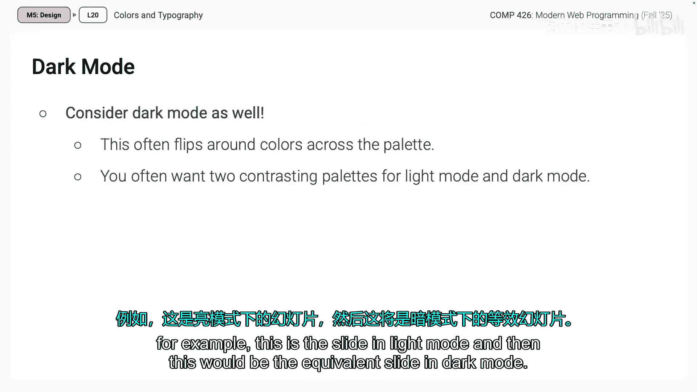
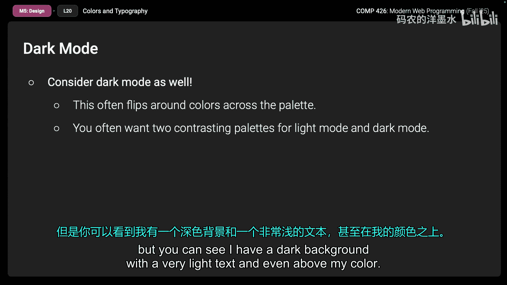
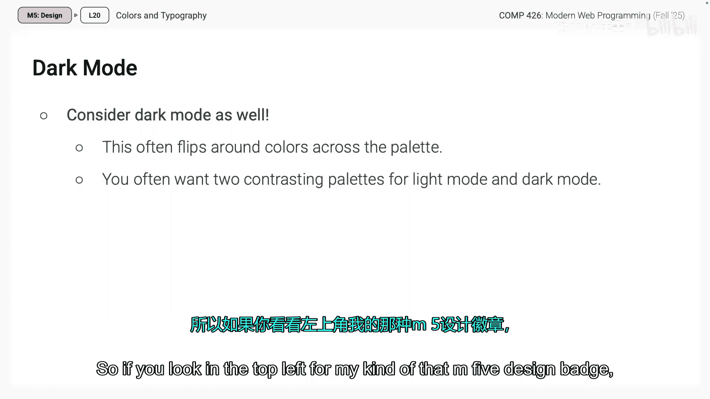
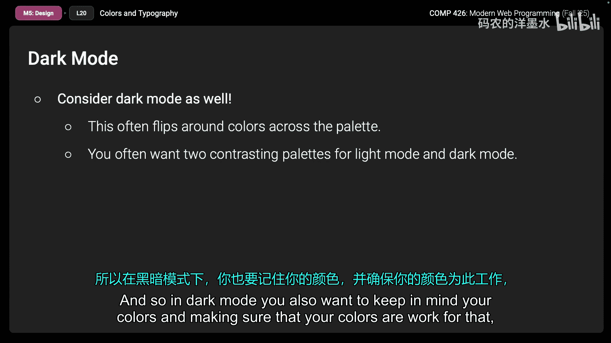
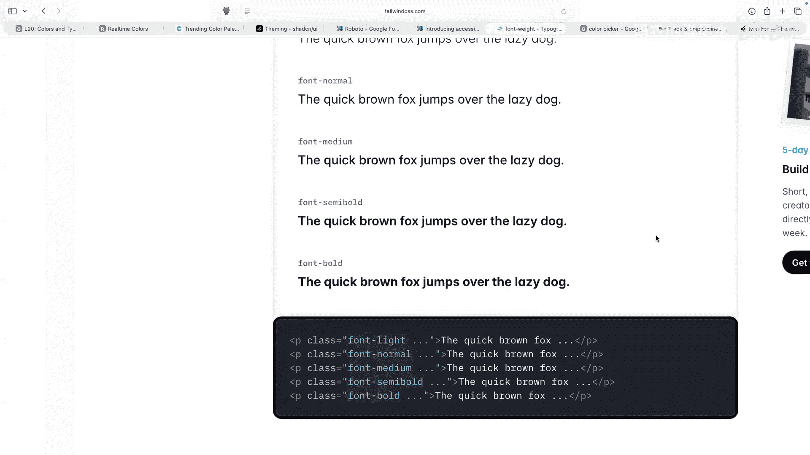
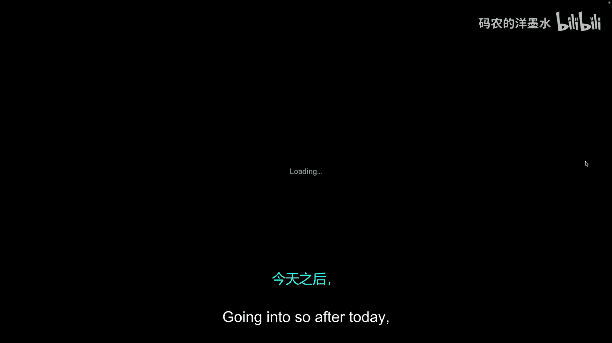
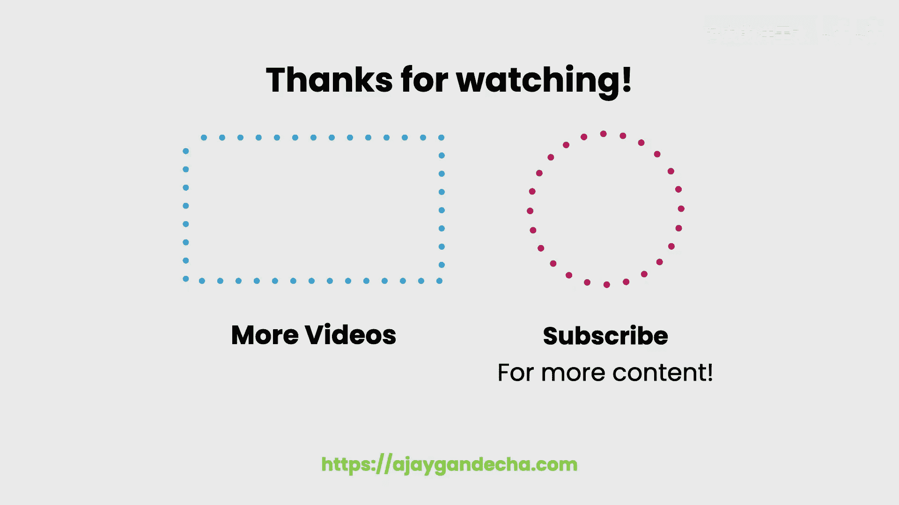

# 020：色彩与排版 🎨

在本节课中，我们将深入学习用户界面设计的两个核心要素：色彩与排版。我们将探讨色彩的基本构成、如何创建有效的配色方案，以及如何通过字体选择来提升设计的可读性和视觉层次感。

---

## 课程公告

在开始之前，我们先回顾一下重要的课程安排。

上一讲我们介绍了设计的四个核心原则。本节中，我们来看看与项目相关的具体事项。

以下是关于期末项目的关键时间节点：
*   **项目构思提交**：截止于今晚。提交后，我会审阅并提供反馈。
*   **原型设计阶段**：将于下周四截止。相关细节已在项目文档中说明，网站链接也会更新。
*   **团队可用时间收集表**：明天将发出一个表单。**每个团队只需提交一次**。请填写团队在指定周五所有可用的10分钟时间段，以便我们为所有50个团队安排原型演示会议。
*   **Alias 作业**：进展顺利。请注意今天公告中的一项说明澄清，涉及数据重新获取的正确方式。提交截止日期为本周日。
*   **考试评分**：预计明天完成最后一次补考评分后发布成绩。

---

## 回顾：设计核心原则

上一节我们介绍了设计的四个关键原则。本节中我们来看看如何将这些原则应用到具体的视觉元素中。

我们讨论过的四个原则是：
1.  **简洁性**：确保页面易于导航，内容精简，只包含满足用户需求的必要元素。
2.  **一致性**：确保应用程序的不同界面或页面在视觉和功能上保持一致，以符合用户预期并引导其行为。
3.  **以用户为中心**：围绕用户需求和期望构建应用，确保功能对用户具有实际意义。
4.  **可访问性**：确保应用对所有用户（包括有视觉、听觉等障碍的用户）都可用，这是设计中至关重要的一环。

---

## 色彩基础

色彩是UI设计中极为重要的一部分，它能极大地影响用户对网站的认知和情感联系。恰当的色彩运用可以将良好的设计提升为出色的设计。

### 色彩的构成

一个颜色由三个核心属性构成，无论使用哪种颜色选择器，你都可以调整它们。

以下是构成颜色的三个部分：
*   **色相**：定义颜色所属的家族，例如红色、蓝色、绿色。它对应色轮上的角度。
*   **饱和度**：指颜色的鲜艳或强烈程度。从高度饱和（鲜艳）到低饱和度（灰暗）变化。
*   **亮度**：指颜色的明暗程度。从非常明亮到接近黑色变化。

这三个属性共同定义了我们所看到的颜色。

### 色彩表示法

在代码中，我们需要特定的语法来表示颜色。CSS提供了多种方式。

以下是三种主要的色彩表示方法：
*   **RGB**：通过混合红、绿、蓝三种基色的量来定义颜色。每种颜色值范围是0到255。
    *   公式：`rgb(红色值, 绿色值, 蓝色值)`
*   **十六进制**：这是网页设计中最常用的表示法，本质上是RGB值的十六进制表示。它更简洁。
    *   代码：`#RRGGBB` （例如 `#3f89cc`）
*   **HSL**：这种表示法更直观，直接对应色相、饱和度和亮度。
    *   公式：`hsl(色相(0-360), 饱和度(百分比), 亮度(百分比))`

你可以使用在线工具轻松在这些表示法之间进行转换。

### 透明度

我们经常需要调整颜色的透明度，这可以通过Alpha通道来实现。

以下是为颜色添加透明度的方法：
*   **RGBA**：`rgba(红色, 绿色, 蓝色, alpha)`，alpha值范围0（完全透明）到1（完全不透明）。
*   **十六进制带Alpha**：`#RRGGBBAA`，最后两位表示Alpha值。
*   **HSLA**：`hsla(色相, 饱和度, 亮度, alpha)`。

---

## 创建配色方案

为网站选择的一组颜色称为配色方案。这通常是初学者感到困惑的地方。

### 配色方案的组成部分

一个典型的配色方案包含以下五个部分：
1.  **背景色**：页面整体的背景颜色。
2.  **文本色**：用于普通正文的颜色。
3.  **主色**：代表品牌或界面的主要颜色，最为突出。
4.  **辅助色**：与主色搭配使用，通常 prominence（突出程度）较低。
5.  **强调色**：用于非常少数的特定元素（如重要按钮），以吸引用户注意力。

### 突出层次与60-30-10法则

通过调整颜色的突出程度，我们可以在界面上建立视觉层次，引导用户的视线和操作。

例如，一个“保存更改”按钮使用鲜艳的主色，而“取消”按钮使用更灰暗的辅助色，这就建立了操作的重要性层次。删除按钮可能使用醒目的红色作为强调色，以警示其严重后果。

为了保持这种层次感，可以参考 **60-30-10法则**（灵感源自室内设计）：
*   **60%** 的区域使用主导色（如背景色）。
*   **30%** 的区域使用辅助色。
*   **10%** 的区域使用强调色。

这并非严格规定，但遵循此比例有助于创建平衡且有重点的界面。

### 实用工具与可访问性

现在有许多工具可以帮助生成和测试配色方案。

以下是两个有用的在线工具：
*   **Realtime Colors**：允许你实时预览配色方案在示例网站上的效果，并支持随机生成。
*   **Coolors**：提供海量设计师分享的调色板，可以激发灵感。

选择颜色时，**对比度**至关重要，它直接影响可读性和可访问性。可以使用 **Coolors 对比度检查器** 等工具来确保文本和背景之间有足够的对比度（WCAG标准）。避免使用像纯红配纯蓝这样对比度差且刺眼的组合。

### 深色模式与组件库

现代网站通常支持深色模式。在深色模式下，背景色和文本色通常会对调，但主色、辅助色等逻辑应保持一致。

对于使用 **Shadcn/ui** 这类组件库的项目，你可以通过修改项目中的CSS变量（通常在 `globals.css` 中）来轻松定制整个配色方案。网站如 **tweakcn.com** 提供了可视化工具来生成这些定制代码。

---

## 排版基础

排版是选择和运用字体的艺术与技术，对网站的风格和品牌辨识度有巨大影响。

### 字体分类

大多数字体可以归入以下五类：

以下是五种主要的字体分类：
*   **衬线体**：字符笔画末端有额外的装饰线（衬线），笔画粗细可能不同。常用于报纸、书籍等传统印刷品，给人以正式、经典的感觉。
*   **无衬线体**：字符笔画末端无装饰线，笔画粗细通常均匀。这是绝大多数网站正文的标准字体，因为它在屏幕上更易阅读。
*   **手写体**：模仿手写或书法风格的字体。通常不用于大量正文，因其可读性较差，但常用于Logo或营造个人化、亲切的氛围。
*   **等宽字体**：每个字符的宽度完全相同。主要用于显示代码，在IDE和技术文档中很常见。
*   **展示字体**：设计感强、非常醒目或装饰性高的字体。通常用于标题等需要吸引注意力的地方，而非正文。

### 使用Google Fonts

**Google Fonts** 是一个庞大的免费字体库，也是学习排版知识的绝佳资源。

你可以在 Google Fonts 上：
*   按分类（衬线、无衬线、等宽等）浏览字体。
*   预览字体效果。
*   获取将字体嵌入到网站所需的代码（通过 `<link>` 标签或CSS `@import`）。
*   查阅关于排版、可读性和多语言支持的丰富学习资料。

### 字体字重与层次

除了字体类型，**字重**（粗细）也是建立视觉层次的关键工具。

字重范围通常从100（最细）到900（最粗）。通过让重要内容加粗、次要内容变细，可以引导用户的阅读顺序。在CSS或Tailwind中，可以轻松应用如 `font-bold`、`font-light` 等类来设置字重。

### 使用Tailwind进行排版

Tailwind CSS 提供了全面的工具类来控制所有排版属性。

你可以使用Tailwind类来设置：
*   字体家族：`font-sans`, `font-mono`
*   字体字重：`font-light`, `font-bold`
*   字体样式：`italic`
*   字母间距：`tracking-tight`
*   行高：`leading-relaxed`

具体可参考 [Tailwind 排版文档](https://tailwindcss.com/docs/typography)。

---

## 总结与展望

本节课中我们一起学习了UI设计的两大支柱：色彩与排版。

我们探讨了：
*   色彩的HSL构成及在代码中的表示方法（RGB、十六进制、HSL）。
*   如何构建包含主色、辅助色和强调色的配色方案，并利用突出层次和60-30-10法则指导设计。
*   对比度的重要性及可访问性考量。
*   五种主要的字体分类及其适用场景。
*   如何利用Google Fonts资源库和Tailwind工具类来实践排版。

掌握这些知识后，你可以在期末项目的原型设计阶段有意识地运用色彩和排版，提升界面的美观性、可用性和品牌一致性。下节课我们将继续深入UX设计的其他方面。