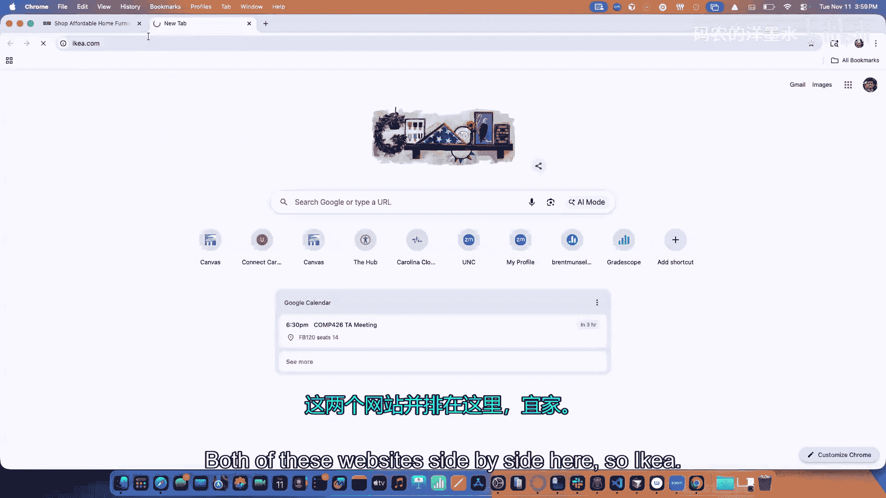
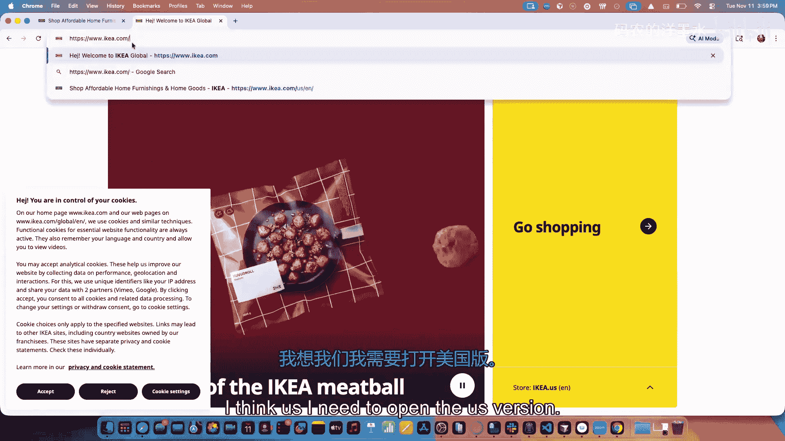
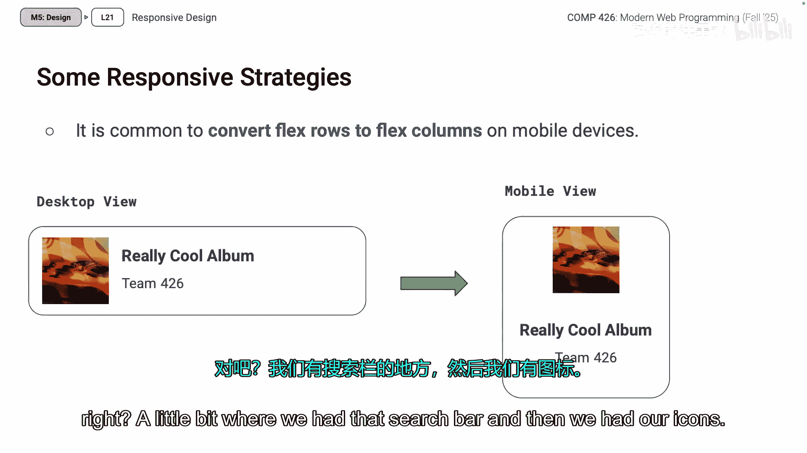
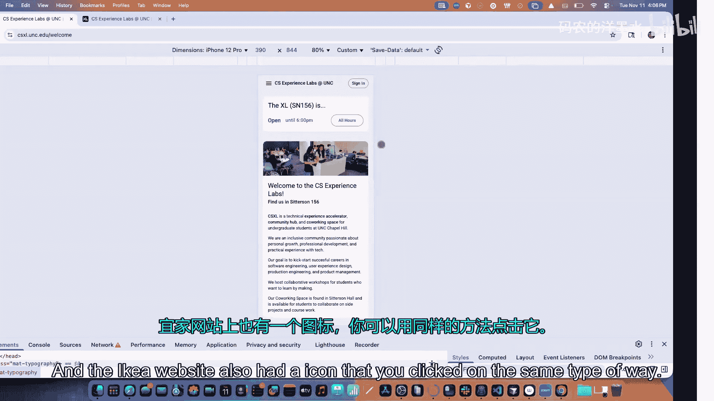
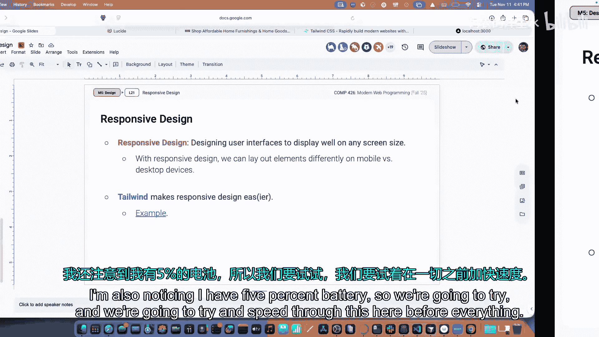
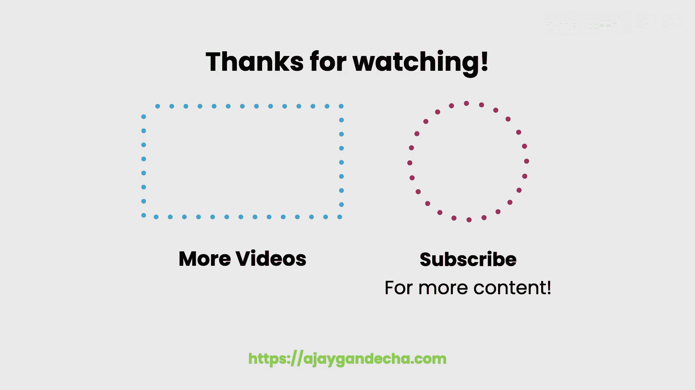

# 021：响应式设计 📱

在本节课中，我们将学习响应式设计的概念、重要性以及如何在实际项目中实现它。我们将从图标设计的基础知识开始，然后深入探讨如何让网页在不同设备和屏幕尺寸上都能提供良好的用户体验。

---

## 图标设计 🎨

上一节我们介绍了色彩和排版，本节中我们来看看图标设计。图标是应用程序中用于表示功能、操作或内容的小型图形元素。

图标具有以下优势：
*   它们可以替代文字，更高效地利用空间。
*   它们为用户操作提供直观的视觉提示。
*   它们能打破纯文本界面的单调感，增加视觉多样性。

在网页中，图标通常使用 **SVG** 格式，而非 PNG 或 JPG 等像素图像格式。SVG 代表可缩放矢量图形，其核心区别在于：
*   **像素图像**：由固定数量的像素点组成。放大时会变得模糊或出现像素块。
*   **SVG图像**：使用数学公式定义形状和路径。无论放大到何种尺寸，边缘都保持清晰锐利。

在 HTML 中，SVG 通过 `<svg>` 元素嵌入。修改 SVG 图标的颜色通常通过修改其 `stroke`（描边）或 `fill`（填充）属性来实现，类似于修改文字颜色。

在 React 项目中，有多种方式添加图标：
1.  直接复制在线找到的 SVG 代码并粘贴使用。
2.  使用图标库，如 **Lucide React**。这是一个包含数千个高质量设计图标的流行库。

以下是使用 Lucide React 图标库的示例代码：
```jsx
import { Apple, BadgeCheck } from 'lucide-react';

function MyComponent() {
  return (
    <div>
      <Apple size={48} />
      <BadgeCheck size={48} />
    </div>
  );
}
```
Shadcn/ui 等组件库通常已集成 Lucide React，你可以轻松导入并使用任何图标。

---

## 响应式设计介绍 🔄

我们之前讨论了设计的四大原则：简洁性、极简主义、一致性和以用户为中心。响应式设计与 **以用户为中心** 的原则紧密相关。

平台在这里指的是用户可能用来访问我们网站的设备类型（如台式机、手机、平板）。数据显示，超过一半的网络流量来自移动设备。这意味着用户将在更小的屏幕、竖屏布局上，使用触摸而非键鼠与我们的应用交互。

因此，**响应式设计** 的核心目标是：设计能够良好显示在任何屏幕尺寸上的用户界面，使网站能够“响应”屏幕尺寸的变化并重新调整布局。





---

## 响应式设计策略 🛠️

实现响应式设计有几种常见策略。以下是关键方法：



**1. 调整内容方向**
许多情况下，只需将水平排列（行）的内容改为垂直排列（列），就能更好地适应窄屏。这通常通过修改 CSS Flexbox 的 `flex-direction` 属性实现。



**2. 处理侧边栏**
在桌面端，侧边栏可以常驻左侧。在移动端，由于水平空间有限，通常将其隐藏在一个“汉堡菜单”图标后，点击时才以弹出层或抽屉形式显示。

**3. 堆叠多列布局**
桌面端的多列布局在移动端通常会垂直堆叠成一列，以避免水平滚动，符合用户上下滑动的习惯。同时，可以考虑将最重要的信息优先展示在顶部。

**4. 考虑不同的输入方式**
移动端使用触摸输入，这带来一些独特的挑战：
*   **手势冲突**：例如，拖拽操作和滚动操作都依赖于“点击并拖动”，容易产生冲突。在移动端设计时可能需要寻找替代交互方式（如使用按钮排序）。
*   **屏幕键盘**：虚拟键盘弹出时会遮挡部分内容。需要确保输入框和关键信息在键盘弹出时仍处于可见区域。

---

## 实现响应式设计：Tailwind CSS 断点 ⚙️

我们讨论了设计策略，本节中我们来看看如何用代码实现。Tailwind CSS 提供了便捷的工具来实现响应式设计，其核心是 **移动优先** 的断点系统。

移动优先意味着：你编写的默认样式是针对最小屏幕（移动设备）的。然后，你可以使用断点前缀来为更大的屏幕添加覆盖样式。

Tailwind 的常用断点前缀有：
*   `sm`: 小屏幕 (≥640px)
*   `md`: 中等屏幕 (≥768px)
*   `lg`: 大屏幕 (≥1024px)
*   `xl`: 超大屏幕 (≥1280px)

**语法示例**：`<div className="flex flex-col md:flex-row">`
这个 `div` 在默认情况（移动端）下是垂直排列的列 (`flex-col`)，在中等及以上屏幕尺寸时，会变为水平排列的行 (`flex-row`)。

另一个实用工具是 `flex-wrap`。它允许 Flex 容器中的项目在空间不足时自动换行到下一行，非常适合用于创建自适应的卡片网格布局。

---



## 总结 📝

本节课中我们一起学习了响应式网页设计的关键知识。我们首先了解了 SVG 图标相对于像素图像的优势及其使用方法。然后，我们深入探讨了响应式设计的重要性，它要求我们为各种设备和屏幕尺寸（尤其是移动设备）优化用户体验。我们学习了几种核心的响应式布局策略，例如调整方向、处理侧边栏和堆叠列。最后，我们介绍了如何使用 Tailwind CSS 的移动优先断点系统，通过简单的类名前缀来实际编写响应式样式。



掌握响应式设计对于创建现代、包容且用户友好的 Web 应用程序至关重要。