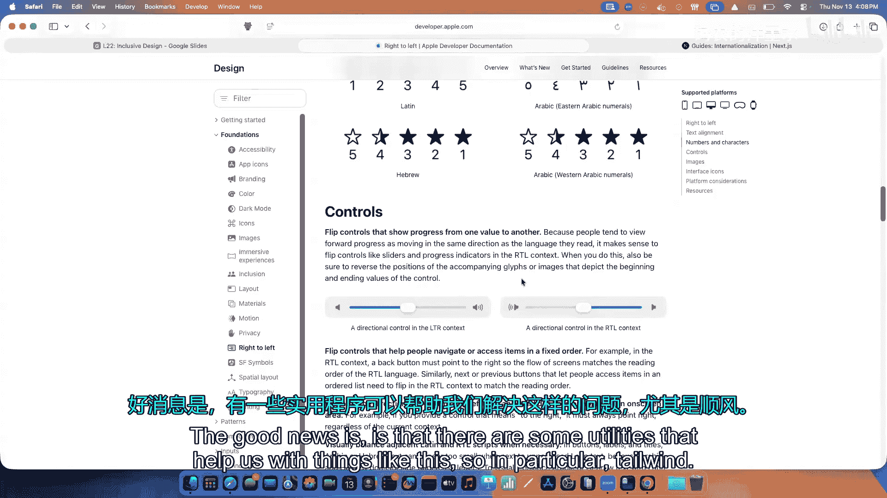
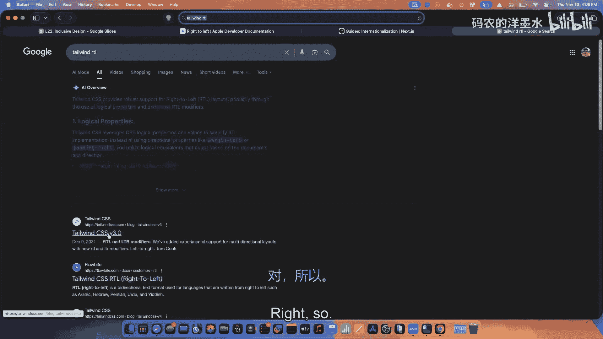
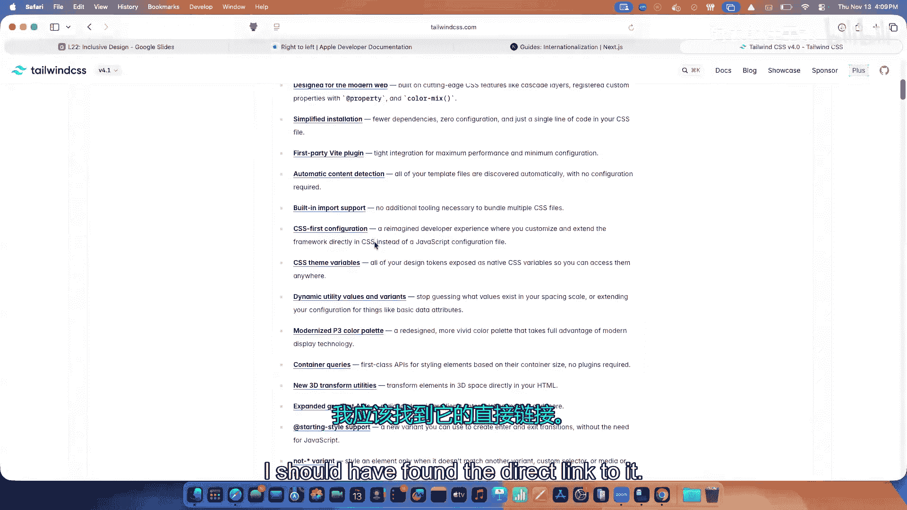
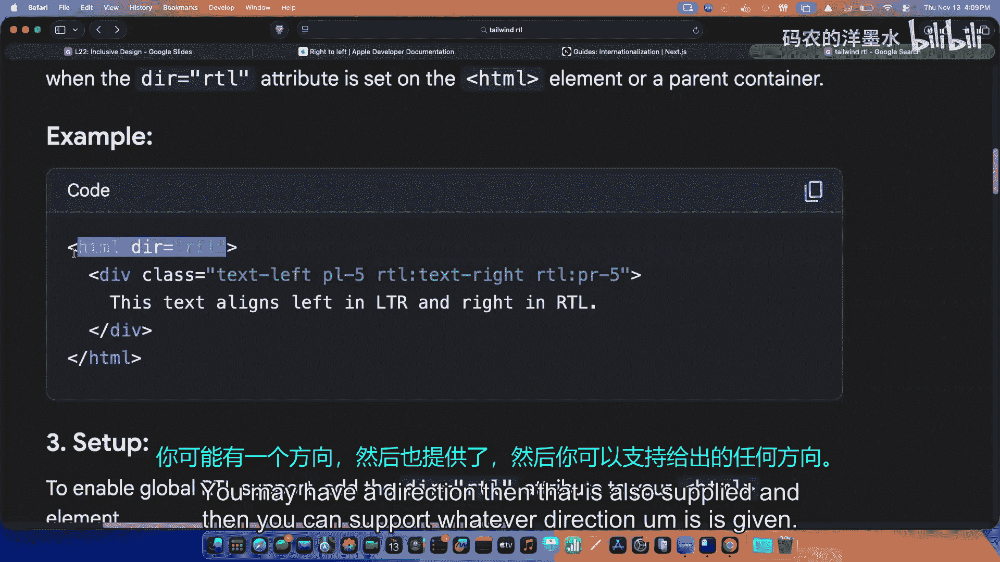
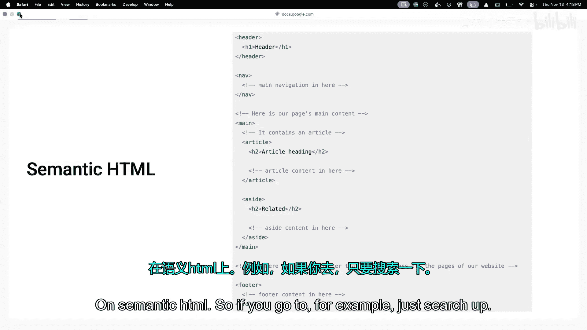
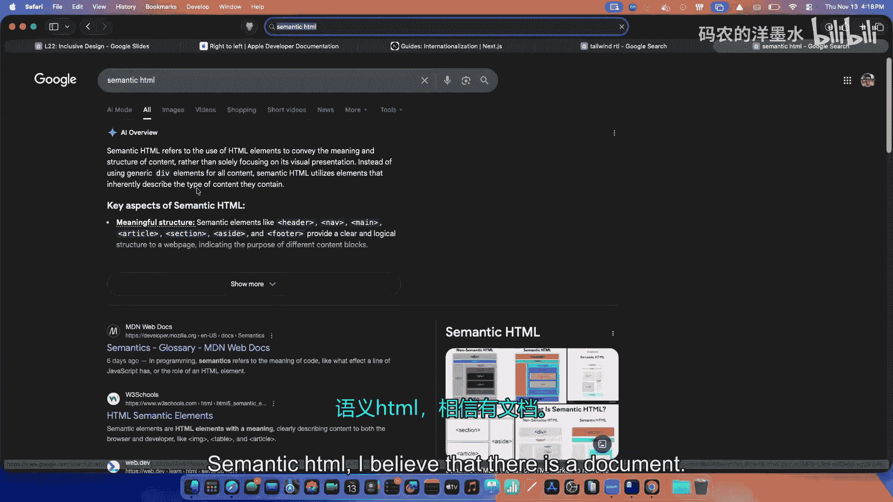
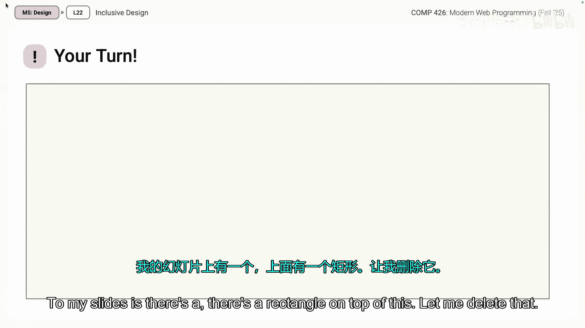
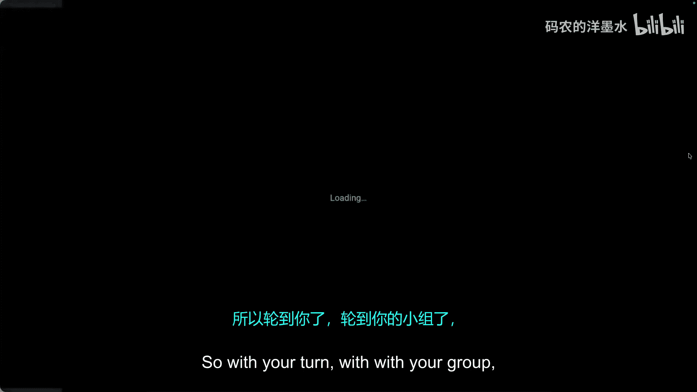
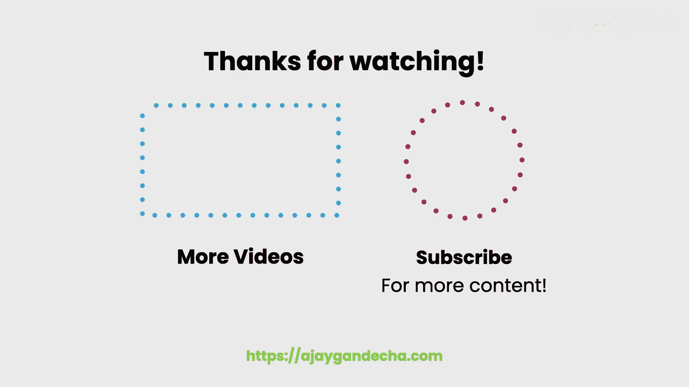

# 022：包容性设计 🎯

在本节课中，我们将学习包容性设计的两个核心概念：**国际化/本地化**和**可访问性**。我们将探讨如何让网站能被全球不同语言和地区的用户访问，以及如何确保残障人士也能顺畅地使用我们的应用。

---

## 课程公告与信息

首先，我们来看一下本周的重要事项。

原型提交截止于今晚。最终项目的演示时间表已发布在Canvas和项目文档中，请确认你的演示时间和地点（C Hall的X走廊）。请确保演示时至少有一台已准备好演示文档且带有HDMI接口的电脑，以便快速开始。

A7设计实验作业将于周日截止。这是最后一个编程作业，部分同学已开始提交。

最终项目的下一个阶段——第一个开发冲刺——将于周五开始，持续到假期前的周二。这是一个进度检查点，我们需要看到你在五个功能中的至少三个上取得了良好进展。详细的评分标准已在项目文档中列出。请注意，学期末的最终提交将根据所有功能的完成度进行评分（占65分），而本次冲刺主要是一个15分的进度检查。

---

## 部门新项目介绍 👥

接下来，计算机科学系职业服务团队的Katie将介绍一个新的导师项目。

这个项目计划在下学期启动，旨在将低年级的计算机科学学生（学员）与高年级学生（导师）联系起来。作为导师，你将成为学员的资源，帮助他们适应专业和大学生活。系里将在学期内组织活动，包括有食物和校友分享的启动会。这是一个很好的机会，可以回馈CS社区，帮助后来的同学。

如果你有兴趣成为导师，请扫描幻灯片上的二维码或点击稍后提供的链接提交你的邮箱。项目团队会通过邮件与你联系，告知更多细节和申请开放时间。

---

## 国际化与本地化 🌍

现在，我们进入今天的核心内容。首先讨论**国际化**，即让应用适应不同语言和地区的过程。

### 为什么需要国际化？

目前，教室里的大多数人都能理解英语，我们的课程和作业也使用英语。然而，全球只有大约20%的人口能理解英语。如果你的网站只提供英文内容，那么对世界上80%的人来说，它将难以理解，从而失去了大量的全球受众。

此外，网站内容也可能因此产生地域性偏差。例如，一个英文食谱网站，其用户和上传的食谱可能主要来自英语国家，而世界其他地区的独特食谱则无法被分享和发现。

虽然浏览器实时翻译工具在进步，但它们仍存在诸多问题，例如专有名词或人名的错误翻译。同时，仅针对一种语言的网站在其他语言地区的搜索引擎优化（SEO）表现会很差。

### 什么是国际化（i18n）与本地化？

使应用适应不同语言和地理区域的过程称为**本地化**。在软件工程领域，更常用的术语是**国际化**，常缩写为 **i18n**（“internationalization”中首字母“i”和尾字母“n”之间有18个字母）。

要实现应用的国际化，需要考虑几个关键方面：
*   **语言翻译**：将界面文本转换为目标语言。
*   **用户界面考量**：布局可能因地区而异（例如，从右到左的阅读顺序）。

### 理解“区域设置”

**区域设置** 是一组定义用户所在地区或使用语言的参数。它通常包含语言和国家/地区信息，例如：
*   `en-US`：英语，美国
*   `en-GB`：英语，英国
*   `de-DE`：德语，德国

当用户向服务器请求资源时，区域设置信息会随请求一同发送。这样，服务器在生成页面内容时，就可以根据用户区域来定制输出。

### 如何实现国际化？

实现国际化的核心是创建**区域设置文件**。这些文件本质上是键值对，将项目中的所有文本字符串映射到一个唯一的键上。

例如，我们有一个表示问候语的字符串。我们会为它创建一个键，比如 `greeting`，然后在不同的区域设置文件中提供对应的翻译：

**英文区域文件 (`en/common.json`)**:
```json
{
  "greeting": "Hello, world!"
}
```

**中文区域文件 (`zh/common.json`)**:
```json
{
  "greeting": "你好，世界！"
}
```

在代码中，我们不再直接写入硬编码的字符串，而是使用国际化工具函数，通过键来获取对应语言的文本。在Next.js中，可以使用 `useTranslation` 这样的钩子：

```jsx
// 在React组件中
import { useTranslation } from 'next-i18next';

function MyComponent() {
  const { t } = useTranslation('common'); // ‘common’是区域设置文件名
  return <h1>{t('greeting')}</h1>; // 根据用户区域显示对应文本
}
```

当美国用户访问时，会看到“Hello, world!”；而中国用户则会看到“你好，世界！”。这一切都得益于请求中附带的区域设置信息。

对于Next.js项目，可以使用 `next-i18next` 这类包来简化流程。它能很好地与服务器端渲染（SSR）配合，确保翻译后的文本在服务器端就已生成，有利于SEO和性能。

### 从右到左的文本方向

国际化不仅涉及文字翻译，还包括用户界面布局的调整。一个重要考量是**文本方向**。







英语等大多数语言从左向右书写，但阿拉伯语、希伯来语等语言则是从右向左。这会对UI设计产生重大影响。



请思考：文本方向的变化会影响用户界面的哪些方面？

---

## 文本方向对UI设计的影响 ↔️

文本方向从右到左会彻底改变用户界面的布局逻辑。

*   **整体布局与对齐**：在从左到右的布局中，元素通常左对齐。在从右到左的布局中，为了符合用户的阅读视线流，所有内容应对齐到右侧。
*   **导航与操作**：例如，“购买”按钮在从左到右的布局中常位于右侧，但在从右到左的布局中应移至左侧，以遵循“行动召唤”元素在阅读流末端的惯例。
*   **进度与控件**：音量滑块、星级评分等交互控件方向需要反转。例如，音量最小值在左、最大值在右的布局，在从右到左的界面中应变为最小值在右、最大值在左。
*   **图标与符号**：某些具有方向性的图标（如返回箭头、电池图标）需要制作镜像版本。但通用符号（如对勾、公司Logo）不应翻转。

幸运的是，现代开发工具提供了支持。例如，Tailwind CSS 提供了 `rtl:` 修饰符来处理从右到左的布局。在Web开发中，可以通过HTML的 `dir` 属性或从请求中获取方向信息，来应用相应的样式。

---

## 可访问性 ♿

包容性设计的另一个核心支柱是**可访问性**，即确保所有用户，包括有感官或运动障碍的用户，都能使用我们的网站。

许多用户可能患有视力障碍（如色盲、失明）、听力损失或运动控制障碍（难以使用鼠标）。我们需要确保这些用户也能访问我们的站点。





### 辅助工具与语义化HTML

有视觉障碍的用户常使用**屏幕阅读器**等辅助工具。屏幕阅读器需要理解页面的结构和内容层次，才能有效地向用户朗读。

为了帮助屏幕阅读器，我们应该使用**语义化HTML**。这意味着使用具有明确含义的HTML标签，而不仅仅是通用的 `<div>` 和 `<span>`。

例如，考虑一个典型的网页结构：
*   使用 `<header>` 标签包裹页头内容，而不是 `<div id=”header”>`。
*   使用 `<nav>` 标签包裹导航栏。
*   使用 `<main>` 标签包裹页面主体内容。
*   使用 `<article>` 标签包裹独立文章内容。
*   使用 `<aside>` 标签包裹侧边栏或相关内容。
*   使用 `<footer>` 标签包裹页脚内容。

虽然用一堆 `<div>` 也能实现相同的视觉效果，但语义化标签为屏幕阅读器提供了至关重要的结构信息，使其能够识别并导航到页面的不同部分。

### Alt文本与ARIA属性

对于非文本内容，如**图片**，我们需要提供替代文本（`alt` 属性）。屏幕阅读器会朗读 `alt` 文本，向用户描述图片内容。这对于信息性图片至关重要，同时也有助于SEO。

```html

```

对于更复杂的交互组件，可以使用 **ARIA** 属性来提供额外的可访问性信息。ARIA（无障碍富互联网应用）是一组属性，用于定义角色（`role`）、状态（`aria-checked`）和描述（`aria-label`），帮助辅助技术理解动态内容。

```html
<div role=”slider” aria-valuemin=”0” aria-valuemax=”100” aria-valuenow=”70” aria-label=”音量大小”>
  <!-- 滑块UI -->
</div>
```

### 使用Lighthouse进行可访问性审计

我们如何检查网站的可访问性问题呢？可以使用 **Lighthouse** 工具。

Lighthouse是内置于Chrome开发者工具中的审计工具，它可以评估网站的性能、最佳实践、SEO和**可访问性**，并给出评分和改进建议。

**使用方法**：
1.  在Chrome中打开要审计的网页。
2.  右键点击页面，选择“检查”。
3.  在开发者工具面板中，找到并点击“Lighthouse”标签。
4.  选择设备类型（如“Mobile”），勾选“Accessibility”等类别。
5.  点击“分析网页加载情况”。

Lighthouse会生成报告，指出可访问性方面的问题，例如“图片缺少`alt`文本”、“颜色对比度不足”、“ARIA角色使用不当”等，并会直接链接到有问题的代码行，方便修复。





在最终项目中，我们将使用Lighthouse来评估你们网站的可访问性和SEO得分。使用像 Shadcn/UI 这样默认具备良好可访问性的组件库，并结合Next.js的服务器端渲染，通常能获得不错的基础分数。报告中的具体建议会指导你如何进一步提升。

---

## 总结 📚

本节课我们一起学习了包容性设计的两个关键方面：

1.  **国际化与本地化**：我们探讨了通过区域设置文件和翻译键值对来使网站支持多语言，并理解了从右到左文本方向对UI布局的深远影响。
2.  **可访问性**：我们学习了如何使用语义化HTML、`alt`文本和ARIA属性来构建对屏幕阅读器等辅助技术友好的网站，并介绍了使用Lighthouse工具进行自动化审计的方法。



包容性设计不仅具有重要的社会意义，也能扩大产品的用户基础。这些原则超越了Web开发，适用于任何与人机交互相关的领域。希望本讲内容能帮助你在未来的项目中构建出对所有人更友好、更包容的数字产品。