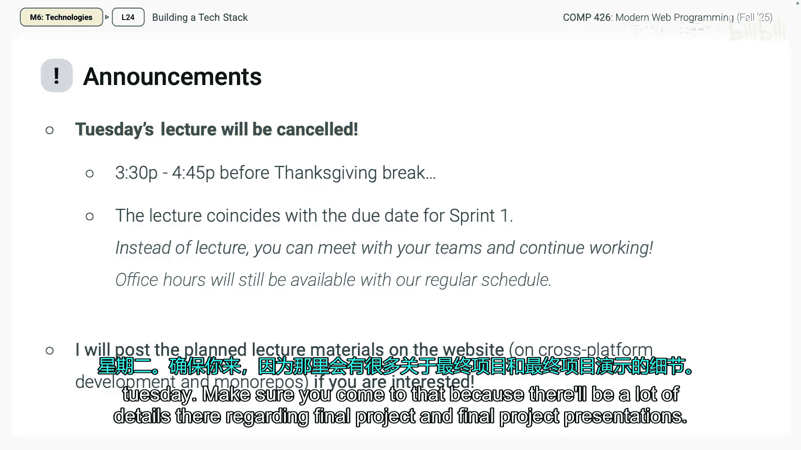
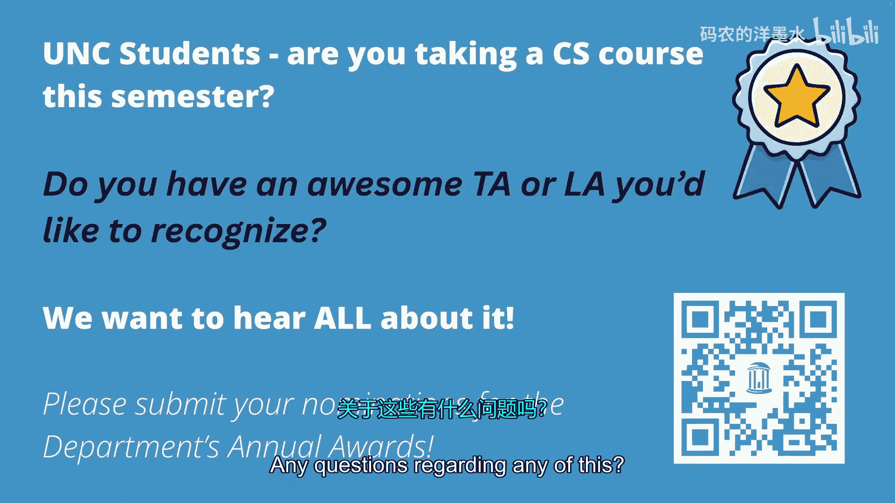
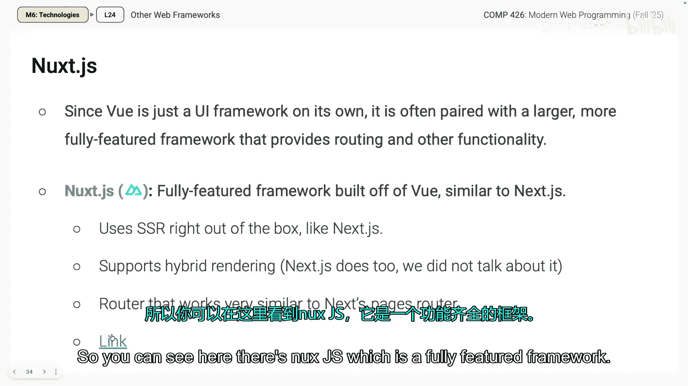
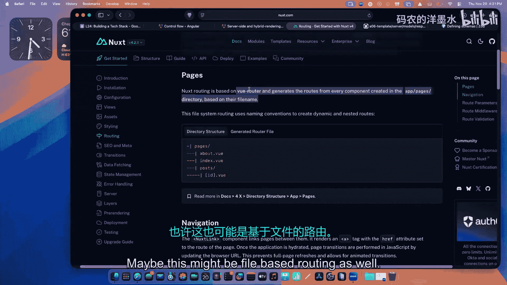
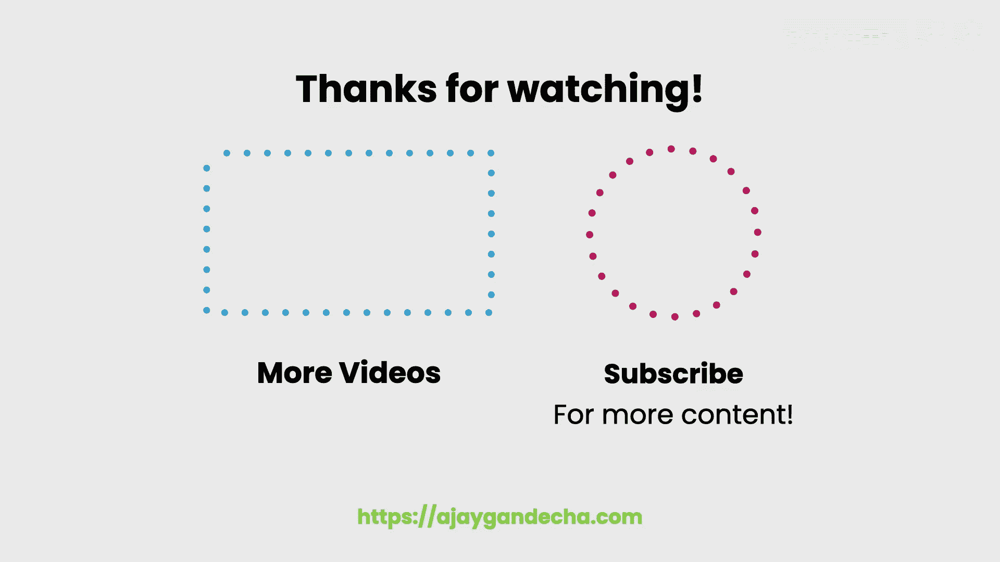

# 024：技术栈搭建 🏗️

在本节课中，我们将学习如何构建一个完整的技术栈。我们将回顾本学期介绍过的各种工具和技术，并从更高层次理解它们如何协同工作，以构建一个完整的全栈应用程序。

---

## 什么是技术栈？ 🤔

技术栈是用于构建应用程序的各种工具、技术、框架和编程语言的组合。在本课程中，我们使用了特定的组合，例如 Next.js、React、Supabase 等。理解这些工具的分类和作用，比仅仅记住它们的名字更为重要。这样，当你未来需要构建自己的应用或加入使用不同技术栈的公司时，你就能知道如何选择和组合工具。

上一节我们介绍了技术栈的概念，本节中我们来看看构成一个典型全栈应用的三个核心层级。

## 应用架构：三层模型 🏛️

我们构建的应用程序通常由三个不同的层级组成：

1.  **前端层 (Frontend Layer)**：也称为客户端。这部分代码决定了用户在浏览器中加载网站时看到和交互的内容。
2.  **数据层 (Data Layer)**：负责管理应用程序的核心功能和持久化数据。例如数据库、对象存储、身份验证和实时功能都位于此层。
3.  **后端层 (Backend Layer)**：也称为服务器层。这是运行在服务器上的代码，充当前端层和数据层之间的桥梁，处理API请求等。

这三个层级共同构成了我们所说的“三阶架构”。

了解了应用的整体架构后，接下来我们深入每一层，看看具体有哪些类别的工具。

## 技术栈详解：工具分类 🧰

以下是构建一个全栈应用技术栈时涉及的各类工具，它们对应着我们本学期使用过的具体技术。

### 前端层工具

这部分工具直接面向用户，构建用户界面并处理交互逻辑。

*   **Web框架 (Web Framework)**：用于构建客户端应用程序的完整工具包。它定义了如何描述和渲染UI、管理路由等。
    *   *UI库 (UI Library)*：定义应用程序中的页面和UI元素。例如：**React**。
    *   *样式库 (Styling Library)*：增强基础CSS功能，使开发者更容易为网站添加样式。例如：**Tailwind CSS**。
    *   *设计系统 (Design System)*：一套定义应用程序应如何设计、布局和遵循设计原则的规则和组件集。例如：**shadcn/ui**。

*   **数据获取库 (Data Fetching Library)**：帮助管理应用程序中的数据加载，处理缓存、竞态条件等问题，优化性能。例如：**React Query**。

*   **数据验证库 (Data Validation Library)**：确保应用程序中使用的数据（如用户输入或外部API数据）符合预期的格式和规则。例如：**Zod**。

### 连接层工具

这部分工具是前端与后端通信的桥梁。

*   **API层 (API Layer)**：定义应用程序的API接口，规定前端如何与后端服务器交互。例如：**tRPC**。

### 后端层工具

这部分工具运行在服务器上，处理业务逻辑并与数据层通信。

*   **数据验证 (Data Validation)**：在后端再次验证数据，确保从API到数据库的数据格式正确。我们同样使用 **Zod**。

*   **对象关系映射 (ORM)**：帮助服务器代码与数据库进行通信，定义数据表结构（模式）。例如：**Drizzle ORM**。

*   **数据层客户端 (Data Layer Client)**：用于与数据层中各种服务（如对象存储、身份验证）通信的客户端库。例如：**Supabase JavaScript 客户端库**。

### 数据层工具

这是实际存储和持久化数据的地方。

*   **数据库 (Database)**：存储结构化数据。例如：**Supabase (PostgreSQL)**。
*   **对象存储 (Object Storage)**：存储文件，如图片、文档。例如：**Supabase Storage**。
*   **身份验证 (Authentication)**：管理用户登录和权限。例如：**Supabase Auth**。

我们已经了解了技术栈中各类工具的角色。现在，让我们将本学期使用的具体工具填入这个框架。

## 我们的课程技术栈 🎓

根据以上分类，我们在本课程中构建的全栈技术栈如下：

*   **Web框架**：Next.js
*   **UI库**：React
*   **样式库**：Tailwind CSS
*   **设计系统**：shadcn/ui
*   **数据获取库**：React Query
*   **数据验证库**：Zod
*   **API层**：tRPC
*   **ORM**：Drizzle ORM
*   **数据层客户端**：Supabase JS
*   **数据库**：Supabase (PostgreSQL)
*   **对象存储**：Supabase Storage
*   **身份验证**：Supabase Auth

这个技术栈中的每一个类别都是可以替换的。例如，你可以用 Prisma 替换 Drizzle ORM，或者用 FastAPI (Python) 替换 tRPC。关键在于理解每个工具在架构中的角色。

掌握了我们自己的技术栈后，让我们开阔视野，看看前端领域还有哪些其他流行的框架。

## 其他前端框架概览 🌐

除了我们使用的 React/Next.js，前端世界还有许多其他优秀的框架和库。它们解决着相同的问题（如组件化、状态管理），但采用了不同的设计和语法。

以下是几个流行的替代方案：

*   **Angular**：由 Google 维护的一个完整的 Web 框架（类比 Next.js）。它使用 TypeScript，将 UI 分解为组件，但组件是用类定义的，状态管理使用“信号”(Signals)。

*   **Vue**：一个用于构建用户界面的渐进式框架（类比 React）。它使用 `.vue` 单文件组件，将模板、脚本和样式放在一起。状态管理使用“引用”(refs)和“侦听器”(watch)。

*   **Svelte**：一个编译型 UI 框架，以其高开发者满意度著称。它直接操作 DOM（无虚拟DOM），并且任何变量变化都可能触发 UI 重新渲染，简化了状态管理概念。

*   **Nuxt**：基于 Vue 的完整全栈框架（类比 Next.js），提供服务器端渲染、路由等功能。

*   **SvelteKit**：基于 Svelte 的完整全栈框架（类比 Next.js）。

尽管这些框架在语法和实现上有所不同，但它们都围绕一些核心概念构建：**可组合的UI组件**、**状态管理**、**处理副作用**以及**架构考量**（如路由、SSR vs CSR）。理解这些核心概念，能帮助你更快地学习任何新框架。

前端框架的选择多种多样，后端和数据层的服务同样有很多选项。

## 后端与数据层服务选择 🔧

在现实世界的项目中，你可能不会使用 Supabase 来提供所有后端服务。有许多替代方案可供选择：

*   **数据库**：你可以使用 Neon（开源 PostgreSQL）、PlanetScale（MySQL）等托管数据库服务，甚至可以在自己的服务器上“自托管”数据库。
*   **身份验证**：除了 Supabase Auth，还有 NextAuth.js、Google Identity Platform 等提供商，你也可以基于 JWT 等技术实现自己的身份验证。
*   **实时功能**：实现高质量的实时功能更具挑战性，可能需要使用 Socket.IO 等库来自建 WebSocket 服务器，或选择深度集成数据库的专门服务。
*   **部署**：我们使用了 Vercel，但你也可以选择 Netlify、GitHub Pages、或自托管到 Carolina Cloud Apps 等服务器上。

选择这些工具时，需要根据项目需求、性能、成本、开发体验等因素进行权衡。

---

在本节课中，我们一起学习了如何构建和理解一个现代 Web 技术栈。我们从抽象的三层架构模型开始，将其细化为具体的工具类别，并填充了我们课程中使用的实际技术。我们还简要了解了其他流行的前端框架以及后端服务的可选方案。重要的是，你要理解每个工具在整体架构中的角色，而不是仅仅记住特定的技术名称。这样，无论未来遇到何种技术栈，你都能快速理解并适应。希望这些知识能帮助你在最终项目和未来的开发生涯中，自信地选择和组合工具，构建出色的应用程序。