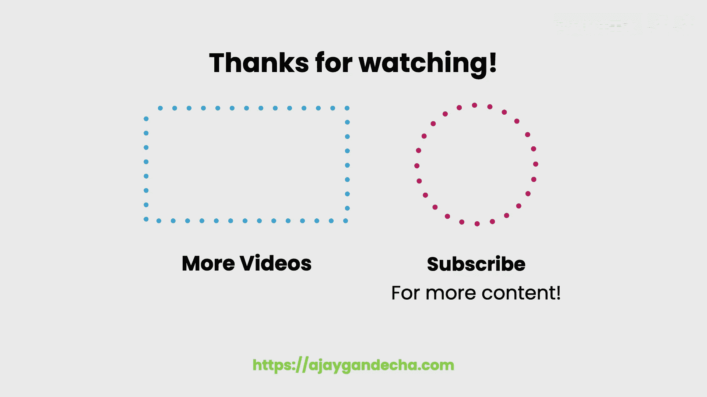

# 025：期末总结课 🎓

在本节课中，我们将回顾整个学期的学习内容，并了解期末项目展示的具体安排与要求。

## 课程概述

欢迎来到现代Web编程的最后一堂课。恭喜大家完成了整个学期的学习。在过去四个月左右的时间里，每个人都付出了巨大的努力。我知道大家除了这门课，还有其他课程和事务需要处理，例如招聘季。因此，在整个相当紧张和严格的学期中，大家能跟上进度，做得非常出色。我们即将完成所有任务，准备进入寒假。

## 重要公告

首先，课程评估已经开放。大家可能今早收到了来自UNC BlueEval的邮件。Canvas上也有直接链接。填写这份评估对我、对未来以类似方式教授426课程都非常有帮助。评估是匿名的，是获取反馈以改进课程的重要方式。评估截止日期是明天，请务必完成。这不仅对426课程有帮助，对所有计算机课程都有益。

接下来，关于需要提交的最后两项任务。第一项是F0.3，即期末项目的代码部分（开发冲刺2）。原定于周五截止，现已延长两天，至周日晚上截止。第二项是视频演示部分，原定于周五截止，现已延长至下周二截止。大家有额外两天时间在完成代码后制作视频提交。提交内容还包括一些关于应用的信息，如徽标、名称等，用于我们准备的展示材料。提交链接将于明天在Gradescope开放，请提前关注。

在大家继续工作的过程中，可能会遇到问题，这完全正常。我们的答疑时间将持续到明天。答疑时间明天下午6点结束。如果遇到紧急问题，请务必在此期间前来。明天从上午10点到下午6点都有答疑覆盖。

## 期末项目评分细则

我想提醒大家，评分方式不应有任何意外，因为我们使用的评分标准早已公开，就像冲刺一和其他所有作业一样。所有评分标准都是公开的。例如，在冲刺二的期望文档中，侧边栏列出了所有评分项。其中包含了评分细则，详细说明了期末项目各个部分的评分方式。

例如，F0.3部分占65分，是成绩的最大部分。文档中详细说明了所有评分点，例如整体设计、改进方式、额外加分机会等。绿色高亮部分列出了额外加分项。关于Lighthouse报告的要求，我们在第22讲关于无障碍设计和包容性设计的课程中讨论过。我们将根据此评分标准进行评分，因此关于如何评分不应有任何疑问。响应式设计、深色/浅色模式支持等要求也已列出。响应式设计完全是额外加分项，虽然基础分是0分，但有机会获得额外分数。如果你在最后有时间，可以尝试完成以获取额外分数。

关于数据库、身份验证、存储要求、实时功能和OpenAI集成要求等，都在文档中详细列出。代码格式要求，如果你使用了起始代码库，应该已经自动设置好了，这基本上是免费的。关于分析功能，虽然我们之前在课堂上遇到了GitHub宕机的事件，但要求仍然存在。只需在文件中添加一个组件即可为项目启用分析功能，具体链接在第23讲“Vercel、CI/CD与分析”中。

我想特别指出一点，这是一个巨大的扣分项，且是故意的，但没有人应该因此被扣分。请确保在提交项目时，你提交的链接是有效的。因为这是大家在实际演示中查看你项目的链接。整个项目的核心是获得一个在线部署的版本。事实上，你可以提前部署你的项目。请记住，使用Vercel功能，当你提交代码时，它应该会自动部署。所以，不要在晚上11点50分才开始部署，那时发现问题可能就来不及了。请提前开始，确保你有一个正常工作的部署版本，并且你提供的链接确实有效。就像我们在过去许多作业中强调的那样，有时很容易错误地复制Vercel项目页面的链接，而不是实际部署的链接。确保你提交的是项目的实际URL。这一点在提交表格上会加粗提示，不是为了增加压力，而是为了提醒大家，确保检查无误，以免后续出现问题。

关于演示视频，要求长度为5-8分钟。内容需要包括项目名称、功能介绍以及其他有趣的说明。如果你在视频中涵盖了这些内容，就应该能获得满分。我们并不是要非常苛刻或挑剔，只是希望确保大家涵盖了关键点。在文档中，你可以看到所有需要讨论的关键点。关于“所有主题已讨论”得4分和“视频具有吸引力/创意超出基线”得5分的区别：很容易制作一个视频，所有摄像头都关闭，就像一个带有黑色矩形的Zoom录制视频，这也可以涵盖所有主题。但我们希望你能稍微多做一点，例如打开摄像头，在录制视频时表现出一些热情。这就是我们在这里寻找的。同样，我们不需要过度夸张的内容，不需要写脚本或表演小品，只是希望确保这是一个可以展示你成果的、体面的视频。

## 期末项目展示安排

接下来，我们将讨论期末项目展示的后勤安排，特别是演示部分的安排。

我们的演示将于12月11日星期四下午4点举行。我知道这个时间对一些人来说可能不太理想，可能是你们最后一门考试的时间，或者已经很晚了。关于本次演示的出席政策，我收到了一些问题，询问是否可以远程参与或无法到场等。我想强调这一点，因为它非常重要。这是院系和大学的政策。这是我们的期末考试，是我们课程的期末考试时间，由大学规定，每个人都必须参加期末考试时间段。期末考试时间表已经公布了很多个月，每个人都应该已经知晓。我们不会在其他时间进行。因此，如果你需要缺席期末考试，必须通过大学官方渠道申请，需要有大学批准的缺勤理由。对于常规课程缺席，我通常比较通融，但这次是大学规定的期末考试，必须严肃对待。每个人都必须在这个时间到场。

这意味着我将在那里见到大家。我们将从Sitterson Hall的下层大厅开始。这一点很重要，因为我们开始时不会在Hanes Art Center这里见面。我们将在Sitterson Hall下层大厅进行演示。我们已经将此通知发送给了院系的各位教职员工，院系团队也通知了其他人。在演示期间，我们将举办一个展示会，对学生、教师和其他人开放。我们将在Sitterson Hall下层大厅进行演示，院系还会提供一些免费的食物或甜点。Sitterson Hall下层大厅有足够的空间让我们设置演示，让大家观看演示并走动。

具体日程安排如下：从下午4点到4点15分，确保每个人都到场，我们会分发一些东西，比如饼干或甜点。这也是你可以用来确保一切就绪的时间，例如在电脑上打开任何你想展示的材料或网站链接。接下来的10分钟，从4点15分到4点25分，我们将把班级分成两组。第1到25组将首先进行演示，这意味着第26到50组将观看演示。我们将有25个小组演示，另外25个小组观看。我们会在下层大厅的桌子上放置你们的团队编号、项目二维码和其他信息，这样你们在演示时就知道该去哪里。你们将在桌子上设置好电脑和任何想展示的内容。你们有10分钟时间准备。然后是实际的演示时间。第1到25组将进行演示，我稍后会解释演示的具体内容。之后，我们将有10分钟时间轮换。然后第26到50组将进行演示，你们将设置在自己的桌子旁，其他人可以走动观看。最后，在6点15分，当一切结束时，所有学生将回到Hanes Art Center这里。我们必须这样做，因为Sitterson Hall没有足够容纳整个班级的座位。不幸的是，每个人最后都需要走回这里，进行我们的闭幕仪式。我们计划了一些有趣的活动，同时也会有一个稍微不那么有趣的调查需要大家填写，以正式结束我们的课程。

我知道你们可能在想，6点05分的时候，我可能悄悄溜走，不回Hanes Art Center了。我们预料到这种情况可能会发生。我们将在不同时间点进行考勤。在你们演示时，我们会记录考勤，确保你们在演示。在回到这里集合时，我们也会记录考勤，因为我们希望每个人都提交调查，完成课程的收尾部分。我们会进行两次考勤。我知道这很漫长，但我希望到最后这一切都是值得的。我们可能会提前结束，不一定到6点15分到7点，但希望确保每个人都回到这里。请记住，结束时，助教们会帮助发布信息，我也会在下层大厅宣布，并通过推送通知发送公告。但请记住，最后你们需要在6点15分回到Hanes Art Center。

## 演示流程详解

现在，当我提到“演示”时，在这45分钟内，例如第1到25组演示，具体意味着什么？我们将这样安排：每个团队最终将进行三次演示。在这45分钟内，将是3轮15分钟的演示。其中10分钟用于演示你的项目，然后5分钟用于问答。观看的人将填写一个简短的表格，说明他们观看了谁的演示。这就是演示的实际工作方式。在这15分钟的间隔里，如果你是演示者，你将留在原地；如果你是观看者，你将轮换到另一个你还没看过的项目。大家可以自由选择观看哪个项目。

关于演示本身，有些人问是否需要幻灯片。这取决于你们。我们希望你们融入视频中提到的同类内容，例如介绍功能、讨论未来的潜在计划或遇到的问题等。如果你们想直接讲，完全可以；如果觉得即兴发挥太难，想准备幻灯片，也可以自由创建。但我们不会收集或给幻灯片评分。所以，你们不必担心设置演示、做所有这些事。这真的取决于你们喜欢如何呈现这个想法。

只要你们到场并谈论、演示了你们的项目，就不会有问题。我们不会非常苛刻。同样，目标是你们与我们和其他人分享你们的项目，但不会严厉评分。只要你们出现并完成演示，就应该没问题。不必担心会失去很多分数。如果你们参加过黑客松，想采用那种风格，完全可以。如果想提前准备任何东西或进行更有趣的演示，也完全自由。

关于时间冲突，如果是因为公共考试时间冲突，那是有效的缺勤理由。你可以给我发邮件，我会处理。理想情况下，期末考试时间安排是错开的，如果你没有两门课在同一时间，应该没问题。但如果出现问题，请尽快给我发邮件，以便我核对，这样你就不必为此担心了。

## 学期内容回顾

接下来，我们做一个简短的回顾。本学期我们共见面25次，从八月开始，大家完成了7次作业、6次阅读和5个模块的学习。在这段短时间内，你们学习了许多不同的概念、工具，并获得了许多技能。这在你们的期末项目中已经显现出来，你们已经看到了冲刺一的进展，大家做得非常出色。

以下是本学期学习内容的总结：
我们从一个模块开始，即基础部分，学习了各种不同的内容。我们从HTML、CSS和TypeScript的基础知识开始，讨论了客户端与服务器、互联网以及请求和响应的工作原理，这些支撑了我们整个学期所做的所有事情。我们讨论了使用Node和NPM设置环境以管理包和外部依赖，以及开发服务器、Vite和构建项目。我们还花了一些时间讨论了异步代码和函数式编程，这非常重要。正如你们现在所知道的，当我们在React中工作时，每个React组件最终都是一个函数。我们花了很多时间研究组合UI和组合函数，所有这些都源于我们讨论的这些基础。

然后我们转向讨论React，讨论了React是什么，如何设置组件，以及基于组件的UI理念，这甚至扩展到了我们讨论过的许多其他框架、工具和技术。例如管理状态和副作用，使用不同的CSS框架进行样式设计，以及基于某些状态重新渲染我们的应用程序和组件的理念，这同样在许多不同的工具和框架中很常见。

接着我们进入了第三个模块，真正扩展了React，思考如何构建完整的应用程序以及完整Web应用框架所需的工具。我们讨论了路由，这非常重要，包括单页应用和多页应用的区别。我们讨论了诸如服务器端渲染、客户端和服务器端数据获取等技术，这些都是构建大型应用、具有不同页面、加载不同数据等时必须牢记的必要事项。我们还花了一些时间讨论了大型应用中常见的各种功能和技巧，例如社交媒体应用中的分页和无限滚动。如何以良好的用户体验方式加载数据。作为讨论服务器端渲染等的一部分，我们还稍微讨论了SEO，以及如何以不仅为用户提供良好体验，而且便于用户首次发现和找到我们的项目的方式开发应用程序。

然后我们讨论了一些后端内容。我们讨论了很多前端内容，然后讨论了实际支持我们应用程序基础设施所需的内容，例如数据库、身份验证（我们讨论了JWT和令牌），以及Supabase，我们有一个很好的库，可以让我们以非常好的方式完成所有这些。例如用于存储文件的对象存储、API和通过WebSocket实现的实时功能。本学期我们还讨论了生成式AI，思考如何整合一些目前处于前沿的工具，如何将AI模型集成到我们已有的应用程序中，并以流畅的方式为用户实现，例如通过流式处理和使用带令牌的WebSocket。

然后我们花了很多时间在设计上。我认为这门课程有独特的机会讨论设计，因为设计是构建应用程序和软件的核心部分。尽管我们在计算机科学中花了很多时间讨论后端、代码结构、效率等，但设计和用户实际看到和使用的内容是构建优秀应用程序的核心部分。我们讨论了UI/UX设计，如何使用原型设计来构建完整的功能。我们讨论了颜色、布局、排版、图标，还讨论了一些响应式设计，如何为不同的屏幕尺寸和设备设计界面。我们讨论了诸如无障碍设计和国际化等内容，这些在未来，特别是如果你在大公司工作，是优秀软件设计的重要组成部分。

最后，我们花了一些时间在最后阶段扩展了一些不同的技术，这些技术帮助我们增强所学内容。我们讨论了一些其他Web框架、技术栈的组成部分，以及如何将本课程所学与现实中存在的各种其他工具联系起来。因为现实中存在许多不同的框架。我们讨论了CI/CD，即部署项目、保持在线和分析的理念。然后，对于少数可能查看了我们提前开始放假的课程中发布的幻灯片的同学，我们还讨论了如何使用TypeScript构建移动应用程序，以及如何在单一代码库中共享移动应用和Web应用的代码。我们在25堂课中涵盖了所有这些内容，速度确实很快，但这是一个很好的总结，如果你们想回顾我们讨论过的一些重要关键部分。

此外，你们都完成了一些非常酷的项目。你们从使用纯HTML和CSS构建个人作品集开始。然后我们构建了像素艺术生成器，仅使用纯HTML、CSS和TypeScript。接着你们学习了如何使用React，完成了纽约时报游戏项目。然后我们扩展了这一点，使用Next.js构建了整个PodX应用。然后你们学习了一些如何与后端集成的知识，完成了Orbit和Alias这两个本学期最大的作业。还在设计实验室中学习了一些设计技巧。现在，你们仍在进行期末项目，将所有这些东西结合起来，为你们选择的主题构建一个具有许多功能的完整应用程序。

## 代码政策说明

很多人问了一些问题，我想在这里澄清一下代码政策。我要求所有常规作业（A1到A7）保持闭源，因为这些作业的代码我们未来可能会使用部分内容，因此这些内容保持仅对我们班级私有是有益的。当然，如果你在面试中被要求展示，可以自由调出项目，这完全没问题。只是不要将这些作业作为公共GitHub仓库留下，因为这可能会影响未来本课程学生的学习体验。

然而，对于期末项目代码，你们可以将其开源，因为这是你们一直在努力工作的成果，完全是你们自己的想法，不仅仅是我们为你们编写的作业。你们可以在课程结束后继续完善这个项目，我鼓励你们在课程结束后继续工作。我知道实际上这里有一些小组在原型设计阶段就和我讨论过这个想法，他们希望在课程结束后继续完善。所以你们可以自由地这样做，自由地继续构建、分享。这是一个很好的经历，即使你们在这里遇到了一些优秀的队友，想继续与他们合作，这也是继续工作的绝佳体验。

## 课程目标回顾

再次强调，这是我们课程开始时的主要目标：我们希望教授使用现代工具、最佳实践、行业流行工具和方法进行全栈开发。这里有不同的部分：理解构建全栈应用程序的架构和工作流程。我们整个学期都在讨论这一点。在我们上次会议中，你们看到了我们讨论的Next.js、React、Supabase等许多内容最终如何扩展并适用于其他框架和技术。即使实现方式可能不同，但概念最终是相同的。

获得前端和后端开发的经验，你们在期末项目和整个课程中都在这样做。欣赏并实践良好的设计实践，你们在原型设计和设计实验室中做到了。阅读文档，这是你们本学期无论好坏都经历过的，例如阅读Drizzle文档和React文档等，学习当我第一次学习新东西时如何阅读文档并从中获取信息。

最后，希望为你们未来在全栈应用开发方面的潜在机会做好准备，无论是在实习、职业生涯中，还是在自己想从事的项目中。

## 课程材料与后续联系

所有课程材料、幻灯片和讲座视频将在学期结束后公开。因此，如果将来任何时候你想回顾本课程的某些内容，都可以在这里找到。你收藏的网站不会很快关闭，它会一直存在。所以你拥有完全的访问权限。此外，我的YouTube频道链接也有包含所有讲座的播放列表。你可以去网站找到它，内容是一样的，但所有这些都可以访问，并且应该在本课程结束后很长时间内保持公开。

最后一点是，如果你对本课程、课程概念、未来课程或任何关于计算机科学或UNC的事情有任何问题，请随时与我联系。我在这里提供了一些关于电子邮件和LinkedIn的信息。如果你是本科生，或者正在考虑攻读硕士学位，或者想知道应该选修哪些其他课程等，我很乐意回答你的任何问题。所以请随时通过那里联系我。我和团队也期待在下周四看到你们的期末项目，并看到你们在本课程之后所做的事情。所以，请继续分享，我们喜欢在未来学期看到你们利用我们涵盖的一些内容所做的事情。

最后，感谢一些人的贡献，没有他们，这门课程，尤其是如此大规模的课程，是不可能实现的。首先，感谢我们的426团队。这门课程有200名学生，是我们院系本学期最大的选修课之一。因此，在没有所有这些优秀人员的帮助下，教授如此规模的课程是不可能的，非常感谢你们。此外，可能有些 bittersweet 的消息，我们团队中有三位成员将于今年12月毕业。尽管这是他们最后一个学期，他们仍然投入了大量精力进行教学和帮助运行这门课程，非常感谢他们所有人。最后，也感谢你们所有人。这是我教授这门课程的第二批学生。感谢你们让教授这门课程成为一次很棒的经历。我希望你们也度过了一段愉快的时光。

我们下周四下午4点见。如果有任何问题，请告诉我。谢谢。